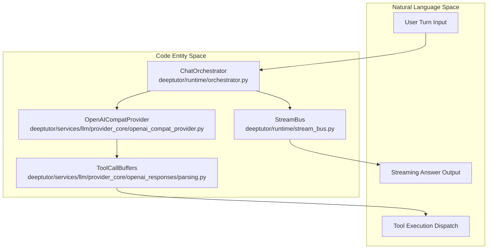
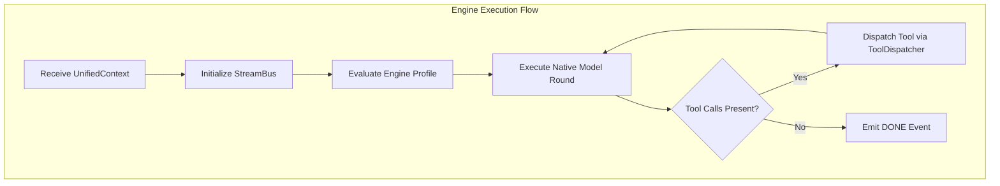

<!-- source: DeepWiki mcp.deepwiki.com · repo HKUDS/DeepTutor · page 3.6 Experimental TypeScript Chat Engine · fetched 2026-11-09 -->

# Experimental TypeScript Chat Engine

Relevant source files

The following files were used as context for generating this wiki page:

- [deeptutor/agents/research/data_structures.py](deeptutor/agents/research/data_structures.py)
- [deeptutor/agents/research/utils/citation_manager.py](deeptutor/agents/research/utils/citation_manager.py)
- [deeptutor/capabilities/prompts/en/turn_status.yaml](deeptutor/capabilities/prompts/en/turn_status.yaml)
- [deeptutor/capabilities/prompts/zh/turn_status.yaml](deeptutor/capabilities/prompts/zh/turn_status.yaml)
- [deeptutor/learning/tests/test_visual_learning_workflow.py](deeptutor/learning/tests/test_visual_learning_workflow.py)
- [deeptutor/runtime/orchestrator.py](deeptutor/runtime/orchestrator.py)
- [deeptutor/runtime/stream_bus.py](deeptutor/runtime/stream_bus.py)
- [deeptutor/services/llm/provider_core/openai_compat_provider.py](deeptutor/services/llm/provider_core/openai_compat_provider.py)
- [deeptutor/services/llm/provider_core/openai_responses/converters.py](deeptutor/services/llm/provider_core/openai_responses/converters.py)
- [deeptutor/services/llm/provider_core/openai_responses/parsing.py](deeptutor/services/llm/provider_core/openai_responses/parsing.py)
- [deeptutor/services/llm/usage_frame.py](deeptutor/services/llm/usage_frame.py)
- [deeptutor/utils/json_parser.py](deeptutor/utils/json_parser.py)
- [tests/agents/research/test_citation_manager.py](tests/agents/research/test_citation_manager.py)
- [tests/capabilities/test_mastery_teaching_delivery.py](tests/capabilities/test_mastery_teaching_delivery.py)
- [tests/core/test_agentic_messages.py](tests/core/test_agentic_messages.py)
- [tests/core/test_stream_bus_cross_loop_input.py](tests/core/test_stream_bus_cross_loop_input.py)
- [tests/runtime/test_orchestrator.py](tests/runtime/test_orchestrator.py)
- [tests/services/llm/test_native_web_search.py](tests/services/llm/test_native_web_search.py)
- [tests/services/llm/test_openai_compat_reasoning_content.py](tests/services/llm/test_openai_compat_reasoning_content.py)
- [tests/services/llm/test_openai_responses_converters.py](tests/services/llm/test_openai_responses_converters.py)
- [tests/services/llm/test_openai_responses_parsing.py](tests/services/llm/test_openai_responses_parsing.py)
- [tests/services/llm/test_responses_tool_strict.py](tests/services/llm/test_responses_tool_strict.py)
- [tests/services/llm/test_usage_frame.py](tests/services/llm/test_usage_frame.py)
- [tests/utils/test_json_parser.py](tests/utils/test_json_parser.py)

## Purpose and Scope

The `packages/chat-engine` subsystem provides an experimental, high-performance, standalone TypeScript-native execution profile for DeepTutor chat turns. It mirrors the orchestration capabilities of the Python core runtime while operating entirely within a Node.js / Bun TypeScript environment. Key components include the asynchronous run-loop, native model round execution, Server-Sent Events (SSE) and stream decoding, dynamic tool dispatching, a zero-overhead `stdio` transport layer, and the Python `ts_engine` bridge that enables cross-language capability handoffs.

Sources: `deeptutor/runtime/orchestrator.py`, `deeptutor/runtime/stream_bus.py`

---

## Architecture and Component Mapping

The following diagram bridges natural language capabilities and high-level architectural concepts to their concrete code entities across the TypeScript engine and Python bridge layers.

*Figure 1: Natural Language to Code Entity mapping for chat routing and stream dispatching.*

Sources: `deeptutor/runtime/orchestrator.py`, `deeptutor/runtime/stream_bus.py`, `deeptutor/services/llm/provider_core/openai_compat_provider.py`, `deeptutor/services/llm/provider_core/openai_responses/parsing.py`

---

## TypeScript Engine Profiles and Run-Loop

The TypeScript engine implements configurable execution profiles that dictate how model rounds iterate. The primary run-loop manages turn lifecycles, state accumulation, and error recovery akin to Python's `ChatOrchestrator` (`[deeptutor/runtime/orchestrator.py:54-177]()`).

*Figure 2: Lifecycle data flow inside the TypeScript run-loop.*

Sources: `deeptutor/runtime/orchestrator.py`, `deeptutor/runtime/stream_bus.py`

---

## Stream Decoding and Native Model Rounds

Chat streams processed by the engine decode raw model chunks (such as SSE data frames or Responses API SDK streams) into structured events (`[deeptutor/services/llm/provider_core/openai_responses/parsing.py:1-666]()`). The stream decoder handles:
- Incremental tool argument accumulation using `_ToolCallBuffers` (`[deeptutor/services/llm/provider_core/openai_responses/parsing.py:136-193]()`).
- Reasoning content extraction and isolation (`[tests/services/llm/test_openai_compat_reasoning_content.py:56-116]()`).
- Robust JSON fallback parsing and repair (`[deeptutor/utils/json_parser.py:66-183]()`).

Sources: `deeptutor/services/llm/provider_core/openai_responses/parsing.py`, `deeptutor/utils/json_parser.py`, `tests/services/llm/test_openai_compat_reasoning_content.py`

---

## Tool Dispatcher and Stdio Transport

The `chat-engine` features a lightweight IPC transport over standard input/output (`stdio`) to communicate with parent processes without requiring network sockets. 
- **Tool Dispatcher**: Inspects incoming tool call requests, resolves schema definitions, executes sandboxed handlers, and returns structured `tool_result` frames.
- **Stdio Transport**: Serializes `StreamEvent` objects into line-delimited JSON payloads sent over `stdout`, while consuming incoming turn commands from `stdin`.

Sources: `deeptutor/runtime/stream_bus.py`, `deeptutor/core/stream.py`

---

## Python `ts_engine` Bridge

To allow the main FastAPI backend to delegate specialized turns to the TypeScript engine, the Python codebase interfaces through the `ts_engine` bridge. This bridge spawns the TypeScript Node process, manages process lifecycles, pipes `UnifiedContext` objects across the boundary, and reconstructs asynchronous `StreamEvent` generators (`[deeptutor/runtime/stream_bus.py:32-159]()`).

Sources: `deeptutor/runtime/orchestrator.py`, `deeptutor/runtime/stream_bus.py`

---

