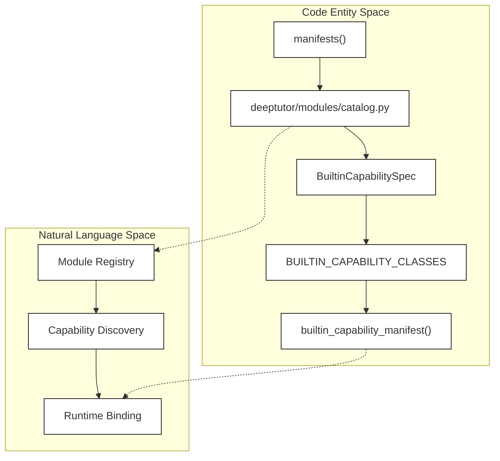
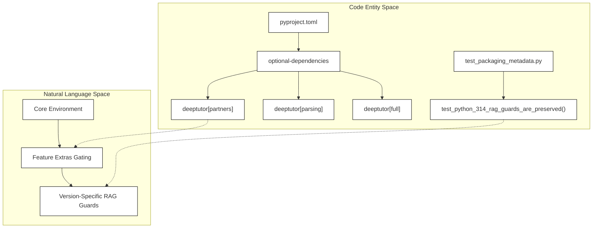

<!-- source: DeepWiki mcp.deepwiki.com · repo HKUDS/DeepTutor · page 3.7 Module Manifests and Plugins · fetched 2026-11-09 -->

# Module Manifests and Plugins

Relevant source files

The following files were used as context for generating this wiki page:

- [deeptutor/agents/chat/capability.py](deeptutor/agents/chat/capability.py)
- [deeptutor/agents/question/capability.py](deeptutor/agents/question/capability.py)
- [deeptutor/capabilities/ask_questions/__init__.py](deeptutor/capabilities/ask_questions/__init__.py)
- [deeptutor/capabilities/ask_questions/capability.py](deeptutor/capabilities/ask_questions/capability.py)
- [deeptutor/capabilities/ask_questions/loop.py](deeptutor/capabilities/ask_questions/loop.py)
- [deeptutor/capabilities/ask_questions/prompts/en/system.md](deeptutor/capabilities/ask_questions/prompts/en/system.md)
- [deeptutor/capabilities/ask_questions/prompts/zh/system.md](deeptutor/capabilities/ask_questions/prompts/zh/system.md)
- [deeptutor/runtime/bootstrap/builtin_capabilities.py](deeptutor/runtime/bootstrap/builtin_capabilities.py)
- [packaging/deeptutor-cli/pyproject.toml](packaging/deeptutor-cli/pyproject.toml)
- [pyproject.toml](pyproject.toml)
- [requirements/cli.txt](requirements/cli.txt)
- [requirements/partners.txt](requirements/partners.txt)
- [scripts/start_tour.py](scripts/start_tour.py)
- [tests/agents/chat/test_language_prompts.py](tests/agents/chat/test_language_prompts.py)
- [tests/core/test_capabilities_runtime.py](tests/core/test_capabilities_runtime.py)
- [tests/scripts/test_start_tour.py](tests/scripts/test_start_tour.py)
- [tests/services/mcp/test_missing_mcp_dependency.py](tests/services/mcp/test_missing_mcp_dependency.py)
- [tests/services/partners/test_weixin_onboarding.py](tests/services/partners/test_weixin_onboarding.py)
- [tests/test_packaging_metadata.py](tests/test_packaging_metadata.py)

The module manifests and plugin subsystem defines DeepTutor's modular architecture. It governs how optional capabilities (such as core, knowledge, reading, partners, parsers, and renderers) declare their metadata, requirements, and entry points, while enabling optional dependency gating and dynamic capability discovery.

Sources: `[pyproject.toml:1-126]()`, `[deeptutor/runtime/bootstrap/builtin_capabilities.py:1-48]()`

---

## 1. Module Manifests and the Catalog Architecture

DeepTutor organizes system functionality into distinct logical modules managed through a catalog layer. Each module encapsulates its own domain code, configuration templates, and runtime capabilities. The module catalog aggregates these definitions dynamically, allowing the core application to inspect available features without importing heavy external dependencies upfront.

The catalog reads module specifications to construct capability registries. These manifests specify structural parameters, such as execution order, associated UI blocks, and required request schemas.

*Diagram 1: Mapping module catalog functions to capability discovery.*

Sources: `[deeptutor/runtime/bootstrap/builtin_capabilities.py:17-48]()`, `[tests/test_packaging_metadata.py:10-124]()`

---

## 2. Optional Dependency Gating and Package Profiles

DeepTutor separates foundational execution requirements from advanced or domain-specific features using optional dependency extras defined in `pyproject.toml`. This design allows minimal installations (such as the core CLI) to run without compiling or installing heavy machine learning, document parsing, or instant messaging SDKs.

The packaging system supports modular installation profiles like `full`, `partners`, `knowledge`, `parsing`, `math-animator`, and version-guarded extras (e.g., Python 3.14 runtime constraints for `graphrag` and `faiss-cpu`).

*Diagram 2: Optional dependency gating and metadata test enforcement.*

Sources: `[pyproject.toml:52-94]()`, `[tests/test_packaging_metadata.py:65-95]()`

---

## 3. Requirements Synchronization and Packaging

To bridge source checkouts and containerized or wheel deployments, DeepTutor maintains synchronization between module manifests and generated requirements files (such as `requirements/cli.txt` and `requirements/partners.txt`). 

The synchronization script (`scripts/sync_module_requirements.py`) compiles module requirements into target environment files. Automated test suites enforce that dependency floors remain strictly tied to their respective module owners and that internal distribution requirements match expected release versions.

Sources: `[requirements/cli.txt:1-2]()`, `[requirements/partners.txt:1-37]()`, `[tests/test_packaging_metadata.py:32-64]()`

---

##  4. The Plugin Loader and Builtin Capabilities Registry

The capability runtime relies on `BUILTIN_CAPABILITY_SPECS` and `BUILTIN_CAPABILITY_CLASSES` defined in `deeptutor/runtime/bootstrap/builtin_capabilities.py`. This registry maps capability identifiers (such as `chat`, `deep_solve`, `deep_research`, `immersive_reading`, and `math_animator`) to their respective implementation classes and `CapabilityManifest` definitions.

When a turn request is received, the runtime resolves the requested capability name via `builtin_capability_manifest()`, merging the static manifest metadata with dynamic request schemas before dispatching execution to the target pipeline.

Sources: `[deeptutor/runtime/bootstrap/builtin_capabilities.py:17-48]()`, `[tests/core/test_capabilities_runtime.py:70-84]()`

---

