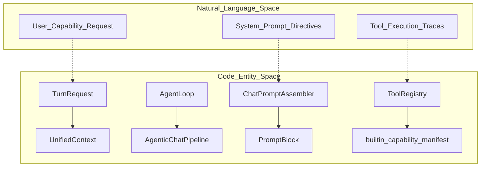
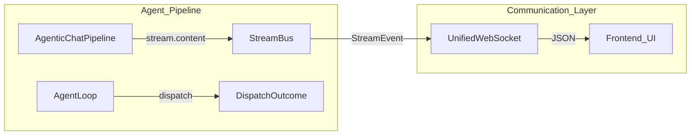

<!-- source: DeepWiki mcp.deepwiki.com · repo HKUDS/DeepTutor · page 4 Intelligent Agent Modules · fetched 2026-11-09 -->

# Intelligent Agent Modules

Relevant source files

The following files were used as context for generating this wiki page:

- [deeptutor/agents/chat/capability.py](deeptutor/agents/chat/capability.py)
- [deeptutor/agents/question/capability.py](deeptutor/agents/question/capability.py)
- [deeptutor/capabilities/ask_questions/__init__.py](deeptutor/capabilities/ask_questions/__init__.py)
- [deeptutor/capabilities/ask_questions/capability.py](deeptutor/capabilities/ask_questions/capability.py)
- [deeptutor/capabilities/ask_questions/loop.py](deeptutor/capabilities/ask_questions/loop.py)
- [deeptutor/capabilities/ask_questions/prompts/en/system.md](deeptutor/capabilities/ask_questions/prompts/en/system.md)
- [deeptutor/capabilities/ask_questions/prompts/zh/system.md](deeptutor/capabilities/ask_questions/prompts/zh/system.md)
- [deeptutor/core/response_languages.py](deeptutor/core/response_languages.py)
- [deeptutor/core/turn_request.py](deeptutor/core/turn_request.py)
- [deeptutor/response_languages.py](deeptutor/response_languages.py)
- [deeptutor/runtime/bootstrap/builtin_capabilities.py](deeptutor/runtime/bootstrap/builtin_capabilities.py)
- [tests/agents/chat/test_language_prompts.py](tests/agents/chat/test_language_prompts.py)
- [tests/capabilities/test_handoff.py](tests/capabilities/test_handoff.py)
- [tests/core/test_capabilities_runtime.py](tests/core/test_capabilities_runtime.py)
- [tests/services/session/test_reply_language_override.py](tests/services/session/test_reply_language_override.py)
- [web/contracts/generated/turn-protocol.ts](web/contracts/generated/turn-protocol.ts)
- [web/contracts/schema/turn-protocol.json](web/contracts/schema/turn-protocol.json)
- [web/features/chat/controllers/buildStartTurnInput.ts](web/features/chat/controllers/buildStartTurnInput.ts)
- [web/features/chat/model/start-turn.ts](web/features/chat/model/start-turn.ts)
- [web/tests/start-turn-input.test.ts](web/tests/start-turn-input.test.ts)

This page provides a high-level overview of the specialized intelligent agent modules that form DeepTutor's core AI-powered educational capabilities. DeepTutor utilizes an **agent-native architecture** where multiple specialized agents and capabilities operate within a unified runtime loop managed by the backend engine [deeptutor/agents/chat/agentic_pipeline.py:36-39](), [deeptutor/runtime/bootstrap/builtin_capabilities.py:17-30]().

For details on the underlying runtime, see [Runtime and Orchestration](#3.4). For information about the LLM service abstraction, see [LLM Service and Provider Factory](#5.1).

---

## Module Overview

DeepTutor implements several primary agent capabilities, each designed for a specific educational workflow. These modules are integrated into a unified workspace and adhere to the core loop runtime protocols [tests/core/test_capabilities_runtime.py:70-86]().

| Module                     | Core Capability Name | Key Classes / Agents            | Purpose                                                                                     |
|----------------------------|---------------------|-------------------------------|---------------------------------------------------------------------------------------------|
| **Smart Solver**            | `deep_solve`        | `DeepSolveCapability`          | Dual-loop problem-solving architecture with context exploration.                           |
| **Deep Research**           | `deep_research`     | `DeepResearchCapability`       | Multi-agent research pipeline with citation management.                                   |
| **Quiz Generation**         | `deep_question`     | `DeepQuestionCapability`       | Ideation-to-validation quiz lifecycle with three phases.                                  |
| **Book Engine**             | `book_engine`       | `BookCompiler`                 | Multi-agent "living book" compiler with interactive block types.                           |
| **Co-Writer & Notebook**    | `co_writer`         | `IdeaAgent`                   | Collaborative Markdown editing, surgical rewrites, and note-taking.                        |
| **Math Animator & Vision**  | `math_animator`     | `MathAnimatorPipeline`         | Visual concept analysis and Manim animation.                                              |
| **Visualization Agent**     | `visualize`         | `VisualizeCapability`          | Data visualization via analysis and code generation agents.                               |
| **Mastery Path**            | `mastery_path`      | `MasteryLoopCapability`        | Spaced repetition and guided learning engine.                                             |
| **Immersive Reading**       | `immersive_reading` | `ReadingCapability`            | PDF/EPUB document interaction, annotations, and bilingual pairing.                        |
| **Immersive Watching**      | `immersive_watching`| `VideoLearningService`         | Video learning service with transcript tracking and timestamped notes.                    |
| **External Library**        | various             | `Obsidian`, `MarginNote`       | Obsidian, MarginNote 4, and Tencent IMA store bindings.                                   |

Sources: [tests/core/test_capabilities_runtime.py:70-86](), [deeptutor/runtime/bootstrap/builtin_capabilities.py:17-30]()

---

## Core Architecture Patterns

### Unified Context and Capability Protocol

All agent modules implement standard loop execution semantics via the capability interface (`TurnRequest` and `UnifiedContext`). They receive structured inputs containing user messages, session metadata, knowledge bases, and enabled tools [deeptutor/core/turn_request.py:141-179](), [deeptutor/agents/chat/agentic_pipeline.py:26-39](). The `AgenticChatPipeline` and its specialized subclasses manage the transition from exploration and tool invocation to final user-facing generation [deeptutor/agents/chat/agentic_pipeline.py:15-40]().

Title: Natural Language to Capability Runtime Mapping

Sources: [deeptutor/core/turn_request.py:141-179](), [deeptutor/agents/chat/agentic_pipeline.py:15-40](), [deeptutor/runtime/bootstrap/builtin_capabilities.py:33-40]()

### Streaming and Event Bus

Agent modules communicate state progression and intermediate outputs to the frontend via the `StreamBus` event-driven architecture. This supports real-time streaming of thinking blocks, tool calls, and structured payloads without buffering the entire response [tests/core/test_capabilities_runtime.py:53-67]().

Title: Agent Stream Event Flow

Sources: [tests/core/test_capabilities_runtime.py:53-67](), [deeptutor/runtime/stream_bus.py:1-40]()

---

## Module Summaries

### Smart Solver and Context Exploration
The Smart Solver (`deep_solve`) capability implements a dual-loop architecture combining a problem-solving agent with context exploration and source inventory capabilities.
For details, see [Smart Solver and Context Exploration](#4.1).

### Deep Research
Orchestrates a multi-agent pipeline supporting iterative rephrasing, decomposition, and block-based research with citation management.
For details, see [Deep Research](#4.2).

### Quiz Generation and Question Bank
Implemented via a three-phase `QuestionPipeline`: exploration, planning, and per-question iterative generation.
For details, see [Quiz Generation and Question Bank](#4.3).

### Book Engine
Compiles interactive "Living Books" by orchestrating ideation, source exploration, spine synthesis, and page planning.
For details, see [Book Engine](#4.4).

### Co-Writer and Notebook
Provides a collaborative Markdown workspace supporting surgical range rewrites, notebook summarization agents, and save-to-notebook workflows.
For details, see [Co-Writer and Learning Notebook](#4.5).

### Math Animator and Vision Solver
Combines visual math concept analysis with code generation and rendering powered by Manim, complete with retry management and vision tools.
For details, see [Math Animator and Vision Solver](#4.6).

### Visualization Agent
Translates analytical data into rendered graphical artifacts using `AnalysisAgent`, `CodeGeneratorAgent`, and `ReviewAgent`.
For details, see [Visualization Agent](#4.7).

### Audio Overview and Voice Capabilities
Manages audio overview pipelines, request configuration, TTS services, speech-to-text helpers, and read-aloud integrations.
For details, see [Audio Overview and Voice Capabilities](#4.8).

### Mastery Path Learning Engine
Manages personalized, spaced repetition-based learning trajectories via structured Pydantic models.
For details, see [Mastery Path Learning Engine](#4.9).

### Immersive Reading
Offers advanced document viewers (PDF, EPUB), annotations with W3C selectors, extension entry points, and bilingual EPUB pairing.
For details, see [Immersive Reading](#4.10).

### Immersive Watching and Video Learning
Integrates video learning services with transcript following, Invidious account integration, and timestamped notes.
For details, see [Immersive Watching and Video Learning](#4.11).

### External Library Capabilities
Extends capabilities by integrating Obsidian vaults, MarginNote 4 stores, and Tencent IMA capabilities.
For details, see [External Library Capabilities](#4.12).

---

## Mapping Capabilities to Code Entities

Title: Capability to Code Symbol Bridge

```mermaid
graph TD
    S["Smart Solver (deep_solve)"] -->|Capability Class| DS["DeepSolveCapability (deeptutor/capabilities/solve/capability.py)"]
    R["Deep Research (deep_research)"] -->|Capability Class| DR["DeepResearchCapability (deeptutor/agents/research/capability.py)"]
    Q["Quiz Generation (deep_question)"] -->|Capability Class| DQ["DeepQuestionCapability (deeptutor/agents/question/capability.py)"]
    B["Book Engine (book_engine)"] -->|Main Class| BC["BookCompiler (deeptutor/agents/book_engine)"]
    C["Co-Writer (co_writer)"] -->|Agent Class| IA["IdeaAgent (deeptutor/agents/co_writer)"]
    M["Math Animator (math_animator)"] -->|Capability Class| MA["MathAnimatorCapability (deeptutor/agents/math_animator/capability.py)"]
    V["Visualization (visualize)"] -->|Capability Class| VC["VisualizeCapability (deeptutor/agents/visualize/capability.py)"]
    MP["Mastery Path (mastery_path)"] -->|Capability Class| ML["MasteryLoopCapability (deeptutor/capabilities/mastery/loop.py)"]
    IR["Immersive Reading (immersive_reading)"] -->|Backend Class| RB["ReadingBackend (deeptutor/immersive_reading/backend)"]
    IW["Immersive Watching (immersive_watching)"] -->|Service Class| VL["VideoLearningService (deeptutor/agents/immersive_watching/service.py)"]
    EL["External Library"] -->|Integrated Tools| ELT["Obsidian/MarginNote/Tencent IMA (deeptutor/capabilities/external)"]
```  

Sources: [deeptutor/capabilities/solve/capability.py:10-40](), [deeptutor/agents/research/capability.py:30-80](), [deeptutor/agents/question/capability.py:29-150](), [tests/core/test_capabilities_runtime.py:16-80]()

---

For in-depth implementation and runtime workflow details, consult the dedicated child pages:

- [Smart Solver and Context Exploration](#4.1)
- [Deep Research](#4.2)
- [Quiz Generation and Question Bank](#4.3)
- [Book Engine](#4.4)
- [Co-Writer and Learning Notebook](#4.5)
- [Math Animator and Vision Solver](#4.6)
- [Visualization Agent](#4.7)
- [Audio Overview and Voice Capabilities](#4.8)
- [Mastery Path Learning Engine](#4.9)
- [Immersive Reading](#4.10)
- [Immersive Watching and Video Learning](#4.11)
- [External Library Capabilities](#4.12)

Sources: [tests/core/test_capabilities_runtime.py:70-86](), [deeptutor/agents/chat/agentic_pipeline.py:15-40]()

---

