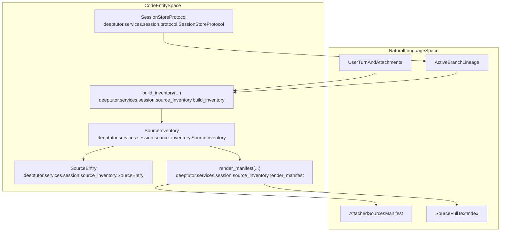
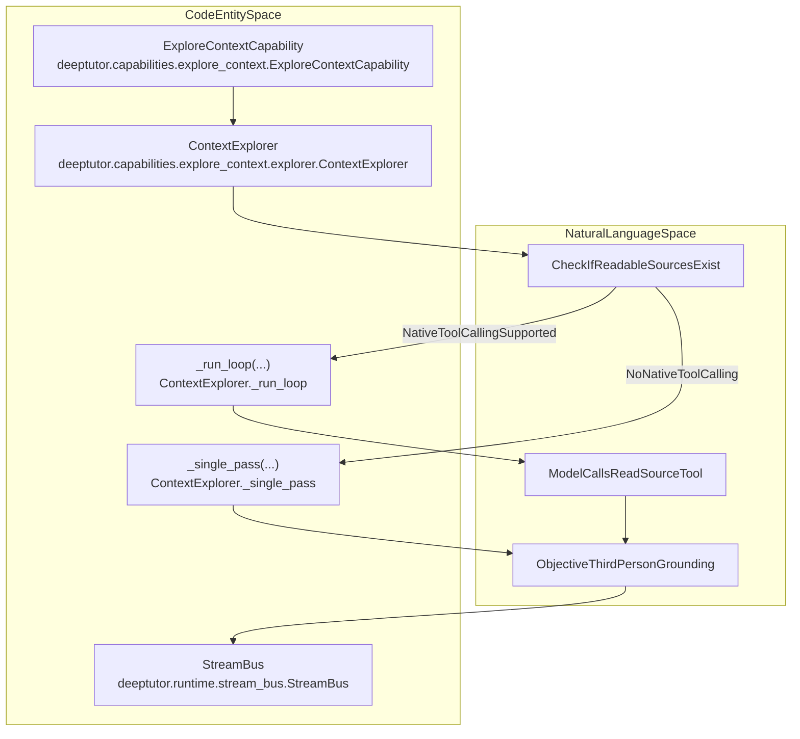

<!-- source: DeepWiki mcp.deepwiki.com · repo HKUDS/DeepTutor · page 4.1 Smart Solver and Context Exploration · fetched 2026-11-09 -->

# Smart Solver and Context Exploration

Relevant source files

The following files were used as context for generating this wiki page:

- [deeptutor/agents/chat/agentic_pipeline.py](deeptutor/agents/chat/agentic_pipeline.py)
- [deeptutor/agents/chat/prompts/en/agentic_chat.yaml](deeptutor/agents/chat/prompts/en/agentic_chat.yaml)
- [deeptutor/agents/chat/prompts/zh/agentic_chat.yaml](deeptutor/agents/chat/prompts/zh/agentic_chat.yaml)
- [deeptutor/agents/loop/agent_loop.py](deeptutor/agents/loop/agent_loop.py)
- [deeptutor/agents/question/pipeline.py](deeptutor/agents/question/pipeline.py)
- [deeptutor/agents/question/prompts/en/pipeline.yaml](deeptutor/agents/question/prompts/en/pipeline.yaml)
- [deeptutor/agents/question/prompts/zh/pipeline.yaml](deeptutor/agents/question/prompts/zh/pipeline.yaml)
- [deeptutor/capabilities/solve/prompts/en/system.md](deeptutor/capabilities/solve/prompts/en/system.md)
- [deeptutor/capabilities/solve/prompts/zh/system.md](deeptutor/capabilities/solve/prompts/zh/system.md)
- [deeptutor/learning/tests/test_mastery_mode.py](deeptutor/learning/tests/test_mastery_mode.py)
- [deeptutor/learning/tests/test_mastery_revise_batch.py](deeptutor/learning/tests/test_mastery_revise_batch.py)
- [deeptutor/runtime/agentic/labeled_step.py](deeptutor/runtime/agentic/labeled_step.py)
- [deeptutor/services/sandbox/artifacts.py](deeptutor/services/sandbox/artifacts.py)
- [deeptutor/skills/builtin/docx/SKILL.md](deeptutor/skills/builtin/docx/SKILL.md)
- [deeptutor/skills/builtin/pdf/SKILL.md](deeptutor/skills/builtin/pdf/SKILL.md)
- [deeptutor/skills/builtin/pptx/SKILL.md](deeptutor/skills/builtin/pptx/SKILL.md)
- [deeptutor/skills/builtin/xlsx/SKILL.md](deeptutor/skills/builtin/xlsx/SKILL.md)
- [tests/agents/chat/test_agent_loop.py](tests/agents/chat/test_agent_loop.py)
- [tests/agents/question/test_pipeline.py](tests/agents/question/test_pipeline.py)
- [tests/agents/test_failure_notices_name_the_cause.py](tests/agents/test_failure_notices_name_the_cause.py)
- [tests/capabilities/test_mastery_status_snapshot.py](tests/capabilities/test_mastery_status_snapshot.py)
- [tests/core/test_labeled_step_think_prelude.py](tests/core/test_labeled_step_think_prelude.py)
- [tests/tools/test_code_execution_guidance.py](tests/tools/test_code_execution_guidance.py)
- [web/scripts/route_budgets.mjs](web/scripts/route_budgets.mjs)

## Purpose and Scope

The Smart Solver and Context Exploration subsystem powers DeepTutor's advanced problem-solving workflow and pre-retrieval grounding. It combines a cumulative session source inventory (`SourceInventory`), an agentic context investigator (`ContextExplorer`), and a dual-loop problem-solving capability (`solve`). 

This subsystem ensures that whenever a user attaches files, book excerpts, conversation histories, or notebook records to a turn, the system builds a branch-isolated cumulative inventory to provide consistent context across turns. Before the primary answer loop begins, the `ContextExplorer` runs a read-only pre-pass using native tool calling or a single-pass fallback to synthesize an objective third-party investigation as grounding for the answer loop.

Sources: [deeptutor/capabilities/explore_context/explorer.py:1-23](), [deeptutor/services/session/source_inventory.py:1-28]()

---

## Cumulative Source Inventory

The chat pipeline maintains a branch-isolated, cumulative source inventory for each session turn. Traditionally, the "Attached Sources" manifest contained only sources attached in the current turn, forcing the LLM to lose track of files uploaded in earlier turns unless re-attached. To solve this, the subsystem composes a cumulative inventory of sources attached across all ancestor messages on the active branch.

### Inventory Architecture and Deduplication

- **Fresh Sources**: Those attached in the current turn are marked as `fresh=True` and carry a full text preview capped by `MANIFEST_PREVIEW_CHARS_FRESH = 2000` characters. This helps the model quickly inspect recent materials without needing to load full texts initially [deeptutor/services/session/source_inventory.py:8-14](), [deeptutor/services/session/source_inventory.py:46]().
- **Historical Sources**: Sources attached in prior turns along the active branch lineage are marked `fresh=False`. They render as compact one-line rows showing id, name, kind, size, and the turn ordinal when first seen. This gives the model awareness of prior materials without bloating context with full previews [deeptutor/services/session/source_inventory.py:12-14]().
- **Deduplication**: The `SourceInventory` maintains deduplication by source ID (`sid`). Fresh entries always override historical ones on collision, ensuring the freshest preview is used [deeptutor/services/session/source_inventory.py:76-103]().
- **Branch Isolation**: The inventory ensures that sources attached in sibling branches do not leak by traversing the `parent_message_id` ancestry of the current active leaf only [deeptutor/services/session/source_inventory.py:16-18]().

Sources: [deeptutor/services/session/source_inventory.py:8-103]()

### Data Flow and Key Functions

- `build_inventory(...)` is the main asynchronous function defined in [deeptutor/services/session/source_inventory.py:30-75]() that assembles the inventory for the current turn by:
  - Adding fresh attachments, notebook records, book excerpts, readings, and partner groups first
  - Asynchronously fetching historical messages to add older sources
  - Adding any attached questions from question banks
  - Finally collecting all references from the active branch's messages to build a historical view
  
- `SourceInventory.add(entry: SourceEntry)` merges entries by `sid` with fresh entries overriding stale previews [deeptutor/services/session/source_inventory.py:76-103]().

- `render_manifest(inventory: SourceInventory)` produces the textual "Attached Sources" manifest shown to the LLM and a `source_index` dictionary mapping source IDs to full text content for downstream reading [deeptutor/services/session/source_inventory.py:105-178]().

Sources: [deeptutor/services/session/source_inventory.py:30-178]()

#### Source Inventory & Manifest Flow Diagram

Sources: [deeptutor/services/session/source_inventory.py:1-178](), [tests/services/session/test_source_inventory.py:58-118]()

---

## Agentic Context Explorer

The `ContextExplorer` defined in [deeptutor/capabilities/explore_context/explorer.py:15-158]() runs a read-only investigation pre-pass *before* the answer loop’s first LLM call. It processes the cumulative source inventory, dynamically fetching source full texts on-demand by invoking the `read_source` tool to gather detailed grounding relevant to the user’s request.

### Execution Modes

1. **Native Tool Calling Loop (`_run_loop`)**:  
   If the LLM provider supports native tool calling, the explorer runs an interactive agentic loop capped by `MAX_LOOP_ROUNDS = 5`. Each iteration lets the LLM issue `read_source(source_id)` calls to fetch needed sources, followed by subsequent reasoning until the LLM stops calling tools and writes a thorough objective investigation [deeptutor/capabilities/explore_context/explorer.py:15-23](), [deeptutor/capabilities/explore_context/explorer.py:64]().

2. **Single-Pass Fallback (`_single_pass`)**:  
   For LLMs lacking native tool calling, the explorer falls back to injecting truncated previews of all sources into a single prompt and asks the model to produce a one-pass briefing [deeptutor/capabilities/explore_context/explorer.py:15-23](), [deeptutor/capabilities/explore_context/explorer.py:79-81]().

Sources: [deeptutor/capabilities/explore_context/explorer.py:15-81]()

### Key Implementation Details

- The Explorer is configured by language, prompts, and the deployed LLM client binding and model [deeptutor/capabilities/explore_context/explorer.py:25-50]().
- The `investigate()` coroutine is the main entrypoint which queries the `UnifiedContext` for the `source_index`, runs either the native tool call loop or fallback single-pass, and produces a final investigation string without emitting user-facing `CONTENT` events (emitting `THINKING` and `STAGE_START` events only) [deeptutor/capabilities/explore_context/explorer.py:52-120]().
- Strict rules embedded in prompt templates emphasize objective, third-person narration and disallow answering the user's question directly during exploration [deeptutor/capabilities/explore_context/explorer.py:121-158]().

Sources: [deeptutor/capabilities/explore_context/explorer.py:25-158]()

#### ContextExplorer Execution Model Diagram

Sources: [deeptutor/capabilities/explore_context/explorer.py:1-158](), [tests/capabilities/test_explore_context_capability.py:30-125]()

---

## Dual-Loop Problem Solving and Solve Capability

The Smart Solver capability (`solve`) implements DeepTutor’s core problem-solving workflow based on a dual-loop architecture, separating investigation and execution into distinct phases as described in [deeptutor/agents/chat/agentic_pipeline.py:1-48]() and [deeptutor/agents/loop/agent_loop.py:1-30]().

### Dual-Loop Architecture

- **Exploration Loop**:  
  Begins with problem understanding, gathering necessary contextual information. It interacts with knowledge bases and plans solution steps, leveraging the contextual investigation produced by the `ContextExplorer`.

- **Solve Loop**:  
  Pursues the execution of the formulated plan by dispatching and coordinating specialized tools such as code execution sandboxes, spreadsheet manipulation via `openpyxl` [deeptutor/skills/builtin/xlsx/SKILL.md:25-28](), and document generation via `python-docx` [deeptutor/skills/builtin/docx/SKILL.md:19-21]().

Sources: [deeptutor/agents/chat/agentic_pipeline.py:1-48](), [deeptutor/agents/loop/agent_loop.py:1-30](), [deeptutor/skills/builtin/xlsx/SKILL.md:25-28](), [deeptutor/skills/builtin/docx/SKILL.md:19-21]()

### Tools and Deliverables

The solve capability orchestrates diverse tools while respecting runtime permissions and user configuration. The tool dispatch system guarantees strict exclusivity and controlled composition to avoid conflicts in tool usage.

Sources: [deeptutor/skills/builtin/xlsx/SKILL.md:1-28](), [deeptutor/skills/builtin/docx/SKILL.md:1-21](), [deeptutor/services/config/__init__.py:1-46]()

---

# References

- deeptutor/services/session/source_inventory.py:1-178  
- deeptutor/capabilities/explore_context/explorer.py:1-158  
- deeptutor/skills/builtin/xlsx/SKILL.md:1-28  
- deeptutor/skills/builtin/docx/SKILL.md:1-21  
- deeptutor/services/config/__init__.py:1-46  
- tests/services/session/test_source_inventory.py:58-118  
- tests/capabilities/test_explore_context_capability.py:30-125

---

