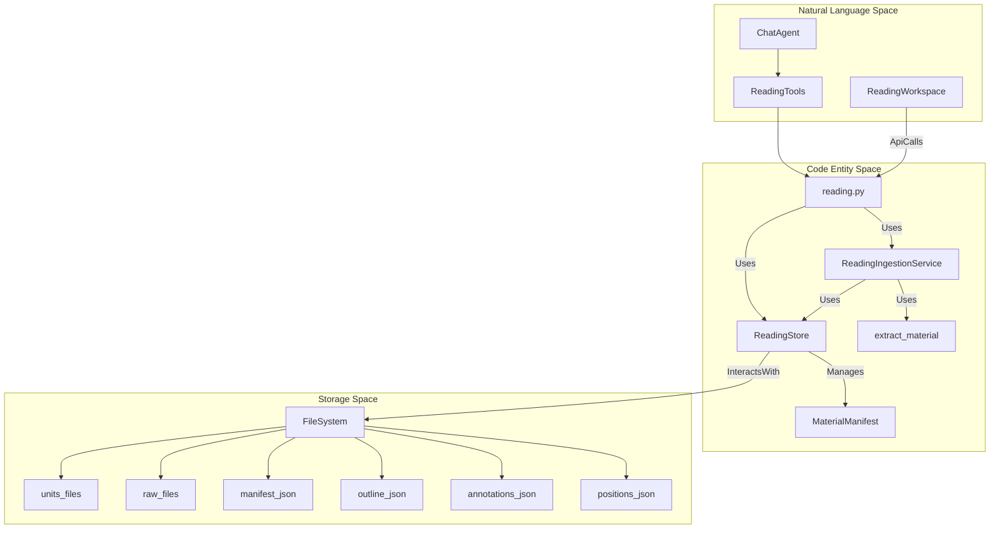
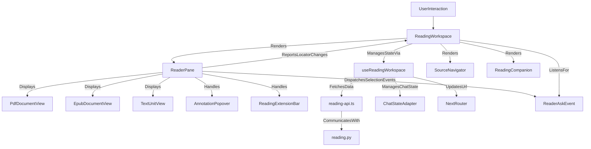

<!-- source: DeepWiki mcp.deepwiki.com · repo HKUDS/DeepTutor · page 4.10 Immersive Reading · fetched 2026-11-09 -->

# Immersive Reading

Relevant source files

The following files were used as context for generating this wiki page:

- [deeptutor/api/routers/reading.py](deeptutor/api/routers/reading.py)
- [deeptutor/reading/extract.py](deeptutor/reading/extract.py)
- [deeptutor/reading/models.py](deeptutor/reading/models.py)
- [deeptutor/reading/store.py](deeptutor/reading/store.py)
- [deeptutor/utils/document_extractor.py](deeptutor/utils/document_extractor.py)
- [deeptutor/utils/document_images.py](deeptutor/utils/document_images.py)
- [tests/docx_math_fixture.py](tests/docx_math_fixture.py)
- [tests/reading/test_engine.py](tests/reading/test_engine.py)
- [tests/reading/test_reading_pdf_media.py](tests/reading/test_reading_pdf_media.py)
- [tests/reading/test_router.py](tests/reading/test_router.py)
- [tests/reading/test_safe_filename.py](tests/reading/test_safe_filename.py)
- [tests/utils/test_document_extractor.py](tests/utils/test_document_extractor.py)
- [tests/utils/test_document_images.py](tests/utils/test_document_images.py)
- [tests/utils/test_pptx_fallback_pictures.py](tests/utils/test_pptx_fallback_pictures.py)
- [tests/utils/test_pptx_presentation_order.py](tests/utils/test_pptx_presentation_order.py)
- [tests/utils/test_xlsx_sparse_columns.py](tests/utils/test_xlsx_sparse_columns.py)
- [web/components/reading/ReaderPane.tsx](web/components/reading/ReaderPane.tsx)
- [web/lib/reading-api.ts](web/lib/reading-api.ts)
- [web/tests/reading-toolbar-selection.spec.tsx](web/tests/reading-toolbar-selection.spec.tsx)
- [web/tests/reading-web-markdown.test.ts](web/tests/reading-web-markdown.test.ts)

The Immersive Reading subsystem provides an AI-augmented environment for document consumption and interaction. It integrates high-fidelity viewers for multiple document formats (PDF, EPUB, plain text), supports robust annotations, and offers extensible reading tools and bilingual EPUB handling. The system’s architecture abstracts document content into discrete **units** addressed by a unified **locator** concept, enabling consistent navigation and interaction regardless of the original document format or length.

This page overviews the Immersive Reading subsystem’s key components and workflows, bridging the natural language interface with underlying storage and processing layers. Detailed technical information for backend storage/models and frontend viewers is available in the child pages.

## Overview and Architecture

DeepTutor’s immersive reading capability is structured around a **unit-based material model**. Documents are dissected into units — for example, pages in PDFs, chapters in EPUBs, or sections in Markdown files — each addressed by a 1-indexed **locator** [deeptutor/reading/models.py:3-9](). This abstraction allows efficient loading and precise referencing without loading entire documents, vital for long texts like multi-hundred-page PDFs [deeptutor/reading/store.py:12-14]().

### System Component Relationship

The following diagram illustrates how immersive reading components map from user-facing channels down to persistent storage with close connections to code entities:

This diagram captures how the FastAPI router exposes reading services to frontend and agent tools, all operating atop the `ReadingStore` [deeptutor/reading/store.py:161-177]() which manages on-disk formats. The ingestion service handles parsing and extracting meaningful units from uploaded documents or URLs.

Sources: [deeptutor/reading/store.py:1-24](), [deeptutor/reading/models.py:1-14](), [deeptutor/api/routers/reading.py:1-15](), [web/components/reading/workspace/ReadingWorkspace.tsx:1-50](), [deeptutor/reading/ingestion.py:1-10]()

## Key Capabilities

### Document Viewers

- **Faithful View (PDF):** Employs `pdfjs-dist` for windowed rendering of the original document layout. Annotations use normalized coordinates to stay consistent across zoom and rendering passes [web/lib/reading-api.ts:83-90](). The `PdfDocumentView` React component manages this [web/components/reading/ReaderPane.tsx:43-50]().
- **Reflowable View (EPUB and Text):** Uses `epubjs` to render EPUB content with navigation and layout controls, and a custom `TextUnitView` for Markdown or plain text [web/components/reading/ReaderPane.tsx:40-41]().

### Annotation System

Annotations support highlights, underlines, and notes using W3C-compliant selectors:
- `TextQuoteSelector` contains exact text plus prefix/suffix context for robust matching.
- `TextPositionSelector` specifies character offset intervals.
This dual approach ensures annotations remain correctly anchored even as source text changes slightly [deeptutor/reading/models.py:93-103](). User interface components like `AnnotationPopover` and `AnnotationList` manage annotation display and editing [web/components/reading/ReaderPane.tsx:38-44]().

### Reading Extensions

The reading subsystem supports backend extensions that can be triggered from the UI to perform tasks such as summarizing selected text or generating quizzes for a page. These extensions return structured results (cards, quiz prompts, or feedback), enriching the reading experience [web/lib/reading-api.ts:180-201](). The frontend includes the `ReadingExtensionBar` for invoking these extensions [web/components/reading/ReaderPane.tsx:51-51]().

### Bilingual EPUB Pairing

A specialty feature allows pairing of English EPUB files with their Chinese translations. The system aligns chapters to enable side-by-side reading, supporting bilingual learning workflows [deeptutor/reading/epub_bilingual.py:1-10](). This pairing occurs during ingestion and is reflected in the reading catalog and store.

Sources: [web/lib/reading-api.ts:180-201](), [web/components/reading/ReaderPane.tsx:38-51](), [deeptutor/reading/models.py:93-103]()

## Data Flow: Ingestion to Rendering

When a user uploads a document or URL, it undergoes a multi-stage process before becoming readable and interactive.

| Stage       | Description                                             | Code Entity / Module                                |
|-------------|---------------------------------------------------------|----------------------------------------------------|
| **Ingest**  | File content hashed for a unique `material_id`. The file is stored for subsequent processing. | `ReadingStore.ingest` [deeptutor/reading/store.py:160-190]() |
| **Extract** | Document is parsed to extract text units, generate outlines, and identify structure. | `extract_material` [deeptutor/reading/extract.py:134-142]() |
| **Store**   | Text units and metadata (`MaterialManifest`, `OutlineEntry`) are atomically committed on disk. | `_atomic_write` function [deeptutor/reading/store.py:61-61]() |
| **Serve**   | FastAPI router serves metadata, unit text, annotations, and raw bytes through REST endpoints. | `reading.py` router [deeptutor/api/routers/reading.py:70-95]() |
| **Render**  | React frontend uses appropriate viewer components based on material type and user preferences. | `ReaderPane`, `PdfDocumentView`, `EpubDocumentView`, `TextUnitView` [web/components/reading/ReaderPane.tsx:40-60]() |

This pipeline is optimized to allow efficient reads of small text units rather than loading entire documents. For example, reading a single locator’s text from a large PDF accesses a small text file rather than deserializing the full document content [deeptutor/reading/store.py:13-15]().

Sources: [deeptutor/reading/store.py:13-190](), [deeptutor/api/routers/reading.py:70-112](), [web/components/reading/ReaderPane.tsx:40-60]()

### Frontend Interaction Flow

The UI orchestrates the immersive reading experience through carefully layered React components communicating with backend APIs:

This flow shows how user interaction triggers state updates, metadata fetches, and dynamic rendering of document units. The reading extension system integrates naturally into this flow by reacting to user selections and text highlights.

Sources: [web/components/reading/ReaderPane.tsx:139-193](), [web/lib/reading-api.ts:203-228]()

## Detailed Subsystems

For an in-depth technical understanding of each main part of the Immersive Reading subsystem, consult the following child pages:

### [Reading Backend — Store, Models, and Extensions](#4.10.1)

Covers how materials and annotations are stored on disk within the `ReadingStore`. Describes the `MaterialManifest` and annotation models reflecting W3C selectors. Details ingestion pipelines, EPUB bilingual pairing mechanisms, and backend extension entrypoints like reading-aloud and quiz generation. Also explains annotation version migrations and the structure of reading router endpoints.

### [Reading Frontend — Viewers and Reader Shell](#4.10.2)

Covers the React components managing document rendering including `PdfDocumentView`, windowed rendering for large PDFs, `EpubDocumentView` integration using `epubjs`, annotation UI overlays like `AnnotationPopover`, and the reading workspace shell coordinating outline navigation, display preferences, and reading position history.

---

By encapsulating diverse document types behind a unified model and offering both user and AI interactive capabilities, the Immersive Reading subsystem is a cornerstone for DeepTutor’s lifelong learner workspace.

Sources: [deeptutor/reading/store.py:1-190](), [deeptutor/api/routers/reading.py:1-199](), [deeptutor/reading/models.py:1-14](), [web/components/reading/ReaderPane.tsx:38-46](), [web/lib/reading-api.ts:3-15]()

---

