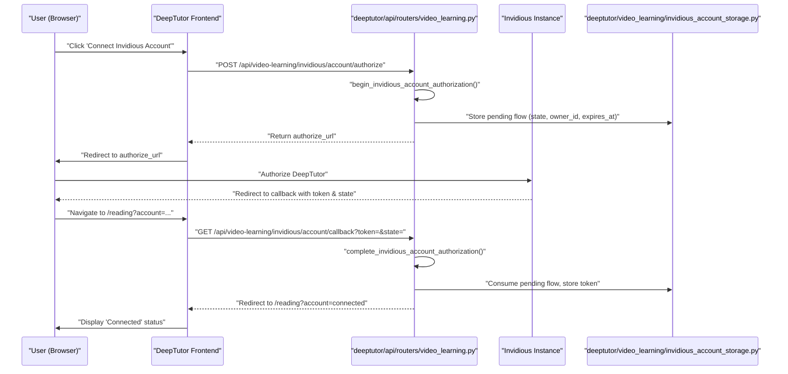
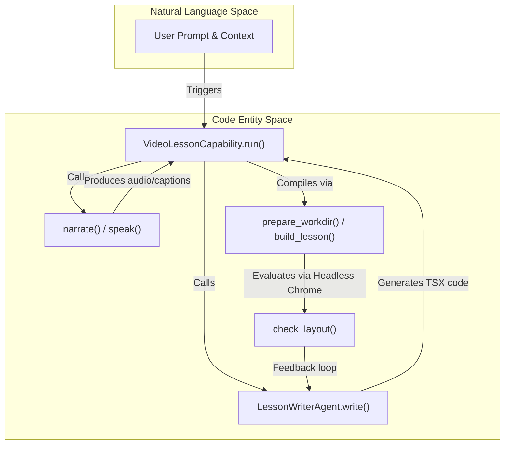

<!-- source: DeepWiki mcp.deepwiki.com · repo HKUDS/DeepTutor · page 4.11 Immersive Watching and Video Learning · fetched 2026-11-09 -->

# Immersive Watching and Video Learning

Relevant source files

The following files were used as context for generating this wiki page:

- [.github/workflows/tests.yml](.github/workflows/tests.yml)
- [deeptutor/agents/video_lesson/__init__.py](deeptutor/agents/video_lesson/__init__.py)
- [deeptutor/agents/video_lesson/capability.py](deeptutor/agents/video_lesson/capability.py)
- [deeptutor/agents/video_lesson/layout_check.py](deeptutor/agents/video_lesson/layout_check.py)
- [deeptutor/agents/video_lesson/lesson_writer.py](deeptutor/agents/video_lesson/lesson_writer.py)
- [deeptutor/agents/video_lesson/narration.py](deeptutor/agents/video_lesson/narration.py)
- [deeptutor/agents/video_lesson/prompts/en/lesson_writer.yaml](deeptutor/agents/video_lesson/prompts/en/lesson_writer.yaml)
- [deeptutor/agents/video_lesson/prompts/en/video_lesson.yaml](deeptutor/agents/video_lesson/prompts/en/video_lesson.yaml)
- [deeptutor/agents/video_lesson/prompts/zh/lesson_writer.yaml](deeptutor/agents/video_lesson/prompts/zh/lesson_writer.yaml)
- [deeptutor/agents/video_lesson/prompts/zh/video_lesson.yaml](deeptutor/agents/video_lesson/prompts/zh/video_lesson.yaml)
- [deeptutor/agents/video_lesson/remotion/build.mjs](deeptutor/agents/video_lesson/remotion/build.mjs)
- [deeptutor/agents/video_lesson/remotion/china_outline.json](deeptutor/agents/video_lesson/remotion/china_outline.json)
- [deeptutor/agents/video_lesson/remotion/kit.tsx](deeptutor/agents/video_lesson/remotion/kit.tsx)
- [deeptutor/agents/video_lesson/remotion/package-lock.json](deeptutor/agents/video_lesson/remotion/package-lock.json)
- [deeptutor/agents/video_lesson/remotion/package.json](deeptutor/agents/video_lesson/remotion/package.json)
- [deeptutor/agents/video_lesson/remotion/render-platform.ts](deeptutor/agents/video_lesson/remotion/render-platform.ts)
- [deeptutor/agents/video_lesson/remotion/voice.ts](deeptutor/agents/video_lesson/remotion/voice.ts)
- [deeptutor/agents/video_lesson/runtime.py](deeptutor/agents/video_lesson/runtime.py)
- [deeptutor/api/routers/video_learning.py](deeptutor/api/routers/video_learning.py)
- [deeptutor/app/facade.py](deeptutor/app/facade.py)
- [deeptutor/services/model_selection/task_agent.py](deeptutor/services/model_selection/task_agent.py)
- [deeptutor/services/sandbox/javascript.mjs](deeptutor/services/sandbox/javascript.mjs)
- [deeptutor/video_learning/__init__.py](deeptutor/video_learning/__init__.py)
- [deeptutor/video_learning/service.py](deeptutor/video_learning/service.py)
- [requirements/video-lesson.txt](requirements/video-lesson.txt)
- [tests/agents/video_lesson/__init__.py](tests/agents/video_lesson/__init__.py)
- [tests/agents/video_lesson/test_isolation.py](tests/agents/video_lesson/test_isolation.py)
- [tests/agents/video_lesson/test_layout_check.py](tests/agents/video_lesson/test_layout_check.py)
- [tests/agents/video_lesson/test_lesson_writer.py](tests/agents/video_lesson/test_lesson_writer.py)
- [tests/agents/video_lesson/test_narration.py](tests/agents/video_lesson/test_narration.py)
- [tests/agents/video_lesson/test_runtime.py](tests/agents/video_lesson/test_runtime.py)
- [tests/app/test_capability_contracts.py](tests/app/test_capability_contracts.py)
- [tests/services/model_selection/test_task_agent.py](tests/services/model_selection/test_task_agent.py)
- [tests/video_learning/test_router.py](tests/video_learning/test_router.py)
- [tests/video_learning/test_service.py](tests/video_learning/test_service.py)
- [web/lib/video-learning-api.ts](web/lib/video-learning-api.ts)

This page details the Immersive Watching and Video Learning subsystem, which provides a dedicated environment for video consumption, video learning services, Invidious account integration, transcript following, timestamped note-taking, the `WatchingPane` frontend, and the `video_lesson` Remotion renderer and narration pipeline.

## Purpose and Scope

The immersive watching and video learning subsystem bridges traditional media viewing with agent-native study features. It allows users to:
- Resolve and play educational videos from YouTube or privacy-respecting Invidious instances.
- Follow synchronized transcripts with smart cue normalization and scrolling.
- Take notes tied precisely to video timestamps.
- Render AI-generated explanatory animations using Remotion with automated voice-over narration and layout safety checking.

## Video Learning Service Overview

The video learning service enables users to watch educational videos within DeepTutor, featuring transcript display, transcript searching, and timestamped note-taking.

### Core Implementation and Capabilities

The main logic is implemented in `deeptutor/video_learning/service.py`. Key components include:

- **URL parsing and validation:** Securely parses and validates YouTube URLs, extracting canonical video IDs and entry times [deeptutor/video_learning/service.py:72-102]().
- **Provider-neutral metadata resolution:** Unified interfaces for resolving video metadata and transcripts from YouTube or Invidious providers.
- **Transcript normalization:** Cleans and bounds subtitles with strict limits on size and count, decodes HTML entities, and merges multi-line captions [deeptutor/video_learning/service.py:243-283]().
- **Segmentation:** Builds logical video segments from transcript cues for stable learning units [deeptutor/video_learning/service.py:61-67]().
- **Settings management:** Handles per-user video learning settings including default provider, YouTube transcript source, and Invidious API endpoints [deeptutor/video_learning/service.py:149-183]().
- **Persistence:** Saves and fetches timed media materials and user progress, stored in the workspace file system for multi-user isolation [deeptutor/video_learning/service.py:140-180]().

The data model `TimedMediaMaterial` used in frontend-backend communication captures material ID, source, metadata (title, author, duration), transcript with cues, learning state, and playback configuration [web/lib/video-learning-api.ts:32-57]().

Sources:
- `deeptutor/video_learning/service.py` [deeptutor/video_learning/service.py:1-182]()
- `web/lib/video-learning-api.ts` [web/lib/video-learning-api.ts:32-57]()

## Invidious Account Integration and Boundaries ADR

DeepTutor supports Invidious to provide privacy-minded users with an integrated video learning experience that respects account boundaries.

### Architectural Decisions and Implementation

- **Separated Per-Owner Secrets:** Invidious tokens and pending authorization flows are safely isolated per user via private secrets storage [deeptutor/video_learning/invidious_account_storage.py:1-120]().
- **Minimal OAuth-like Scopes:** The service requests narrowly-scoped API permissions from Invidious [deeptutor/video_learning/invidious_account.py:31-37]().
- **One-Time Callback with Atomic Claim:** Authorization uses a unique state parameter with expiration to avoid replay attacks [deeptutor/video_learning/invidious_account.py:90-105]().

### Invidious Account Integration Flow Diagram

Sources:
- `deeptutor/video_learning/invidious_account.py` [deeptutor/video_learning/invidious_account.py:31-105]()
- `deeptutor/video_learning/invidious_account_storage.py` [deeptutor/video_learning/invidious_account_storage.py:1-120]()

## Transcript Following and Notes with Timestamps

- The `WatchingPane` React component maintains playback time and identifies the active transcript cue [web/components/watching/WatchingPane.tsx:152-155]().
- When `followTranscript` is enabled, an effect scrolls the transcript panel to keep the active cue visible [web/components/watching/WatchingPane.tsx:184-196]().
- CRUD operations for video notes are handled through API helpers like `createVideoNote`, `updateVideoNote`, and `listVideoNotes` [web/lib/video-learning-api.ts:116-178]().
- Notes are persisted via DeepTutor's `NotebookManager` [deeptutor/video_learning/notes.py:1-100](), ensuring material scoping and isolation.

Sources:
- `web/components/watching/WatchingPane.tsx` [web/components/watching/WatchingPane.tsx:70-196]()
- `web/lib/video-learning-api.ts` [web/lib/video-learning-api.ts:116-178]()
- `deeptutor/video_learning/notes.py` [deeptutor/video_learning/notes.py:1-100]()

## Video Lesson Remotion Renderer and Narration Pipeline

The `video_lesson` capability [deeptutor/agents/video_lesson/capability.py:25-] creates Remotion-based explainer animations that learners can play directly inside the browser.

### Pipeline Architecture

1. **Lesson Writing Agent (`LessonWriterAgent`):** Generates structured lesson content and `tsx` Remotion code [deeptutor/agents/video_lesson/lesson_writer.py] based on user prompts and conversation history [deeptutor/agents/video_lesson/capability.py:49-56]().
2. **Narration Pipeline (`deeptutor/agents/video_lesson/narration.py`):**
   - Synthesizes speech-over using configured text-to-speech providers or `edge-tts` (Microsoft Edge read-aloud voices) [deeptutor/agents/video_lesson/narration.py:3-8]().
   - Calculates sentence-level timestamps and timing clips (`Clip`) with frame counts and caption offsets [deeptutor/agents/video_lesson/narration.py:37-49]().
3. **Runtime Compilation & Layout Verification:**
   - Prepares working directories with required Remotion kit files (`ASSETS_DIR`, `KIT_FILES`) [deeptutor/agents/video_lesson/runtime.py]().
   - Builds the lesson bundle via `build_lesson` [deeptutor/agents/video_lesson/capability.py:128]().
   - Checks layout using headless Chrome/Chromium (`check_layout`) to detect text overlaps, stroke collisions, and caption band violations [deeptutor/agents/video_lesson/layout_check.py] [deeptutor/agents/video_lesson/capability.py:145]().

### Video Lesson Generation Flow Diagram

Sources:
- `deeptutor/agents/video_lesson/capability.py` [deeptutor/agents/video_lesson/capability.py:25-145]()
- `deeptutor/agents/video_lesson/narration.py` [deeptutor/agents/video_lesson/narration.py:1-80]()
- `deeptutor/agents/video_lesson/layout_check.py` [deeptutor/agents/video_lesson/layout_check.py:1-79]()

---

This page details the implementation of video learning services, Invidious account boundaries, transcript following, timestamped notes, and the Remotion video lesson rendering and narration pipeline.

---

