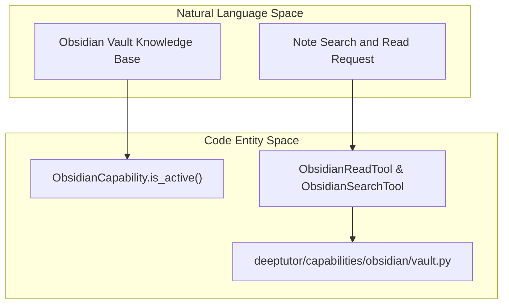
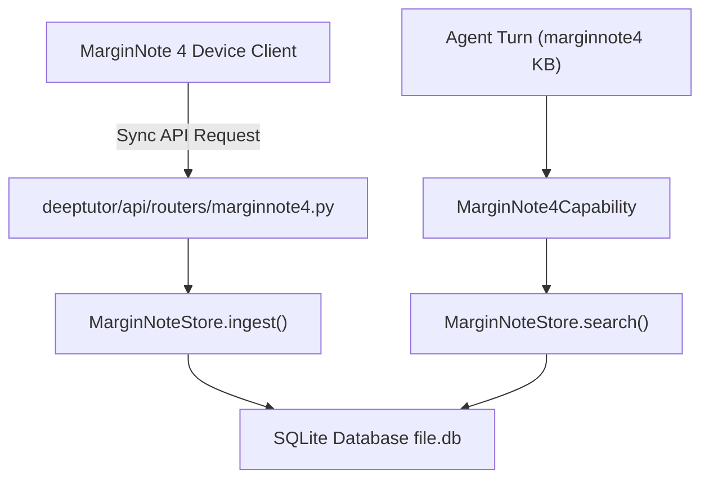
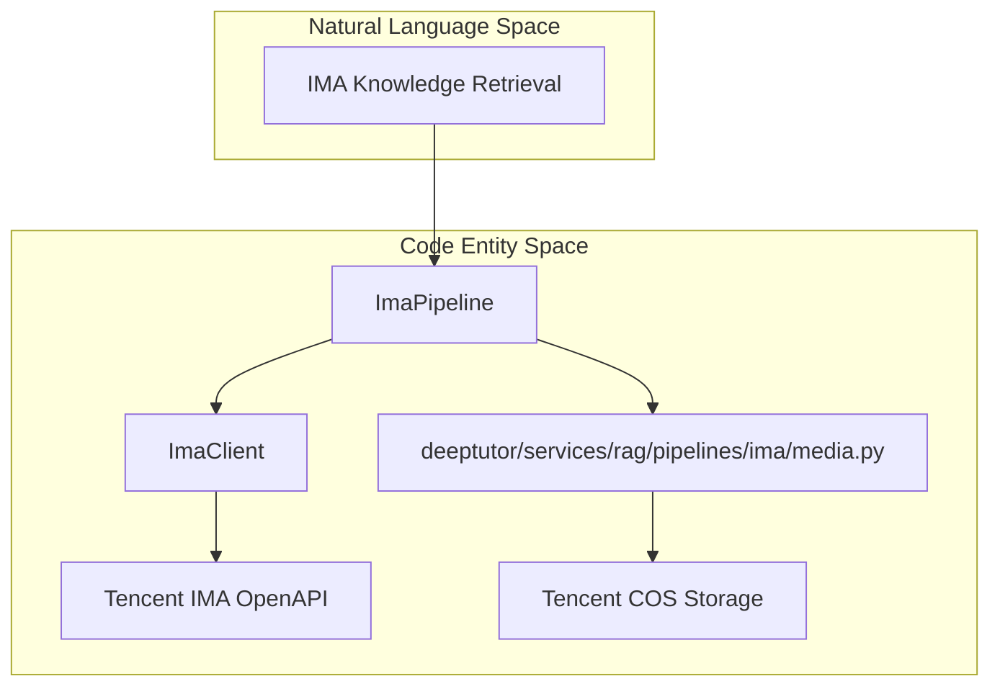
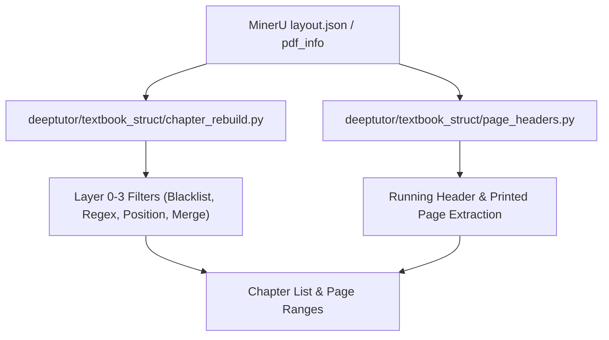
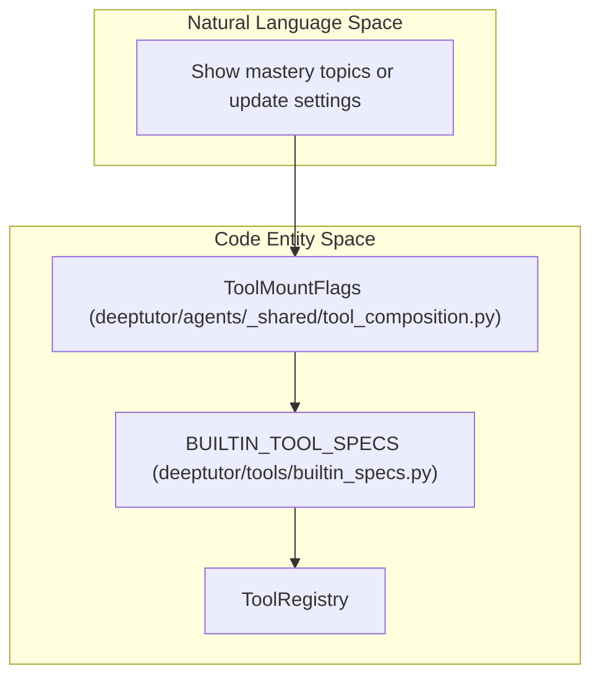

<!-- source: DeepWiki mcp.deepwiki.com · repo HKUDS/DeepTutor · page 4.12 External Library Capabilities · fetched 2026-11-09 -->

# External Library Capabilities

Relevant source files

The following files were used as context for generating this wiki page:

- [deeptutor/agents/_shared/tool_composition.py](deeptutor/agents/_shared/tool_composition.py)
- [deeptutor/api/routers/marginnote4.py](deeptutor/api/routers/marginnote4.py)
- [deeptutor/capabilities/marginnote4/__init__.py](deeptutor/capabilities/marginnote4/__init__.py)
- [deeptutor/capabilities/marginnote4/binding.py](deeptutor/capabilities/marginnote4/binding.py)
- [deeptutor/capabilities/marginnote4/capability.py](deeptutor/capabilities/marginnote4/capability.py)
- [deeptutor/capabilities/marginnote4/models.py](deeptutor/capabilities/marginnote4/models.py)
- [deeptutor/capabilities/marginnote4/prompts/en/system.md](deeptutor/capabilities/marginnote4/prompts/en/system.md)
- [deeptutor/capabilities/marginnote4/prompts/zh/system.md](deeptutor/capabilities/marginnote4/prompts/zh/system.md)
- [deeptutor/capabilities/marginnote4/store.py](deeptutor/capabilities/marginnote4/store.py)
- [deeptutor/capabilities/mastery/mode.py](deeptutor/capabilities/mastery/mode.py)
- [deeptutor/capabilities/obsidian/tools.py](deeptutor/capabilities/obsidian/tools.py)
- [deeptutor/capabilities/obsidian/vault.py](deeptutor/capabilities/obsidian/vault.py)
- [deeptutor/services/calendar/layers.py](deeptutor/services/calendar/layers.py)
- [deeptutor/services/partners/interaction.py](deeptutor/services/partners/interaction.py)
- [deeptutor/services/session/__init__.py](deeptutor/services/session/__init__.py)
- [deeptutor/textbook_struct/__init__.py](deeptutor/textbook_struct/__init__.py)
- [deeptutor/textbook_struct/chapter_rebuild.py](deeptutor/textbook_struct/chapter_rebuild.py)
- [deeptutor/textbook_struct/column_blacklist.py](deeptutor/textbook_struct/column_blacklist.py)
- [deeptutor/textbook_struct/page_headers.py](deeptutor/textbook_struct/page_headers.py)
- [deeptutor/tools/builtin/__init__.py](deeptutor/tools/builtin/__init__.py)
- [deeptutor/tools/builtin_specs.py](deeptutor/tools/builtin_specs.py)
- [deeptutor/tools/mastery_tool.py](deeptutor/tools/mastery_tool.py)
- [deeptutor/tools/question_bank.py](deeptutor/tools/question_bank.py)
- [tests/api/test_marginnote4_router.py](tests/api/test_marginnote4_router.py)
- [tests/app/test_multiworker_turn_application.py](tests/app/test_multiworker_turn_application.py)
- [tests/capabilities/marginnote4/test_store.py](tests/capabilities/marginnote4/test_store.py)
- [tests/capabilities/test_obsidian_backlink_paths.py](tests/capabilities/test_obsidian_backlink_paths.py)
- [tests/capabilities/test_obsidian_capability.py](tests/capabilities/test_obsidian_capability.py)
- [tests/capabilities/test_subagent_capability.py](tests/capabilities/test_subagent_capability.py)
- [tests/core/agentic/test_tool_arg_guard.py](tests/core/agentic/test_tool_arg_guard.py)
- [tests/core/test_builtin_tools.py](tests/core/test_builtin_tools.py)
- [tests/knowledge/test_marginnote4_kb.py](tests/knowledge/test_marginnote4_kb.py)
- [tests/knowledge/test_naming.py](tests/knowledge/test_naming.py)
- [tests/services/session/test_turn_admission_lease.py](tests/services/session/test_turn_admission_lease.py)
- [tests/textbook_struct/test_chapter_rebuild.py](tests/textbook_struct/test_chapter_rebuild.py)
- [tests/textbook_struct/test_page_headers.py](tests/textbook_struct/test_page_headers.py)
- [tests/tools/test_kb_files_tool.py](tests/tools/test_kb_files_tool.py)
- [tests/tools/test_question_bank_tool.py](tests/tools/test_question_bank_tool.py)
- [web/lib/kb-name.ts](web/lib/kb-name.ts)

This page details DeepTutor's integration with external libraries, platforms, and structural processing systems. It covers the Obsidian vault capability for personal knowledge management [tests/capabilities/test_obsidian_capability.py:1-4](), MarginNote 4 store and binding for document annotations [deeptutor/capabilities/marginnote4/store.py:1-14](), Tencent IMA enterprise knowledge retrieval [deeptutor/services/rag/pipelines/ima/pipeline.py](), deterministic textbook structure rebuilding [deeptutor/textbook_struct/chapter_rebuild.py:1-12](), and course study/setup capabilities [deeptutor/agents/_shared/tool_composition.py:48-68]().

---

## Obsidian Vault Capability

The Obsidian vault capability treats a local directory containing Markdown notes and YAML frontmatter as an active knowledge base. It allows the agent to read, search, create, append, and modify notes safely.

### Implementation Details

Pure filesystem operations reside in `deeptutor/capabilities/obsidian/vault.py`, parsing YAML frontmatter and `[[wikilinks]]` while ignoring vault internals (`.obsidian`, `.trash`, `.git`) [deeptutor/capabilities/obsidian/vault.py:24-34](). The entry point `ObsidianCapability` activates when a selected knowledge base has `type="obsidian"` [tests/capabilities/test_obsidian_capability.py:114-128](). 

Path traversal checks prevent escaping the vault root [deeptutor/capabilities/obsidian/vault.py:88-94](), and decoding tolerances replace invalid UTF-8 bytes gracefully on reads while enforcing strict UTF-8 on exact writes [deeptutor/capabilities/obsidian/vault.py:55-86](). The capability's `augment_kwargs()` method injects `_vault_path` server-side, preventing prompt injection of arbitrary filesystem paths [tests/capabilities/test_obsidian_capability.py:139-142]().

### Key Functions and Classes

- **`deeptutor/capabilities/obsidian/vault.py`**:
  - `read_note(root: Path, ref: str)`: Parses frontmatter and body for a note reference [deeptutor/capabilities/obsidian/vault.py:163-170]()
  - `search_notes(root: Path, query: str, limit: int)`: Performs case-insensitive substring search over note titles and contents [deeptutor/capabilities/obsidian/vault.py:173-]().
  - `create_note(root: Path, rel: str, content: str, frontmatter: dict)`: Adds new note files additively.
  - `append_note(root: Path, ref: str, extra: str)`: Appends text to existing notes.
- **`deeptutor/capabilities/obsidian/capability.py`**:
  - `ObsidianCapability`: Activates on obsidian KBs, mounts owned tools, and injects `_vault_path` [tests/capabilities/test_obsidian_capability.py:132-146]().

### Diagram: Obsidian Natural Language to Code Mapping

Sources:
- [deeptutor/capabilities/obsidian/vault.py:1-177]()
- [tests/capabilities/test_obsidian_capability.py:112-161]()

---

## MarginNote 4 Store and Binding

DeepTutor integrates with MarginNote 4 (MN4) through a SQLite-backed persistence store [deeptutor/capabilities/marginnote4/store.py:1-14]().

### Implementation Details

The storage layer in `deeptutor/capabilities/marginnote4/store.py` manages the SQLite database schema (`mn4_objects`, `mn4_devices`, `mn4_cursors`, `mn4_tombstones`) under `data/marginnote4/<kb_name>.db` [deeptutor/capabilities/marginnote4/store.py:39-85,96-109](). `MarginNoteStore` provides sequential async-safe connections using WAL mode (`PRAGMA journal_mode=WAL`), device pairing with token hashing [deeptutor/capabilities/marginnote4/store.py:92-93,177-191](), sync batch ingestion, and structured search.

### Key Functions and Classes

- **`deeptutor/capabilities/marginnote4/store.py`**:
  - `MarginNoteStore`: Owns database CRUD, device pairing, token verification, and search queries [deeptutor/capabilities/marginnote4/store.py:147-192]().
  - `default_db_path(kb_name)`: Resolves the default SQLite location under user data directories [deeptutor/capabilities/marginnote4/store.py:96-110]().
  - `MarginNoteStore.ingest(batch: SyncBatch)`: Ingests synced cards, notes, and mindmap nodes [tests/capabilities/marginnote4/test_store.py:96-146]().

### Diagram: MarginNote 4 Data Flow

Sources:
- [deeptutor/capabilities/marginnote4/store.py:1-192]()
- [tests/capabilities/marginnote4/test_store.py:67-146]()

---

## Tencent IMA Capability

DeepTutor supports Tencent IMA cloud knowledge base integration for retrieval-augmented generation (RAG).

### Implementation Details

The integration is driven by `ImaPipeline` [deeptutor/services/rag/pipelines/ima/pipeline.py]() and `ImaClient` [deeptutor/services/rag/pipelines/ima/client.py](), which handle OpenAPI authentication, cursor-based pagination, and error mapping. Media assets are fetched securely through `media.py` [deeptutor/services/rag/pipelines/ima/media.py](), verifying HTTPS URLs against trusted Tencent COS domains with strict size limits to mitigate SSRF and resource exhaustion.

### Key Functions and Classes

- **`deeptutor/services/rag/pipelines/ima/pipeline.py`**:
  - `ImaPipeline.search()`: Queries the Tencent IMA knowledge base and formats retrieved chunks.
- **`deeptutor/services/rag/pipelines/ima/client.py`**:
  - `ImaClient`: Manages OpenAPI signatures, headers, and request sessions.

### Diagram: Tencent IMA Pipeline Architecture

Sources:
- [deeptutor/services/rag/pipelines/ima/pipeline.py]()
- [deeptutor/services/rag/pipelines/ima/client.py]()
- [deeptutor/services/rag/pipelines/ima/media.py]()

---

## Textbook Structure Rebuild

DeepTutor features a deterministic, non-LLM pipeline for rebuilding textbook chapters and section hierarchies from MinerU layout outputs (`layout.json`) [deeptutor/textbook_struct/chapter_rebuild.py:1-12]() and running headers [deeptutor/textbook_struct/page_headers.py:1-12]().

### Implementation Details

The chapter rebuild engine uses a layered deterministic approach:
1. **Column Blacklist**: Excludes closed vocabulary of feature-column headers [deeptutor/textbook_struct/chapter_rebuild.py:4,20]().
2. **Regex Matching**: Matches chapter heading patterns like `第X课/章/节/单元` [deeptutor/textbook_struct/chapter_rebuild.py:5,22]().
3. **Position Filtering**: Ensures headings reside within the page-top band (`y0 < top_band`) [deeptutor/textbook_struct/chapter_rebuild.py:6,82-87]().
4. **Adjacent Merge**: Joins split line-wrapped title blocks [deeptutor/textbook_struct/chapter_rebuild.py:7,47-73]().
5. **Running Header Dual-Channel Collection**: Extracts running headers and printed page numbers from MinerU's `discarded_blocks` to measure physical-vs-printed offsets accurately [deeptutor/textbook_struct/page_headers.py:1-12,49-73]().

### Key Functions and Classes

- **`deeptutor/textbook_struct/chapter_rebuild.py`**:
  - `Chapter`: Dataclass representing title, page index, bounding box, and ranges [deeptutor/textbook_struct/chapter_rebuild.py:29-39]().
  - `rebuild(layout, top_band, merge_gap)`: Runs the layered chapter extraction pipeline [deeptutor/textbook_struct/chapter_rebuild.py:82-110]().
  - `detect_frames(layout)`: Detects mid-page section frames and chapter-level extras [deeptutor/textbook_struct/chapter_rebuild.py:149-163]().
- **`deeptutor/textbook_struct/page_headers.py`**:
  - `rebuild_from_headers(layout)`: Builds chapters from running footers/headers and printed page furniture [deeptutor/textbook_struct/page_headers.py:76-100]().

### Diagram: Textbook Rebuild Data Flow

Sources:
- [deeptutor/textbook_struct/chapter_rebuild.py:1-174]()
- [deeptutor/textbook_struct/page_headers.py:1-100]()
- [tests/textbook_struct/test_page_headers.py:1-122]()

---

## Course Study and Setup Capabilities

DeepTutor provides specialized tools for structured course study (Mastery Path integration) and system setup configuration.

### Implementation Details

Course study tools include mastery navigation and session management (`mastery_topics`, `mastery_sessions`, `mastery_open_session`, `mastery_new_session`), which are conditionally mounted based on turn flags [deeptutor/agents/_shared/tool_composition.py:64-67](). Setup tools (`inspect_setup`, `apply_setting`) allow agents to inspect and dynamically modify system configurations. All conditional mounting is governed centrally by `ToolMountFlags` in `deeptutor/agents/_shared/tool_composition.py` [deeptutor/agents/_shared/tool_composition.py:48-68]().

### Key Functions and Classes

- **`deeptutor/agents/_shared/tool_composition.py`**:
  - `ToolMountFlags`: Resolves flags (`has_mastery_nav`, `has_exec`, etc.) for conditional tool mounting [deeptutor/agents/_shared/tool_composition.py:149-168]().
- **`deeptutor/tools/builtin_specs.py`**:
  - Exposes tool definitions for built-in capabilities without importing heavy runtimes at startup [deeptutor/tools/builtin_specs.py:1-40]().

### Diagram: Tool Composition and Flag Mapping

Sources:
- [deeptutor/agents/_shared/tool_composition.py:48-68,149-168]()
- [deeptutor/tools/builtin_specs.py:1-50]()

---

