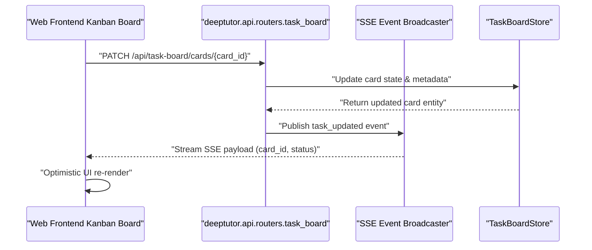

<!-- source: DeepWiki mcp.deepwiki.com · repo HKUDS/DeepTutor · page 4.13 Calendar, Tasks and Study Planning · fetched 2026-11-09 -->

# Calendar, Tasks and Study Planning

<details>
<summary>Relevant source files</summary>

The following files were used as context for generating this wiki page:

- [deeptutor/api/routers/auth.py](deeptutor/api/routers/auth.py)
- [deeptutor/api/routers/multi_user.py](deeptutor/api/routers/multi_user.py)
- [deeptutor/api/routers/task_board.py](deeptutor/api/routers/task_board.py)
- [deeptutor/multi_user/identity.py](deeptutor/multi_user/identity.py)
- [deeptutor/services/partners/__init__.py](deeptutor/services/partners/__init__.py)
- [deeptutor/services/partners/sessions.py](deeptutor/services/partners/sessions.py)
- [tests/api/test_auth_password.py](tests/api/test_auth_password.py)
- [tests/multi_user/test_learning_policy_http.py](tests/multi_user/test_learning_policy_http.py)
- [tests/multi_user/test_learning_surface_map.py](tests/multi_user/test_learning_surface_map.py)
- [tests/multi_user/test_login_username_contract.py](tests/multi_user/test_login_username_contract.py)
- [tests/multi_user/test_task_board.py](tests/multi_user/test_task_board.py)
- [tests/services/partners/test_slugify_partner_id.py](tests/services/partners/test_slugify_partner_id.py)
- [web/app/(auth)/login/page.tsx](web/app/(auth)/login/page.tsx)
- [web/app/(auth)/register/page.tsx](web/app/(auth)/register/page.tsx)
- [web/app/(utility)/profile/page.tsx](web/app/(utility)/profile/page.tsx)
- [web/app/(workspace)/partners/page.tsx](web/app/(workspace)/partners/page.tsx)
- [web/components/knowledge/KbFilePreview.tsx](web/components/knowledge/KbFilePreview.tsx)
- [web/components/mcp/McpCatalogBrowser.tsx](web/components/mcp/McpCatalogBrowser.tsx)
- [web/components/mcp/McpStatusBadge.tsx](web/components/mcp/McpStatusBadge.tsx)
- [web/components/memory/MemoryL1Workbench.tsx](web/components/memory/MemoryL1Workbench.tsx)
- [web/components/memory/MemorySection.tsx](web/components/memory/MemorySection.tsx)
- [web/components/partners/PartnerChannels.tsx](web/components/partners/PartnerChannels.tsx)
- [web/components/settings/MemoryUsageItem.tsx](web/components/settings/MemoryUsageItem.tsx)
- [web/components/settings/ModelsWorkspace.tsx](web/components/settings/ModelsWorkspace.tsx)
- [web/components/settings/ProvidersWorkspace.tsx](web/components/settings/ProvidersWorkspace.tsx)
- [web/components/settings/RegistryControls.tsx](web/components/settings/RegistryControls.tsx)
- [web/components/space/EduHubImportModal.tsx](web/components/space/EduHubImportModal.tsx)
- [web/components/space/PersonasSection.tsx](web/components/space/PersonasSection.tsx)
- [web/components/space/SkillsSection.tsx](web/components/space/SkillsSection.tsx)
- [web/components/workspaces/WorkspacePill.tsx](web/components/workspaces/WorkspacePill.tsx)
- [web/features/settings/sections/ToolsSettingsSection.tsx](web/features/settings/sections/ToolsSettingsSection.tsx)
- [web/lib/partners-api.ts](web/lib/partners-api.ts)
- [web/lib/profile-api.ts](web/lib/profile-api.ts)
- [web/lib/provider-registry.ts](web/lib/provider-registry.ts)
- [web/tests/provider-registry-workflow.spec.tsx](web/tests/provider-registry-workflow.spec.tsx)

</details>


The Calendar, Tasks and Study Planning subsystem provides temporal organization, structured task management, and schedule-driven study planning within DeepTutor. It bridges asynchronous AI tutoring agents with concrete user schedules, supporting iCalendar (ICS) import/export, recurring event expansion, multi-layered calendar views, a Kanban task board backed by FastAPI routers and real-time Server-Sent Events (SSE), and learning journal integrations.

---

## 1. Calendar Service and ICS Persistence

The calendar backend manages scheduling data through modular stores, handling standard iCalendar (`.ics`) serialization, recurrence rule (`RRULE`) expansion, and calendar layering (e.g., separating study schedules, assignment deadlines, and personal milestones).

```mermaid
graph TD
    subcode ["Code Entity Space"]
        ICS["deeptutor.services.calendar.ics_parser"] -->|Parse/Serialize| Model["CalendarEventModel"]
        Store["deeptutor.services.calendar.store.CalendarStore"] -->|Persistence| Disk["ics/ JSON Storage"]
        Recurrence["deeptutor.services.calendar.recurrence"] -->|Expand RRULE| Model
        LayerEngine["deeptutor.services.calendar.layers"] -->|Filter by Layer| API["deeptutor.api.routers.calendar"]
    end

    subnl ["Natural Language Space"]
        UserAction["User Calendar View Request"] --> API
        API --> Store
        Store --> Recurrence
    end

    style ICS fill:none,stroke:#000,stroke-width:1px
    style Store fill:none,stroke:#000,stroke-width:1px
    style Recurrence fill:none,stroke:#000,stroke-width:1px
    style LayerEngine fill:none,stroke:#000,stroke-width:1px
    style API fill:none,stroke:#000,stroke-width:1px
```
*Figure 1: Calendar subsystem architecture mapping natural language scheduling interactions to internal Python service classes and ICS parsers.*

### ICS Parsing and Recurrence
The ICS parser module normalizes external calendar feeds into internal Pydantic representations. Recurring events are processed via rule-expansion engines that compute concrete event instances on the fly within a given query window.
- **Store Layout**: Calendar data is persisted under the user scope path managed by `deeptutor.multi_user.paths` [deeptutor/multi_user/paths:55-58]().
- **Layers**: Events are categorized into distinct visual and operational layers (`study`, `deadline`, `personal`) to allow selective filtering during agent prompt context building.

Sources: `deeptutor/services/calendar/` (service module), `deeptutor/api/routers/auth.py` [deeptutor/api/routers/auth.py:30-44]()

---

## 2. Task Board Router and SSE Events

The task board subsystem organizes tasks into a Kanban workflow (e.g., `todo`, `in_progress`, `review`, `done`). It exposes REST endpoints via FastAPI and streams real-time board mutations using Server-Sent Events (SSE).


*Figure 2: Task mutation lifecycle and Server-Sent Events (SSE) push notification flow.*

### Router Implementation
The task board API router manages board columns, card ordering, metadata tagging, and assignment bindings to specific learning modules or mastery paths:
- **Endpoints**: Supports card creation (`POST /api/task-board/cards`), bulk reordering, and status transitions (`PATCH /api/task-board/cards/{card_id}`) [tests/multi_user/test_learning_surface_map.py:39-41]().
- **Real-Time Updates**: Connections to `/api/task-board/events` establish an SSE channel, broadcasting structural changes across client instances instantly without polling.

Sources: `deeptutor/api/routers/task_board.py`, `tests/multi_user/test_task_board.py`

---

## 3. Kanban and Tasks Frontend Features

The frontend Kanban interface provides a high-performance, responsive drag-and-drop board alongside list-based alternatives for task prioritization.

- **State Management**: Task data is synchronized with the backend store using optimistic updates to guarantee zero-latency UI feedback during column moves.
- **Filtering and Search**: Cards can be filtered by due date, priority levels, associated reading materials [tests/multi_user/test_learning_policy_http.py:170-180](), or active Mastery Path knowledge points.
- **Agent Integration**: AI tutoring agents can programmatically insert tasks into the user's board (e.g., suggesting review tasks after a quiz failure or book chapter completion).

Sources: `web/components/settings/ModelsWorkspace.tsx` [web/components/settings/ModelsWorkspace.tsx:1-20](), `tests/multi_user/test_learning_surface_map.py`

---

## 4. Learning Journal and Study Planning Integration

Study planning ties together the calendar, task board, and learning journal into a unified metacognitive feedback loop.

- **Journal Entries**: Users record daily reflections, study summaries, and conceptual blockers. These entries are indexed and linked to corresponding task cards and calendar sessions.
- **Mastery Path Synchronization**: When a user interacts with the Mastery Path engine [deeptutor/api/routers/auth.py:43-48](), overdue or failed learning objectives automatically generate corrective task items on the Kanban board.
- **Time Boxing**: Calendar blocks can be linked directly to specific task cards, allowing agents to monitor study duration and prompt reflective entries when scheduled blocks conclude.

Sources: `deeptutor/api/routers/auth.py` [deeptutor/api/routers/auth.py:40-52](), `deeptutor/multi_user/identity.py` [deeptutor/multi_user/identity.py:80-92]()

---

