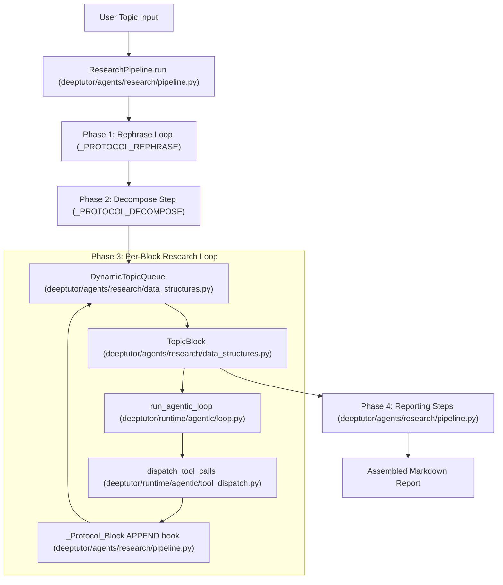
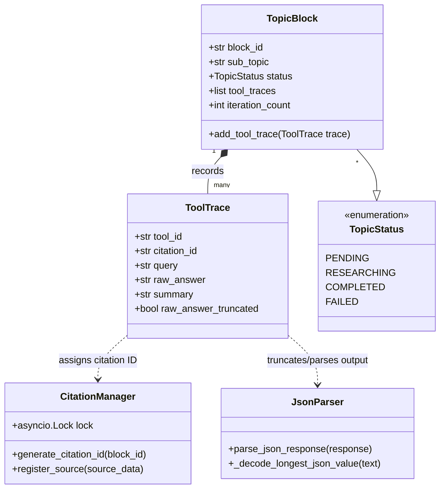

<!-- source: DeepWiki mcp.deepwiki.com · repo HKUDS/DeepTutor · page 4.2 Deep Research · fetched 2026-11-09 -->

# Deep Research

Relevant source files

The following files were used as context for generating this wiki page:

- [deeptutor/agents/loop/pipeline.py](deeptutor/agents/loop/pipeline.py)
- [deeptutor/agents/research/data_structures.py](deeptutor/agents/research/data_structures.py)
- [deeptutor/agents/research/pipeline.py](deeptutor/agents/research/pipeline.py)
- [deeptutor/agents/research/prompts/en/pipeline.yaml](deeptutor/agents/research/prompts/en/pipeline.yaml)
- [deeptutor/agents/research/prompts/zh/pipeline.yaml](deeptutor/agents/research/prompts/zh/pipeline.yaml)
- [deeptutor/agents/research/utils/citation_manager.py](deeptutor/agents/research/utils/citation_manager.py)
- [deeptutor/book/blocks/base.py](deeptutor/book/blocks/base.py)
- [deeptutor/runtime/agentic/__init__.py](deeptutor/runtime/agentic/__init__.py)
- [deeptutor/runtime/agentic/labels.py](deeptutor/runtime/agentic/labels.py)
- [deeptutor/runtime/agentic/loop.py](deeptutor/runtime/agentic/loop.py)
- [deeptutor/runtime/agentic/messages.py](deeptutor/runtime/agentic/messages.py)
- [deeptutor/services/llm/provider_core/openai_compat_provider.py](deeptutor/services/llm/provider_core/openai_compat_provider.py)
- [deeptutor/services/llm/provider_core/openai_responses/converters.py](deeptutor/services/llm/provider_core/openai_responses/converters.py)
- [deeptutor/services/llm/provider_core/openai_responses/parsing.py](deeptutor/services/llm/provider_core/openai_responses/parsing.py)
- [deeptutor/services/llm/usage_frame.py](deeptutor/services/llm/usage_frame.py)
- [deeptutor/services/rag/visual_assets.py](deeptutor/services/rag/visual_assets.py)
- [deeptutor/utils/json_parser.py](deeptutor/utils/json_parser.py)
- [tests/agents/chat/test_context_window_guard.py](tests/agents/chat/test_context_window_guard.py)
- [tests/agents/research/test_citation_manager.py](tests/agents/research/test_citation_manager.py)
- [tests/agents/research/test_report_stream_formatting.py](tests/agents/research/test_report_stream_formatting.py)
- [tests/agents/research/test_research_obsidian_tools.py](tests/agents/research/test_research_obsidian_tools.py)
- [tests/core/agentic/test_loop_reasoning_replay.py](tests/core/agentic/test_loop_reasoning_replay.py)
- [tests/core/test_agentic_labels.py](tests/core/test_agentic_labels.py)
- [tests/core/test_agentic_messages.py](tests/core/test_agentic_messages.py)
- [tests/services/config/test_staged_capability_params.py](tests/services/config/test_staged_capability_params.py)
- [tests/services/llm/test_native_web_search.py](tests/services/llm/test_native_web_search.py)
- [tests/services/llm/test_openai_compat_reasoning_content.py](tests/services/llm/test_openai_compat_reasoning_content.py)
- [tests/services/llm/test_openai_responses_converters.py](tests/services/llm/test_openai_responses_converters.py)
- [tests/services/llm/test_openai_responses_parsing.py](tests/services/llm/test_openai_responses_parsing.py)
- [tests/services/llm/test_responses_tool_strict.py](tests/services/llm/test_responses_tool_strict.py)
- [tests/services/llm/test_usage_frame.py](tests/services/llm/test_usage_frame.py)
- [tests/services/rag/test_visual_assets.py](tests/services/rag/test_visual_assets.py)
- [tests/utils/test_json_parser.py](tests/utils/test_json_parser.py)

The Deep Research module provides an autonomous, multi-agent investigation pipeline for deep-diving into complex topics. It coordinates a Decompose-Investigate-Note-Report lifecycle using the `ResearchPipeline` engine, which organizes the research into multiple phases and integrates tool invocations grounded by a strict block-level policy [deeptutor/agents/research/pipeline.py:1-30]().

This page documents the research pipeline stages, the block tool policy ensuring grounded evidence collection, the citation management system for traceability, the key research data structures, and prompt management for agent communication.

---

## Multi-Agent Research Pipeline Architecture

The core orchestration for deep research is encapsulated in the `ResearchPipeline` class, which implements a four-phase agentic workflow supplemented by a note-taking sidecar capability [deeptutor/agents/research/pipeline.py:1-30]().

| Phase | Description | Protocol / Labels |
|-------|-------------|------------------|
| **Phase 1: Rephrase** | An agentic mini loop refining the research topic through user interaction (up to 3 rounds of `ask_user` tool calls). Only `THINK`, `TOOL` (restricted to `ask_user`), and `FINISH` labels are allowed. The output is a concrete refined topic. | `_PROTOCOL_REPHRASE` ([deeptutor/agents/research/pipeline.py:154-160]()) |
| **Phase 2: Decompose** | Single-step production of a JSON outline for sub-topics from the refined topic. Outputs a list of `TopicBlock` entities in a queue. | `_PROTOCOL_DECOMPOSE` (`OUTLINE` label only) ([deeptutor/agents/research/pipeline.py:163-170]()) |
| **Phase 3: Research Blocks** | Iterative agentic loops per `TopicBlock` that use tool calls (`TOOL`), reflections (`THINK`), intermediate queue extensions (`APPEND`), and completion (`FINISH`). The dynamic topic queue can expand during this phase based on discoveries. | `_PROTOCOL_BLOCK` (`THINK`, `TOOL`, `APPEND`, `FINISH`) ([deeptutor/agents/research/pipeline.py:174-180]()) |
| **Phase 4: Reporting** | One-shot labeled steps generating report structure (`OUTLINE`), introduction (`INTRO`), sections (`SECTION`), and conclusion (`CONCLUSION`). Pulls citations from `CitationManager` for referencing. | `_PROTOCOL_REPORT_OUTLINE`, etc. ([deeptutor/agents/research/pipeline.py:185-190]()) |

### Diagram: Natural Language Space to Code Entity Space (Pipeline Execution)

Sources: [deeptutor/agents/research/pipeline.py:1-190](), [deeptutor/agents/research/data_structures.py:1-206]()

---

## Block Tool Policy and Allowlist

To ensure rigorous, evidence-backed research, the pipeline enforces a strict allowlist of tools usable inside each research block loop (`Phase 3`). This policy excludes any write-capable tools during research blocks and limits allowed tools to those that can provide sourced evidence [deeptutor/agents/research/pipeline.py:113-138]().

### Allowed Tools in Research Blocks (`RESEARCH_BLOCK_TOOL_ALLOWLIST`)

- **Key Tools:**
  - `rag` (retrieval-augmented generation from connected knowledge bases)
  - `web_search` (web search tools)
  - `paper_search` (academic paper search)
  - `exec` (sandboxed code execution)
  - Workspace tools: `workspace_read`, `workspace_list`, `workspace_search`, `workspace_present`
- **Read-only Obsidian Vault Tools (`RESEARCH_OBSIDIAN_READ_TOOLS`):**
  - `obsidian_search`, `obsidian_read`, `obsidian_list`

> Write operations are disallowed inside research blocks to ensure that all resulting content is grounded on evidence rather than user or agent-generated data edits. The Obsidian vault tools are injected server-side with an internal `_vault_path` and are read-only [deeptutor/agents/research/pipeline.py:118-138]().

Sources: [deeptutor/agents/research/pipeline.py:113-138]()

---

## Core Research Data Structures

The research pipeline state and dataflow depend on primary data structures defined in `deeptutor/agents/research/data_structures.py`.

### TopicBlock and ToolTrace

- **`TopicBlock`**: Represents the fundamental scheduling unit, a single sub-topic to be researched. Tracks `block_id`, `sub_topic` title, `overview`, status (`TopicStatus` enum), iteration count, timestamps, metadata, and an accumulated list of `ToolTrace` objects.
- **`ToolTrace`**: Represents a complete tool call and response cycle. Contains a uniquely assigned `citation_id`, query parameters, raw answer data, summarized note, and truncation metadata. Automatically truncates raw answers (>50 KB) while attempting to preserve JSON structure using `parse_json_response` [deeptutor/utils/json_parser.py:66-182]().
- **`TopicStatus`**: Enum tracking lifecycle states (`PENDING`, `RESEARCHING`, `COMPLETED`, `FAILED`).

### Diagram: Natural Language Space to Code Entity Space (Data Structures)

Sources: [deeptutor/agents/research/data_structures.py:1-206](), [deeptutor/utils/json_parser.py:66-182]()

---

## Citation Management

The `CitationManager` abstracts the generation, storage, and normalization of citation IDs used throughout the research and reporting phases [deeptutor/agents/research/utils/citation_manager.py:62-188]().

### Features:
- **Citation ID Generators:** Generates `PLAN-XX` style IDs for planning stage citations and `CIT-X-XX` style IDs for research blocks.
- **Citation Persistence:** Stores citations in `citations.json` under the workspace cache directory (`data/user/workspace/deep_research/{research_id}`).
- **Thread Safety:** Incorporates an `asyncio.Lock` for async-safe operations during parallel research threads.
- **Citation Validation:** Ensures citations referenced in final reports link to collected tool traces.

Sources: [deeptutor/agents/research/utils/citation_manager.py:62-188]()

---

## Robust JSON Parsing Utilities

Deep Research features robust JSON parsing support via `parse_json_response` to handle malformed LLM outputs, embedded reasoning preludes, and markdown code blocks [deeptutor/utils/json_parser.py:66-182]().

### Features:
- **Multi-stage Parsing:** Attempts direct JSON parse, extracts and parses JSON within markdown fenced code blocks, strips `<think>` reasoning tags, and uses the longest successful JSON decode when multiple candidates exist [deeptutor/utils/json_parser.py:103-162]().
- **Repair Support:** Integrates with the `json-repair` library to fix trailing commas and missing quotes [deeptutor/utils/json_parser.py:163-181]().

Sources: [deeptutor/utils/json_parser.py:66-182]()

---

## Prompt Management and Protocols

Research agent behavior is governed by structured YAML prompts loaded per language (e.g., `deeptutor/agents/research/prompts/en/pipeline.yaml` and `zh/pipeline.yaml`) [deeptutor/agents/research/prompts/en/pipeline.yaml:1-130](), [deeptutor/agents/research/prompts/zh/pipeline.yaml:1-74]().

### Key Aspects:
- **Labels and Action Protocols:** Defines `THINK`, `TOOL`, `FINISH`, `APPEND`, `OUTLINE`, `INTRO`, `SECTION`, `CONCLUSION` to dictate agent turn intentions.
- **Phase-Specific Prompts:** Directs Phase 1 clarification with `ask_user` limits and Phase 3 research block execution with dynamic topic lists.
- **Internationalization:** English and Chinese prompt manifests maintain complete structural parity.

Sources: [deeptutor/agents/research/prompts/en/pipeline.yaml:1-130](), [deeptutor/agents/research/prompts/zh/pipeline.yaml:1-74]()

---

