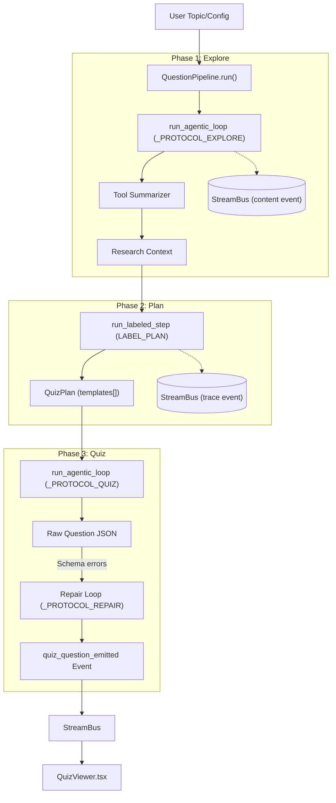
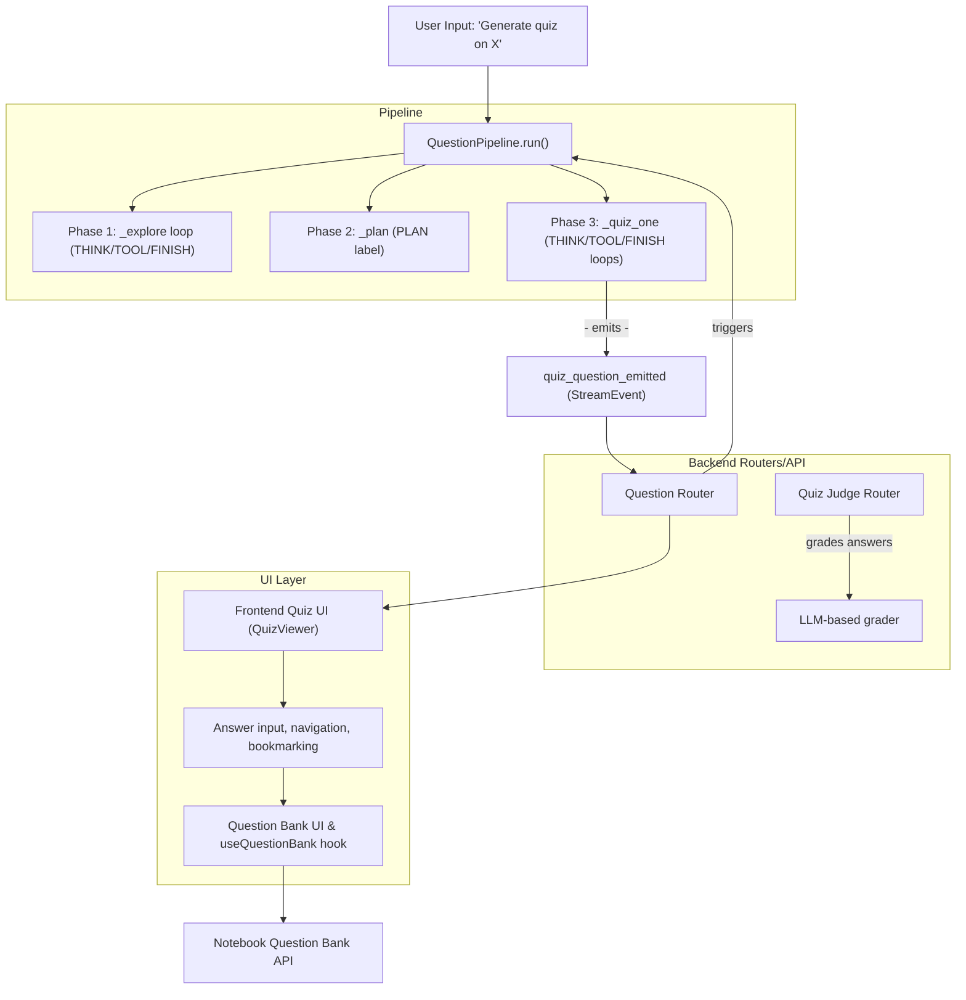

<!-- source: DeepWiki mcp.deepwiki.com · repo HKUDS/DeepTutor · page 4.3 Quiz Generation and Question Bank · fetched 2026-11-09 -->

# Quiz Generation and Question Bank

Relevant source files

The following files were used as context for generating this wiki page:

- [deeptutor/agents/chat/agentic_pipeline.py](deeptutor/agents/chat/agentic_pipeline.py)
- [deeptutor/agents/chat/prompts/en/agentic_chat.yaml](deeptutor/agents/chat/prompts/en/agentic_chat.yaml)
- [deeptutor/agents/chat/prompts/zh/agentic_chat.yaml](deeptutor/agents/chat/prompts/zh/agentic_chat.yaml)
- [deeptutor/agents/loop/agent_loop.py](deeptutor/agents/loop/agent_loop.py)
- [deeptutor/agents/question/pipeline.py](deeptutor/agents/question/pipeline.py)
- [deeptutor/agents/question/prompts/en/pipeline.yaml](deeptutor/agents/question/prompts/en/pipeline.yaml)
- [deeptutor/agents/question/prompts/zh/pipeline.yaml](deeptutor/agents/question/prompts/zh/pipeline.yaml)
- [deeptutor/api/routers/question_notebook.py](deeptutor/api/routers/question_notebook.py)
- [deeptutor/runtime/agentic/labeled_step.py](deeptutor/runtime/agentic/labeled_step.py)
- [deeptutor/skills/builtin/pdf/SKILL.md](deeptutor/skills/builtin/pdf/SKILL.md)
- [tests/agents/chat/test_agent_loop.py](tests/agents/chat/test_agent_loop.py)
- [tests/agents/question/test_pipeline.py](tests/agents/question/test_pipeline.py)
- [tests/agents/test_failure_notices_name_the_cause.py](tests/agents/test_failure_notices_name_the_cause.py)
- [tests/api/test_question_bank_api.py](tests/api/test_question_bank_api.py)
- [tests/core/test_labeled_step_think_prelude.py](tests/core/test_labeled_step_think_prelude.py)
- [tests/tools/test_code_execution_guidance.py](tests/tools/test_code_execution_guidance.py)
- [web/components/quiz/QuizFollowupTabBody.tsx](web/components/quiz/QuizFollowupTabBody.tsx)
- [web/components/quiz/QuizViewer.tsx](web/components/quiz/QuizViewer.tsx)
- [web/components/space/question-bank/BankScopeRail.tsx](web/components/space/question-bank/BankScopeRail.tsx)
- [web/components/space/question-bank/BankSelectionBar.tsx](web/components/space/question-bank/BankSelectionBar.tsx)
- [web/components/space/question-bank/BankToolbar.tsx](web/components/space/question-bank/BankToolbar.tsx)
- [web/components/space/question-bank/CategoryManager.tsx](web/components/space/question-bank/CategoryManager.tsx)
- [web/components/space/question-bank/CategoryMenu.tsx](web/components/space/question-bank/CategoryMenu.tsx)
- [web/components/space/question-bank/QuestionBankSection.tsx](web/components/space/question-bank/QuestionBankSection.tsx)
- [web/components/space/question-bank/QuestionCard.tsx](web/components/space/question-bank/QuestionCard.tsx)
- [web/components/space/question-bank/useQuestionBank.ts](web/components/space/question-bank/useQuestionBank.ts)
- [web/hooks/useChatAutoScroll.ts](web/hooks/useChatAutoScroll.ts)
- [web/lib/notebook-api.ts](web/lib/notebook-api.ts)
- [web/tests/chat-autoscroll-layout.spec.tsx](web/tests/chat-autoscroll-layout.spec.tsx)
- [web/tests/integration/smoke.spec.tsx](web/tests/integration/smoke.spec.tsx)
- [web/tests/practice-display-stats.spec.tsx](web/tests/practice-display-stats.spec.tsx)
- [web/tests/quiz-autoscroll.test.ts](web/tests/quiz-autoscroll.test.ts)
- [web/tests/quiz-option-latex.test.ts](web/tests/quiz-option-latex.test.ts)
- [web/tests/setup/rendered.ts](web/tests/setup/rendered.ts)
- [web/vitest.config.mts](web/vitest.config.mts)

The **Quiz Generation and Question Bank** module in DeepTutor encapsulates a sophisticated pipeline to generate, manage, and interact with educational quizzes. It comprises a three-phase agentic pipeline (`QuestionPipeline`) to create grounded, diverse questions and a rich frontend/backend integration to manage question banks. This module supports exam mimicry, schema validation and repair, live incremental question emission, and a notebook-based question repository with seamless UI.

Sources: [deeptutor/agents/question/pipeline.py:1-24]()

---

## 1. QuestionPipeline Three Phases

`QuestionPipeline` is the core engine orchestrating quiz creation through three well-defined sequential phases. It leverages protocol labels to direct an LLM-driven agentic execution and integrates tools dynamically.

### Phase Descriptions and Protocol

- **Phase 1 (Explore)**: This phase executes an agentic loop governed by the protocol labels `THINK`, `TOOL`, and `FINISH` [deeptutor/agents/question/pipeline.py:5-10](). The agent performs research using chat-style tools including knowledge bases and web search, integrating prior quiz history to avoid duplicate questions and target learner weak spots. Each tool result is summarized by a dedicated tool summarizer that compresses raw results into concise, citation-preserving summaries reducing token usage in future turns [deeptutor/agents/question/pipeline.py:148-153]().

- **Phase 2 (Plan)**: A single agentic step labeled `PLAN` synthesizes a detailed JSON plan. The output includes an analysis and a list of question templates specifying properties like `question_id`, `topic`, `question_type`, and `difficulty`. This step produces no tool calls but streams progress into the trace for review [deeptutor/agents/question/pipeline.py:11-13]().

- **Phase 3 (Quiz)**: For each question template, an agentic loop executes over the protocol `THINK`, `TOOL`, and `FINISH`. The `FINISH` label must yield a strict JSON describing a single question's complete content. This output is validated; if schema violations occur, a repair protocol loop attempts automated fixes. Verified questions are emitted as structured events with kind `quiz_question_emitted`, enabling immediate frontend rendering of question cards [deeptutor/agents/question/pipeline.py:14-19,131-137]().

### Agentic Quiz Generation Data Flow Diagram

Sources: [deeptutor/agents/question/pipeline.py:1-24,110-137](), [tests/agents/question/test_pipeline.py:1-189]()

---

## 2. Quiz Templates and Question Type Taxonomy

Question templates produced in Phase 2 follow a precise schema, drawing from a canonical question-type taxonomy enumerated in `QuestionType` [deeptutor/agents/question/pipeline.py:156-166](). This taxonomy informs prompt construction, validation, and frontend rendering logic.

| Question Type      | Description                        | Frontend / Evaluation Logic                                  |
|--------------------|----------------------------------|-------------------------------------------------------------|
| `choice`           | Multiple-choice (options A-D)    | Recognized by `isMultipleChoice` helper; key-based grading  [web/components/quiz/QuizViewer.tsx:138-144]() |
| `concept`          | True/False conceptual questions  | Boolean normalization and evaluation via `isConceptQuizQuestion` [web/components/quiz/QuizViewer.tsx:183-187]() |
| `fill_in_blank`    | Blank completion (using `____`)  | Detected by `isFillInBlankQuizQuestion`                      [web/components/quiz/QuizViewer.tsx:155-157]()                   |
| `short_answer`     | Open-ended brief response         | User-graded by comparison with model answer                  [web/components/quiz/QuizViewer.tsx:147-151]()                |
| `written`          | Essay or in-depth written answer  | User-graded                                                   [web/components/quiz/QuizViewer.tsx:147-151]()                |
| `coding`           | Programming or algorithmic task   | User-graded                                                   [web/components/quiz/QuizViewer.tsx:147-151]()                |

Frontend auto-grading is supported for choice, concept, and fill-in-blank types, while other types require learner self-assessment with model-provided reference answers.

Sources: [deeptutor/agents/question/pipeline.py:156-174](), [web/components/quiz/QuizViewer.tsx:137-157]()

---

## 3. Mimic Mode (Exam Cloning)

DeepTutor supports an **exam-mimicry** workflow, enabling quiz generation that clones the structural and stylistic signature of a provided exam paper. This is useful for educators wanting to replicate exam templates or for practice matching real exam styles.

### Process Overview

1. **Exam Paper Parsing**: The system ingests static documents (e.g., PDFs). Document extractors parse text and layout to reconstruct question stems, options, and relevant metadata.

2. **Template Injection**: Instead of running Phase 1 (Explore), the parsed question templates directly override the question templates list passed to the `QuestionPipeline`. This bypasses open ideation and enforces structural fidelity to the source exam [deeptutor/agents/question/pipeline.py:1-24]().

3. **Targeted Generation**: The pipeline executes Phase 3 (Quiz) exclusively on the provided templates, generating fresh question texts and options that mimic the style and difficulty of the reference exam.

### Exam-Mimicry Code Entity Mapping

```mermaid
graph LR
    subgraph Frontend["Frontend"]
        QCP["QuizConfigPanel.tsx"] --> Mode["mode: mimic"]
        Mode --> Upload["onUploadPdf"]
        Upload --> Route["/api/v1/question/mimic"]
    end

    subgraph Backend["Backend"]
        Route --> EP["deeptutor/api/routers/question.py"]
        EP --> Tool["deeptutor/tools/question.mimic_exam_questions"]
        Tool --> AC["AgentCoordinator"]
        AC --> PET["parse_exam_paper_to_templates()"]
        PET --> QP["QuestionPipeline.run(templates_override)"]
    end

    subgraph Pipeline["Pipeline Runtime"]
        QP --> Phase3["Phase 3: Quiz Loop"]
        Phase3 -->|quiz_question_emitted| Bus["StreamBus"]
    end

    Bus --> Route
    Route --> QCP
```

Sources: [deeptutor/agents/question/pipeline.py:1-24](), [deeptutor/api/routers/question.py:1-60]()

---

## 4. Quiz Routers, Judge, and API

DeepTutor exposes quiz generation and judgment functionalities via dedicated FastAPI routers in the backend:

- **Question Router** (`deeptutor/api/routers/question.py`): Handles REST and WebSocket APIs for quiz generation, mimicking, and streaming progress events. It interfaces directly with the `QuestionPipeline` and streams incremental question emissions for frontend consumption [deeptutor/api/routers/question.py:1-60]().

- **Quiz Judge Router** (`deeptutor/api/routers/quiz_judge.py`): Provides grading and feedback endpoints that accept user answers alongside reference solutions. It uses LLM-based judgment to automatically evaluate free-text or open-ended responses and returns structured feedback explanations to the frontend [deeptutor/api/routers/quiz_judge.py:1-40]().

Sources: [deeptutor/api/routers/question.py:1-60](), [deeptutor/api/routers/quiz_judge.py:1-40]()

---

## 5. Notebook Question Bank UI and API

The interactive question bank integrates tightly with the frontend quiz UI and backend storage:

### Frontend `QuizViewer` Component

- Implements an interactive quiz card UI that supports multiple question types, answer input (selected choices, free text, image upload), and displays explanations [web/components/quiz/QuizViewer.tsx:150-215]().

- Supports client-side auto-grading for choice, concept, and fill-in-blank questions and connects to asynchronous LLM-based grading for open-ended questions.

- Uses the `turnId` metadata to scope notebook storage lookups and updates, ensuring that different quiz instances within the same session do not conflate their question states [web/components/quiz/QuizViewer.tsx:66-80]().

### Notebook Question Bank State and API

- The `useQuestionBank` React hook provides filtered views, bookmarking, categorization, and CRUD operations on notebook entries (questions and answers) [web/components/space/question-bank/useQuestionBank.ts]().

- Each notebook entry stores metadata including the question content, user answers, grading state, and relevant session or source IDs [deeptutor/api/routers/question_notebook.py:48-89]().

- The backend API (`deeptutor/api/routers/question_notebook.py`) exposes notebook entry routes supporting lookups, upserts, bulk categorizations, and category management, enabling persistent study archives [deeptutor/api/routers/question_notebook.py:1-223]().

Sources: [web/components/quiz/QuizViewer.tsx:66-215](), [web/components/space/question-bank/useQuestionBank.ts](), [deeptutor/api/routers/question_notebook.py:1-223]()

---

## Summary Diagram: Natural Language to Code Entity Mapping for Quiz Generation and Question Bank

This diagram maps user intentions through the pipeline phases, API routers for generation and judgment, and onto frontend components that manage quizzes and notebook entries.

Sources: All above-cited files and sections

---

## Technical Details and Key Implementation Points

- **Tool Summarizer**: After each tool call in Phase 1, the raw tool output is compressed by a summarizer agentic step with low temperature (0.2) to reduce token usage while preserving factual content for grounding [deeptutor/agents/question/pipeline.py:148-153]().

- **Schema Repair**: The pipeline uses a special repair protocol label (`FINISH` only) to emit corrected JSON if the initial question JSON payload violates the schema, with fixed maximum repair attempts [deeptutor/agents/question/pipeline.py:131-137]().

- **Prior Quiz History**: Passed into Phase 1 exploration, prior quiz history guides question topic coverage to avoid repeats and targets learner weak spots discovered by analyzing prior incorrect answers [deeptutor/agents/question/pipeline.py:85-87]().

- **Agentic Loop Reuse**: The loop behavior of Phase 1 and Phase 3 relies on shared primitives from `deeptutor.runtime.agentic` such as `run_agentic_loop` and `LabelProtocol` configuration, ensuring consistent tool handling and output streaming across phases [deeptutor/agents/question/pipeline.py:110-130]().

- **Incremental Emission**: Questions are streamed as soon as they are ready via `quiz_question_emitted` events, allowing the frontend to display quiz content progressively without waiting for the entire batch [deeptutor/agents/question/pipeline.py:17-19]().

- **Frontend Answer Handling**: The `QuizViewer` supports answer states with selection, typed text, and attached images, tracks submission states, and interfaces with the notebook entry backend for persistence. It auto-grades straightforward question types and streams LLM judgments for open questions [web/components/quiz/QuizViewer.tsx:99-190]().

- **Turn Isolation in Notebook API**: To prevent answer state confusion between quizzes in one chat session, all notebook interactions are scoped by `turnId`, ensuring proper segregation and consistent question identities [web/components/quiz/QuizViewer.tsx:68-78]().

Sources:  
- [deeptutor/agents/question/pipeline.py:1-180]()  
- [deeptutor/api/routers/question.py:1-60]()  
- [deeptutor/api/routers/quiz_judge.py:1-40]()  
- [deeptutor/api/routers/question_notebook.py:1-223]()  
- [web/components/quiz/QuizViewer.tsx:1-215]()  
- [web/components/space/question-bank/useQuestionBank.ts]()  
- [web/lib/notebook-api.ts]()  
- [tests/agents/question/test_pipeline.py:1-189]()

---

