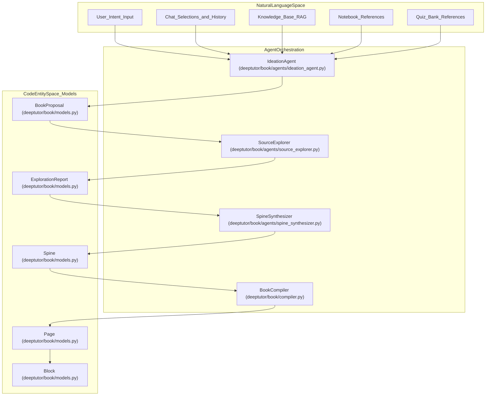
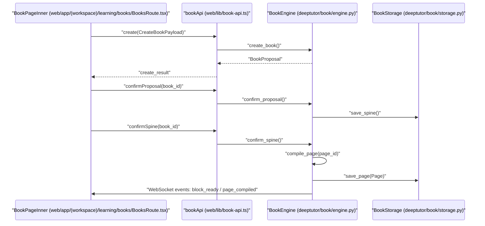

<!-- source: DeepWiki mcp.deepwiki.com · repo HKUDS/DeepTutor · page 4.4 Book Engine · fetched 2026-11-09 -->

# Book Engine

Relevant source files

The following files were used as context for generating this wiki page:

- [deeptutor/api/routers/book.py](deeptutor/api/routers/book.py)
- [deeptutor/api/routers/reading_extensions.py](deeptutor/api/routers/reading_extensions.py)
- [deeptutor/book/agents/spine_agent.py](deeptutor/book/agents/spine_agent.py)
- [deeptutor/book/blocks/_rag_helpers.py](deeptutor/book/blocks/_rag_helpers.py)
- [deeptutor/book/blocks/section.py](deeptutor/book/blocks/section.py)
- [deeptutor/book/engine.py](deeptutor/book/engine.py)
- [deeptutor/book/kb_health.py](deeptutor/book/kb_health.py)
- [deeptutor/book/models.py](deeptutor/book/models.py)
- [deeptutor/book/storage.py](deeptutor/book/storage.py)
- [deeptutor/learning/assessment.py](deeptutor/learning/assessment.py)
- [deeptutor/learning/tests/test_assessment.py](deeptutor/learning/tests/test_assessment.py)
- [deeptutor/reading/extensions.py](deeptutor/reading/extensions.py)
- [deeptutor/reading/read_aloud.py](deeptutor/reading/read_aloud.py)
- [tests/api/test_book_quiz_attempt_notebook.py](tests/api/test_book_quiz_attempt_notebook.py)
- [tests/api/test_reading_quiz_answers.py](tests/api/test_reading_quiz_answers.py)
- [tests/book/test_empty_source_drift.py](tests/book/test_empty_source_drift.py)
- [tests/book/test_engine_controls.py](tests/book/test_engine_controls.py)
- [tests/book/test_kb_health_drift.py](tests/book/test_kb_health_drift.py)
- [tests/reading/test_extension_router.py](tests/reading/test_extension_router.py)
- [tests/reading/test_extensions.py](tests/reading/test_extensions.py)
- [web/app/(workspace)/learning/books/BooksRoute.tsx](web/app/(workspace)/learning/books/BooksRoute.tsx)
- [web/components/reading/ReadingExtensionBar.tsx](web/components/reading/ReadingExtensionBar.tsx)
- [web/lib/book-api.ts](web/lib/book-api.ts)
- [web/lib/book-types.ts](web/lib/book-types.ts)
- [web/tests/reading-extensions.test.ts](web/tests/reading-extensions.test.ts)
- [web/tests/reading-quiz-persistence.spec.tsx](web/tests/reading-quiz-persistence.spec.tsx)

## Purpose and Scope

The **Book Engine** serves as a top-level orchestrator for the creation and compilation of *living, interactive books* from diverse educational content sources [deeptutor/book/engine.py:2-39](). It integrates user intent, multiple knowledge bases, chat excerpts, notebooks, and quiz banks into a structured digital learning artifact. Crucially, the `BookEngine` is designed as a parallel, standalone coordinator separate from the chat agent orchestration, providing a single public API endpoint for the CLI, API router, and SDK layers [deeptutor/book/engine.py:5-8](). Its lifecycle includes ideation, proposal confirmation, spine synthesis, page planning, page compilation, and book maintenance with long-lived streaming status updates [deeptutor/book/engine.py:9-39](). 

The engine supports a multi-stage, incremental pipeline and manages concurrency and error handling carefully to prevent "half-generated debris." It employs per-book runtime state, including asyncio queues and background workers, with breaker logic to pause compilation on persistent provider failures [deeptutor/book/engine.py:25-38](), [deeptutor/book/engine.py:100-106]().

### Key Functionalities

- **Create Book Proposal**: Initial ideation stage producing a user-confirmable book outline [deeptutor/book/engine.py:14]().
- **Confirm Proposal**: Synthesizing the chapter spine and associated concept graph [deeptutor/book/engine.py:15]().
- **Confirm Spine**: Locking the spine layout and triggering page planning and compilation [deeptutor/book/engine.py:16]().
- **Compile Page**: Incremental, asynchronous generation of each page's content blocks [deeptutor/book/engine.py:17]().
- **Resume and Rebuild Book**: Managing continuation or full regeneration of book pages [deeptutor/book/engine.py:18-19]().
- **Generation Status Reporting**: Long-lived event streaming for frontend progress monitoring [deeptutor/book/engine.py:36-38]().

Sources: [deeptutor/book/engine.py:2-39](), [deeptutor/book/engine.py:100-130]()

---

## Living Book Pipeline

The Book Engine implements a structured pipeline consisting of four core stages, with each stage represented by a dedicated agent or component. The pipeline transforms natural language user intent into fully compiled book pages.

### 1. Ideation (`IdeationAgent`)

- **Input:** An `IdeationContext` aggregating user intent, recent chat selections, notebook references, and question bank excerpts [deeptutor/book/inputs.py](), [deeptutor/book/engine.py:60]().
- **Output:** A structured `BookProposal` JSON object describing the proposed book's title, description, scope, target level, rationale, and estimated chapters [deeptutor/book/models.py:69]().
- **Implementation:** The `IdeationAgent` extends `BaseAgent` and performs a structured LLM call with reasoning retry capabilities, appending a strict language directive to maintain consistency [deeptutor/book/agents/ideation_agent.py]().
- **Retry Logic:** Retries the LLM call with low reasoning effort if the initial response is truncated or incomplete.

### 2. Source Exploration (`SourceExplorer`)

- **Input:** The confirmed `BookProposal` and a snapshot of `BookInputs` (four content sources) [deeptutor/book/engine.py:55](), [deeptutor/book/engine.py:68]().
- **Output:** An `ExplorationReport` containing synthesized summaries, candidate concepts, and source chunks from Knowledge Bases (KBs), notebooks, chat history, and quiz banks [deeptutor/book/models.py:73]().
- **Implementation:** Executes a parallel multi-query RAG sweep across selected KBs and sources, combining vector search and LLM synthesis calls [deeptutor/book/agents/source_explorer.py]().
- **LLM Calls:** Two passes (query design and chunk synthesis).
- **Concurrency:** Restricts retrieval concurrency to avoid overloading providers [deeptutor/book/agents/source_explorer.py]().

### 3. Spine Synthesis (`SpineSynthesizer`)

- **Input:** `BookProposal` and `ExplorationReport` [deeptutor/book/engine.py:56](), [deeptutor/book/models.py:73](), [deeptutor/book/models.py:78]().
- **Output:** A fully synthesized `Spine` object, including ordered chapters and a directed concept graph [deeptutor/book/models.py:78]().
- **Implementation:** Implements a multi-round Draft → Critique → Revise loop (default `max_rounds=2`) [deeptutor/book/agents/spine_synthesizer.py]().
- **Post-processing:** Performs deterministic topological sorting, cycle removal, and coverage padding post LLM rounds.
- **Robustness:** Returns a fallback minimal spine if LLM calls fail, avoiding pipeline breakdown [deeptutor/book/agents/spine_synthesizer.py]().

### 4. Page Planning and Block Compilation

- **Page Planning:** The confirmed spine is converted into a set of planned pages and blocks, organizing content by types such as theory, derivations, practice, quizzes, and interactive components.
- **Block Compilation:** Specialized block generators synthesize individual content blocks from the planned pages [deeptutor/book/compiler.py]().
- **Concurrency:** Page compilation is queued and processed asynchronously, enabling parallel generation while preventing duplicate generation via an in-flight table [deeptutor/book/engine.py:25-30]().
- **Runtime Control:** Background workers manage the compilation queue with breaker logic for provider-related consecutive failures [deeptutor/book/engine.py:31-34]().
- **Editable Blocks:** Certain block types support in-place editing, preserved across regenerations [deeptutor/book/engine.py:128-140]().

### Diagram: NL Space to Code Entity Mapping

Sources: [deeptutor/book/agents/ideation_agent.py](), [deeptutor/book/agents/source_explorer.py](), [deeptutor/book/agents/spine_synthesizer.py](), [deeptutor/book/models.py:62-79]()

---

## Block Types and Payload Structures

The Book Engine defines a rich set of block types categorized into modular content units:

| Category                 | Block Types                                                                                  |
|--------------------------|----------------------------------------------------------------------------------------------|
| **Text & Prose**         | `text`, `callout`, `user_note`, `section` [deeptutor/book/models.py:63-65](), [deeptutor/book/engine.py:128]() |
| **Assessment & Quiz**    | `quiz`, `flash_cards`, `diagnostic`, `pretest`, `retrieval_practice`, `error_diagnosis`, `module_test` |
| **Visual & Interactive** | `figure`, `interactive`, `animation`, `timeline`, `concept_graph`, `progress_dashboard`     |
| **Logic & Code**         | `code`, `deep_dive`                                                                          |

Editable blocks (`text`, `user_note`, `callout`) allow readers to perform inline modifications that do not require recompilation [deeptutor/book/engine.py:128-140](). Structural or compound blocks carry nested payloads and require regeneration to update.

Sources: [deeptutor/book/models.py:62-79](), [deeptutor/book/engine.py:128-140]()

---

## Storage and Knowledge Base Health

### Book Storage Persistence

- Each book uses a `BookStorage` instance responsible for atomic, file-based persistence under the workspace data directory [deeptutor/book/storage.py:5-112]().
- The book directory includes:
  - `manifest.json`: Core metadata for the book [deeptutor/book/storage.py:10]().
  - `spine.json`: Confirmed chapter spine and concept graph [deeptutor/book/storage.py:11]().
  - `progress.json`: User progress and interaction captures [deeptutor/book/storage.py:12]().
  - `inputs.json`: Snapshots of source inputs [deeptutor/book/storage.py:13]().
  - `pages/`: Directory containing per-page JSON files with block payloads [deeptutor/book/storage.py:16-17]().
  - `assets/`: Folder for supplemental page assets [deeptutor/book/storage.py:18-19]().

Strict validation guards against path traversal in book and page IDs through safe ID functions (`_safe_book_id`, `_safe_page_id`) to ensure file system integrity [deeptutor/book/storage.py:62-80]().

### Knowledge Base Drift and Source Quality

- The engine compares stored KB fingerprints (content hashes) to detect drift or changes in attached knowledge bases [deeptutor/book/kb_health.py:1-100]().
- It computes compact source coverage summaries showing requested vs. actually covered KBs as part of the exploration report [deeptutor/book/engine.py:171-190]().
- The KB health system uses drift detection to mark pages stale and surfaces warnings about missing or changed KBs [deeptutor/book/kb_health.py:150-173]().

Sources: [deeptutor/book/storage.py:5-112](), [deeptutor/book/kb_health.py:1-173](), [deeptutor/book/engine.py:171-190]()

---

## BookReader Frontend and API Integration

The BookReader frontend interfaces via REST APIs and a dedicated WebSocket transport, enabling fine-grained progress updates and asynchronous control over book compilation [web/lib/book-api.ts:22-221](), [deeptutor/api/routers/book.py:1-47]().

### Key API Interactions

- **Creation:** `create_book()` generates a `BookProposal` [web/lib/book-api.ts:153-161]().
- **Proposal Confirmation:** `confirm_proposal()` triggers spine synthesis [web/lib/book-api.ts:162-182]().
- **Spine Confirmation:** `confirm_spine()` locks the spine and queues page compilations [web/lib/book-api.ts:183-203]().
- **Page Compilation:** `compile_page()` asynchronously builds individual pages [web/lib/book-api.ts:210-221]().
- **Progress Updates:** Via the streaming WebSocket bus (`/ws/books`), emitting events such as `block_ready` and `page_compiled` [web/lib/book-api.ts:23-46]().

### Diagram: BookEngine Data Flow and WebSocket Integration

Sources: [web/lib/book-api.ts:36-221](), [deeptutor/book/engine.py:25-38](), [deeptutor/api/routers/book.py:1-47]()

---

## Runtime Control, Breaker Logic, and Reset Mechanics

### Per-Book Runtime State

- Each live book has a dedicated `_BookRuntime` instance managing an `asyncio.Queue` of pending page compile tasks, a background worker coroutine, and an "in-flight" dictionary keyed by page ID to prevent duplicate simultaneous compilations [deeptutor/book/engine.py:25-30]().
- The entry point `BookEngine.compile_page` consults this table to join concurrent compile requests for the same page into one execution [deeptutor/book/engine.py:25-30]().

### Circuit Breaker and Failure Handling

- The system counts *consecutive* page failures with provider-level errors [deeptutor/book/engine.py:100-106]().
- After `CONSECUTIVE_PAGE_FAILURE_LIMIT` (currently 2) failures, book compilation pauses to prevent half-generated debris [deeptutor/book/engine.py:100-106]().

### Force Compile Reset Logic

- Forced recompilation resets block statuses and clears payloads for all blocks except editable ones (`text`, `user_note`, `callout`), which preserve user edits [deeptutor/book/engine.py:128-140]().

Sources: [deeptutor/book/engine.py:25-140]()

---

