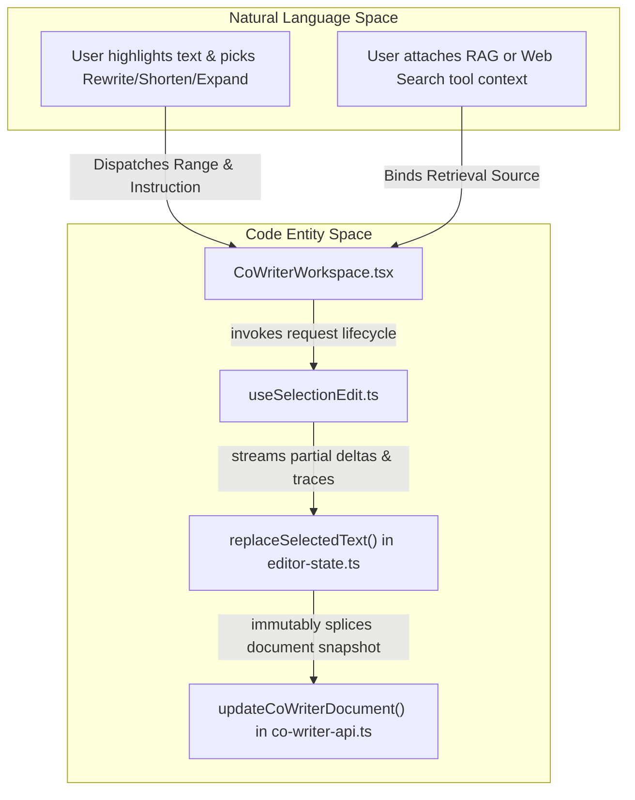
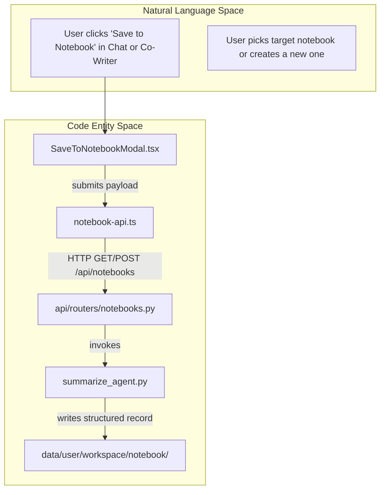

<!-- source: DeepWiki mcp.deepwiki.com · repo HKUDS/DeepTutor · page 4.5 Co-Writer and Learning Notebook · fetched 2026-11-09 -->

# Co-Writer and Learning Notebook

<details>
<summary>Relevant source files</summary>

The following files were used as context for generating this wiki page:

- [deeptutor/agents/base_agent.py](deeptutor/agents/base_agent.py)
- [deeptutor/api/routers/co_writer.py](deeptutor/api/routers/co_writer.py)
- [deeptutor/api/routers/notebook.py](deeptutor/api/routers/notebook.py)
- [deeptutor/api/routers/question.py](deeptutor/api/routers/question.py)
- [deeptutor/book/agents/page_planner.py](deeptutor/book/agents/page_planner.py)
- [deeptutor/co_writer/docx_converter.py](deeptutor/co_writer/docx_converter.py)
- [deeptutor/co_writer/edit_agent.py](deeptutor/co_writer/edit_agent.py)
- [deeptutor/co_writer/prompts/en/edit_agent.yaml](deeptutor/co_writer/prompts/en/edit_agent.yaml)
- [deeptutor/co_writer/prompts/zh/edit_agent.yaml](deeptutor/co_writer/prompts/zh/edit_agent.yaml)
- [deeptutor/services/memory/snapshot/__init__.py](deeptutor/services/memory/snapshot/__init__.py)
- [deeptutor/services/memory/snapshot/adapters.py](deeptutor/services/memory/snapshot/adapters.py)
- [deeptutor/services/memory/snapshot/entity.py](deeptutor/services/memory/snapshot/entity.py)
- [deeptutor/services/notebook/service.py](deeptutor/services/notebook/service.py)
- [deeptutor/services/workspace/catalog.py](deeptutor/services/workspace/catalog.py)
- [deeptutor/video_learning/notes.py](deeptutor/video_learning/notes.py)
- [tests/api/test_co_writer.py](tests/api/test_co_writer.py)
- [tests/api/test_question_router.py](tests/api/test_question_router.py)
- [tests/book/test_block_type_controls.py](tests/book/test_block_type_controls.py)
- [tests/co_writer/__init__.py](tests/co_writer/__init__.py)
- [tests/co_writer/test_docx_inline_nul.py](tests/co_writer/test_docx_inline_nul.py)
- [tests/services/memory/test_partner_archive_snapshot.py](tests/services/memory/test_partner_archive_snapshot.py)
- [tests/services/memory/test_snapshot_adapters.py](tests/services/memory/test_snapshot_adapters.py)
- [tests/services/memory/test_snapshot_probes.py](tests/services/memory/test_snapshot_probes.py)
- [tests/services/memory/test_snapshot_workspace_aggregation.py](tests/services/memory/test_snapshot_workspace_aggregation.py)
- [tests/services/test_notebook_service.py](tests/services/test_notebook_service.py)
- [web/app/(workspace)/kanban/page.tsx](web/app/(workspace)/kanban/page.tsx)
- [web/app/(workspace)/partners/[partnerId]/page.tsx](web/app/(workspace)/partners/[partnerId]/page.tsx)
- [web/components/chat/HistorySessionPicker.tsx](web/components/chat/HistorySessionPicker.tsx)
- [web/components/common/InlineFileCard.tsx](web/components/common/InlineFileCard.tsx)
- [web/components/partners/PartnerArchives.tsx](web/components/partners/PartnerArchives.tsx)
- [web/components/partners/PartnerChat.tsx](web/components/partners/PartnerChat.tsx)
- [web/components/partners/group/PartnerSeat.tsx](web/components/partners/group/PartnerSeat.tsx)
- [web/features/co-writer/components/CoWriterWorkspace.tsx](web/features/co-writer/components/CoWriterWorkspace.tsx)
- [web/lib/message-content.ts](web/lib/message-content.ts)
- [web/lib/partner-chat-draft.ts](web/lib/partner-chat-draft.ts)
- [web/lib/session-title.ts](web/lib/session-title.ts)
- [web/tests/co-writer-lazy-notebook.spec.tsx](web/tests/co-writer-lazy-notebook.spec.tsx)
- [web/tests/co-writer-model-selection.spec.tsx](web/tests/co-writer-model-selection.spec.tsx)
- [web/tests/generated-file-cards.spec.tsx](web/tests/generated-file-cards.spec.tsx)
- [web/tests/partner-archives-markdown.spec.tsx](web/tests/partner-archives-markdown.spec.tsx)
- [web/tests/partner-chat-draft.test.ts](web/tests/partner-chat-draft.test.ts)
- [web/tests/partner-detail-encoded-id.spec.tsx](web/tests/partner-detail-encoded-id.spec.tsx)
- [web/tests/session-title.test.ts](web/tests/session-title.test.ts)
- [web/tests/workspace-present.test.ts](web/tests/workspace-present.test.ts)

</details>


## Purpose and Scope

This page details the technical implementation of the Co-Writer markdown workspace and surgical range rewrites, alongside the Learning Notebook subsystem (`web/features/notes`). This includes the block editor, page tree navigation, flashcards, the Dito AI companion, and the unified save-to-notebook flow. These modules bridge real-time text editing, AI-assisted surgical transformations, structured note organization, and persistent lifelong knowledge archiving.

Sources: [web/features/co-writer/components/CoWriterWorkspace.tsx:1-230](), [deeptutor/services/memory/snapshot/adapters.py:113-174](), [web/components/notebook/SaveToNotebookModal.tsx:1-220]()

---

## 1. Co-Writer Markdown Workspace and Autosave

The Co-Writer Workspace is implemented via `CoWriterWorkspace` (`web/features/co-writer/components/CoWriterWorkspace.tsx`), providing an interactive split-pane interface consisting of:
- A Markdown editing text area capturing raw user keystrokes.
- A live rendered Markdown preview pane driven by a dynamically loaded `MarkdownRenderer` component (with SSR disabled).
- Toolbar and selection hooks for block formatting, document export, and tool integrations.

State persistence is handled via a client-side draft cache and backend synchronization:
- **Local Draft Storage:** Utilizes utility functions (`saveDraft()`, `loadDraft()`, `clearDraft()`) to cache draft states locally by document ID, minimizing network traffic.
- **Autosave Mechanism:** A debounced timer (`AUTOSAVE_DEBOUNCE_MS = 1500`) compares current markdown state with `lastSavedContentRef` and calls `updateCoWriterDocument()` when dirty.
- **Optimistic UI:** Local updates modify the editor state immediately, while background saves update the timestamp and status indicator.

Sources: [web/features/co-writer/components/CoWriterWorkspace.tsx:1-230](), [web/features/co-writer/storage/drafts.ts:1-37](), [web/lib/co-writer-api.ts:55-60]()

---

## 2. Surgical Range Rewrites

Within the Co-Writer workspace, users can select a specific text range and invoke surgical editing actions (`"rewrite"`, `"shorten"`, or `"expand"`).

### Implementation Details
- **Selection State:** Maintained as `SelectedRange` containing character start/end offsets, original selected text, and an immutable snapshot of the document.
- **Tool Attachments:** Supports attaching external context providers (`"rag"` knowledge base or `"web"` search) to enrich the target revision.
- **Dispatch Flow:** Managed via the `useSelectionEdit()` hook, handling asynchronous streaming events (`StreamTraceEvent`) that return progressive text edits and tool traces.
- **Snapshot Splice:** The revised fragment replaces the selected range within the document snapshot via `replaceTextInSnapshot()`, preserving unselected regions.

### Diagram: Co-Writer Surgical Range Rewrite Pipeline (NL to Code Space)



Sources: [web/features/co-writer/components/CoWriterWorkspace.tsx:130-226](), [web/features/co-writer/model/editor-state.ts:1-50](), [web/features/co-writer/hooks/useSelectionEdit.ts:1-31]()

---

## 3. Learning Notebook and Block Editor

The Learning Notebook subsystem (`web/features/notes`) provides a modular, hierarchical documentation and note-taking environment.

### Page Tree and Block Architecture
- **Page Tree:** Organizes notebook pages hierarchically, enabling nesting, reordering, and metadata tagging.
- **Block Editor:** Content is decomposed into structured blocks (paragraphs, headers, code snippets, lists, and embeds), allowing granular manipulation and targeted AI assistance.
- **Snapshot Adapters:** The backend memory and snapshot service uses `read_notebook_entities()` in `adapters.py` to parse notebook index files (`get_notebook_index_file()`) and individual notebook records (`get_notebook_file()`). Each record generates an immutable `Entity` object with a unique fingerprint used by the diff engine.

```python
# Conceptual extraction flow in deeptutor/services/memory/snapshot/adapters.py
def read_notebook_entities() -> list[Entity]:
    # Loads notebook index and individual records into searchable Entity structures
    ...
```

Sources: [deeptutor/services/memory/snapshot/adapters.py:113-174]()

---

## 4. Flashcards and Dito Companion

The Learning Notebook integrates specialized study and AI co-pilot tools:
- **Flashcards:** Generates review decks automatically from notebook blocks or user selections, supporting spaced-repetition study loops.
- **Dito Companion:** An embedded AI assistant pane that indexes the active notebook or page context, allowing users to query notes, request explanations, or generate summaries inline.

Sources: [deeptutor/services/memory/snapshot/adapters.py:113-174]()

---

## 5. Save-to-Notebook Flow

The save-to-notebook capability unifies data archiving across chat sessions, research outputs, solvers, and the Co-Writer workspace.

### Frontend and Backend Architecture
- **`SaveToNotebookModal`:** React component allowing users to select an existing notebook or initialize a new one inline. It constructs clean markdown transcripts and query metadata from active sessions.
- **API and Summarization:** The frontend invokes `listNotebooks()` and `createNotebook()` via `notebook-api.ts`, targeting FastAPI endpoints in `api/routers/notebooks.py`. The backend invokes summarization and tag-stripping pipelines before persisting records on disk.

### Diagram: Save-to-Notebook Data Flow (NL to Code Space)



Sources: [web/components/notebook/SaveToNotebookModal.tsx:1-220](), [web/lib/notebook-api.ts:1-59](), [deeptutor/services/memory/snapshot/adapters.py:113-174]()

---

# Summary

This section covered the Co-Writer markdown workspace autosave mechanics, surgical range rewrites via the selection edit hook, the structured block editor and page tree within the Learning Notebook, flashcards, the Dito AI companion, and the backend save-to-notebook persistence pipeline.

Sources:
- [web/features/co-writer/components/CoWriterWorkspace.tsx:1-230]()
- [web/features/co-writer/hooks/useSelectionEdit.ts:1-31]()
- [web/features/co-writer/model/editor-state.ts:1-50]()
- [web/lib/co-writer-api.ts:55-60]()
- [web/components/notebook/SaveToNotebookModal.tsx:1-220]()
- [deeptutor/services/memory/snapshot/adapters.py:113-174]()

---

