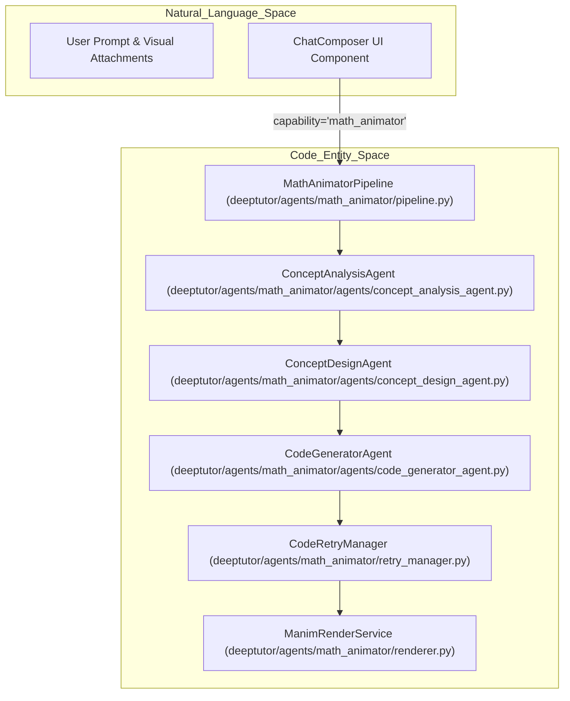
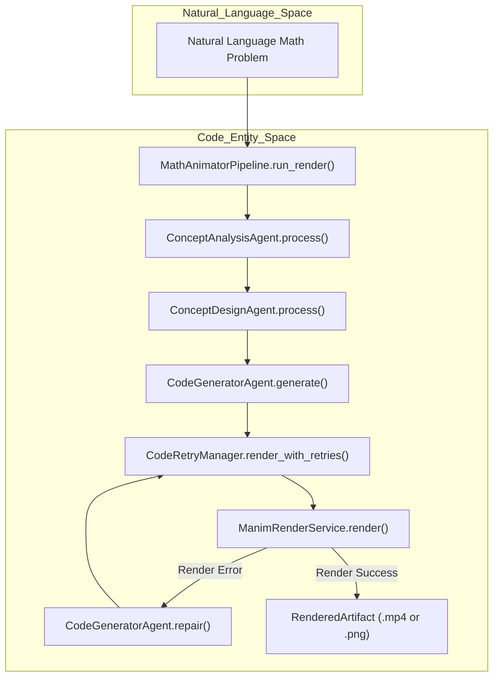
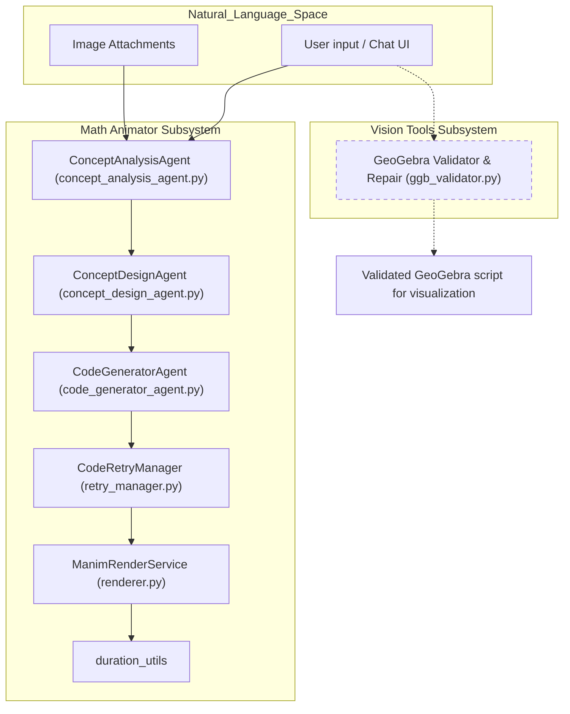

<!-- source: DeepWiki mcp.deepwiki.com · repo HKUDS/DeepTutor · page 4.6 Math Animator and Vision Solver · fetched 2026-11-09 -->

# Math Animator and Vision Solver

<details>
<summary>Relevant source files</summary>

The following files were used as context for generating this wiki page:

- [deeptutor/agents/math_animator/duration_utils.py](deeptutor/agents/math_animator/duration_utils.py)
- [deeptutor/agents/math_animator/layout_probe.py](deeptutor/agents/math_animator/layout_probe.py)
- [deeptutor/agents/math_animator/pipeline.py](deeptutor/agents/math_animator/pipeline.py)
- [deeptutor/agents/math_animator/prompts/en/code_generator_agent.yaml](deeptutor/agents/math_animator/prompts/en/code_generator_agent.yaml)
- [deeptutor/agents/math_animator/prompts/zh/code_generator_agent.yaml](deeptutor/agents/math_animator/prompts/zh/code_generator_agent.yaml)
- [deeptutor/agents/math_animator/renderer.py](deeptutor/agents/math_animator/renderer.py)
- [deeptutor/agents/math_animator/retry_manager.py](deeptutor/agents/math_animator/retry_manager.py)
- [deeptutor/agents/math_animator/utils.py](deeptutor/agents/math_animator/utils.py)
- [deeptutor/agents/visualize/__init__.py](deeptutor/agents/visualize/__init__.py)
- [deeptutor/agents/visualize/agents/__init__.py](deeptutor/agents/visualize/agents/__init__.py)
- [deeptutor/api/routers/render_storage.py](deeptutor/api/routers/render_storage.py)
- [deeptutor/services/workspace/render_storage.py](deeptutor/services/workspace/render_storage.py)
- [tests/agents/math_animator/test_duration_ms_not_minute.py](tests/agents/math_animator/test_duration_ms_not_minute.py)
- [tests/agents/math_animator/test_duration_unit_word_boundary.py](tests/agents/math_animator/test_duration_unit_word_boundary.py)
- [tests/agents/math_animator/test_layout_probe.py](tests/agents/math_animator/test_layout_probe.py)
- [tests/agents/math_animator/test_renderer_error.py](tests/agents/math_animator/test_renderer_error.py)
- [tests/agents/math_animator/test_retry_manager.py](tests/agents/math_animator/test_retry_manager.py)
- [tests/agents/math_animator/test_utils.py](tests/agents/math_animator/test_utils.py)
- [tests/api/test_render_storage.py](tests/api/test_render_storage.py)
- [web/app/(workspace)/learning/mastery/[pathId]/page.tsx](web/app/(workspace)/learning/mastery/[pathId]/page.tsx)
- [web/components/chat/GeneratedOutputFileActions.tsx](web/components/chat/GeneratedOutputFileActions.tsx)
- [web/components/files/OutputFileActions.tsx](web/components/files/OutputFileActions.tsx)
- [web/components/math-animator/MathAnimatorViewer.tsx](web/components/math-animator/MathAnimatorViewer.tsx)
- [web/components/math-animator/RenderFileActions.tsx](web/components/math-animator/RenderFileActions.tsx)
- [web/components/space/learning/ReviewTrail.tsx](web/components/space/learning/ReviewTrail.tsx)
- [web/tests/generated-output-file-actions.spec.tsx](web/tests/generated-output-file-actions.spec.tsx)

</details>


The Math Animator and Vision Solver module delivers a comprehensive pipeline for converting natural language math queries and optional image attachments into rich, educational animations or visualizations using Manim. It integrates advanced LLM-powered concept analysis and design agents, robust code generation with retry and repair logic, and subprocess-based rendering. This subsystem also includes vision tools that validate and repair GeoGebra scripts for interactive geometric visualizations.

---

## 1. System Overview

This module executes a multi-phase workflow:

- **Concept Analysis:** Interprets the math problem and visual context.
- **Concept Design:** Plans the animation scenes and teaching narrative.
- **Code Generation:** Produces runnable Python Manim scripts, tailored to requested modes (video or image) and durations.
- **Rendering:** Runs Manim to render MP4 videos or PNG images, managing workspaces, subprocess execution, and real-time process feedback.
- **Retry and Repair:** Automatically retries failed renders by invoking code repair agents with diagnosed errors.
- **Vision Solver:** Validates, normalizes, and repairs GeoGebra scripts for embedded geometry visualization.

### Core Components

| Component                | Role                                                                            | Key File(s)                                                    |
|--------------------------|---------------------------------------------------------------------------------|---------------------------------------------------------------|
| `MathAnimatorPipeline`   | Manages the multi-agent flow from analysis to rendering                         | `deeptutor/agents/math_animator/pipeline.py`                   |
| `ConceptAnalysisAgent`  | Performs semantic breakdown of math problems and visuals                       | `deeptutor/agents/math_animator/agents/concept_analysis_agent.py` |
| `ConceptDesignAgent`    | Creates scene outlines and design descriptions for the animation               | `deeptutor/agents/math_animator/agents/concept_design_agent.py`   |
| `CodeGeneratorAgent`    | Generates and repairs Manim Python code with duration controls                  | `deeptutor/agents/math_animator/agents/code_generator_agent.py`   |
| `CodeRetryManager`      | Orchestrates render attempts, error handling, and repair cycles                | `deeptutor/agents/math_animator/retry_manager.py`                 |
| `ManimRenderService`    | Handles isolated Manim subprocess calls, workspace setup, and artifact saving  | `deeptutor/agents/math_animator/renderer.py`                      |
| `duration_utils`        | Provides time computation helpers for pacing and duration enforcement          | `deeptutor/agents/math_animator/duration_utils.py`               |
| `GeoGebraValidator`     | Validates and auto-fixes GeoGebra scripts generated by LLMs                    | `deeptutor/tools/vision/ggb_validator.py`                        |

### Natural Language to Code Entity Mapping: Math Animator Architecture



Sources: [deeptutor/agents/math_animator/pipeline.py:25-70](), [deeptutor/agents/math_animator/renderer.py:35-59](), [deeptutor/agents/math_animator/retry_manager.py:21-41](), [deeptutor/agents/math_animator/agents/concept_analysis_agent.py:14-97](), [deeptutor/agents/math_animator/agents/concept_design_agent.py:14-76](), [deeptutor/agents/math_animator/agents/code_generator_agent.py:31-192]()

---

## 2. Mathematical Animation Pipeline and Agents

The Math Animator pipeline divides the animation creation process into logical stages, each managed by a dedicated agent class. The flow moves from understanding the user's input, through narrative design, to code generation and rendering.

### Agent Components and Responsibilities

| Agent / Component            | File Reference                                                      | Responsibility                                                                                   |
|-----------------------------|--------------------------------------------------------------------|------------------------------------------------------------------------------------------------|
| **`ConceptAnalysisAgent`**  | `deeptutor/agents/math_animator/agents/concept_analysis_agent.py`  | Analyzes input text and image attachments to extract learning goals and visual targets.         |
| **`ConceptDesignAgent`**    | `deeptutor/agents/math_animator/agents/concept_design_agent.py`    | Generates a detailed scene outline and textual design guiding animation creation.               |
| **`CodeGeneratorAgent`**    | `deeptutor/agents/math_animator/agents/code_generator_agent.py`    | Produces runnable Manim animation code, abiding by timing and rendering mode constraints; manages code repair on failure. |
| **`CodeRetryManager`**      | `deeptutor/agents/math_animator/retry_manager.py`                  | Controls the render-retry loop, invokes repairs on encounter of errors, and limits retry counts. |
| **`ManimRenderService`**    | `deeptutor/agents/math_animator/renderer.py`                       | Executes the Manim CLI in subprocesses; manages temporary directories and output artifacts.     |

### Process Flow: Natural Language to Executable Animation



Sources: [deeptutor/agents/math_animator/pipeline.py:137-194](), [deeptutor/agents/math_animator/agents/concept_analysis_agent.py:31-97](), [deeptutor/agents/math_animator/agents/concept_design_agent.py:31-76](), [deeptutor/agents/math_animator/agents/code_generator_agent.py:48-192](), [deeptutor/agents/math_animator/retry_manager.py:42-128](), [deeptutor/agents/math_animator/renderer.py:60-80]()

---

## 3. Manim Rendering and Subprocess Execution

The `ManimRenderService` class is the core runtime component responsible for transforming generated Manim Python code into visual media. It orchestrates workspace directory setup, Manim CLI command construction, and subprocess management with live progress reporting.

### Workspace Structure

The renderer maintains an isolated directory hierarchy for each rendering request identified by a `turn_id`:

- `source/`: Generated Manim Python source code files (`scene.py`, image block scripts)
- `artifacts/`: Final outputs — MP4 videos or PNG images
- `media/`: Intermediate Manim media cache directory
- `meta/`: Metadata storage (if needed)

These directories are automatically created on instantiation.

### Rendering Modes

- **Video Mode**

  - Accepts a complete Manim script with at least one `Scene` subclass.
  - Uses quality flags mapped as:

    | Quality | Manim CLI Flag |
    |---------|----------------|
    | low     | `-ql`          |
    | medium  | `-qm`          |
    | high    | `-qh`          |

  - Runs Manim to output an MP4 video.

- **Image Mode**

  - Requires the code string to be composed solely of `YON_IMAGE` anchor blocks:
  
    ```
    ### YON_IMAGE_1_START ###
    <Manim script for image 1>
    ### YON_IMAGE_1_END ###
    ...
    ```
  
  - Each block is saved to a separate `image_block_nn.py` file and rendered individually with the `-s` flag (save last frame).
  - Outputs individual PNG image files as artifacts.

### Subprocess Execution

- Uses `subprocess.Popen` to launch Manim CLI synchronously while capturing `stdout`/`stderr`.
- Reader threads feed process output lines into an `asyncio.Queue` to support real-time asynchronous progress event emission.
- Properly handles cross-platform compatibility concerns (e.g., Windows `SelectorEventLoop` limitations).

### Extracting Scene Names and Output Artifacts

- Uses regex to extract the primary `Scene` subclass name from source code.
- After rendering, searches the designated media directory for generated `.mp4` or `.png` files.
- Slugifies artifact filenames to associate them with the `turn_id` and scene name.

Sources: [deeptutor/agents/math_animator/renderer.py:35-178]()

---

## 4. Error Recovery, Code Repair, and Duration Utilities

The rendering pipeline is fault-tolerant, employing an error-handling and repair loop orchestrated by the `CodeRetryManager`.

### Retry and Repair Workflow

- On render failure (syntax errors, runtime exceptions, or missing anchor blocks in image mode), the `CodeRetryManager` diagnoses issues and triggers code repair.
- Repair occurs via calls to the `CodeGeneratorAgent.repair()` method that returns modified runnable code with minimal changes while preserving teaching intent and pacing.
- Multiple retries are capped to prevent infinite loops.
- Repair prompts explicitly instruct avoidance of unsupported Manim features and command adjustments (e.g., removing `stroke_dash_pattern` parameters, removing `self.save_state()`, adapting camera code).

### Duration and Pacing Control

- The code generation prompts in both English and Chinese versions enforce duration constraints through guidance on explicit timings:

  - Minimum 5 distinct teaching beats for normal explanations.
  - Target overall duration defaults to 12–30 seconds unless the user requests brevity.
  - Each key step includes 1.2–2.5 seconds of `run_time`, plus 0.6–1.5 seconds of `self.wait()` pauses.
  - Stable hold period of 1.5–3 seconds at animation end for readability.
  - Duration targets must be respected closely, with pacing adjusted accordingly.

- The `duration_utils` module provides utilities for consistent duration-related calculations in Manim scripts.

### Code Generation Prompts and Restrictions Summary

- Avoid LaTeX usage by default due to local environment limitations (no `Tex`, `MathTex`, or related LaTeX commands).
- All points coordinates must be 3D (e.g., `[x, y, 0]` or use `axes.c2p()` functions).
- Do not include comments outside JSON response for image mode; use only `YON_IMAGE` anchors.
- Remove unsupported parameters and camera references that cause rendering failures.
- Preserve or extend pacing on repair, do not shorten animations forcibly.

Sources: [deeptutor/agents/math_animator/retry_manager.py:21-41](), [deeptutor/agents/math_animator/prompts/zh/code_generator_agent.yaml:4-41]()

---

## 5. Vision Tools: GeoGebra Validator and Repair

DeepTutor supports the generation and embedding of GeoGebra scripts for interactive geometric visualizations. Since LLM outputs may contain syntax errors or convention violations, the `ggb_validator` module validates and fixes common issues.

### Validation Features

- Checks for:
  - Correct use of square brackets `[]` instead of parentheses `()` for function arguments of key GeoGebra commands (e.g., `Point`, `Segment`, `Polygon`, `SetColor`).
  - Fixes frequent LLM mistakes such as `Point({x,y})` to `(x,y)`.
  - Converts logarithmic function `log(10, x)` to `lg(x)`.
  - Removes unsupported comments (`#`).
  - Validates `Text[]` commands for proper argument count and LaTeX balance.
- Analyzes the full GeoGebra script line-by-line, returning a normalized script with warnings and errors.

### Repair Rules and Argument Analysis

- Detects boolean, point, scalar, and explicit scalar arguments to handle signatures especially for the `Text` command.
- Combines scalar `x` and `y` arguments into explicit point tuples when permissible.
- Rejects invalid or excessive arguments with descriptive errors.
- The validator outputs detailed warnings and errors for downstream use in feedback interfaces.

### GeoGebra Payload Integration

- The visualizer registration in `builtin.py` validates GeoGebra payloads by:
  - Ensuring a minimum and maximum command count.
  - Validating the coordinate view boundaries.
  - Confirming supported app names (`geometry`, `graphing`, `3d`, `classic`).
- Provides a structured JSON object of fixed commands for rendering by frontend components.

Sources: [deeptutor/tools/vision/ggb_validator.py:1-240](), [deeptutor/visualizers/builtin.py:100-154]()

---

## 6. Summary Diagram: Natural Language Space to Code and Vision Components



Sources: [deeptutor/agents/math_animator/agents/concept_analysis_agent.py:14-97](), [deeptutor/agents/math_animator/agents/concept_design_agent.py:14-76](), [deeptutor/agents/math_animator/agents/code_generator_agent.py:31-192](), [deeptutor/agents/math_animator/retry_manager.py:21-41](), [deeptutor/agents/math_animator/renderer.py:35-178](), [deeptutor/tools/vision/ggb_validator.py:1-240]()

---

# References

- `deeptutor/agents/math_animator/pipeline.py`
- `deeptutor/agents/math_animator/agents/concept_analysis_agent.py`
- `deeptutor/agents/math_animator/agents/concept_design_agent.py`
- `deeptutor/agents/math_animator/agents/code_generator_agent.py`
- `deeptutor/agents/math_animator/renderer.py`
- `deeptutor/agents/math_animator/retry_manager.py`
- `deeptutor/agents/math_animator/prompts/zh/code_generator_agent.yaml`
- `deeptutor/agents/math_animator/duration_utils.py`
- `deeptutor/tools/vision/ggb_validator.py`
- `deeptutor/visualizers/builtin.py`

Sources: All listed above

---

