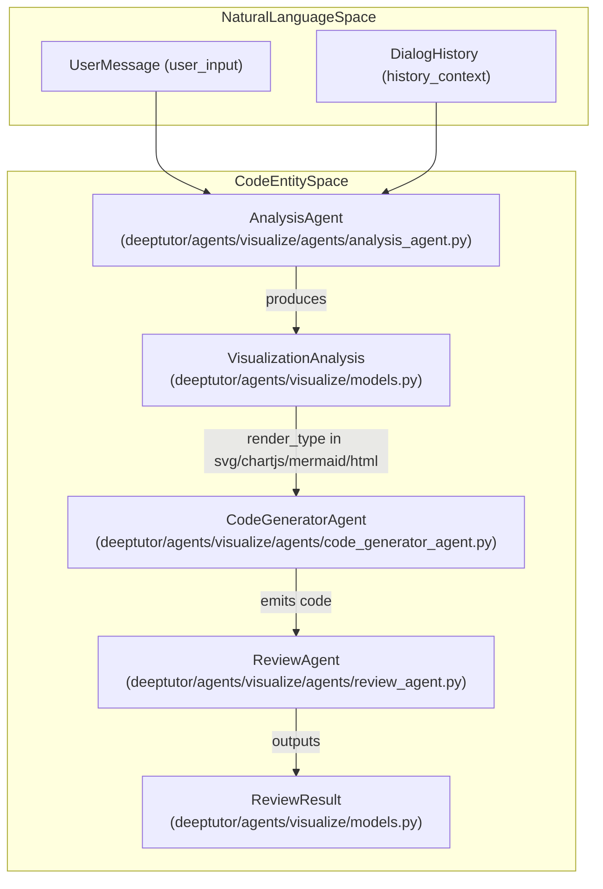
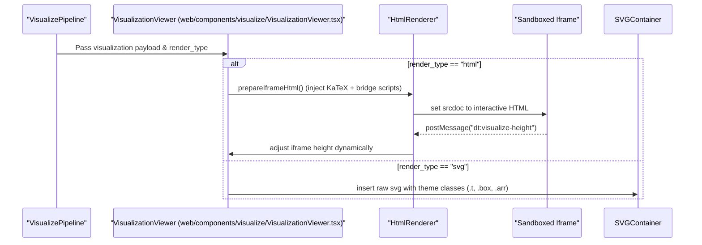

<!-- source: DeepWiki mcp.deepwiki.com · repo HKUDS/DeepTutor · page 4.7 Visualization Agent · fetched 2026-11-09 -->

# Visualization Agent

Relevant source files

The following files were used as context for generating this wiki page:

- [.pre-commit-config.yaml](.pre-commit-config.yaml)
- [deeptutor/agents/math_animator/agents/code_generator_agent.py](deeptutor/agents/math_animator/agents/code_generator_agent.py)
- [deeptutor/agents/math_animator/agents/concept_analysis_agent.py](deeptutor/agents/math_animator/agents/concept_analysis_agent.py)
- [deeptutor/agents/math_animator/agents/concept_design_agent.py](deeptutor/agents/math_animator/agents/concept_design_agent.py)
- [deeptutor/agents/math_animator/agents/summary_agent.py](deeptutor/agents/math_animator/agents/summary_agent.py)
- [deeptutor/learning/tests/test_prompt_language_fallback.py](deeptutor/learning/tests/test_prompt_language_fallback.py)
- [deeptutor/services/config/loader.py](deeptutor/services/config/loader.py)
- [deeptutor/services/config/test_runner.py](deeptutor/services/config/test_runner.py)
- [deeptutor/services/prompt/manager.py](deeptutor/services/prompt/manager.py)
- [deeptutor/services/rag/smart_retriever.py](deeptutor/services/rag/smart_retriever.py)
- [deeptutor/services/setup/init.py](deeptutor/services/setup/init.py)
- [tests/agents/math_animator/test_code_generator_agent.py](tests/agents/math_animator/test_code_generator_agent.py)
- [tests/agents/math_animator/test_reasoning_retry.py](tests/agents/math_animator/test_reasoning_retry.py)
- [tests/api/test_main_notebook_router.py](tests/api/test_main_notebook_router.py)
- [tests/config/test_reasoning_probe_budget.py](tests/config/test_reasoning_probe_budget.py)
- [tests/core/test_prompt_manager.py](tests/core/test_prompt_manager.py)
- [tests/services/config/test_llm_probe_config.py](tests/services/config/test_llm_probe_config.py)
- [tests/services/config/test_task_probe.py](tests/services/config/test_task_probe.py)
- [tests/services/config/test_visualize_params.py](tests/services/config/test_visualize_params.py)
- [tests/services/rag/test_pipeline_integration.py](tests/services/rag/test_pipeline_integration.py)
- [tests/services/rag/test_rag_pipelines.py](tests/services/rag/test_rag_pipelines.py)
- [tests/services/rag/testfile.txt](tests/services/rag/testfile.txt)
- [tests/services/test_parse_language.py](tests/services/test_parse_language.py)

The **Visualization Agent** subsystem in DeepTutor converts natural language user requests and conversation context into rich, interactive visualizations. It executes this transformation through a multi-stage agent pipeline that analyzes the user's intent, generates tailored visualization code across multiple renderer targets, and reviews/optimizes the generated output before rendering it inside the chat workspace.

Sources: [deeptutor/services/prompt/manager.py:28-40](), [deeptutor/services/setup/init.py:78-117]()

---

## 1. Overview and Rendering Engines

The Visualization Agent supports six primary rendering engines, spanning static figures, interactive web content, and mathematical animation:

- **`chartjs`**: For standard quantitative chart types (bar, line, pie, radar, etc.) rendered with Chart.js and managed in the frontend by `ChartJsRenderer`.
- **`mermaid`**: For structured diagrams like flowcharts, sequence diagrams, class/state diagrams, ERD, Gantt, and mindmaps.
- **`svg`**: For custom, freeform illustrations requiring precise coordinate control and theme-aware styling.
- **`html`**: For interactive, multi-component visualizations such as draggable demos, step-by-step walkthroughs, or clickable practices rendered securely inside sandboxed iframes.
- **`manim_video`**: For high-quality time-evolving mathematical animations rendered as MP4 videos using Manim.
- **`manim_image`**: For static storyboard-style frames rendered using Manim.

Sources: [deeptutor/services/setup/init.py:78-117](), [web/components/visualize/VisualizationViewer.tsx:49-194]()

---

## 2. System Architecture and Pipeline Flow

The visualization workflow is orchestrated through a backend pipeline (`VisualizePipeline`) comprising three sequential stages: **Analysis**, **Code Generation**, and **Review**.

### Architecture Diagram: Natural Language Space to Code Entity Space

Sources: [deeptutor/agents/visualize/agents/analysis_agent.py:13-102](), [deeptutor/agents/visualize/agents/code_generator_agent.py:14-117]()

---

## 3. Core Agent Classes and Responsibilities

### AnalysisAgent
- Evaluates user input and dialog history to determine the optimal visualization `render_type` and pedagogical `visual_genre`.
- Loads prompts via the unified `PromptManager` infrastructure using `visualize` module configurations.
- Validates output into a strict `VisualizationAnalysis` Pydantic model.

Implementation: `class AnalysisAgent(BaseAgent)` in `deeptutor/agents/visualize/agents/analysis_agent.py` [deeptutor/agents/visualize/agents/analysis_agent.py:13-102]().

### CodeGeneratorAgent
- Consumes the `VisualizationAnalysis` brief to generate concrete implementation code (SVG markup, Chart.js JSON configs, Mermaid syntax, or HTML/JS payloads).
- Applies defensive extraction patterns (e.g., root-tag isolation and JSON block stripping).
- Handles parameter escalation and fallback retries.

Implementation: `class CodeGeneratorAgent(BaseAgent)` in `deeptutor/agents/visualize/agents/code_generator_agent.py` [deeptutor/agents/visualize/agents/code_generator_agent.py:14-117]().

### ReviewAgent
- Validates and optimizes the generated visualization code against syntax and rendering constraints.
- Emits a structured `ReviewResult` containing the final code and review notes.

Sources: [deeptutor/agents/visualize/agents/code_generator_agent.py:14-117]()

---

## 4. Data Models and Prompt Architecture

Visualization data models are defined in `deeptutor/agents/visualize/models.py`.

| Model | Description | Key Fields |
|---|---|---|
| **`VisualizationAnalysis`** | Output of the analysis stage; determines render type and design specifications. | `render_type`, `visual_genre`, `description`, `data_description`, `chart_type`, `visual_elements`, `rationale` |
| **`ReviewResult`** | Output of the review/repair stage; holds final code and modification flags. | `optimized_code`, `changed`, `review_notes` |

Sources: [deeptutor/agents/visualize/agents/analysis_agent.py:13-102]()

---

## 5. Frontend Rendering and Theming (`VisualizationViewer`)

The frontend component `VisualizationViewer` dynamically selects the appropriate rendering strategy based on the backend `render_type`.

### Frontend Data Flow: Natural Language to Rendered UI

Sources: [web/components/visualize/VisualizationViewer.tsx:49-194]()

### SVG Themable Styling (`svg-theme.css`)
- SVGs rely on semantic CSS classes (`.t`, `.th`, `.ts`, `.box`, `.arr`) for text, shape, and connector styling.
- Light and dark modes are toggled via CSS variable mappings under the `.dark` selector context.
- Offloads presentation logic from the LLM code generation phase to maintain clean, theme-consistent SVG markup.

Sources: [web/components/visualize/VisualizationViewer.tsx:49-194]()

---

