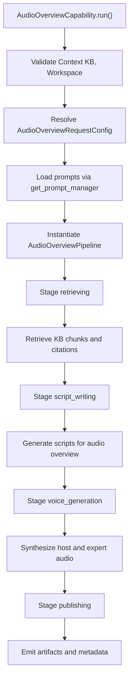
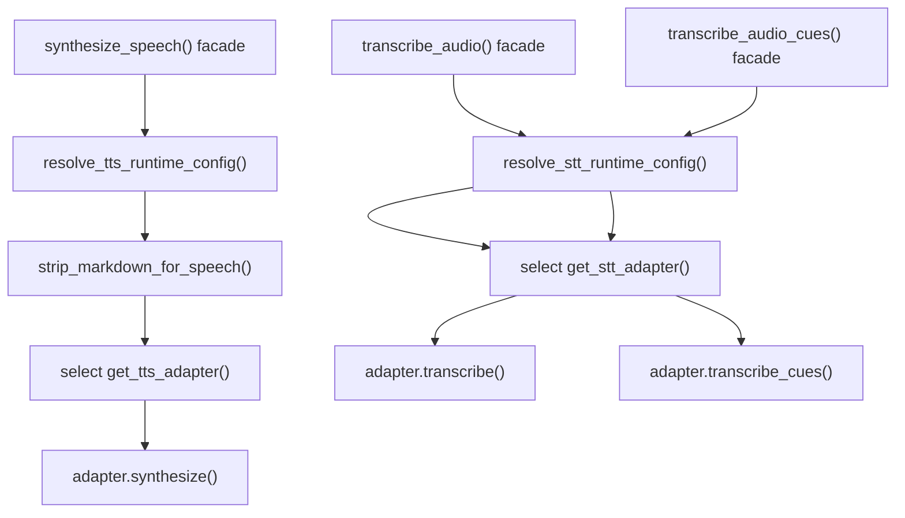
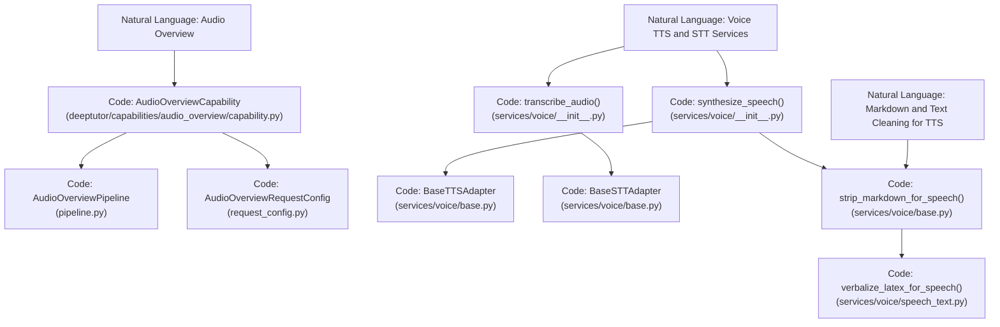

<!-- source: DeepWiki mcp.deepwiki.com · repo HKUDS/DeepTutor · page 4.8 Audio Overview and Voice Capabilities · fetched 2026-11-09 -->

# Audio Overview and Voice Capabilities

<details>
<summary>Relevant source files</summary>

The following files were used as context for generating this wiki page:

- [deeptutor/services/imagegen/adapters/__init__.py](deeptutor/services/imagegen/adapters/__init__.py)
- [deeptutor/services/imagegen/adapters/dashscope.py](deeptutor/services/imagegen/adapters/dashscope.py)
- [deeptutor/services/imagegen/config.py](deeptutor/services/imagegen/config.py)
- [deeptutor/services/llm/utils.py](deeptutor/services/llm/utils.py)
- [deeptutor/services/videogen/adapters/__init__.py](deeptutor/services/videogen/adapters/__init__.py)
- [deeptutor/services/videogen/adapters/async_task.py](deeptutor/services/videogen/adapters/async_task.py)
- [deeptutor/services/videogen/adapters/dashscope.py](deeptutor/services/videogen/adapters/dashscope.py)
- [deeptutor/services/videogen/adapters/xai.py](deeptutor/services/videogen/adapters/xai.py)
- [deeptutor/services/videogen/base.py](deeptutor/services/videogen/base.py)
- [deeptutor/services/voice/__init__.py](deeptutor/services/voice/__init__.py)
- [deeptutor/services/voice/adapters/__init__.py](deeptutor/services/voice/adapters/__init__.py)
- [deeptutor/services/voice/adapters/dashscope.py](deeptutor/services/voice/adapters/dashscope.py)
- [deeptutor/services/voice/adapters/mistral.py](deeptutor/services/voice/adapters/mistral.py)
- [deeptutor/services/voice/adapters/xai.py](deeptutor/services/voice/adapters/xai.py)
- [deeptutor/services/voice/audio.py](deeptutor/services/voice/audio.py)
- [deeptutor/services/voice/base.py](deeptutor/services/voice/base.py)
- [deeptutor/services/voice/options.py](deeptutor/services/voice/options.py)
- [deeptutor/services/voice/speech_text.py](deeptutor/services/voice/speech_text.py)
- [tests/services/llm/test_unreachable_endpoint_hint.py](tests/services/llm/test_unreachable_endpoint_hint.py)
- [tests/services/test_media_gen.py](tests/services/test_media_gen.py)
- [tests/services/test_speech_limit_order.py](tests/services/test_speech_limit_order.py)
- [tests/services/test_video_poll_budget.py](tests/services/test_video_poll_budget.py)
- [tests/services/test_voice.py](tests/services/test_voice.py)
- [tests/services/test_xai_mistral_voice.py](tests/services/test_xai_mistral_voice.py)
- [web/components/settings/VoicePreviewPanel.tsx](web/components/settings/VoicePreviewPanel.tsx)
- [web/tests/chat-read-aloud-playback.spec.tsx](web/tests/chat-read-aloud-playback.spec.tsx)
- [web/tests/provider-branding.spec.ts](web/tests/provider-branding.spec.ts)
- [web/tests/voice-settings.spec.tsx](web/tests/voice-settings.spec.tsx)

</details>


## Purpose and Scope

The Audio Overview capability offers grounded two-voice audio summaries synthesized from a knowledge base, accompanied by generated transcripts. This feature synthesizes natural-sounding speech from textual content after intelligently cleaning Markdown and verbalizing embedded LaTeX math expressions to improve voice clarity. The voice services abstract different provider implementations for TTS and STT via adapters following a common interface. The capability integrates tightly with the runtime workspace, prompt pipelines, and the streaming protocol for stage events.

This page details:
- The **Audio Overview capability**: orchestration, pipeline stages, request configuration, and streaming.
- **Voice service abstractions**: adapter interfaces for TTS and STT, error handling, and request header construction.
- **Markdown cleaning and LaTeX verbalization**: the text preprocessing layer for speech synthesis.
- **Public facade functions** for consuming voice services asynchronously in the backend.
- **Integration points** for embedded read-aloud functionality and contextual readout within DeepTutor.

---

## 1. Audio Overview Capability: Implementation and Pipeline

The main capability class is `AudioOverviewCapability`, defined as a `TurnCapability` subclass responsible for coordinating the audio overview generation (including retrieval, script generation, voice synthesis, and publishing).

### Key Elements of `AudioOverviewCapability`

- **Manifest (Metadata & Configuration Defaults):**
  - Name: `"audio_overview"`
  - Description: "Create a grounded two-voice audio overview and transcript from a knowledge base."
  - Stages: `["retrieving", "script_writing", "voice_generation", "publishing"]`
  - Tools used: `["rag"]` (Retrieval-Augmented Generation)
  - CLI aliases: `["audio-overview", "overview"]`
  - Request schema is validated via `get_capability_request_schema("audio_overview")`.
  - Default config fields:
    - `topic`: empty string (optional override)
    - `target_minutes`: 5 (estimated length)
    - `host_voice` and `expert_voice`: voice selections for two-voice audio (optional)
    - `max_context_chunks`: 6 (retrieval limit)

- **Run Method Workflow:**
  1. **Context validation:** Verifies presence of an attached knowledge base and a writable runtime workspace.
  2. **Request config:** Parse and validate request config overrides by `AudioOverviewRequestConfig`.
  3. **Topic resolution:** Uses config topic if overridden, else falls back to the user's message or a fallback label.
  4. **Prompt loading:** Uses the centralized prompt manager to load system and instruction prompts by capability name and language.
  5. **Pipeline instantiation:** Creates an `AudioOverviewPipeline` instance configured with language, prompts, workspace directories, and workspace id.
  6. **Processing each stage with streaming:**
     - `"retrieving"`: Fetches relevant text chunks and citations from knowledge base.
     - `"script_writing"`: Generates audio scripts from retrieved content.
     - `"voice_generation"`: Synthesizes voice audio files for both host and expert voices.
     - `"publishing"`: Records artifacts and emits source metadata for UI and downstream handlers.
  7. **Emit final capability result:** Sends a comprehensive payload including the transcript, audio file path, citations, segments of the script, workspace items, and metadata.

The method raises `AudioOverviewError` exceptions if required resources (knowledge base, workspace) are missing.


Sources: `deeptutor/capabilities/audio_overview/capability.py:21-131`()

---

## 2. Audio Overview Pipeline and Request Configuration

The detailed processing logic of each pipeline stage is encapsulated in the `AudioOverviewPipeline` class. Request configuration is modeled by `AudioOverviewRequestConfig` which maps user or runtime config JSON into strongly-typed Python objects for limiting context chunks, voice selection, and target duration.

- The pipeline handles loading content using RAG tools.
- Produces scripts designed for voice performances.
- Invokes TTS modules to synthesize speech.
- Publishes output artifacts alongside transcript files.

This pipeline is the core execution engine used by the `AudioOverviewCapability`.

Sources: `deeptutor/capabilities/audio_overview/capability.py:9-13`()

---

## 3. Voice Services: TTS and STT Adapter Architecture

### Abstract Base Classes

Defined in `deeptutor.services.voice.base`, the voice services define core abstractions:
- `BaseTTSAdapter` (ABC): Must implement async `synthesize(text: str, config: TTSConfig)` -> `(bytes, content_type)`.
- `BaseSTTAdapter` (ABC): Must implement async `transcribe(audio: bytes, config: STTConfig, ...)` -> `str` and optionally `transcribe_cues` -> list of timed `TranscriptCue`.

### Error Handling
- `VoiceProviderError`: base exception for configuration or request errors.
- `VoiceProviderHTTPError`: captures non-2xx HTTP responses with status and body data.

### Authentication Helpers
The function `build_auth_headers(auth_style: str, api_key: str) -> dict` constructs header dicts based on three auth styles: bearer tokens, explicit API key header (e.g., Azure), and token style.

### Content Type Normalization
`normalize_stt_content_type` strips MIME parameters (like codecs) for compatibility with STT APIs that reject them.

### Markdown Cleaning for Speech
The `strip_markdown_for_speech(text: str, max_chars=0, math_speak=True) -> str` function performs aggressive cleaning:
- Removes fenced code blocks, inline code, images, tables.
- Unwraps Markdown links/emphasis to raw text.
- Removes headings, blockquotes, and list markers.
- Strips HTML tags.
- Calls `verbalize_latex_for_speech` to convert LaTeX math into spoken words.
- Reduces repeated whitespace and trims output.
- Truncates clean text near sentence boundaries if a `max_chars` limit is given.

```mermaid
graph LR
  subgraph strip_markdown_for_speech()
    A["Input Markdown text"] --> B["Drop fenced code, tables, images"]
    B --> C["Unwrap links and inline code"]
    C --> D["Remove headings, blockquotes, lists"]
    D --> E["Strip HTML tags"]
    E --> F["verbalize_latex_for_speech"]
    F --> G["Collapse whitespace"]
    G --> H["Truncate at sentence boundary"]
    H --> I["Output cleaned speech text"]
  end
```
Sources: `deeptutor/services/voice/base.py:34-185`()

---

## 4. LaTeX/Math Verbalization for Speech (`speech_text.py`)

This module implements a focused verbalizer `verbalize_latex_for_speech` that converts mathematical expressions to natural speech strings, improving TTS output.
- Recognizes common math delimiters (`$...$`, `$$...$$`, `\(...\)`, `\[...\]`).
- Supports algebraic verbalization of fractions, roots, sums, limits, Greek letters, and trig functions.
- Strips structural TeX commands (`\left`, braces, environments).
- Converts LaTeX operators (`\leq`) and Unicode math (`≤`) to spoken equivalents.
- Retains prose elements like snake_case untouched.

Sources: `deeptutor/services/voice/speech_text.py:1-261`()

---

## 5. Public Voice Service Facade (`services/voice/__init__.py`)

This module exposes async coroutine functions used by the API and capability layers to synthesize and recognize speech:
- `async def synthesize_speech(text, catalog=None, voice=None, response_format=None, strip_markdown=True, math_speak=None)`
- `async def transcribe_audio(audio, catalog=None, filename="audio.webm", content_type="application/octet-stream", language=None)`
- `async def transcribe_audio_cues(...)`


Sources: `deeptutor/services/voice/__init__.py:32-117`(), `deeptutor/services/voice/base.py:34-138`()

---

## 6. Read-Aloud Integration and Helpers

The voice services and audio overview pipeline support frontend read-aloud features where textual content within workspace or reading modules can be synthesized on demand.
- Markdown cleaning helpers strip noisy markup before TTS.
- LaTeX verbalizers ensure formulas are intelligible.
- Streaming stages provide progressive client feedback with audio and transcript artifacts.

---

## 7. Natural Language to Code Architecture Mapping


Sources: `deeptutor/capabilities/audio_overview/capability.py:21-131`(), `deeptutor/services/voice/__init__.py:32-117`(), `deeptutor/services/voice/base.py:34-185`()

---

