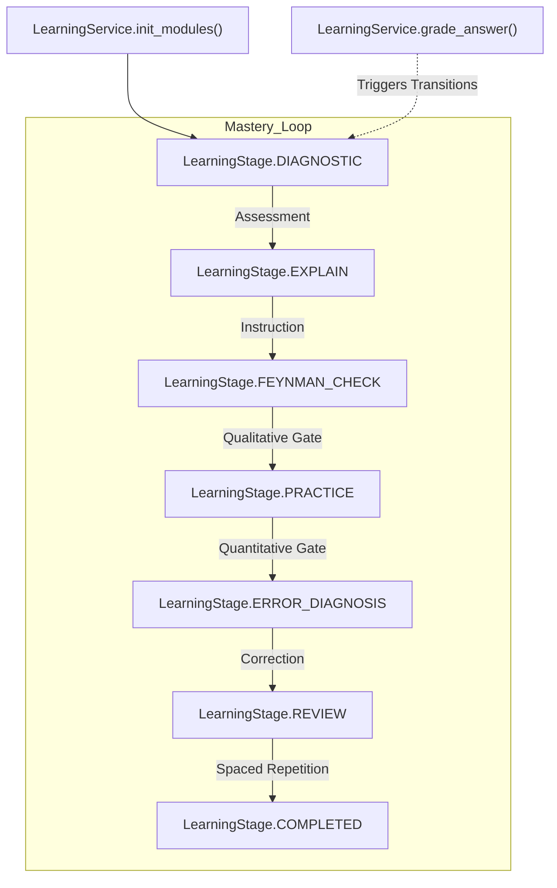
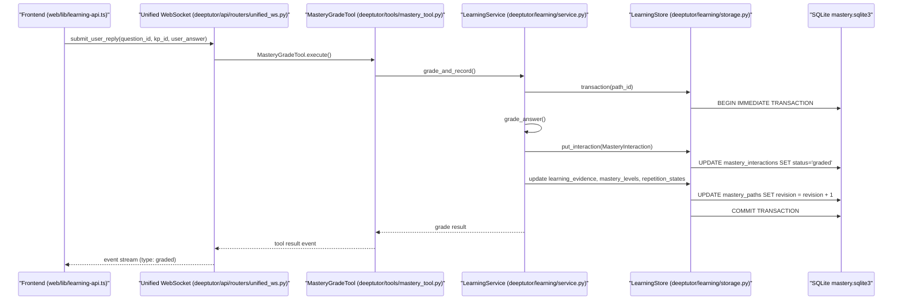

<!-- source: DeepWiki mcp.deepwiki.com · repo HKUDS/DeepTutor · page 4.9 Mastery Path Learning Engine · fetched 2026-11-09 -->

# Mastery Path Learning Engine

<details>
<summary>Relevant source files</summary>

The following files were used as context for generating this wiki page:

- [deeptutor/api/routers/mastery_path.py](deeptutor/api/routers/mastery_path.py)
- [deeptutor/capabilities/mastery/loop.py](deeptutor/capabilities/mastery/loop.py)
- [deeptutor/capabilities/mastery/prompts/en/mastery_loop.yaml](deeptutor/capabilities/mastery/prompts/en/mastery_loop.yaml)
- [deeptutor/capabilities/mastery/prompts/zh/mastery_loop.yaml](deeptutor/capabilities/mastery/prompts/zh/mastery_loop.yaml)
- [deeptutor/capabilities/mastery/tools.py](deeptutor/capabilities/mastery/tools.py)
- [deeptutor/learning/mastery.py](deeptutor/learning/mastery.py)
- [deeptutor/learning/models.py](deeptutor/learning/models.py)
- [deeptutor/learning/policy.py](deeptutor/learning/policy.py)
- [deeptutor/learning/question_card.py](deeptutor/learning/question_card.py)
- [deeptutor/learning/scheduler.py](deeptutor/learning/scheduler.py)
- [deeptutor/learning/semantic_assessment.py](deeptutor/learning/semantic_assessment.py)
- [deeptutor/learning/service.py](deeptutor/learning/service.py)
- [deeptutor/learning/storage.py](deeptutor/learning/storage.py)
- [deeptutor/learning/teaching.py](deeptutor/learning/teaching.py)
- [deeptutor/learning/tests/test_api_endpoints.py](deeptutor/learning/tests/test_api_endpoints.py)
- [deeptutor/learning/tests/test_guided_mastery_updates.py](deeptutor/learning/tests/test_guided_mastery_updates.py)
- [deeptutor/learning/tests/test_mastery_tools.py](deeptutor/learning/tests/test_mastery_tools.py)
- [deeptutor/learning/tests/test_models.py](deeptutor/learning/tests/test_models.py)
- [deeptutor/learning/tests/test_policy.py](deeptutor/learning/tests/test_policy.py)
- [deeptutor/learning/tests/test_scheduler.py](deeptutor/learning/tests/test_scheduler.py)
- [deeptutor/learning/tests/test_storage.py](deeptutor/learning/tests/test_storage.py)
- [tests/api/test_mastery_path_reviews.py](tests/api/test_mastery_path_reviews.py)
- [tests/capabilities/test_mastery_capability.py](tests/capabilities/test_mastery_capability.py)
- [tests/capabilities/test_mastery_profile_continuity.py](tests/capabilities/test_mastery_profile_continuity.py)
- [tests/capabilities/test_mastery_semantic_assessment.py](tests/capabilities/test_mastery_semantic_assessment.py)
- [tests/capabilities/test_mastery_teaching_compass.py](tests/capabilities/test_mastery_teaching_compass.py)
- [tests/capabilities/test_mastery_teaching_focus.py](tests/capabilities/test_mastery_teaching_focus.py)
- [web/app/(workspace)/learning/page.tsx](web/app/(workspace)/learning/page.tsx)
- [web/lib/learning-api.ts](web/lib/learning-api.ts)

</details>


## Purpose and Scope
The **Mastery Path Learning Engine** is a core pedagogical subsystem within DeepTutor designed to guide learners from initial exposure to verified mastery [deeptutor/learning/models.py:61-74](). Unlike standard chat-based tutoring, the Mastery Path enforces deterministic "hard gates" to progress based on qualitative and quantitative performance [deeptutor/capabilities/mastery/prompts/en/mastery_loop.yaml:19-24](), integrated with a spaced repetition scheduler (`SpacedRepetitionScheduler`) to ensure long-term retention [deeptutor/learning/scheduler.py:147-156]().

It supports topic-based structured learning with modular knowledge points (`KnowledgePoint`) organized into ordered modules (`LearningModule`) [deeptutor/learning/models.py:81-113](). Learners proceed through finely controlled stages (`LearningStage`) with graded interactions recorded durably in SQLite via `LearningStore` and mastery computed dynamically [deeptutor/learning/storage.py:1-13](). This subsystem ensures a consistent, auditable, and pedagogically-grounded learning progression.

This is a parent overview page. For granular details on data models, interval scheduling, and storage transactions, see [Learning Models and Spaced Repetition](#4.9.1). For the grading pipeline, REST APIs, mastery control loop, and frontend UI components, see [Learning Service, API and Mastery Loop](#4.9.2).

**Sources:**
- [deeptutor/learning/storage.py:1-13]()
- [deeptutor/learning/service.py:1-35]()
- [deeptutor/learning/models.py:61-113]()
- [deeptutor/capabilities/mastery/prompts/en/mastery_loop.yaml:19-24]()
- [deeptutor/learning/scheduler.py:147-156]()


---

## Learning Workflow and Stages

The Mastery Path engine progresses learners through a fixed set of learning stages, represented by the `LearningStage` enum [deeptutor/learning/models.py:62-74](). Each stage corresponds to a pedagogical phase, from initial diagnosis, concept explanation, qualitative checking, practice, error diagnosis, to spaced review and completion.



- **Diagnostic (`diagnostic`)**: Initial assessment phase to evaluate learner's baseline understanding on each knowledge point [deeptutor/learning/models.py:67]() (KP).
- **Explain (`explain`)**: Provides targeted concept instruction aligned to the KP [deeptutor/learning/models.py:68]().
- **Feynman Check (`feynman_check`)**: Qualitative self-explanation phase where the learner reinforces understanding [deeptutor/learning/models.py:69]().
- **Practice (`practice`)**: Engages learner in active recall tasks to apply knowledge; progress gated by performance pass thresholds [deeptutor/learning/models.py:70]().
- **Error Diagnosis (`error_diagnosis`)**: Classification and remediation of learner errors (`ErrorType`), with error types including structural, deviation, application, and metacognitive [deeptutor/learning/models.py:37-46,71]().
- **Review (`review`)**: Periodic spaced repetition assessments scheduled by an adaptive scheduler to support durable mastery [deeptutor/learning/scheduler.py:98-106]().
- **Completed (`completed`)**: Terminal stage signaling mastery achievement and completion of the path [deeptutor/learning/models.py:73]().

Progression from one stage to the next is driven by grading results and mastery policies implemented in the service layer [deeptutor/learning/service.py:8-10]().

**Sources:**
- [deeptutor/learning/models.py:37-78]()
- [deeptutor/learning/service.py:8-10]()
- [deeptutor/learning/scheduler.py:98-106]()


---

## Core Components and Architecture

The Mastery Path engine is composed of distinct layers coordinating to deliver a robust learning experience:

1. **Learning Models and Spaced Repetition**  
   This layer defines core Pydantic models (`LearningProgress`, `LearningModule`, `KnowledgePoint`, `MasteryInteraction`, `ErrorRecord`) for representing learning state [deeptutor/learning/models.py:81-208](). It implements mastery calculation across attempts with recency-weighting and low-confidence caps [deeptutor/learning/mastery.py](). Spaced repetition intervals are tailored by knowledge point type (`memory`, `concept`, `procedure`, `design`) via `SpacedRepetitionScheduler` [deeptutor/learning/scheduler.py:17-22,147-165]().  
   See [Learning Models and Spaced Repetition](#4.9.1) for comprehensive model details, scheduling logic, storage transactional guarantees, and migration paths.

2. **Learning Service and Grading Pipeline**  
   The `LearningService` encapsulates core business logic: grading user answers against expected answers (`grade_answer`), classifying errors (`classify_error`), updating mastery levels, advancing spaced repetition states, recomputing review queues, and managing durable state mutations wrapped in transactional units of work (`LearningTransaction`) [deeptutor/learning/service.py:8-35]().  
   See [Learning Service, API and Mastery Loop](#4.9.2) for detailed service implementation, REST API endpoints (`/api/mastery-paths`), mastery capability orchestration loops (`MasteryLoopCapability`), and frontend UI bindings [deeptutor/api/routers/mastery_path.py]().

3. **API Layer and Frontend Dashboard**  
   The mastering progress state is persisted in a workspace-scoped SQLite store managed by `LearningStore`, providing concurrency-safe compare-and-swap semantics and leasing to prevent concurrent conflicting updates [deeptutor/learning/storage.py:1-14](). Public REST endpoints serve progress data, mastery maps, learning boards, and events for live frontend dashboards (`web/app/(workspace)/learning/page.tsx`) and interactive study tools [web/lib/learning-api.ts:37-187]().

**Sources:**
- [deeptutor/learning/models.py:81-208]()
- [deeptutor/learning/service.py:8-35]()
- [deeptutor/learning/storage.py:1-14]()
- [deeptutor/learning/scheduler.py:17-22,147-165]()
- [web/lib/learning-api.ts:37-187]()


---

## System Mapping: Code to Concept

The following diagrams map natural language concepts of the Mastery Path learning system to their specific code entities and data structures, illustrating the flow and architecture.

### Data Entity Mapping

```mermaid
classDiagram
    class LearningProgress {
        +str book_id
        +LearningStage current_stage
        +dict mastery_levels
        +list error_records
        +list modules
        +PendingQuestion pending_question
    }
    class LearningModule {
        +str id
        +str name
        +float pass_threshold
        +list knowledge_points
    }
    class KnowledgePoint {
        +str id
        +KnowledgeType type
        +list prerequisite_ids
        +list topic_source_ids
    }
    class ErrorRecord {
        +str question_id
        +ErrorType error_type
        +str status
        +list retry_history
    }
    class MasteryInteraction {
        +str interaction_id
        +InteractionStatus status
        +PendingQuestion question
        +str user_answer
    }
    class RepetitionState {
        +int interval_index
        +float next_review_at
        +float stability
        +int review_count
    }
    class MasteryEvent {
        +int id
        +int revision
        +str event_type
        +dict payload
    }
    class LearningStore {
        +sqlite3 backend
        +method save(progress: LearningProgress)
        +method load(book_id: str) -> LearningProgress
    }

    LearningProgress "1" *-- "many" LearningModule : contains
    LearningModule "1" *-- "many" KnowledgePoint : defines
    LearningProgress "1" *-- "many" ErrorRecord : tracks
    LearningProgress "1" *-- "many" LearningEvidence : records
    LearningProgress "1" *-- "many" MasteryInteraction : manages
    LearningProgress "1" *-- "many" MasteryEvent : emits
    LearningProgress "1" *-- "many" RepetitionState : schedules
    LearningProgress "1" o-- "PendingQuestion" : current_question
```

This layout clarifies how the persistent progress aggregates knowledge points, maintains error diagnostics, schedules reviews, and tracks user interaction lifecycle.

**Sources:**
- [deeptutor/learning/models.py:61-208]()
- [deeptutor/learning/storage.py:108-192]()


### Execution Pipeline Mapping



This pipeline shows how a learner's answer submitted from the frontend results in grading, mastery state update, transactionally persisted changes, and live UI updates using event streams.

**Sources:**
- [deeptutor/api/routers/mastery_path.py:13-183]()
- [deeptutor/learning/service.py:84-187]()
- [deeptutor/learning/storage.py:108-192]()


---

## Key Data Structures

| Entity | Code Symbol | Purpose |
| :--- | :--- | :--- |
| **Path Progress Container** | `LearningProgress` | Aggregates learner progress for a topic/path, including modules, mastery levels, error records, and current stage [deeptutor/learning/models.py:80-160](). |
| **Knowledge Point (KP)** | `KnowledgePoint` | Atomic learning objective with type, prerequisites, and topic sources [deeptutor/learning/models.py:80-93](). |
| **Learning Module** | `LearningModule` | Ordered group of knowledge points with pass threshold and objective description [deeptutor/learning/models.py:94-110](). |
| **Quiz Attempt & Error Record** | `QuizAttempt`, `ErrorRecord` | Records individual assessment attempts and error classification for KP [deeptutor/learning/models.py:119-158](). |
| **MasteryInteraction** | `MasteryInteraction` | Represents a persisted question interaction transaction with status and answers [deeptutor/learning/models.py:209-234](). |
| **Repetition State** | `RepetitionState` | Tracks spaced repetition interval, stability, next review timestamps, and performance counters [deeptutor/learning/models.py:186-208](). |
| **Learning Store** | `LearningStore` | Durable SQLite persistence mechanism with transactional support for concurrency control and compare-and-swap semantics [deeptutor/learning/storage.py:1-192](). |
| **MasteryEvent** | `MasteryEvent` | Versioned event record for synchronization between backend and frontend UI components [deeptutor/learning/models.py:225-250](). |

**Sources:**
- [deeptutor/learning/models.py:80-208]()
- [deeptutor/learning/storage.py:108-192]()


---

## Child Pages
* **[Learning Models and Spaced Repetition](#4.9.1)**: Contains detailed Pydantic models defining the learning progress, modules, knowledge points, mastery interactions, and error records. Explains spaced repetition scheduling, mastery policy computation, storage transactions, and migration strategy.
* **[Learning Service, API and Mastery Loop](#4.9.2)**: Details the `LearningService` grading and persistence pipeline, mastery path REST API endpoints, the mastery capability loop with choices and navigation tools, event hub architecture, and the frontend LearningBoard and MasteryStudy UI components.

---

