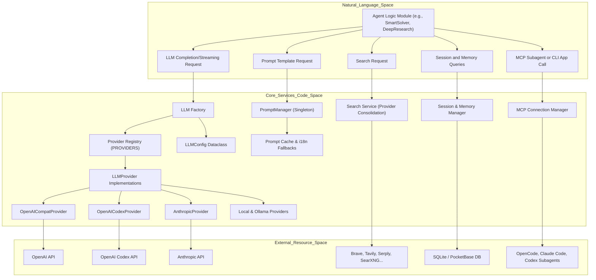
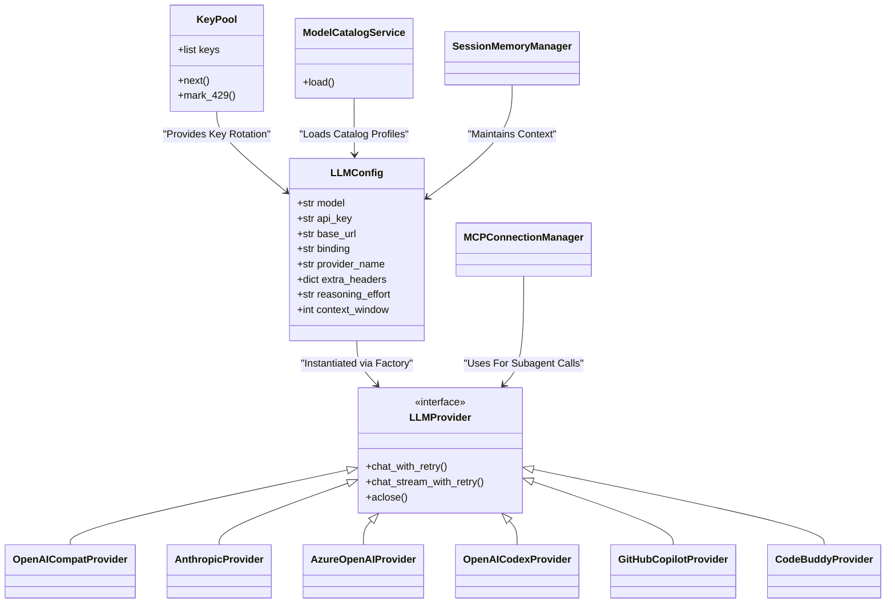

<!-- source: DeepWiki mcp.deepwiki.com · repo HKUDS/DeepTutor · page 5 Core Services · fetched 2026-11-09 -->

# Core Services

Relevant source files

The following files were used as context for generating this wiki page:

- [deeptutor/multi_user/model_access.py](deeptutor/multi_user/model_access.py)
- [deeptutor/multi_user/personal_models.py](deeptutor/multi_user/personal_models.py)
- [deeptutor/runtime/agentic/client.py](deeptutor/runtime/agentic/client.py)
- [deeptutor/runtime/home.py](deeptutor/runtime/home.py)
- [deeptutor/services/keypool.py](deeptutor/services/keypool.py)
- [deeptutor/services/llm/config.py](deeptutor/services/llm/config.py)
- [deeptutor/services/llm/factory.py](deeptutor/services/llm/factory.py)
- [deeptutor/services/llm/provider_core/__init__.py](deeptutor/services/llm/provider_core/__init__.py)
- [deeptutor/services/llm/provider_factory.py](deeptutor/services/llm/provider_factory.py)
- [tests/api/test_codex_oauth_scope.py](tests/api/test_codex_oauth_scope.py)
- [tests/multi_user/test_personal_codex_models.py](tests/multi_user/test_personal_codex_models.py)
- [tests/services/llm/test_config_module.py](tests/services/llm/test_config_module.py)
- [tests/services/llm/test_factory_provider_exec.py](tests/services/llm/test_factory_provider_exec.py)
- [tests/services/llm/test_key_rotation.py](tests/services/llm/test_key_rotation.py)
- [tests/services/partners/conftest.py](tests/services/partners/conftest.py)
- [tests/services/partners/test_channel_links.py](tests/services/partners/test_channel_links.py)
- [tests/services/test_keypool.py](tests/services/test_keypool.py)

The **Core Services** layer provides the shared backend infrastructure that powers DeepTutor's intelligent agent ecosystem and the TutorBot subsystem. This layer abstracts complex external APIs and integrations — such as Large Language Models (LLMs), web search providers, embedding services, session-memory persistence, and runtime configuration — into standardized, unified interfaces enabling modular and reusable capability development across agents and workflows.

This layer forms a foundational tier bridging the higher-level pedagogical and agentic logic with low-level API and system concerns, promoting separation of concerns and robust capability routing.

---

### Service Architecture Overview

The core services unify interactions with external AI resources and internal state management. Key elements of the architecture include:

- **Provider Registry:** A central registry maps provider names and models to specific implementations, enabling transparent switching and capability discovery for components that need LLMs, embeddings, or search [deeptutor/services/llm/factory.py:13-20]().

- **Factory Pattern:** Factories resolve model configurations and instantiate pooled, connection-managed provider clients for scalable, efficient operation [deeptutor/services/llm/factory.py:131-210](), [deeptutor/services/llm/provider_factory.py:30-57]().

- **Cache and Configuration Layer:** Singleton services cache prompts and embeddings and load system/runtime settings dynamically from multi-format user configuration files, supporting i18n and fallback chains [deeptutor/services/llm/config.py:160-175]().

- **Memory and Session Services:** Persistent stores and contextual builders manage user sessions, agent conversational memory, and multi-agent protocol lifecycle, enabling sophisticated long-term reasoning and interaction [deeptutor/multi_user/model_access.py:72-134]().

- **Runtime Tools Integration:** The Model Context Protocol (MCP) connection manager integrates external tool and subagent backends elegantly into the agent runtime, also supporting command-line apps as agent capabilities [deeptutor/multi_user/personal_models.py:40-60]().

The following diagram illustrates how core services map from higher-level natural language agent logic to concrete code entities responsible for those services.

---

#### Natural Language Space to Code Entity Space — Core Service Mapping

This diagram shows typical request flows from an agent module through the core services infrastructure, highlighting concrete code entities such as `build_isolated_provider`, `ProviderRegistry`, and service singletons like `ModelCatalogService`.

**Sources:**  
[deeptutor/services/llm/factory.py:1-210](),  
[deeptutor/services/llm/config.py:22-30](),  
[deeptutor/multi_user/model_access.py:28-33]()

---

## 5.1 LLM Service and Provider Factory

The LLM service acts as the central gateway for all large language model interactions within DeepTutor. It uses a factory design to abstract the instantiation and configuration of multiple backend providers, allowing different model endpoints (OpenAI, Anthropic, Codex, local servers) to be interchangeable and pooled for reuse.

- **Provider Registry & Discovery:** Providers are registered under canonical names and can be resolved by model name, binding, or explicit URL keys. This enables dynamic routing of calls and consistent API usage across providers [deeptutor/services/llm/factory.py:81-136]().

- **LLMConfig:** This dataclass encapsulates all runtime configuration such as model name, keys, base URLs, provider binding, extra HTTP headers, and reasoning effort settings [deeptutor/services/llm/config.py:110-131](). Key rotation and pooling are managed via `KeyPool` to handle multi-key rate-limiting transparently [deeptutor/services/keypool.py:9-62]().

- **Provider Implementations:** Adapter classes implement the `LLMProvider` interface for each backend (e.g., `OpenAICompatProvider`, `AnthropicProvider`, `OpenAICodexProvider`). This abstraction standardizes request and response handling for chat completions and streams [deeptutor/services/llm/provider_factory.py:65-158](), [deeptutor/services/llm/provider_core/__init__.py:36-55]().

- **OAuth and Personal Models:** Supports owner-bound OAuth profiles (such as OpenAI Codex and CodeBuddy) where individual users authenticate their personal subscriptions rather than sharing billable keys [deeptutor/multi_user/model_access.py:50-70](), [deeptutor/multi_user/personal_models.py:1-27]().

For full technical details and usage, see the child pages: [LLM Service and Provider Factory](#5.1), [OAuth and Codex Auth](#5.1.1), and [Model Selection and Task Models](#5.1.2).

**Sources:**  
[deeptutor/services/llm/factory.py:1-210](),  
[deeptutor/services/llm/config.py:110-131](),  
[deeptutor/services/keypool.py:9-62](),  
[deeptutor/services/llm/provider_factory.py:65-158](),  
[deeptutor/multi_user/model_access.py:50-70](),  
[deeptutor/multi_user/personal_models.py:1-27]()

---

## 5.2 Search Service

The Search Service provides a unified abstraction layer over various web search providers, enabling agents to query live web data transparently.

- **Provider Support:** Aggregates multiple backend search engines like Brave, Tavily, Serply, SearXNG, with fallback and consolidation policies.
- **Native LLM Integration:** Some LLM providers support direct native web search, which offloads search execution to the model provider.

For more detailed design and supported providers, see [Search Service](#5.2).

**Sources:**  
[deeptutor/services/llm/factory.py:13-20]()

---

## 5.3 Prompt Management and i18n Prompts

The prompt management subsystem loads, caches, and resolves prompt templates in multiple languages with language fallback chains and path resolution.

- **Prompt Caching and Path Resolution:** Loaded prompts are cached and resolved based on module, agent, language, and subdirectories.
- **Internationalization Support:** Language codes are normalized with automatic fallbacks (e.g., regional variants falling back to base language codes).

For implementation details and i18n design, see [Prompt Management and i18n Prompts](#5.3).

**Sources:**  
[deeptutor/services/llm/config.py:22-30]()

---

## 5.4 Embedding, Image, Video and Voice Services

This group of services provides unified access to vector embeddings, multimedia generation, and speech interfaces:

- **Embedding Services:** Uses an adapter pattern to normalize different vector embedding providers (OpenAI-compatible, DashScope, Ollama, Cohere, Jina) for Knowledge Base and RAG workflows.
- **Multimedia and Voice Services:** Abstracted provider interfaces for image generation, video generation, text-to-speech (TTS), and speech-to-text (STT) capabilities.

For details on APIs, providers, and runtime configuration, see [Embedding, Image, Video and Voice Services](#5.4).

**Sources:**  
[deeptutor/services/llm/provider_factory.py:65-158]()

---

## 5.5 Session and Memory Management

DeepTutor employs persistent storage and sophisticated in-memory systems to maintain conversational state and agent memory:

- **Session Storage:** Uses SQLite and PocketBase session stores supporting protocol traces, edit branching, and recycle bins.
- **Memory Subsystem:** Combines short-term active memory, medium-term episodic memory, and long-term knowledge storage.

For full service behavior and storage protocols, see [Session and Memory Management](#5.5).

**Sources:**  
[deeptutor/multi_user/model_access.py:72-134]()

---

## 5.6 MCP, Subagents and CLI Apps

The Model Context Protocol (MCP) layer extends DeepTutor by managing connections to external subagents and CLI applications.

- **MCP Connection Manager:** Handles lifecycle, progress reporting, and deferred tool adapters for MCP servers.
- **Subagents & CLI Apps:** Integrates backend subagent profiles (such as OpenCode, Claude Code, Codex) and CLI tool runners as agent capabilities.

For integration and usage, see [MCP, Subagents and CLI Apps](#5.6).

**Sources:**  
[deeptutor/multi_user/personal_models.py:1-27]()

---

## 5.7 Document Parsing and Sandbox Execution

This service layer manages document ingestion and secure code/tool sandboxing:

- **Parsing Engines:** Factory pattern supports parsing engines including MinerU, Docling, markitdown, pymupdf4llm, liteparse, and text-only extractors.
- **Sandbox Backends:** Secure execution environments providing isolated runtime execution and builtin office skills.

For detailed functionality and supported formats, see [Document Parsing and Sandbox Execution](#5.7).

**Sources:**  
[deeptutor/services/llm/config.py:110-131]()

---

### Code Entity Overview: Core Service Classes and Relationships

This diagram clarifies the roles of major core service classes and their interactions, linking runtime configuration, key pooling, and provider resolution with catalog services, session memory, and MCP connectivity.

**Sources:**  
[deeptutor/services/llm/config.py:110-131](),  
[deeptutor/services/llm/factory.py:1-210](),  
[deeptutor/services/keypool.py:9-62](),  
[deeptutor/services/llm/provider_factory.py:65-158](),  
[deeptutor/multi_user/model_access.py:28-33]()

---

This core services page provides a high-level overview linking major backend subsystems, their responsibility boundaries, and how they underpin DeepTutor's agent capabilities. Detailed technical exposition and API usage are available on the respective child pages referenced above.

---

