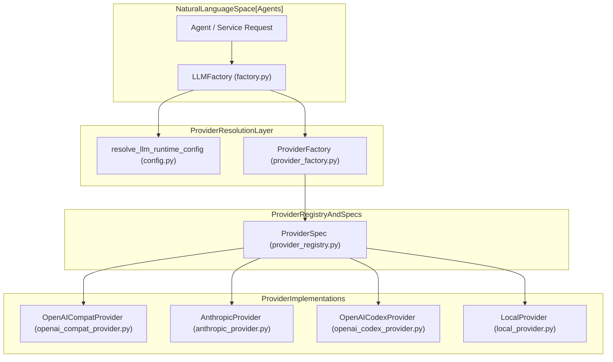
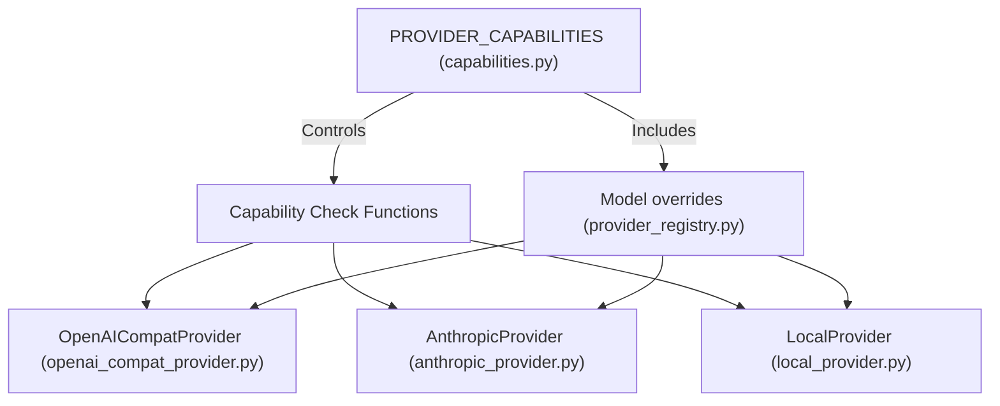

<!-- source: DeepWiki mcp.deepwiki.com · repo HKUDS/DeepTutor · page 5.1 LLM Service and Provider Factory · fetched 2026-11-09 -->

# LLM Service and Provider Factory

Relevant source files

The following files were used as context for generating this wiki page:

- [deeptutor/agents/research/data_structures.py](deeptutor/agents/research/data_structures.py)
- [deeptutor/agents/research/utils/citation_manager.py](deeptutor/agents/research/utils/citation_manager.py)
- [deeptutor/api/routers/settings.py](deeptutor/api/routers/settings.py)
- [deeptutor/multi_user/model_access.py](deeptutor/multi_user/model_access.py)
- [deeptutor/multi_user/personal_models.py](deeptutor/multi_user/personal_models.py)
- [deeptutor/runtime/agentic/client.py](deeptutor/runtime/agentic/client.py)
- [deeptutor/runtime/home.py](deeptutor/runtime/home.py)
- [deeptutor/services/__init__.py](deeptutor/services/__init__.py)
- [deeptutor/services/config/context_window_detection.py](deeptutor/services/config/context_window_detection.py)
- [deeptutor/services/keypool.py](deeptutor/services/keypool.py)
- [deeptutor/services/llm/capabilities.py](deeptutor/services/llm/capabilities.py)
- [deeptutor/services/llm/claude_sdk.py](deeptutor/services/llm/claude_sdk.py)
- [deeptutor/services/llm/cloud_provider.py](deeptutor/services/llm/cloud_provider.py)
- [deeptutor/services/llm/config.py](deeptutor/services/llm/config.py)
- [deeptutor/services/llm/context_window.py](deeptutor/services/llm/context_window.py)
- [deeptutor/services/llm/error_mapping.py](deeptutor/services/llm/error_mapping.py)
- [deeptutor/services/llm/factory.py](deeptutor/services/llm/factory.py)
- [deeptutor/services/llm/local_provider.py](deeptutor/services/llm/local_provider.py)
- [deeptutor/services/llm/minimax_models.py](deeptutor/services/llm/minimax_models.py)
- [deeptutor/services/llm/provider_core/__init__.py](deeptutor/services/llm/provider_core/__init__.py)
- [deeptutor/services/llm/provider_core/claude_code_provider.py](deeptutor/services/llm/provider_core/claude_code_provider.py)
- [deeptutor/services/llm/provider_core/codebuddy_provider.py](deeptutor/services/llm/provider_core/codebuddy_provider.py)
- [deeptutor/services/llm/provider_core/openai_compat_provider.py](deeptutor/services/llm/provider_core/openai_compat_provider.py)
- [deeptutor/services/llm/provider_core/openai_responses/converters.py](deeptutor/services/llm/provider_core/openai_responses/converters.py)
- [deeptutor/services/llm/provider_core/openai_responses/parsing.py](deeptutor/services/llm/provider_core/openai_responses/parsing.py)
- [deeptutor/services/llm/provider_core/sdk_bridge.py](deeptutor/services/llm/provider_core/sdk_bridge.py)
- [deeptutor/services/llm/provider_factory.py](deeptutor/services/llm/provider_factory.py)
- [deeptutor/services/llm/reasoning_params.py](deeptutor/services/llm/reasoning_params.py)
- [deeptutor/services/llm/request_compat.py](deeptutor/services/llm/request_compat.py)
- [deeptutor/services/llm/usage_frame.py](deeptutor/services/llm/usage_frame.py)
- [deeptutor/services/provider_registry.py](deeptutor/services/provider_registry.py)
- [deeptutor/services/rag/pipelines/lightrag/worker.py](deeptutor/services/rag/pipelines/lightrag/worker.py)
- [deeptutor/services/settings/provider_probe.py](deeptutor/services/settings/provider_probe.py)
- [deeptutor/services/subagent/claude_models.py](deeptutor/services/subagent/claude_models.py)
- [deeptutor/utils/json_parser.py](deeptutor/utils/json_parser.py)
- [docs-for-dev/I18N.md](docs-for-dev/I18N.md)
- [docs-for-dev/README.md](docs-for-dev/README.md)
- [examples/memory_evaluation/README.md](examples/memory_evaluation/README.md)
- [tests/agents/research/test_citation_manager.py](tests/agents/research/test_citation_manager.py)
- [tests/api/test_codex_oauth_scope.py](tests/api/test_codex_oauth_scope.py)
- [tests/api/test_settings_router.py](tests/api/test_settings_router.py)
- [tests/core/test_agentic_client_provider_kwargs.py](tests/core/test_agentic_client_provider_kwargs.py)
- [tests/core/test_agentic_messages.py](tests/core/test_agentic_messages.py)
- [tests/multi_user/test_personal_codex_models.py](tests/multi_user/test_personal_codex_models.py)
- [tests/services/config/test_context_window_detection.py](tests/services/config/test_context_window_detection.py)
- [tests/services/config/test_provider_runtime.py](tests/services/config/test_provider_runtime.py)
- [tests/services/embedding/test_retry_after.py](tests/services/embedding/test_retry_after.py)
- [tests/services/llm/test_capabilities.py](tests/services/llm/test_capabilities.py)
- [tests/services/llm/test_claude_code_provider.py](tests/services/llm/test_claude_code_provider.py)
- [tests/services/llm/test_cloud_provider.py](tests/services/llm/test_cloud_provider.py)
- [tests/services/llm/test_codebuddy_provider.py](tests/services/llm/test_codebuddy_provider.py)
- [tests/services/llm/test_config_module.py](tests/services/llm/test_config_module.py)
- [tests/services/llm/test_context_window.py](tests/services/llm/test_context_window.py)
- [tests/services/llm/test_error_mapping.py](tests/services/llm/test_error_mapping.py)
- [tests/services/llm/test_factory_provider_exec.py](tests/services/llm/test_factory_provider_exec.py)
- [tests/services/llm/test_key_rotation.py](tests/services/llm/test_key_rotation.py)
- [tests/services/llm/test_local_provider.py](tests/services/llm/test_local_provider.py)
- [tests/services/llm/test_minimax_current_models.py](tests/services/llm/test_minimax_current_models.py)
- [tests/services/llm/test_multimodal.py](tests/services/llm/test_multimodal.py)
- [tests/services/llm/test_native_web_search.py](tests/services/llm/test_native_web_search.py)
- [tests/services/llm/test_openai_compat_reasoning_content.py](tests/services/llm/test_openai_compat_reasoning_content.py)
- [tests/services/llm/test_openai_responses_converters.py](tests/services/llm/test_openai_responses_converters.py)
- [tests/services/llm/test_openai_responses_parsing.py](tests/services/llm/test_openai_responses_parsing.py)
- [tests/services/llm/test_reasoning_params.py](tests/services/llm/test_reasoning_params.py)
- [tests/services/llm/test_request_compat.py](tests/services/llm/test_request_compat.py)
- [tests/services/llm/test_responses_tool_strict.py](tests/services/llm/test_responses_tool_strict.py)
- [tests/services/llm/test_usage_frame.py](tests/services/llm/test_usage_frame.py)
- [tests/services/partners/conftest.py](tests/services/partners/conftest.py)
- [tests/services/partners/test_channel_links.py](tests/services/partners/test_channel_links.py)
- [tests/services/rag/test_lightrag_worker.py](tests/services/rag/test_lightrag_worker.py)
- [tests/services/rag/test_llamaindex_ingestion.py](tests/services/rag/test_llamaindex_ingestion.py)
- [tests/services/test_claude_model_discovery.py](tests/services/test_claude_model_discovery.py)
- [tests/services/test_keypool.py](tests/services/test_keypool.py)
- [tests/services/test_provider_registry.py](tests/services/test_provider_registry.py)
- [tests/utils/test_json_parser.py](tests/utils/test_json_parser.py)
- [web/lib/provider-branding.ts](web/lib/provider-branding.ts)
- [web/public/provider-icons/cloudgpu.png](web/public/provider-icons/cloudgpu.png)
- [web/public/provider-icons/llmtr.png](web/public/provider-icons/llmtr.png)
- [web/public/provider-icons/microsoft-color.svg](web/public/provider-icons/microsoft-color.svg)
- [web/public/provider-icons/onomeo.svg](web/public/provider-icons/onomeo.svg)
- [web/public/provider-icons/runcrate.png](web/public/provider-icons/runcrate.png)
- [web/public/provider-icons/sources.json](web/public/provider-icons/sources.json)
- [web/tests/learning-source-scroll.audit.ts](web/tests/learning-source-scroll.audit.ts)

The LLM Service layer in DeepTutor serves as the core system bridging agents and user-facing modules to various large language model (LLM) providers. Its primary goal is to unify access to heterogeneous LLM backends including OpenAI-compatible endpoints, Anthropic Claude models, OAuth-based OpenAI Codex, local LLM servers, and others. It manages provider discovery, capability detection, request compatibility, context window assessment, reasoning parameter injection, and usage telemetry.

This page provides a high-level overview of the LLM factory and provider factory, the provider registry, and capability detection systems. It also summarizes mechanisms for context window detection, request compatibility, error mapping, and usage frames. For in-depth details, see the linked child pages on OAuth and Codex authentication flow, and model selection with task-specific models.

---

## LLM Factory and Provider Registry

### Central Role of LLMFactory

`LLMFactory` is the main entry point for creating and managing LLM provider instances. It receives requests from agents and clients calling methods such as `complete()` and `stream()`, then orchestrates routing to the suitable provider configuration. It encapsulates distinctions between cloud-hosted models, gateway proxies, and local inference servers, presenting a unified interface for consumers.

The factory uses the provider registry and runtime configuration services to resolve the provider specification and runtime settings before instantiating a provider. It intelligently detects the provider type by analyzing the binding name, model ID prefixes, API key prefixes, or the base API URL to assign the correct backend (e.g., OpenAI-compatible, Anthropic, Codex, local).

### Provider Specification Discovery

The provider registry (`ProviderSpec`) holds metadata and configuration hints per provider. It includes:

- Binding names, environment variable keys, and API base URLs.
- Detection heuristics like API key prefixes (e.g., keys starting with `sk-or-` map to `openrouter` gateway).
- Backend type identifiers like `"openai_compat"`, `"anthropic"`, `"openai_codex"`, `"codebuddy"`, or `"local"`.
- Flags indicating capabilities such as tool calling, streaming support, vision capabilities, and OAuth authentication.
- Model family patterns to detect which provider a model belongs to.

The factory consults this registry when matching a request's binding name, model, or API credentials to identify the precise provider instance to use. For example, local LLM servers are auto-detected by examining if the endpoint uses loopback or Docker host network addresses [deeptutor/services/provider_registry.py:19-70](), [deeptutor/services/llm/factory.py:70-110]().

### Provider Factory and Execution Dispatch

The `ProviderFactory` class wraps the provider instantiation logic. Based on the resolved `ProviderSpec`, it initializes the correct provider class:

- **OpenAICompatProvider**: Wraps any OpenAI-compatible API endpoint using the official `openai.AsyncOpenAI` SDK.
- **AnthropicProvider**: Direct integration with Claude models using the Anthropic SDK, converting OpenAI chat messages to Anthropic format.
- **OpenAICodexProvider**: Handles OAuth-based OpenAI Codex calls, including specialized OAuth workflows.
- **LocalProvider**: Supports self-hosted or LAN-attached LLMs like Ollama or vLLM.

This layered factory design isolates provider-specific logic, enabling seamless function calls on the unified interface regardless of the backend. It supports dynamic provider selection, key rotation, and error recovery [deeptutor/services/llm/provider_factory.py:1-24](), [deeptutor/services/llm/provider_core/openai_compat_provider.py:164-197]().

Sources:
- `deeptutor/services/provider_registry.py:19-70`
- `deeptutor/services/llm/factory.py:70-110`
- `deeptutor/services/llm/provider_factory.py:1-24`
- `deeptutor/services/llm/provider_core/openai_compat_provider.py:164-197`

---

## Capability Detection and Context Window

### Centralized Capability System

To manage diverse provider features, DeepTutor centralizes capability detection in the `PROVIDER_CAPABILITIES` registry. This governs whether a backend supports:

- Streaming responses
- Structured JSON response format (`response_format`)
- Vision support (multimodal image inputs)
- Tool calling (function calls or actions)
- Retry, prompt caching, and reasoning tags
- Placement of System prompts (messages array vs dedicated params)

Additionally, per-model overrides refine these capabilities at a granular level, such as disabling JSON mode for some DeepSeek reasoners or enabling thinking tags only on specialized bindings [deeptutor/services/llm/capabilities.py:27-183]().

### Context Window Detection

The factory assesses each model’s max context window using cataloged or default values. This guides request token budgets to avoid overruns and informs reasoning parameter tuning.

### Reasoning Parameter Injection

Depending on the provider and model, the service automatically injects reasoning parameters to control “thinking modes.” For instance:

- DeepSeek and VolcEngine models receive `thinking.type: "enabled"` for high reasoning effort.
- Anthropic’s effort-based families (e.g., Opus and Sonnet) use adaptive thinking styles toggled via parameters, omitting explicit temperature when unsupported.
- Qwen models enable thinking with custom flags.

These logic rules ensure compatible, optimized requests tailored per backend and model [tests/core/test_agentic_client_provider_kwargs.py:20-90]().

Sources:
- `deeptutor/services/llm/capabilities.py:27-183`
- `tests/core/test_agentic_client_provider_kwargs.py:20-90`

---

## Supported Providers and Backends

Below is a mapping of supported provider backends and their capabilities:

| Backend           | Common Provider Names                                                                    | Vision Supported | Tool Calling Supported | Prompt Caching         |
|-------------------|------------------------------------------------------------------------------------------|------------------|-----------------------|------------------------|
| `openai_compat`   | OpenAI, DeepSeek, OpenRouter, SiliconFlow, Groq, Together AI, Mistral, DashScope, Moonshot, VolcEngine, BytePlus | Yes              | Yes                   | Often model-dependent  |
| `anthropic`       | Claude (Opus, Sonnet, Fable families), Custom Anthropic, MiniMax Anthropic               | Yes              | Yes                   | Yes                    |
| `azure_openai`    | Azure-hosted OpenAI variants                                                             | Yes              | Yes                   | No                     |
| `openai_codex`    | OAuth-based OpenAI interface                                                             | Yes              | No                    | No                     |
| `github_copilot`  | GitHub Copilot                                                                           | No               | No                    | No                     |
| `codebuddy`       | CodeBuddy                                                                               | No               | Yes                   | No                     |
| `local`           | Ollama, LM Studio                                                                        | Variable         | Variable              | Variable               |

This unified abstraction facilitates adding providers in future without disrupting existing workflows [deeptutor/services/provider_registry.py:19-180](), [deeptutor/services/llm/capabilities.py:20-183]().

Sources:
- `deeptutor/services/provider_registry.py:19-180`
- `deeptutor/services/llm/capabilities.py:20-183`

---

## Multimodal Message Preparation and Usage Frames

### Image Input Handling

Before sending requests to providers, the factory calls `prepare_multimodal_messages` to detect and convert image inputs. Providers like Anthropic require image data to be embedded as base64 inline images, whereas OpenAI-compatible endpoints may accept image URLs inline.

### Prompt Caching and Circuit Breaking

- Gateways like OpenRouter expose prompt caching, managed by `OpenAICompatProvider`.
- AnthropicProvider supports native prompt caching inherent to Claude.
- The factory employs circuit breakers to halt requests temporarily to providers/models with repeated transient failures, avoiding cascading errors.

### Usage Frames

The `usage_frame` records token usage, request timing, and error contexts, enabling telemetry and troubleshooting for LLM requests across diverse backends.

Sources:
- `deeptutor/services/llm/factory.py:1-270`
- `deeptutor/services/llm/provider_core/openai_compat_provider.py:1-50`

---

## Error Mapping and Request Compatibility

The LLM service layer handles protocol differences and error formats via:

- Compatibility layers adapting request keyword arguments for each provider.
- Specialized error mappers that translate provider-specific exceptions into uniform `LLMResponse` objects with standardized status flags.
- Model-intrinsic request overrides ensuring stable parameter combinations (e.g., disabled temperature on Kimi models).

These mechanisms enable consistent error handling and robustness across the provider portfolio.

Sources:
- `deeptutor/services/llm/request_compat.py`
- `deeptutor/services/llm/error_mapping.py`

---

## Agentic Client Factory and Native SDK Adapters

For agents requiring direct native SDK (e.g., OpenAI, Anthropic) clients with enhanced features like key pools and streaming callbacks, the factory provides `build_openai_client`. This method returns an adapter implementing uniform `openai.AsyncOpenAI`-style calls regardless of the native provider.

It supports:

- Key rotation on 429 (rate limit) errors.
- Forwarding reasoning content deltas on stream.
- Native tool call support flags per backend.
- SSL verification disabling for local/self-signed environments.

This enables the Smart Solver and other components to use typical OpenAI SDK methods even when routed through heterogeneous backends [deeptutor/runtime/agentic/client.py:1-134](), [tests/core/test_agentic_client_provider_kwargs.py:20-90]().

Sources:
- `deeptutor/runtime/agentic/client.py:1-134`
- `tests/core/test_agentic_client_provider_kwargs.py:20-90`

---

## Summary Diagram: Natural Language Space to Code Entity Space

This diagram visualizes how agent calls are resolved into specific LLM provider instances, linking natural language concepts to code entities:

Sources:
- `deeptutor/services/llm/factory.py:1-270`
- `deeptutor/services/llm/provider_factory.py:1-24`
- `deeptutor/services/provider_registry.py:1-180`

---

## Summary Diagram: Provider Capabilities and Model Overrides

This diagram highlights the key code entities and their relationship with provider capabilities and model-level overrides.

Sources:
- `deeptutor/services/llm/capabilities.py:20-183`
- `deeptutor/services/provider_registry.py:1-180`

---

## Child Pages

- For detailed OpenAI Codex and CodeBuddy OAuth flows, the `codex_auth` service, catalog refresh, UI components, and OAuth contract specs, see [OAuth and Codex Auth](#5.1.1).
- For comprehensive coverage of the model catalog, task model routing, key pool management, capability routing, model overrides, and launch settings, see [Model Selection and Task Models](#5.1.2).

---

