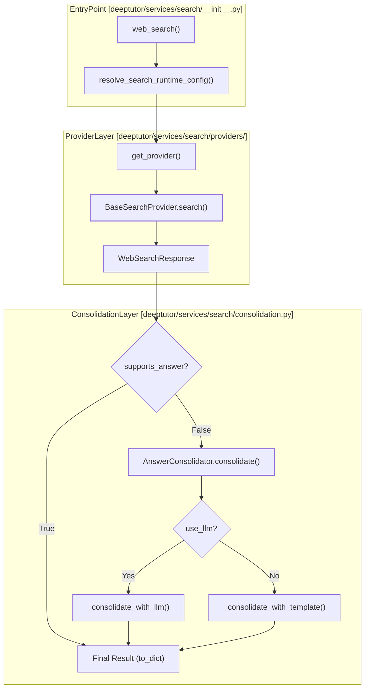
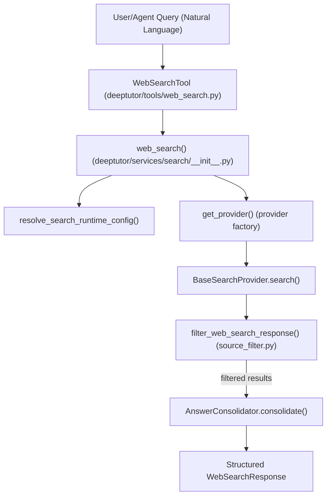

<!-- source: DeepWiki mcp.deepwiki.com · repo HKUDS/DeepTutor · page 5.2 Search Service · fetched 2026-11-09 -->

# Search Service

<details>
<summary>Relevant source files</summary>

The following files were used as context for generating this wiki page:

- [deeptutor/services/search/__init__.py](deeptutor/services/search/__init__.py)
- [deeptutor/services/search/consolidation.py](deeptutor/services/search/consolidation.py)
- [deeptutor/services/search/providers/__init__.py](deeptutor/services/search/providers/__init__.py)
- [deeptutor/services/search/providers/google_browser_scraper.py](deeptutor/services/search/providers/google_browser_scraper.py)
- [deeptutor/services/search/providers/perplexity.py](deeptutor/services/search/providers/perplexity.py)
- [deeptutor/services/search/providers/serply.py](deeptutor/services/search/providers/serply.py)
- [deeptutor/services/search/providers/youcom.py](deeptutor/services/search/providers/youcom.py)
- [deeptutor/services/search/source_filter.py](deeptutor/services/search/source_filter.py)
- [deeptutor/tools/web_search.py](deeptutor/tools/web_search.py)
- [deeptutor_cli/init_wizard.py](deeptutor_cli/init_wizard.py)
- [tests/cli/test_init_wizard_probe.py](tests/cli/test_init_wizard_probe.py)
- [tests/services/search/test_search_providers.py](tests/services/search/test_search_providers.py)
- [tests/services/search/test_web_search_runtime.py](tests/services/search/test_web_search_runtime.py)
- [web/public/provider-icons/youcom.ico](web/public/provider-icons/youcom.ico)

</details>


The Search Service acts as a unified abstraction layer providing web search capabilities within DeepTutor. It orchestrates diverse provider implementations, manages credential resolution for each provider, applies post-processing filters for source safety, and consolidates raw search engine results into structured, agent-consumable response formats [deeptutor/services/search/__init__.py:1-40]().

## Architecture Overview

The Search Service follows a modular, provider-registry architecture pattern, cleanly separating concerns into these main layers:

- **Provider Layer:** Individual search providers implementing the `BaseSearchProvider` interface fetch raw search results from various search engines or APIs [deeptutor/services/search/base.py](), [deeptutor/services/search/providers/__init__.py:18-20]().
- **Source Filtering:** Provider results are post-processed to remove risky or irrelevant references for safety and quality [deeptutor/services/search/source_filter.py:1-15]().
- **Consolidation Layer:** Synthesizes raw results into consolidated answers, optionally using LLM-based summarization [deeptutor/services/search/consolidation.py:1-15]().

This abstraction enables flexible addition of new providers, central credential management, and consistent safety and synthesis policies.

### Search Execution and Consolidation Flow

The following diagram shows the principal flow from the entry point `web_search()` function through provider invocation, source filtering, and answer consolidation:



Sources: [deeptutor/services/search/__init__.py:131-210](), [deeptutor/services/search/consolidation.py:174-189](), [deeptutor/services/search/providers/__init__.py:60-84]()

## Provider Abstraction

DeepTutor supports a broad range of search providers. Each provider is implemented as a subclass of `BaseSearchProvider`. Providers differ in the capabilities they expose, including whether they return a direct answer or only raw search engine result pages (SERP) [deeptutor/services/search/base.py]().

### Supported Providers

The system classifies providers mainly into:

- **AI Providers:** Capable of generating direct answers from queries using their internal LLM or AI models (e.g., Tavily, Perplexity, Doubao) [deeptutor/services/search/providers/perplexity.py:21-25]().
- **SERP Providers:** Return raw search results, URLs, snippets and require consolidation for human-readable answers (e.g., Brave, Serply, DuckDuckGo, SearXNG, You.com) [deeptutor/services/search/providers/youcom.py:17-20](), [deeptutor/services/search/providers/serply.py:37-43]().

The provider specification and registration define each provider's properties, required credentials, and whether it supports answer synthesis [deeptutor/services/search/providers/__init__.py:27-57]().

| Provider      | Type   | Implementation Class  | Key Feature                        |
| ------------- | ------ | ---------------------| --------------------------------- |
| Brave         | SERP   | `BraveProvider`       | Independent index, privacy-focused|
| Tavily        | AI     | `TavilyProvider`      | LLM-friendly, includes free tier  |
| Jina          | SERP+  | `JinaProvider`        | Returns full page content/markdown|
| DuckDuckGo    | SERP   | `DuckDuckGoProvider`  | Zero-config fallback               |
| Perplexity    | AI     | `PerplexityProvider`  | Answer-style search                |
| Serper        | SERP   | `SerperProvider`      | Google SERP wrapper (organic/news/scholar) |
| Serply        | SERP   | `SerplyProvider`      | Google SERP, News, and Scholar modes |
| Firecrawl     | SERP+  | `FirecrawlProvider`   | Search + full-page markdown convert|
| You.com       | SERP   | `YouComProvider`      | Authenticated You.com Search API   |
| SearXNG       | SERP   | `SearXNGProvider`     | Self-hosted meta-search aggregator|

Sources: [deeptutor_cli/init_wizard.py:143-220](), [deeptutor/services/search/providers/serply.py:7-39](), [deeptutor/services/search/providers/__init__.py:27-57](), [deeptutor/services/search/providers/youcom.py:17-23]()

### Provider Registry and Selection

Providers are registered through the `register_provider` decorator which attaches standardized metadata such as display name, credential requirements, and answer support flags using the central `SEARCH_PROVIDERS` spec [deeptutor/services/search/providers/__init__.py:27-57]().

The `get_available_providers()` call filters registered providers based on active credentials configured in the user’s search profile [deeptutor/services/search/providers/__init__.py:97-111]().

At runtime, the search service:

- Resolves the active search provider configuration and credentials [deeptutor/services/search/__init__.py:156-172]().
- Checks for deprecated or unsupported providers [deeptutor/services/search/__init__.py:86-98]().
- Falls back to a default provider (`SEARCH_FALLBACK_PROVIDER`, defaulting to DuckDuckGo) if the configured provider has missing credentials or is disabled [deeptutor/services/search/__init__.py:173-185]().

Sources: [deeptutor/services/search/providers/__init__.py:50-110](), [deeptutor/services/search/__init__.py:74-94]()

## Answer Consolidation

For providers that provide raw SERP results without direct answers (`supports_answer=False`), DeepTutor synthesizes readable and well-formatted answers [deeptutor/services/search/consolidation.py:25-27]().

### Consolidation Strategies

1. **Template-based Consolidation:**  
   Uses Jinja2 templates specific to each provider to format citations and snippets into text. Templates exist for providers such as Serper, Jina, and Serper Scholar modes [deeptutor/services/search/consolidation.py:27-135]().

2. **LLM-based Consolidation:**  
   When configured (`use_llm=True`), the consolidator calls the LLM to generate a coherent summary answer from extracted snippets [deeptutor/services/search/consolidation.py:138-182]().

The `AnswerConsolidator` class manages this logic, detecting whether to use templating or LLM synthesis [deeptutor/services/search/consolidation.py:138-166]().

### Serply Vertical Search Example

The `SerplyProvider` stands out by supporting verticals: normal web search, news, and scholar modes within a single provider key. It parses and maps these vertical-mode results onto the unified data models:

- `SearchResult` [deeptutor/services/search/types.py]()
- `Citation` [deeptutor/services/search/types.py]()

Example source parsing handles different JSON response shapes into consistent internal representations for downstream consolidation [deeptutor/services/search/providers/serply.py:123-174]().

Sources: [deeptutor/services/search/consolidation.py:27-135](), [deeptutor/services/search/providers/serply.py:45-70]()

## Configuration and Implementation Details

### Configuration to Execution Mapping

This class diagram illustrates how configuration data and runtime functions relate to the search execution components:

```mermaid
classDiagram
    class "ResolvedSearchConfig" as ResolvedSearchConfig {
        +provider: str
        +api_key: str
        +max_results: int
        +proxy: str
    }
    class "web_search()" as WebSearchFunction {
        +query: str
        +output_dir: str
        +provider: str
    }
    class AnswerConsolidator {
        +jinja_env: Environment
        +use_llm: bool
        +consolidate(response: WebSearchResponse)
    }
    class BaseSearchProvider {
        <<abstract>>
        +search(query: str)
        +supports_answer: bool
        +requires_api_key: bool
    }
    class "filter_web_search_response()" as SourceFilter {
        +blocked_domains: tuple
        +trusted_domains: tuple
        +unsafe_content_patterns: tuple
    }

    WebSearchFunction ..> ResolvedSearchConfig : "resolves via resolve_search_runtime_config()"
    WebSearchFunction --> BaseSearchProvider : "factory get_provider()"
    WebSearchFunction --> AnswerConsolidator : "uses for SERP results if supports_answer=False"
    WebSearchFunction --> SourceFilter : "applies filtering to results"
```

Sources: [deeptutor/services/search/__init__.py:156-190](), [deeptutor/services/search/consolidation.py:138-166](), [deeptutor/services/search/source_filter.py:130-208]()

### Source Filtering

The source filtering enforces post-fetch safety by applying several layers of heuristics and checks implemented in the `source_filter` module [deeptutor/services/search/source_filter.py:1-15]().

- **Domain Blocking / Trusting:** Customizable lists of blocked domains and an opt-in trusted educational domain allowlist prevent surfaced results from risky or irrelevant sites [deeptutor/services/search/source_filter.py:24-46]().
- **Unsafe Content Heuristics:** Title and snippet regex patterns filter out adult content, gambling, drugs, and other disallowed topics [deeptutor/services/search/source_filter.py:48-77]().
- **URL Validation:** Rejects URLs with unsupported schemes, embedded credentials, private IP addresses, or uncommon ports [deeptutor/services/search/source_filter.py:146-195]().
- **Optional OpenAI Moderation and Google Web Risk Checks:** Further checks can optionally use external APIs for content moderation and web risk assessment [deeptutor/services/search/source_filter.py:79-96]().

Sources: [deeptutor/services/search/source_filter.py:1-208]()

### Built-in Tool Integration

The `WebSearchTool` tool class integrates the search service into the agent tooling system, allowing agents to invoke web searches seamlessly and get structured `ToolResult` objects [deeptutor/tools/web_search.py:26-42]().

Sources: [deeptutor/tools/web_search.py:26-42]()

### Testing and Validation

The codebase contains extensive tests validating:

- Correct mapping of shared runtime config (`max_results`, `proxy`) to provider-specific API parameters [tests/services/search/test_search_providers.py:1-68]().
- Fallback behavior when provider credentials are missing or invalid [tests/services/search/test_web_search_runtime.py:151-178]().
- Correct source filtering behavior [tests/services/search/test_web_search_runtime.py:31-56]().
- Robustness against provider-level runtime errors and rate limiting [tests/services/search/test_web_search_runtime.py:204-220]().

Sources: [tests/services/search/test_web_search_runtime.py:1-206](), [tests/services/search/test_search_providers.py:1-85]()

---

## Natural Language Search Flow to Code Entities



Sources: [deeptutor/services/search/__init__.py:131-190](), [deeptutor/services/search/source_filter.py:1-15](), [deeptutor/tools/web_search.py:26-42]()

---

## Search Provider Configuration and Runtime Entities

```mermaid
classDiagram
  class "SearchProfile" {
    +provider: str
    +api_key: str
    +base_url: str
    +max_results: int
  }
  class "ResolvedSearchConfig" {
    +provider: str
    +api_key: str
    +base_url: str
    +max_results: int
    +proxy: str
  }
  class SearchService {
    +web_search(query)
  }
  class ProviderRegistry {
    +register_provider(cls)
    +get_provider(name)
  }
  class BaseSearchProvider <<abstract>> {
    +search(query)
    +supports_answer: bool
  }
  class SourceFilter {
    +settings_from_config(config)
    +filter_web_search_response(response)
  }
  class AnswerConsolidator {
    +consolidate(response)
  }

  SearchProfile --> ResolvedSearchConfig : "resolve_search_runtime_config()"
  ResolvedSearchConfig --> SearchService : "used by web_search()"
  SearchService --> ProviderRegistry : "get_provider()"
  ProviderRegistry --> BaseSearchProvider : "instantiate provider"
  SearchService --> SourceFilter : "filter_web_search_response()"
  SearchService --> AnswerConsolidator : "consolidate()"
```

Sources: [deeptutor/services/search/__init__.py:156-190](), [deeptutor/services/search/providers/__init__.py:60-84](), [deeptutor/services/search/source_filter.py:1-15]()

---

