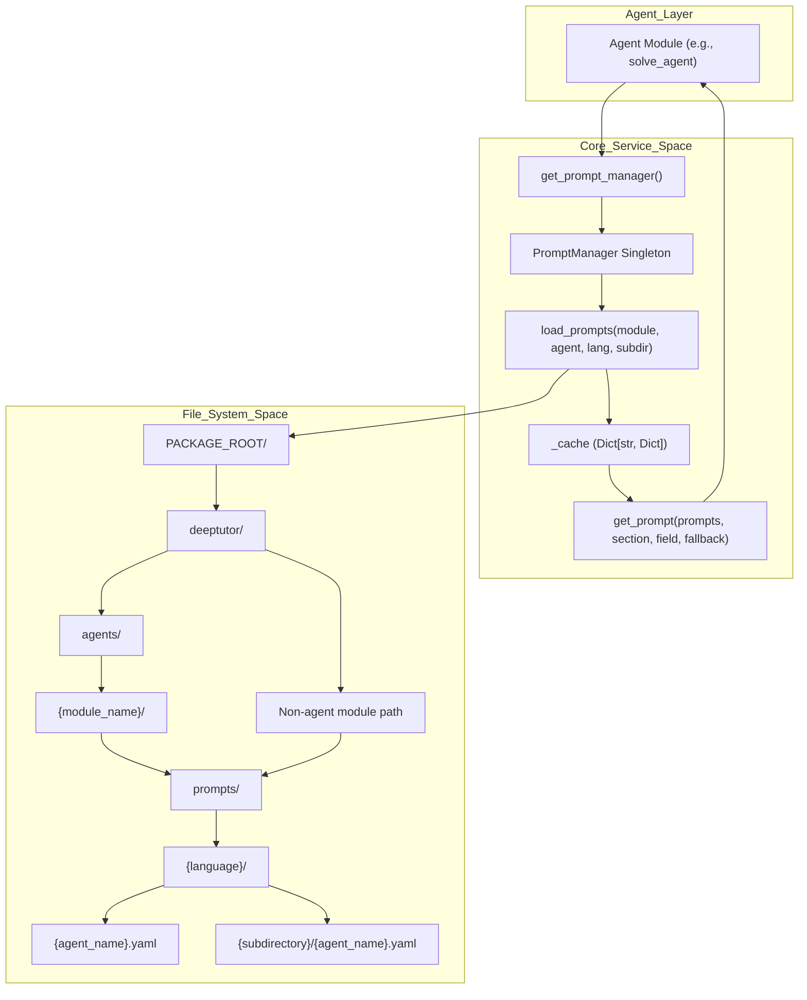
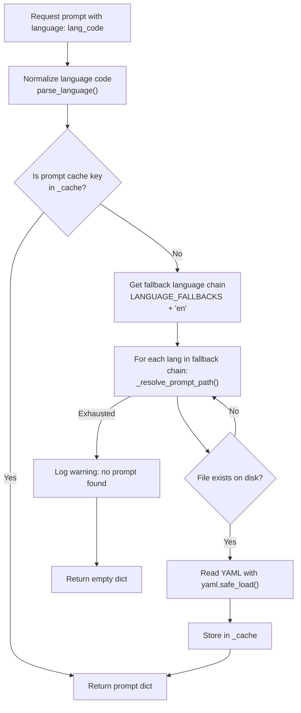
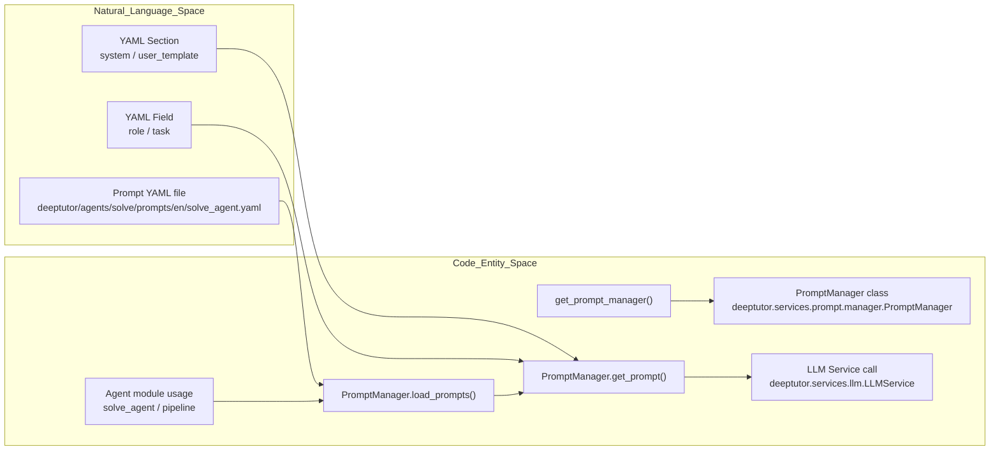
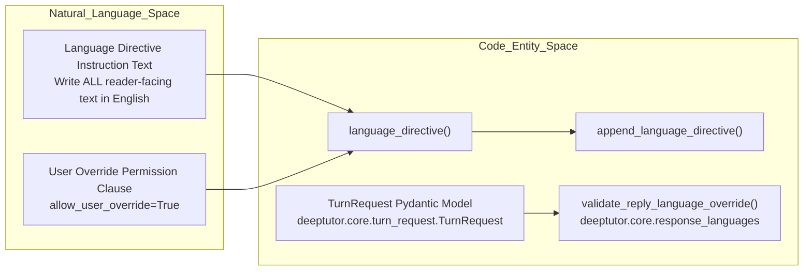

<!-- source: DeepWiki mcp.deepwiki.com · repo HKUDS/DeepTutor · page 5.3 Prompt Management and i18n Prompts · fetched 2026-11-09 -->

# Prompt Management and i18n Prompts

<details>
<summary>Relevant source files</summary>

The following files were used as context for generating this wiki page:

- [.pre-commit-config.yaml](.pre-commit-config.yaml)
- [deeptutor/agents/math_animator/agents/code_generator_agent.py](deeptutor/agents/math_animator/agents/code_generator_agent.py)
- [deeptutor/agents/math_animator/agents/concept_analysis_agent.py](deeptutor/agents/math_animator/agents/concept_analysis_agent.py)
- [deeptutor/agents/math_animator/agents/concept_design_agent.py](deeptutor/agents/math_animator/agents/concept_design_agent.py)
- [deeptutor/agents/math_animator/agents/summary_agent.py](deeptutor/agents/math_animator/agents/summary_agent.py)
- [deeptutor/core/response_languages.py](deeptutor/core/response_languages.py)
- [deeptutor/core/turn_request.py](deeptutor/core/turn_request.py)
- [deeptutor/learning/tests/test_prompt_language_fallback.py](deeptutor/learning/tests/test_prompt_language_fallback.py)
- [deeptutor/response_languages.py](deeptutor/response_languages.py)
- [deeptutor/services/prompt/manager.py](deeptutor/services/prompt/manager.py)
- [deeptutor/services/rag/smart_retriever.py](deeptutor/services/rag/smart_retriever.py)
- [tests/agents/math_animator/test_code_generator_agent.py](tests/agents/math_animator/test_code_generator_agent.py)
- [tests/agents/math_animator/test_reasoning_retry.py](tests/agents/math_animator/test_reasoning_retry.py)
- [tests/capabilities/test_handoff.py](tests/capabilities/test_handoff.py)
- [tests/core/test_prompt_manager.py](tests/core/test_prompt_manager.py)
- [tests/services/rag/test_pipeline_integration.py](tests/services/rag/test_pipeline_integration.py)
- [tests/services/rag/test_rag_pipelines.py](tests/services/rag/test_rag_pipelines.py)
- [tests/services/rag/testfile.txt](tests/services/rag/testfile.txt)
- [tests/services/session/test_reply_language_override.py](tests/services/session/test_reply_language_override.py)
- [tests/services/test_parse_language.py](tests/services/test_parse_language.py)
- [web/contracts/generated/turn-protocol.ts](web/contracts/generated/turn-protocol.ts)
- [web/contracts/schema/turn-protocol.json](web/contracts/schema/turn-protocol.json)
- [web/features/chat/controllers/buildStartTurnInput.ts](web/features/chat/controllers/buildStartTurnInput.ts)
- [web/features/chat/model/start-turn.ts](web/features/chat/model/start-turn.ts)
- [web/tests/start-turn-input.test.ts](web/tests/start-turn-input.test.ts)

</details>


## Purpose and Scope

The `PromptManager` is a centralized singleton service responsible for loading, caching, and managing all LLM prompt templates in DeepTutor. It supports multi-language prompt files, automatic language fallback chains, and safe dictionary access methods for nested prompt fields. This design decouples prompt assets (e.g., YAML files) from agent logic, enabling consistent prompt engineering and seamless internationalization (i18n).

The system also accommodates special modules outside the default `deeptutor/agents/` folder by maintaining a mapping for non-agent modules to their prompt file locations (`NON_AGENT_MODULES`). Additionally, strict and overridable language directives are appended to system prompts to ensure models output text in the desired language.

The `PromptManager` is utilized across multiple intelligent agent modules, including research, solve, quiz generation, co-writing, math animation, book engine, and mastery path subsystems. [deeptutor/services/prompt/manager.py:16-188](), [tests/core/test_prompt_manager.py:19-189]()

Sources: `deeptutor/services/prompt/manager.py:16-188`, `tests/core/test_prompt_manager.py:19-189`

---

## System Architecture

Prompt files are stored as YAML templates under specific directories inside the repository, either under agent modules at `deeptutor/agents/{module}/prompts/{lang}/` or under top-level non-agent modules mapped by `NON_AGENT_MODULES` to paths like `deeptutor/book/prompts/{lang}/`.

The system uses:
- A singleton `PromptManager` class (`deeptutor.services.prompt.manager.PromptManager`) to coordinate prompt loading and cache management.
- A cache keyed by `{module}_{agent}_{language}{_subdirectory}` to avoid redundant file I/O.
- A fallback mechanism for missing languages, falling back from requested regional codes (e.g., `"zh-tw"`) to base locales (`"zh"`) and ultimately `"en"`.
- Support for optional subdirectories for prompt resolution (e.g., `solve_loop`).
- Recursive directory search for prompt files if not found at expected paths.

### PromptManager Singleton and Data Flow



Sources: `deeptutor/services/prompt/manager.py:16-52`, `deeptutor/services/prompt/manager.py:54-81`, `tests/core/test_prompt_manager.py:19-189`

---

## Implementation Details

### PromptManager Key Class Members

| Member | Type | Description |
|--------|------|-------------|
| `_instance` | Optional[PromptManager] | Singleton instance reference. |
| `_cache` | Dict[str, Dict] | In-memory cache storing loaded YAML prompts keyed by composite strings. |
| `LANGUAGE_FALLBACKS` | Dict[str, List[str]] | Defines language fallback order (e.g., `"zh"` → `["zh", "cn", "en"]`). |
| `MODULES` | List[str] | Supported module names for prompt loading. |
| `NON_AGENT_MODULES` | Dict[str, str] | Maps non-agent module names to on-disk directories (e.g., `"book": "book"`). |

### Core Methods Overview

- `__new__`: Implements singleton pattern, returning the existing instance or creating one. [deeptutor/services/prompt/manager.py:54-57]()
- `load_prompts(module_name, agent_name, language, subdirectory)`: Loads the YAML prompt dictionary for a specific module, agent, language, and optionally subdirectory. Uses cache if available; otherwise conducts a fallback search on disk. [deeptutor/services/prompt/manager.py:59-90]()
- `_build_cache_key(...)`: Generates unique cache keys based on module, agent, language, and subdirectory. [deeptutor/services/prompt/manager.py:92-101]()
- `_load_with_fallback(...)`: Implements the search using fallback language chain and candidate prompt directories. [deeptutor/services/prompt/manager.py:103-126]()
- `_fallback_chain(lang_code)`: Returns the ordered list of languages to try, considering regional codes and the fallback map. [deeptutor/services/prompt/manager.py:128-140]()
- `_candidate_prompt_dirs(module_name)`: Determines the search directories for prompts depending on whether the module is an agent or non-agent. [deeptutor/services/prompt/manager.py:141-153]()
- `_resolve_prompt_path(prompts_dir, lang, agent_name, subdirectory)`: Resolves YAML prompt file path, supporting optional subdirectory and recursive search. [deeptutor/services/prompt/manager.py:155-184]()
- `get_prompt(prompts, section, field, fallback)`: Safe dictionary lookup utility for prompt data with optional nested field and fallback. [deeptutor/services/prompt/manager.py:186-210]()
- `clear_cache(module_name=None)`: Clears all or module-specific cache entries. [tests/core/test_prompt_manager.py:91-118]()
- `reload_prompts(...)`: Forces reload from disk ignoring current cache. [tests/core/test_prompt_manager.py:151-166]()

Sources: `deeptutor/services/prompt/manager.py:16-210`, `tests/core/test_prompt_manager.py:19-189`

---

## Multi-Language Support

DeepTutor supports multi-language prompts to internationalize tutoring sessions. Prompt files exist per language code (e.g., `"en"`, `"zh"`, `"zh-tw"`).
- Language codes are normalized using `parse_language`. [deeptutor/services/prompt/manager.py:78]()
- Fallback chain prioritizes `LANGUAGE_FALLBACKS` map. [deeptutor/services/prompt/manager.py:112]()
- Regional or variant codes (e.g., `"zh-tw"`) redirect to their base form (`"zh"`). [deeptutor/services/prompt/manager.py:136]()
- Unsupported languages gracefully fall back to English rather than Chinese to avoid confusing non-Chinese learners. [deeptutor/services/prompt/manager.py:134]()

### Language Resolution Flow



Sources: `deeptutor/services/prompt/manager.py:78-184`, `tests/core/test_prompt_manager.py:143-193`

---

## Language Directives

To ensure that generated output adheres to the desired language, DeepTutor appends explicit language directives to the system prompt. These directives instruct the LLM on the required output language, with options to allow user override in interactive conversation modes.

### Directive Generation

- The `language_directive(language, allow_user_override=False)` function returns a human-readable string that commands the model to write all reader-facing text in the specified language.
- When `allow_user_override=True`, the directive adds instructions allowing the model to switch languages if the user explicitly requests during a conversation.
- `append_language_directive(system_prompt, language, allow_user_override=False)` appends these directives to system prompt texts.

Sources: `deeptutor/services/prompt/manager.py:16-188`, `deeptutor/core/turn_request.py:160-163`

---

## Natural Language to Code Entity Mapping

The following diagrams bridge natural language artifacts (prompt YAML files, directive texts, and configuration keys) with their corresponding code entities in the DeepTutor codebase.

### Bridge Diagram 1: Prompt Resolution Flow



Sources: `deeptutor/services/prompt/manager.py:54-130`, `tests/core/test_prompt_manager.py:31-77`

### Bridge Diagram 2: Language Directive Mapping



Sources: `deeptutor/core/turn_request.py:160-163`, `deeptutor/core/response_languages.py:24-30`, `deeptutor/services/prompt/manager.py:78`

---

## Usage Examples

### Loading Prompts

Access the singleton `PromptManager` via the `get_prompt_manager()` helper, then load prompts by specifying module, agent, language, and optional subdirectory:

```python
from deeptutor.services.prompt import get_prompt_manager

pm = get_prompt_manager()
prompts = pm.load_prompts(
    module_name="solve",
    agent_name="solve_agent",
    language="en",
    subdirectory="solve_loop"
)
```
[deeptutor/services/prompt/manager.py:59-77](), [tests/core/test_prompt_manager.py:33-48]()

### Retrieving Specific Prompt Strings Safely

To safely extract nested prompt entries without risking `KeyError`, use `get_prompt()` with a fallback:

```python
role_prompt = pm.get_prompt(prompts, "system", "role", fallback="Default role text")
```
[tests/core/test_prompt_manager.py:120-141]()

### Reloading Prompts (Force Refresh)

To reload prompt files bypassing the cache:

```python
prompts = pm.reload_prompts("research", "pipeline", "en")
```
[tests/core/test_prompt_manager.py:151-166]()

Sources: `deeptutor/services/prompt/manager.py:59-210`, `tests/core/test_prompt_manager.py:33-166`

---

