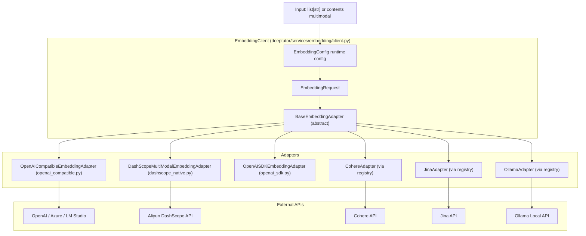
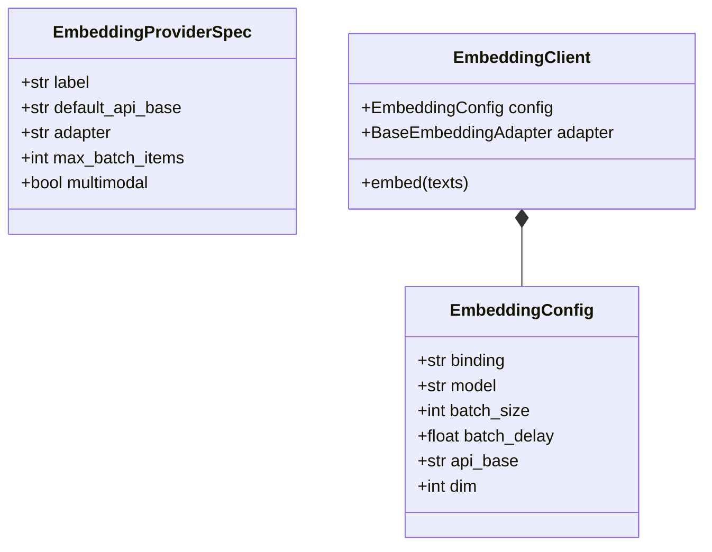
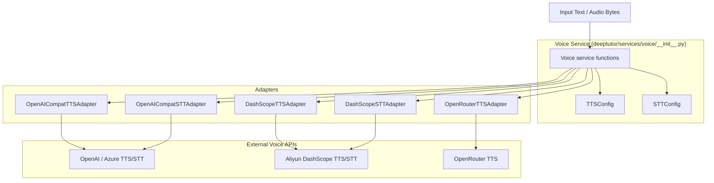

<!-- source: DeepWiki mcp.deepwiki.com · repo HKUDS/DeepTutor · page 5.4 Embedding, Image, Video and Voice Services · fetched 2026-11-09 -->

# Embedding, Image, Video and Voice Services

Relevant source files

The following files were used as context for generating this wiki page:

- [deeptutor/logging/__init__.py](deeptutor/logging/__init__.py)
- [deeptutor/services/config/embedding_endpoint.py](deeptutor/services/config/embedding_endpoint.py)
- [deeptutor/services/config/provider_runtime.py](deeptutor/services/config/provider_runtime.py)
- [deeptutor/services/embedding/adapters/base.py](deeptutor/services/embedding/adapters/base.py)
- [deeptutor/services/embedding/adapters/openai_compatible.py](deeptutor/services/embedding/adapters/openai_compatible.py)
- [deeptutor/services/embedding/adapters/openai_sdk.py](deeptutor/services/embedding/adapters/openai_sdk.py)
- [deeptutor/services/embedding/client.py](deeptutor/services/embedding/client.py)
- [deeptutor/services/embedding/config.py](deeptutor/services/embedding/config.py)
- [deeptutor/services/embedding/request_options.py](deeptutor/services/embedding/request_options.py)
- [deeptutor/services/imagegen/adapters/__init__.py](deeptutor/services/imagegen/adapters/__init__.py)
- [deeptutor/services/imagegen/adapters/dashscope.py](deeptutor/services/imagegen/adapters/dashscope.py)
- [deeptutor/services/imagegen/config.py](deeptutor/services/imagegen/config.py)
- [deeptutor/services/llm/utils.py](deeptutor/services/llm/utils.py)
- [deeptutor/services/rag/pipelines/graphrag/compatibility.py](deeptutor/services/rag/pipelines/graphrag/compatibility.py)
- [deeptutor/services/rag/pipelines/graphrag/completion_adapter.py](deeptutor/services/rag/pipelines/graphrag/completion_adapter.py)
- [deeptutor/services/videogen/adapters/__init__.py](deeptutor/services/videogen/adapters/__init__.py)
- [deeptutor/services/videogen/adapters/async_task.py](deeptutor/services/videogen/adapters/async_task.py)
- [deeptutor/services/videogen/adapters/dashscope.py](deeptutor/services/videogen/adapters/dashscope.py)
- [deeptutor/services/videogen/adapters/xai.py](deeptutor/services/videogen/adapters/xai.py)
- [deeptutor/services/videogen/base.py](deeptutor/services/videogen/base.py)
- [deeptutor/services/voice/__init__.py](deeptutor/services/voice/__init__.py)
- [deeptutor/services/voice/adapters/__init__.py](deeptutor/services/voice/adapters/__init__.py)
- [deeptutor/services/voice/adapters/dashscope.py](deeptutor/services/voice/adapters/dashscope.py)
- [deeptutor/services/voice/audio.py](deeptutor/services/voice/audio.py)
- [deeptutor/services/voice/base.py](deeptutor/services/voice/base.py)
- [deeptutor/services/voice/options.py](deeptutor/services/voice/options.py)
- [deeptutor/services/voice/speech_text.py](deeptutor/services/voice/speech_text.py)
- [tests/services/config/test_embedding_runtime.py](tests/services/config/test_embedding_runtime.py)
- [tests/services/embedding/test_client_runtime.py](tests/services/embedding/test_client_runtime.py)
- [tests/services/embedding/test_encoding_format.py](tests/services/embedding/test_encoding_format.py)
- [tests/services/embedding/test_send_dimensions.py](tests/services/embedding/test_send_dimensions.py)
- [tests/services/llm/test_unreachable_endpoint_hint.py](tests/services/llm/test_unreachable_endpoint_hint.py)
- [tests/services/test_media_gen.py](tests/services/test_media_gen.py)
- [tests/services/test_speech_limit_order.py](tests/services/test_speech_limit_order.py)
- [tests/services/test_video_poll_budget.py](tests/services/test_video_poll_budget.py)
- [tests/services/test_voice.py](tests/services/test_voice.py)
- [web/components/settings/VoicePreviewPanel.tsx](web/components/settings/VoicePreviewPanel.tsx)
- [web/tests/chat-read-aloud-playback.spec.tsx](web/tests/chat-read-aloud-playback.spec.tsx)
- [web/tests/voice-settings.spec.tsx](web/tests/voice-settings.spec.tsx)

This page details DeepTutor's capabilities for generating embeddings, images, videos, and processing voice. It covers the embedding service's adapter pattern, configuration, and runtime, as well as image generation, video generation, and speech-to-text/text-to-speech services.

---

## Embedding Service

The **Embedding Service** provides a unified abstraction for generating vector embeddings across diverse providers. It uses an **Adapter Pattern** to normalize and unify varying API schemas such as OpenAI-compatible, Cohere, Jina, Ollama, and DashScope. This enables seamless integration for retrieval augmented generation (RAG), semantic search, and other downstream modules.

### Architecture and Data Flow

The architecture is centered around the `EmbeddingClient` [deeptutor/services/embedding/client.py:39](), which orchestrates batching, concurrency control, runtime configuration, and validation logic. It delegates all provider-specific protocol details to adapter classes, each implementing the abstract base interface.

The typical flow for embedding multiple texts is:
1. `EmbeddingClient.embed` [deeptutor/services/embedding/client.py:118]() receives a list of texts or contents.
2. It processes configuration, clamps batch sizes, and groups input into batches.
3. Each batch is converted into an `EmbeddingRequest` [deeptutor/services/embedding/adapters/base.py:34]().
4. The appropriate adapter's `embed` method performs the remote API call asynchronously.
5. The response is parsed into `EmbeddingResponse` [deeptutor/services/embedding/adapters/base.py:81](), extracting embedding vectors.
6. Results are validated for length and dimensional consistency.
7. All batch results are concatenated and returned.

Sources:
- `deeptutor/services/embedding/client.py:37-133`
- `deeptutor/services/embedding/adapters/openai_compatible.py:23-165`
- `deeptutor/services/config/provider_runtime.py:140-177`

---

### Key Classes and Components

| Component | Description | File Reference |
|-----------|-------------|----------------|
| `EmbeddingClient` | Main client managing embedding requests, batching, concurrency locking, and result validation. | [deeptutor/services/embedding/client.py:37-133]() |
| `BaseEmbeddingAdapter` | Abstract adapter interface for provider API implementations. | [deeptutor/services/embedding/adapters/base.py:18-80]() |
| `EmbeddingRequest` | Provider-agnostic data class representing an embedding request, including optional `contents` for multimodal input. | [deeptutor/services/embedding/adapters/base.py:34-77]() |
| `EmbeddingResponse` | Represents parsed embedding response with embedding vectors. | [deeptutor/services/embedding/adapters/base.py:81-110]() |
| `OpenAICompatibleEmbeddingAdapter` | Adapter supporting OpenAI, Azure OpenAI, LM Studio, SiliconFlow, etc. Handles flexible parsing, retry logic for encoding format, and error mapping. | [deeptutor/services/embedding/adapters/openai_compatible.py:47-165]() |
| `EmbeddingProviderSpec` | Metadata structure defining provider specs, default endpoints, and batch constraints. | [deeptutor/services/config/provider_runtime.py:147-169]() |

Sources:
- `deeptutor/services/embedding/client.py:37-133`
- `deeptutor/services/embedding/adapters/base.py:18-110`
- `deeptutor/services/embedding/adapters/openai_compatible.py:47-165`
- `deeptutor/services/config/provider_runtime.py:147-169`

---

### Provider Runtime Configuration and Endpoint Routing

DeepTutor uses normalized provider specs (`EmbeddingProviderSpec`) containing endpoint URLs, model defaults, adapter names, batch constraints, and flags for multimodality. These are resolved for symbolic provider names on startup and runtime to produce an `EmbeddingConfig` session config.

- Endpoint URLs for embedding vary per provider; for example, OpenAI uses `https://api.openai.com/v1/embeddings`, Ollama uses `http://localhost:11434/api/embed`, and DashScope routes text vs multimodal models dynamically [deeptutor/services/config/embedding_endpoint.py:114-130]().
- Validation helpers (`embedding_endpoint_validation_error`) ensure endpoint URLs are correctly formatted before client initialization [deeptutor/services/embedding/client.py:91-99]().

Sources:
- `deeptutor/services/config/provider_runtime.py:147-169`
- `deeptutor/services/config/embedding_endpoint.py:114-130`
- `deeptutor/services/embedding/client.py:88-112`

---

### Concurrency Control and Batch Size Clamping

To coordinate concurrent indexing from multiple threads (e.g., LlamaIndex thread pool), the `EmbeddingClient` uses:
- A global threading lock (`threading.Lock`) managed by `_global_spacing_lock()` to serialize network requests across asyncio loops and threads [deeptutor/services/embedding/client.py:50-54]().
- A monotonic timestamp to enforce a minimum delay (`batch_delay`) between requests, avoiding rate limits and overloading [deeptutor/services/embedding/client.py:80-86]().
- **Batch Size Clamping**: Configured batch sizes are clamped against provider-specific maximum items (`max_batch_items`) to prevent gateway rejections [deeptutor/services/embedding/client.py:134-145]() (e.g., SiliconFlow Qwen3 caps at 32, DashScope at 20).

Sources:
- `deeptutor/services/embedding/client.py:39-145`

---

## Image Generation Service

Image generation services are governed by `ImagegenConfig` [deeptutor/services/imagegen/config.py:1]() and supported by provider adapters such as `OpenAICompatImagegenAdapter` and `ChatCompletionsImagegenAdapter`.

- **Payload & Response Handling**: Adapters format standard prompt/size payloads and support both base64-encoded JSON responses (`b64_json`) and remote CDN URLs which are automatically downloaded and parsed into raw image bytes [tests/services/test_media_gen.py:121-160]().
- **Modality Fallback**: Chat completion image adapters implement robust modality negotiation (trying `["image", "text"]` and falling back to `["image"]` on HTTP 404 errors) to support diverse multi-modal chat backends.

Sources:
- `deeptutor/services/imagegen/config.py:1`
- `tests/services/test_media_gen.py:120-167`

---

## Video Generation Service

Video generation utilizes `VideogenConfig` and asynchronous task adapters (`AsyncTaskVideogenAdapter` [deeptutor/services/videogen/adapters/async_task.py:41](), `DashScopeVideogenAdapter` [deeptutor/services/videogen/adapters/dashscope.py:56]()).

### Task Lifecycle Data Flow
1. **Submit**: `submit_task()` sends a POST request to the provider's task submission endpoint, returning a task identifier (`task_id`) [deeptutor/services/videogen/adapters/async_task.py:52]().
2. **Poll**: `_poll()` checks status at regular intervals until reaching terminal success (`_SUCCESS_STATES`) or failure states (`_FAILURE_STATES`) within a timeout budget [deeptutor/services/videogen/adapters/async_task.py:92]().
3. **Download**: Once completed, the video file URL is fetched and downloaded into raw bytes with content-type verification [deeptutor/services/videogen/adapters/async_task.py:76-90]().

Sources:
- `deeptutor/services/videogen/adapters/async_task.py:41-133`
- `deeptutor/services/videogen/adapters/dashscope.py:56-97`

---

## Voice Services (TTS and STT)

DeepTutor exposes text-to-speech (`synthesize_speech`) and speech-to-text (`transcribe_audio`) via asynchronous service wrappers and model-catalog driven adapters [deeptutor/services/voice/__init__.py]().

Sources:
- `deeptutor/services/voice/__init__.py`
- `deeptutor/services/voice/base.py:59-136`

### Markdown and LaTeX Preprocessing for Speech

To ensure generated speech is natural and free of raw syntax artifacts, DeepTutor applies pre-processing to text before TTS synthesis:
- **`strip_markdown_for_speech`**: Removes fenced code blocks, inline code markers, markdown links, headers, and list formatting [deeptutor/services/voice/base.py:183-191]().
- **`verbalize_latex_for_speech`**: Converts mathematical islands (`$…$`, `$$…$$`, `\begin{equation}`) into spoken equivalents (e.g., fractions, roots, Greek letters, and relations) [deeptutor/services/voice/speech_text.py:1-261]().

Sources:
- `deeptutor/services/voice/base.py:182-191`
- `deeptutor/services/voice/speech_text.py:1-261`

---

