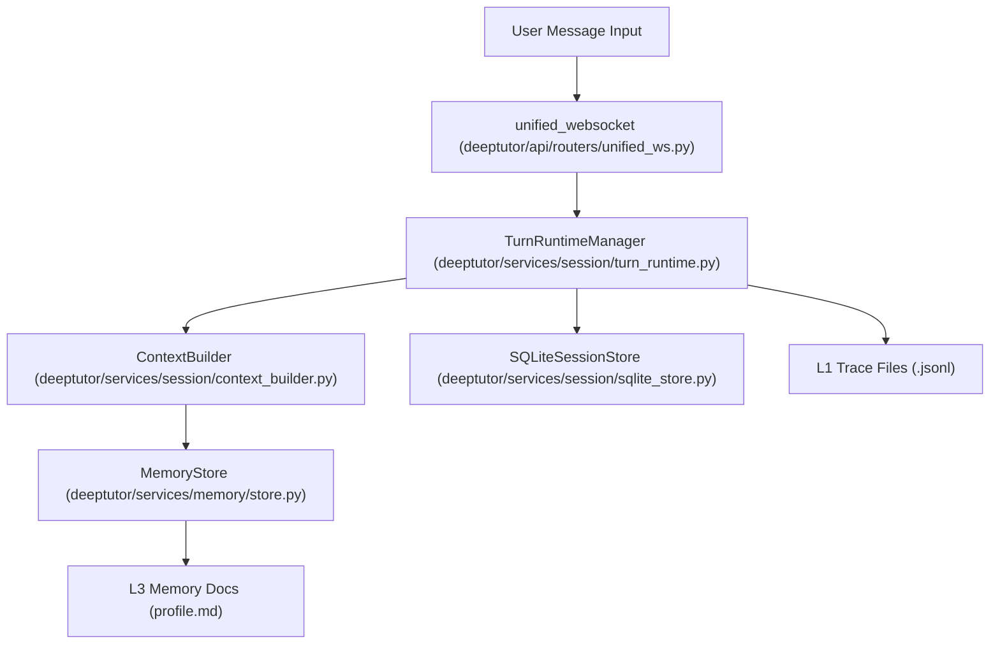
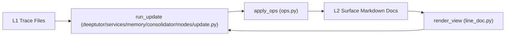

<!-- source: DeepWiki mcp.deepwiki.com · repo HKUDS/DeepTutor · page 5.5 Session and Memory Management · fetched 2026-11-09 -->

# Session and Memory Management

Relevant source files

The following files were used as context for generating this wiki page:

- [deeptutor/agents/base_agent.py](deeptutor/agents/base_agent.py)
- [deeptutor/api/routers/memory.py](deeptutor/api/routers/memory.py)
- [deeptutor/api/routers/notebook.py](deeptutor/api/routers/notebook.py)
- [deeptutor/api/routers/question.py](deeptutor/api/routers/question.py)
- [deeptutor/api/routers/sessions.py](deeptutor/api/routers/sessions.py)
- [deeptutor/api/routers/unified_ws.py](deeptutor/api/routers/unified_ws.py)
- [deeptutor/book/agents/page_planner.py](deeptutor/book/agents/page_planner.py)
- [deeptutor/services/memory/__init__.py](deeptutor/services/memory/__init__.py)
- [deeptutor/services/memory/consolidator/__init__.py](deeptutor/services/memory/consolidator/__init__.py)
- [deeptutor/services/memory/consolidator/chunker.py](deeptutor/services/memory/consolidator/chunker.py)
- [deeptutor/services/memory/consolidator/guards.py](deeptutor/services/memory/consolidator/guards.py)
- [deeptutor/services/memory/consolidator/line_doc.py](deeptutor/services/memory/consolidator/line_doc.py)
- [deeptutor/services/memory/consolidator/meta.py](deeptutor/services/memory/consolidator/meta.py)
- [deeptutor/services/memory/consolidator/modes/__init__.py](deeptutor/services/memory/consolidator/modes/__init__.py)
- [deeptutor/services/memory/consolidator/modes/_runtime.py](deeptutor/services/memory/consolidator/modes/_runtime.py)
- [deeptutor/services/memory/consolidator/modes/_shims.py](deeptutor/services/memory/consolidator/modes/_shims.py)
- [deeptutor/services/memory/consolidator/modes/audit.py](deeptutor/services/memory/consolidator/modes/audit.py)
- [deeptutor/services/memory/snapshot/__init__.py](deeptutor/services/memory/snapshot/__init__.py)
- [deeptutor/services/memory/snapshot/adapters.py](deeptutor/services/memory/snapshot/adapters.py)
- [deeptutor/services/memory/snapshot/entity.py](deeptutor/services/memory/snapshot/entity.py)
- [deeptutor/services/notebook/service.py](deeptutor/services/notebook/service.py)
- [deeptutor/services/session/_turn_runtime_shared.py](deeptutor/services/session/_turn_runtime_shared.py)
- [deeptutor/services/session/attachment_parsing.py](deeptutor/services/session/attachment_parsing.py)
- [deeptutor/services/session/pocketbase_store.py](deeptutor/services/session/pocketbase_store.py)
- [deeptutor/services/session/protocol.py](deeptutor/services/session/protocol.py)
- [deeptutor/services/session/selection_grounding.py](deeptutor/services/session/selection_grounding.py)
- [deeptutor/services/session/sqlite_store.py](deeptutor/services/session/sqlite_store.py)
- [deeptutor/services/session/thread_attribution.py](deeptutor/services/session/thread_attribution.py)
- [deeptutor/services/session/turn_runtime.py](deeptutor/services/session/turn_runtime.py)
- [deeptutor/services/session/turns/executor.py](deeptutor/services/session/turns/executor.py)
- [deeptutor/services/session/turns/request_preparer.py](deeptutor/services/session/turns/request_preparer.py)
- [deeptutor/services/workspace/catalog.py](deeptutor/services/workspace/catalog.py)
- [deeptutor/video_learning/notes.py](deeptutor/video_learning/notes.py)
- [tests/api/test_question_router.py](tests/api/test_question_router.py)
- [tests/api/test_session_organization.py](tests/api/test_session_organization.py)
- [tests/api/test_unified_ws_turn_runtime.py](tests/api/test_unified_ws_turn_runtime.py)
- [tests/book/test_block_type_controls.py](tests/book/test_block_type_controls.py)
- [tests/services/llm/test_openai_compat_tool_call_index.py](tests/services/llm/test_openai_compat_tool_call_index.py)
- [tests/services/memory/test_audit_line_identity.py](tests/services/memory/test_audit_line_identity.py)
- [tests/services/memory/test_chunker.py](tests/services/memory/test_chunker.py)
- [tests/services/memory/test_line_doc.py](tests/services/memory/test_line_doc.py)
- [tests/services/memory/test_partner_archive_snapshot.py](tests/services/memory/test_partner_archive_snapshot.py)
- [tests/services/memory/test_snapshot_adapters.py](tests/services/memory/test_snapshot_adapters.py)
- [tests/services/memory/test_snapshot_probes.py](tests/services/memory/test_snapshot_probes.py)
- [tests/services/memory/test_snapshot_workspace_aggregation.py](tests/services/memory/test_snapshot_workspace_aggregation.py)
- [tests/services/session/test_attachment_parsing.py](tests/services/session/test_attachment_parsing.py)
- [tests/services/session/test_pocketbase_store_fallbacks.py](tests/services/session/test_pocketbase_store_fallbacks.py)
- [tests/services/session/test_regenerate.py](tests/services/session/test_regenerate.py)
- [tests/services/session/test_selection_grounding.py](tests/services/session/test_selection_grounding.py)
- [tests/services/session/test_sqlite_store.py](tests/services/session/test_sqlite_store.py)
- [tests/services/session/test_thread_attribution.py](tests/services/session/test_thread_attribution.py)
- [tests/services/session/test_turn_runtime.py](tests/services/session/test_turn_runtime.py)
- [tests/services/session/test_turn_runtime_subscribe.py](tests/services/session/test_turn_runtime_subscribe.py)
- [tests/services/test_notebook_service.py](tests/services/test_notebook_service.py)
- [web/lib/latex.ts](web/lib/latex.ts)
- [web/lib/markdown-display.ts](web/lib/markdown-display.ts)
- [web/lib/session-api.ts](web/lib/session-api.ts)
- [web/tests/latex.test.ts](web/tests/latex.test.ts)
- [web/tests/markdown-display.test.ts](web/tests/markdown-display.test.ts)

This page documents DeepTutor's session and memory management system designed for longitudinal personalized tutoring, multi-agent state persistence, and efficient information retrieval. It details underlying protocols, persistent storage backends (SQLite and PocketBase), conversation branching, search capabilities, context building, `ask_user` tracing, and the multi-layered memory subsystem.

Sources: `deeptutor/services/session/protocol.py:13-206`(), `deeptutor/services/session/sqlite_store.py:15-50`(), `deeptutor/services/session/pocketbase_store.py:1-185`()

---

## Persistence Architecture

DeepTutor's persistence infrastructure relies on pluggable **session stores** providing a unified interface (`SessionStoreProtocol`) to manage conversation history, turns, messages, and associated metadata across different backends.

### Unified Session Store Protocol

Defined in `deeptutor/services/session/protocol.py`, `SessionStoreProtocol` unifies the contract for all storage backends:
- **Session management**: Creation, retrieval, existence checks, renaming, soft/hard deletion, restoration, and listing (including the recycle bin).
- **Turn management**: Creation, status transition (`TurnRecord`), event appending, and active turn lookup.
- **Messages**: Adding messages and retrieving histories with support for attachments and event traces.
- **Search**: Full-text and structured search interfaces for sessions and messages.
- **Concurrency**: Raises `ActiveTurnConflict` when concurrent active turn creation attempts collide [deeptutor/services/session/protocol.py:13-206]().

Sources: `deeptutor/services/session/protocol.py:13-206`()

### SQLite Session Store

`SQLiteSessionStore` serves as the primary default backend, storing each user's data in an isolated SQLite database file resolved via `PathService` [deeptutor/services/session/sqlite_store.py:15-50]().
- Manages normalized tables for sessions, turns, messages, and notebook entries.
- Implements optimistic concurrency control for turns using fencing tokens.
- Handles idempotent schema upgrades and serialization via `_migration_lock` using POSIX `fcntl` file locking where available [deeptutor/services/session/sqlite_store.py:54-76]().
- Supports **edit-branching** conversation trees using `parent_message_id` fields on messages [deeptutor/services/session/sqlite_store.py:166-210]().

Sources: `deeptutor/services/session/sqlite_store.py:15-76`(), `deeptutor/services/session/sqlite_store.py:166-210`()

### PocketBase Session Store

`PocketBaseSessionStore` provides an HTTP API-backed alternative utilizing PocketBase collections [deeptutor/services/session/pocketbase_store.py:1-185]().
- Enforces user isolation by scoping queries with `user_id` filtered against the current identity context [deeptutor/services/session/pocketbase_store.py:106-125]().
- Buffers and flushes turn events before committing terminal states to guarantee durability [deeptutor/services/session/pocketbase_store.py:5-14]().
- Implements soft-deletion via `deleted_at` timestamps for the session recycle bin [deeptutor/services/session/pocketbase_store.py:127-155]().

Sources: `deeptutor/services/session/pocketbase_store.py:1-185`()

### Edit Branching in Conversations

DeepTutor supports branching conversations where users can edit past messages and spawn alternative dialogue tracks.
- Messages link back to their parent via `parent_message_id` (`null` for root messages) [web/lib/session-api.ts:52-54]().
- The frontend resolves visible paths using branch selections stored inside session preferences (`selected_branches`), falling back to the most recently created sibling child [web/lib/session-api.ts:122-125]().

Sources: `web/lib/session-api.ts:22-55`(), `web/lib/session-api.ts:122-125`()

---

## Session Management API

The REST API for session management is implemented in `deeptutor/api/routers/sessions.py`.

### Session Endpoints

| Endpoint | Method | Description |
| --- | --- | --- |
| `/api/sessions` | GET | List sessions with pagination and workspace filters |
| `/api/sessions/search` | GET | Full-text search across session titles and messages |
| `/api/sessions/recycle-bin` | GET | List soft-deleted sessions |
| `/api/sessions/{session_id}` | GET | Retrieve single session with messages and active turns |
| `/api/sessions/{session_id}/rename` | POST | Rename a conversation session title |
| `/api/sessions/{session_id}/organize` | POST | Update session organization metadata (pinned, archived, etc.) |
| `/api/sessions/{session_id}/branch` | POST | Store branch selection mapping for edit-branching |
| `/api/sessions/{session_id}/delete` | POST | Move session to the recycle bin (soft delete) |
| `/api/sessions/{session_id}/restore` | POST | Restore session from the recycle bin |
| `/api/sessions/{session_id}/hard-delete` | DELETE | Permanently remove a session |

Sources: `deeptutor/api/routers/sessions.py:12-255`()

---

## Conversation Context Builder and `ask_user` Trace

### ContextBuilder

The `ContextBuilder` class assembles a token-budgeted sequence of conversation history messages appropriate for the active LLM provider's context window.
- Apportions capacity between raw recent turns and compressed historical summaries.
- Enforces hard ceilings on total history tokens and summary outputs, utilizing `tiktoken` or fallback heuristic counters [deeptutor/services/session/context_builder.py:161-390]().

Sources: `deeptutor/services/session/context_builder.py:161-390`()

### `ask_user` Trace Extraction

Clarification blocks generated during interactive agent prompts (`ask_user`) are stored inline as part of assistant messages.
- Utilities in `ask_user_trace.py` extract these events and interleave them into chronological message sequences during context assembly [deeptutor/services/session/ask_user_trace.py:10-68]().

Sources: `deeptutor/services/session/ask_user_trace.py:1-68`()

---

## Three-Layer Memory Subsystem

DeepTutor implements a hierarchical memory architecture managed via `MemoryStore` [deeptutor/services/memory/store.py:68-72]():

1. **L1: Trace (Raw Event Log)**: Append-only `.jsonl` files per surface logging raw atomic interaction events [deeptutor/services/memory/trace.py]().
2. **L2: Surface Summaries**: Markdown documents (e.g., `chat.md`) synthesizing events and facts per capability surface.
3. **L3: Cross-Surface Memory**: Global learner models, profiles, and preferences stored across documents like `profile.md` and `preferences.md` [deeptutor/services/memory/paths.py:24-25]().

### Memory Consolidation Pipeline

- **Update Mode**: Chunks raw L1 trace entries, extracts facts, and applies document edit operations to L2/L3 summaries [deeptutor/services/memory/consolidator/modes/update.py:1-156]().
- **Line-Indexed Snapshots**: Uses line hashing and structural operators (`ReplaceLineOp`, `DeleteLinesOp`, `InsertAfterOp`) for atomic, incremental document updates [deeptutor/services/memory/consolidator/line_doc.py:1-28]().

Sources: `deeptutor/services/memory/store.py:68-152]`, `deeptutor/services/memory/paths.py:24-25`(), `deeptutor/services/memory/consolidator/modes/update.py:1-156`(), `deeptutor/services/memory/consolidator/line_doc.py:1-28`()

---

## Data Flow Diagrams

### Turn Execution and Persistence Flow

Sources: `deeptutor/services/session/turn_runtime.py:43-52`(), `deeptutor/services/session/context_builder.py:161-200`(), `deeptutor/services/memory/store.py:68-85`(), `deeptutor/services/session/sqlite_store.py:15-50`()

### Memory Consolidation Pipeline

Sources: `deeptutor/services/memory/consolidator/modes/update.py:1-156`(), `deeptutor/services/memory/consolidator/line_doc.py:1-28`()

---

# References

- `deeptutor/services/session/protocol.py` [13-206]()
- `deeptutor/services/session/sqlite_store.py` [15-76](), [166-210]()
- `deeptutor/services/session/pocketbase_store.py` [1-185]()
- `deeptutor/api/routers/sessions.py` [12-255]()
- `deeptutor/services/session/context_builder.py` [161-390]()
- `deeptutor/services/session/ask_user_trace.py` [1-68]()
- `deeptutor/services/memory/store.py` [68-152]()
- `deeptutor/services/memory/paths.py` [24-25]()
- `deeptutor/services/memory/consolidator/modes/update.py` [1-156]()
- `deeptutor/services/memory/consolidator/line_doc.py` [1-28]()
- `web/lib/session-api.ts` [22-55](), [122-125]()

---

