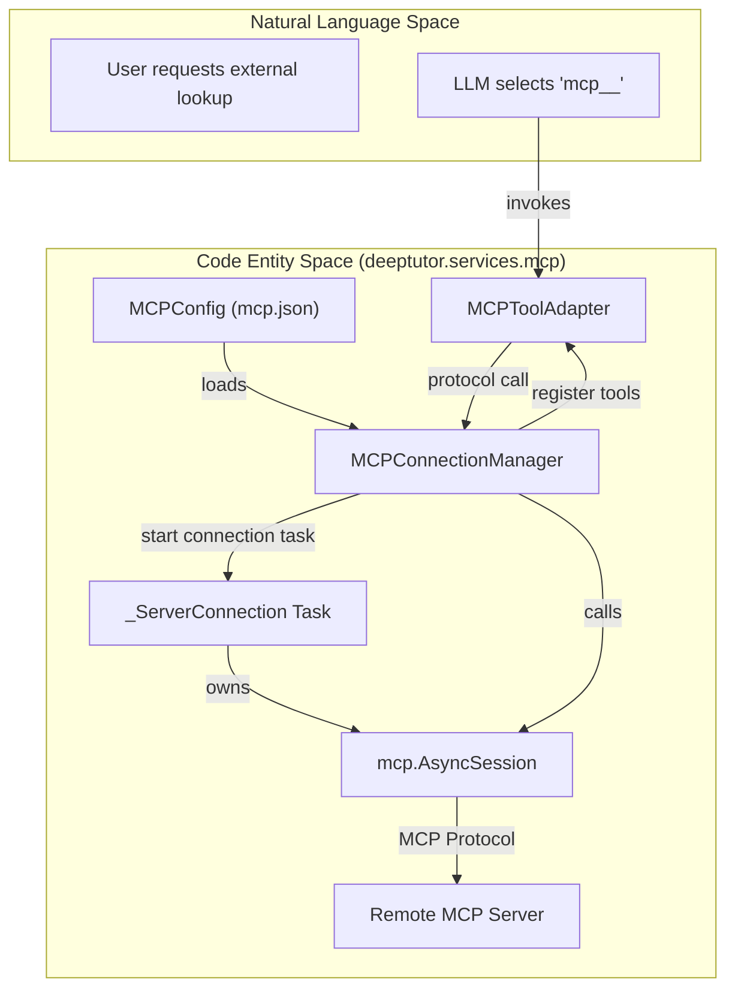
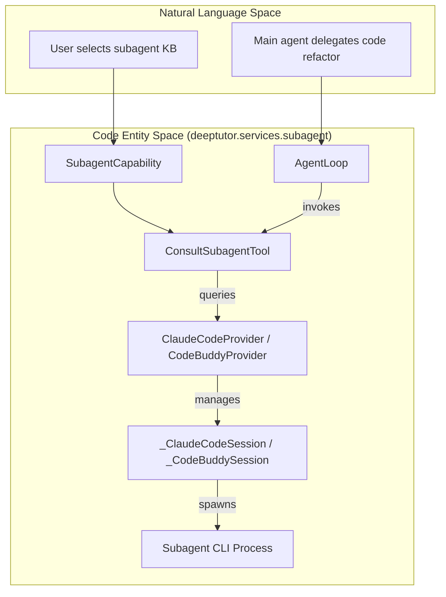
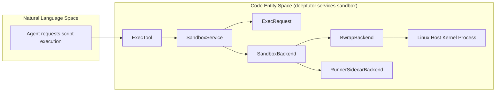

<!-- source: DeepWiki mcp.deepwiki.com · repo HKUDS/DeepTutor · page 5.6 MCP, Subagents and CLI Apps · fetched 2026-11-09 -->

# MCP, Subagents and CLI Apps

Relevant source files

The following files were used as context for generating this wiki page:

- [deeptutor/services/llm/claude_sdk.py](deeptutor/services/llm/claude_sdk.py)
- [deeptutor/services/llm/provider_core/claude_code_provider.py](deeptutor/services/llm/provider_core/claude_code_provider.py)
- [deeptutor/services/llm/provider_core/codebuddy_provider.py](deeptutor/services/llm/provider_core/codebuddy_provider.py)
- [deeptutor/services/llm/provider_core/sdk_bridge.py](deeptutor/services/llm/provider_core/sdk_bridge.py)
- [deeptutor/services/mcp/config.py](deeptutor/services/mcp/config.py)
- [deeptutor/services/mcp/manager.py](deeptutor/services/mcp/manager.py)
- [deeptutor/services/partners/__init__.py](deeptutor/services/partners/__init__.py)
- [deeptutor/services/partners/sessions.py](deeptutor/services/partners/sessions.py)
- [deeptutor/services/rag/pipelines/graphrag/config.py](deeptutor/services/rag/pipelines/graphrag/config.py)
- [deeptutor/services/rag/pipelines/graphrag/engine.py](deeptutor/services/rag/pipelines/graphrag/engine.py)
- [deeptutor/services/rag/pipelines/graphrag/pandas_compat.py](deeptutor/services/rag/pipelines/graphrag/pandas_compat.py)
- [deeptutor/services/rag/pipelines/pageindex/client.py](deeptutor/services/rag/pipelines/pageindex/client.py)
- [deeptutor/services/rag/pipelines/pageindex/pipeline.py](deeptutor/services/rag/pipelines/pageindex/pipeline.py)
- [deeptutor/services/subagent/claude_models.py](deeptutor/services/subagent/claude_models.py)
- [docs-for-dev/I18N.md](docs-for-dev/I18N.md)
- [docs-for-dev/README.md](docs-for-dev/README.md)
- [examples/memory_evaluation/README.md](examples/memory_evaluation/README.md)
- [tests/services/llm/test_claude_code_provider.py](tests/services/llm/test_claude_code_provider.py)
- [tests/services/llm/test_codebuddy_provider.py](tests/services/llm/test_codebuddy_provider.py)
- [tests/services/mcp/test_progress_reporting.py](tests/services/mcp/test_progress_reporting.py)
- [tests/services/partners/test_slugify_partner_id.py](tests/services/partners/test_slugify_partner_id.py)
- [tests/services/rag/test_graphrag_pandas_compat.py](tests/services/rag/test_graphrag_pandas_compat.py)
- [tests/services/rag/test_graphrag_pipeline.py](tests/services/rag/test_graphrag_pipeline.py)
- [tests/services/rag/test_pageindex_oss_config.py](tests/services/rag/test_pageindex_oss_config.py)
- [tests/services/rag/test_pageindex_pipeline.py](tests/services/rag/test_pageindex_pipeline.py)
- [tests/services/test_claude_model_discovery.py](tests/services/test_claude_model_discovery.py)
- [web/app/(workspace)/partners/page.tsx](web/app/(workspace)/partners/page.tsx)
- [web/components/knowledge/KbFilePreview.tsx](web/components/knowledge/KbFilePreview.tsx)
- [web/components/mcp/McpCatalogBrowser.tsx](web/components/mcp/McpCatalogBrowser.tsx)
- [web/components/mcp/McpStatusBadge.tsx](web/components/mcp/McpStatusBadge.tsx)
- [web/components/memory/MemoryL1Workbench.tsx](web/components/memory/MemoryL1Workbench.tsx)
- [web/components/memory/MemorySection.tsx](web/components/memory/MemorySection.tsx)
- [web/components/partners/PartnerChannels.tsx](web/components/partners/PartnerChannels.tsx)
- [web/components/settings/MemoryUsageItem.tsx](web/components/settings/MemoryUsageItem.tsx)
- [web/components/settings/ModelsWorkspace.tsx](web/components/settings/ModelsWorkspace.tsx)
- [web/components/settings/ProvidersWorkspace.tsx](web/components/settings/ProvidersWorkspace.tsx)
- [web/components/settings/RegistryControls.tsx](web/components/settings/RegistryControls.tsx)
- [web/components/space/EduHubImportModal.tsx](web/components/space/EduHubImportModal.tsx)
- [web/components/space/PersonasSection.tsx](web/components/space/PersonasSection.tsx)
- [web/components/space/SkillsSection.tsx](web/components/space/SkillsSection.tsx)
- [web/components/workspaces/WorkspacePill.tsx](web/components/workspaces/WorkspacePill.tsx)
- [web/features/settings/sections/ToolsSettingsSection.tsx](web/features/settings/sections/ToolsSettingsSection.tsx)
- [web/lib/partners-api.ts](web/lib/partners-api.ts)
- [web/lib/provider-registry.ts](web/lib/provider-registry.ts)
- [web/tests/learning-source-scroll.audit.ts](web/tests/learning-source-scroll.audit.ts)
- [web/tests/provider-registry-workflow.spec.tsx](web/tests/provider-registry-workflow.spec.tsx)

This page details DeepTutor's integration with the Model Context Protocol (MCP) for managing external tool connections, the subagent framework for delegating tasks to specialized AI backends (including Claude Code, Codex, and OpenCode), and the CLI Apps subsystem for executing command-line tools in sandboxed environments (`RestrictedSubprocessBackend`, `BwrapBackend`, and `RunnerSidecarBackend`). It covers the architecture, data flow, and key classes governing these capabilities.

Sources:
- `deeptutor/services/mcp/manager.py`
- `deeptutor/services/subagent/models.py`
- `deeptutor/services/sandbox/backends.py`

---

## MCP Integration Architecture

DeepTutor embeds an MCP client layer to manage external protocol servers dynamically, connecting to configured servers and exposing their tools as chat-adapted capabilities.

### Connection Management

The `MCPConnectionManager` singleton coordinates the lifecycle of configured MCP server connection tasks and builds their corresponding tool adapters [deeptutor/services/mcp/manager.py:5-185](). MCP client sessions rely on task-local cancellation scopes, so each server connection runs inside an isolated background connection task managed via an `AsyncExitStack`.

Key lifecycle patterns include:
- **Lazy Startup**: Connections establish on-demand using `ensure_started()` with per-server timeouts to reduce idle initialization overhead [deeptutor/services/mcp/manager.py:18-22]().
- **Config Diffing**: The manager compares persisted configuration updates against active connections, restarting only modified servers [deeptutor/services/mcp/manager.py:20-22]().
- **Multi-Tenant Scoping**: Servers are isolated by `(owner, server_name)` keys to prevent cross-tenant collisions in multi-user deployments [deeptutor/services/mcp/manager.py:55-59]().

### MCPToolAdapter and Progress Reporting

The `MCPToolAdapter` wraps a remote MCP server tool, marking it as a deferred tool whose schema is progressively loaded by the prompt system [deeptutor/services/mcp/manager.py:105-174](). Tool names are prefixed to prevent collisions (e.g., `mcp_<server>_<tool>`) [deeptutor/services/mcp/manager.py:100-103](). Progress notifications from the remote server are intercepted and routed through `_progress_reporter` to publish trace events to the streaming bus [deeptutor/services/mcp/manager.py:176-187]().

### MCP Data Flow

Sources:
- `deeptutor/services/mcp/manager.py`

---

## Subagents: Code Execution Backends

DeepTutor delegates advanced coding and systems tasks to external CLI-driven or SDK-backed AI agents.

### Backends Overview

Supported subagent kinds include:
- **Claude Code**: Interfaced via `ClaudeCodeProvider` and `claude-agent-sdk`, using local CLI authentication (`claude /login`) and an in-process MCP server bridge [deeptutor/services/llm/provider_core/claude_code_provider.py:1-172]().
- **Codex / CodeBuddy**: Stateful CLI processes managed via `CodeBuddyProvider`, mapping tool calls and streaming responses through SDK adapters [deeptutor/services/llm/provider_core/codebuddy_provider.py:1-163]().
- **OpenCode / MiMo Code**: Local or remote CLI execution pipelines.

### SubagentCapability and ConsultSubagentTool

The `SubagentCapability` isolates chat execution when a subagent workspace is selected, restricting general tool invocation in favor of the `consult_subagent` tool [tests/capabilities/test_subagent_capability.py:128-138](). The `ConsultSubagentTool` passes context, subagent configuration, and turn budgets (`subagent_consult_budget`) to the subagent backend [tests/capabilities/test_subagent_capability.py:65-84]().

### Subagent Delegation Data Flow

Sources:
- `deeptutor/services/llm/provider_core/claude_code_provider.py`
- `deeptutor/services/llm/provider_core/codebuddy_provider.py`
- `tests/capabilities/test_subagent_capability.py`

---

## CLI Apps and Sandboxed Execution

Arbitrary command-line tools and code execution run within isolated sandbox backends to preserve host security.

### Sandbox Backends

DeepTutor implements three isolation tiers via `SandboxService`:
1. **`RestrictedSubprocessBackend`**: Application-level isolation using sanitized environment variables and restricted working directories.
2. **`BwrapBackend`**: System-level isolation using Linux Bubblewrap (`bwrap`) for bind mounts, isolated `/tmp` and `/proc`, and virtual environment filtering [deeptutor/services/sandbox/backends.py:115-186]().
3. **`RunnerSidecarBackend`**: Offloads execution to an isolated Docker container via HTTP.

### Sandboxed Execution Data Flow

Sources:
- `deeptutor/services/sandbox/backends.py`
- `deeptutor/tools/builtin_specs.py`

---

## Dependency and Packaging Notes

- The `mcp` Python client is included as a core runtime dependency across standard and CLI-only distributions [pyproject.toml:39-43](), [packaging/deeptutor-cli/pyproject.toml:10]().
- Full CLI packaging includes `pyte` for terminal TUI emulation (supporting Claude Code sync) along with required LLM SDK bindings.

Sources:
- `pyproject.toml`
- `packaging/deeptutor-cli/pyproject.toml`
- `requirements/cli.txt`

---

