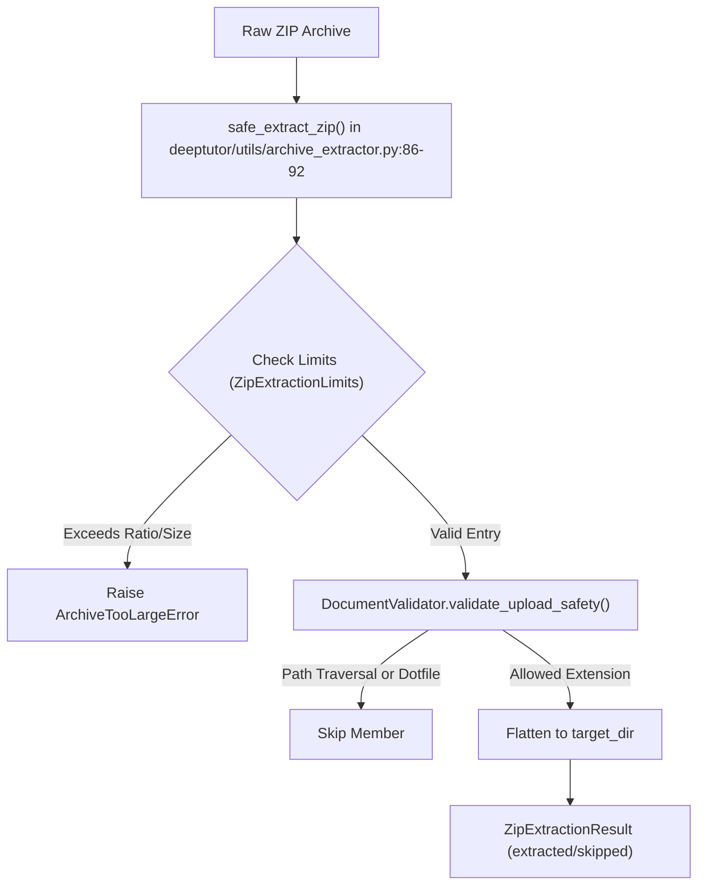

<!-- source: DeepWiki mcp.deepwiki.com · repo HKUDS/DeepTutor · page 5.7 Document Parsing and Sandbox Execution · fetched 2026-11-09 -->

# Document Parsing and Sandbox Execution

<details>
<summary>Relevant source files</summary>

The following files were used as context for generating this wiki page:

- [deeptutor/api/routers/tools.py](deeptutor/api/routers/tools.py)
- [deeptutor/core/tool_protocol.py](deeptutor/core/tool_protocol.py)
- [deeptutor/learning/lesson_evidence.py](deeptutor/learning/lesson_evidence.py)
- [deeptutor/learning/visual_practice.py](deeptutor/learning/visual_practice.py)
- [deeptutor/partners/channels/wecom.py](deeptutor/partners/channels/wecom.py)
- [deeptutor/runtime/worker_tasks.py](deeptutor/runtime/worker_tasks.py)
- [deeptutor/services/parsing/cache.py](deeptutor/services/parsing/cache.py)
- [deeptutor/services/parsing/engines/docling/config.py](deeptutor/services/parsing/engines/docling/config.py)
- [deeptutor/services/parsing/engines/docling/engine.py](deeptutor/services/parsing/engines/docling/engine.py)
- [deeptutor/services/parsing/engines/docling/remote.py](deeptutor/services/parsing/engines/docling/remote.py)
- [deeptutor/services/parsing/engines/factory.py](deeptutor/services/parsing/engines/factory.py)
- [deeptutor/services/parsing/engines/mineru/_process.py](deeptutor/services/parsing/engines/mineru/_process.py)
- [deeptutor/services/parsing/engines/mineru/backend.py](deeptutor/services/parsing/engines/mineru/backend.py)
- [deeptutor/services/parsing/engines/mineru/checkpoints.py](deeptutor/services/parsing/engines/mineru/checkpoints.py)
- [deeptutor/services/parsing/engines/mineru/cloud.py](deeptutor/services/parsing/engines/mineru/cloud.py)
- [deeptutor/services/parsing/engines/mineru/config.py](deeptutor/services/parsing/engines/mineru/config.py)
- [deeptutor/services/parsing/engines/mineru/engine.py](deeptutor/services/parsing/engines/mineru/engine.py)
- [deeptutor/services/parsing/engines/mineru/local.py](deeptutor/services/parsing/engines/mineru/local.py)
- [deeptutor/services/parsing/engines/mineru/normalization.py](deeptutor/services/parsing/engines/mineru/normalization.py)
- [deeptutor/services/parsing/service.py](deeptutor/services/parsing/service.py)
- [deeptutor/services/sandbox/backends.py](deeptutor/services/sandbox/backends.py)
- [deeptutor/services/sandbox/service.py](deeptutor/services/sandbox/service.py)
- [deeptutor/tools/prompting/hints/en/exec.yaml](deeptutor/tools/prompting/hints/en/exec.yaml)
- [deeptutor/tools/prompting/hints/en/zotero_search.yaml](deeptutor/tools/prompting/hints/en/zotero_search.yaml)
- [deeptutor/tools/prompting/hints/zh/exec.yaml](deeptutor/tools/prompting/hints/zh/exec.yaml)
- [deeptutor/tools/prompting/hints/zh/zotero_search.yaml](deeptutor/tools/prompting/hints/zh/zotero_search.yaml)
- [deeptutor/tools/zotero_search.py](deeptutor/tools/zotero_search.py)
- [deeptutor/utils/archive_extractor.py](deeptutor/utils/archive_extractor.py)
- [deeptutor/utils/bibtex_converter.py](deeptutor/utils/bibtex_converter.py)
- [tests/agents/chat/test_workspace_system_note.py](tests/agents/chat/test_workspace_system_note.py)
- [tests/api/test_tools_router.py](tests/api/test_tools_router.py)
- [tests/capabilities/test_mastery_visual_hint_contract.py](tests/capabilities/test_mastery_visual_hint_contract.py)
- [tests/services/parsing/test_cache.py](tests/services/parsing/test_cache.py)
- [tests/services/parsing/test_mineru_local_failures.py](tests/services/parsing/test_mineru_local_failures.py)
- [tests/services/parsing/test_mineru_normalization.py](tests/services/parsing/test_mineru_normalization.py)
- [tests/services/parsing/test_mineru_process_lifecycle.py](tests/services/parsing/test_mineru_process_lifecycle.py)
- [tests/services/parsing/test_mineru_slicer.py](tests/services/parsing/test_mineru_slicer.py)
- [tests/services/parsing/test_parse_service.py](tests/services/parsing/test_parse_service.py)
- [tests/services/rag/test_mastery_source_pages.py](tests/services/rag/test_mastery_source_pages.py)
- [tests/services/sandbox/test_sandbox.py](tests/services/sandbox/test_sandbox.py)
- [tests/tools/test_exec_prompt_hints.py](tests/tools/test_exec_prompt_hints.py)
- [tests/tools/test_mineru.py](tests/tools/test_mineru.py)
- [tests/tools/test_rag_selector_contract.py](tests/tools/test_rag_selector_contract.py)
- [tests/utils/test_archive_extractor.py](tests/utils/test_archive_extractor.py)
- [tests/utils/test_bibtex_converter.py](tests/utils/test_bibtex_converter.py)
- [tests/utils/test_bibtex_math_intervals.py](tests/utils/test_bibtex_math_intervals.py)

</details>


This page details DeepTutor's architecture for multi-engine document parsing, secure archive extraction, document validation, BibTeX conversion, and sandboxed code execution backends equipped with built-in office skills.

## Document Parsing Engine Factory

DeepTutor's parsing subsystem abstracts document intake through a centralized factory and registry located in `factory.py` [deeptutor/services/parsing/engines/factory.py:1-21](). Parsers adhere to a common interface, enabling dynamic selection based on file format and runtime configuration.

### Available Parsing Engines

- **Text-Only Parser**: A lightweight fallback parser extracting plain text from standard formats without external model dependencies [deeptutor/services/parsing/engines/factory.py:84-91]().
- **MinerU Parser**: A multimodal extraction engine supporting local CLI execution via `parse_document_with_mineru_result` [deeptutor/services/parsing/engines/mineru/local.py:125-153]() and cloud API execution via `parse_cloud` [deeptutor/services/parsing/engines/mineru/cloud.py:60-68](). It parses PDFs, images, and Office documents with high fidelity for formulas and tables [deeptutor/services/parsing/engines/mineru/config.py:47-81]().
- **Docling, MarkItDown, PyMuPDF4LLM, LiteParse, and Tika**: Alternative engines registered in the factory for specific structural requirements and format coverages [deeptutor/services/parsing/engines/factory.py:101-145]().

```mermaid
graph TD
    subcode ["Natural Language to Code Entity Mapping"]
        NL1["Parsing Engine Factory Entry"] --> CE1["get_parser() in deeptutor/services/parsing/engines/factory.py:153-158"]
        NL2["Local MinerU CLI Runner"] --> CE2["parse_document_with_mineru_result() in deeptutor/services/parsing/engines/mineru/local.py:125-153"]
        NL3["Cloud MinerU API Runner"] --> CE3["parse_cloud() in deeptutor/services/parsing/engines/mineru/cloud.py:60-68"]
    end
```
**Diagram: Parsing Module Code Entity Mapping**  
Sources:  
- [deeptutor/services/parsing/engines/factory.py:153-158]()  
- [deeptutor/services/parsing/engines/mineru/local.py:125-153]()  
- [deeptutor/services/parsing/engines/mineru/cloud.py:60-68]()

Sources:  
- [deeptutor/services/parsing/engines/factory.py:1-21]()  
- [deeptutor/services/parsing/engines/factory.py:84-91]()  
- [deeptutor/services/parsing/engines/factory.py:101-145]()  
- [deeptutor/services/parsing/engines/mineru/local.py:125-153]()  
- [deeptutor/services/parsing/engines/mineru/cloud.py:60-68]()  
- [deeptutor/services/parsing/engines/mineru/config.py:47-81]()

## Document Extraction, Validation, and Archive Extraction

Raw document bytes are processed through validation and extraction gates prior to indexing or agent consumption.

### Document Validator and Extractor
- **DocumentValidator**: Enforces extension whitelists and file size constraints (`MAX_FILE_SIZE`) [deeptutor/utils/archive_extractor.py:39-50]().
- **Document Extractor**: Translates binary office formats (PDF, DOCX, XLSX, PPTX), EPUB structures, and text files into structured text payloads [deeptutor/utils/document_extractor.py:7-10]().

### Safe Archive Extraction
The `archive_extractor.py` module prevents security vulnerabilities such as *Zip Slip* path traversal and *zip bombs* when users upload `.zip` archives [deeptutor/utils/archive_extractor.py:1-18](). 

- **Flattening and Whitelisting**: Members are extracted flat by taking sanitized basenames and verifying them against `allowed_extensions` (excluding nested `.zip` archives) [deeptutor/utils/archive_extractor.py:9-10], [deeptutor/utils/archive_extractor.py:122-124]().
- **Quota Enforcements**: `ZipExtractionLimits` bounds uncompressed entry sizes, cumulative total bytes, entry counts, and compression ratios [deeptutor/utils/archive_extractor.py:39-50]().
- **Atomic Rollback**: `safe_extract_zip()` deletes any files written during the session if an extraction error occurs [deeptutor/utils/archive_extractor.py:70-84], [deeptutor/utils/archive_extractor.py:113-115]().


**Diagram: Safe Archive Extraction Flow**  
Sources:  
- [deeptutor/utils/archive_extractor.py:39-50]()  
- [deeptutor/utils/archive_extractor.py:70-84]()  
- [deeptutor/utils/archive_extractor.py:86-92]()  
- [deeptutor/utils/archive_extractor.py:122-124]()

Sources:  
- [deeptutor/utils/archive_extractor.py:1-18]()  
- [deeptutor/utils/archive_extractor.py:39-50]()  
- [deeptutor/utils/archive_extractor.py:70-84]()  
- [deeptutor/utils/archive_extractor.py:86-92]()  
- [deeptutor/utils/archive_extractor.py:113-115]()  
- [deeptutor/utils/archive_extractor.py:122-124]()  
- [deeptutor/utils/document_extractor.py:7-10]()

## BibTeX Conversion

The `bibtex_converter.py` utility parses BibTeX reference lists into readable Markdown documents for RAG ingestion [deeptutor/utils/bibtex_converter.py:1-3](). It extracts structured fields (`author`, `title`, `journal`, `year`, `doi`, `abstract`), handles nested braces, skips metadata entries (`@string`, `@comment`), and formats author lists cleanly [deeptutor/utils/bibtex_converter.py:15-27], [deeptutor/utils/bibtex_converter.py:53-93]().

Sources:  
- [deeptutor/utils/bibtex_converter.py:1-3]()  
- [deeptutor/utils/bibtex_converter.py:15-27]()  
- [deeptutor/utils/bibtex_converter.py:53-93]()

## Sandbox Backends and Execution

DeepTutor uses isolated backends to execute code generated by agents safely.

### Sandbox Isolation Tiers
- **RunnerSidecarBackend**: Delegates code execution via HTTP to a dedicated runner container (`SYSTEM` isolation) [deeptutor/services/sandbox/backends.py:74-128]().
- **BwrapBackend**: Utilizes Linux Bubblewrap mount namespaces to bind system directories and virtual environments read-only (`SYSTEM` isolation) [deeptutor/services/sandbox/backends.py:139-175]().
- **RestrictedSubprocessBackend**: Fallback backend executing processes with cleaned environment variables and working directory constraints (`APPLICATION` isolation) [deeptutor/services/sandbox/backends.py:9-12]().

### Built-in Office Skills
Built-in skills (`xlsx` and `docx`) instruct agents on invoking python libraries like `openpyxl` and `python-docx` inside the sandbox environment to programmatically build spreadsheets and documents [deeptutor/skills/builtin/xlsx/SKILL.md](), [deeptutor/skills/builtin/docx/SKILL.md]().

```mermaid
graph TD
    subcode2 ["Sandbox Code Entity Mapping"]
        SB1["Agent Exec Request"] --> SC1["SandboxService.exec() in deeptutor/services/sandbox/service.py"]
        SC1 --> SC2["RunnerSidecarBackend.exec() in deeptutor/services/sandbox/backends.py:83-128"]
        SC1 --> SC3["BwrapBackend.exec() in deeptutor/services/sandbox/backends.py:139-175"]
        SC1 --> SC4["RestrictedSubprocessBackend.exec() in deeptutor/services/sandbox/backends.py"]
    end
```
**Diagram: Sandbox Backend Code Entity Mapping**  
Sources:  
- [deeptutor/services/sandbox/backends.py:9-12]()  
- [deeptutor/services/sandbox/backends.py:74-128]()  
- [deeptutor/services/sandbox/backends.py:139-175]()

Sources:  
- [deeptutor/services/sandbox/backends.py:1-175]()  
- [deeptutor/skills/builtin/xlsx/SKILL.md]()  
- [deeptutor/skills/builtin/docx/SKILL.md]()

---

