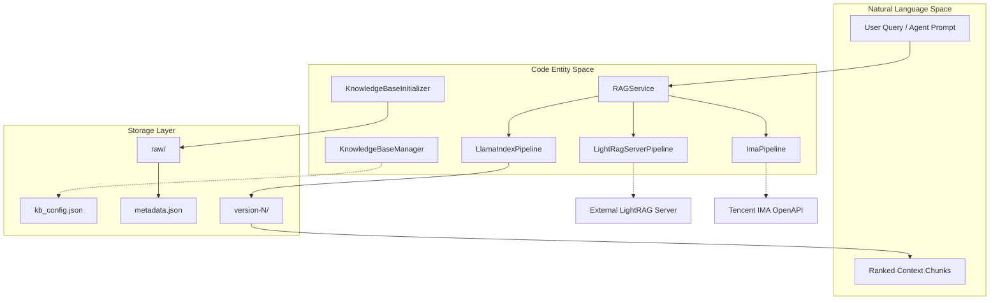
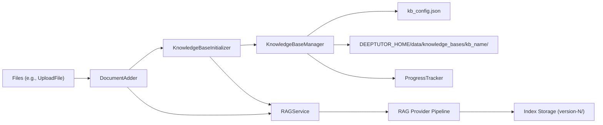
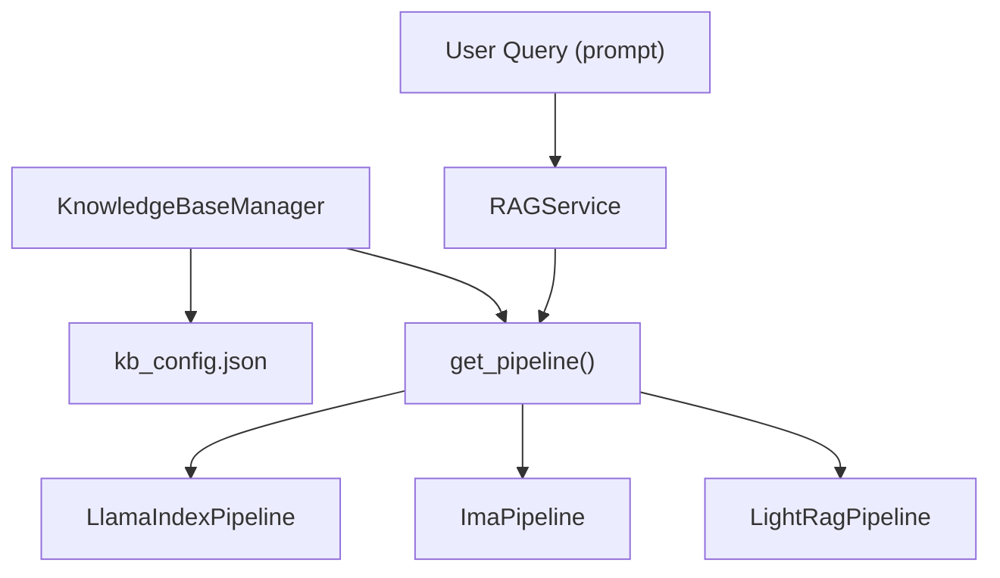
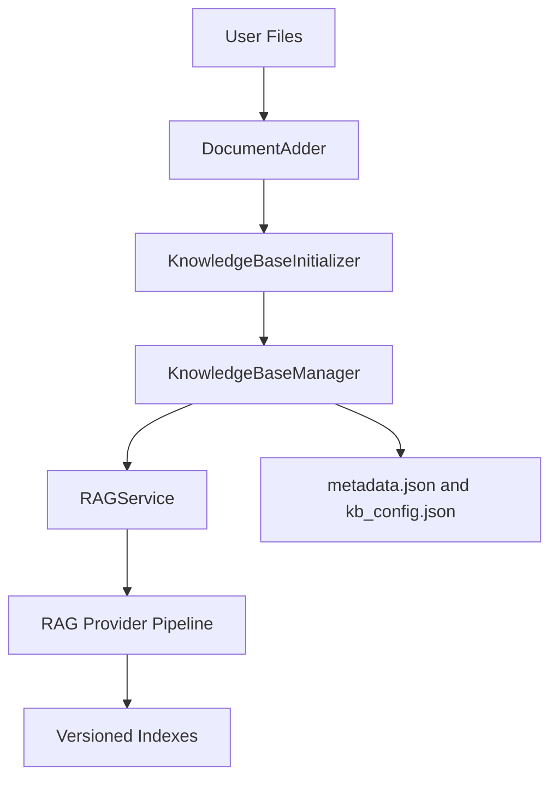

<!-- source: DeepWiki mcp.deepwiki.com · repo HKUDS/DeepTutor · page 6 Knowledge and RAG System · fetched 2026-11-09 -->

# Knowledge and RAG System

Relevant source files

The following files were used as context for generating this wiki page:

- [deeptutor/logging/process_stream.py](deeptutor/logging/process_stream.py)
- [deeptutor/services/config/__init__.py](deeptutor/services/config/__init__.py)
- [deeptutor/services/rag/query_rewrite.py](deeptutor/services/rag/query_rewrite.py)
- [deeptutor/services/rag/service.py](deeptutor/services/rag/service.py)
- [tests/cli/test_kb_eval_cli.py](tests/cli/test_kb_eval_cli.py)
- [tests/logging/test_process_logs.py](tests/logging/test_process_logs.py)
- [tests/services/rag/eval/test_eval_diff.py](tests/services/rag/eval/test_eval_diff.py)
- [tests/services/rag/eval/test_eval_runner.py](tests/services/rag/eval/test_eval_runner.py)
- [tests/services/rag/test_query_rewrite.py](tests/services/rag/test_query_rewrite.py)
- [tests/services/rag/test_rag_service_rewrite.py](tests/services/rag/test_rag_service_rewrite.py)

The Knowledge and Retrieval-Augmented Generation (RAG) system in DeepTutor underpins the management of persistent educational content and enables effective retrieval of relevant information to augment language model reasoning. It provides a unified interface for indexing, querying, and managing knowledge bases (KBs) across multiple local and remote providers. This system bridges the gap between static documents (PDFs, text, code files) and agentic tutoring workflows by supporting both local vector retrieval and remote API-based knowledge bases.

---

## System Overview

At the heart of the system lies the `KnowledgeBaseManager`, responsible for coordinating multiple knowledge bases stored on disk and managing their metadata and configuration — primarily through the `kb_config.json` configuration file [deeptutor/knowledge/manager.py:3-6](). The retrieval capabilities are abstracted over various RAG pipelines via the `RAGService`, which routes queries to specific engines such as `LlamaIndexPipeline` for local vector retrieval or remote connectors like `ImaPipeline` (Tencent IMA) and others [deeptutor/services/rag/factory.py:25-64]().

### High-Level Architecture Diagram: Knowledge Retrieval Flow

This diagram shows how natural language queries flow through the system components and connect to the underlying code entities and storage layers:

**Sources:**  
- [deeptutor/services/rag/service.py:22-65]()  
- [deeptutor/knowledge/manager.py:3-51]()  
- [deeptutor/services/rag/factory.py:33-64]()  

---

## 6.1 RAG Engines and Pipelines

The RAG subsystem enables the retrieval of contextual knowledge to support intelligent tutoring. DeepTutor currently supports a family of retrieval and generation pipelines, each specialized for different backends and indexing strategies:

- **LlamaIndex (default)**: Local vector retrieval with hybrid BM25 fusion, embedding-based search for efficient semantic matching [deeptutor/services/rag/factory.py:34-48]().
- **PageIndex**: Cloud-backed solution with deployment credentials and MCP integration, as well as an open-source local variant [deeptutor/services/rag/factory.py:34-48]().
- **GraphRAG**: Local knowledge graph retrieval with an optional dependency, enabling graph-structured knowledge traversal [deeptutor/services/rag/factory.py:138-143]().
- **LightRAG / LightRAG Server**: Graph + vector retrieval; LightRAG supports native and server-offloaded modes with multimodal data [deeptutor/services/rag/factory.py:145-157]().
- **Tencent IMA**: Retrieval offloaded to a Tencent IMA knowledge base via OpenAPI calls [deeptutor/services/rag/pipelines/ima/pipeline.py:1-150]().
- **WeKnora**: Querying a self-hosted Tencent WeKnora deployment over REST API [deeptutor/services/rag/factory.py:166-171]().

For further implementation details, see the child page [RAG Engines and Pipelines](#6.1).

**Sources:**  
- [deeptutor/services/rag/factory.py:33-171]()  
- [deeptutor/services/rag/pipelines/ima/pipeline.py:1-150]()  

---

## 6.2 Knowledge Base Management

Knowledge Base Management orchestrates the lifecycle of knowledge bases within DeepTutor, including metadata management, indexing, and status tracking. The central `KnowledgeBaseManager` maintains KB state and facilitates atomic updates to ensure consistency around critical files such as `kb_config.json` and `metadata.json` [deeptutor/knowledge/manager.py:97-100]().

### KB Processing Pipeline Diagram

### Additional Details:

- **Connected KBs**: Certain KBs are pointers to external sources rather than locally indexed collections, detected using `is_connected_kb` [deeptutor/knowledge/kb_types.py:11-30]().
- **Index Integrity**: The system uses embedding dimension reconciliation and other heuristics to flag stale indexes [deeptutor/knowledge/manager.py:133-154]().
- **Progress Tracking**: Indexing progress is managed by `ProgressTracker`, persisting snapshots to `.progress.json` [deeptutor/knowledge/progress_tracker.py:53-59]().

For comprehensive details, see the child page [Knowledge Base Management](#6.2).

**Sources:**  
- [deeptutor/knowledge/manager.py:130-180]()  
- [deeptutor/knowledge/progress_tracker.py:53-154]()  
- [deeptutor/knowledge/kb_types.py:10-45]()  

---

## 6.3 Web Sources and Knowledge Tools

DeepTutor's knowledge system also integrates external web sources and specialized tools for crawling and managing knowledge beyond local files.

- **Documentation-Site Crawler**: Implements an asynchronous BFS web crawler (`crawler.py`) that collects linked pages up to a configurable depth [deeptutor/services/web_source/crawler.py:1-13]().
- **Web Sync Engine**: The sync pipeline (`sync_source`) crawls documentation sites, compares page hashes, and ingests updated content [deeptutor/services/web_source/sync.py:1-111]().
- **Document Extraction**: Processed with text extraction helpers for binaries like PDFs or Office documents [deeptutor/api/routers/knowledge.py:83-87]().

For implementation specifics, see the child page [Web Sources and Knowledge Tools](#6.3).

**Sources:**  
- [deeptutor/services/web_source/crawler.py:1-13]()  
- [deeptutor/services/web_source/sync.py:1-111]()  
- [deeptutor/api/routers/knowledge.py:83-87]()  

---

# Summary

The DeepTutor Knowledge and RAG System integrates diverse knowledge sources—local and remote—through a consistent management and retrieval interface. For detailed technical information, algorithmic implementations, and usage examples of specific pipelines and KB management operations, refer to the respective child pages:

- [RAG Engines and Pipelines](#6.1)  
- [Knowledge Base Management](#6.2)  
- [Web Sources and Knowledge Tools](#6.3)

---

# Diagram: Mapping Natural Language to RAG Provider Code Entities

# Diagram: Knowledge Base Management and RAG Integration

**Sources:**  
- [deeptutor/services/rag/factory.py:1-172]()  
- [deeptutor/knowledge/kb_types.py:1-50]()  
- [deeptutor/knowledge/manager.py:1-180]()  
- [deeptutor/knowledge/initializer.py:1-129]()  
- [deeptutor/knowledge/add_documents.py:140-180]()  
- [deeptutor/services/rag/pipelines/ima/pipeline.py:1-150]()  
- [deeptutor/services/web_source/crawler.py:1-13]()  
- [deeptutor/services/web_source/sync.py:1-111]()

---

