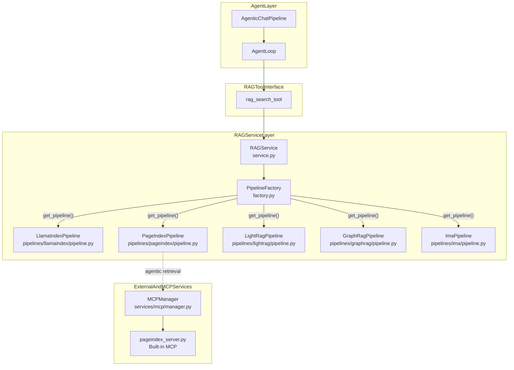
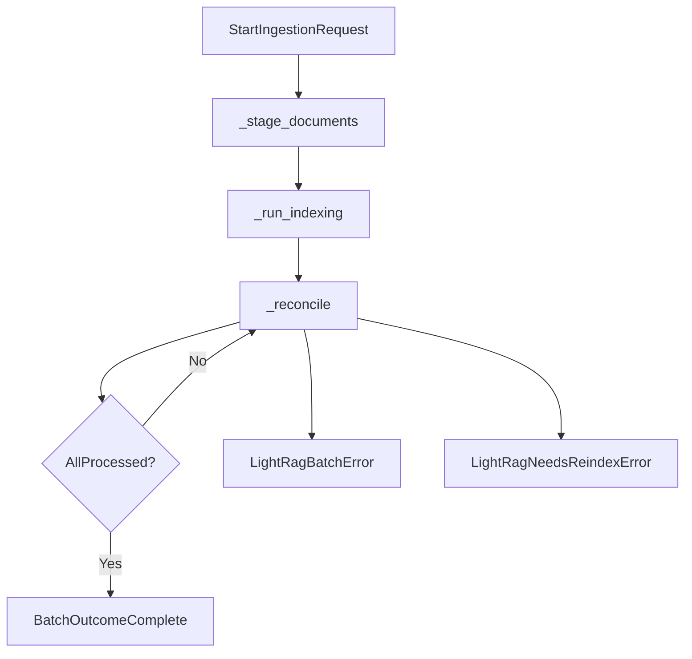
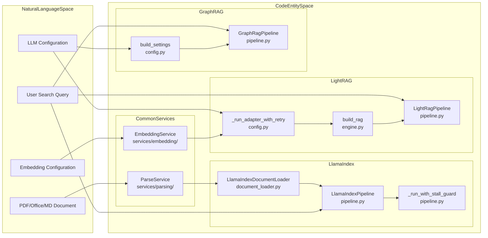

<!-- source: DeepWiki mcp.deepwiki.com · repo HKUDS/DeepTutor · page 6.1 RAG Engines and Pipelines · fetched 2026-11-09 -->

# RAG Engines and Pipelines

Relevant source files

The following files were used as context for generating this wiki page:

- [deeptutor/knowledge/indexing_run.py](deeptutor/knowledge/indexing_run.py)
- [deeptutor/services/codex_auth/__init__.py](deeptutor/services/codex_auth/__init__.py)
- [deeptutor/services/embedding/adapters/cohere.py](deeptutor/services/embedding/adapters/cohere.py)
- [deeptutor/services/embedding/adapters/jina.py](deeptutor/services/embedding/adapters/jina.py)
- [deeptutor/services/embedding/adapters/ollama.py](deeptutor/services/embedding/adapters/ollama.py)
- [deeptutor/services/file_io.py](deeptutor/services/file_io.py)
- [deeptutor/services/llm/image_caption_batch.py](deeptutor/services/llm/image_caption_batch.py)
- [deeptutor/services/llm/image_caption_cache.py](deeptutor/services/llm/image_caption_cache.py)
- [deeptutor/services/mcp/config.py](deeptutor/services/mcp/config.py)
- [deeptutor/services/mcp/manager.py](deeptutor/services/mcp/manager.py)
- [deeptutor/services/parsing/engines/mineru/models.py](deeptutor/services/parsing/engines/mineru/models.py)
- [deeptutor/services/rag/embedding_binding.py](deeptutor/services/rag/embedding_binding.py)
- [deeptutor/services/rag/embedding_signature.py](deeptutor/services/rag/embedding_signature.py)
- [deeptutor/services/rag/index_versioning.py](deeptutor/services/rag/index_versioning.py)
- [deeptutor/services/rag/pipelines/graphrag/config.py](deeptutor/services/rag/pipelines/graphrag/config.py)
- [deeptutor/services/rag/pipelines/graphrag/engine.py](deeptutor/services/rag/pipelines/graphrag/engine.py)
- [deeptutor/services/rag/pipelines/graphrag/pandas_compat.py](deeptutor/services/rag/pipelines/graphrag/pandas_compat.py)
- [deeptutor/services/rag/pipelines/lightrag/README.md](deeptutor/services/rag/pipelines/lightrag/README.md)
- [deeptutor/services/rag/pipelines/lightrag/config.py](deeptutor/services/rag/pipelines/lightrag/config.py)
- [deeptutor/services/rag/pipelines/lightrag/engine.py](deeptutor/services/rag/pipelines/lightrag/engine.py)
- [deeptutor/services/rag/pipelines/lightrag/indexing_policy.py](deeptutor/services/rag/pipelines/lightrag/indexing_policy.py)
- [deeptutor/services/rag/pipelines/lightrag/pipeline.py](deeptutor/services/rag/pipelines/lightrag/pipeline.py)
- [deeptutor/services/rag/pipelines/lightrag/roles.py](deeptutor/services/rag/pipelines/lightrag/roles.py)
- [deeptutor/services/rag/pipelines/lightrag/storage.py](deeptutor/services/rag/pipelines/lightrag/storage.py)
- [deeptutor/services/rag/pipelines/llamaindex/config.py](deeptutor/services/rag/pipelines/llamaindex/config.py)
- [deeptutor/services/rag/pipelines/llamaindex/document_loader.py](deeptutor/services/rag/pipelines/llamaindex/document_loader.py)
- [deeptutor/services/rag/pipelines/llamaindex/embedding_adapter.py](deeptutor/services/rag/pipelines/llamaindex/embedding_adapter.py)
- [deeptutor/services/rag/pipelines/llamaindex/errors.py](deeptutor/services/rag/pipelines/llamaindex/errors.py)
- [deeptutor/services/rag/pipelines/llamaindex/exercise_lookup.py](deeptutor/services/rag/pipelines/llamaindex/exercise_lookup.py)
- [deeptutor/services/rag/pipelines/llamaindex/pipeline.py](deeptutor/services/rag/pipelines/llamaindex/pipeline.py)
- [deeptutor/services/rag/pipelines/llamaindex/rerank.py](deeptutor/services/rag/pipelines/llamaindex/rerank.py)
- [deeptutor/services/rag/pipelines/llamaindex/retrievers.py](deeptutor/services/rag/pipelines/llamaindex/retrievers.py)
- [deeptutor/services/rag/pipelines/llamaindex/storage.py](deeptutor/services/rag/pipelines/llamaindex/storage.py)
- [deeptutor/services/rag/pipelines/pageindex/client.py](deeptutor/services/rag/pipelines/pageindex/client.py)
- [deeptutor/services/rag/pipelines/pageindex/pipeline.py](deeptutor/services/rag/pipelines/pageindex/pipeline.py)
- [requirements/rag-rerank.txt](requirements/rag-rerank.txt)
- [tests/knowledge/test_indexing_run.py](tests/knowledge/test_indexing_run.py)
- [tests/knowledge/test_linked_folder_sync.py](tests/knowledge/test_linked_folder_sync.py)
- [tests/knowledge/test_manager_delete.py](tests/knowledge/test_manager_delete.py)
- [tests/services/config/test_graphrag_lightrag_settings.py](tests/services/config/test_graphrag_lightrag_settings.py)
- [tests/services/config/test_llamaindex_settings.py](tests/services/config/test_llamaindex_settings.py)
- [tests/services/embedding/test_disable_ssl_verify.py](tests/services/embedding/test_disable_ssl_verify.py)
- [tests/services/embedding/test_jina_adapter.py](tests/services/embedding/test_jina_adapter.py)
- [tests/services/llm/test_codex_disable_ssl_verify.py](tests/services/llm/test_codex_disable_ssl_verify.py)
- [tests/services/llm/test_image_caption_batch.py](tests/services/llm/test_image_caption_batch.py)
- [tests/services/llm/test_image_caption_cache.py](tests/services/llm/test_image_caption_cache.py)
- [tests/services/mcp/test_progress_reporting.py](tests/services/mcp/test_progress_reporting.py)
- [tests/services/rag/test_embedding_binding.py](tests/services/rag/test_embedding_binding.py)
- [tests/services/rag/test_exercise_lookup.py](tests/services/rag/test_exercise_lookup.py)
- [tests/services/rag/test_exercise_scope.py](tests/services/rag/test_exercise_scope.py)
- [tests/services/rag/test_graphrag_pandas_compat.py](tests/services/rag/test_graphrag_pandas_compat.py)
- [tests/services/rag/test_graphrag_pipeline.py](tests/services/rag/test_graphrag_pipeline.py)
- [tests/services/rag/test_index_versioning.py](tests/services/rag/test_index_versioning.py)
- [tests/services/rag/test_lightrag_ingress.py](tests/services/rag/test_lightrag_ingress.py)
- [tests/services/rag/test_lightrag_pipeline.py](tests/services/rag/test_lightrag_pipeline.py)
- [tests/services/rag/test_lightrag_roles.py](tests/services/rag/test_lightrag_roles.py)
- [tests/services/rag/test_lightrag_settings_wiring.py](tests/services/rag/test_lightrag_settings_wiring.py)
- [tests/services/rag/test_lightrag_workspace_meta.py](tests/services/rag/test_lightrag_workspace_meta.py)
- [tests/services/rag/test_llamaindex_bm25_fusion.py](tests/services/rag/test_llamaindex_bm25_fusion.py)
- [tests/services/rag/test_llamaindex_document_loader.py](tests/services/rag/test_llamaindex_document_loader.py)
- [tests/services/rag/test_llamaindex_embedding_failures.py](tests/services/rag/test_llamaindex_embedding_failures.py)
- [tests/services/rag/test_llamaindex_embedding_resume.py](tests/services/rag/test_llamaindex_embedding_resume.py)
- [tests/services/rag/test_llamaindex_embedding_roles.py](tests/services/rag/test_llamaindex_embedding_roles.py)
- [tests/services/rag/test_llamaindex_image_description.py](tests/services/rag/test_llamaindex_image_description.py)
- [tests/services/rag/test_llamaindex_pipeline_stall.py](tests/services/rag/test_llamaindex_pipeline_stall.py)
- [tests/services/rag/test_llamaindex_rerank.py](tests/services/rag/test_llamaindex_rerank.py)
- [tests/services/rag/test_llamaindex_storage_layout.py](tests/services/rag/test_llamaindex_storage_layout.py)
- [tests/services/rag/test_pageindex_oss_config.py](tests/services/rag/test_pageindex_oss_config.py)
- [tests/services/rag/test_pageindex_pipeline.py](tests/services/rag/test_pageindex_pipeline.py)
- [tests/services/test_file_io.py](tests/services/test_file_io.py)
- [tests/tools/test_mineru_models.py](tests/tools/test_mineru_models.py)
- [web/components/knowledge/IndexingModelSelector.tsx](web/components/knowledge/IndexingModelSelector.tsx)
- [web/components/knowledge/KbDocumentsSection.tsx](web/components/knowledge/KbDocumentsSection.tsx)
- [web/components/knowledge/LightRagIndexingSelector.tsx](web/components/knowledge/LightRagIndexingSelector.tsx)
- [web/components/knowledge/LightRagRoleModelsEditor.tsx](web/components/knowledge/LightRagRoleModelsEditor.tsx)
- [web/features/knowledge/components/engines/EngineDetail.tsx](web/features/knowledge/components/engines/EngineDetail.tsx)
- [web/hooks/useKnowledgeProgress.ts](web/hooks/useKnowledgeProgress.ts)
- [web/tests/kb-embedding-binding.spec.tsx](web/tests/kb-embedding-binding.spec.tsx)
- [web/tests/knowledge-create-progress.spec.tsx](web/tests/knowledge-create-progress.spec.tsx)
- [web/tests/lightrag-form.spec.tsx](web/tests/lightrag-form.spec.tsx)
- [web/tests/lightrag-lifecycle.spec.tsx](web/tests/lightrag-lifecycle.spec.tsx)
- [web/tests/lightrag-role-models.spec.tsx](web/tests/lightrag-role-models.spec.tsx)

## Purpose and Scope

The RAG (Retrieval-Augmented Generation) System provides a unified abstraction layer for querying knowledge bases across multiple retrieval strategies and pipeline implementations. It serves as the primary tool for all intelligent agents to access structured knowledge, supporting vector-based semantic search, graph-based retrieval, hosted reasoning retrieval, and multimodal document parsing.

DeepTutor's RAG architecture is "RAG-Anything" compatible, meaning it can ingest various document formats (PDF, Markdown, Text, Office) and extract content into a unified knowledge representation. The system supports multiple engines including **LlamaIndex**, **LightRAG**, **GraphRAG**, **PageIndex**, and **IMA**, integrated with a custom embedding layer to support diverse model providers.

Sources: `[deeptutor/services/rag/factory.py:34-49]()`, `[deeptutor/services/rag/service.py:23-56]()`, `[deeptutor/knowledge/kb_types.py:45-87]()`

---

## System Architecture

The RAG system implements a **provider-based architecture** where `RAGService` acts as the central routing hub. The system resolves the appropriate engine per knowledge base by checking authoritative configuration files.

### Core Components and Data Flow

Title: "RAG Architecture and Provider Routing"

Sources: `[deeptutor/services/rag/factory.py:34-49]`, `[deeptutor/services/rag/service.py:23-56]()`, `[deeptutor/services/rag/pipelines/llamaindex/pipeline.py:179-188]()`

| Component                | File Path                                      | Responsibility                                                    |
|-------------------------|------------------------------------------------|------------------------------------------------------------------|
| `RAGService`             | `[deeptutor/services/rag/service.py:23-56]()`  | Orchestrates KB-specific provider resolution and search execution.|
| `LlamaIndexPipeline`     | `[deeptutor/services/rag/pipelines/llamaindex/pipeline.py:179-188]()` | Local vector/hybrid implementation using `VectorStoreIndex`.       |
| `PageIndexPipeline`      | `[deeptutor/services/rag/pipelines/pageindex/pipeline.py:21-25]()`    | Orchestrates cloud-backed indexing and structural outline retrieval. |
| `LightRagPipeline`       | `[deeptutor/services/rag/pipelines/lightrag/pipeline.py:98-104]()`     | Local RAG-Anything implementation using LightRAG.                   |
| `GraphRagPipeline`       | `[deeptutor/services/rag/pipelines/graphrag/pipeline.py:34-35]()`     | Local implementation using Microsoft's GraphRAG.                   |
| `ImaPipeline`            | `[deeptutor/services/rag/pipelines/ima/pipeline.py:23-26]()`          | Integration for Tencent IMA knowledge bases.                       |

Sources: `[deeptutor/services/rag/factory.py:34-49]()`, `[deeptutor/services/rag/service.py:23-56]()`, `[deeptutor/services/rag/pipelines/llamaindex/pipeline.py:179-188]()`

---

## Retrieval Pipeline Implementation

### 1. LlamaIndex Integration

The `LlamaIndexPipeline` manages the lifecycle of a knowledge base using the LlamaIndex framework. It supports hybrid retrieval (BM25 + Vector) and optimized storage.

#### Ingestion and Stall Guard

Indexing operations (chunking + embedding) run in a worker thread via `run_in_executor`. DeepTutor implements `_run_with_stall_guard` to prevent indefinite hangs if an embedding provider accepts requests but never completes them. This method monitors a heartbeat progress callback and raises `IndexingStallError` if no progress is made for `_INDEX_STALL_TIMEOUT_SECONDS` (default 600s), ensuring robustness during ingestion `[deeptutor/services/rag/pipelines/llamaindex/pipeline.py:104-177]()`.

#### Ingestion Pipeline

The `LlamaIndexDocumentLoader` delegates parsing transformations and embedding to LlamaIndex components and the shared parse service:
- **Transformations**: Includes chunking configured by size and overlap.
- **Multimodal Nodes**: Handles extracted images and feeds them into the multimodal `ImageNode` path `[deeptutor/services/rag/pipelines/llamaindex/document_loader.py:69-146]()`.

#### Vector Store and Retrievers

- **Vector Index Types**: Configurable via configuration supporting exact search and approximate nearest neighbor indices.
- **Retrieval Profiles**: Defines profiles like vector and hybrid profiles, combining vector and BM25 retrieval using Reciprocal Rank Fusion `[deeptutor/services/rag/pipelines/llamaindex/pipeline.py:1-50]()`.

Sources: `[deeptutor/services/rag/pipelines/llamaindex/pipeline.py:104-188]`, `[deeptutor/services/rag/pipelines/llamaindex/document_loader.py:69-146]()`

---

### 2. LightRAG and RAG-Anything

The `LightRagPipeline` delegates to the `lightrag` package, providing a multimodal knowledge-graph RAG engine (`[deeptutor/services/rag/pipelines/lightrag/pipeline.py:98-104]()`).

#### Decoupling and Adapters

DeepTutor avoids importing the heavy LightRAG dependency at module load via the `config.py` bridge module. This bridge adapts DeepTutor's internal LLM, vision, and embedding clients to LightRAG's expected callable signatures (`[deeptutor/services/rag/pipelines/lightrag/config.py:1-140]()`).

- **LLM Adapter**: Wraps unified LLM callable and drops LightRAG-specific kwargs (`[deeptutor/services/rag/pipelines/lightrag/config.py:1-15]()`).
- **Retry Policy**: Implements bounded retries via `_run_adapter_with_retry` (3 attempts) on transient HTTP errors (`[deeptutor/services/rag/pipelines/lightrag/config.py:113-138]()`).
- **Worker Loop**: Operation lifecycle management in an isolated worker loop managed by `OwnerLoopBridge` (`[deeptutor/services/rag/pipelines/lightrag/worker.py:1-50]()`).

#### Block Policy and Parsing

DeepTutor feeds LightRAG with pre-parsed content lists produced by the shared `ParseService`, converting document blocks into LightRAG schemas using `block_policy` (`[deeptutor/services/rag/pipelines/lightrag/pipeline.py:130-153]()`).

#### LightRAG Pipeline Lifecycle

The `LightRagPipeline` manages staging documents, reconciling ingestion batches, monitoring indexing progress, and error-handling outcomes (`[deeptutor/services/rag/pipelines/lightrag/pipeline.py:154-187]()`).

Title: "LightRAG Ingestion and Reconciliation Lifecycle"

Sources: `[deeptutor/services/rag/pipelines/lightrag/pipeline.py:124-187]()`, `[deeptutor/services/rag/pipelines/lightrag/config.py:113-138]()`

---

### 3. GraphRAG Integration

DeepTutor integrates Microsoft's GraphRAG for knowledge graph-based retrieval (`[tests/services/rag/test_graphrag_pipeline.py:1-48]()`).

- **Lazy Loading**: The `graphrag` package is loaded only when a GraphRAG KB is used.
- **Configuration Bridge**: `gr_config.build_settings` translates DeepTutor's LLM and embedding configurations into GraphRAG's native JSON settings format (`[tests/services/rag/test_graphrag_pipeline.py:101-125]()`).
- **Error Classification**: The pipeline includes helpers to classify embedding errors such as dimension mismatches or unsupported providers (`[tests/services/rag/test_graphrag_pipeline.py:27-34]()`).

Sources: `[tests/services/rag/test_graphrag_pipeline.py:1-125]()`, `[deeptutor/services/rag/pipelines/graphrag/config.py:1-130]()`

---

### 4. PageIndex

PageIndex provides hosted reasoning-as-retrieval functionality.

- **Agentic Retrieval**: Enforces agentic retrieval using PageIndex MCP tools integrated within the DeepTutor agent runtime.
- **MCP Integration**: Communication with hosted PageIndex servers is managed via the MCP manager (`[deeptutor/services/rag/service.py:90-104]()`).

Sources: `[deeptutor/services/rag/service.py:90-104]()`

---

### 5. IMA (Tencent Intelligent Media Assistant)

The IMA pipeline integrates Tencent's IMA knowledge base service.

- **Retrieval-Only Pipeline**: DeepTutor delegates indexing entirely to the IMA backend and performs retrieval operations (`[deeptutor/services/rag/pipelines/ima/client.py:20-60]()`).
- **API Client**: `ImaClient` manages paginated API calls, error handling, and maps HTTP/API errors to typed exceptions (`[deeptutor/services/rag/pipelines/ima/client.py:20-60]()`).

Sources: `[deeptutor/services/rag/pipelines/ima/client.py:20-60]()`, `[deeptutor/services/rag/pipelines/ima/config.py:30-60]()`

---

## Retrieval Strategies and Query Modes

DeepTutor supports multiple query modes based on the underlying engine:

| Engine        | Supported Modes                                     | Default  | Description                                                                                      |
|---------------|----------------------------------------------------|----------|------------------------------------------------------------------------------------------------|
| **LlamaIndex**| `hybrid`, `vector`                                 | `hybrid` | Hybrid combines BM25 and vector retrieval (Reciprocal Rank Fusion) for balanced recall & precision. |
| **LightRAG**  | `naive`, `local`, `global`, `hybrid`, `mix`       | `hybrid` | `mix` fuses knowledge graph and vector retrieval; `global` for theme-level retrieval.         |
| **GraphRAG**  | `local`, `global`, `drift`, `basic`                | `local`  | `global` employs map-reduce over global community summaries.                                   |

Sources: `[deeptutor/services/config/runtime_settings.py:10-21]()`, `[deeptutor/services/rag/pipelines/lightrag/config.py:40-44]()`

---

## Natural Language to Code Entity Mapping

Title: "Natural Language to Code Entity Mapping for RAG Pipelines"

Sources: `[deeptutor/services/rag/pipelines/llamaindex/pipeline.py:104-177]()`, `[deeptutor/services/rag/pipelines/lightrag/config.py:113-138]()`, `[deeptutor/services/rag/pipelines/llamaindex/document_loader.py:69-146]()`

---

## Knowledge Base Management

### Storage and Versioning

Knowledge bases reside under a runtime data root, typically under `knowledge_bases/`. Each knowledge base update creates a new directory with a version label (`version-1`, `version-2`), allowing safe co-existence of multiple index snapshots (`[deeptutor/services/rag/index_versioning.py:1-23]()`). Each version stores a `meta.json` or `metadata.json` file describing the RAG provider, embedding model, and indexing policy.

Sources: `[deeptutor/services/rag/index_versioning.py:1-23]`, `[deeptutor/services/rag/pipelines/lightrag/storage.py:1-70]()`

### Embedding Signatures and Index Consistency

Embedding signatures identify the embedding configuration for a KB, linking the embedding model and provider fingerprints. This prevents querying with mismatched or deprecated embedding versions (`[deeptutor/services/rag/embedding_signature.py:1-60]()`, `[deeptutor/services/rag/pipelines/lightrag/indexing_policy.py:1-80]()`).

Sources: `[deeptutor/services/rag/embedding_signature.py:1-60]()`, `[deeptutor/services/rag/pipelines/lightrag/indexing_policy.py:1-80]()`

### Document Map and Canonical Filenames

A document map maintains the association between original file names and internal document identifiers required for downstream retrieval and idempotency during incremental ingestion operations (`[tests/services/rag/test_pageindex_pipeline.py:140-147]()`).

Sources: `[tests/services/rag/test_pageindex_pipeline.py:140-147]()`

---

## Summary Table of RAG Engines and Their Pipeline Classes

| Engine      | Main Binding/Package         | Pipeline Class                   | Key Files                                  | Indexing Approach                      | Query Style                  |
|-------------|-----------------------------|--------------------------------|--------------------------------------------|--------------------------------------|------------------------------|
| LlamaIndex  | `llama_index`               | `LlamaIndexPipeline`           | `pipelines/llamaindex/pipeline.py`        | BM25 + Vector, stall-guard            | Hybrid vector-BM25           |
| LightRAG    | `lightrag` (optional)       | `LightRagPipeline`             | `pipelines/lightrag/pipeline.py`           | LLM-powered knowledge graph + vector | KG + vector fusion           |
| GraphRAG    | `graphrag` (optional)       | `GraphRagPipeline`             | `pipelines/graphrag/pipeline.py`           | Graph-based with isolated loop        | Entity & theme retrieval     |
| PageIndex   | Hosted MCP service          | `PageIndexPipeline`            | `pipelines/pageindex/pipeline.py`          | Cloud-hosted embedding + ingestion    | Agentic retrieval through MCP|
| IMA         | Tencent IMA hosted service  | `ImaPipeline`                  | `pipelines/ima/pipeline.py`                 | Retrieval-only API client              | Search via IMA API           |

Sources: `[deeptutor/services/rag/factory.py:34-49]()`, `[deeptutor/services/rag/service.py:23-56]()`, `[deeptutor/services/rag/pipelines/lightrag/pipeline.py:98-187]()`

---

