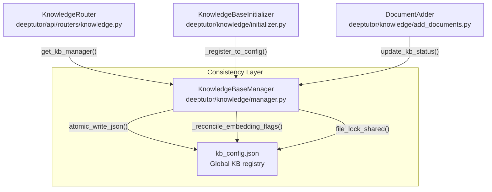
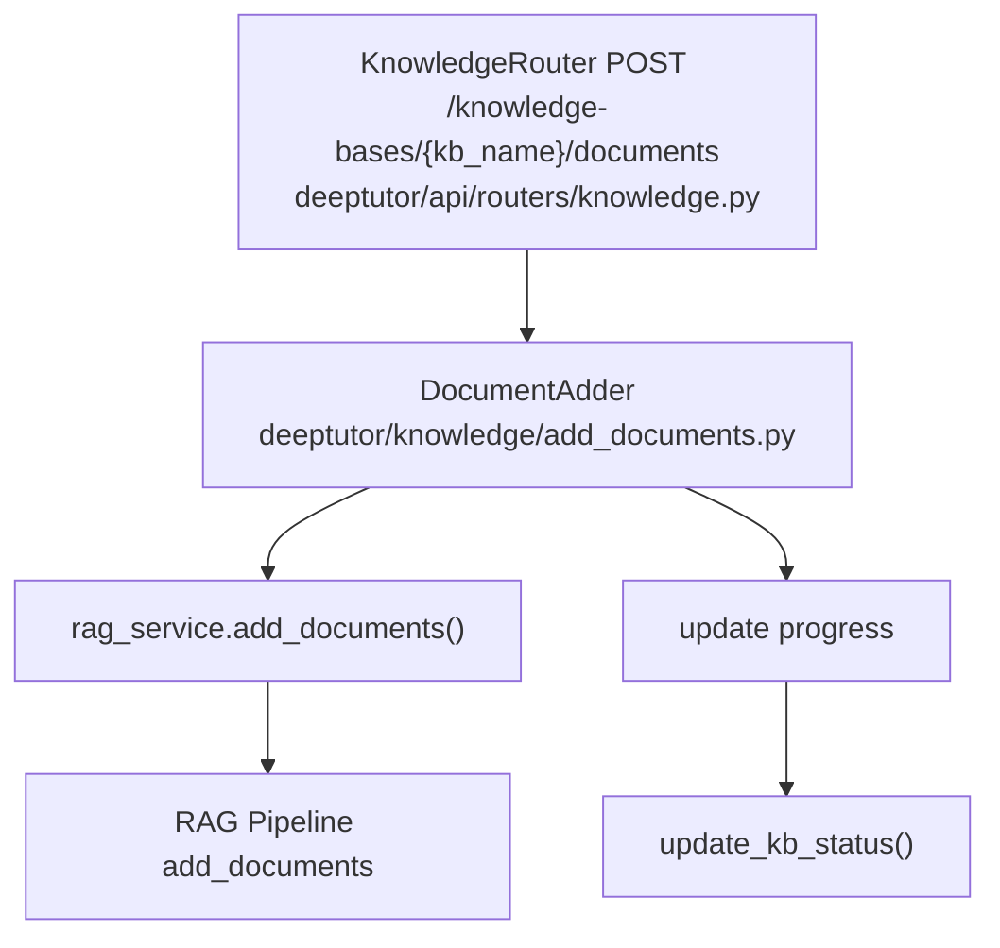

<!-- source: DeepWiki mcp.deepwiki.com · repo HKUDS/DeepTutor · page 6.2 Knowledge Base Management · fetched 2026-11-09 -->

# Knowledge Base Management

<details>
<summary>Relevant source files</summary>

The following files were used as context for generating this wiki page:

- [deeptutor/api/routers/knowledge.py](deeptutor/api/routers/knowledge.py)
- [deeptutor/knowledge/add_documents.py](deeptutor/knowledge/add_documents.py)
- [deeptutor/knowledge/initializer.py](deeptutor/knowledge/initializer.py)
- [deeptutor/knowledge/manager.py](deeptutor/knowledge/manager.py)
- [deeptutor/knowledge/progress_tracker.py](deeptutor/knowledge/progress_tracker.py)
- [deeptutor/knowledge/staging.py](deeptutor/knowledge/staging.py)
- [deeptutor/services/config/runtime_settings.py](deeptutor/services/config/runtime_settings.py)
- [deeptutor/services/rag/index_probe.py](deeptutor/services/rag/index_probe.py)
- [deeptutor/services/setup/data_volume.py](deeptutor/services/setup/data_volume.py)
- [tests/api/test_knowledge_router.py](tests/api/test_knowledge_router.py)
- [tests/api/test_linked_folder_routes.py](tests/api/test_linked_folder_routes.py)
- [tests/knowledge/test_add_documents_linked_folder.py](tests/knowledge/test_add_documents_linked_folder.py)
- [tests/knowledge/test_document_adder_provider.py](tests/knowledge/test_document_adder_provider.py)
- [tests/knowledge/test_kb_document_staging.py](tests/knowledge/test_kb_document_staging.py)
- [tests/knowledge/test_manager_get_info_status.py](tests/knowledge/test_manager_get_info_status.py)
- [tests/knowledge/test_manager_list.py](tests/knowledge/test_manager_list.py)
- [tests/knowledge/test_progress_tracker.py](tests/knowledge/test_progress_tracker.py)
- [tests/knowledge/test_staging_retry.py](tests/knowledge/test_staging_retry.py)
- [tests/services/config/test_runtime_settings.py](tests/services/config/test_runtime_settings.py)
- [tests/services/rag/test_index_probe.py](tests/services/rag/test_index_probe.py)
- [tests/services/rag/test_lightrag_indexing_policy.py](tests/services/rag/test_lightrag_indexing_policy.py)
- [tests/services/rag/test_lightrag_native_smoke.py](tests/services/rag/test_lightrag_native_smoke.py)
- [tests/services/setup/test_data_volume.py](tests/services/setup/test_data_volume.py)
- [web/components/knowledge/CreateKbModal.tsx](web/components/knowledge/CreateKbModal.tsx)
- [web/components/knowledge/KbIndexVersionsSection.tsx](web/components/knowledge/KbIndexVersionsSection.tsx)
- [web/components/knowledge/KbSettingsSection.tsx](web/components/knowledge/KbSettingsSection.tsx)
- [web/components/knowledge/KnowledgeBaseDetail.tsx](web/components/knowledge/KnowledgeBaseDetail.tsx)
- [web/components/knowledge/KnowledgeHome.tsx](web/components/knowledge/KnowledgeHome.tsx)
- [web/components/knowledge/KnowledgePage.tsx](web/components/knowledge/KnowledgePage.tsx)
- [web/hooks/useKnowledgeBases.ts](web/hooks/useKnowledgeBases.ts)
- [web/lib/knowledge-helpers.ts](web/lib/knowledge-helpers.ts)
- [web/lib/marginnote4-api.ts](web/lib/marginnote4-api.ts)
- [web/tests/knowledge-helpers.test.ts](web/tests/knowledge-helpers.test.ts)
- [web/tests/knowledge-progress.test.ts](web/tests/knowledge-progress.test.ts)
- [web/tests/lightrag-embedding-compatibility.spec.tsx](web/tests/lightrag-embedding-compatibility.spec.tsx)
- [web/tests/marginnote4-api.test.ts](web/tests/marginnote4-api.test.ts)

</details>


## Purpose and Scope

This document details the Knowledge Base (KB) management subsystem in DeepTutor, which is responsible for creating, managing, and maintaining the repositories of documents that serve as the foundational data for Retrieval-Augmented Generation (RAG) capabilities. The KB management spans from KB initialization, document ingestion, embedding/version consistency, progress tracking, to integration with external linked KBs and web sources.

The core orchestration is via the `KnowledgeBaseManager` class [deeptutor/knowledge/manager.py:5](), which handles multiple KB lifecycle aspects, including concurrency-safe updates, metadata persistence, and embedding compatibility checks. This page also covers supporting modules like `KnowledgeBaseInitializer` (for initial creation) [deeptutor/knowledge/initializer.py:35](), `DocumentAdder` (for incremental document staging and ingestion) [deeptutor/knowledge/add_documents.py:162](), the knowledge API router [deeptutor/api/routers/knowledge.py:118](), and frontend components that compose the UI for Knowledge Base management [web/components/knowledge/CreateKbModal.tsx:129]().

**Sources:** [deeptutor/knowledge/manager.py:5](), [deeptutor/knowledge/initializer.py:35](), [deeptutor/knowledge/add_documents.py:162](), [deeptutor/api/routers/knowledge.py:118](), [web/components/knowledge/CreateKbModal.tsx:129]()

---

## Knowledge Base Directory Structure

DeepTutor organizes knowledge bases under a common root directory, typically `./data/knowledge_bases/`. Each KB has an isolated folder containing raw documents, metadata, and versioned index files.

### Standard Layout

```
data/knowledge_bases/
├── kb_config.json                    # Global registry and status
└── <kb_name>/
    ├── metadata.json                 # KB-level metadata, file hashes, sync info
    ├── raw/                         # Raw source files (PDFs, Markdown, DOCX, etc.)
    │   └── _web/                    # Namespaced directory for web-crawled docs
    ├── .progress.json               # Progress snapshot for indexing tasks
    ├── version-1/                   # Versioned index directory (flat layout)
    │   ├── docstore.json            # LlamaIndex document store 
    │   ├── index_store.json         # Index data
    │   └── meta.json                # Provider and index version metadata
    └── version-2/                   # Additional version (e.g. during reindexing)
```

| Directory/File  | Description                          | Associated Code                         |
|-----------------|------------------------------------|---------------------------------------|
| `raw/`          | Raw imported document files         | `DocumentAdder.raw_dir` [deeptutor/knowledge/add_documents.py:182]() |
| `_web/`         | Web crawl output under namespace    | `_source_filename` in web crawler [deeptutor/services/web_source/crawler.py:1-170]() |
| `version-N/`    | Flat versioned directory for indices| `inspect_kb_versions` [deeptutor/services/rag/index_probe.py:52]()|
| `kb_config.json`| Global knowledge base registry      | `KnowledgeBaseManager` config handling [deeptutor/knowledge/manager.py:5]() |
| `metadata.json` | KB top-level metadata & hashes     | `DocumentAdder.metadata_file` [deeptutor/knowledge/add_documents.py:185]() |

This isolation helps the system clearly identify the state of ingestion, indexing, and coordination with connected or external knowledge bases.

**Sources:** [deeptutor/knowledge/manager.py:162-185](), [deeptutor/knowledge/add_documents.py:182-185](), [deeptutor/services/web_source/crawler.py:1-170]()

---

## Knowledge Base Management

### 1. KnowledgeBaseManager Class

The `KnowledgeBaseManager` is the central class managing lifecycle and state for all knowledge bases [deeptutor/knowledge/manager.py:5](). It owns the global KB registry (persisted as `kb_config.json`) and provides thread-safe access to state via file-level locking and atomic write operations.

Key implementation details:
- Uses cross-platform shared read locks on config files and atomic file writes for concurrency safety during multiple reader/writer scenarios [deeptutor/knowledge/manager.py:128-148]() and [deeptutor/services/file_io.py:1-10]().
- Maintains embedding model version consistency; comparing on-disk index versions with the active embedding config flags using `_reconcile_embedding_flags` [deeptutor/knowledge/manager.py:161-192]().
- Supports read/write operations with update methods tracking KB status and indexing progress.
- Identifies "connected" knowledge bases (e.g. Obsidian vaults, linked folder indexes) via KB type flags [deeptutor/knowledge/kb_types.py:24-34]().

Title: "Knowledge Base Manager Class and Registry Interactions"


**Sources:** [deeptutor/knowledge/manager.py:5-192](), [deeptutor/knowledge/kb_types.py:24-34](), [deeptutor/knowledge/initializer.py:64-92](), [deeptutor/knowledge/add_documents.py:162-185](), [deeptutor/api/routers/knowledge.py:145-150]()

### 2. Embedding Consistency and Status

- KBs track the active embedding model configuration and index compatibility through scanning version directories and their embedded signature metadata.
- If mismatches are found, `needs_reindex` flags are set on KB entries for UI prompting.
- Ready indices are detected by recognizing provider-specific artifacts (e.g., index files) within version directories, via `inspect_kb_versions` probe [deeptutor/services/rag/index_probe.py:52-55]().
- Status promotion logic ensures that KBs with ready index versions but "processing" status in config are promoted to "ready" for UI correctness.

**Sources:** [deeptutor/knowledge/manager.py:161-192](), [deeptutor/services/rag/index_probe.py:52-55]()

### 3. Supported KB Types

Several special KB types have distinct handling:

| Type                | Description                                             |
|---------------------|---------------------------------------------------------|
| `OBSIDIAN_KB_TYPE`  | Linked Obsidian vault (no local indexing) [deeptutor/knowledge/kb_types.py:29]() |
| `LINKED_KB_TYPE`    | Linked folder containing prebuilt indexes [deeptutor/knowledge/kb_types.py:27]() |
| `LIGHTRAG_SERVER_KB_TYPE` | External LightRAG server knowledge base (retrieval only) [deeptutor/knowledge/kb_types.py:26]() |
| `IMA_KB_TYPE`       | Tencent IMA knowledge base integration [deeptutor/knowledge/kb_types.py:25]() |
| `SUBAGENT_KB_TYPE`  | KBs powered by subagent services (excluded from UI KB lists) [deeptutor/knowledge/kb_types.py:30]() |

**Sources:** [deeptutor/knowledge/manager.py:3-192](), [deeptutor/knowledge/kb_types.py:20-34](), [deeptutor/services/rag/index_probe.py:1-134]()

---

## Initialization and Document Addition

### KnowledgeBaseInitializer

- Responsible for creating a new knowledge base directory structure, including `raw/` and metadata files [deeptutor/knowledge/initializer.py:132-152]().
- Registers the KB with an initial `initializing` status in the global KB configuration, ensuring visibility in listings while setup completes [deeptutor/knowledge/initializer.py:64-90]().
- Copies source documents into the KB's `raw/` folder for later ingestion [deeptutor/knowledge/initializer.py:155-174]().
- Kicks off processing with the RAG provider through the `RAGService`, reporting progress via `ProgressTracker`.

**Sources:** [deeptutor/knowledge/initializer.py:35-174]()

### DocumentAdder

- Supports incremental addition of new files to an existing KB [deeptutor/knowledge/add_documents.py:162-192]().
- Validates that the KB has a ready index and then stages raw files before invoking the bound RAG provider's ingestion pipelines.
- Maintains `metadata.json` with file hashes for deduplication and incremental indexing correctness [deeptutor/knowledge/add_documents.py:92-107]().
- Returns detailed index results with success and failure reporting of document files [deeptutor/knowledge/add_documents.py:52-81]().

**Sources:** [deeptutor/knowledge/add_documents.py:52-192]()

---

### Document Ingestion Flow

Title: "Document Ingestion and API Routing Flow"


**Sources:** [deeptutor/api/routers/knowledge.py:1-219](), [deeptutor/knowledge/add_documents.py:162-192](), [deeptutor/services/rag/service.py:1-100](), [deeptutor/knowledge/progress_tracker.py:20-156](), [deeptutor/knowledge/manager.py:5-192]()

---

## Web Source Synchronization

DeepTutor supports web source integration as a specialized form of linked KB:

- `sync_source` manages crawling/document sync via `crawl_docs_site`.
- Crawled pages are saved in namespaced folders under `raw/_web/<namespace>/` with ".md" files.
- The system performs change detection (diff) to avoid reindexing unchanged documents.
- New or updated web documents are pushed into the KB via the same document addition mechanisms.

**Sources:** [deeptutor/services/web_source/crawler.py:1-170]()

---

## Metadata and Progress Tracking

### Metadata Persistence

- The `metadata.json` file stores KB metadata and a `file_hashes` dictionary keyed by the relative path of indexed documents [deeptutor/knowledge/add_documents.py:92-107]().
- This allows for incremental re-indexing and accurate removal of stale files [deeptutor/knowledge/add_documents.py:131-160]().
- The KB config registry also stores progress and status flags.

### ProgressTracker

- A dedicated `ProgressTracker` monitors active KB indexing and initialization tasks [deeptutor/knowledge/progress_tracker.py:20-156]().
- Supports multiple stages such as `INITIALIZING`, `PROCESSING_DOCUMENTS`, `COMPLETED`, and `ERROR`.
- Progress state is saved to `kb_config.json` and a local `.progress.json` file for resilience.
- In server mode, progress updates are broadcasted in real-time to WebSocket clients via `ProgressBroadcaster` [deeptutor/api/utils/progress_broadcaster.py:1-30]().

**Sources:** [deeptutor/knowledge/progress_tracker.py:20-156](), [deeptutor/api/utils/progress_broadcaster.py:1-30](), [deeptutor/knowledge/add_documents.py:92-160]()

---

## Knowledge Router and Frontend Integration

### API Router (`knowledge.py`)

- Provides RESTful endpoints to list, create, update, reindex, and delete knowledge bases [deeptutor/api/routers/knowledge.py:25-219]().
- Supports document upload and removal [deeptutor/knowledge/add_documents.py:131-160]().
- Includes support for linked KBs: linked folder, Obsidian vault, LightRAG servers, WeKnora, MarginNote 4, Tencent IMA [deeptutor/api/routers/knowledge.py:198-212]().
- Exposes upload policies and RAG provider lists [deeptutor/api/routers/knowledge.py:25-219]().

### Frontend Components

#### KnowledgePage.tsx

- The central React component displaying knowledge bases and their details.
- Controls KB and RAG engine view selection and state [web/components/knowledge/KnowledgeBaseDetail.tsx:130-190]().

#### useKnowledgeBases Hook

- React hook managing KB state, API interactions, progress tracking, and error handling.
- Integrates live progress updates from WebSocket channels.
- Supports mutations like creating KBs, uploading files, connecting external sources, reindexing, setting default KB.
- Auto-refreshes KB list during active indexing or retry operations.

#### CreateKbModal.tsx

- Modal dialog enabling user creation of a new KB or linking to existing external sources [web/components/knowledge/CreateKbModal.tsx:129-144]().
- Allows selection of RAG providers, file uploads, and configuration of specialized source types like LightRAG servers or Obsidian vaults [web/components/knowledge/CreateKbModal.tsx:146-176]().
- Manages probe (validation) operations for connection parameters and policy-driven upload restrictions [web/components/knowledge/CreateKbModal.tsx:35-42]().

**Sources:** [deeptutor/api/routers/knowledge.py:25-219](), [web/components/knowledge/KnowledgeBaseDetail.tsx:130-190](), [web/components/knowledge/CreateKbModal.tsx:35-176]()

---

### Frontend Data Flow for KB Creation

Title: "Frontend State and API Transport for Knowledge Base Creation"
```mermaid
graph TD
    KP["KnowledgePage<br/>web/components/knowledge/KnowledgePage.tsx"]
    CKM["CreateKbModal<br/>web/components/knowledge/CreateKbModal.tsx"]
    UKB["useKnowledgeBases Hook<br/>web/hooks/useKnowledgeBases.ts"]
    API_CATALOG["API: /api/knowledge-bases<br/>(catalog.ts)"]
    API_FILES["API: /api/knowledge-bases/{kb_name}/documents<br/>(files.ts)"]
    API_ENGINES["API: /api/knowledge-bases/{kb_name}/link-lightrag-server<br/>(engines.ts)"]
    UKP["useKnowledgeProgress Hook<br/>web/hooks/useKnowledgeProgress.ts"]

    KP --> |openCreate()| CKM
    CKM --> |onCreate({name, provider, files})| UKB
    CKM --> |onConnectLinkedFolder({name, folderPath})| UKB
    CKM --> |onConnectObsidian({name, vaultPath})| UKB
    CKM --> |onConnectLightRagServer({name, serverUrl})| UKB
    CKM --> |onConnectWeKnora(...)| UKB
    CKM --> |onConnectMarginNote4(...)| UKB
    CKM --> |onConnectIma(...)| UKB

    UKB --> |createKbApi()| API_CATALOG
    UKB --> |uploadKnowledgeBaseFiles()| API_FILES
    UKB --> |connectLinkedFolderApi()| API_CATALOG
    UKB --> |connectObsidianVaultApi()| API_CATALOG
    UKB --> |connectLightRagServerApi()| API_ENGINES
    UKB --> |connectWeKnoraApi()| API_CATALOG
    UKB --> |connectMarginNote4LibraryApi()| API_CATALOG
    UKB --> |connectImaKnowledgeBaseApi()| API_CATALOG

    UKB --> |listKnowledgeBases()| API_CATALOG
    UKB --> |listRagProviders()| API_CATALOG
    UKB --> |getKnowledgeUploadPolicy()| API_CATALOG

    UKB --> |startTask()| UKP
    UKP --> |WebSocket /ws/knowledge-bases/{kb_name}/progress| API_CATALOG
```

**Sources:** [web/components/knowledge/KnowledgePage.tsx:1-190](), [web/components/knowledge/CreateKbModal.tsx:1-196](), [web/hooks/useKnowledgeBases.ts:1-199]()

---

# Summary

The Knowledge Base Management subsystem in DeepTutor is a robust, concurrency-aware framework that supports the full KB lifecycle from initial creation through document ingestion, indexing, linking external knowledge sources, and real-time progress monitoring. It integrates multiple RAG providers, enforces embedding compatibility, and offers rich frontend tooling for interactive KB management via the REST API and React components.

By clearly separating raw documents, versioned indices, and linked KBs, coupled with detailed progress tracking and a flexible knowledge router API, DeepTutor enables efficient knowledge ingestion pipelines and smooth user workflows for lifelong personalized tutoring applications.

---

**Sources:**

- [deeptutor/knowledge/manager.py:1-192]()
- [deeptutor/knowledge/initializer.py:1-180]()
- [deeptutor/knowledge/add_documents.py:1-198]()
- [deeptutor/api/routers/knowledge.py:1-219]()
- [deeptutor/services/web_source/crawler.py:1-170]()
- [deeptutor/knowledge/progress_tracker.py:20-156]()
- [deeptutor/api/utils/progress_broadcaster.py:1-30]()
- [web/components/knowledge/KnowledgePage.tsx:1-190]()
- [web/components/knowledge/CreateKbModal.tsx:1-196]()
- [web/hooks/useKnowledgeBases.ts:1-199]()

---

