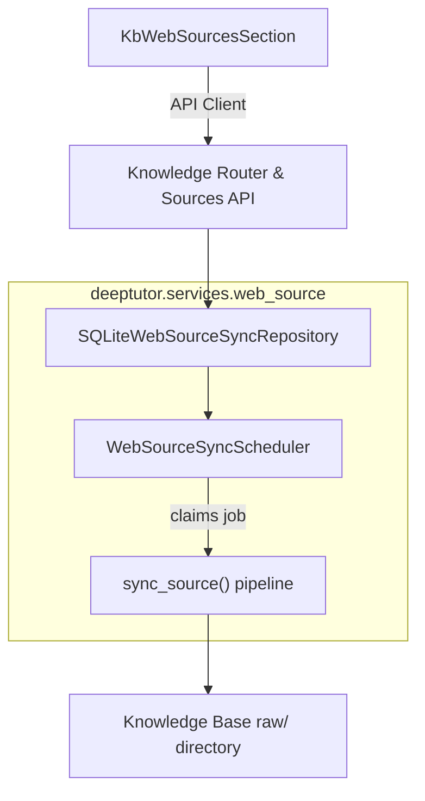
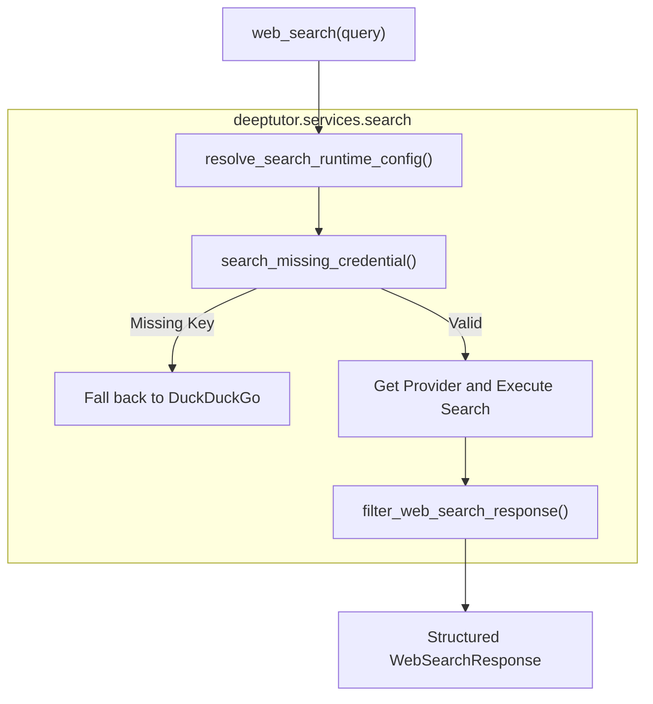
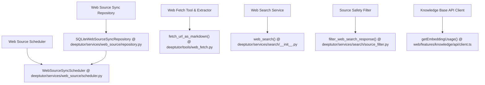

<!-- source: DeepWiki mcp.deepwiki.com · repo HKUDS/DeepTutor · page 6.3 Web Sources and Knowledge Tools · fetched 2026-11-09 -->

# Web Sources and Knowledge Tools

Relevant source files

The following files were used as context for generating this wiki page:

- [deeptutor/reading/__init__.py](deeptutor/reading/__init__.py)
- [deeptutor/reading/epub_bilingual.py](deeptutor/reading/epub_bilingual.py)
- [deeptutor/reading/ingestion.py](deeptutor/reading/ingestion.py)
- [deeptutor/services/cron/repository.py](deeptutor/services/cron/repository.py)
- [deeptutor/services/search/__init__.py](deeptutor/services/search/__init__.py)
- [deeptutor/services/search/source_filter.py](deeptutor/services/search/source_filter.py)
- [deeptutor/services/web_source/repository.py](deeptutor/services/web_source/repository.py)
- [deeptutor/services/web_source/scheduler.py](deeptutor/services/web_source/scheduler.py)
- [deeptutor/tools/web_fetch.py](deeptutor/tools/web_fetch.py)
- [deeptutor/tools/web_search.py](deeptutor/tools/web_search.py)
- [tests/api/test_web_source_schedule_api.py](tests/api/test_web_source_schedule_api.py)
- [tests/reading/test_epub_bilingual.py](tests/reading/test_epub_bilingual.py)
- [tests/reading/test_ingestion.py](tests/reading/test_ingestion.py)
- [tests/services/search/test_web_search_runtime.py](tests/services/search/test_web_search_runtime.py)
- [tests/services/test_background_sqlite_connections.py](tests/services/test_background_sqlite_connections.py)
- [tests/services/web_source/test_markdown.py](tests/services/web_source/test_markdown.py)
- [tests/services/web_source/test_sync_scheduler.py](tests/services/web_source/test_sync_scheduler.py)
- [tests/tools/test_web_fetch.py](tests/tools/test_web_fetch.py)
- [web/components/knowledge/KbLinkedFoldersSection.tsx](web/components/knowledge/KbLinkedFoldersSection.tsx)
- [web/components/knowledge/KbWebSourcesSection.tsx](web/components/knowledge/KbWebSourcesSection.tsx)
- [web/features/knowledge/api/client.ts](web/features/knowledge/api/client.ts)
- [web/features/knowledge/api/sources.ts](web/features/knowledge/api/sources.ts)
- [web/features/knowledge/model/types.ts](web/features/knowledge/model/types.ts)
- [web/tests/knowledge-linked-folders.spec.tsx](web/tests/knowledge-linked-folders.spec.tsx)
- [web/tests/linked-folder-api.test.ts](web/tests/linked-folder-api.test.ts)

This page documents the tools and services within DeepTutor that enable agents to interact with web-based information and manage knowledge bases. This includes crawling web sources, extracting content, performing web searches, source filtering, and managing files within knowledge bases. These capabilities are crucial for retrieval-augmented generation (RAG) and for keeping the agent's knowledge frontier up-to-date.

The tools and subsystems covered include:
- **Web Source Crawler/Sync/Snapshot Pipeline**: Durable scheduling, repository state, and synchronization [deeptutor/services/web_source/repository.py:1-184]() [tests/services/web_source/test_sync_scheduler.py:73-125]().
- **HTML Extraction and `web_fetch`**: Converting web pages into clean markdown with SSRF protection [deeptutor/tools/web_fetch.py:1-160]().
- **`web_search` and Source Filter**: Provider abstraction, fallback chains, and safety filtering [deeptutor/services/search/__init__.py:1-190]() [deeptutor/services/search/source_filter.py:1-208]().
- **KB File Tools and Frontend Integration**: Managing files, API clients, and web source components [web/features/knowledge/api/client.ts:1-170]() [web/components/knowledge/KbWebSourcesSection.tsx:33-155]().

---

## Web Source Crawler/Sync/Snapshot Pipeline

The web source pipeline ingests and maintains content from specified web URLs into a knowledge base via asynchronous crawling, synchronization, and durable scheduling.

- The `SQLiteWebSourceSyncRepository` provides a WAL-backed job state repository for tracking web source synchronization jobs and bilingual pairings (`web_source_sync_jobs`, `web_source_bilingual_pairings`) [deeptutor/services/web_source/repository.py:114-184]().
- The `WebSourceSyncScheduler` manages distributed leases, concurrency limits, retries, and automatic scheduling of enabled auto-sync sources [tests/services/web_source/test_sync_scheduler.py:73-125]().
- Frontend components such as `KbWebSourcesSection` handle user-facing management, listing sources, initiating syncs, and configuring auto-sync intervals [web/components/knowledge/KbWebSourcesSection.tsx:33-155]().

Sources:
- [deeptutor/services/web_source/repository.py:114-184]()
- [tests/services/web_source/test_sync_scheduler.py:73-125]()
- [web/components/knowledge/KbWebSourcesSection.tsx:33-155]()

### Web Source Synchronization Architecture Diagram

Sources:
- [deeptutor/services/web_source/repository.py:114-184]()
- [web/components/knowledge/KbWebSourcesSection.tsx:33-155]()

---

## `web_fetch` and HTML Extraction

The `web_fetch` tool provides secure HTTP fetching and readable content extraction for agent workflows and ingestion pipelines [deeptutor/tools/web_fetch.py:1-22]().

- `fetch_url_as_markdown` enforces strict security constraints, including allowed schemes (`http`, `https`), pre-flight and post-redirect validation against private/loopback IP addresses and disallowed hosts, and a hard response size cap (`MAX_RESPONSE_BYTES`) [deeptutor/tools/web_fetch.py:40-125]().
- Extracted text is processed to remove scripts and styles, converting HTML to clean markdown with automatic truncation (`DEFAULT_MAX_CHARS`) [deeptutor/tools/web_fetch.py:46-160]().
- Used extensively by `ReadingIngestionService` for web material imports and snapshot localizations [deeptutor/reading/ingestion.py:151-194]().

Sources:
- [deeptutor/tools/web_fetch.py:1-160]()
- [deeptutor/reading/ingestion.py:151-194]()

---

## `web_search` and Source Filter

The `web_search` service provides TutorBot-style provider selection, fallback chains, and robust post-provider safety filtering [deeptutor/services/search/__init__.py:1-39]().

- `web_search()` checks system configuration, resolves runtime search config, validates supported providers, checks credentials, and falls back gracefully when primary providers fail or lack keys [deeptutor/services/search/__init__.py:131-190]().
- `filter_web_search_response` applies reference safety filtering, blocking malformed URLs, non-public addresses, blocked domains, and unsafe content patterns [deeptutor/services/search/source_filter.py:1-208]().

Sources:
- [deeptutor/services/search/__init__.py:1-190]()
- [deeptutor/services/search/source_filter.py:1-208]()

### Web Search Runtime and Filtering Flow

Sources:
- [deeptutor/services/search/__init__.py:131-190]()
- [deeptutor/services/search/source_filter.py:1-208]()

---

## Knowledge Base Management API and Files

DeepTutor exposes knowledge base summaries, configuration options, and file structures via backend routers and frontend clients (`web/features/knowledge/api/client.ts`) [web/features/knowledge/api/client.ts:1-60]().

- `KnowledgeBaseSummary` models KB metadata, status, provenance, and availability [web/features/knowledge/api/client.ts:46-60]().
- Supports multiple RAG engines (LlamaIndex, LightRag, GraphRag, PageIndex, IMA) with specific configuration schemas [web/features/knowledge/api/client.ts:94-170]().

Sources:
- [web/features/knowledge/api/client.ts:1-170]()

---

## Bridging Natural Language Space to Code Entity Space

### Diagram 1: Web Sources and Search Code Mapping

Sources:
- [deeptutor/services/web_source/repository.py:114-184]()
- [deeptutor/tools/web_fetch.py:74-100]()
- [deeptutor/services/search/__init__.py:131-190]()
- [deeptutor/services/search/source_filter.py:1-200]()
- [web/features/knowledge/api/client.ts:29-38]()

### Diagram 2: Web Fetch and Source Ingestion Data Flow

```mermaid
graph LR
    UserRequest["Agent / User URL Input"] --> IngestService["ReadingIngestionService @ deeptutor/reading/ingestion.py"]
    IngestService --> Fetcher["fetch_url_as_markdown() @ deeptutor/tools/web_fetch.py"]
    Fetcher --> SSRFCheck["_is_disallowed_host() @ deeptutor/tools/web_fetch.py"]
    SSRFCheck --> BoundedRead["_bounded_read() @ deeptutor/tools/web_fetch.py"]
    BoundedRead --> ReadContent["FetchOutcome (Markdown)"]
    ReadContent --> Catalog["ReadingCatalogStore & ReadingStore"]

    Catalog --> KnowledgeBase["Knowledge Base Indexing"]
```

Sources:
- [deeptutor/reading/ingestion.py:151-194]()
- [deeptutor/tools/web_fetch.py:74-160]()

---

# Summary

This page documented the technical architecture of DeepTutor's web sources, extraction pipeline, search services, safety filters, and knowledge base tooling. Utilizing WAL-backed SQLite repositories, secure HTTP fetchers with SSRF guards, and robust search provider selection, DeepTutor maintains up-to-date knowledge frontiers for agentic reasoning and RAG.

Sources:
- [deeptutor/services/web_source/repository.py]()
- [deeptutor/tools/web_fetch.py]()
- [deeptutor/services/search/__init__.py]()
- [deeptutor/services/search/source_filter.py]()
- [web/features/knowledge/api/client.ts]()

---

