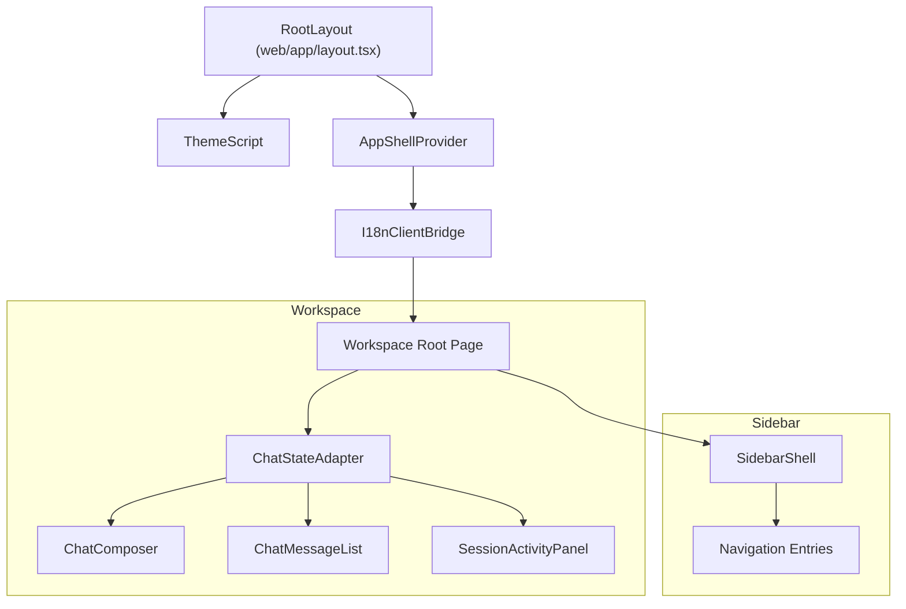
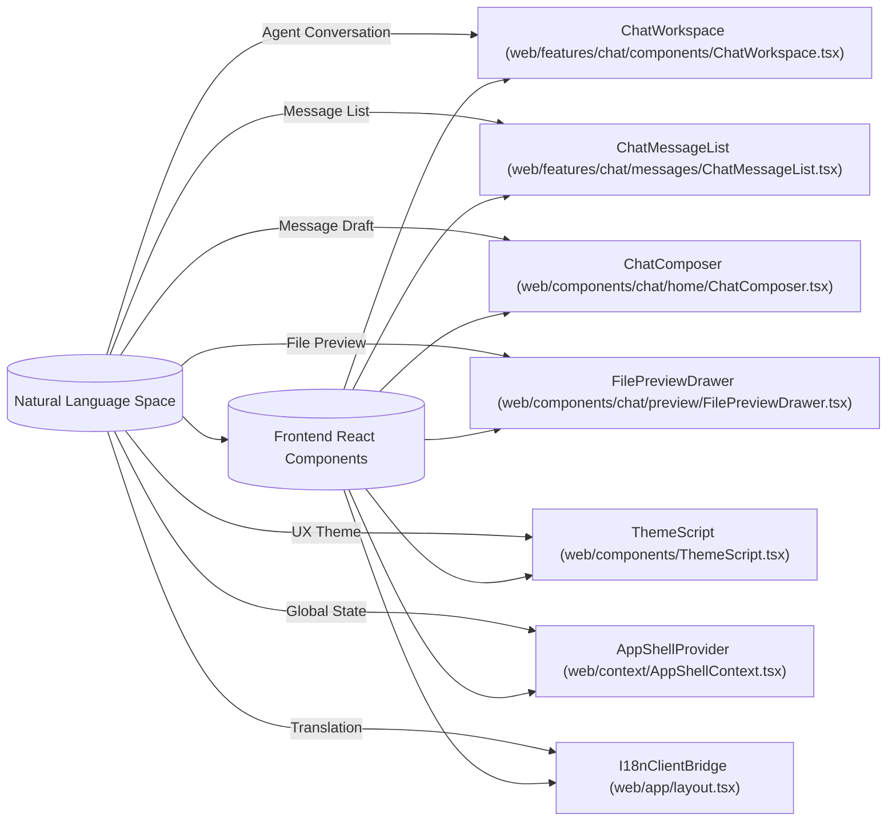
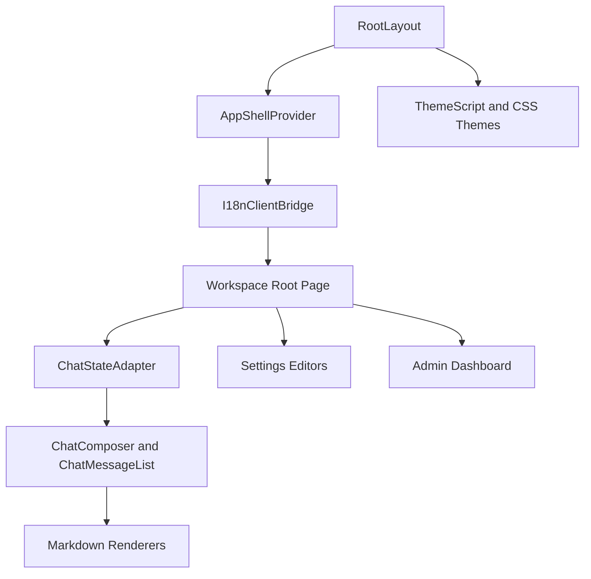

<!-- source: DeepWiki mcp.deepwiki.com · repo HKUDS/DeepTutor · page 7 Frontend Components · fetched 2026-11-09 -->

# Frontend Components

Relevant source files

The following files were used as context for generating this wiki page:

- [deeptutor/api/router_index.json](deeptutor/api/router_index.json)
- [web/components/reading/workspace/ReadingCompanion.tsx](web/components/reading/workspace/ReadingCompanion.tsx)
- [web/components/space/learning/MasteryStudy.tsx](web/components/space/learning/MasteryStudy.tsx)
- [web/contracts/generated/api.ts](web/contracts/generated/api.ts)
- [web/contracts/schema/openapi.json](web/contracts/schema/openapi.json)
- [web/features/chat/ChatStateAdapter.tsx](web/features/chat/ChatStateAdapter.tsx)
- [web/features/chat/components/ChatWorkspace.tsx](web/features/chat/components/ChatWorkspace.tsx)
- [web/features/chat/messages/ChatMessageList.tsx](web/features/chat/messages/ChatMessageList.tsx)
- [web/lib/failed-submissions.ts](web/lib/failed-submissions.ts)
- [web/locales/de/app.json](web/locales/de/app.json)
- [web/locales/en/app.json](web/locales/en/app.json)
- [web/locales/fr/app.json](web/locales/fr/app.json)
- [web/locales/pl/app.json](web/locales/pl/app.json)
- [web/locales/uk/app.json](web/locales/uk/app.json)
- [web/locales/zh/app.json](web/locales/zh/app.json)
- [web/tests/chat-failed-submission-recovery.spec.tsx](web/tests/chat-failed-submission-recovery.spec.tsx)
- [web/tests/integration/chat-messages.spec.tsx](web/tests/integration/chat-messages.spec.tsx)
- [web/tests/session-failed-submission-cleanup.spec.ts](web/tests/session-failed-submission-cleanup.spec.ts)

This page provides a high-level overview of the React and Next.js frontend components that power DeepTutor's web interface. It covers the architectural context, key component categories, and how various frontend utilities and systems integrate to deliver an intelligent tutoring experience. Detailed technical descriptions are deferred to child pages focused on specific subsystems.

---

## Overview

The DeepTutor frontend is implemented as a **Next.js** application using the App Router and TypeScript, styled with Tailwind CSS. It offers rich web-based interactive UIs that communicate with backend services through REST APIs and WebSocket streams. The frontend orchestrates dynamic agent conversations, learning modules, knowledge bases, and administrative tools within a consistent component framework.

Key frontend technologies include:
- **React** for UI components and state management.
- **Next.js**'s App Router for routing and server-client rendering balance.
- **Tailwind CSS** for utility-first styling across themes.
- **i18next** for multilanguage internationalization with locale JSON files.

### Frontend Context Hierarchy Diagram

Sources: [web/app/layout.tsx:1-61](), [web/components/ThemeScript.tsx:10-49](), [web/features/chat/ChatStateAdapter.tsx:1-150](), [web/app/(workspace)/page.tsx:1-10]()

---

## Frontend Component Ecosystem Overview

DeepTutor's frontend organizes around these major categories:

| Category               | Representative Components                      | Purpose and Description                                          |
|------------------------|-----------------------------------------------|-----------------------------------------------------------------|
| **Chat Workspace**      | `ChatWorkspace`, `ChatStateAdapter`, `ChatComposer`, `ChatMessageList` | Core components for multi-turn conversational agent interaction, managing chat UI, input, message rendering, and session state. |
| **Input Composition**  | `ComposerInput`, `ChatComposer`                | Provide rich text composition with mentions, attachments, slash commands, and language selection for user turns. |
| **Message Rendering**   | `ChatMessageList`, `AssistantActivity`, `NestedTraceFlow`, `InlineFileCard` | Render messages, tool traces, inline attachments, and interactive message elements. |
| **File Preview & Attachments** | `FilePreviewDrawer`, `AttachmentProcessingStatus`        | UI for previewing uploaded files, attachment processing indicators, and drag-drop support. |
| **Navigation**          | `SidebarShell`, `PrimaryNav`, `SecondaryNav` | Main and secondary navigation with capability gating based on user grants. |
| **Resource Selectors**  | `KnowledgeSelector`, `ModelSelector`, `PersonaSelector`, `AgentSelector`, `PartnerSelector` | Selection components for knowledge bases, LLM models, personas, agents, and partner groups. |
| **Specialized Viewers** | `SessionViewerPanel`, `QuizViewer`, `MathAnimatorViewer` | Lazy-loaded viewers presenting specialized output like quiz questions, math animations, or session transcripts. |

Sources: [web/features/chat/components/ChatWorkspace.tsx:1-171](), [web/features/chat/messages/ChatMessageList.tsx:1-195]()

---

## Natural Language Space to Code Entities Mapping

This diagram relates key frontend system names and UI functionality to specific React components and their code locations, bridging conceptual workspace terms to concrete code elements.

Sources: [web/features/chat/components/ChatWorkspace.tsx:1-171](), [web/features/chat/messages/ChatMessageList.tsx:1-195](), [web/components/chat/home/ChatComposer.tsx:1-100](), [web/components/chat/preview/FilePreviewDrawer.tsx:1-50](), [web/components/ThemeScript.tsx:1-49](), [web/app/layout.tsx:1-61]()

---

## Architectural Data Flow and Subsystem Relationships

The frontend components connect into a layered architecture bridging providers, adapters, and UI layers:

Sources: [web/app/layout.tsx:1-61](), [web/features/chat/ChatStateAdapter.tsx:1-150](), [web/features/chat/components/ChatWorkspace.tsx:1-171]()

---

## Relations to Child Pages

This parent page abstracts the large React frontend into major thematic areas, each covered in detail in child pages:

- **[Chat Workspace and Composer](#7.1)** — ChatWorkspace, ChatStateAdapter, ChatMessageList, ComposerInput/ChatComposer, trace presentation, session viewer/file preview, starter suggestions, message branching and optimistic IDs.
- **[Global State and Transport](#7.2)** — AppShellContext and storage, SettingsStore, TurnRuntimeClient WebSocket transport, reconnect policy, turn command/event parsers, idle recovery, and generated API contracts.
- **[Theme and Design System](#7.3)** — Theme management (light/dark/glass/snow), ThemeScript FOUC prevention, globals.css, code block themes, shared UI primitives, tooltips and dialogs.
- **[Markdown Rendering and Export](#7.4)** — markdown-display pipeline, Rich/Simple markdown renderers, LaTeX/KaTeX handling, Mermaid, code blocks, clipboard and export.
- **[Internationalization](#7.5)** — i18n setup, locale JSON files (`en`/`zh`/`fr`/`uk`/`pt`/`de`/`pl`/`ja`/`tr`/`vi`), i18next bridge, language bootstrap, backend i18n service, and i18n parity audit in the check pipeline.
- **[Settings and Admin UI](#7.6)** — Settings navigation and scroll behavior, ServiceConfigEditor, ConnectionsEditor, TaskModelsEditor, search providers, subagent settings, admin users dashboard, and chat import.

Sources: [web/locales/en/app.json:1-85](), [web/locales/zh/app.json:1-85]()

---

## Summary

DeepTutor’s frontend utilizes a modular, layered React architecture powered by Next.js’s App Router. Context providers at the root unify theme, global state, and i18n support. Core chat workspace components manage real-time conversational workflows with rich message presentation and interactive input composition. The design system ensures consistent theming and usability across a multi-feature intelligent tutoring application. This page serves as a conceptual anchor, linking to specialized child pages for deeper technical details.

Sources: [web/app/layout.tsx:1-61](), [web/components/ThemeScript.tsx:1-49](), [web/features/chat/components/ChatWorkspace.tsx:1-171](), [web/features/chat/messages/ChatMessageList.tsx:1-195]()

---

