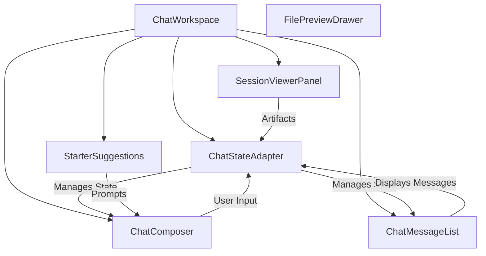
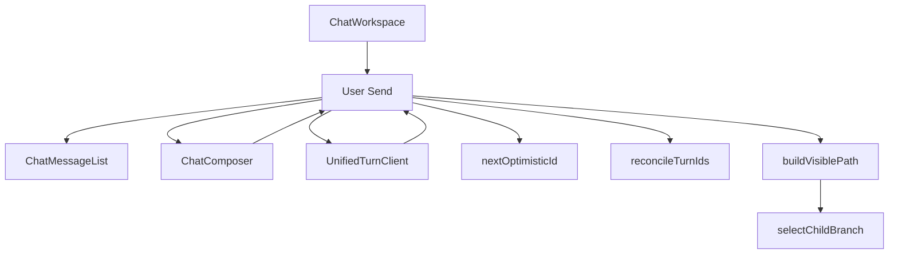
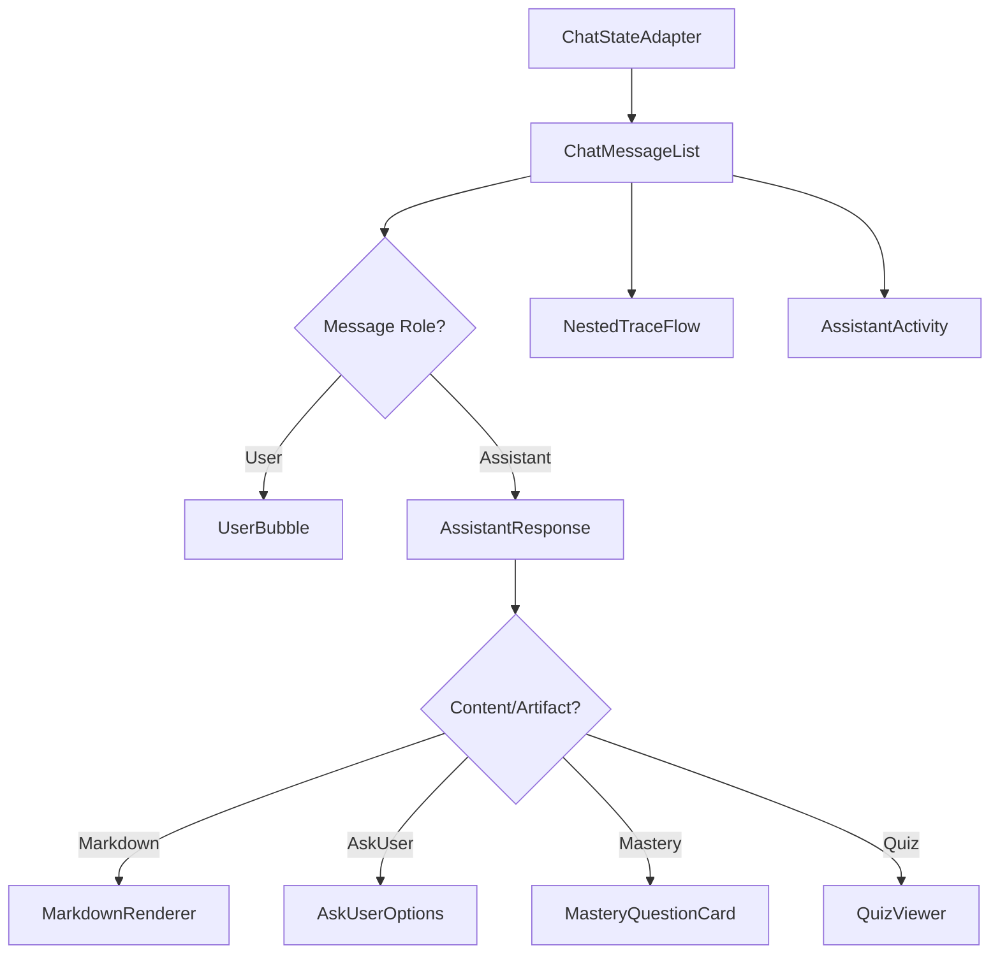
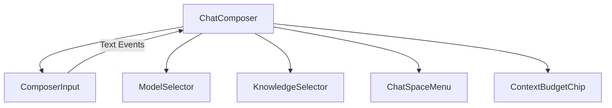
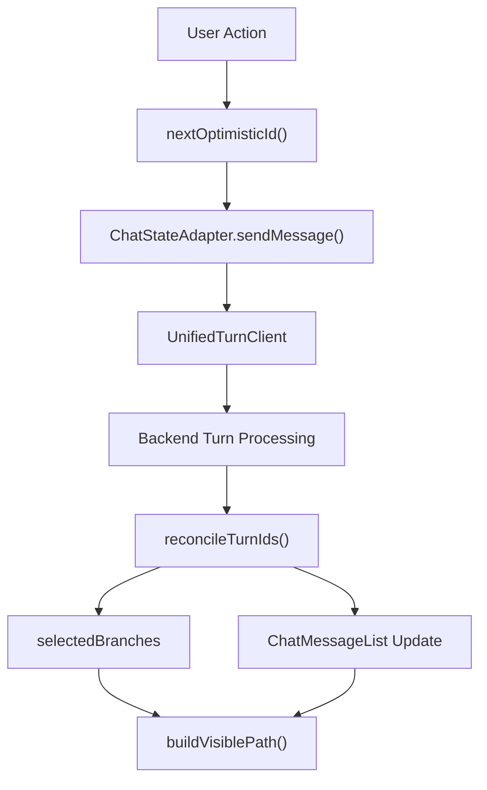

<!-- source: DeepWiki mcp.deepwiki.com · repo HKUDS/DeepTutor · page 7.1 Chat Workspace and Composer · fetched 2026-11-09 -->

# Chat Workspace and Composer

<details>
<summary>Relevant source files</summary>

The following files were used as context for generating this wiki page:

- [deeptutor/api/router_index.json](deeptutor/api/router_index.json)
- [deeptutor/services/session/artifact_attachments.py](deeptutor/services/session/artifact_attachments.py)
- [tests/services/session/test_artifact_attachments.py](tests/services/session/test_artifact_attachments.py)
- [web/components/chat/MyAgentsPicker.tsx](web/components/chat/MyAgentsPicker.tsx)
- [web/components/chat/QuestionBankPicker.tsx](web/components/chat/QuestionBankPicker.tsx)
- [web/components/chat/home/ChatComposer.tsx](web/components/chat/home/ChatComposer.tsx)
- [web/components/chat/home/ComposerInput.tsx](web/components/chat/home/ComposerInput.tsx)
- [web/components/chat/home/KnowledgeSelector.tsx](web/components/chat/home/KnowledgeSelector.tsx)
- [web/components/chat/home/ModelSelector.tsx](web/components/chat/home/ModelSelector.tsx)
- [web/components/chat/home/ResourceReuse.tsx](web/components/chat/home/ResourceReuse.tsx)
- [web/components/chat/home/SelectedResources.tsx](web/components/chat/home/SelectedResources.tsx)
- [web/components/chat/home/SessionActivityPanel.tsx](web/components/chat/home/SessionActivityPanel.tsx)
- [web/components/chat/home/SessionViewerPanel.tsx](web/components/chat/home/SessionViewerPanel.tsx)
- [web/components/chat/home/StandaloneComposer.tsx](web/components/chat/home/StandaloneComposer.tsx)
- [web/components/chat/preview/FilePreviewDrawer.tsx](web/components/chat/preview/FilePreviewDrawer.tsx)
- [web/components/chat/preview/previewers/XlsxPreview.tsx](web/components/chat/preview/previewers/XlsxPreview.tsx)
- [web/components/reading/workspace/ReadingCompanion.tsx](web/components/reading/workspace/ReadingCompanion.tsx)
- [web/components/reading/workspace/ReadingComposer.tsx](web/components/reading/workspace/ReadingComposer.tsx)
- [web/components/space/learning/MasteryComposer.tsx](web/components/space/learning/MasteryComposer.tsx)
- [web/components/space/learning/MasteryStudy.tsx](web/components/space/learning/MasteryStudy.tsx)
- [web/contracts/generated/api.ts](web/contracts/generated/api.ts)
- [web/contracts/schema/openapi.json](web/contracts/schema/openapi.json)
- [web/features/chat/ChatStateAdapter.tsx](web/features/chat/ChatStateAdapter.tsx)
- [web/features/chat/components/ChatWorkspace.tsx](web/features/chat/components/ChatWorkspace.tsx)
- [web/features/chat/messages/ChatMessageList.tsx](web/features/chat/messages/ChatMessageList.tsx)
- [web/features/chat/transport/command-delivery.ts](web/features/chat/transport/command-delivery.ts)
- [web/hooks/useWorkspaceChatActions.ts](web/hooks/useWorkspaceChatActions.ts)
- [web/lib/ask-user-state.ts](web/lib/ask-user-state.ts)
- [web/lib/failed-submissions.ts](web/lib/failed-submissions.ts)
- [web/lib/llm-options.ts](web/lib/llm-options.ts)
- [web/lib/message-branches.ts](web/lib/message-branches.ts)
- [web/lib/optimistic-id.ts](web/lib/optimistic-id.ts)
- [web/lib/session-activity.ts](web/lib/session-activity.ts)
- [web/lib/workspace-drafts.ts](web/lib/workspace-drafts.ts)
- [web/locales/de/app.json](web/locales/de/app.json)
- [web/locales/en/app.json](web/locales/en/app.json)
- [web/locales/fr/app.json](web/locales/fr/app.json)
- [web/locales/pl/app.json](web/locales/pl/app.json)
- [web/locales/uk/app.json](web/locales/uk/app.json)
- [web/locales/zh/app.json](web/locales/zh/app.json)
- [web/tests/capability-catalog.test.ts](web/tests/capability-catalog.test.ts)
- [web/tests/chat-composer-empty-kb.spec.tsx](web/tests/chat-composer-empty-kb.spec.tsx)
- [web/tests/chat-failed-submission-recovery.spec.tsx](web/tests/chat-failed-submission-recovery.spec.tsx)
- [web/tests/composer-draft-restore-failure.spec.tsx](web/tests/composer-draft-restore-failure.spec.tsx)
- [web/tests/composer-keyboard-admission.spec.tsx](web/tests/composer-keyboard-admission.spec.tsx)
- [web/tests/integration/chat-messages.spec.tsx](web/tests/integration/chat-messages.spec.tsx)
- [web/tests/message-branches.test.ts](web/tests/message-branches.test.ts)
- [web/tests/optimistic-id.test.ts](web/tests/optimistic-id.test.ts)
- [web/tests/orphaned-tree.test.ts](web/tests/orphaned-tree.test.ts)
- [web/tests/reading-composer-resources.spec.tsx](web/tests/reading-composer-resources.spec.tsx)
- [web/tests/session-activity.test.ts](web/tests/session-activity.test.ts)
- [web/tests/session-failed-submission-cleanup.spec.ts](web/tests/session-failed-submission-cleanup.spec.ts)
- [web/tests/workspace-chat-actions-hidden-capability.spec.tsx](web/tests/workspace-chat-actions-hidden-capability.spec.tsx)

</details>


This page details the core components that form the DeepTutor chat interface, focusing on `ChatWorkspace`, `ChatStateAdapter`, `ChatMessageList`, and `ChatComposer`. These components collectively manage the user's interaction with the tutoring agent, including message input, display, session state management, trace presentation, file previews, and advanced features like message branching and optimistic IDs.

---

## Chat Workspace (`ChatWorkspace.tsx`)

The `ChatWorkspace` component is the main container that orchestrates the chat interface. It manages the lifecycle of chat sessions, user inputs, message display, and integration of supporting panels like the session viewer and file preview drawer.

### Key Responsibilities

- **Session Management:** Loads and initializes chat sessions, handling errors, timeouts, and session activity indicators [web/features/chat/components/ChatWorkspace.tsx]().
- **User Input Handling:** Renders the `ChatComposer` component as the primary user input area, supporting message entry and attachment handling [web/features/chat/components/ChatWorkspace.tsx]().
- **Message Display:** Uses `ChatMessageList` to render full message history and interactive cards [web/features/chat/components/ChatWorkspace.tsx]().
- **Contextual Panels:** Includes `SessionViewerPanel` for session artifact browsing, and a file preview drawer for inline document viewing [web/features/chat/components/ChatWorkspace.tsx]().
- **Starter Suggestions:** Displays dynamic suggestion prompts below the input to help users begin conversations [web/features/chat/components/ChatWorkspace.tsx]().

### Component Interaction Diagram



Sources: `[web/features/chat/components/ChatWorkspace.tsx]()`

---

## Chat State Adapter (`ChatStateAdapter.tsx`)

`ChatStateAdapter` is a React context provider encapsulating session state, message management, and backend communication with the tutoring service.

### Core Functions and Features

- **State Management:** Holds conversation messages, streaming status, session metadata (`activeCapability`, `workspaceMode`, `llmSelection`, `knowledgeBases`), and selected message branches [web/features/chat/ChatStateAdapter.tsx]().
- **Message Handling:** Stores messages supporting complex branching and sibling messages via `parentMessageId`. Maintains optimistic IDs (`nextOptimisticId`) assigned on submission and reconciles them with server IDs via `reconcileTurnIds` [web/features/chat/ChatStateAdapter.tsx](), [web/lib/optimistic-id.ts](), [web/lib/turn-reconcile.ts]().
- **Streaming Events:** Processes real-time streaming events from the backend via `UnifiedTurnClient`, updating message content and status [web/features/chat/ChatStateAdapter.tsx]().
- **Message Branching:** Uses `buildVisiblePath` and `selectChildBranch` to compute the active conversation path [web/lib/message-branches.ts]().

### Data Flow Diagram



Sources: `[web/features/chat/ChatStateAdapter.tsx]()`, `[web/lib/optimistic-id.ts]()`, `[web/lib/message-branches.ts]()`, `[web/lib/turn-reconcile.ts]()`

---

## Chat Message List (`ChatMessageList.tsx`)

This component renders the sequence of chat messages, supporting rich content display, interactive elements, and trace visualization.

### Features

- **Message Rendering:** Renders user, assistant, and system messages with markdown, code blocks, and embedded components using dynamic imports for heavy viewers like `MathAnimatorViewer`, `QuizViewer`, and `VisualizationViewer` [web/features/chat/messages/ChatMessageList.tsx]().
- **Trace Presentation:** Supports nested trace flows and assistant activity visualization to reveal underlying agent tool usage and logic [web/features/chat/messages/ChatMessageList.tsx]().
- **Interactive Cards:** Displays interactive cards such as `AskUserOptions`, `MasteryQuestionCard`, `SetupCredentialCard`, and `PartnerDraftCard` [web/features/chat/messages/ChatMessageList.tsx]().

### Rendering Flow Diagram



Sources: `[web/features/chat/messages/ChatMessageList.tsx]()`

---

## Chat Composer (`ChatComposer.tsx`) and Input (`ComposerInput.tsx`)

The `ChatComposer` provides the user interface to compose and send chat messages, supporting rich contextual inputs, attachments, and dynamic controls.

### Features

- **Input Handling:** The embedded `ComposerInput` component manages the main textarea with auto-sizing, IME composition support, and keyboard shortcuts [web/components/chat/home/ComposerInput.tsx]().
- **Send Button State:** The send button dynamically reflects states: `idle`, `blocked`, `ready`, and `streaming`, styled via `SEND_STATE_CLASS` [web/components/chat/home/ChatComposer.tsx]().
- **Selectors and Space Menu:** Integrates controls for selecting models, knowledge bases, and resources via `ChatSpaceMenu` [web/components/chat/home/ChatComposer.tsx]().

### Component Structure Diagram



Sources: `[web/components/chat/home/ChatComposer.tsx]()`, `[web/components/chat/home/ComposerInput.tsx]()`

---

## Starter Suggestions (`StarterSuggestions.tsx`)

`StarterSuggestions` provides quick entry points as dynamic prompts beneath the composer when the chat is empty.

### Highlights

- **Backend-Driven:** Suggestions are asynchronously generated by backend services and cached for performance [deeptutor/services/suggestions.py](), [web/components/chat/home/StarterSuggestions.tsx]().
- **Trace-Based:** Derived from recent user traces, session activities, and knowledge base searches.
- **Interaction:** Clicking a suggestion triggers `ChatStateAdapter.sendMessage`.

Sources: `[web/components/chat/home/StarterSuggestions.tsx]`, `[deeptutor/services/suggestions.py]()`

---

## Session Viewer and File Preview

The session viewer sidebar and file preview drawers provide context and artifact visualization.

### Components and Features

- **SessionViewerPanel:** Displays session activity details and supports tab navigation [web/components/chat/home/SessionViewerPanel.tsx]().
- **FilePreviewDrawer:** Renders file previews for PDFs, images, and Office documents [web/components/chat/preview/FilePreviewDrawer.tsx]().
- **Previewer Determination:** Uses `previewerFor` to select the correct preview component based on MIME type or file extension [web/components/chat/preview/previewerFor.ts]().

Sources: `[web/components/chat/home/SessionViewerPanel.tsx]()`, `[web/components/chat/preview/FilePreviewDrawer.tsx]`, `[web/components/chat/preview/previewerFor.ts]()`

---

## Message Branching and Optimistic IDs

DeepTutor supports conversational branching, enabling users to edit prior messages and explore alternative dialogue paths.

### Concepts

- **Branching Model:** Messages are stored flat with a `parentMessageId`. Siblings represent alternative branches [web/lib/message-branches.ts]().
- **Optimistic IDs:** Upon submission, new messages receive temporary negative IDs generated by `nextOptimisticId` [web/lib/optimistic-id.ts]().
- **Reconciliation:** `reconcileTurnIds` maps optimistic client IDs to backend-assigned persistent IDs upon server acknowledgment [web/lib/turn-reconcile.ts]().

Sources: `[web/lib/message-branches.ts]()`, `[web/lib/optimistic-id.ts]()`, `[web/lib/turn-reconcile.ts]()`

---

## Technical Diagrams Bridging Natural Language and Code Entities

### Diagram 1: Chat Workspace to Core State and Transport Entities

```mermaid
graph TD
    ChatWorkspace["ChatWorkspace (ChatWorkspace.tsx)"]
    ChatStateAdapter["ChatStateAdapter (ChatStateAdapter.tsx)"]
    UnifiedTurnClient["UnifiedTurnClient (Transport)"]
    ChatMessageList["ChatMessageList (ChatMessageList.tsx)"]
    ChatComposer["ChatComposer (ChatComposer.tsx)"]
    ComposerInput["ComposerInput (ComposerInput.tsx)"]

    ChatWorkspace --> ChatStateAdapter
    ChatWorkspace --> ChatComposer
    ChatWorkspace --> ChatMessageList
    ChatStateAdapter --> UnifiedTurnClient
    ChatComposer --> ComposerInput
    ChatComposer --> ChatStateAdapter : "sendMessage()"
    ChatMessageList --> ChatStateAdapter : "reads state"
    UnifiedTurnClient --> ChatStateAdapter : "stream events"
```

Sources: `[web/features/chat/components/ChatWorkspace.tsx]()`, `[web/features/chat/ChatStateAdapter.tsx]()`, `[web/features/chat/messages/ChatMessageList.tsx]()`, `[web/components/chat/home/ChatComposer.tsx]()`

### Diagram 2: Message Branching and Optimistic IDs with Backend Integration



Sources: `[web/lib/message-branches.ts]()`, `[web/lib/optimistic-id.ts]()`, `[web/lib/turn-reconcile.ts]()`, `[web/features/chat/ChatStateAdapter.tsx]()`

---

