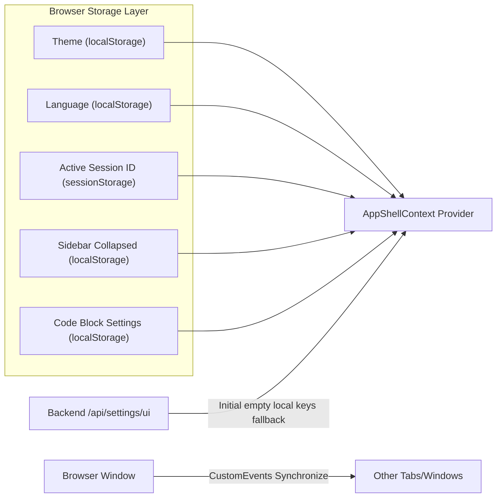
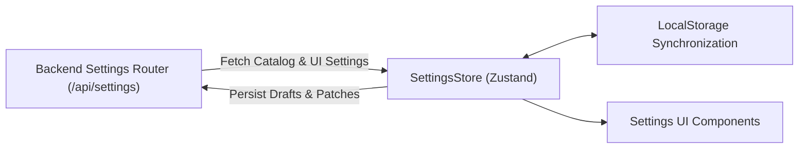
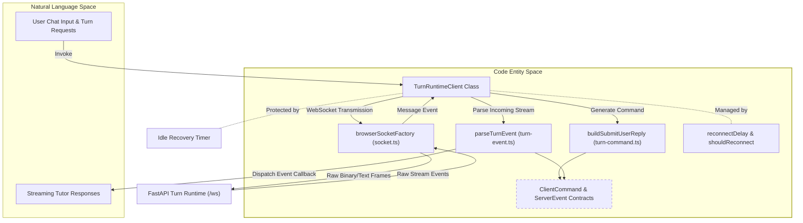
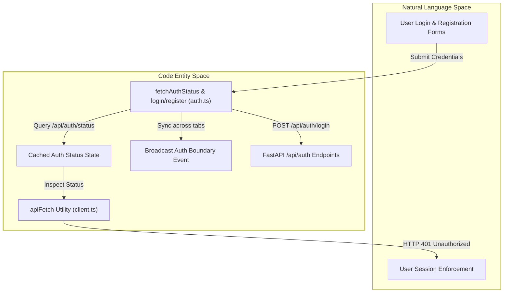

<!-- source: DeepWiki mcp.deepwiki.com · repo HKUDS/DeepTutor · page 7.2 Global State and Transport · fetched 2026-11-09 -->

# Global State and Transport

Relevant source files

The following files were used as context for generating this wiki page:

- [deeptutor/agents/loop/prompt_blocks.py](deeptutor/agents/loop/prompt_blocks.py)
- [deeptutor/core/response_languages.py](deeptutor/core/response_languages.py)
- [deeptutor/core/turn_request.py](deeptutor/core/turn_request.py)
- [deeptutor/response_languages.py](deeptutor/response_languages.py)
- [deeptutor/services/config/launch_settings.py](deeptutor/services/config/launch_settings.py)
- [deeptutor/services/config/settings_spec.py](deeptutor/services/config/settings_spec.py)
- [deeptutor/services/prompt/language.py](deeptutor/services/prompt/language.py)
- [deeptutor/services/settings/interface_settings.py](deeptutor/services/settings/interface_settings.py)
- [tests/capabilities/test_handoff.py](tests/capabilities/test_handoff.py)
- [tests/multi_user/test_ui_language_scoping.py](tests/multi_user/test_ui_language_scoping.py)
- [tests/services/config/test_launch_settings.py](tests/services/config/test_launch_settings.py)
- [tests/services/prompt/test_language_directive.py](tests/services/prompt/test_language_directive.py)
- [tests/services/session/test_reply_language_override.py](tests/services/session/test_reply_language_override.py)
- [web/components/UserAvatar.tsx](web/components/UserAvatar.tsx)
- [web/components/auth/AdminLink.tsx](web/components/auth/AdminLink.tsx)
- [web/components/auth/LogoutButton.tsx](web/components/auth/LogoutButton.tsx)
- [web/components/auth/ProfileLink.tsx](web/components/auth/ProfileLink.tsx)
- [web/components/common/BrandIcon.tsx](web/components/common/BrandIcon.tsx)
- [web/components/common/ToastViewport.tsx](web/components/common/ToastViewport.tsx)
- [web/components/reading/workspace/YouTubeReadingPlayer.tsx](web/components/reading/workspace/YouTubeReadingPlayer.tsx)
- [web/components/settings/MinerUEngineSettings.tsx](web/components/settings/MinerUEngineSettings.tsx)
- [web/context/AppShellContext.tsx](web/context/AppShellContext.tsx)
- [web/context/app-shell-storage.ts](web/context/app-shell-storage.ts)
- [web/contracts/generated/turn-protocol.ts](web/contracts/generated/turn-protocol.ts)
- [web/contracts/schema/turn-protocol.json](web/contracts/schema/turn-protocol.json)
- [web/features/chat/controllers/buildStartTurnInput.ts](web/features/chat/controllers/buildStartTurnInput.ts)
- [web/features/chat/model/start-turn.ts](web/features/chat/model/start-turn.ts)
- [web/features/settings/store/SettingsStore.tsx](web/features/settings/store/SettingsStore.tsx)
- [web/features/settings/store/response-language-options.ts](web/features/settings/store/response-language-options.ts)
- [web/hooks/useAuthStatus.ts](web/hooks/useAuthStatus.ts)
- [web/i18n/init.ts](web/i18n/init.ts)
- [web/i18n/languages.ts](web/i18n/languages.ts)
- [web/lib/api.ts](web/lib/api.ts)
- [web/lib/auth.ts](web/lib/auth.ts)
- [web/lib/datetime.ts](web/lib/datetime.ts)
- [web/tests/account-role.test.ts](web/tests/account-role.test.ts)
- [web/tests/api-auth-redirect.test.ts](web/tests/api-auth-redirect.test.ts)
- [web/tests/app-shell-language-bootstrap.test.ts](web/tests/app-shell-language-bootstrap.test.ts)
- [web/tests/auth-enabled.test.ts](web/tests/auth-enabled.test.ts)
- [web/tests/language-preferences.test.ts](web/tests/language-preferences.test.ts)
- [web/tests/native-button-title.test.ts](web/tests/native-button-title.test.ts)
- [web/tests/settings-unified-draft.spec.tsx](web/tests/settings-unified-draft.spec.tsx)
- [web/tests/start-turn-input.test.ts](web/tests/start-turn-input.test.ts)

This page details the global state management and real-time communication mechanisms within the DeepTutor frontend and its interaction with backend transport services. It covers the `AppShellContext` for foundational UI settings and browser storage [web/context/AppShellContext.tsx:57-174](), the `SettingsStore` for user preferences and provider catalogs [web/features/settings/store/SettingsStore.tsx:11-169](), the `TurnRuntimeClient` for WebSocket-based streaming interaction with the backend, reconnect policies, turn command/event parsers, idle recovery, and generated API contracts.

## AppShellContext and Storage

The `AppShellContext` is a React Context provider managing top-level UI state and preferences to ensure consistency across the application [web/context/AppShellContext.tsx:57-174](). It handles theme, language, active session ID, sidebar collapse state, and code block rendering preferences.

### State Management and Hydration

- **Theme**: Initialized via stored preferences or system defaults (`getStoredTheme()`), updated via `setTheme` [web/context/AppShellContext.tsx:77-79]().
- **Language**: Managed via `language` and `setLanguage`, backed by local storage and backend `/api/settings/ui` synchronization. Language strings are normalized using utilities from `app-shell-storage` [web/context/app-shell-storage.ts:129-148]() and validated with `isAppLanguage` [web/i18n/languages.ts:21-23]().
- **Active Session ID**: Persisted in `sessionStorage` under `deeptutor.activeSessionId.tab` for tab-isolated session tracking [web/context/app-shell-storage.ts:66]().
- **Sidebar Collapsed**: Boolean UI layout state persisted in local storage [web/context/app-shell-storage.ts:69]().
- **Code Block Settings**: Tracks themes, line number visibility, and text wrapping with persistent local storage mirroring [web/context/app-shell-storage.ts:71-76]().

### Cross-Tab Synchronization

Preferences dispatch `CustomEvent` instances (`LANGUAGE_EVENT`, `RESPONSE_LANGUAGE_EVENT`, `SIDEBAR_COLLAPSED_EVENT`, `CODE_BLOCK_SETTINGS_EVENT`) across browser windows to maintain synchronized state [web/context/app-shell-storage.ts:123-128]().

Sources: [web/context/AppShellContext.tsx:57-174](), [web/context/app-shell-storage.ts:66-128](), [web/i18n/languages.ts:21-23]()

## SettingsStore

The `SettingsStore` (implemented as a Zustand store) manages configuration data such as LLM provider definitions, active models, UI themes, and system diagnostic states [web/features/settings/store/SettingsStore.tsx:11-169]().

### Key Responsibilities

- **Settings Fetching**: Loads model catalogs, provider options, and task routing rules from backend endpoints upon initialization [web/features/settings/store/SettingsStore.tsx:100-215]().
- **Settings Persistence**: Supports updating UI settings, staging unsaved drafts via `/api/settings/draft`, and applying modifications globally [web/features/settings/store/SettingsStore.tsx:155-164]().
- **Timeout Management**: Clamps chat response timeouts using `clampChatResponseTimeout` between defined limits [web/context/app-shell-storage.ts:85-91]().

Sources: [web/features/settings/store/SettingsStore.tsx:11-215](), [web/context/app-shell-storage.ts:85-91]()

## TurnRuntimeClient WebSocket Transport

The `TurnRuntimeClient` manages WebSocket connections to the backend `/ws` endpoint, facilitating bidirectional command submission and real-time event streaming [web/features/chat/transport/TurnRuntimeClient.ts:90-211]().

### Connection States and Lifecycle

- Five connection states define its lifecycle: `idle`, `connecting`, `connected`, `recovering`, and `stopped` [web/features/chat/transport/TurnRuntimeClient.ts:23-28]().
- Upon opening, it transmits `resume_from` or `subscribe_turn` cursors to synchronize conversation state [web/features/chat/transport/TurnRuntimeClient.ts:220-228]().
- Messages are parsed into `ServerEvent` structures and buffered to maintain sequential ordering [web/features/chat/transport/TurnRuntimeClient.ts:230-249]().

### Reconnect Policy and Idle Recovery

- Reconnection uses exponential backoff calculated by `reconnectDelay()` and conditioned by `shouldReconnect()` [web/features/chat/transport/reconnect-policy.ts:10-24]().
- Idle recovery timers probe for missing terminal `done` events if streaming stalls past `replayProbeDelayMs` [web/features/chat/transport/TurnRuntimeClient.ts:130-133]().

### Diagram: Natural Language Space to Code Entity Space (Turn Runtime Transport)

Sources: [web/features/chat/transport/TurnRuntimeClient.ts:23-292](), [web/features/chat/transport/reconnect-policy.ts:10-24](), [web/contracts/parse/turn-command.ts:70-172](), [web/contracts/parse/turn-event.ts:11-12]()

## Authentication Status and API Fetch

The frontend dynamically queries authentication credentials using `fetchAuthStatus` against `/api/auth/status` rather than relying on build-time constants [web/lib/auth.ts:76-113]().

### Auth Status Caching and Redirects

- `fetchAuthStatus` caches user status for 5 seconds to minimize redundant network chatter [web/lib/auth.ts:38-81]().
- `apiFetch` evaluates authentication errors (e.g., HTTP 401) and handles routing to `/login` when authentication is enabled [web/lib/auth.ts:85-97](), [web/tests/api-auth-redirect.test.ts:67-125]().

### Diagram: Natural Language Space to Code Entity Space (Authentication & API Transport)

Sources: [web/lib/auth.ts:35-187](), [web/lib/api.ts:5](), [web/tests/api-auth-redirect.test.ts:67-125]()

## Summary Table of Key Entities and Files

| Concept / Component           | Code Entity / Symbol                  | File / Lines                  | Description                                                                            |
|------------------------------|-------------------------------------|------------------------------|----------------------------------------------------------------------------------------|
| AppShellContext (UI State)   | `AppShellContext`, `AppShellProvider` | web/context/AppShellContext.tsx [57-174] | React Context for top-level app UI state and user preference hydration and sync.     |
| Storage Keys & Utils          | Constants and functions (`readStoredLanguage`, etc.) | web/context/app-shell-storage.ts [1-215]  | LocalStorage/sessionStorage keys and normalization for language, theme, etc.          |
| Settings Store               | Zustand store                       | web/features/settings/store/SettingsStore.tsx [11-169] | Persistent user settings and backend sync.                                            |
| TurnRuntimeClient Transport  | `TurnRuntimeClient` class           | web/features/chat/transport/TurnRuntimeClient.ts [90-211] | WebSocket client for turn runtime protocol, including reconnect and buffering logic.  |
| Turn Protocol Command Builders | e.g. `buildSubmitUserReply`        | web/contracts/parse/turn-command.ts [70-172]  | Functions to build typed client commands for runtime transport.                       |
| Turn Protocol Event Parser    | `parseTurnEvent`                   | web/contracts/parse/turn-event.ts [11-12]  | Parses incoming server WS messages into typed events.                                 |
| Reconnect Policy             | `reconnectDelay`, `shouldReconnect`| web/features/chat/transport/reconnect-policy.ts [10-24] | Reconnection backoff and conditions logic.                                           |
| Auth Status and API          | `fetchAuthStatus`, `login`, `register`, `logout` | web/lib/auth.ts [10-187]                         | Authentication status fetch and user account API calls.                              |

Sources: Aggregate of all above citations.

---

