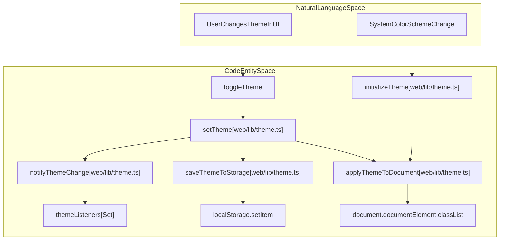

<!-- source: DeepWiki mcp.deepwiki.com · repo HKUDS/DeepTutor · page 7.3 Theme and Design System · fetched 2026-11-09 -->

# Theme and Design System

Relevant source files

The following files were used as context for generating this wiki page:

- [tests/runtime/test_runtime_home_reset.py](tests/runtime/test_runtime_home_reset.py)
- [web/app/globals.css](web/app/globals.css)
- [web/components/common/RichMarkdownRenderer.tsx](web/components/common/RichMarkdownRenderer.tsx)
- [web/components/common/SimpleMarkdownRenderer.tsx](web/components/common/SimpleMarkdownRenderer.tsx)
- [web/components/sidebar/SidebarNav.tsx](web/components/sidebar/SidebarNav.tsx)
- [web/components/sidebar/SidebarShell.tsx](web/components/sidebar/SidebarShell.tsx)
- [web/components/sidebar/UtilitySidebar.tsx](web/components/sidebar/UtilitySidebar.tsx)
- [web/components/sidebar/VersionBadge.tsx](web/components/sidebar/VersionBadge.tsx)
- [web/components/sidebar/WorkspaceSidebar.tsx](web/components/sidebar/WorkspaceSidebar.tsx)
- [web/lib/rehype-dir-auto.ts](web/lib/rehype-dir-auto.ts)
- [web/tests/markdown-direction.spec.tsx](web/tests/markdown-direction.spec.tsx)
- [web/tests/rehype-dir-auto.test.ts](web/tests/rehype-dir-auto.test.ts)
- [web/tests/rich-markdown-direction.spec.tsx](web/tests/rich-markdown-direction.spec.tsx)
- [web/tests/sidebar-lazy-history.spec.tsx](web/tests/sidebar-lazy-history.spec.tsx)
- [web/tests/sidebar-prefetch.spec.tsx](web/tests/sidebar-prefetch.spec.tsx)

## Purpose and Scope

The DeepTutor theme system provides robust management of visual themes, enabling users to switch between multiple distinct modes: `light`, `dark`, `glass`, and `snow` [web/lib/theme.ts:8](). This system ensures that theme selection is persistent across browser sessions using `localStorage` and aligned with user system preferences. A key goal is to prevent the Flash of Unstyled Content (FOUC) by executing an inline theme initialization script before React hydration starts, delivering a seamless and flicker-free user experience. The design leverages Tailwind CSS's class-based theming through CSS variables declared in `globals.css`, and integrates with the Next.js app layout [web/components/ThemeScript.tsx:10-49](), [web/app/layout.tsx:38-68]().

Sources: [web/lib/theme.ts:8](), [web/components/ThemeScript.tsx:10-49](), [web/app/layout.tsx:38-68]()

---

## Architecture Overview

The theme and design system is composed of the following major components:

1. **Early Theme Initialization (ThemeScript)**: An inline `<script>` tag rendered as a Server Component within the head that synchronously applies the user's stored theme or falls back to system preferences before React hydration [web/components/ThemeScript.tsx:5-49]().  
2. **Theme Utilities (theme.ts)**: Client-side TypeScript module providing persistent theme storage, system preference detection, theme application, and subscription notifications [web/lib/theme.ts:3-127]().  
3. **CSS Declaration (globals.css)**: Defines CSS variable palettes for four theme variants with semantic tokens (background, foreground, accents, border, overlay, container queries, etc.), supporting consistent UI styling across DeepTutor [web/app/globals.css:5-190]().  
4. **Next.js Root Layout**: Incorporates `ThemeScript` and applies global font variables and theming base classes [web/app/layout.tsx:38-68]().

### Roles of Core Components

| Component          | File Path                       | Role                                                       |
|--------------------|--------------------------------|------------------------------------------------------------|
| ThemeScript        | `web/components/ThemeScript.tsx` | Inline JS to apply theme synchronously pre-hydration       |
| theme.ts           | `web/lib/theme.ts`               | Theme logic: get/set theme, interact with localStorage and document classes, subscriptions |
| globals.css        | `web/app/globals.css`            | CSS palettes defining theme colors & variables, container rules |
| RootLayout         | `web/app/layout.tsx`             | Includes ThemeScript in page head, applies font and color vars |

Sources: [web/components/ThemeScript.tsx:5-49](), [web/lib/theme.ts:3-127](), [web/app/globals.css:5-190](), [web/app/layout.tsx:38-68]()

---

## Implementation Details

### 1. FOUC Prevention via `ThemeScript`

To prevent a flash of incorrect unstyled content on initial page load, DeepTutor uses the `ThemeScript` component rendered as a Server Component in the `<head>`. This injects a small inline script block that runs before React hydration and reads the persisted user theme directly from `localStorage`, applying corresponding class names synchronously on the `<html>` element.

**Functionality:**
- Removes all theme-related classes (`dark`, `theme-glass`, `theme-snow`).
- Adds the stored theme class:
  - `dark`: adds `.dark`
  - `glass`: adds `.dark` and `.theme-glass`
  - `snow`: adds `.theme-snow`
  - `light`: no class added (default)
- If no stored theme exists, it matches system preference (`prefers-color-scheme: dark`).

Sources: [web/components/ThemeScript.tsx:10-49](), [web/lib/theme.ts:86-98](), [web/app/layout.tsx:50-52]()

---

### 2. Client-Side Theme Persistence and Subscription (`theme.ts`)

The `web/lib/theme.ts` module houses core theme management functions.

**Core Types and Constants:**
- `type Theme = "light" | "dark" | "glass" | "snow"` — declared theme variants [web/lib/theme.ts:8]().
- `THEME_STORAGE_KEY = "deeptutor-theme"` — key in localStorage for theme persistence.

**Key Functions:**
- `getStoredTheme()` — safely reads theme string from localStorage, validating it.
- `saveThemeToStorage(theme: Theme)` — writes theme string to localStorage.
- `getSystemTheme()` — returns `"dark"` if system prefers dark, else `"snow"`.
- `applyThemeToDocument(theme: Theme)` — updates `<html>` classes on DOM to reflect theme [web/lib/theme.ts:85-98]().
- `setTheme(theme: Theme)` — applies and saves a new theme, then notifies subscribers via pub-sub listeners.

Sources: [web/lib/theme.ts:5-127]()

---

### 3. Global CSS Themes (`globals.css`)

The main theme palettes are defined in `web/app/globals.css`, using CSS custom properties that Tailwind CSS consumes for styling consistency across the workspace shell and markdown renderers.

**Themes and Their Classes:**
- `:root` — Cream theme (near-white off-white warm base with terracotta accent) [web/app/globals.css:98-131]()
- `.dark` — Dark theme (warm near-black with terracotta accent) [web/app/globals.css:134-167]()
- `.theme-snow` — Default pure-white neutral canvas with blue accent [web/app/globals.css:173-206]()
- `.theme-glass` — Glass theme: translucent purple on near-black with blurred surfaces [web/app/globals.css:210-245]()

**Semantic CSS Variables per Theme:**
Each theme publishes core tokens including `--background`, `--foreground`, `--card`, `--popover`, `--primary`, `--secondary`, `--muted`, `--accent`, `--destructive`, `--border`, `--input`, `--ring`, `--overlay`, and status variables (`--success`, `--warning`, `--info`) [web/app/globals.css:85-91]().

Sources: [web/app/globals.css:5-245]()

---

### 4. Code Block Themes

DeepTutor supports customizable code block syntax highlighting themes through centralized definitions:
- **Theme Selection:** `CODE_BLOCK_THEME_OPTIONS` provides available themes with labels [web/tests/appearance-settings-page.test.ts:6]().
- **Prism Integration:** `getCodeBlockTheme(name: string)` returns the style object used by `react-syntax-highlighter` [web/components/common/RichCodeBlock.tsx:7]().
- **Color Helpers:** `getCodeBlockThemeBackground` and `getCodeBlockThemeForeground` manage background and syntax token colors [web/components/common/RichCodeBlock.tsx:18-32]().

Sources: [web/components/common/RichCodeBlock.tsx:7-108](), [web/tests/appearance-settings-page.test.ts:6]()

---

### 5. Shared UI Primitives: Tooltips and Dialogs

DeepTutor includes shared UI primitives implemented as reusable React components using design system tokens.
- **Tooltips:** Provides contextual overlays on hover/focus (`Tooltip`), supporting `side="right"` or `side="bottom"`, `aria-describedby`, and transition timers [web/components/ui/Tooltip.tsx:12-71]().
- **Dialogs & Modals:** Uses modal dialogs consistent with the CSS variable design system (`--overlay` scrim backdrop).

Sources: [web/components/ui/Tooltip.tsx:12-71]()

---

### 6. Integration Into Next.js Root Layout

The `web/app/layout.tsx` RootLayout component integrates the theme system:
- Sets font variables (`Geist`, `Lora`) [web/app/layout.tsx:14-24]().
- Embeds `ThemeScript` inside the `<head>` [web/app/layout.tsx:50-52]().
- Applies global styles on the `<body>` element with `suppressHydrationWarning` [web/app/layout.tsx:53-65]().

Sources: [web/app/layout.tsx:38-68](), [web/components/ThemeScript.tsx:10-49]()

---

## Data Flow: Theme Selection to Persistence and UI Update

This diagram illustrates the flow from user action or system state changes through theme utilities to DOM updates and subscriber notifications, bridging natural language requests to code entities.

Sources: [web/lib/theme.ts:5-127](), [web/components/ThemeScript.tsx:10-49](), [web/app/layout.tsx:38-68]()

---

## LocalStorage Schema for Theme Persistence

| Key                | Value Type | Allowed Values          | Description                        |
|--------------------|------------|------------------------|----------------------------------|
| `deeptutor-theme`   | `string`   | `"light"`, `"dark"`, `"glass"`, `"snow"` | Persisted user theme preference |

Sources: [web/lib/theme.ts:8](), [web/components/ThemeScript.tsx:14-24]()

---

# Summary

DeepTutor's Theme and Design System provides a performant, extensible theming architecture featuring FOUC prevention, persistent storage, semantic CSS variables across four theme modes (`light`, `dark`, `glass`, `snow`), and reusable UI primitives.

Sources: [web/lib/theme.ts:5-127](), [web/app/globals.css:5-245](), [web/components/ThemeScript.tsx:10-49]()

---

