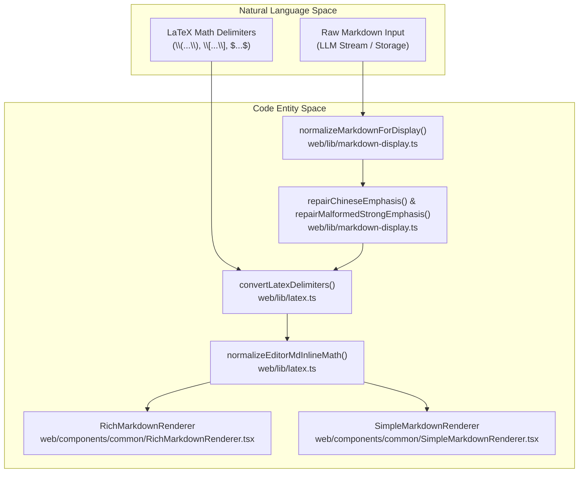
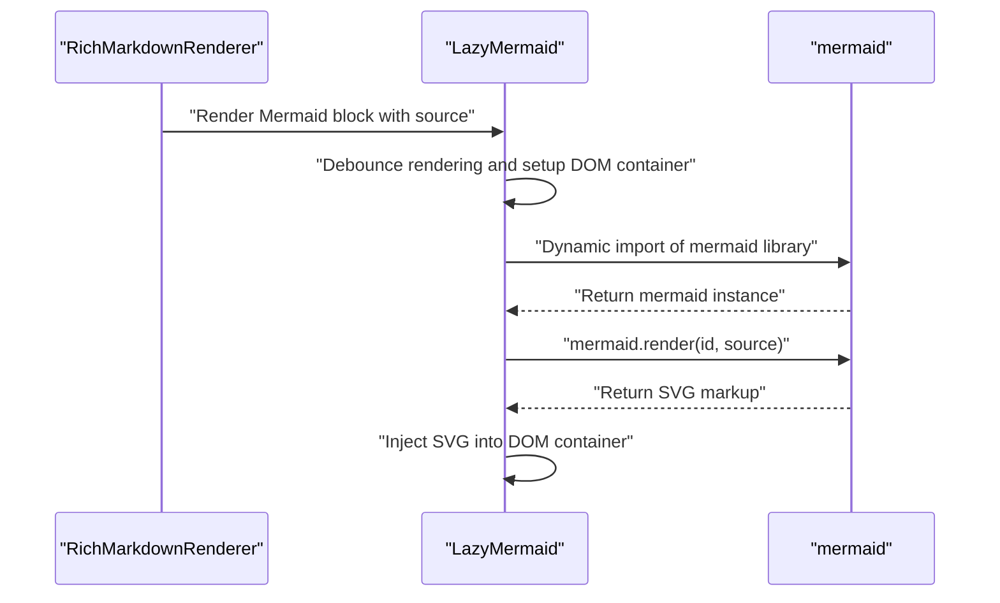

<!-- source: DeepWiki mcp.deepwiki.com · repo HKUDS/DeepTutor · page 7.4 Markdown Rendering and Export · fetched 2026-11-09 -->

# Markdown Rendering and Export

Relevant source files

The following files were used as context for generating this wiki page:

- [deeptutor/services/session/_turn_runtime_shared.py](deeptutor/services/session/_turn_runtime_shared.py)
- [deeptutor/services/session/selection_grounding.py](deeptutor/services/session/selection_grounding.py)
- [tests/services/session/test_selection_grounding.py](tests/services/session/test_selection_grounding.py)
- [tests/services/session/test_turn_runtime.py](tests/services/session/test_turn_runtime.py)
- [web/app/globals.css](web/app/globals.css)
- [web/components/common/RichMarkdownRenderer.tsx](web/components/common/RichMarkdownRenderer.tsx)
- [web/components/common/SimpleMarkdownRenderer.tsx](web/components/common/SimpleMarkdownRenderer.tsx)
- [web/lib/latex.ts](web/lib/latex.ts)
- [web/lib/markdown-display.ts](web/lib/markdown-display.ts)
- [web/lib/rehype-dir-auto.ts](web/lib/rehype-dir-auto.ts)
- [web/tests/latex.test.ts](web/tests/latex.test.ts)
- [web/tests/markdown-direction.spec.tsx](web/tests/markdown-direction.spec.tsx)
- [web/tests/markdown-display.test.ts](web/tests/markdown-display.test.ts)
- [web/tests/rehype-dir-auto.test.ts](web/tests/rehype-dir-auto.test.ts)
- [web/tests/rich-markdown-direction.spec.tsx](web/tests/rich-markdown-direction.spec.tsx)

## Purpose and Scope

This page documents the markdown rendering and export subsystem integrated into DeepTutor's frontend (`web/`) and coordination layers (`deeptutor/services/session/`). The system provides rich display of markdown content with proper support for mathematical formulas (via KaTeX), diagrams (via Mermaid), tables, collapsible sections, citations, and rich code blocks, while also enabling safe export functionalities such as clipboard copying and PDF export.

Key aspects covered include:
- The end-to-end markdown-display pipeline bridging raw model output to rendered React components.
- Two markdown renderers: `RichMarkdownRenderer` and `SimpleMarkdownRenderer`.
- Handling LaTeX formulas through normalization (`convertLatexDelimiters`) and KaTeX rendering.
- Support for Mermaid diagrams including legacy fence conversions (`convertFlowFenceToMermaid`, `convertSequenceFenceToMermaid`).
- Processing and repairing markdown from AI-generated content with citation linking, malformed strong emphasis repairs, and CJK emphasis fixes (`repairChineseEmphasis`).
- Clipboard integration, scroll management (`scrollAnchorIntoView`), and export considerations.

Theme and state management integrations are covered in [7.3 Theme and Design System]() and [7.2 Global State and Transport]().

Sources: [web/components/common/RichMarkdownRenderer.tsx:1-117](), [web/lib/markdown-display.ts:1-224](), [deeptutor/services/session/_turn_runtime_shared.py:103-186]()

---

## Markdown Rendering Architecture

### Core Technology Stack

The markdown rendering subsystem leverages modern React and remark ecosystem libraries, designed for extensibility and performance:

| Component / Library       | Role                                                            | Sources |
|--------------------------|-----------------------------------------------------------------|---------|
| `react-markdown`         | Core markdown-to-React JSX parser and renderer                   | [web/components/common/RichMarkdownRenderer.tsx:5]() |
| `remark-gfm`             | Support for GitHub Flavored Markdown features (tables, task lists) | [web/components/common/RichMarkdownRenderer.tsx:6]() |
| `remark-math`            | Parse math syntaxes in markdown like `$...$` and `$$...$$`       | [web/components/common/RichMarkdownRenderer.tsx:148-153]() |
| `rehype-katex`           | Render parsed math expressions to HTML using KaTeX               | [web/components/common/RichMarkdownRenderer.tsx:151-154]() |
| `rehype-raw`             | Allow raw HTML parsing and rendering inside markdown             | [web/components/common/RichMarkdownRenderer.tsx:157-160]() |
| `mermaid`                | Client-side rendering of flowcharts, sequence diagrams etc.      | [web/components/common/RichMarkdownRenderer.tsx:48-51]() |

Sources: [web/components/common/RichMarkdownRenderer.tsx:4-8](), [web/components/common/SimpleMarkdownRenderer.tsx:4-5]()

---

### Markdown Processing Pipeline

Before rendering, raw text (usually AI output) is normalized and transformed through preprocessing pipelines to ensure clean, consistent display.

Title: "Markdown Preprocessing and Rendering Pipeline"

Sources: [web/lib/markdown-display.ts:1-125](), [web/lib/latex.ts:40-92](), [web/components/common/RichMarkdownRenderer.tsx:106-187]()

---

## Renderer Implementations

### RichMarkdownRenderer

- **Purpose**: Used for main user-visible markdown content with full feature sets.
- **Dynamic Plugins**: Loads `remark-math`, `rehype-katex` [web/components/common/RichMarkdownRenderer.tsx:148-155](), and optionally `rehype-raw` [web/components/common/RichMarkdownRenderer.tsx:157-160]() on demand.
- **Lazy Components**: Uses Next.js `dynamic()` to lazily import `LazyMermaid` [web/components/common/RichMarkdownRenderer.tsx:48-51](), `LazyCodeBlock` [web/components/common/RichMarkdownRenderer.tsx:53-56](), and `GeogebraOpenCTA` [web/components/common/RichMarkdownRenderer.tsx:58-61]().
- **Source Line Tracking**: Supports `trackSourceLines` prop to preserve exact line positions by bypassing aggressive normalization, keeping AST line numbers synchronized for editor-preview scrolling [web/components/common/RichMarkdownRenderer.tsx:116-130]().
- **Headings and Anchors**: Generates slugified heading IDs and supports smooth scrolling via `scrollAnchorIntoView` [web/components/common/RichMarkdownRenderer.tsx:83-104]().

Sources: [web/components/common/RichMarkdownRenderer.tsx:1-196]()

---

### SimpleMarkdownRenderer

- **Purpose**: Lightweight, compact renderer for internal logs and agent thought traces.
- **Variants**: Supports `trace`, `compact`, and `default` variants adjusting whitespace, font size, and padding.
- **Filtered Elements**: Omits images and form controls; simplifies code blocks without full syntax highlighting.
- **Header Processing**: Strips leading hashes from header lines for compactness [web/components/common/SimpleMarkdownRenderer.tsx:147-195]().

Sources: [web/components/common/SimpleMarkdownRenderer.tsx:1-195]()

---

## Content Normalization and Security

### Markdown Display Utilities

DeepTutor includes a suite of preprocessing and security utilities in `web/lib/markdown-display.ts`:

- **Allowed HTML Tags**: A strict whitelist (`ALLOWED_HTML_TAGS`) of structural, text-level, table, and MathML elements permitted under `rehype-raw` [web/lib/markdown-display.ts:28-137](). Unknown pseudo-tags (e.g., `<think>`, `<tool_call>`) are escaped into inline code.
- **URL Policy**: `markdownUrlTransform` restricts scheme checking to safe protocols (`http`, `https`, `mailto`, `attachment`) [web/lib/markdown-display.ts:182-188]() and permits passive raster data images (`SAFE_RASTER_DATA_IMAGE_REGEX`) [web/lib/markdown-display.ts:189-215]().
- **Emphasis Repair**: 
  - `repairMalformedStrongEmphasis` corrects LLM tokenization errors like `**Label: **value` to `**Label:** value` [web/lib/markdown-display.ts:153-154]().
  - `repairChineseEmphasis` adjusts emphasis delimiters around CJK punctuation to prevent markdown parser rendering failures [web/tests/markdown-display.test.ts:15-36]().
- **Invisible Character Stripping**: Removes zero-width and control characters (`INVISIBLE_CONTROL_REGEX`) [web/lib/markdown-display.ts:3-20]().

Sources: [web/lib/markdown-display.ts:1-257](), [web/tests/markdown-display.test.ts:1-191]()

---

## Mathematical Formula Rendering

### KaTeX Integration and LaTeX Normalization

Math rendering is powered by KaTeX and managed through helper modules:
- **Detection**: `hasMarkdownMath()` inspects strings for display-math, backslash delimiters, or inline math candidates to determine whether rich KaTeX rendering is required [web/lib/latex.ts:28-36]().
- **Delimiter Conversion**: `convertLatexDelimiters` converts alternate delimiters (`\\(...\\)`, `\\[...\\]`) into standard `$...$` and `$$...$$` recognized by `remark-math` [web/lib/latex.ts:42-55]().
- **Editor.md Compatibility**: `normalizeEditorMdInlineMath` handles multi-line blocks and editor.md math conventions [web/lib/latex.ts:88-158]().

Sources: [web/lib/latex.ts:1-137](), [web/tests/latex.test.ts:1-191]()

---

## Diagram Rendering

### Mermaid Diagram Support

Mermaid diagrams are lazily loaded and rendered client-side:

Title: "Mermaid Diagram Rendering Flow"

Sources: [web/components/common/RichMarkdownRenderer.tsx:38-51](), [web/lib/latex.ts:199-222]()

---

## Export and Global Styling

### Rich Code Highlighting and Scroll Management

- Code blocks utilize syntax highlighting components supporting line numbers and wrapping configurations.
- `scrollAnchorIntoView` walks parent elements to locate the nearest scrollable ancestor container rather than jumping the entire viewport [web/components/common/RichMarkdownRenderer.tsx:83-104]().
- Clean normalized DOM markup ensures smooth clipboard copy operations and high-fidelity PDF exports.

Sources: [web/components/common/RichMarkdownRenderer.tsx:76-104](), [web/components/common/RichCodeBlock.tsx:1-114]()

---

