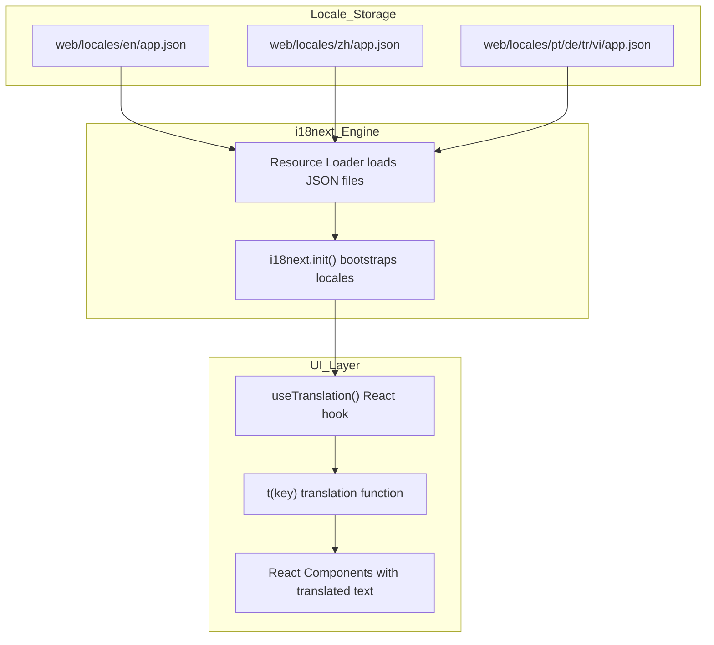
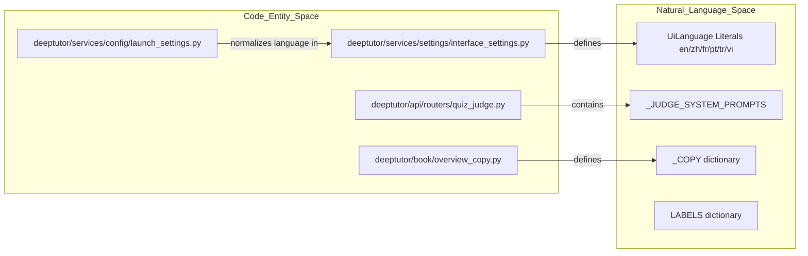
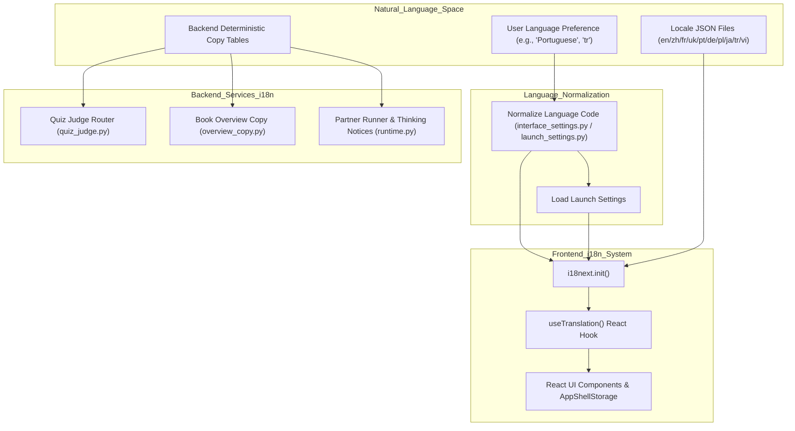

<!-- source: DeepWiki mcp.deepwiki.com · repo HKUDS/DeepTutor · page 7.5 Internationalization · fetched 2026-11-09 -->

# Internationalization

Relevant source files

The following files were used as context for generating this wiki page:

- [deeptutor/agents/loop/prompt_blocks.py](deeptutor/agents/loop/prompt_blocks.py)
- [deeptutor/api/routers/quiz_judge.py](deeptutor/api/routers/quiz_judge.py)
- [deeptutor/book/export.py](deeptutor/book/export.py)
- [deeptutor/book/overview_copy.py](deeptutor/book/overview_copy.py)
- [deeptutor/runtime/banner.py](deeptutor/runtime/banner.py)
- [deeptutor/services/config/launch_settings.py](deeptutor/services/config/launch_settings.py)
- [deeptutor/services/config/settings_spec.py](deeptutor/services/config/settings_spec.py)
- [deeptutor/services/i18n.py](deeptutor/services/i18n.py)
- [deeptutor/services/llm/claude_sdk.py](deeptutor/services/llm/claude_sdk.py)
- [deeptutor/services/llm/provider_core/claude_code_provider.py](deeptutor/services/llm/provider_core/claude_code_provider.py)
- [deeptutor/services/llm/provider_core/codebuddy_provider.py](deeptutor/services/llm/provider_core/codebuddy_provider.py)
- [deeptutor/services/llm/provider_core/sdk_bridge.py](deeptutor/services/llm/provider_core/sdk_bridge.py)
- [deeptutor/services/partners/runtime.py](deeptutor/services/partners/runtime.py)
- [deeptutor/services/prompt/language.py](deeptutor/services/prompt/language.py)
- [deeptutor/services/settings/interface_settings.py](deeptutor/services/settings/interface_settings.py)
- [deeptutor/services/subagent/claude_models.py](deeptutor/services/subagent/claude_models.py)
- [docs-for-dev/I18N.md](docs-for-dev/I18N.md)
- [docs-for-dev/README.md](docs-for-dev/README.md)
- [examples/memory_evaluation/README.md](examples/memory_evaluation/README.md)
- [tests/fixtures/portuguese_unchanged_ui.json](tests/fixtures/portuguese_unchanged_ui.json)
- [tests/i18n/test_portuguese_locale.py](tests/i18n/test_portuguese_locale.py)
- [tests/multi_user/test_ui_language_scoping.py](tests/multi_user/test_ui_language_scoping.py)
- [tests/services/config/test_launch_settings.py](tests/services/config/test_launch_settings.py)
- [tests/services/llm/test_claude_code_provider.py](tests/services/llm/test_claude_code_provider.py)
- [tests/services/llm/test_codebuddy_provider.py](tests/services/llm/test_codebuddy_provider.py)
- [tests/services/partners/test_partner_runtime.py](tests/services/partners/test_partner_runtime.py)
- [tests/services/prompt/test_language_directive.py](tests/services/prompt/test_language_directive.py)
- [tests/services/test_claude_model_discovery.py](tests/services/test_claude_model_discovery.py)
- [web/app/(workspace)/partners/new/page.tsx](web/app/(workspace)/partners/new/page.tsx)
- [web/components/partners/PartnerConfigure.tsx](web/components/partners/PartnerConfigure.tsx)
- [web/components/settings/MinerUEngineSettings.tsx](web/components/settings/MinerUEngineSettings.tsx)
- [web/context/AppShellContext.tsx](web/context/AppShellContext.tsx)
- [web/context/app-shell-storage.ts](web/context/app-shell-storage.ts)
- [web/features/settings/store/SettingsStore.tsx](web/features/settings/store/SettingsStore.tsx)
- [web/features/settings/store/response-language-options.ts](web/features/settings/store/response-language-options.ts)
- [web/i18n/init.ts](web/i18n/init.ts)
- [web/i18n/languages.ts](web/i18n/languages.ts)
- [web/lib/datetime.ts](web/lib/datetime.ts)
- [web/locales/pt/app.json](web/locales/pt/app.json)
- [web/tests/account-role.test.ts](web/tests/account-role.test.ts)
- [web/tests/app-shell-language-bootstrap.test.ts](web/tests/app-shell-language-bootstrap.test.ts)
- [web/tests/language-preferences.test.ts](web/tests/language-preferences.test.ts)
- [web/tests/learning-source-scroll.audit.ts](web/tests/learning-source-scroll.audit.ts)
- [web/tests/partner-soul-load-errors.spec.tsx](web/tests/partner-soul-load-errors.spec.tsx)
- [web/tests/settings-unified-draft.spec.tsx](web/tests/settings-unified-draft.spec.tsx)

DeepTutor provides a comprehensive internationalization (i18n) framework to support multi-language user interfaces, AI-driven content generation, CLI banners, backend deterministic copy, and partner runtime notifications. This framework integrates frontend translation via `i18next` with localized JSON files, backend prompt language controls, and an automated pipeline auditing translation parity across supported languages. Ten primary locales are supported across various UI and backend surfaces: English (`en`), Chinese (`zh`), French (`fr`), Ukrainian (`uk`), Portuguese (`pt`), German (`de`), Polish (`pl`), Japanese (`ja`), Turkish (`tr`), and Vietnamese (`vi`).

---

## i18n Integration and Data Flow

The frontend React application leverages the `i18next` library with the `react-i18next` bridge to provide contextual translations. Translation resources are loaded from static locale JSON files under `web/locales/{lang}/app.json`. The system initializes i18n on app startup and hydrates user preferences from `localStorage` or backend API calls.

### Translation Resolution Pipeline

This pipeline enables UI components to call `const { t } = useTranslation()` and render translated strings per the active language.

**Sources:**  
- [web/locales/pt/app.json:1-132]()  
- [web/context/app-shell-storage.ts:1-210]()  
- [web/tests/language-preferences.test.ts:1-34]()  

---

## Locale JSON File Structure and Extended Locales

DeepTutor's i18n text is organized under the `web/locales` directory by language code (`en`, `zh`, `fr`, `uk`, `pt`, `de`, `pl`, `ja`, `tr`, `vi`), each containing key-value pairs for translated strings. The interface language selects the web UI locale, navigation, settings, status text, and CLI copy, while the model output language (`response_language`) handles reader-facing model responses.

| Language | Code | Interface Support | Response Language | Key Files / References |
|---|---|---|---|---|
| English | `en` | Yes | Yes | [web/locales/en/app.json]() |
| Chinese | `zh` | Yes | Yes | [web/locales/zh/app.json]() |
| French | `fr` | Yes | Yes | [web/locales/fr/app.json]() |
| Ukrainian | `uk` | Yes | Yes | [web/locales/uk/app.json]() |
| Portuguese | `pt` | Yes | Yes | [web/locales/pt/app.json:1-132]() |
| German | `de` | Yes | Yes | [web/locales/de/app.json]() |
| Polish | `pl` | Yes | Yes | [web/locales/pl/app.json]() |
| Japanese | `ja` | Yes | Yes | [web/tests/language-preferences.test.ts:10-34]() |
| Turkish | `tr` | Yes | Yes | [web/tests/language-preferences.test.ts:29-33]() |
| Vietnamese | `vi` | Yes | Yes | [web/tests/language-preferences.test.ts:22-25]() |

**Sources:**  
- [web/locales/pt/app.json:1-132]()  
- [web/tests/language-preferences.test.ts:1-34]()  
- [docs-for-dev/I18N.md:1-33]()  

---

## Frontend Implementation Details

### Language Bootstrap and Preference Hydration

The frontend preference management is centralized in `AppShellContext` and `AppShellStorage`. Language preferences are resolved as follows:
- `readStoredLanguage()` reads the local preference via `browserStorage` from `deeptutor-language` [web/context/app-shell-storage.ts:150-159]()  
- `hasStoredLanguage()` verifies whether an explicit user choice has ever been recorded [web/context/app-shell-storage.ts:168-175]()  
- `resolveResponseLanguage()` handles decoupling model output language from interface language [web/context/app-shell-storage.ts:135-148]()  
- `SettingsStore` synchronizes loaded UI preferences and dispatches storage events [web/features/settings/store/SettingsStore.tsx:1-114]()  

**Sources:**  
- [web/context/app-shell-storage.ts:66-210]()  
- [web/features/settings/store/SettingsStore.tsx:30-114]()  

---

## Backend Services, Prompts, and Deterministic Copy

Beyond the web UI, multiple backend services maintain localized dictionaries or prompt blocks to ensure native experiences across capabilities:

- **Interface Settings Service:** Canonical backend reader/writer for user-selected UI language and theme stored in `data/user/settings/interface.json`, supporting `UiLanguage` literals (`en`, `zh`, `fr`, `de`, `uk`, `pl`, `pt`, `vi`, `ja`, `tr`) [deeptutor/services/settings/interface_settings.py:1-23]().
- **Quiz Judge Router:** Implements system prompts in multiple languages (`_JUDGE_SYSTEM_PROMPTS`) to grade learner quiz answers directly in the target language [deeptutor/api/routers/quiz_judge.py:29-120]().
- **Book Overview Copy:** `deeptutor/book/overview_copy.py` provides deterministic reader-facing copy for engine-injected Overview chapters across supported locales without relying on LLM generation [deeptutor/book/overview_copy.py:1-35]().
- **Partner Runtime Notices:** `deeptutor/services/partners/runtime.py` defines localized `_THINKING_NOTICES` (e.g. Portuguese `🤔 Pensando…`, Turkish `🤔 Düşünüyorum…`, Chinese `🤔 正在思考…`) for asynchronous IM channels like Feishu [deeptutor/services/partners/runtime.py:67-87]().
- **CLI Banner & Init Wizard:** `deeptutor/runtime/banner.py` reads user language preference from `interface.json` to localize startup banners and setup wizards [deeptutor/runtime/banner.py:1-26]().

**Sources:**  
- [deeptutor/services/settings/interface_settings.py:1-23]()  
- [deeptutor/api/routers/quiz_judge.py:29-120]()  
- [deeptutor/book/overview_copy.py:1-35]()  
- [deeptutor/services/partners/runtime.py:67-87]()  
- [deeptutor/runtime/banner.py:1-26]()  

---

### Code-Natural Language Bridge Diagram (Part 1)

**Sources:**  
- [deeptutor/services/settings/interface_settings.py:1-23]()  
- [deeptutor/api/routers/quiz_judge.py:29-120]()  
- [deeptutor/book/overview_copy.py:35-188]()  
- [deeptutor/services/config/launch_settings.py:50-76]()  

---

## Language Normalization and Launch Settings

Language codes are normalized across both Python and TypeScript runtimes to accommodate regional variations (e.g., `pt-BR`, `pt_PT`, `Português` → `pt`; `tr-TR`, `Türkçe` → `tr`).

- **Backend Normalization:** `_normalize_language()` in `deeptutor/services/settings/interface_settings.py` and `deeptutor/services/config/launch_settings.py` maps variants to canonical base codes, falling back safely to English [deeptutor/services/settings/interface_settings.py:100-146](), [deeptutor/services/config/launch_settings.py:50-75]().
- **Launch Settings Loading:** `load_launch_settings()` loads UI language preferences from `interface.json`, merging process environment overrides (`UI_LANGUAGE` or `LANGUAGE`) [deeptutor/services/config/launch_settings.py:78-108]().

**Sources:**  
- [deeptutor/services/settings/interface_settings.py:100-146]()  
- [deeptutor/services/config/launch_settings.py:50-108]()  

---

## Summary Mermaid Diagram: From Natural Language Preferences to Code Entities

**Sources:**  
- [deeptutor/services/settings/interface_settings.py:100-146]()  
- [deeptutor/services/config/launch_settings.py:50-108]()  
- [web/context/app-shell-storage.ts:129-148]()  
- [deeptutor/api/routers/quiz_judge.py:29-120]()  
- [deeptutor/book/overview_copy.py:35-188]()  
- [deeptutor/services/partners/runtime.py:67-87]()  

---

# References and Source Files

- `deeptutor/services/settings/interface_settings.py`
- `deeptutor/services/config/launch_settings.py`
- `web/locales/pt/app.json`
- `web/context/app-shell-storage.ts`
- `web/tests/language-preferences.test.ts`
- `web/features/settings/store/SettingsStore.tsx`
- `deeptutor/api/routers/quiz_judge.py`
- `deeptutor/book/overview_copy.py`
- `deeptutor/services/partners/runtime.py`
- `deeptutor/runtime/banner.py`
- `docs-for-dev/I18N.md`

---

