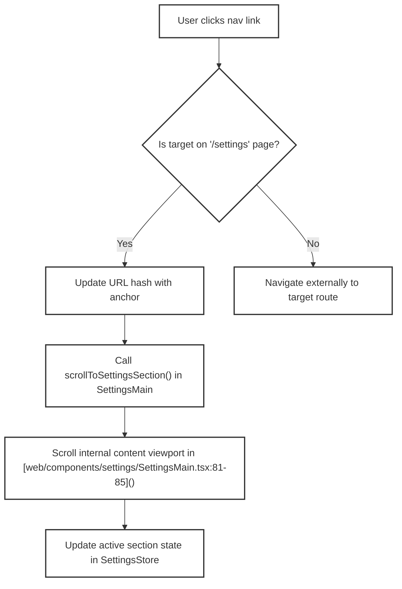
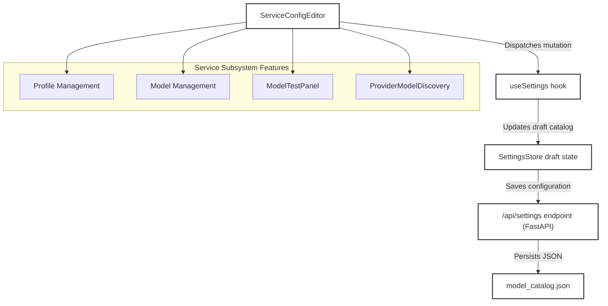
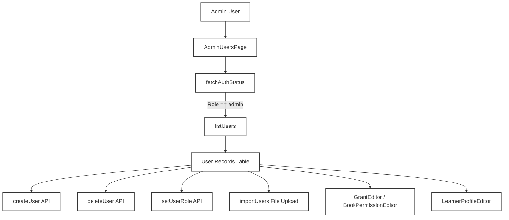

<!-- source: DeepWiki mcp.deepwiki.com · repo HKUDS/DeepTutor · page 7.6 Settings and Admin UI · fetched 2026-11-09 -->

# Settings and Admin UI

Relevant source files

The following files were used as context for generating this wiki page:

- [deeptutor/multi_user/context.py](deeptutor/multi_user/context.py)
- [deeptutor/multi_user/models.py](deeptutor/multi_user/models.py)
- [deeptutor/multi_user/paths.py](deeptutor/multi_user/paths.py)
- [deeptutor/services/auth.py](deeptutor/services/auth.py)
- [deeptutor/services/partners/__init__.py](deeptutor/services/partners/__init__.py)
- [deeptutor/services/partners/scope.py](deeptutor/services/partners/scope.py)
- [deeptutor/services/partners/sessions.py](deeptutor/services/partners/sessions.py)
- [tests/agents/visualize/test_agent_llm_calls.py](tests/agents/visualize/test_agent_llm_calls.py)
- [tests/multi_user/test_owner_path_service.py](tests/multi_user/test_owner_path_service.py)
- [tests/multi_user/test_role_normalization.py](tests/multi_user/test_role_normalization.py)
- [tests/services/partners/test_slugify_partner_id.py](tests/services/partners/test_slugify_partner_id.py)
- [web/app/(admin)/admin/users/page.tsx](web/app/(admin)/admin/users/page.tsx)
- [web/app/(workspace)/partners/page.tsx](web/app/(workspace)/partners/page.tsx)
- [web/components/knowledge/KbFilePreview.tsx](web/components/knowledge/KbFilePreview.tsx)
- [web/components/mcp/McpCatalogBrowser.tsx](web/components/mcp/McpCatalogBrowser.tsx)
- [web/components/mcp/McpStatusBadge.tsx](web/components/mcp/McpStatusBadge.tsx)
- [web/components/memory/MemoryL1Workbench.tsx](web/components/memory/MemoryL1Workbench.tsx)
- [web/components/memory/MemorySection.tsx](web/components/memory/MemorySection.tsx)
- [web/components/partners/PartnerChannels.tsx](web/components/partners/PartnerChannels.tsx)
- [web/components/settings/ConnectionsEditor.tsx](web/components/settings/ConnectionsEditor.tsx)
- [web/components/settings/MemoryUsageItem.tsx](web/components/settings/MemoryUsageItem.tsx)
- [web/components/settings/ModelsWorkspace.tsx](web/components/settings/ModelsWorkspace.tsx)
- [web/components/settings/ProvidersWorkspace.tsx](web/components/settings/ProvidersWorkspace.tsx)
- [web/components/settings/RegistryControls.tsx](web/components/settings/RegistryControls.tsx)
- [web/components/settings/ServiceConfigEditor.tsx](web/components/settings/ServiceConfigEditor.tsx)
- [web/components/settings/SettingsMain.tsx](web/components/settings/SettingsMain.tsx)
- [web/components/settings/SettingsNav.tsx](web/components/settings/SettingsNav.tsx)
- [web/components/settings/SettingsOverview.tsx](web/components/settings/SettingsOverview.tsx)
- [web/components/settings/SettingsStatusPanel.tsx](web/components/settings/SettingsStatusPanel.tsx)
- [web/components/settings/TaskModelsEditor.tsx](web/components/settings/TaskModelsEditor.tsx)
- [web/components/settings/shared.tsx](web/components/settings/shared.tsx)
- [web/components/space/EduHubImportModal.tsx](web/components/space/EduHubImportModal.tsx)
- [web/components/space/PersonasSection.tsx](web/components/space/PersonasSection.tsx)
- [web/components/space/SkillsSection.tsx](web/components/space/SkillsSection.tsx)
- [web/components/ui/ConfirmDialog.tsx](web/components/ui/ConfirmDialog.tsx)
- [web/components/workspaces/WorkspacePill.tsx](web/components/workspaces/WorkspacePill.tsx)
- [web/features/multi-user/components/GuardianRelationshipsEditor.tsx](web/features/multi-user/components/GuardianRelationshipsEditor.tsx)
- [web/features/settings/sections/ToolsSettingsSection.tsx](web/features/settings/sections/ToolsSettingsSection.tsx)
- [web/lib/account-role.ts](web/lib/account-role.ts)
- [web/lib/admin-api.ts](web/lib/admin-api.ts)
- [web/lib/admin-users.ts](web/lib/admin-users.ts)
- [web/lib/partners-api.ts](web/lib/partners-api.ts)
- [web/lib/provider-registry.ts](web/lib/provider-registry.ts)
- [web/tests/admin-users-filter.test.ts](web/tests/admin-users-filter.test.ts)
- [web/tests/provider-registry-workflow.spec.tsx](web/tests/provider-registry-workflow.spec.tsx)

This page details the implementation of the DeepTutor application's settings and administrative user interfaces. It covers navigation and scroll behavior, `ServiceConfigEditor`, `ConnectionsEditor`, `TaskModelsEditor`, search provider configurations, subagent settings, the admin users dashboard, and chat-log import tooling. The focus is on technical architecture, data flows, core components, and state management.

## Settings Navigation and Scroll Behavior

DeepTutor’s settings UI is implemented as a single-page application under the `/settings` route. Settings content is presented as a scrollable document with internal navigation anchored by hash fragments (`#llm`, `#embedding`, `#connections`, etc.). This structure enables immediate jumping between sections without full page reloads.

The main shell layout is provided by `SettingsMain` (`[web/components/settings/SettingsMain.tsx:16-157]()`), which implements a two-column layout on desktop screens. The left pane renders the navigation sidebar powered by `SettingsNav` (`[web/components/settings/SettingsNav.tsx:19-126]()`), and the right pane renders the active settings section. On mobile viewports, navigation collapses into a modal overlay menu.

Navigation links update the URL hash and invoke scroll handlers to smoothly scroll the focused content container rather than reloading the page. State tracking for active settings sections is synchronized with the global `SettingsStore` (`[web/features/settings/store/SettingsStore.tsx]()`).

Sources:
- [web/components/settings/SettingsMain.tsx:16-157]()
- [web/components/settings/SettingsNav.tsx:19-126]()
- [web/tests/settings-continuous-navigation.test.ts:1-94]()

## ServiceConfigEditor

`ServiceConfigEditor` (`[web/components/settings/ServiceConfigEditor.tsx:102-110]`) is the primary interface component for managing configurations across AI services (`llm`, `task`, `embedding`, `search`, `tts`, `stt`, `imagegen`, `videogen`). It encapsulates profile and model management:

- **Profile Management:** Services support multiple profiles representing different provider accounts or credentials. Profiles store identifying fields (`id`, `name`), API bindings (e.g., `openai`, `anthropic`, `custom`), base URLs, API keys, version strings, and extra headers (`[web/components/settings/ServiceConfigEditor.tsx:163-174]()`).
- **Model Management:** Each profile configures one or more models specifying model IDs, display names, context windows, reasoning effort tiers, and capability flags (`[web/components/settings/ServiceConfigEditor.tsx:124-131]()`).
- **Protocol & Binding Registry:** Bindings like `codebuddy` or `claude_code` integrate with local CLI logins where API keys are bypassed in favor of local session authentication (`[web/components/settings/ServiceConfigEditor.tsx:87-90]()`). API formats support `auto`, `openai_chat`, `openai_responses`, and `anthropic` (`[web/components/settings/ServiceConfigEditor.tsx:73-85]()`).

Sources:
- [web/components/settings/ServiceConfigEditor.tsx:102-1900]()
- [web/components/settings/ServiceConfigEditor.tsx:28-60]()

## ConnectionsEditor

`ConnectionsEditor` (`[web/components/settings/ConnectionsEditor.tsx:82-187]()`) centralizes shared credentials. Instead of typing the same API key across multiple service pages, a connection acts as a master credential record.

- **Central Storage:** Connections store API keys and base URLs once.
- **Service Linking:** Linked profiles mirror the connection credentials down to individual service profiles automatically upon saving (`[web/components/settings/ConnectionsEditor.tsx:180-186]()`).
- **Masking & Navigation:** Credentials are automatically masked in the UI (e.g., `••••••••` or `sk-proj••••abcd`), and connection cards list every service profile currently bound to them.

Sources:
- [web/components/settings/ConnectionsEditor.tsx:42-762]()
- [web/components/settings/ConnectionsEditor.tsx:108-121]()

## TaskModelsEditor

`TaskModelsEditor` handles background auxiliary models used for tasks such as automated conversation title generation and quick-reply suggestion generation.

- **Inheritance & Reference Modes:** Profiles can inherit the primary chat model configuration or reference a dedicated task-model profile (`[web/components/settings/TaskModelsEditor.tsx:20-40]()`).
- **Testing & Status:** Reuses the model test harness (`ModelTestPanel`) to verify latency and capability support prior to commitment.

Sources:
- [web/components/settings/TaskModelsEditor.tsx:10-100]()

## Search Providers

Search provider definitions are decoupled in `searchProviderFields` (`[web/components/settings/ServiceConfigEditor.tsx:60]()`, `[web/components/settings/search-providers.ts]()`). Supported backends include Brave, Tavily, Serply, SearXNG, and You.com. Users configure search API tokens and endpoint parameters directly via the unified `ServiceConfigEditor` under the search service category.

Sources:
- [web/components/settings/ServiceConfigEditor.tsx:60]()
- [web/components/settings/search-providers.ts]()

## Subagent Settings

Subagent configurations utilize specialized LLM or task-model profiles identified by service categories (`"llm"` and `"task"`) (`[web/components/settings/ServiceConfigEditor.tsx:86]()`). These profiles handle separate provider routing for subagent delegation loops. Import pipelines identify subagent transcripts via metadata fields such as `thread_source: 'subagent'` (`[web/lib/chat-import/codex.ts:40-45]()`).

Sources:
- [web/components/settings/ServiceConfigEditor.tsx:86]()
- [web/lib/chat-import/codex.ts:40-45]()

## Admin Users Dashboard

The administrative dashboard (`AdminUsersPage`, `[web/app/(admin)/admin/users/page.tsx:56-204]()`) manages multi-user environments under the `/admin/users` route. Access is protected by bearer token authentication and administrative role checks (`[web/app/(admin)/admin/users/page.tsx:100-113]()`).

- **Role Management:** Roles are strictly validated against `VALID_ROLES` (`admin`, `teacher`, `student`, `user`) with least-privilege degradation (`[deeptutor/multi_user/models.py:16-25]`, `[tests/multi_user/test_role_normalization.py:24-36]()`). Only `"admin"` grants elevated access (`[deeptutor/multi_user/models.py:76-78]()`).
- **User Provisioning & Batch Import:** Admins can create users (`createUser`), update roles (`setUserRole`), delete accounts individually or in batches (`deleteUser`, `deleteUsers`), and import users via CSV payloads (`importUsers`) (`[web/lib/admin-api.ts:66-192]()`).
- **Granular Permissions:** Expanded user rows permit editing of data scopes, book permissions, learner profiles, and guardian relationships (`[web/app/(admin)/admin/users/page.tsx:19-22]()`).

Sources:
- [web/app/(admin)/admin/users/page.tsx:56-204]()
- [web/lib/admin-api.ts:1-192]()
- [deeptutor/multi_user/models.py:1-86]()
- [tests/multi_user/test_role_normalization.py:1-144]()

## Chat Import

DeepTutor supports importing conversation histories from Codex session logs (`.jsonl`) (`[web/lib/chat-import/codex.ts:1-30]()`).

- **Metadata Extraction:** Parses session headers to capture working directories (`cwd`) and thread identification (`[web/lib/chat-import/codex.ts:35-45]()`).
- **Turn Normalization & Noise Filtering:** Converts raw JSON events into `NormalizedMessage` objects while filtering out harness-injected system/environment markers (e.g., `<environment_context>`) (`[web/lib/chat-import/codex.ts:45-110]()`).
- **Title Derivation & Storage Access:** Derives conversation titles from the initial valid user message and uses browser `FileSystemDirectoryHandle` APIs for local file tree traversal (`[web/lib/chat-import/codex.ts:145-190]()`).

Sources:
- [web/lib/chat-import/codex.ts:1-251]()
- [web/tests/chat-import-codex.spec.ts:1-170]()

---

