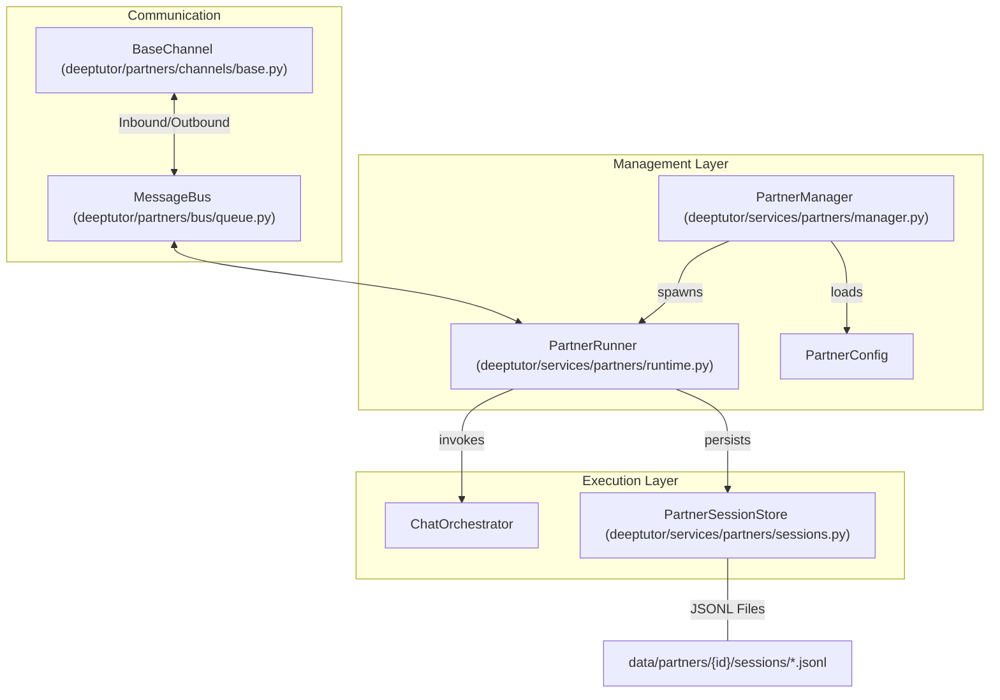
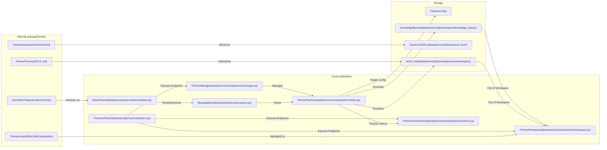

<!-- source: DeepWiki mcp.deepwiki.com · repo HKUDS/DeepTutor · page 8 Partners (Persistent AI Companions) · fetched 2026-11-09 -->

# Partners (Persistent AI Companions)

Relevant source files

The following files were used as context for generating this wiki page:

- [deeptutor/api/routers/partners.py](deeptutor/api/routers/partners.py)
- [deeptutor/partners/__init__.py](deeptutor/partners/__init__.py)
- [deeptutor/partners/bus/__init__.py](deeptutor/partners/bus/__init__.py)
- [deeptutor/partners/bus/queue.py](deeptutor/partners/bus/queue.py)
- [deeptutor/partners/channels/__init__.py](deeptutor/partners/channels/__init__.py)
- [deeptutor/partners/channels/base.py](deeptutor/partners/channels/base.py)
- [deeptutor/partners/channels/email.py](deeptutor/partners/channels/email.py)
- [deeptutor/partners/channels/manager.py](deeptutor/partners/channels/manager.py)
- [deeptutor/services/partners/manager.py](deeptutor/services/partners/manager.py)
- [tests/api/test_partners_channel_schema.py](tests/api/test_partners_channel_schema.py)
- [tests/api/test_partners_router.py](tests/api/test_partners_router.py)
- [tests/services/partners/test_channel_manager.py](tests/services/partners/test_channel_manager.py)
- [tests/services/partners/test_custom_seed_souls.py](tests/services/partners/test_custom_seed_souls.py)
- [tests/services/partners/test_partner_outbound_delivery.py](tests/services/partners/test_partner_outbound_delivery.py)
- [tests/services/partners/test_turn_stop_cleanup.py](tests/services/partners/test_turn_stop_cleanup.py)

The **Partners** subsystem in DeepTutor provides persistent AI companions—long-lived, autonomous agents designed for personalized tutoring and lifelong learning. Partners maintain their own workspaces, personality definitions (`SOUL.md`), archived conversation sessions, and connect seamlessly to multiple instant messaging (IM) channels. This architecture enables interactive AI companions that persist state across sessions and integrate deeply with external chat platforms.

This page offers a high-level overview of the Partners system, its main components, lifecycle, and integrations. For technical details, refer to the linked child pages.

---

## System Overview

At its core, the Partners system is managed by the `PartnerManager`, responsible for creating, configuring, and controlling partner instances identified by unique `partner_id` slugs [deeptutor/services/partners/manager.py:1-52](). Each partner is backed by a dedicated on-disk workspace and data directories under the path `data/partners/{partner_id}/` that store configuration, media, conversation archives, and related assets.

Key backend entities and responsibilities within the Partners system include:

| Component             | Code Entity                                | Responsibility                                              |
|----------------------|--------------------------------------------|-------------------------------------------------------------|
| **Manager**           | `PartnerManager`                           | Manages partner lifecycle, loading configs, starting/stopping partners, and tracks running instances [deeptutor/services/partners/manager.py:169-182](). |
| **Runner**            | `PartnerRunner`                            | Executes partner chat loops, linking agent orchestration with message bus events [deeptutor/services/partners/runtime.py:1-29](). |
| **Session Store**     | `PartnerSessionStore`                      | Lightweight JSONL conversation log per session for persistent messaging history [deeptutor/services/partners/sessions.py:1-31](). |
| **API Router**        | `deeptutor.api.routers.partners`           | REST and WebSocket endpoints for CRUD, Soul management, workspace and asset provisioning, and channel configs [deeptutor/api/routers/partners.py:1-50](). |
| **Message Bus**       | `MessageBus`                              | Async inbound/outbound message queue connecting channels and the partner runtime [deeptutor/partners/bus/queue.py:44](). |

### High-Level Architecture Diagram

Sources: [deeptutor/services/partners/manager.py:1-52](), [deeptutor/services/partners/runtime.py:1-29](), [deeptutor/services/partners/sessions.py:1-31](), [deeptutor/partners/bus/queue.py:44](), [deeptutor/partners/channels/base.py:38-55]()

---

## Partner Lifecycle and Persistence

Partners in DeepTutor are designed as persistent, agent-native companions with isolated state and assets. Upon creation, a partner can be bound to a dedicated workspace that includes essential assets like knowledge bases, skills, and notebooks. This ensures partners access rich contextual information in their specialized environment [deeptutor/api/routers/partners.py:80-115]().

**Workspace Isolation**
- Each partner is provisioned with its own on-disk workspace located at `data/partners/{partner_id}/workspace/` [deeptutor/services/partners/workspace.py:3-15](). 
- Asset provisioning copies relevant KBs, skills, and notebooks into the partner's native workspace ensuring deterministic context reads for retrieval-augmented generation and skill execution.
- This isolation prevents cross-partner data contamination and allows flexible reconfiguration without impacting others.

**Soul Definition**
- Partners derive their personality and behavior definition from a "Soul" markdown file, typically stored as `SOUL.md` in their workspace [deeptutor/services/partners/workspace.py:61-62]().
- Souls can be selected from a built-in library of persona templates or defined by custom content.

**Secret Management and Channel Configuration**
- Channel credentials (e.g., API tokens) are masked automatically in API responses using `mask_channel_secrets` to prevent accidental leakage [deeptutor/services/partners/manager.py:55-85]() while allowing toggle in the UI.
- Partner channels support multi-platform IM bindings including Feishu, Telegram, Slack, Discord, WeCom, Matrix, Zulip, and more.

**Session Archiving and History**
- Conversations are stored per session as append-only JSONL logs in `data/partners/{id}/sessions/` [deeptutor/services/partners/sessions.py:1-128]().
- Sessions can be soft-archived by setting flags in a JSON index file instead of renaming, allowing seamless resumption later.

Sources: [deeptutor/services/partners/manager.py:30-123](), [deeptutor/api/routers/partners.py:80-115](), [deeptutor/services/partners/workspace.py:3-15](), [deeptutor/services/partners/sessions.py:65-128]()

---

## Integration Helpers

Partners integrate with platform messaging channels while managing message formats and platform constraints.

- **Markdown Table Conversion:** Channels such as Slack and Telegram do not support native markdown tables cleanly. The system provides utilities to convert markdown tables to platform-friendly labeled rows for Slack or aligned text blocks for Telegram.
- **Message Splitting:** To comply with platform character limits (e.g., 2000 chars for Discord, 4000 for Telegram), long agent responses are split intelligently, preserving natural breakpoints like newlines.
- **Filename Sanitization:** Safe file naming removes unsafe path components and control characters to avoid vulnerabilities on file system storage [deeptutor/partners/helpers.py:36-39]().
- **Image MIME Detection:** MIME types are detected using magic bytes rather than solely by file extension for more robust handling of image attachments.

Sources: [deeptutor/partners/helpers.py:36-39]()

---

## Child Pages

- ### Partner Runtime and Workspaces
  In-depth coverage of the partner execution runtime, chat turn lifecycles, workspace layout and scope, support for partner groups, authoring capabilities, the internal event bus, and frontend integration with the `PartnerChat` component.
  *For details, see [Partner Runtime and Workspaces](#8.1).*

- ### Messaging Channels and Skills
  Technical documentation of partner channel integrations including Feishu, Telegram, Slack, Discord, WeCom, Matrix, Zulip; channel registry and management; markdown and table helpers; streaming and transcription; and the `SKILL.md` skill system for extending partner capabilities.
  *For details, see [Messaging Channels and Skills](#8.2).*

- ### Whisper Rooms
  Description of the Whisper multi-agent chat room UI including components like `WhisperMessageList` and `WhisperComposer`, room chips UI elements, transcription utilities, and internationalization support.
  *For details, see [Whisper Rooms](#8.3).*

---

## Technical Summary Diagram

This diagram links the natural language concepts around partners to their concrete codebase entities and storage layouts.

**Partners Natural Language to Code Mapping**

Sources: [deeptutor/services/partners/manager.py:1-52](), [deeptutor/services/partners/runtime.py:1-29](), [deeptutor/services/partners/sessions.py:1-31](), [deeptutor/partners/bus/queue.py:44](), [deeptutor/partners/channels/base.py:38-55](), [deeptutor/services/partners/workspace.py:3-15](), [deeptutor/api/routers/partners.py:1-50]()

---

This overview situates the Partners system within DeepTutor’s architecture as a sophisticated environment for AI companions with persistence, multi-channel connectivity, workspace-centric context, and user-facing configuration and chat UI components. For detailed implementation and usage, please explore the associated child pages.

---

