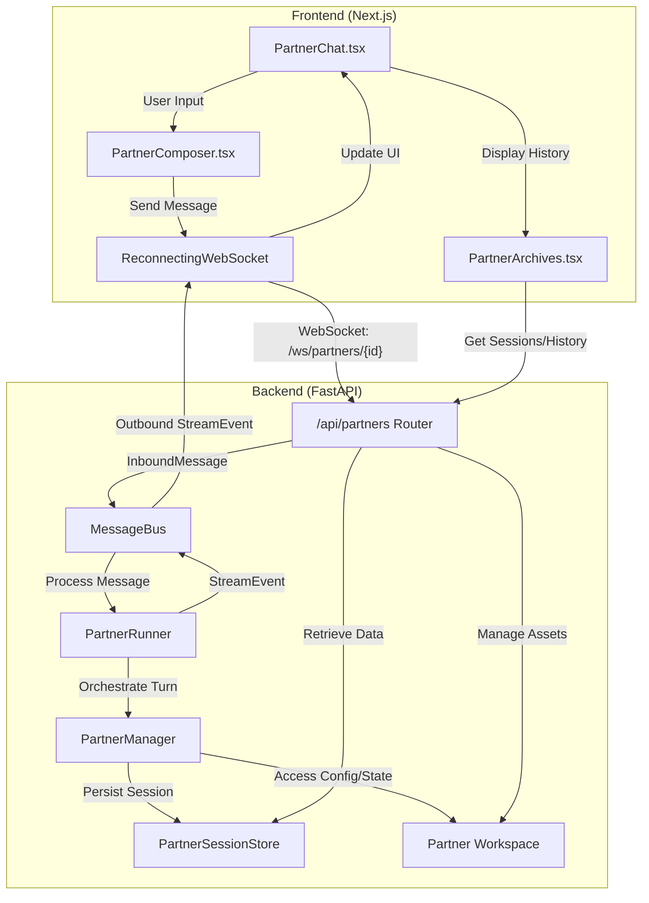
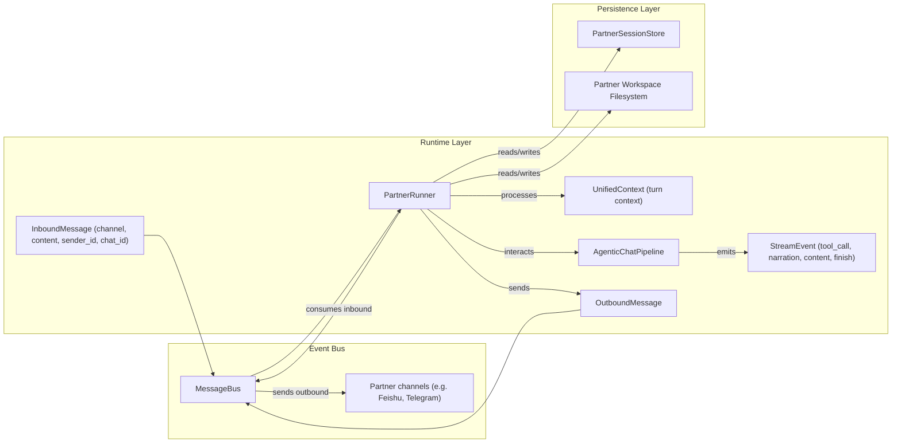

<!-- source: DeepWiki mcp.deepwiki.com · repo HKUDS/DeepTutor · page 8.1 Partner Runtime and Workspaces · fetched 2026-11-09 -->

# Partner Runtime and Workspaces

<details>
<summary>Relevant source files</summary>

The following files were used as context for generating this wiki page:

- [deeptutor/api/routers/partners.py](deeptutor/api/routers/partners.py)
- [deeptutor/api/routers/quiz_judge.py](deeptutor/api/routers/quiz_judge.py)
- [deeptutor/book/export.py](deeptutor/book/export.py)
- [deeptutor/book/overview_copy.py](deeptutor/book/overview_copy.py)
- [deeptutor/partners/__init__.py](deeptutor/partners/__init__.py)
- [deeptutor/partners/bus/__init__.py](deeptutor/partners/bus/__init__.py)
- [deeptutor/partners/bus/queue.py](deeptutor/partners/bus/queue.py)
- [deeptutor/partners/channels/__init__.py](deeptutor/partners/channels/__init__.py)
- [deeptutor/partners/channels/base.py](deeptutor/partners/channels/base.py)
- [deeptutor/partners/channels/email.py](deeptutor/partners/channels/email.py)
- [deeptutor/partners/channels/manager.py](deeptutor/partners/channels/manager.py)
- [deeptutor/runtime/banner.py](deeptutor/runtime/banner.py)
- [deeptutor/services/i18n.py](deeptutor/services/i18n.py)
- [deeptutor/services/partners/manager.py](deeptutor/services/partners/manager.py)
- [deeptutor/services/partners/runtime.py](deeptutor/services/partners/runtime.py)
- [tests/api/test_partners_channel_schema.py](tests/api/test_partners_channel_schema.py)
- [tests/api/test_partners_router.py](tests/api/test_partners_router.py)
- [tests/fixtures/portuguese_unchanged_ui.json](tests/fixtures/portuguese_unchanged_ui.json)
- [tests/i18n/test_portuguese_locale.py](tests/i18n/test_portuguese_locale.py)
- [tests/services/partners/test_channel_manager.py](tests/services/partners/test_channel_manager.py)
- [tests/services/partners/test_custom_seed_souls.py](tests/services/partners/test_custom_seed_souls.py)
- [tests/services/partners/test_partner_outbound_delivery.py](tests/services/partners/test_partner_outbound_delivery.py)
- [tests/services/partners/test_partner_runtime.py](tests/services/partners/test_partner_runtime.py)
- [tests/services/partners/test_turn_stop_cleanup.py](tests/services/partners/test_turn_stop_cleanup.py)
- [web/app/(workspace)/kanban/page.tsx](web/app/(workspace)/kanban/page.tsx)
- [web/app/(workspace)/partners/[partnerId]/page.tsx](web/app/(workspace)/partners/[partnerId]/page.tsx)
- [web/app/(workspace)/partners/new/page.tsx](web/app/(workspace)/partners/new/page.tsx)
- [web/components/chat/HistorySessionPicker.tsx](web/components/chat/HistorySessionPicker.tsx)
- [web/components/common/InlineFileCard.tsx](web/components/common/InlineFileCard.tsx)
- [web/components/partners/PartnerArchives.tsx](web/components/partners/PartnerArchives.tsx)
- [web/components/partners/PartnerChat.tsx](web/components/partners/PartnerChat.tsx)
- [web/components/partners/PartnerConfigure.tsx](web/components/partners/PartnerConfigure.tsx)
- [web/components/partners/group/PartnerSeat.tsx](web/components/partners/group/PartnerSeat.tsx)
- [web/features/co-writer/components/CoWriterWorkspace.tsx](web/features/co-writer/components/CoWriterWorkspace.tsx)
- [web/lib/message-content.ts](web/lib/message-content.ts)
- [web/lib/partner-chat-draft.ts](web/lib/partner-chat-draft.ts)
- [web/lib/session-title.ts](web/lib/session-title.ts)
- [web/locales/pt/app.json](web/locales/pt/app.json)
- [web/tests/generated-file-cards.spec.tsx](web/tests/generated-file-cards.spec.tsx)
- [web/tests/partner-archives-markdown.spec.tsx](web/tests/partner-archives-markdown.spec.tsx)
- [web/tests/partner-chat-draft.test.ts](web/tests/partner-chat-draft.test.ts)
- [web/tests/partner-detail-encoded-id.spec.tsx](web/tests/partner-detail-encoded-id.spec.tsx)
- [web/tests/partner-soul-load-errors.spec.tsx](web/tests/partner-soul-load-errors.spec.tsx)
- [web/tests/session-title.test.ts](web/tests/session-title.test.ts)
- [web/tests/workspace-present.test.ts](web/tests/workspace-present.test.ts)

</details>


This page details the Partner runtime environment, including how partner sessions are managed, the structure of their workspaces, their scope, grouping mechanisms, authoring capabilities, the event bus for communication, and the API router and frontend component `PartnerChat`.

## Partner Runtime and Workspaces

The Partner runtime provides an isolated and persistent environment for each AI companion. This section covers the structure and management of these environments.

### Partner Workspace Layout and Scope

Each partner operates within a dedicated workspace, which is a verbatim clone of the chat user-workspace format, following the `PathService` layout. This design allows the chat agent loop's tools to natively read and interact with the partner's assets without modification.

The workspace is structured as follows:

```text
data/partners/<id>/workspace/          ← synthetic scope root
├── knowledge_bases/<kb>/              ← copied KBs (retrieval-augmented generation assets)
└── user/
    ├── workspace/
    │   ├── SOUL.md                    ← the partner's persona definition
    │   ├── skills/<name>/SKILL.md     ← copied skills, each with SKILL.md and references
    │   ├── notebook/…                 ← copied notebooks used by the partner
    │   └── memory/…                   ← memory storage
    └── settings/ …                   ← configuration settings
```

This layout is implemented by the `ensure_partner_workspace` function, which creates this full chat-format workspace tree for a given partner ID, returning the scope root path. The `PathService` instance configured for this workspace root enables the chat tools to interact seamlessly [deeptutor/services/partners/workspace.py:4-14,70-92](). 

Provisioning of assets into this partner workspace occurs in the context of the requesting user. Asset sources are resolved considering the permissions and grants of this user (e.g., using `resolve_kb` for knowledge bases). The assets—knowledge bases, skills, and notebooks—are then cloned into the partner workspace as isolated, plain file copies. This design supports data isolation and security by sharing only what the user has access to.

- **Knowledge Bases (KBs)**: The entire knowledge base directory tree, including LlamaIndex versioned directories, is copied. Connected or pointer KBs (such as Obsidian or "linked" KBs) do not have a concrete directory structure and are registered through metadata files instead of physical copying.
- **Skills**: The entire skill directory (named `<skill_name>/`) is copied, including its `SKILL.md` and any associated references.
- **Notebooks**: Individual notebook JSON files and their index entries (`notebooks_index.json`) are copied.

This provisioning process is managed by `provision_assets` and reports successes and errors per asset type [deeptutor/services/partners/workspace.py:121-158](). 

Additionally, when cloning personas, any YAML frontmatter present in chat-persona markdown files is stripped using the utility function `strip_frontmatter` to produce plain markdown suitable for the `SOUL.md` persona file [deeptutor/services/partners/workspace.py:75-87]().

Sources:
- [deeptutor/services/partners/workspace.py:4-158]()

### Partner Groups and Sessions

Partner conversations are tracked and persisted in sessions managed by the `PartnerSessionStore`. This store organizes dialogues by unique `session_key`s that encode the channel and conversation identifier, for example, `telegram:42` for individual chats or `feishu_oc_math_group` for group conversations in Feishu [deeptutor/services/partners/runtime.py:163-164](). 

Channels providing metadata about the conversation type (such as Feishu's `chat_type`) enable explicit labeling of sessions as "group" or "direct". This label helps in multi-user settings and group management scenarios. If this meta-information is missing or unsupported, the session does not carry explicit scope labels [deeptutor/services/partners/runtime.py:128-167]().

This session model supports single and multi-party interactions and provides a mechanism to distinguish conversation context meaningfully.

Sources:
- [deeptutor/services/partners/runtime.py:128-167]()

### Partner Authoring Capability

Partners are authored and configured primarily via:

- **SOUL.md**: Each partner has a persona defined in `SOUL.md`, representing its core AI characteristics (termed the "soul"). This file is stored in the `workspace/` folder of the partner workspace. Reading and writing operations on this file are managed by `read_soul` and `write_soul` respectively. A default soul template is supplied if no persona is defined [deeptutor/services/partners/workspace.py:63-115]().
  
- **Asset Provisioning**: As described above, assets including knowledge bases, skills, and notebooks are provisioned into the partner workspace under the user's authorization context [deeptutor/services/partners/workspace.py:121-158]().

- **Workspace and Media Paths**: The partner workspace also includes a `media/` folder and session storage directories, following a logical layout consistent with chat user workspaces, ensuring all components operate with uniform expectations [deeptutor/services/partners/workspace.py:6-14]().

The authoring workflows are typically exposed through higher-level APIs and UI components, which invoke these backend services transparently.

Sources:
- [deeptutor/services/partners/workspace.py:6-158]()

### Partner Runtime and Event Bus

The core runtime for a partner is encapsulated in the `PartnerRunner` class which drives the chat agent loop from inbound IM messages. Each inbound message (encapsulated as an `InboundMessage`) triggers a chat turn executed inside the partner's workspace or, in the case of unbound partners, a private synthetic user scope. The partner has no independent engine; it uses the shared DeepTutor's `TurnEngine` and `AgenticChatPipeline` machinery [deeptutor/services/partners/runtime.py:1-64]().

Key details of the runtime:
- **Inbound message consumption** is done asynchronously from a `MessageBus`. Every inbound message routes through `_handle_inbound` which applies session identification, locking to avoid concurrent turn execution, and builds a `UnifiedContext` capturing conversation and partner state [deeptutor/services/partners/runtime.py:131-174]().

- **Event Types and Mapping**: Chat agent loop stream events (`StreamEvent`) generated during turn execution—including results, mid-turn commentary, tool calls, and progress updates—are mapped back to outbound messages that the partner sends via the bus [deeptutor/services/partners/runtime.py:9-21, 131-174]().

- **Session Locking**: To prevent overlapping responses in chat clients, session-based locks at the runtime level ensure one chat turn completes before the next begins, supporting concurrency control [deeptutor/services/partners/manager.py:64-88]().

- **Turn Options**: Via `PartnerTurnOptions`, runtime behavior can be customized per turn, such as injecting shared context for groups, disabling persistence, or restricting command invocation [deeptutor/services/partners/runtime.py:67-85]().

Sources:
- [deeptutor/services/partners/runtime.py:1-174]()
- [deeptutor/services/partners/manager.py:64-88]()

### Partners API Router and Frontend `PartnerChat`

The partner subsystem exposes a comprehensive API and interactive frontend components:

#### Partners API Router (`deeptutor.api.routers.partners`)

Implemented as a FastAPI router, it manages:

- **CRUD Operations**: Create, read, update, delete partners along with their configuration, soul, and asset workspace bindings.
- **Lifecycle Control**: Start, stop, and reload partner runtime instances inside the server process.
- **Session and History Access**: Retrieve and modify partner conversation history and archived sessions.
- **Assets and Workspace Management**: Provision, list, or remove knowledge bases, skills, and notebooks linked to the partner.
- **Command and Interaction APIs**: Dispatch slash commands, handle draft confirmations, and expose partner runtime status.
- **WebSocket Endpoint**: A WebSocket route at `/ws/partners/{partner_id}` allows real-time bi-directional communication with a partner, streaming agent chat turns and events [deeptutor/api/routers/partners.py:1-181](). 

The router integrates tightly with multi-user access control, permissions, and partner state coordination, embedding locks to prevent concurrency issues during start/stop commands [deeptutor/api/routers/partners.py:81-134](). It also masks sensitive channel secrets before exposing configs [deeptutor/services/partners/manager.py:130-152]().

Sources:
- [deeptutor/api/routers/partners.py:1-181]()
- [deeptutor/services/partners/manager.py:130-152]()

#### Frontend `PartnerChat` Component (`web/components/partners/PartnerChat.tsx`)

This React component offers the web chat UI for interacting with partners. It establishes a WebSocket connection to the backend route `/ws/partners/{id}`, allowing streaming of `StreamEvent`s to update the UI live as the agent processes turns. 

Key characteristics:
- **Rendering**: Uses existing product chat rendering components (`AssistantActivity`, `AssistantResponse`) to show live agent reasoning, tool usage traces, and answer text with detailed retraction and incremental updates [web/components/partners/PartnerChat.tsx:1-50]().

- **Attachment Support**: Displays message attachments including images (with preview), audio, files, and supports icons for document types [web/components/partners/PartnerChat.tsx:130-197]().

- **Session Commands**: Recognizes slash commands like `/new`, `/branch`, `/resume`, and others to manage the partner conversation session lifecycle on the client side [web/components/partners/PartnerChat.tsx:80-101]().

- **History Management**: Works with the `PartnerArchives` component to display and manage conversation archives, facilitating user navigation through past sessions [web/components/partners/PartnerArchives.tsx]().

- **Robust message normalization**: Converts backend partner message formats and attachments into a normalized shape for rendering, handling missing or malformed data gracefully [web/components/partners/PartnerChat.tsx:100-140]().

Sources:
- [web/components/partners/PartnerChat.tsx:1-197]()
- [web/components/partners/PartnerArchives.tsx:1-184]()

### Diagram: Partner Runtime and Frontend Interaction



Sources:
- [web/components/partners/PartnerChat.tsx:1-197]()
- [deeptutor/api/routers/partners.py:1-181]()
- [deeptutor/services/partners/runtime.py:1-174]()

### Diagram: Partner Runtime Logical Components and Data Flow



Sources:
- [deeptutor/services/partners/runtime.py:1-174]()
- [deeptutor/partners/bus/queue.py:1-50]()
- [deeptutor/services/partners/sessions.py:1-150]()

---

