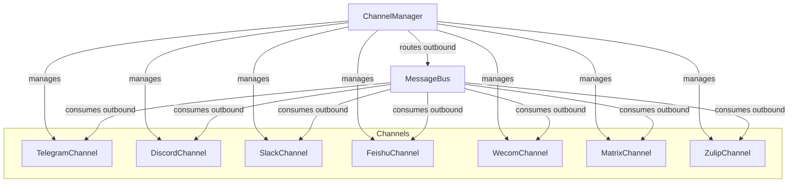
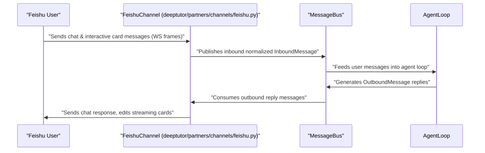

<!-- source: DeepWiki mcp.deepwiki.com · repo HKUDS/DeepTutor · page 8.2 Messaging Channels and Skills · fetched 2026-11-09 -->

# Messaging Channels and Skills

Relevant source files

The following files were used as context for generating this wiki page:

- [AGENTS.md](AGENTS.md)
- [SKILL.md](SKILL.md)
- [THIRD_PARTY_NOTICES.md](THIRD_PARTY_NOTICES.md)
- [deeptutor/partners/channels/feishu.py](deeptutor/partners/channels/feishu.py)
- [deeptutor/partners/channels/slack.py](deeptutor/partners/channels/slack.py)
- [deeptutor/partners/channels/telegram.py](deeptutor/partners/channels/telegram.py)
- [deeptutor/partners/helpers.py](deeptutor/partners/helpers.py)
- [deeptutor/services/partners/channel_onboarding.py](deeptutor/services/partners/channel_onboarding.py)
- [deeptutor/services/partners/commands.py](deeptutor/services/partners/commands.py)
- [deeptutor_cli/README.md](deeptutor_cli/README.md)
- [deeptutor_cli/provider_cmd.py](deeptutor_cli/provider_cmd.py)
- [packaging/deeptutor-cli/pyproject.toml](packaging/deeptutor-cli/pyproject.toml)
- [pyproject.toml](pyproject.toml)
- [requirements/cli.txt](requirements/cli.txt)
- [requirements/partners.txt](requirements/partners.txt)
- [scripts/start_tour.py](scripts/start_tour.py)
- [tests/cli/test_provider_cli.py](tests/cli/test_provider_cli.py)
- [tests/multi_user/test_owner_bound_models.py](tests/multi_user/test_owner_bound_models.py)
- [tests/partners/test_feishu_md_table_empty_edge_cells.py](tests/partners/test_feishu_md_table_empty_edge_cells.py)
- [tests/partners/test_markdown_table_empty_cells.py](tests/partners/test_markdown_table_empty_cells.py)
- [tests/partners/test_markdown_table_separator_row.py](tests/partners/test_markdown_table_separator_row.py)
- [tests/partners/test_split_markdown_table_row.py](tests/partners/test_split_markdown_table_row.py)
- [tests/scripts/test_start_tour.py](tests/scripts/test_start_tour.py)
- [tests/services/mcp/test_missing_mcp_dependency.py](tests/services/mcp/test_missing_mcp_dependency.py)
- [tests/services/partners/test_channel_onboarding.py](tests/services/partners/test_channel_onboarding.py)
- [tests/services/partners/test_feishu_domain_initialization.py](tests/services/partners/test_feishu_domain_initialization.py)
- [tests/services/partners/test_feishu_final_delivery.py](tests/services/partners/test_feishu_final_delivery.py)
- [tests/services/partners/test_feishu_model_picker.py](tests/services/partners/test_feishu_model_picker.py)
- [tests/services/partners/test_feishu_ws_card_callback.py](tests/services/partners/test_feishu_ws_card_callback.py)
- [tests/services/partners/test_partner_model_commands.py](tests/services/partners/test_partner_model_commands.py)
- [tests/services/partners/test_safe_filename.py](tests/services/partners/test_safe_filename.py)
- [tests/services/partners/test_split_message.py](tests/services/partners/test_split_message.py)
- [tests/services/partners/test_telegram_channel.py](tests/services/partners/test_telegram_channel.py)
- [tests/services/partners/test_telegram_markdown_html.py](tests/services/partners/test_telegram_markdown_html.py)
- [tests/services/partners/test_telegram_message_parsing.py](tests/services/partners/test_telegram_message_parsing.py)
- [tests/services/partners/test_weixin_onboarding.py](tests/services/partners/test_weixin_onboarding.py)
- [tests/test_packaging_metadata.py](tests/test_packaging_metadata.py)
- [web/components/partners/ChannelOnboardingPanel.tsx](web/components/partners/ChannelOnboardingPanel.tsx)

DeepTutor's Partner subsystem is designed to operate autonomously across various messaging platforms. This is achieved through a decoupled architecture where the `ChannelManager` handles platform-specific communication, and a unified agent loop executes tasks using a robust "Skill" system.

---

## Channel Management

The `ChannelManager` coordinates multiple messaging channels, abstracts messaging protocols, and manages message routing with retry, duplicate suppression, and streaming delta coalescing features.

### ChannelManager: Overview and Responsibilities

- Maintains initialized and running channel instances (e.g., Telegram, Feishu, Slack, Discord).
- Routes outbound messages through respective channels.
- Handles channel lifecycle: start, stop, and status tracking.
- Supports per-channel configuration including delivery flags (`send_progress`, `send_tool_hints`) [deeptutor/partners/channels/manager.py:31-120]().
  

Sources: [deeptutor/partners/channels/manager.py:31-120]()

### Channel Discovery and Registry

- Channels are dynamically discovered via Python's `pkgutil` scanning combined with entry point plugins.
- Discovery produces a dictionary of available channel classes with import error reporting [deeptutor/partners/channels/registry.py:55-70]().
- The registry supports runtime checking of channel availability for graceful degradation.

Sources: [deeptutor/partners/channels/registry.py:55-70]()

### Supported Channels and Key Implementation Notes

| Platform  | Class                      | Config Model           | Key Features                                                                                                   |
|-----------|----------------------------|------------------------|---------------------------------------------------------------------------------------------------------------|
| Telegram  | `TelegramChannel`           | `TelegramConfig`       | Uses python-telegram-bot, supports HTML conversion, streaming edits with `_StreamBuf` [deeptutor/partners/channels/telegram.py:1-50]() |
| Discord   | `DiscordChannel`            | `DiscordConfig`        | Gateway WebSocket, message splitting, typing indicators                                                        |
| Feishu    | `FeishuChannel`             | `FeishuConfig`         | WebSocket long connection, interactive cards support, rich message parsing & custom WS client                  |
| Slack     | `SlackChannel`              | `SlackConfig`          | Socket Mode for interaction, Slack-specific markdown conversion, threaded replies                              |
| WeCom     | `WecomChannel`              | `WecomConfig`          | WebSocket client, supports multiple message types (text, image, voice, file)                                  |
| Matrix    | `MatrixChannel`             | `MatrixConfig`         | Supports E2EE integration with matrix-nio[e2e]                                                               |
| Zulip     | `ZulipChannel`              | `ZulipConfig`          | Uses Zulip Python client, handles message send/receive                                                        |

Sources: [deeptutor/partners/channels/telegram.py:1-50]()

### Example: FeishuChannel

- Uses the `lark_oapi` SDK with a custom WebSocket client that handles card callback messages with multipart payloads [deeptutor/partners/channels/feishu.py:32-76]().
- Provides rich message extraction for share cards and interactive elements, flattening them into readable text snippets [deeptutor/partners/channels/feishu.py:88-106]().
- Supports streaming message delivery and reaction handling for message progress feedback.
  

Sources: [deeptutor/partners/channels/feishu.py:32-106]()

### MessageBus and Streaming

- The `MessageBus` carries both `InboundMessage` and `OutboundMessage` events.
- Streaming support allows progressive message edits and partial content updates on supported channels [deeptutor/partners/bus/queue.py:1-40]().
- Channels use `send_delta` flags to coalesce message edits and avoid flooding users with repeated messages.

Sources: [deeptutor/partners/bus/queue.py:1-40]()

---

## Content Helpers and Normalization

The `deeptutor.partners.helpers` module offers utilities for consistent message formatting and platform compatibility:

| Helper Function                         | Purpose                                                                                                    |
|---------------------------------------|------------------------------------------------------------------------------------------------------------|
| `detect_image_mime(data: bytes) -> str \| None` | Detects image MIME type from magic bytes for file uploads [deeptutor/partners/helpers.py:10-21](). |
| `safe_filename(name: str) -> str`       | Sanitizes strings for safe filesystem paths, removing unsafe and control characters [deeptutor/partners/helpers.py:7](). |
| `split_message(content: str, max_len) -> list[str]` | Splits long messages into platform-size-limited chunks, preferring line breaks [deeptutor/partners/helpers.py:34-67](). |
| `split_markdown_table_row(line: str) -> list[str]`| Splits markdown pipe table rows accurately, preserving empty columns [deeptutor/partners/helpers.py:69-82](). |
| `is_markdown_table_separator_row(cells: list[str]) -> bool` | Checks if a row is a markdown table separator (e.g., `| --- | --- |`) [deeptutor/partners/helpers.py:84-90](). |
| `convert_markdown_table_to_labeled_rows(text: str) -> str` | Converts markdown tables into Slack-style labeled rows for better text display [deeptutor/partners/helpers.py:92-109](). |

These helpers ensure that outbound messages respect platform constraints like Telegram's 4000 character limit or Discord's 2000 character limit and handle rich content gracefully.

Sources: [deeptutor/partners/helpers.py:7-109]()

---

## The Skill System

The Skill system empowers DeepTutor agents with programmable capabilities by injecting structured behavior instructions and CLI tool references directly into the LLM context.

### SKILL.md Definition

- A declarative Markdown file enumerating the skill's purpose, environment setup, and detailed allowed CLI commands [SKILL.md:1-10]().
- Primary skill exposes the full `deeptutor` CLI, allowing the agent to operate autonomously within safe constraints.

Sources: [SKILL.md:1-10]()

### Sample Skill Content

| Category         | Commands Example                                                   | Location          |
|------------------|-------------------------------------------------------------------|-------------------|
| Chat & Capabilities | `deeptutor chat`, `deeptutor run chat`, `deeptutor run deep_solve` | [SKILL.md:33-58]() |
| Knowledge Bases  | `deeptutor kb create`, `deeptutor kb add`, `deeptutor kb search`   | [SKILL.md:65-76]() |
| Partners         | `deeptutor partner create`, `deeptutor partner start`, `deeptutor partner stop` | [SKILL.md:78-89]() |
| Skills & Hubs    | `deeptutor skill search`, `deeptutor skill install`, `deeptutor skill list` | [SKILL.md:91-101]() |
| Books            | `deeptutor book list`, `deeptutor book health`                    | [SKILL.md:105-111]() |
| Memory           | `deeptutor memory show`, `deeptutor memory clear`                 | [SKILL.md:115-119]() |
| Sessions         | `deeptutor session list`, `deeptutor session show`                | [SKILL.md:123-129]() |
| Notebooks        | `deeptutor notebook list`, `deeptutor notebook add-md`            | [SKILL.md:133-140]() |
| Providers        | `deeptutor provider login openai-codex`                           | [SKILL.md:144-147]() |
| System           | `deeptutor config show`                                           | [SKILL.md:151]() |

Sources: [SKILL.md:33-151]()

### Skill Registry & ClawHub

- Skills can be searched and installed dynamically from external hubs such as ClawHub.
- Hub references take the form `<hub>:<slug>[@version]` to specify manifest and version [SKILL.md:91-99]().

Sources: [SKILL.md:91-99]()

---

## Integration with Notebooks and Parsing Cache

DeepTutor integrates channel messaging and capability results with the persistent `Notebook` storage for archival and RAG (Retrieval Augmented Generation) workflows.

### Parsing Cache

- The parsing cache keyed by `(source_hash, parser_signature)` prevents redundant parsing and enables consistent intermediate representation (IR) reuse [deeptutor/services/parsing/cache.py:25-47]().
- `load_ir` reads Markdown content, structured data blocks, and asset references, absolutizing relative image URLs to ensure robust path resolution [deeptutor/services/parsing/cache.py:126-178]().

Sources: [deeptutor/services/parsing/cache.py:25-178]()

### Skill-to-Notebook Data Flow

```mermaid
graph LR
    CLI["deeptutor CLI [deeptutor_cli/main.py]"]
    APP["DeepTutorApp Facade [deeptutor/app/facade.py]"]
    PARSE["ParseCache [deeptutor/services/parsing/cache.py:7]"]
    MANI["manifest.json [deeptutor/services/parsing/cache.py:31]"]
    SKILLS["Skill Registry [SKILL.md]"]

    CLI -- "deeptutor notebook add-md" --> APP
    APP -- "reserve/lookup" --> PARSE
    PARSE -- "writes last" --> MANI
    SKILLS -- "provides command schema" --> CLI
    PARSE -- "load_ir()" --> APP
```

Sources: [deeptutor/services/parsing/cache.py:7-31](), [SKILL.md:1-152]()

---

# Summary Diagram: Messaging Channels to Code Entities

```mermaid
graph TD
    subgraph "Natural Language Space (External)"
        UserTG["Telegram User"]
        UserDiscord["Discord User"]
        UserSlack["Slack User"]
        UserWeCom["WeCom User"]
        UserFeishu["Feishu User"]
        UserMatrix["Matrix User"]
        UserZulip["Zulip User"]
    end

    subgraph "Code Entity Space (Internal)"
        subgraph "Channel Layer [deeptutor/partners/channels/]"
            TC["TelegramChannel [telegram.py:21]"]
            DC["DiscordChannel [discord.py:49]"]
            SC["SlackChannel [slack.py:51]"]
            WC["WecomChannel [wecom.py:40]"]
            FC["FeishuChannel [feishu.py:20]"]
            MC["MatrixChannel [matrix.py:30]"]
            ZC["ZulipChannel [zulip.py:20]"]
            REG["registry.py [registry.py]"]
        end

        subgraph "Bus & Orchestration"
            MB["MessageBus [bus/queue.py]"]
            OM["OutboundMessage [bus/events.py:18]"]
            IM["InboundMessage [bus/events.py:11]"]
        end

        subgraph "Agent Runtime & Manager"
            AL["PartnerRunner [services/partners/runtime.py:130]"]
            MGR["PartnerManager [services/partners/manager.py:31]"]
        end
    end

    UserTG -- "Update" --> TC
    UserDiscord -- "Gateway Event" --> DC
    UserSlack -- "SocketModeRequest" --> SC
    UserWeCom -- "WS Frame" --> WC
    UserFeishu -- "WS Frame" --> FC
    UserMatrix -- "Client Event" --> MC
    UserZulip -- "Client Event" --> ZC

    TC -- "bus.publish_inbound()" --> MB
    DC -- "bus.publish_inbound()" --> MB
    SC -- "bus.publish_inbound()" --> MB
    WC -- "bus.publish_inbound()" --> MB
    FC -- "bus.publish_inbound()" --> MB
    MC -- "bus.publish_inbound()" --> MB
    ZC -- "bus.publish_inbound()" --> MB

    MB -- "consume_inbound()" --> AL
    AL -- "generates" --> OM
    OM -- "bus.publish_outbound()" --> MB

    MB -- "consume_outbound()" --> TC
    MB -- "consume_outbound()" --> DC
    MB -- "consume_outbound()" --> SC
    MB -- "consume_outbound()" --> WC
    MB -- "consume_outbound()" --> FC
    MB -- "consume_outbound()" --> MC
    MB -- "consume_outbound()" --> ZC

    TC -- "bot.send_message()" --> UserTG
    SC -- "chat_postMessage()" --> UserSlack
    WC -- "client.reply_welcome()" --> UserWeCom
    MC -- "client.room_send()" --> UserMatrix
    ZC -- "client.send_message()" --> UserZulip
```

Sources: [deeptutor/partners/channels/manager.py:31-173](), [deeptutor/services/partners/runtime.py:131-174](), [deeptutor/services/partners/manager.py:31-107]()

---

# Sources

- ChannelManager and runtime: [deeptutor/partners/channels/manager.py:31-173](), [deeptutor/services/partners/runtime.py:131-174](), [deeptutor/services/partners/manager.py:31-107]()
- Channel implementations: [deeptutor/partners/channels/feishu.py:1-188](), [deeptutor/partners/channels/telegram.py:1-188](), [deeptutor/partners/channels/slack.py:1-170](), [deeptutor/partners/channels/wecom.py:40-110](), [deeptutor/partners/channels/discord.py:40-160](), [deeptutor/partners/channels/matrix.py:1-100](), [deeptutor/partners/channels/zulip.py:10-60]()
- Message bus and events: [deeptutor/partners/bus/events.py:1-30](), [deeptutor/partners/bus/queue.py:1-40]()
- Content helpers: [deeptutor/partners/helpers.py:1-109]()
- Skill system: [SKILL.md:1-152]()
- Parsing cache & notebook integration: [deeptutor/services/parsing/cache.py:1-180]()

---

