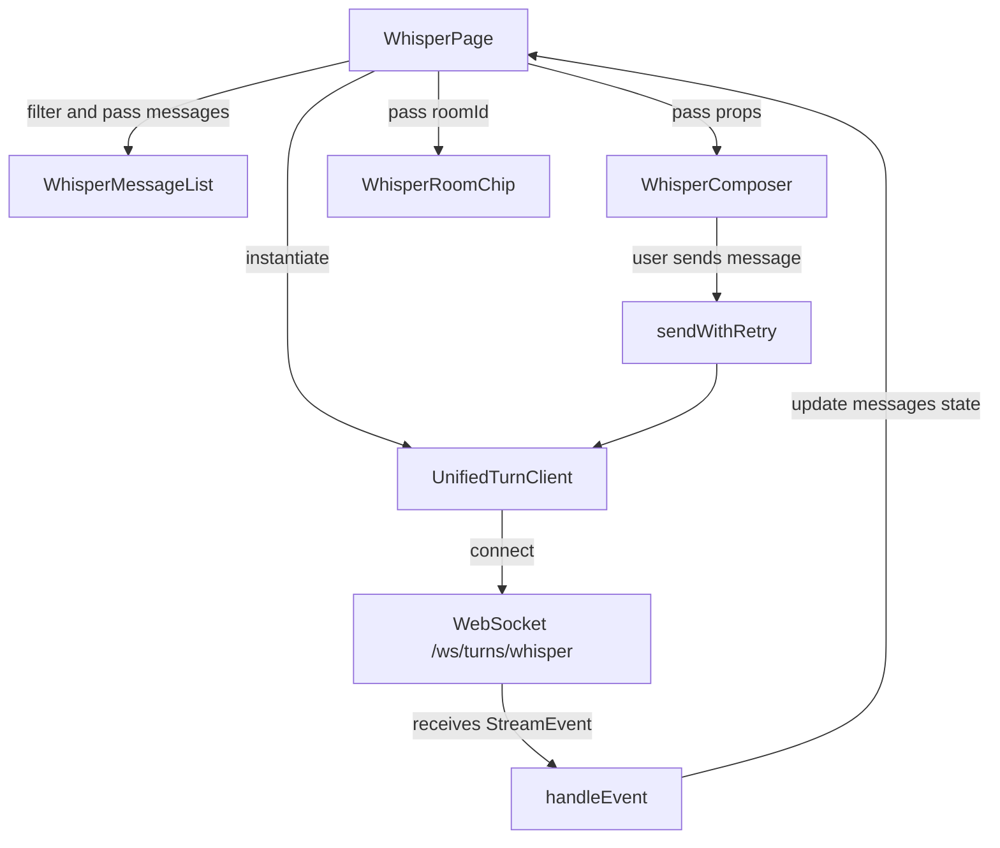
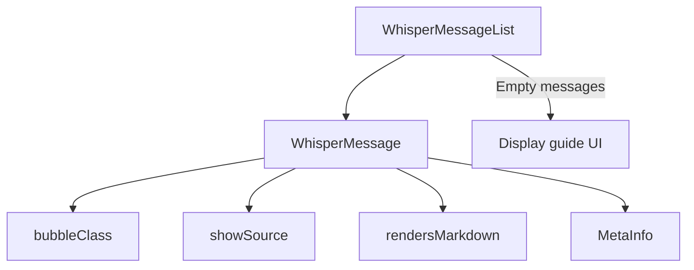
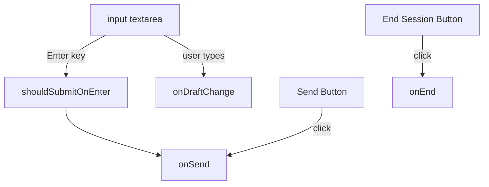
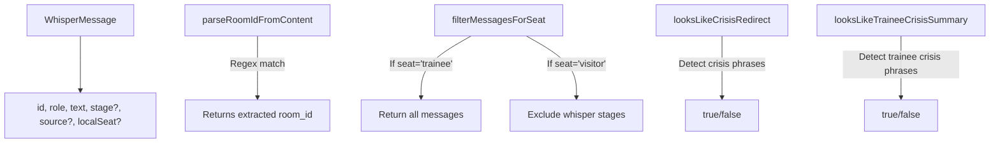
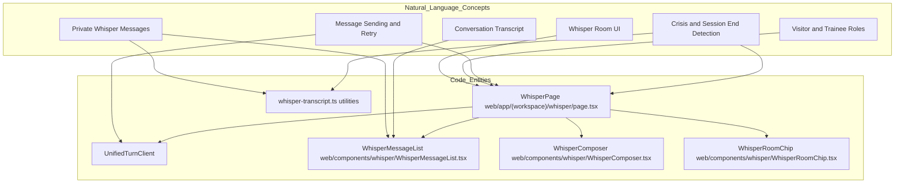
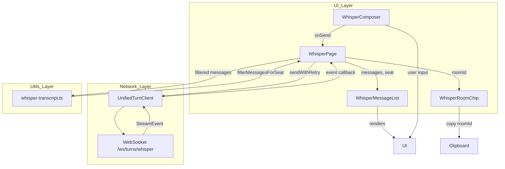

<!-- source: DeepWiki mcp.deepwiki.com · repo HKUDS/DeepTutor · page 8.3 Whisper Rooms · fetched 2026-11-09 -->

# Whisper Rooms

<details>
<summary>Relevant source files</summary>

The following files were used as context for generating this wiki page:

- [deeptutor/api/router_index.json](deeptutor/api/router_index.json)
- [web/app/(workspace)/kanban/page.tsx](web/app/(workspace)/kanban/page.tsx)
- [web/app/(workspace)/partners/[partnerId]/page.tsx](web/app/(workspace)/partners/[partnerId]/page.tsx)
- [web/components/chat/HistorySessionPicker.tsx](web/components/chat/HistorySessionPicker.tsx)
- [web/components/common/InlineFileCard.tsx](web/components/common/InlineFileCard.tsx)
- [web/components/partners/PartnerArchives.tsx](web/components/partners/PartnerArchives.tsx)
- [web/components/partners/PartnerChat.tsx](web/components/partners/PartnerChat.tsx)
- [web/components/partners/group/PartnerSeat.tsx](web/components/partners/group/PartnerSeat.tsx)
- [web/components/reading/workspace/ReadingCompanion.tsx](web/components/reading/workspace/ReadingCompanion.tsx)
- [web/components/space/learning/MasteryStudy.tsx](web/components/space/learning/MasteryStudy.tsx)
- [web/contracts/generated/api.ts](web/contracts/generated/api.ts)
- [web/contracts/schema/openapi.json](web/contracts/schema/openapi.json)
- [web/features/chat/ChatStateAdapter.tsx](web/features/chat/ChatStateAdapter.tsx)
- [web/features/chat/components/ChatWorkspace.tsx](web/features/chat/components/ChatWorkspace.tsx)
- [web/features/chat/messages/ChatMessageList.tsx](web/features/chat/messages/ChatMessageList.tsx)
- [web/features/co-writer/components/CoWriterWorkspace.tsx](web/features/co-writer/components/CoWriterWorkspace.tsx)
- [web/lib/failed-submissions.ts](web/lib/failed-submissions.ts)
- [web/lib/message-content.ts](web/lib/message-content.ts)
- [web/lib/partner-chat-draft.ts](web/lib/partner-chat-draft.ts)
- [web/lib/session-title.ts](web/lib/session-title.ts)
- [web/locales/de/app.json](web/locales/de/app.json)
- [web/locales/en/app.json](web/locales/en/app.json)
- [web/locales/fr/app.json](web/locales/fr/app.json)
- [web/locales/pl/app.json](web/locales/pl/app.json)
- [web/locales/uk/app.json](web/locales/uk/app.json)
- [web/locales/zh/app.json](web/locales/zh/app.json)
- [web/tests/chat-failed-submission-recovery.spec.tsx](web/tests/chat-failed-submission-recovery.spec.tsx)
- [web/tests/generated-file-cards.spec.tsx](web/tests/generated-file-cards.spec.tsx)
- [web/tests/integration/chat-messages.spec.tsx](web/tests/integration/chat-messages.spec.tsx)
- [web/tests/partner-archives-markdown.spec.tsx](web/tests/partner-archives-markdown.spec.tsx)
- [web/tests/partner-chat-draft.test.ts](web/tests/partner-chat-draft.test.ts)
- [web/tests/partner-detail-encoded-id.spec.tsx](web/tests/partner-detail-encoded-id.spec.tsx)
- [web/tests/session-failed-submission-cleanup.spec.ts](web/tests/session-failed-submission-cleanup.spec.ts)
- [web/tests/session-title.test.ts](web/tests/session-title.test.ts)
- [web/tests/workspace-present.test.ts](web/tests/workspace-present.test.ts)

</details>


This leaf page details the implementation of the Whisper multi-agent room UI in DeepTutor. Whisper Rooms provide a private dual-seat conversational interface where a "visitor" and a "trainee" interact with an AI assistant, enabling private guidance or counseling. The page covers key UI components—`WhisperMessageList`, `WhisperComposer`, and `WhisperRoomChip`—transcript handling utilities, and internationalization (i18n) integration.

---

## WhisperPage Component Overview

The `WhisperPage` component orchestrates the Whisper room experience. It manages connection to the backend WebSocket, message state, user seat roles, and UI interactions [web/app/(workspace)/whisper/page.tsx:40-413]().

### State and Hooks

- **Seats and Roles:**
  - `seat`: A string `"visitor"` or `"trainee"` marking the current user role [web/app/(workspace)/whisper/page.tsx:42]().
  - `roomId`: Unique identifier for the current Whisper room session [web/app/(workspace)/whisper/page.tsx:43]().
- **Messaging:**
  - `messages`: Array of `WhisperMessage` objects representing the transcript [web/app/(workspace)/whisper/page.tsx:44]().
  - `draft`: Current text in the message input box [web/app/(workspace)/whisper/page.tsx:48]().
- **Connection and Session:**
  - `clientRef`: `useRef` holding the `UnifiedTurnClient` instance communicating with server [web/app/(workspace)/whisper/page.tsx:54-56]().
  - `dtSessionId`: DeepTutor backend session identifier [web/app/(workspace)/whisper/page.tsx:49]().
  - `connected` and `everConnected`: Flags for WebSocket connection state [web/app/(workspace)/whisper/page.tsx:50-51]().
- **UI/Flow Control:**
  - `busy`: If the system is currently processing a send operation [web/app/(workspace)/whisper/page.tsx:45]().
  - `crisisHit`: Flag set when a crisis message pattern is detected [web/app/(workspace)/whisper/page.tsx:46]().
  - `roomClosed`: True if the room session has been ended [web/app/(workspace)/whisper/page.tsx:47]().

### WebSocket Setup and Event Handling

- Uses `UnifiedTurnClient` to connect to `/ws/turns/whisper` endpoint and send/receive chat events [web/app/(workspace)/whisper/page.tsx:139-169]().
- `handleEvent`: Processes incoming `StreamEvent`s for updates:
  - Updates session metadata on `"session/session_meta"` event.
  - Detects `room_id` from initial content messages via `parseRoomIdFromContent`.
  - Detects crisis or room closure phrases via utility functions.
  - Updates `messages` with new chat content [web/app/(workspace)/whisper/page.tsx:71-137]().

### Message Sending with Retry Logic

- `sendWithRetry`: Sends a message payload over WebSocket.
  - If not connected, attempts reconnect with exponential backoff retry up to 10 times.
  - Keeps track of retry timers to prevent duplicated retries [web/app/(workspace)/whisper/page.tsx:188-212]().

### UI Subcomponents Composed

- `WhisperRoomChip`: Displays and allows copying the current `roomId` [web/app/(workspace)/whisper/page.tsx:240-242]().
- `WhisperMessageList`: Renders filtered messages for current seat view [web/app/(workspace)/whisper/page.tsx:243-245]().
- `WhisperComposer`: Text input and controls for sending messages or ending the session [web/app/(workspace)/whisper/page.tsx:246-257]().

### User Interaction Flow

1. Visitor sends the first message; backend responds with a `room_id` which is set in state.
2. User may switch between seats (visitor/trainee) to see or enter private ("whisper") messages.
3. Messages for a seat are filtered to show only relevant transcript parts.
4. Crisis redirection or session closure triggers UI state updates disabling input.
5. Messages are appended or updated in-place as new events arrive.


Sources: [web/app/(workspace)/whisper/page.tsx:40-413]()

---

## WhisperMessageList Component

The `WhisperMessageList` renders transcripts with role-based filtering and custom styling [web/components/whisper/WhisperMessageList.tsx:8-137]().

### Props

- `messages`: Array of transcript messages.
- `seat`: Current user seat, `"visitor"` or `"trainee"`.

### Message Rendering Logic

- **Bubble Styles (`bubbleClass`)**: Assigns CSS classes to messages based on:
  - `role`: user, assistant, or system.
  - `stage`: `"whisper"` (private trainee-only) or `"debrief"` (summary or notes).
- **Source Display (`showSource`)**: Avoids showing internal system message sources like `"whisper_visitor"` or `"whisper_trainee"`.
- **Markdown Rendering (`rendersMarkdown`)**: Renders assistant messages as Markdown; user and system messages as plain text.
- **Meta Info**: Displays icons or labels for whisper messages, stages, source marker, and local (optimistic) seat.

### Empty State Guidance

Shows a user guide with 3 steps with icons:
1. Visitor starts conversation.
2. Trainee counsels privately (whispers).
3. Ends session and reviews transcript.


Sources: [web/components/whisper/WhisperMessageList.tsx:8-137]()

---

## WhisperComposer Component

The `WhisperComposer` is the multi-seat message input UI with send and end session controls [web/components/whisper/WhisperComposer.tsx:10-104]().

### Props

- `seat`: Current user seat.
- `draft`: Current input string.
- `busy`: Whether sending/in-progress.
- `sendDisabled`: Disables send button (e.g., room closed).
- `inputDisabled`: Disables text input box.
- `showEndButton`: Show "End session" button.
- `endDisabled`: Disable end session action.
- `onDraftChange`: Callback on input change.
- `onSend`: Callback to send the message.
- `onEnd`: Callback to end the session.

### Features

- Textarea:
  - Placeholder changes by seat ("Ask for help" visitor, "Enter whisper notes" trainee).
  - Controlled input bound to `draft`.
  - Handles IME composition to avoid premature sends.
- Send Button:
  - Disabled if `sendDisabled` or empty.
  - Shows loading spinner when `busy`.
- End Session Button:
  - Visible if `showEndButton` and enabled per `endDisabled`.

### Keyboard Support

- Pressing Enter (without Shift or IME composition) triggers send.


Sources: [web/components/whisper/WhisperComposer.tsx:10-104]()

---

## WhisperRoomChip Component

The `WhisperRoomChip` displays the current Whisper room ID and provides a copy-to-clipboard feature [web/components/whisper/WhisperRoomChip.tsx:8-46]().

### Props

- `roomId`: The current Whisper room ID string.

### Behavior

- Displays `roomId` in a monospace-styled block.
- Copy button toggles icon on click (copy/check).
- Copies `roomId` to clipboard asynchronously.
- Shows ephemeral visual feedback for successful copy.

Sources: [web/components/whisper/WhisperRoomChip.tsx:8-46]()

---

## Transcript Utilities (`whisper-transcript.ts`)

Transcript processing helpers designed for the Whisper multi-seat conversation are located in `web/lib/whisper-transcript.ts` [web/lib/whisper-transcript.ts:1-55]().

### Whisper Types

```typescript
export type WhisperSeat = "visitor" | "trainee";

export interface WhisperMessage {
  id: string;
  role: "user" | "assistant" | "system";
  text: string;
  stage?: "whisper" | "debrief";
  source?: string;
  localSeat?: WhisperSeat;
}
```

### Key Functions

- **`parseRoomIdFromContent`**: Extracts `room_id` string from a message text, matching pattern `room_id=...`. Returns null if not found.
- **`filterMessagesForSeat`**: Filters messages depending on seat:
  - If seat is `"trainee"`, returns all messages (full transcript).
  - If `"visitor"`, excludes messages with `stage === "whisper"` or messages from `"whisper_trainee"` source with `stage === "debrief"`.
- **`looksLikeCrisisRedirect`**: Tests if message text matches English or Chinese patterns indicating crisis redirect messages.
- **`looksLikeTraineeCrisisSummary`**: Tests if text matches trainee-facing crisis summary phrases.


Sources: [web/lib/whisper-transcript.ts:1-55]()

---

## Internationalization (i18n) Support

Whisper room components employ the `react-i18next` library for translation support:

- All user-facing strings use the `t()` function for lookup [web/app/(workspace)/whisper/page.tsx:41-41](), [web/components/whisper/WhisperComposer.tsx:37-37](), [web/components/whisper/WhisperMessageList.tsx:45-45](), [web/components/whisper/WhisperRoomChip.tsx:13-13]().
- Test suite `whisper-i18n.test.ts` ensures localization completeness, checking key presence and translation parity between English and Chinese locales [web/tests/whisper-i18n.test.ts:1-101]().

Sources: [web/app/(workspace)/whisper/page.tsx:41-41](), [web/components/whisper/WhisperComposer.tsx:37-37](), [web/components/whisper/WhisperMessageList.tsx:45-45](), [web/components/whisper/WhisperRoomChip.tsx:13-13](), [web/tests/whisper-i18n.test.ts:1-101]()

---

# Natural Language to Code Entity Space


Sources: [web/app/(workspace)/whisper/page.tsx:40-413](), [web/components/whisper/WhisperMessageList.tsx:8-137](), [web/components/whisper/WhisperComposer.tsx:10-104](), [web/components/whisper/WhisperRoomChip.tsx:8-46](), [web/lib/whisper-transcript.ts:1-55]()

---

# Detailed Component Data Flow


Sources: [web/app/(workspace)/whisper/page.tsx:40-413](), [web/components/whisper/WhisperMessageList.tsx:8-137](), [web/components/whisper/WhisperComposer.tsx:10-104](), [web/components/whisper/WhisperRoomChip.tsx:8-46](), [web/lib/whisper-transcript.ts:1-55]()

---

