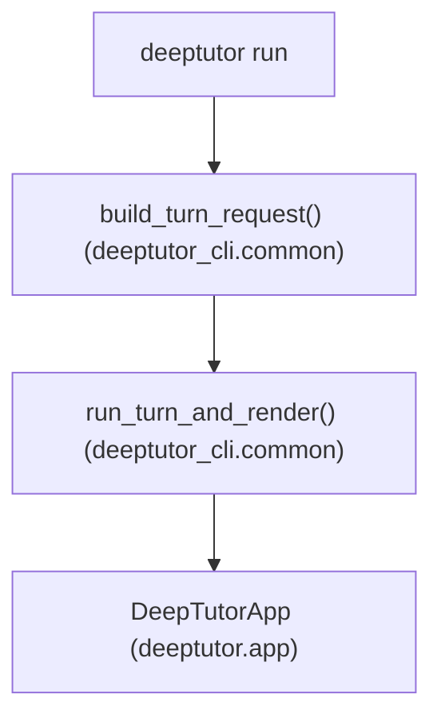
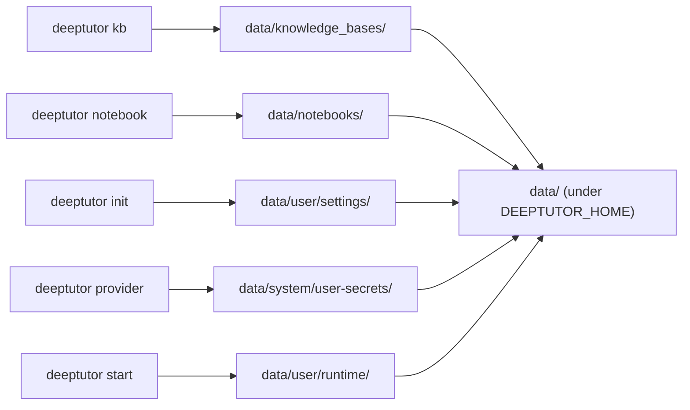

<!-- source: DeepWiki mcp.deepwiki.com · repo HKUDS/DeepTutor · page 9 CLI Reference · fetched 2026-11-09 -->

# CLI Reference

Relevant source files

The following files were used as context for generating this wiki page:

- [AGENTS.md](AGENTS.md)
- [SKILL.md](SKILL.md)
- [deeptutor/api/routers/system.py](deeptutor/api/routers/system.py)
- [deeptutor/api/run_server.py](deeptutor/api/run_server.py)
- [deeptutor/runtime/launcher.py](deeptutor/runtime/launcher.py)
- [deeptutor/runtime/process.py](deeptutor/runtime/process.py)
- [deeptutor/runtime/update_worker.py](deeptutor/runtime/update_worker.py)
- [deeptutor/services/app_update.py](deeptutor/services/app_update.py)
- [deeptutor_cli/README.md](deeptutor_cli/README.md)
- [deeptutor_cli/main.py](deeptutor_cli/main.py)
- [deeptutor_cli/provider_cmd.py](deeptutor_cli/provider_cmd.py)
- [tests/api/test_system_router.py](tests/api/test_system_router.py)
- [tests/cli/test_chat_cli.py](tests/cli/test_chat_cli.py)
- [tests/cli/test_provider_cli.py](tests/cli/test_provider_cli.py)
- [tests/multi_user/test_owner_bound_models.py](tests/multi_user/test_owner_bound_models.py)
- [tests/runtime/test_launcher.py](tests/runtime/test_launcher.py)
- [tests/runtime/test_launcher_lifecycle.py](tests/runtime/test_launcher_lifecycle.py)
- [tests/runtime/test_run_server_memory_mode.py](tests/runtime/test_run_server_memory_mode.py)
- [tests/runtime/test_uvicorn_launch_flags.py](tests/runtime/test_uvicorn_launch_flags.py)
- [tests/services/test_app_update.py](tests/services/test_app_update.py)

The purpose of this page is to provide a high-level reference for the `deeptutor` Command-Line Interface (CLI), outlining its sub-commands, runtime modes, flags, and usage patterns. As a parent page, it introduces the core interface categories and links to detailed child pages for sub-commands.

Sources: [`deeptutor_cli/main.py:30-181`](), [`SKILL.md:23-56`]()

---

## Overview of the CLI Structure and Command Registry

DeepTutor’s CLI architecture is built using the `typer` framework [deeptutor_cli/main.py:9-35](). It organizes functionality into modular sub-command apps that handle everything from single-turn capability invocation to multi-turn conversational REPLs, server orchestration, and resource management.

| Sub-command | Description | Source/Reference |
|-------------|-------------|------------------|
| `run`       | Execute a single-turn capability (e.g., `chat`, `deep_solve`) with runtime options. | [`deeptutor_cli/main.py:77-117`]() |
| `chat`      | Launch an interactive multi-turn REPL for conversational agent interaction. | [`deeptutor_cli/main.py:37-37`](), [`SKILL.md:71-74`]() |
| `partner`   | Manage persistent IM companions and multi-channel bindings. | [`deeptutor_cli/main.py:37-37`](), [`SKILL.md:118-125`]() |
| `kb`        | Knowledge base operations and RAG management. | [`deeptutor_cli/main.py:39-39`](), [`SKILL.md:104-116`]() |
| `skill`     | Manage skills and install them from external hubs. | [`deeptutor_cli/main.py:38-38`]() |
| `session`   | Handle shared session management and history. | [`deeptutor_cli/main.py:41-41`]() |
| `notebook`  | Manage instructional markdown notebooks. | [`deeptutor_cli/main.py:45-45`]() |
| `memory`    | View and manage hierarchical persistent memory. | [`deeptutor_cli/main.py:41-41`]() |
| `config`    | Inspect and apply configuration settings. | [`deeptutor_cli/main.py:40-40`](), [`SKILL.md:41-48`]() |
| `provider`  | Manage provider OAuth login and credential validation. | [`deeptutor_cli/main.py:42-42`](), [`deeptutor_cli/provider_cmd.py:17-40`]() |
| `doctor`    | Run system diagnostics to verify setup and online connectivity. | [`deeptutor_cli/main.py:70-70`](), [`SKILL.md:46-47`]() |
| `serve`     | Start the FastAPI backend server in hosting mode. | [`deeptutor_cli/main.py:164-168`](), [`deeptutor/api/run_server.py:30-95`]() |
| `start`     | Launch backend (`FastAPI`) and frontend (`Next.js`) together. | [`deeptutor_cli/main.py:123-141`](), [`deeptutor/runtime/launcher.py:141-150`]() |
| `init`      | Interactive workspace setup wizard. | [`deeptutor_cli/main.py:71-71`](), [`SKILL.md:27-27`]() |

Sources: [`deeptutor_cli/main.py:30-181`](), [`SKILL.md:23-56`]()

---

## Core Execution and Launcher Commands

The CLI provides entry points for single-shot agent execution (`run`), interactive REPL sessions (`chat`), and full-stack application lifecycle management (`start`, `stop`, `serve`).

- **`run`**: Executes a single-turn capability (e.g., `deep_solve`, `deep_research`) using `build_turn_request` and `DeepTutorApp` [deeptutor_cli/main.py:107-120]().
- **`chat`**: Opens a conversational REPL that accepts runtime flags and slash commands (`/cap`, `/tool`, `/kb`, `/config`) [deeptutor_cli/main.py:54](), [`SKILL.md:154-170`].
- **`start` / `stop`**: Boots or gracefully terminates the combined FastAPI backend and Next.js frontend application stack, handling port probing and process groups [`deeptutor/runtime/launcher.py:141-161`]().
- **`serve`**: Starts the FastAPI backend directly via `uvicorn` under `RunMode.SERVER`, managing event loop policies on Windows [`deeptutor/api/run_server.py:17-95`]().

For detailed command usage, flags, and syntax, see [Core CLI Commands](#9.1).

Sources: [`deeptutor_cli/main.py:77-181`](), [`deeptutor/api/run_server.py:7-95`](), [`deeptutor/runtime/launcher.py:141-195`]()

---

## Diagnostics, Provider Authentication, and Resource Management

System maintenance and configuration commands help diagnose issues and manage authentication:
- **`doctor`**: Verifies system readiness, storage permissions, and provider connections [deeptutor_cli/main.py:70]().
- **`provider`**: Handles OAuth flows and credential validation for providers like OpenAI Codex, GitHub Copilot, and CodeBuddy [`deeptutor_cli/provider_cmd.py:17-168`]().

For details on managing knowledge bases, sessions, notebooks, memory, workspaces, and skills, see [Knowledge Base, Session and Workspace Commands](#9.2).

Sources: [`deeptutor_cli/main.py:38-60`](), [`deeptutor_cli/provider_cmd.py:17-168`]()

---

## Architecture and Command Mapping

### Diagram: Capability Execution Flow

The following diagram illustrates how user inputs to `deeptutor run` are mapped through `build_turn_request` to the `DeepTutorApp` execution facade in code entity space.

Diagram: Capability Execution Flow

Sources: [`deeptutor_cli/main.py:77-121`](), [`deeptutor_cli/common.py:16`](), [`deeptutor/app/__init__.py`]

---

### Diagram: CLI Commands to Persistent Data Entities

The following diagram associates CLI sub-commands with their target persistent directory structures under `DEEPTUTOR_HOME`.

Diagram: CLI Commands to Persistent Data Entities

Sources: [`deeptutor_cli/main.py:39-60`](), [`deeptutor/runtime/home.py:28-31`](), [`deeptutor/runtime/launcher.py:67-80`]()

---

## Navigation to Child Pages

- For details on initialization, server starting, REPL chat, and capability execution, see [Core CLI Commands](#9.1).
- For details on knowledge bases (`kb`), sessions, notebooks, memory, workspaces, and plugins, see [Knowledge Base, Session and Workspace Commands](#9.2).

Sources: [`SKILL.md:27-217`]()

---

