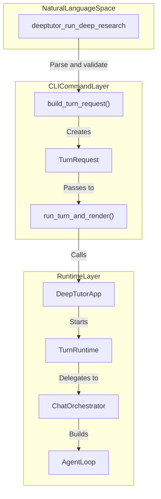
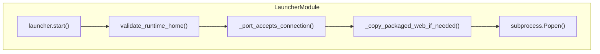
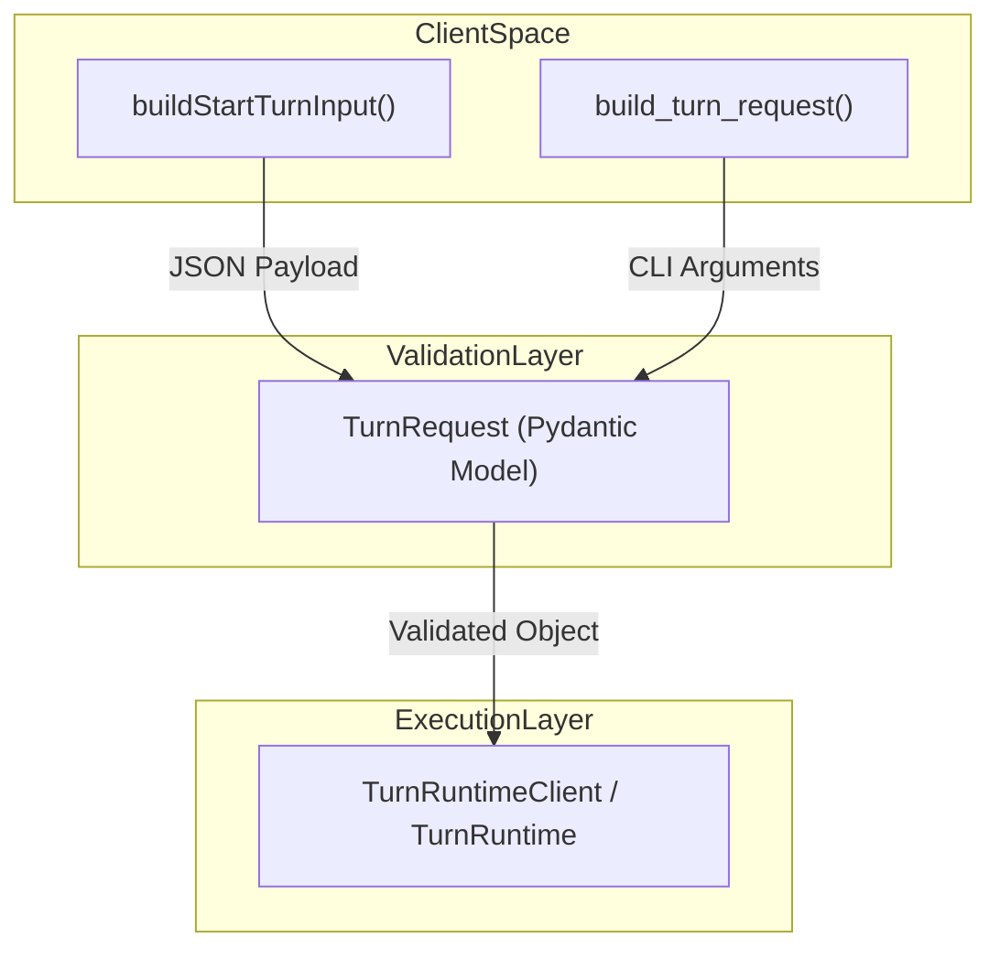
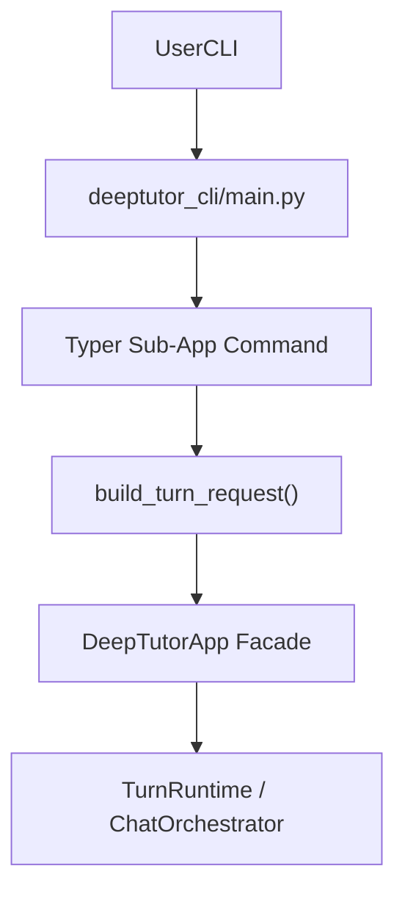

<!-- source: DeepWiki mcp.deepwiki.com · repo HKUDS/DeepTutor · page 9.1 Core CLI Commands · fetched 2026-11-09 -->

# Core CLI Commands

Relevant source files

The following files were used as context for generating this wiki page:

- [deeptutor/api/routers/system.py](deeptutor/api/routers/system.py)
- [deeptutor/api/run_server.py](deeptutor/api/run_server.py)
- [deeptutor/core/response_languages.py](deeptutor/core/response_languages.py)
- [deeptutor/core/turn_request.py](deeptutor/core/turn_request.py)
- [deeptutor/response_languages.py](deeptutor/response_languages.py)
- [deeptutor/runtime/launcher.py](deeptutor/runtime/launcher.py)
- [deeptutor/runtime/process.py](deeptutor/runtime/process.py)
- [deeptutor/runtime/update_worker.py](deeptutor/runtime/update_worker.py)
- [deeptutor/services/app_update.py](deeptutor/services/app_update.py)
- [deeptutor/services/search/consolidation.py](deeptutor/services/search/consolidation.py)
- [deeptutor/services/search/providers/__init__.py](deeptutor/services/search/providers/__init__.py)
- [deeptutor/services/search/providers/google_browser_scraper.py](deeptutor/services/search/providers/google_browser_scraper.py)
- [deeptutor/services/search/providers/perplexity.py](deeptutor/services/search/providers/perplexity.py)
- [deeptutor/services/search/providers/serply.py](deeptutor/services/search/providers/serply.py)
- [deeptutor/services/search/providers/youcom.py](deeptutor/services/search/providers/youcom.py)
- [deeptutor_cli/init_wizard.py](deeptutor_cli/init_wizard.py)
- [deeptutor_cli/main.py](deeptutor_cli/main.py)
- [tests/api/test_system_router.py](tests/api/test_system_router.py)
- [tests/capabilities/test_handoff.py](tests/capabilities/test_handoff.py)
- [tests/cli/test_chat_cli.py](tests/cli/test_chat_cli.py)
- [tests/cli/test_init_wizard_probe.py](tests/cli/test_init_wizard_probe.py)
- [tests/runtime/test_launcher.py](tests/runtime/test_launcher.py)
- [tests/runtime/test_launcher_lifecycle.py](tests/runtime/test_launcher_lifecycle.py)
- [tests/runtime/test_run_server_memory_mode.py](tests/runtime/test_run_server_memory_mode.py)
- [tests/runtime/test_uvicorn_launch_flags.py](tests/runtime/test_uvicorn_launch_flags.py)
- [tests/services/search/test_search_providers.py](tests/services/search/test_search_providers.py)
- [tests/services/session/test_reply_language_override.py](tests/services/session/test_reply_language_override.py)
- [tests/services/test_app_update.py](tests/services/test_app_update.py)
- [web/contracts/generated/turn-protocol.ts](web/contracts/generated/turn-protocol.ts)
- [web/contracts/schema/turn-protocol.json](web/contracts/schema/turn-protocol.json)
- [web/features/chat/controllers/buildStartTurnInput.ts](web/features/chat/controllers/buildStartTurnInput.ts)
- [web/features/chat/model/start-turn.ts](web/features/chat/model/start-turn.ts)
- [web/public/provider-icons/youcom.ico](web/public/provider-icons/youcom.ico)
- [web/tests/start-turn-input.test.ts](web/tests/start-turn-input.test.ts)

The DeepTutor CLI provides a powerful, agent-first command line interface enabling users and developers to operate the DeepTutor intelligent tutoring system. This CLI supports a rich set of commands facilitating everything from running agent capabilities interactively or single-turn, to managing backend/frontend processes, plugins, knowledge bases, and providers. It acts as a direct, scriptable access point to the DeepTutor platform's core functions.

The CLI is built using the `typer` library, which organizes commands and sub-commands in a modular fashion. Upon entry, the CLI sets the global runtime mode to `CLI` to tailor runtime behavior accordingly.

Sources: [deeptutor_cli/main.py:1-35]()

---

## CLI Architecture Overview

The CLI is structured around a main Typer app with several nested sub-apps for modular command grouping:

| Sub-App Name | Purpose | Registration Location |
|--------------|---------|----------------------|
| `run` | Execute any capability in a single turn | [deeptutor_cli/main.py:77-121]() |
| `chat` | Interactive multi-turn chat REPL | [deeptutor_cli/main.py:37-54]() |
| `start` | Launch backend + frontend processes | [deeptutor_cli/main.py:124-150]() |
| `stop` | Stop detached DeepTutor processes | [deeptutor_cli/main.py:152-161]() |
| `serve` | Run the FastAPI API server standalone | [deeptutor_cli/main.py:163-181]() |
| `init` | Run init wizard and setup | [deeptutor_cli/main.py:71-71]() |
| `provider` | OAuth provider management | [deeptutor_cli/main.py:51-59]() |

This modular setup organizes core runtime commands distinctly from resource and administrative tasks, facilitating extensibility and maintenance.

Sources: [deeptutor_cli/main.py:30-75]() 

---

## Natural Language to CLI Code Mapping

The CLI accepts user input in natural language form, commands, and options which it systematically translates into structured requests and runtime actions within DeepTutor.

Title: Natural Language Space to Code Entity Space for CLI Turn Execution

This flow exemplifies how the CLI’s user input is normalized and entrusted to deeper runtime components for capability execution.

Sources: [deeptutor_cli/main.py:77-121](), [deeptutor_cli/common.py:1-149]()

---

## Core Command Details

### `deeptutor run`

The `run` command is the fundamental way to invoke any capability programmatically with a single turn. Its key features include:

- **Capability argument:** Select the capability by name (e.g., `chat`, `deep_solve`, `deep_research`). Aliases map to canonical names internally.
- **Message:** The user's input content for the capability to process.
- **Options:** Attach tools (`--tool`), knowledge bases (`--kb`), notebooks (`--notebook-ref`), session scoping (`--session`), language, and per-capability config overrides.
- **Output formatting:** Supports rich terminal rendering or JSON streaming output (`--format`).

**Implementation flow:**

1. Uses `build_turn_request()` to create a typed `TurnRequest` object that validates and normalizes inputs [deeptutor_cli/main.py:107-118](), [deeptutor/core/turn_request.py:141-179]().
2. Instantiates `DeepTutorApp` facade (optionally scoped to a workspace) to manage turn start and streaming results [deeptutor_cli/main.py:119-120]().
3. Executes `run_turn_and_render()` that coordinates turn submission, streams intermediate events, and displays final results [deeptutor_cli/main.py:120-120]().

Sources: [deeptutor_cli/main.py:77-121](), [deeptutor/core/turn_request.py:141-179]()

---

### `deeptutor chat`

The `chat` command initiates an interactive REPL with session continuity, multi-turn conversations, and rich slash-command support.

**Features:**
- Session resume via `--session`
- Workspace scoping via `--workspace`
- Pre-load tools, capabilities, knowledge bases, and configuration
- Handles slash commands like `/quit`, `/new`, `/tool on|off`, `/cap`, `/regenerate`, `/show`, and configuration management

**Implementation details:**
- Uses `DeepTutorApp` facade for turn handling [deeptutor_cli/main.py:103-120]().
- Reads and parses user input line by line, wrapping messages into `TurnRequest` instances [deeptutor/core/turn_request.py:141-179]().

Sources: [deeptutor_cli/chat.py:1-196](), [deeptutor/core/turn_request.py:141-179]()

---

### `deeptutor start`

The `start` command is the main orchestrator that launches the full DeepTutor environment locally: backend API server plus frontend Next.js server.

**Key Options:**
- `--home`: Specifies workspace root folder (runtime data, config, outputs) [deeptutor_cli/main.py:125-125]().
- `--dev`: Enables development mode to run Next.js in development server [deeptutor_cli/main.py:126-130]().
- `--detach`: Runs backend + frontend in background, detaching from CLI console [deeptutor_cli/main.py:131-135]().
- `--open-browser`: Automatically open browser tab for frontend URL [deeptutor_cli/main.py:136-140]().

**Implementation Highlights:**
- The `start()` function delegates to `deeptutor.runtime.launcher.start` [deeptutor_cli/main.py:143-149]().
- Validates runtime home paths using `validate_runtime_home()` to prevent bad nesting [deeptutor/runtime/home.py:26-31](), [tests/runtime/test_launcher.py:129-148]().
- Handles detached launcher states (`launcher.json`, `launcher.stop`, `launcher.log`) [deeptutor/runtime/launcher.py:165-171]().

Title: Launcher Subsystem and Process Management Flow

Sources: [deeptutor_cli/main.py:124-150](), [deeptutor/runtime/launcher.py:113-211](), [tests/runtime/test_launcher.py:129-148]()

---

### `deeptutor stop`

The `stop` command cleanly shuts down a detached DeepTutor instance launched by `deeptutor start --detach` [deeptutor_cli/main.py:152-161](). It reads detached state, writes to `launcher.stop`, and signals the background supervisor process to terminate gracefully [deeptutor/runtime/launcher.py:180-206]().

Sources: [deeptutor_cli/main.py:152-161](), [deeptutor/runtime/launcher.py:180-206]()

---

### `deeptutor serve`

Used for running only the API server (backend FastAPI) independently of frontend [deeptutor_cli/main.py:163-181](). Sets `RunMode` to `SERVER` and invokes `uvicorn.run()` [deeptutor_cli/main.py:176-181]().

Sources: [deeptutor_cli/main.py:163-181]()

---

## TurnRequest Building Utilities

The codebase relies on strict typed value objects for turn requests (`TurnRequest`) defined in backend schemas and mirrored in frontend structures [deeptutor/core/turn_request.py:141-179](), [web/features/chat/controllers/buildStartTurnInput.ts:51-131]().

Title: Turn Request Construction and Mapping to Runtime Entities

Sources: [deeptutor/core/turn_request.py:141-179](), [web/features/chat/controllers/buildStartTurnInput.ts:51-131]()

---

# Summary Diagram: Core CLI Command Flow from User Input to Runtime

Title: Complete CLI Execution Pipeline from CLI Entry to Runtime Capability

Sources: [deeptutor_cli/main.py:1-181](), [deeptutor/core/turn_request.py:141-179]()

---

# References

- [deeptutor_cli/main.py:1-181]()
- [deeptutor_cli/chat.py:1-196]()
- [deeptutor/runtime/launcher.py:1-211]()
- [deeptutor/core/turn_request.py:1-179]()
- [web/features/chat/controllers/buildStartTurnInput.ts:51-131]()
- [tests/runtime/test_launcher.py:1-194]()

---

