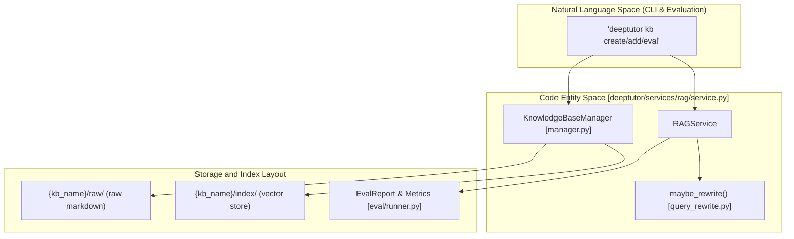
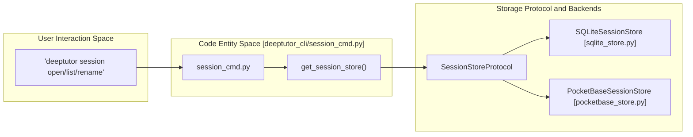

<!-- source: DeepWiki mcp.deepwiki.com · repo HKUDS/DeepTutor · page 9.2 Knowledge Base, Session and Workspace Commands · fetched 2026-11-09 -->

# Knowledge Base, Session and Workspace Commands

Relevant source files

The following files were used as context for generating this wiki page:

- [AGENTS.md](AGENTS.md)
- [SKILL.md](SKILL.md)
- [deeptutor/logging/process_stream.py](deeptutor/logging/process_stream.py)
- [deeptutor/services/config/__init__.py](deeptutor/services/config/__init__.py)
- [deeptutor/services/rag/query_rewrite.py](deeptutor/services/rag/query_rewrite.py)
- [deeptutor/services/rag/service.py](deeptutor/services/rag/service.py)
- [deeptutor_cli/README.md](deeptutor_cli/README.md)
- [deeptutor_cli/provider_cmd.py](deeptutor_cli/provider_cmd.py)
- [tests/cli/test_kb_eval_cli.py](tests/cli/test_kb_eval_cli.py)
- [tests/cli/test_provider_cli.py](tests/cli/test_provider_cli.py)
- [tests/logging/test_process_logs.py](tests/logging/test_process_logs.py)
- [tests/multi_user/test_owner_bound_models.py](tests/multi_user/test_owner_bound_models.py)
- [tests/services/rag/eval/test_eval_diff.py](tests/services/rag/eval/test_eval_diff.py)
- [tests/services/rag/eval/test_eval_runner.py](tests/services/rag/eval/test_eval_runner.py)
- [tests/services/rag/test_query_rewrite.py](tests/services/rag/test_query_rewrite.py)
- [tests/services/rag/test_rag_service_rewrite.py](tests/services/rag/test_rag_service_rewrite.py)

This section provides a technical reference for the DeepTutor CLI sub-commands dedicated to managing persistent data, including Knowledge Bases (KB), KB retrieval evaluation, chat sessions, long-term memory, shared notebooks, workspace configurations, skills, and provider credentials. These commands interact directly with the unified data layout and underlying storage systems, enabling management of knowledge resources, conversational state, and workspace preferences.

---

## Knowledge Base (KB) Commands

The `deeptutor kb` suite offers commands to manage RAG (Retrieval-Augmented Generation) knowledge bases: indexing documents, synchronizing web sources, searching, evaluating retrieval performance, and maintaining metadata. These commands utilize the `KnowledgeBaseManager`, `RAGService`, and related indexing pipelines.

### Command Overview

The KB commands are organized under a `kb` sub-command group implemented in `deeptutor_cli/kb.py`. This includes capabilities to create, add to, list, inspect, search, evaluate, and sync knowledge bases.

| Sub-command  | Description                            | Implementation Reference                                |
|--------------|------------------------------------|-------------------------------------------------------|
| `list`       | Lists all registered knowledge bases.     | `mgr.list_knowledge_bases()` [deeptutor_cli/kb.py:68-68]()          |
| `info`       | View metadata and configuration of a KB. | `mgr.get_info(name)` [deeptutor_cli/kb.py:122-122]()                 |
| `create`     | Initialize a new knowledge base from files or dirs. | `initialize_knowledge_base()` [deeptutor_cli/kb.py:174-179]()         |
| `add`        | Append documents to an existing KB.    | `add_documents(...)` [deeptutor_cli/kb.py:192-200]()                  |
| `set-default`| Set the default knowledge base.        | `mgr.set_default(name)` [deeptutor_cli/kb.py:133-133]()               |
| `search`     | Search a knowledge base using a query. | `RAGService.search()` [deeptutor/services/rag/service.py:127-134]()    |
| `eval`       | Evaluate retrieval performance against QA sets. | `RetrievalEvaluator` [tests/cli/test_kb_eval_cli.py:41-71]() |
| `sync`       | Synchronize external web sources to KB.| `sync_source()` [deeptutor/services/web_source/sync.py:97-104]()      |

### Retrieval Evaluation (`kb eval`)

The `deeptutor kb eval` command assesses retrieval quality against a JSONL dataset containing queries and gold-standard answer chunks (`{"query": ..., "gold": [...]}`). It computes metrics such as `Recall@k`, `Precision@k`, `nDCG@k`, `MRR`, `MAP`, and `Hit@k` per case and aggregated across the set [tests/cli/test_kb_eval_cli.py:113-140](). Reasoning-as-retrieval engines like PageIndex are rejected by the CLI during evaluation since they require agentic loops rather than standard vector similarity searches [tests/cli/test_kb_eval_cli.py:168-180]().

### Query Rewriting in RAG Searches

Before queries reach the KB retrieval pipeline, `RAGService.search()` optionally executes a fail-open query rewrite layer (`deeptutor.services.rag.query_rewrite`). This layer transforms conversational or anaphoric queries into self-contained, keyword-leaning search queries via a single LLM call (`standalone` strategy) [deeptutor/services/rag/query_rewrite.py:1-38](). If the LLM call times out or fails, the layer falls back to the original query (`fail-open`) [deeptutor/services/rag/query_rewrite.py:75-120]().

Sources: [deeptutor_cli/kb.py:61-200](), [deeptutor/services/rag/service.py:127-166](), [deeptutor/services/rag/query_rewrite.py:1-186](), [tests/cli/test_kb_eval_cli.py:1-180]()

### Data Flow: KB Document Ingestion and Evaluation

Sources: [deeptutor/services/rag/service.py:68-166](), [deeptutor/services/rag/query_rewrite.py:138-177](), [tests/services/rag/eval/test_eval_runner.py:51-87]()

---

## Session Management Commands

The `deeptutor session` sub-commands manage chat sessions which capture conversational histories and metadata for persistent, resumable agent interactions.

### Implementation Details

Sessions are stored via `SessionStoreProtocol`, which abstracts backend storage implemented by:

- `SQLiteSessionStore`: SQLite database in `DEEPTUTOR_HOME/data/user/chat_history.db` [tests/services/session/test_sqlite_store.py:26-26]()  
- `PocketBaseSessionStore`: PocketBase collections scoped by `user_id` for multi-user environments [deeptutor/services/session/pocketbase_store.py:82-99]()

The CLI commands interact with the session store to perform:

| Command | Action                     | Implementation Reference                  |
|---------|----------------------------|-----------------------------------------|
| `list`  | List recent sessions.       | `list_sessions()` [deeptutor/services/session/protocol.py:55-55]()   |
| `open`  | Resume a session in REPL.   | `get_session()` [deeptutor/services/session/protocol.py:42-42]()     |
| `rename`| Update session title.       | `update_session_title()` [deeptutor/services/session/protocol.py:61-61]() |
| `delete`| Soft-delete a session.      | `soft_delete_session()` [deeptutor/services/session/protocol.py:63-63]() |
| `hard-delete` | Permanently delete session. | `hard_delete_session()` [deeptutor/services/session/protocol.py:67-67]() |
| `restore`| Restore a soft-deleted session.| `restore_session()` [deeptutor/services/session/protocol.py:65-65]() |
| `search`| Search session content.     | `search_sessions()` [deeptutor/services/session/protocol.py:57-59]()  |

Sources: [deeptutor_cli/session_cmd.py:1-1](), [deeptutor/services/session/protocol.py:33-137](), [deeptutor/services/session/sqlite_store.py:1-1](), [deeptutor/services/session/pocketbase_store.py:82-177]()

### Code Entity Mapping for Session Commands

Sources: [deeptutor_cli/session_cmd.py:1-1](), [deeptutor/services/session/protocol.py:137-137](), [deeptutor/services/session/sqlite_store.py:1-1](), [deeptutor/services/session/pocketbase_store.py:1-1]()

---

## Notebook and Memory Commands

### Notebooks (`deeptutor notebook`)

Notebooks persist curated user content such as chat excerpts, solutions, or research notes for referencing in future agent turns.

- Notebook entries can be filtered using a rich query model (`QuestionBankQuery`), allowing search by attributes like category, bookmarked status, correctness, source type, material IDs, section IDs, resolved status, score trends, or general text search [deeptutor/services/session/sqlite_store.py:160-188]().
- The CLI integrates notebook references during turn execution via the `--notebook-ref` flag [SKILL.md:88-96]().

### Long-term Memory (`deeptutor memory`)

Memory commands manage persistent user context outside of active sessions. Memory backend files are stored under the user data directory.

Sources: [deeptutor/services/session/sqlite_store.py:160-188](), [SKILL.md:88-96]()

---

## Workspace Commands

`deeptutor workspace` commands enable users to configure and manage their workspaces, including session preferences and organizational metadata linking sessions to courses, mastery topics, or reading collections.

### Implementation

Workspace preferences are stored inside session metadata via the session store. Migration utilities such as `migrate_workspace_preferences()` in `SessionStoreProtocol` handle updating structures, e.g., session types, parent pointers for nested sessions, pinning, and archiving states [deeptutor/services/session/protocol.py:33-33](), [deeptutor/services/session/pocketbase_store.py:143-177]().

### Frontend Interaction Components

- **WorkspaceSidebar**: Presents organized session lists by course, mastery path, and reading collection [web/components/sidebar/WorkspaceSidebar.tsx:33-140]().
- **SidebarShell**: Main shell component rendering navigation and session summaries [web/components/sidebar/SidebarShell.tsx:129-144]().

### Workspace Preference Fields

| Field             | Description                                             |
|-------------------|---------------------------------------------------------|
| `capability`      | Primary capability used in the session.                  |
| `workspace_mode`  | Learning surface mode (e.g., `immersive_reading`).       |
| `tools`           | List of enabled tools.                                   |
| `knowledge_bases` | Linked knowledge base IDs.                               |
| `llm_selection`   | Chosen LLM model ID.                                    |
| `mastery_path_id` | Mastery path identifier for learning sessions.          |
| `course_id`       | Associated course ID.                                   |
| `parent_session_id` | Parent session, enabling nested or threaded sessions.  |
| `session_kind`    | Type of session (e.g., `chat`, `selection_tutor`).      |
| `pinned`          | Whether the session is pinned in UI.                      |
| `archived`        | Whether the session is archived.                          |

Sources: [web/components/sidebar/WorkspaceSidebar.tsx:33-140](), [web/components/sidebar/SidebarShell.tsx:129-144](), [deeptutor/api/routers/sessions.py:31-105](), [deeptutor/services/session/protocol.py:33-33](), [deeptutor/services/session/pocketbase_store.py:143-177]()

---

## Skill, Plugin and Provider Authentication Commands

### Skill and Plugin Management (`deeptutor skill`, `deeptutor plugin`)

Skills and plugins correspond to AI capabilities, agent tools, or specialized features loaded as pluggable components. They dynamically register their commands and integrate with the capability registry at runtime [SKILL.md:1-1]().

### Provider Authentication (`deeptutor provider login`)

The `deeptutor provider login` command authenticates or validates access for external LLM backends and provider SDKs [deeptutor_cli/provider_cmd.py:17-40]():
- `openai-codex`: Initiates an OAuth login flow with callback handling and remote tunneling instructions [deeptutor_cli/provider_cmd.py:43-84]().
- `github-copilot`: Executes a GitHub device authorization flow and validates model access [deeptutor_cli/provider_cmd.py:86-118]().
- `codebuddy`: Validates CodeBuddy SDK credentials or triggers an in-app interactive login flow [deeptutor_cli/provider_cmd.py:119-173]().

Sources: [SKILL.md:1-1](), [deeptutor_cli/provider_cmd.py:1-173]()

---

