# Page: Overview

# Overview

<details>
<summary>Relevant source files</summary>

The following files were used as context for generating this wiki page:

- [README.md](README.md)
- [assets/README/README_AR.md](assets/README/README_AR.md)
- [assets/README/README_CN.md](assets/README/README_CN.md)
- [assets/README/README_ES.md](assets/README/README_ES.md)
- [assets/README/README_FR.md](assets/README/README_FR.md)
- [assets/README/README_HI.md](assets/README/README_HI.md)
- [assets/README/README_JA.md](assets/README/README_JA.md)
- [assets/README/README_PL.md](assets/README/README_PL.md)
- [assets/README/README_PT.md](assets/README/README_PT.md)
- [assets/README/README_RU.md](assets/README/README_RU.md)
- [assets/README/README_TH.md](assets/README/README_TH.md)
- [assets/roster/forkers.svg](assets/roster/forkers.svg)
- [assets/roster/stargazers.svg](assets/roster/stargazers.svg)
- [deeptutor/__version__.py](deeptutor/__version__.py)
- [packaging/deeptutor-cli/pyproject.toml](packaging/deeptutor-cli/pyproject.toml)
- [pyproject.toml](pyproject.toml)
- [requirements/cli.txt](requirements/cli.txt)
- [requirements/partners.txt](requirements/partners.txt)
- [scripts/start_tour.py](scripts/start_tour.py)
- [tests/scripts/test_start_tour.py](tests/scripts/test_start_tour.py)
- [tests/services/mcp/test_missing_mcp_dependency.py](tests/services/mcp/test_missing_mcp_dependency.py)
- [tests/services/partners/test_weixin_onboarding.py](tests/services/partners/test_weixin_onboarding.py)
- [tests/test_packaging_metadata.py](tests/test_packaging_metadata.py)

</details>


## Purpose and Scope

DeepTutor is an agent-native lifelong personalized tutoring workspace designed to integrate tutoring, problem-solving, quiz generation, research, visualization, and mastery practice into a unified, extensible system [README.md:4-66](). It enables connected pedagogical workflows by sharing a runtime and session context among diverse learning modes such as Chat, Quiz, Research, Mastery Path, and Immersive Reading or Watching [README.md:60-61]().

At the architectural level, DeepTutor spans four main layers: a Next.js-based web frontend serving the user interface, a FastAPI backend providing API and WebSocket transport, an agent capability runtime orchestrating intelligent multi-agent workflows, and foundational backend services managing language models, knowledge bases, session memory, and storage [README.md:60-65](), [pyproject.toml:50-95]().

Sources: [README.md:4-66](), [pyproject.toml:50-95]()

---

## Four-Layer System Architecture

DeepTutor’s technical architecture is structured in four operational layers, each with clear responsibilities and integration points:

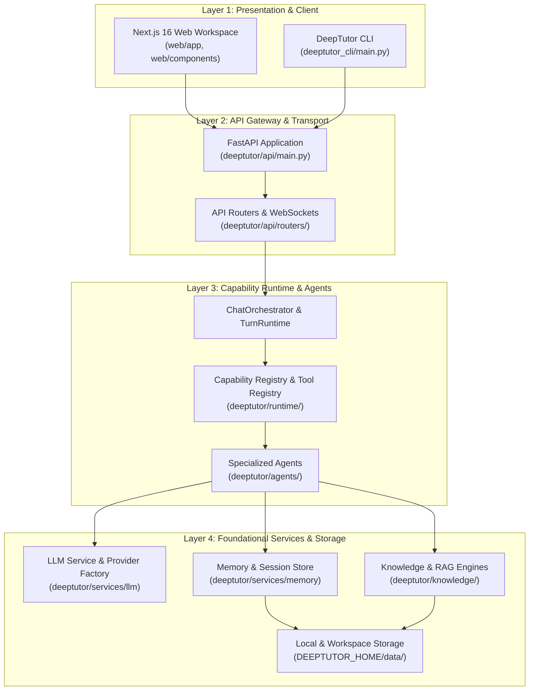

**Layer details:**

1. **Presentation & Client:** The user interfaces, including the Next.js 16-based web workspace (source under `web/app`, `web/components`) and the DeepTutor CLI client defined in `pyproject.toml` pointing to `deeptutor_cli.main:main` [pyproject.toml:50](). These components communicate with backend APIs or WebSockets.

2. **API Gateway & Transport:** A FastAPI web application (`deeptutor/api/main.py`) serves REST and WebSocket endpoints through modular routers (`deeptutor/api/routers/`), forming the backend interface for frontend and CLI clients.

3. **Capability Runtime & Agents:** The core orchestrator of multi-agent workflows, including `ChatOrchestrator` and `TurnRuntime` that manage interactive tutoring sessions. The capability registry and tool registry (under `deeptutor/runtime/`) provide dynamic loading and dispatching of specialized agents (`deeptutor/agents/`) implementing distinct tutoring capabilities.

4. **Foundational Services & Storage:** Backend services offering interfaces for large language models (`deeptutor/services/llm`), retrieval-augmented generation engines (`deeptutor/knowledge/`), session and memory management (`deeptutor/services/memory`), and local data persistence in the runtime home directory (`DEEPTUTOR_HOME/data`) [README.md:60-65](), [pyproject.toml:50-95]().

Sources: [README.md:60-65](), [pyproject.toml:50-95]()

---

## Technical Implementation: Mapping Natural Language to Code Entities

DeepTutor bridges user natural language requests with internal Python-based agent implementations. The following diagram illustrates the correspondence between natural language tasks and key backend classes within the runtime.

### Natural Language to Agent Implementation Mapping

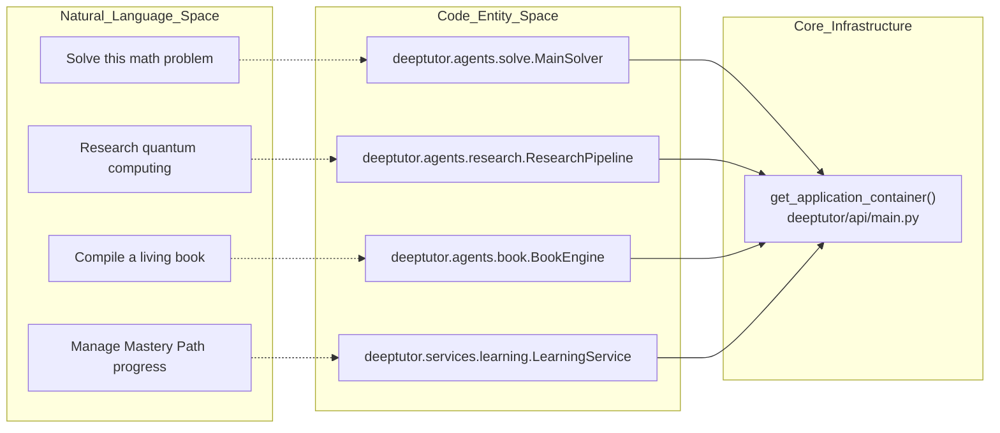

- `"Solve this math problem"` maps to the `MainSolver` class in the `deeptutor.agents.solve` module, which implements the dual-loop problem-solving capability with step verification and vision tool support.
- `"Research quantum computing"` maps to `ResearchPipeline` in `deeptutor.agents.research`, encapsulating rich multi-agent research workflows.
- `"Compile a living book"` maps to `BookEngine` in `deeptutor.agents.book`, managing content blocks, concept spines, and interactive book generation.
- `"Manage Mastery Path progress"` corresponds to `LearningService` in `deeptutor.services.learning`, implementing adaptive grading and spaced repetition.

All are instantiated and managed via the application container returned by `get_application_container()` in the API entry point (`deeptutor/api/main.py`) which orchestrates runtime dependencies and lifecycle management.

Sources: [README.md:60-65](), [pyproject.toml:70-94]()

---

## Key Capabilities

DeepTutor integrates multiple specialized learning capabilities under a shared runtime and session context, promoting interconnected workflows and data reuse [README.md:60-66]():

| Capability Module | Namespace | Core Function |
|---|---|---|
| **Smart Solver** | `deeptutor.agents.solve` | Dual-loop problem solving with step validation and vision capabilities [pyproject.toml:78](). |
| **Deep Research** | `deeptutor.agents.research` | Multi-agent source exploration, filtering, and report generation [pyproject.toml:87](). |
| **Book Engine** | `deeptutor.agents.book` | Living book generation with concept graphs and planned page synthesis [pyproject.toml:86](). |
| **Mastery Path Learning Engine** | `deeptutor.services.learning` | Tracks knowledge points, schedules spaced repetition, and manages mastery grading [pyproject.toml:93](). |
| **Immersive Reading** | `deeptutor.knowledge` | Document viewers with rich annotations, W3C selectors, and bilingual EPUB ingestion [pyproject.toml:79](). |
| **Partners (Persistent AI Companions)** | `deeptutor.services.partners` | Multi-channel persistent AI assistants with IM bindings (Telegram, Feishu, etc.) [pyproject.toml:61](). |

Each capability exposes a runtime pipeline or loop within the unified capability runtime framework, allowing them to share session memory, knowledge bases, and workspace artifacts seamlessly.

Sources: [README.md:60-66](), [pyproject.toml:52-95]()

---

## Data Flow and Persistence

DeepTutor manages data persistence primarily in the local runtime home directory specified by `DEEPTUTOR_HOME` or user configurations, typically under `data/user/` for private user settings and `data/user/workspace` for shared contents [assets/README/README_CN.md:71-75]().

The data flow from frontend user input to backend computation and back is orchestrated as follows:

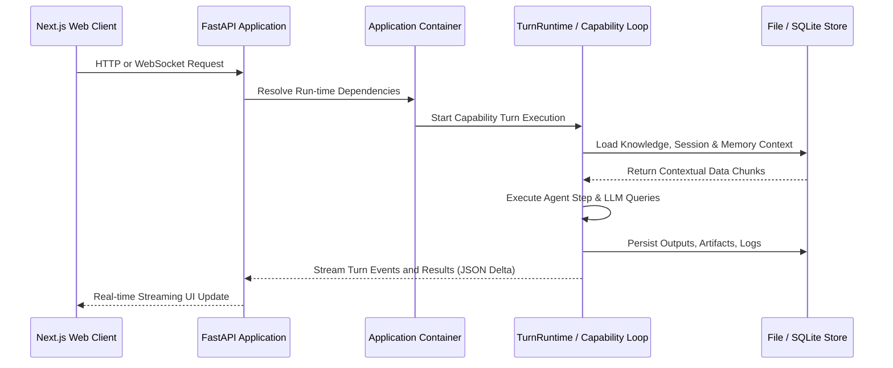

- User requests from the Next.js frontend or CLI are transported via REST or WebSocket APIs through FastAPI endpoint routers.
- The backend obtains scoped dependencies from the application container, including capability runtime and agent modules, to execute an interaction turn.
- The turn runtime loads relevant knowledge base segments, session memory, and previous context from SQLite or the file system.
- Agents process steps with calls to LLM providers, external tools, or plugins.
- Outputs including streaming JSON deltas, logs, and artifacts are saved to workspace output directories for persistence and UI rendering [assets/README/README_CN.md:71-75]().

This architecture enables dynamic, low-latency interactive tutoring with persistent state and content versioning.

Sources: [README.md:60-66](), [assets/README/README_CN.md:71-75]()

---

## Next Steps

For deeper exploration, consult these child sections and pages from the documentation:

- **Getting Started (2)** — Installation, deployment, CLI initialization, and environment configurations.
- **System Architecture (3)** — Detailed breakdown of frontend layouts, runtime orchestration, data persistence, and agent loops.
- **Core Services (5)** — Backend LLM providers, embedding adapters, session and memory infrastructure.
- **Intelligent Agent Modules (4)** — Individual learning capabilities like Smart Solver, Mastery Path, Book Engine, and Partners.
- **API Layer (12)** — FastAPI app structure, routers, WebSocket turn protocol, contracts, and exception handling [README.md:40]().

This page serves as the foundation for understanding the design principles and core structures of DeepTutor.

Sources: [README.md:40-66]()

---

# Page: Getting Started

# Getting Started

<details>
<summary>Relevant source files</summary>

The following files were used as context for generating this wiki page:

- [README.md](README.md)
- [assets/README/README_AR.md](assets/README/README_AR.md)
- [assets/README/README_CN.md](assets/README/README_CN.md)
- [assets/README/README_ES.md](assets/README/README_ES.md)
- [assets/README/README_FR.md](assets/README/README_FR.md)
- [assets/README/README_HI.md](assets/README/README_HI.md)
- [assets/README/README_JA.md](assets/README/README_JA.md)
- [assets/README/README_PL.md](assets/README/README_PL.md)
- [assets/README/README_PT.md](assets/README/README_PT.md)
- [assets/README/README_RU.md](assets/README/README_RU.md)
- [assets/README/README_TH.md](assets/README/README_TH.md)
- [deeptutor/__version__.py](deeptutor/__version__.py)
- [deeptutor/services/search/consolidation.py](deeptutor/services/search/consolidation.py)
- [deeptutor/services/search/providers/__init__.py](deeptutor/services/search/providers/__init__.py)
- [deeptutor/services/search/providers/google_browser_scraper.py](deeptutor/services/search/providers/google_browser_scraper.py)
- [deeptutor/services/search/providers/perplexity.py](deeptutor/services/search/providers/perplexity.py)
- [deeptutor/services/search/providers/serply.py](deeptutor/services/search/providers/serply.py)
- [deeptutor/services/search/providers/youcom.py](deeptutor/services/search/providers/youcom.py)
- [deeptutor_cli/init_wizard.py](deeptutor_cli/init_wizard.py)
- [tests/cli/test_init_wizard_probe.py](tests/cli/test_init_wizard_probe.py)
- [tests/services/search/test_search_providers.py](tests/services/search/test_search_providers.py)
- [web/public/provider-icons/youcom.ico](web/public/provider-icons/youcom.ico)

</details>


DeepTutor provides a streamlined onboarding experience designed to get your agent-native lifelong personalized tutoring workspace running locally or in production within minutes [README.md:4-4](). The installation process establishes the runtime environment, initializes directory structures, configures provider settings, and starts the integrated Next.js frontend and FastAPI backend stack [assets/README/README_CN.md:71-71]().

For detailed deployment, configuration, runtime launcher, and desktop app packaging instructions, see the child pages below:
- [Docker Deployment](#2.1) — Multi-stage builds, supervisord orchestration, docker-compose files, and containerization notes.
- [Configuration Guide](#2.2) — Environment variables, settings JSON files (`model_catalog`, `system`, `auth`, `interface`), and the runtime settings service.
- [Local Runtime and Launcher](#2.3) — `deeptutor start`/`stop` launcher, process management, port conflict resolution, and the proxy between Next.js and FastAPI.
- [Desktop App Packaging](#2.4) — Electron-style desktop preview, runtime sealing, Windows NSIS installer, and macOS signing/notarization.

---

## Prerequisites and Initialization

DeepTutor requires Python 3.11+ [README.md:30-30]() and Node.js 22+ for manual installations, or Docker/Podman for containerized setups [assets/README/README_CN.md:93-93](). The CLI initialization wizard configures necessary home directories and persistence paths under `DEEPTUTOR_HOME` or local `data/user/settings/` directories [assets/README/README_CN.md:71-71]().

### Initialization Architecture Mapping

```mermaid
graph TB
    subgraph "Natural_Language_Space"
        ["CLI_Init_Wizard"] -- "sets_up" --> ["Runtime_Home"]
        ["User_Environment"] -- "supplies" --> ["Environment_Variables"]
    end

    subgraph "Code_Entity_Space"
        ["deeptutor_cli.init_cmd.run_init"] -- "invokes" --> ["deeptutor.services.config.service"]
        ["Dockerfile"] -- "prepares" --> ["/app/data"]
        ["pyproject.toml"] -- "declares" --> ["typer_cli_commands"]
    end

    ["CLI_Init_Wizard"] --> ["deeptutor_cli.init_cmd.run_init"]
    ["Environment_Variables"] --> ["deeptutor.services.config.service"]
```

**Sources:** [assets/README/README_CN.md:71-71](), [README.md:30-30]()

---

## Deployment Overviews

### Docker and Podman Deployment
For containerized deployments, DeepTutor uses a multi-stage container build that packages the Next.js standalone frontend and FastAPI backend into a single image managed by `supervisord` [README.md:93-102](). Production deployments can utilize Docker Compose for orchestration alongside sidecars like vector stores and isolated sandbox runners [README.md:93-102](). For full details on container layers, image pulling, and containerization notes, see [Docker Deployment](#2.1).

**Sources:** [README.md:93-102]()

### Configuration and Environment Setup
Runtime behavior, model selection, authentication, and interface parameters are managed through configuration files under `data/user/settings` [assets/README/README_CN.md:71-71]() and various environment variables [assets/README/README_CN.md:71-71](). The runtime settings service automatically validates and loads models, system prompts, and provider catalogs [deeptutor/__version__.py:1-9](). For comprehensive documentation on JSON schemas, YAML settings, and environment variables, see [Configuration Guide](#2.2).

**Sources:** [assets/README/README_CN.md:71-71](), [deeptutor/__version__.py:1-9]()

### Local Runtime and Process Launcher
When running outside of containers, the `deeptutor start` and `stop` CLI commands manage local process lifecycles, handle port conflict resolution, manage frontend build caching, and proxy requests between Next.js and FastAPI [assets/README/README_CN.md:71-71](). For details on process management, port resolution, and self-update workers, see [Local Runtime and Launcher](#2.3).

**Sources:** [assets/README/README_CN.md:71-71]()

### Desktop App Packaging
For desktop environments, the `apps/desktop` packaging pipeline bundles Python, Node.js, and the complete learning workspace into standalone previews and installer packages for Windows and macOS [assets/README/README_CN.md:74-87](). For details on runtime sealing, NSIS installers, and signing workflows, see [Desktop App Packaging](#2.4).

**Sources:** [assets/README/README_CN.md:74-87]()

---

## System Component Mapping

```mermaid
graph LR
    subgraph "Client_Space"
        ["Browser_UI"]
        ["deeptutor_chat_REPL"]
    end

    subgraph "Application_Runtime"
        ["Next.js_Frontend"]
        ["FastAPI_Backend"]
        ["deeptutor_cli_main"]
    end

    subgraph "Persistence_Layer"
        ["DEEPTUTOR_HOME/data/user/settings"]
        ["DEEPTUTOR_HOME/data/knowledge_bases"]
        ["DEEPTUTOR_HOME/data/system"]
    end

    ["Browser_UI"] -- "HTTP" --> ["Next.js_Frontend"]
    ["Next.js_Frontend"] -- "proxy.ts" --> ["FastAPI_Backend"]
    ["deeptutor_cli_main"] -- "starts" --> ["FastAPI_Backend"]
    ["FastAPI_Backend"] -- "reads/writes" --> ["DEEPTUTOR_HOME/data/user/settings"]
    ["FastAPI_Backend"] -- "reads/writes" --> ["DEEPTUTOR_HOME/data/knowledge_bases"]
```

**Sources:** [assets/README/README_CN.md:71-71](), [deeptutor/__version__.py:1-9]()

---

# Page: Docker Deployment

# Docker Deployment

<details>
<summary>Relevant source files</summary>

The following files were used as context for generating this wiki page:

- [.dockerignore](.dockerignore)
- [.env.example](.env.example)
- [Dockerfile](Dockerfile)
- [assets/releases/past_releases/ver1-6-2.md](assets/releases/past_releases/ver1-6-2.md)
- [deeptutor/services/config/readiness.py](deeptutor/services/config/readiness.py)
- [deeptutor/services/parsing/engines/_install.py](deeptutor/services/parsing/engines/_install.py)
- [deeptutor/services/parsing/engines/mineru/readiness.py](deeptutor/services/parsing/engines/mineru/readiness.py)
- [deeptutor/services/partners/workspace.py](deeptutor/services/partners/workspace.py)
- [deeptutor/services/workspace/service.py](deeptutor/services/workspace/service.py)
- [docker-compose.dev.yml](docker-compose.dev.yml)
- [docker-compose.ghcr.yml](docker-compose.ghcr.yml)
- [docker-compose.yml](docker-compose.yml)
- [docs-for-dev/MODULES.md](docs-for-dev/MODULES.md)
- [tests/scripts/test_docker_compose.py](tests/scripts/test_docker_compose.py)
- [tests/scripts/test_install_extras.py](tests/scripts/test_install_extras.py)
- [tests/services/config/test_readiness.py](tests/services/config/test_readiness.py)
- [tests/services/parsing/test_engines.py](tests/services/parsing/test_engines.py)
- [tests/services/partners/test_partner_workspace.py](tests/services/partners/test_partner_workspace.py)
- [web/features/settings/sections/DocumentParsingSettingsSection.tsx](web/features/settings/sections/DocumentParsingSettingsSection.tsx)

</details>


## Purpose and Scope

This page documents DeepTutor's containerized deployment architecture. It covers the multi-stage `Dockerfile` design [Dockerfile:1-175](), process orchestration, runtime configuration handling, server-side proxying for Next.js (`web/proxy.ts`), persistent volume layouts, sidecar orchestration via `docker-compose.yml` [docker-compose.yml:1-162](), and multi-platform image publishing via GitHub Container Registry (GHCR).

Sources: [`Dockerfile:1-15`](), [`docker-compose.yml:1-24`]()

---

## Multi-Stage Build Process

DeepTutor uses a multi-stage Docker build to decouple frontend compilation and Python package resolution from the final runtime image. The overall process compiles static frontend assets, installs Python dependencies, and assembles a production image with all components [Dockerfile:1-175]().

### Build Stages and Component Mapping

The following diagram bridges the deployment build phases to the concrete builder stages and related code artifacts:

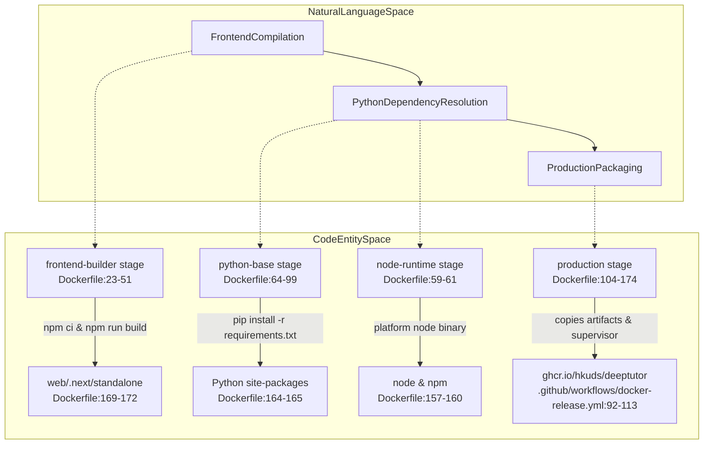

**Sources:** [`Dockerfile:23-172`](), [`.github/workflows/docker-release.yml:1-113`]()

### 1. Frontend Builder (`frontend-builder`)

- **Platform Isolation:** Runs with `--platform=$BUILDPLATFORM` pinned, ensuring native execution on the build host without QEMU overhead [Dockerfile:23]().
- **Dependency Installation:** Uses `npm config set fetch-timeout 600000` and `npm ci --legacy-peer-deps` to install frontend dependencies [Dockerfile:31-33]().
- **Standalone Next.js Build:** Runs `npm run build`, outputting a standalone Node server configuration [Dockerfile:49-51]().

### 2. Python Base (`python-base`)

- **System Dependencies:** Installs OpenCV libraries (`libgl1`, `libglib2.0-0`, etc.) and sets up the Rust compiler via rustup for building native packages like `tiktoken` [Dockerfile:75-95]().
- **Python Packages:** Executes `pip install -r requirements.txt` under Python 3.11-slim [Dockerfile:97-101]().

### 3. Node Runtime (`node-runtime`)

- **Target Platform Binary:** Pulls the architecture-matched `node:22.23.4-slim` binary to ensure correct target execution [Dockerfile:59-61]().

### 4. Production Image (`production`)

- **Runtime Base:** Uses `python:3.11-slim` [Dockerfile:106]().
- **System Utilities:** Installs `supervisor`, `git`, `libreoffice-*`, and fonts (`fonts-noto-cjk`, `fonts-liberation`) for document rendering and sandboxed execution [Dockerfile:131-158]().
- **Artifact Integration:** Copies Node binary, Python site-packages, and the built frontend standalone bundle [Dockerfile:160-172]().

Sources: [`Dockerfile:23-175`]()

---

## Process Orchestration and Security

DeepTutor uses `supervisord` inside the container to manage concurrent processes while enforcing a security model with user privilege dropping [Dockerfile:147]().

### Process Supervision and Runtime Components

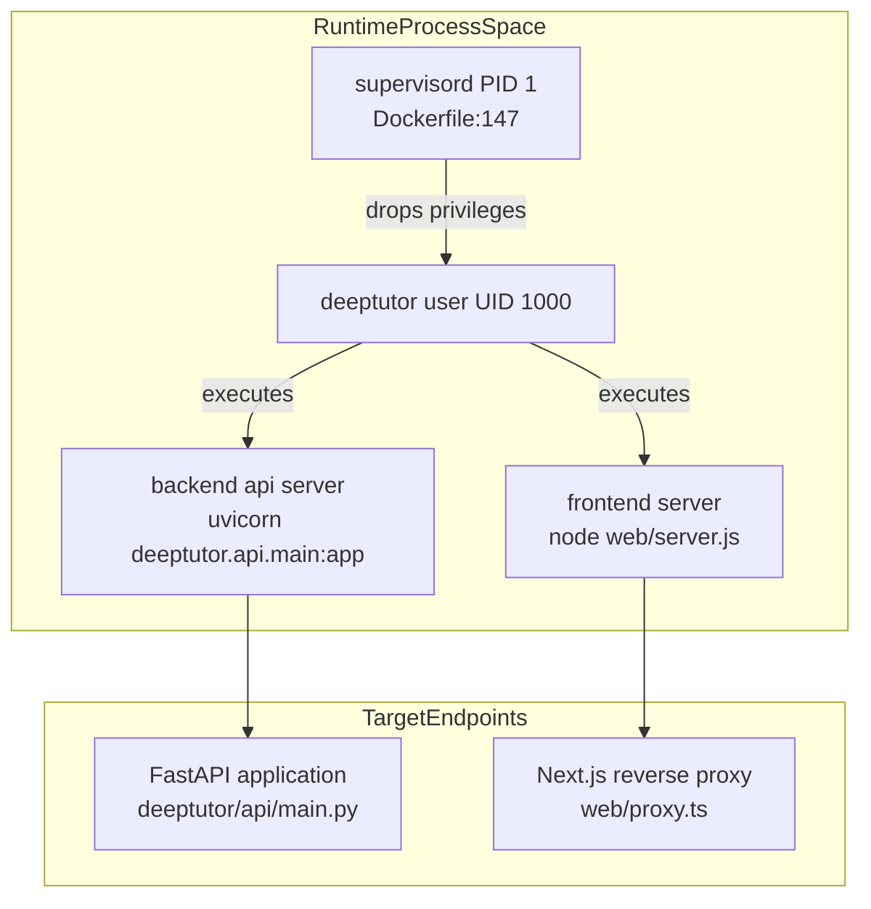

- **Privilege Model:** `supervisord` starts as root to initialize system resources and then drops privileges to the unprivileged `deeptutor` user (UID 1000) [Dockerfile:147]().
- **Service Management:** Manages Uvicorn running the FastAPI backend and Node serving the Next.js frontend.
- **Security Isolation:** Code execution is delegated to the sandbox runner sidecar container (`sandbox-runner`) rather than running untrusted code in the main app process [docker-compose.yml:145-160]().

Sources: [`Dockerfile:147`](), [`docker-compose.yml:145-160`]()

---

## Runtime Configuration and Proxying

- **Dynamic API Forwarding:** The frontend serves browser requests and proxies `/api/*` and `/ws/*` calls to the backend API base URL specified by `DEEPTUTOR_API_BASE_URL` [web/proxy.ts](), [`.env.example:11-16`].
- **JSON-Driven Settings:** The entrypoint reads settings from `data/user/settings/system.json` to configure runtime properties [`.env.example:6-9`]().

Sources: [`.env.example:1-26`](), [`docker-compose.yml:1-24`]()

---

## Data Persistence, Volumes, and Sidecars

To ensure durability, persistent volumes map host directories to container paths [docker-compose.yml:88-98]().

### Volume Layout

| Container Path               | Purpose                                                        | Reference                 |
|-----------------------------|----------------------------------------------------------------|---------------------------|
| `/app/data`                 | Unified data volume (settings, KBs, memory, accounts, workspace) | [`docker-compose.yml:97`]() |
| `/workspace`                | Host-mapped Content Workspace mount point                       | [`docker-compose.yml:98`]() |

### Sidecar Containers

- **Redis:** Internal-only coordination state (`redis:7.4-alpine`) with AOF persistence [docker-compose.yml:30-43]().
- **PocketBase:** Optional auth and storage sidecar (`ghcr.io/muchobien/pocketbase:latest`) running on port 8090 [docker-compose.yml:50-66]().
- **Sandbox Runner:** Dedicated isolated container executing untrusted shell commands (`sandbox-runner`) [docker-compose.yml:145-160]().

Sources: [`docker-compose.yml:26-162`]()

---

## Multi-Platform Releases and GHCR Images

Official production images are built via GitHub Actions targeting `amd64` and `arm64` architectures [`.github/workflows/docker-release.yml:1-113`]().

- **Registry:** Pushed to GitHub Container Registry (GHCR) under `ghcr.io/hkuds/deeptutor` [docker-compose.ghcr.yml:60]().
- **Composition:** Users can launch pre-built images instantly using `docker-compose.ghcr.yml` [docker-compose.ghcr.yml:1-118]().

Sources: [`docker-compose.ghcr.yml:1-119`], [`.github/workflows/docker-release.yml:1-113`]()

---

# Summary Diagram: From Deployment Concepts to Code Entities

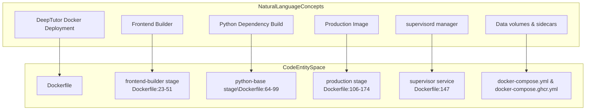

**Sources:** [`Dockerfile:1-175`](), [`docker-compose.yml:1-162`](), [`docker-compose.ghcr.yml:1-119`]()

---

# Notes on Containerization and Best Practices

- **Non-root Operation:** Runs under the `deeptutor` non-root user (UID 1000) for enhanced security [Dockerfile:147]().
- **Port Mapping:** Host ports are rendered dynamically via helper scripts from `system.json` configurations [tests/scripts/test_docker_compose.py:25-50]().
- **Sandboxing:** Shell code execution is isolated within the `sandbox-runner` sidecar container [docker-compose.yml:145-160]().

Sources: [`Dockerfile:1-175`](), [`docker-compose.yml:1-162`](), [`tests/scripts/test_docker_compose.py:1-100`]()

---

# Page: Configuration Guide

# Configuration Guide

<details>
<summary>Relevant source files</summary>

The following files were used as context for generating this wiki page:

- [deeptutor/agents/loop/prompt_blocks.py](deeptutor/agents/loop/prompt_blocks.py)
- [deeptutor/api/routers/knowledge.py](deeptutor/api/routers/knowledge.py)
- [deeptutor/knowledge/manager.py](deeptutor/knowledge/manager.py)
- [deeptutor/services/config/launch_settings.py](deeptutor/services/config/launch_settings.py)
- [deeptutor/services/config/loader.py](deeptutor/services/config/loader.py)
- [deeptutor/services/config/runtime_settings.py](deeptutor/services/config/runtime_settings.py)
- [deeptutor/services/config/settings_spec.py](deeptutor/services/config/settings_spec.py)
- [deeptutor/services/config/test_runner.py](deeptutor/services/config/test_runner.py)
- [deeptutor/services/prompt/language.py](deeptutor/services/prompt/language.py)
- [deeptutor/services/settings/interface_settings.py](deeptutor/services/settings/interface_settings.py)
- [deeptutor/services/setup/init.py](deeptutor/services/setup/init.py)
- [tests/api/test_knowledge_router.py](tests/api/test_knowledge_router.py)
- [tests/api/test_main_notebook_router.py](tests/api/test_main_notebook_router.py)
- [tests/config/test_reasoning_probe_budget.py](tests/config/test_reasoning_probe_budget.py)
- [tests/knowledge/test_manager_list.py](tests/knowledge/test_manager_list.py)
- [tests/multi_user/test_ui_language_scoping.py](tests/multi_user/test_ui_language_scoping.py)
- [tests/services/config/test_launch_settings.py](tests/services/config/test_launch_settings.py)
- [tests/services/config/test_llm_probe_config.py](tests/services/config/test_llm_probe_config.py)
- [tests/services/config/test_runtime_settings.py](tests/services/config/test_runtime_settings.py)
- [tests/services/config/test_task_probe.py](tests/services/config/test_task_probe.py)
- [tests/services/config/test_visualize_params.py](tests/services/config/test_visualize_params.py)
- [tests/services/prompt/test_language_directive.py](tests/services/prompt/test_language_directive.py)
- [web/components/knowledge/CreateKbModal.tsx](web/components/knowledge/CreateKbModal.tsx)
- [web/components/knowledge/KbIndexVersionsSection.tsx](web/components/knowledge/KbIndexVersionsSection.tsx)
- [web/components/knowledge/KbSettingsSection.tsx](web/components/knowledge/KbSettingsSection.tsx)
- [web/components/knowledge/KnowledgeBaseDetail.tsx](web/components/knowledge/KnowledgeBaseDetail.tsx)
- [web/components/knowledge/KnowledgeHome.tsx](web/components/knowledge/KnowledgeHome.tsx)
- [web/components/knowledge/KnowledgePage.tsx](web/components/knowledge/KnowledgePage.tsx)
- [web/components/settings/MinerUEngineSettings.tsx](web/components/settings/MinerUEngineSettings.tsx)
- [web/context/AppShellContext.tsx](web/context/AppShellContext.tsx)
- [web/context/app-shell-storage.ts](web/context/app-shell-storage.ts)
- [web/features/settings/store/SettingsStore.tsx](web/features/settings/store/SettingsStore.tsx)
- [web/features/settings/store/response-language-options.ts](web/features/settings/store/response-language-options.ts)
- [web/hooks/useKnowledgeBases.ts](web/hooks/useKnowledgeBases.ts)
- [web/i18n/init.ts](web/i18n/init.ts)
- [web/i18n/languages.ts](web/i18n/languages.ts)
- [web/lib/datetime.ts](web/lib/datetime.ts)
- [web/lib/knowledge-helpers.ts](web/lib/knowledge-helpers.ts)
- [web/lib/marginnote4-api.ts](web/lib/marginnote4-api.ts)
- [web/tests/account-role.test.ts](web/tests/account-role.test.ts)
- [web/tests/app-shell-language-bootstrap.test.ts](web/tests/app-shell-language-bootstrap.test.ts)
- [web/tests/knowledge-helpers.test.ts](web/tests/knowledge-helpers.test.ts)
- [web/tests/language-preferences.test.ts](web/tests/language-preferences.test.ts)
- [web/tests/lightrag-embedding-compatibility.spec.tsx](web/tests/lightrag-embedding-compatibility.spec.tsx)
- [web/tests/marginnote4-api.test.ts](web/tests/marginnote4-api.test.ts)
- [web/tests/settings-unified-draft.spec.tsx](web/tests/settings-unified-draft.spec.tsx)

</details>


This page details the configuration architecture of DeepTutor, covering environment variables, YAML configuration files, JSON settings stores (`model_catalog`, `system`, `auth`, `interface`), document parsing JSON files, and the runtime settings service.

---

## 1. Configuration Architecture Overview

DeepTutor uses a multi-layered configuration hierarchy that unifies environment variables, operator YAML files, and user-editable JSON settings. Configuration loading centralizes path resolution (`PathService`) and agent hyperparameters to guarantee consistency across FastAPI backend, Next.js frontend, and agentic pipelines.

### Code Entity Configuration Map

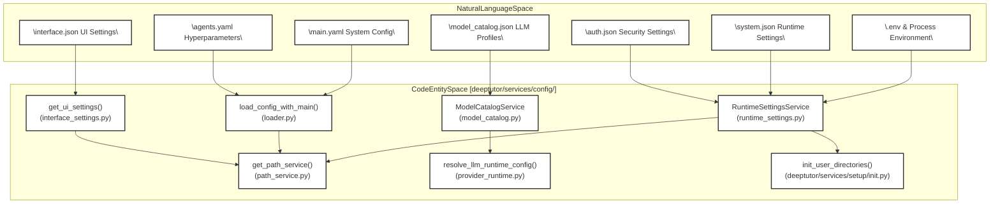

**Configuration Priority Order** (highest to lowest):
1. **Process Environment Variables:** Explicitly exported environment variables override file-backed runtime settings [deeptutor/services/config/runtime_settings.py:60-79]().
2. **Model Catalog:** Managed LLM profiles and active models stored in `model_catalog.json` [deeptutor/services/config/provider_runtime.py:41-42]().
3. **JSON Runtime Settings:** User-configurable runtime stores including `system.json`, `auth.json`, `interface.json`, and `integrations.json` [deeptutor/services/config/runtime_settings.py:15-105]() and [deeptutor/services/settings/interface_settings.py:10-180]().
4. **YAML Configuration:** Operator configurations (`main.yaml` and `agents.yaml`) loaded and merged during initialization [deeptutor/services/setup/init.py:24-201]().
5. **Hardcoded Defaults:** Fallback values seeded on first use and in default dicts [deeptutor/services/config/runtime_settings.py:15-68]().

Sources: `[deeptutor/services/config/runtime_settings.py:15-79]`, `[deeptutor/services/config/provider_runtime.py:1-150]`, `[deeptutor/services/settings/interface_settings.py:1-180]`, `[deeptutor/services/setup/init.py:24-201]`, `[deeptutor/services/config/loader.py:23-79]`

---

## 2. Runtime Settings Service and JSON Stores

The `RuntimeSettingsService` class (in `runtime_settings.py`) orchestrates loading, saving, and atomic updates of runtime JSON configurations stored under the project data root at `data/user/settings/`. The runtime settings persist system-level, authentication, integration, and document parsing configuration:

### JSON Runtime Settings Files

| Filename               | Purpose                                          | Main Keys / Schema Highlights                                                                                                   |
|------------------------|-------------------------------------------------|-------------------------------------------------------------------------------------------------------------------------------|
| `system.json`          | Core server runtime settings                     | `backend_port`, `frontend_port`, `version_check_enabled`, `sandbox_allow_subprocess`, `capability_routing_enabled`             |
| `auth.json`            | Authentication and multi-user access control    | `enabled`, `username`, `password_hash`, `token_expire_hours`, `cookie_secure`                                                  |
| `integrations.json`    | External service URLs and distributed backends  | `pocketbase_url`, `turn_coordination` (with Redis lease config)                                                                |
| `document_parsing.json`| Document parsing engine and mode configuration   | `version`, `engine` (active), `engines` (configuration per engine, e.g. MinerU, Docling, MarkItDown, PyMuPDF4LLM)                |
| `interface.json`       | User interface preferences (theme, language)     | `theme`, `language`, `response_language`, `voice_math_speak`                                                                    |

### RuntimeSettingsService Key Methods

- `load_system(include_process_overrides: bool = True)`: Load the system JSON with optional environment variable overrides.
- `load_auth(include_process_overrides: bool = True)`: Load authentication configuration.
- `load_integrations(include_process_overrides: bool = True)`: Load integrations config.
- `save_system(data: dict)`, `save_auth(data: dict)`, `save_integrations(data: dict)`: Persist settings atomically.
- `render_environment()`: Convert JSON runtime settings and environment overrides into normalized environment variables consumable by backend and frontend.

### Example JSON fragment from `system.json`

```json
{
  "version": 1,
  "version_check_enabled": true,
  "backend_port": 8001,
  "frontend_port": 3782,
  "sandbox_allow_subprocess": true,
  "capability_routing_enabled": false,
  "web_search_source_filtering": {
    "enabled": true,
    "blocked_domains": [],
    "trusted_domains": [],
    "content_filtering": true,
    "use_educational_trusted_domains": false,
    "use_moderation": false
  },
  "chat_attachment_max_file_mb": 20,
  "chat_attachment_max_total_mb": 25
}
```

### Document Parsing Settings Highlights

`document_parsing.json` stores the active document parsing engine and its configuration per engine type. Supported engines include `"mineru"`, `"text_only"`, `"docling"`, `"markitdown"`, `"pymupdf4llm"`, `"liteparse"`, and `"tika"`. This controls how uploaded documents are extracted into Markdown or structured formats prior to ingestion [deeptutor/services/config/runtime_settings.py:108-152]().

Sources: `[deeptutor/services/config/runtime_settings.py:15-105]`, `[deeptutor/services/settings/interface_settings.py:1-180]`, `[tests/services/config/test_runtime_settings.py:10-185]`

---

## 3. Environment Variables and Rendering

DeepTutor uses environment variables for container-based deployment overrides and launch-time configuration. The `.env.example` file and shell environment variables serve as the first-order overrides for runtime JSON files.

### Environment Variable Rendering Flow

```mermaid
graph TB
    EnvExample["\".env or Process Env Variables\""]
    RuntimeJson["\"system.json, auth.json, integrations.json\""]
    RuntimeSettings["\"RuntimeSettingsService.render_environment()\""]
    BackendServer["\"Uvicorn / FastAPI BACKEND_PORT\""]
    NextProxy["\"Next.js Proxy DEEPTUTOR_API_BASE_URL\""]
    AuthModule["\"Auth Module AUTH_ENABLED\""]

    EnvExample --> RuntimeSettings
    RuntimeJson --> RuntimeSettings
    RuntimeSettings --> BackendServer
    RuntimeSettings --> NextProxy
    RuntimeSettings --> AuthModule
```

### Key Environment Variables Rendered

| Env Variable                 | Source / Purpose                                                        |
|-----------------------------|------------------------------------------------------------------------|
| `BACKEND_PORT`               | `system.json.backend_port` override                                   |
| `FRONTEND_PORT`              | `system.json.frontend_port` override                                  |
| `DEEPTUTOR_API_BASE_URL`     | `http://127.0.0.1:<backend_port>` to avoid IPv6 localhost resolution issues |
| `DEEPTUTOR_VERSION_CHECK_ENABLED` | `system.json.version_check_enabled` supports disabling update checks   |
| `AUTH_ENABLED`               | `auth.json.enabled` propagates login activation status                |
| `NEXT_PUBLIC_AUTH_ENABLED`   | Same as `AUTH_ENABLED` but exposed to Next.js frontend                |
| `POCKETBASE_URL`             | Integration settings for PocketBase endpoint URL                      |

### Implementation Details

`RuntimeSettingsService.render_environment()` reads current runtime JSON settings, merges any explicit process environment overrides (e.g., from container `-e` flags), coerces boolean and list types to lowercase strings or comma-joined strings, and ensures consistent mappings [deeptutor/services/config/runtime_settings.py:126-183]().

Notably, `DEEPTUTOR_API_BASE_URL` always uses IPv4 loopback instead of `localhost` due to Docker and networking complexities on dual-stack hosts to prevent connectivity failures [tests/services/config/test_runtime_settings.py:170-185]().

Sources: `[deeptutor/services/config/runtime_settings.py:126-183]`, `[tests/services/config/test_runtime_settings.py:126-185]`

---

## 4. YAML Configuration and Initialization

DeepTutor supports operator YAML configurations (`main.yaml` and `agents.yaml`) housed outside the JSON runtime settings.

### YAML Configuration Role

- `main.yaml`: Contains system-level definitions such as tool permissions, routing, and logging levels.
- `agents.yaml`: Contains hyperparameters for agent capabilities, such as LLM temperature, max tokens, and rate limits.

### Initialization and Defaults

At the first run or when settings files are missing, `init_user_directories()` seeds default files and directories in the data root (`data/user/`), including initial JSON and YAML files [deeptutor/services/setup/init.py:24-201]().

```mermaid
flowchart LR
    Start["\"DeepTutor launch\""]
    InitDirs["\"init_user_directories()\""]
    CheckInterface["\"Check or create interface.json\""]
    SeedMainYaml["\"Seed main.yaml defaults\""]
    SeedAgentsYaml["\"Seed agents.yaml defaults\""]
    Finish["\"Ready for runtime\""]

    Start --> InitDirs --> CheckInterface --> SeedMainYaml --> SeedAgentsYaml --> Finish
```

### Example Defaults

- **`interface.json` defaults:**

  ```json
  {
    "theme": "snow",
    "language": "en",
    "sidebar_nav_order": [
      "workspace",
      "partners",
      "notes",
      "books",
      "video",
      "quiz",
      "reading",
      "research",
      "settings"
    ]
  }
  ```

- **`main.yaml` defaults** include system logging level ("WARNING"), allowed tool roots (`./data/user`), and capability parameters (e.g., `"capabilities.solve.max_rounds": 8`).

- **`agents.yaml` defaults** set agent hyperparameters like `temperature: 0.3`, `max_tokens: 400`, `rate_limit_tokens_total: 20000` for `solve` and other agents, ensuring consistent runtime behaviour [deeptutor/services/setup/init.py:18-201]().

Sources: `[deeptutor/services/setup/init.py:18-201]`, `[deeptutor/services/config/loader.py:23-79]`

---

## 5. User Interface Settings and Language Scoping

User interface preferences such as theme and language are stored in `interface.json` located under the per-user settings path.

### UI Settings Schema and Defaults

| Key               | Description                                     | Default        |
|-------------------|-------------------------------------------------|----------------|
| `theme`           | Selected UI theme (`"snow"`, `"light"`, `"dark"`, `"glass"`) | `"snow"`       |
| `language`        | Interface language code, normalized (`en`, `zh`, `fr`, `uk`) | `"en"`         |
| `response_language` | Language for LLM model responses (independent from UI language) | `"en"`         |
| `voice_math_speak` | Whether text-to-speech verbalizes math expressions in LaTeX form   | `True`         |

### Language Normalization and Resolution

The `interface_settings.py` module provides logic for normalizing various language inputs including aliases, region variants, and fallbacks so that the system supports consistent and predictable i18n behaviour.

- Interface language and response language are scoped independently but coherently normalized [deeptutor/services/settings/interface_settings.py:79-157]().

- Per-user interface language is resolved from the interface JSON with fallback to English for missing or unsupported codes. Response language normalization accepts a broader list of target languages commonly used by response LLM prompts [tests/multi_user/test_ui_language_scoping.py:1-84]().

### Thread-safe File Access

Per-user settings files are guarded by dedicated locks keyed by resolved paths to allow concurrent safe updates in multi-user environments [deeptutor/services/settings/interface_settings.py:35-70]().

Sources: `[deeptutor/services/settings/interface_settings.py:1-180]`, `[tests/multi_user/test_ui_language_scoping.py:1-85]`

---

## 6. Model Catalog and Provider Runtime Configuration

DeepTutor stores its LLM providers and models in `model_catalog.json`, managed by the `ModelCatalogService`. This catalog defines profiles used for task-specific routing and supports dynamic runtime integration.

### Provider Configuration Flow

```mermaid
graph LR
    ModelCatalog["\"ModelCatalogService (model_catalog.py)\""]
    ProviderRuntime["\"resolve_llm_runtime_config() (provider_runtime.py)\""]
    RuntimeSettings["\"RuntimeSettingsService\""]
    RuntimeEnv["\"Render environment variables\""]

    ModelCatalog --> ProviderRuntime --> RuntimeSettings --> RuntimeEnv
```

- `resolve_llm_runtime_config()` processes active service profiles and converts them to `LLMConfig` structures used by runtime agent components.

- Provider runtime resolution accounts for gateway prefixes, base URL normalization, and custom HTTP headers [deeptutor/services/config/provider_runtime.py:40-150]().

Sources: `[deeptutor/services/config/provider_runtime.py:1-150]`, `[deeptutor/services/config/runtime_settings.py:15-79]`

---

## 7. Document Parsing Configuration and Engine Selection

The document parsing subsystem supports multiple pluggable parsing engines configurable via JSON runtime settings.

| Engine ID                   | Description                                                                                                        |
|-----------------------------|--------------------------------------------------------------------------------------------------------------------|
| `"text_only"`               | Basic plain text extraction for PDF, Office, and text files; no external dependencies                               |
| `"mineru"`                  | Full-featured multimodal parsing supporting layouts, tables, formulas; local models or hosted API                   |
| `"docling"`                 | Structured conversion across many formats including images, ebooks, audio/video; local or remote modes             |
| `"markitdown"`              | Full Microsoft MarkItDown parser with broad format support; markdown output without local model requirement         |
| `"pymupdf4llm"`             | CPU-only PyMuPDF based parser with OCR and image extraction                                                        |
| `"liteparse"`               | Rust-backed parser from LlamaIndex for PDF and office formats with optional image extraction                         |
| `"tika"`                    | Apache Tika server remote parser supporting thousands of types                                                    |

The active engine and per-engine settings reside in `document_parsing.json`, and the parsing subsystem dynamically loads parser classes via a factory [deeptutor/services/config/runtime_settings.py:107-152]().

Sources: `[deeptutor/services/config/runtime_settings.py:107-152]`

---

## 8. Launch Settings Service and CLI Init

The `load_launch_settings()` function reads runtime ports and UI language settings for launcher-style entrypoints.

- It prefers `system.json` for backend/frontend ports but falls back to environment variables like `BACKEND_PORT` or `.env`.

- UI language is loaded from `interface.json` or overridden by environment `UI_LANGUAGE` or `LANGUAGE`.

- The function composes a source string reflecting which source contributed the final values [deeptutor/services/config/launch_settings.py:18-119]().

Sources: `[deeptutor/services/config/launch_settings.py:18-119]`

---

# Summary

DeepTutor's configuration system is an interplay of:

- **Process environment variables** overriding  
- **JSON runtime settings** (`system.json`, `auth.json`, `interface.json`, `integrations.json`, `document_parsing.json`) read by `RuntimeSettingsService`  
- **YAML operator configs** (`main.yaml`, `agents.yaml`) for system and agent hyperparameters  
- **Model catalog JSON** for LLM provider profiles  

All configuration data is stored under `data/user/settings/` or equivalent multi-user paths and cast into runtime environment variables for consistent consumption across backend services and frontend clients.

Sources: `[deeptutor/services/config/runtime_settings.py:1-159]`, `[deeptutor/services/setup/init.py:18-201]`

---

# Appendix: Architecture Diagrams Bridging Config Concepts to Code

### 1. JSON Settings to RuntimeSettingsService

```mermaid
graph LR
    RuntimeSettingsService["\"RuntimeSettingsService (runtime_settings.py)\""]
    SystemJson["\"system.json (data/user/settings/)\""]
    AuthJson["\"auth.json (data/user/settings/)\""]
    IntegrationsJson["\"integrations.json (data/user/settings/)\""]
    DocumentParsingJson["\"document_parsing.json (data/user/settings/)\""]
    PathService["\"PathService (path_service.py)\""]
    EnvRender["\"render_environment()\""]

    SystemJson --> RuntimeSettingsService
    AuthJson --> RuntimeSettingsService
    IntegrationsJson --> RuntimeSettingsService
    DocumentParsingJson --> RuntimeSettingsService

    RuntimeSettingsService --> PathService
    RuntimeSettingsService --> EnvRender
```

### 2. Interface Settings Scoping

```mermaid
graph LR
    InterfaceSettingsModule["\"interface_settings.py\""]
    UserInterfaceJson["\"interface.json (per-user settings path)\""]
    PathService["\"get_path_service()\""]
    UISettingsCache["\"Thread-safe Locks Per-File\""]
    UISettings["\"Returned normalized UI settings\""]

    UserInterfaceJson --> InterfaceSettingsModule
    InterfaceSettingsModule --> UISettingsCache
    InterfaceSettingsModule --> PathService
```

Sources:  
`[deeptutor/services/config/runtime_settings.py:1-159]`  
`[deeptutor/services/settings/interface_settings.py:1-180]`  
`[deeptutor/services/config/launch_settings.py:1-120]`  
`[deeptutor/services/config/provider_runtime.py:1-150]`  
`[deeptutor/services/setup/init.py:18-201]`  
`[tests/services/config/test_runtime_settings.py:1-186]`

---

# Page: Local Runtime and Launcher

# Local Runtime and Launcher

<details>
<summary>Relevant source files</summary>

The following files were used as context for generating this wiki page:

- [.gitignore](.gitignore)
- [deeptutor/api/routers/system.py](deeptutor/api/routers/system.py)
- [deeptutor/api/run_server.py](deeptutor/api/run_server.py)
- [deeptutor/multi_user/session_handoff.py](deeptutor/multi_user/session_handoff.py)
- [deeptutor/runtime/launcher.py](deeptutor/runtime/launcher.py)
- [deeptutor/runtime/process.py](deeptutor/runtime/process.py)
- [deeptutor/runtime/update_worker.py](deeptutor/runtime/update_worker.py)
- [deeptutor/services/app_update.py](deeptutor/services/app_update.py)
- [deeptutor_cli/main.py](deeptutor_cli/main.py)
- [requirements.txt](requirements.txt)
- [requirements/dev.txt](requirements/dev.txt)
- [requirements/math-animator.txt](requirements/math-animator.txt)
- [tests/api/test_session_handoff.py](tests/api/test_session_handoff.py)
- [tests/api/test_system_router.py](tests/api/test_system_router.py)
- [tests/cli/test_chat_cli.py](tests/cli/test_chat_cli.py)
- [tests/multi_user/test_admin_user_batches.py](tests/multi_user/test_admin_user_batches.py)
- [tests/multi_user/test_session_handoff.py](tests/multi_user/test_session_handoff.py)
- [tests/runtime/test_launcher.py](tests/runtime/test_launcher.py)
- [tests/runtime/test_launcher_lifecycle.py](tests/runtime/test_launcher_lifecycle.py)
- [tests/runtime/test_run_server_memory_mode.py](tests/runtime/test_run_server_memory_mode.py)
- [tests/runtime/test_uvicorn_launch_flags.py](tests/runtime/test_uvicorn_launch_flags.py)
- [tests/services/test_app_update.py](tests/services/test_app_update.py)
- [web/app/handoff/page.tsx](web/app/handoff/page.tsx)
- [web/lib/backend-forward.ts](web/lib/backend-forward.ts)
- [web/lib/streaming-upload-proxy.ts](web/lib/streaming-upload-proxy.ts)
- [web/proxy.ts](web/proxy.ts)
- [web/tests/admin-user-batches.test.ts](web/tests/admin-user-batches.test.ts)
- [web/tests/handoff-effect-replay.spec.tsx](web/tests/handoff-effect-replay.spec.tsx)
- [web/tests/proxy-policy.test.ts](web/tests/proxy-policy.test.ts)
- [web/tests/streaming-upload-proxy.test.ts](web/tests/streaming-upload-proxy.test.ts)

</details>


## Purpose and Scope

This page provides a comprehensive technical overview of the local runtime environment and launcher for DeepTutor. It covers the mechanisms for starting and constraining the DeepTutor backend and frontend processes, managing process groups, resolving loopback port conflicts, caching and injecting packaged web assets, enabling the durable self-update worker lifecycle, and configuring the Next.js-to-FastAPI proxy layer (`web/proxy.ts`). 

This subsystem forms the backbone of local developer setups, standalone desktop packaging, and single-machine production deployments.

Sources: `[deeptutor/runtime/launcher.py:1-216]()`, `[deeptutor_cli/main.py:124-160]()`, `[web/proxy.ts:1-92]()`

---

## 1. Launcher Architecture and Process Management

DeepTutor’s local runtime launcher orchestrates two distinct primary services:
- **Backend:** A FastAPI server hosted on Uvicorn (`[deeptutor/api/run_server.py:30-96]()`), exposing REST endpoints and the real-time WebSocket protocol.
- **Frontend:** A Next.js React application, running either via a compiled production standalone build or through the development server (`--dev`).

The command-line interface commands `deeptutor start` and `deeptutor stop` (`[deeptutor_cli/main.py:124-160]`) act as the entry points, which invoke `deeptutor.runtime.launcher.start()` and `stop()` respectively. 

The launcher uses the `ManagedProcess` dataclass (`[deeptutor/runtime/launcher.py:112-117]()`) to track child processes, capturing their name, `subprocess.Popen` handles, and process group IDs (`pgid`) to cleanly propagate termination signals. For detached or daemonized deployments (`--detach`), runtime status and control flags are written to `data/user/runtime/launcher.json` (`[deeptutor/runtime/launcher.py:165-172]()`).

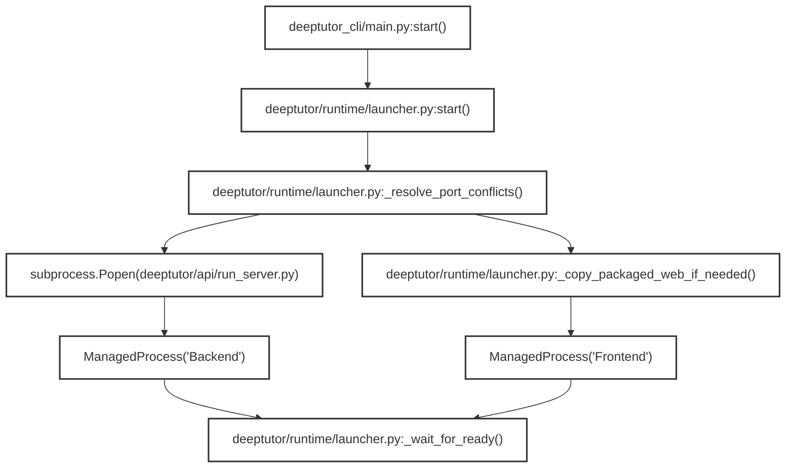
*Figure 1: Launcher Startup Flow from CLI to Managed Processes.*

### Key Functions and Classes:
- **`start()`**: Initializes the runtime home (`[deeptutor/runtime/home.py]()`), binds environment tuning (`MALLOC_ARENA_MAX`), and coordinates child process startup.
- **`ManagedProcess`**: Encapsulates `name`, `process`, and `pgid` for signal routing (`[deeptutor/runtime/launcher.py:112-117]()`).
- **`_wait_for_http()`**: Polls loopback health endpoints using a proxy-free opener (`[deeptutor/runtime/launcher.py:87]`) to verify service readiness.

Sources: `[deeptutor/runtime/launcher.py:5-216]()`, `[deeptutor_cli/main.py:124-160]()`, `[deeptutor/api/run_server.py:30-96]()`

---

## 2. Port Conflict Resolution and Probing

Before spawning background workers, the launcher checks whether required backend and frontend ports are occupied by probing standard loopback targets (`127.0.0.1` and `::1`) (`[deeptutor/runtime/launcher.py:77, 162-172]()`).

- **IPv6 and IPv4 Dual Probing:** Unix sockets may bind exclusively to `::1` while IPv4 services bind to `127.0.0.1`. The helper `_port_accepts_connection()` attempts connections across both families (`[tests/runtime/test_launcher.py:87-103]()`).
- **Proxy Bypass:** Health and port probes construct a dedicated proxy-free urllib opener (`_LOOPBACK_OPENER`) so that system-wide or environment proxy variables (`http_proxy`) do not cause false-positive readiness failures (`[deeptutor/runtime/launcher.py:87]()`, `[tests/runtime/test_launcher.py:37-85]()`).
- **Error Reporting:** When a conflict occurs, the launcher aborts and outputs localized messages via translation templates (`_t()`).

Sources: `[deeptutor/runtime/launcher.py:72-88, 162-172]()`, `[tests/runtime/test_launcher.py:37-103]()`

---

## 3. Frontend Build Caching & Packaged Web Assets

To eliminate the need for Node.js compilation on end-user machines, packaged releases embed a pre-built standalone Next.js artifact (`.next-deeptutor`) (`[deeptutor/runtime/launcher.py:68]()`).

- **Asset Copying and Injection:** When starting from a packaged distribution, `_copy_packaged_web_if_needed()` copies the static assets and server scripts into the runtime cache directory `data/user/runtime/web` (`[deeptutor/runtime/launcher.py:67]()`).
- **Placeholder Replacement:** During copying, build-time string tokens are dynamically swapped out with active runtime variables (`[tests/runtime/test_launcher.py:104-127]()`):
  - `__NEXT_PUBLIC_API_BASE_PLACEHOLDER__` $\rightarrow$ Converted to the live backend URL (e.g., `http://localhost:8001`).
  - `__NEXT_PUBLIC_AUTH_ENABLED_PLACEHOLDER__` $\rightarrow$ Converted to `"true"` or `"false"`.

Sources: `[deeptutor/runtime/launcher.py:62-76]()`, `[tests/runtime/test_launcher.py:104-127]()`

---

## 4. Next.js to FastAPI Proxy Layer

The frontend application uses a Next.js middleware router defined in `web/proxy.ts` to forward backend traffic, handle OAuth callbacks, and enforce multi-user authentication (`[web/proxy.ts:1-92]()`).

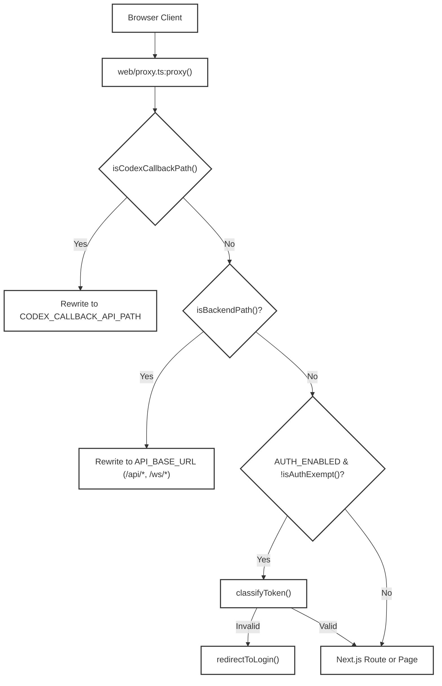
*Figure 2: Next.js Proxy Routing Flow and Authentication Gate (`web/proxy.ts`).*

### Proxy Processing Stages:
1. **Codex Callback Interception:** Exact matches for `isCodexCallbackPath()` are rewritten to the backend OAuth callback API route (`[web/proxy.ts:54-58]()`).
2. **Backend Forwarding:** Requests matching `isBackendPath()` (`/api/*` and `/ws/*`) are rewritten to `API_BASE_URL` using `prepareBackendForwardHeaders()` to strip untrusted client forwarding headers while retaining WebSocket upgrade parameters (`[web/proxy.ts:67-76]()`, `[web/tests/proxy-policy.test.ts:132-161]()`).
3. **Authentication Gate:** When `AUTH_ENABLED` is active and the path is not covered by `isAuthExempt()`, the middleware inspects the `dt_token` cookie via `classifyToken()`. Invalid credentials trigger a redirect to `LOGIN_PATH` (`[web/proxy.ts:82-89]()`, `[web/tests/proxy-policy.test.ts:104-130]()`).

Sources: `[web/proxy.ts:1-109]()`, `[web/lib/proxy-policy.ts:1-90]()`, `[web/tests/proxy-policy.test.ts:1-170]()`

---

## 5. Self-Update Worker & Version Lifecycle

DeepTutor includes a managed update subsystem coordinated by `deeptutor/services/app_update.py` and background launcher routines (`[deeptutor/services/app_update.py:1-126]()`, `[tests/runtime/test_launcher.py:151-194]()`).

- **Update Jobs:** Scheduled upgrades are recorded via `UpdateJobStore`, which tracks job status across states (`pending`, `handoff`, `running`, `restarting`, `succeeded`, `failed`) (`[deeptutor/services/app_update.py:38-126]()`).
- **Handoff Sequence:** When an update is approved, the launcher spawns an isolated update worker process passing restart arguments and termination tokens (`[tests/runtime/test_launcher.py:151-174]()`). Under systemd environments, in-app self-updates are safely disabled to respect system service boundaries (`[deeptutor/services/app_update.py:31-35, 175-194]()`).

Sources: `[deeptutor/services/app_update.py:1-126]()`, `[tests/runtime/test_launcher.py:140-194]()`, `[deeptutor/runtime/update_worker.py:1-100]()`

---

## Summary Table of Key Launcher Components

| Component | Description | Source File and Lines |
| :--- | :--- | :--- |
| `ManagedProcess` | Dataclass holding subprocess handles and process group identifiers | `[deeptutor/runtime/launcher.py:112-117]()` |
| Detached Runtime State | JSON state and control files under `data/user/runtime/` for daemon execution | `[deeptutor/runtime/launcher.py:165-172]()` |
| Web Build Cache | Runtime cache at `data/user/runtime/web` populated from packaged assets | `[deeptutor/runtime/launcher.py:62-76]()` |
| CLI Entry Points | Typer commands defining `deeptutor start`, `stop`, and `serve` | `[deeptutor_cli/main.py:124-180]()` |
| Port Conflict Checker | Dual-stack loopback probes verifying availability before binding | `[deeptutor/runtime/launcher.py:162-172]()`, `[tests/runtime/test_launcher.py:87-103]()` |
| Next.js Proxy Middleware | Rewrites API/WebSocket calls to FastAPI and enforces multi-user auth gates | `[web/proxy.ts:1-109]()`, `[web/lib/proxy-policy.ts:1-90]()` |
| UpdateJobStore | Durable JSON store managing self-update states and worker handoffs | `[deeptutor/services/app_update.py:38-126]()` |

Sources: `[deeptutor/runtime/launcher.py:1-216]()`, `[deeptutor_cli/main.py:124-180]()`, `[web/proxy.ts:1-109]()`, `[deeptutor/services/app_update.py:38-126]()`

---

# Page: Desktop App Packaging

# Desktop App Packaging

<details>
<summary>Relevant source files</summary>

The following files were used as context for generating this wiki page:

- [.github/workflows/desktop-release.yml](.github/workflows/desktop-release.yml)
- [.github/workflows/docker-release.yml](.github/workflows/docker-release.yml)
- [.github/workflows/pypi-release.yml](.github/workflows/pypi-release.yml)
- [apps/desktop/README.md](apps/desktop/README.md)
- [apps/desktop/assets/entitlements.runtime.mac.plist](apps/desktop/assets/entitlements.runtime.mac.plist)
- [apps/desktop/platforms/windows-x64/installer.nsi](apps/desktop/platforms/windows-x64/installer.nsi)
- [apps/desktop/platforms/windows-x64/smoke-installer.ps1](apps/desktop/platforms/windows-x64/smoke-installer.ps1)
- [apps/desktop/scripts/lib/macos-runtime-signing.mjs](apps/desktop/scripts/lib/macos-runtime-signing.mjs)
- [apps/desktop/scripts/lib/signing.mjs](apps/desktop/scripts/lib/signing.mjs)
- [apps/desktop/scripts/notarize.mjs](apps/desktop/scripts/notarize.mjs)
- [apps/desktop/scripts/seal-runtime.mjs](apps/desktop/scripts/seal-runtime.mjs)
- [apps/desktop/test/macos-runtime-signing.test.mjs](apps/desktop/test/macos-runtime-signing.test.mjs)
- [apps/desktop/test/notarize.test.mjs](apps/desktop/test/notarize.test.mjs)
- [apps/desktop/test/signing.test.mjs](apps/desktop/test/signing.test.mjs)
- [tests/test_release_workflow_guards.py](tests/test_release_workflow_guards.py)

</details>


## Purpose and Scope

The `apps/desktop` package provides a double-clickable, self-contained Electron-style desktop preview of DeepTutor. It bundles a target-specific Python runtime, Node.js interpreter, production Next.js standalone build, and the core DeepTutor codebase into a single distributable application. Users can launch DeepTutor without manual terminal interaction, global Python/Node installations, or source code checkouts. This page documents the runtime sealing mechanism, cryptographic verification, Windows NSIS installer configuration, macOS signing and notarization, and the automated desktop release pipeline.

Sources: [`apps/desktop/README.md:1-68`]()

---

## 1. Desktop Architecture and Runtime Bundling

The desktop app follows a strict separation between the desktop shell (Node.js/Electron main process) and the managed backend services (FastAPI Python backend and Next.js frontend). The desktop shell is responsible exclusively for startup orchestration, health readiness polling, graceful shutdown signaling, and native window management (`apps/desktop/README.md:48-55`). No business logic or React component execution occurs directly inside the shell process; web content runs with isolated permissions.

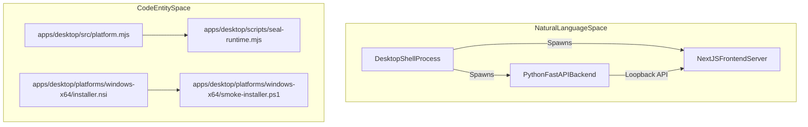

Sources: [`apps/desktop/README.md:48-68`]()

---

## 2. Runtime Sealing and Ed25519 Cryptographic Signatures

To ensure integrity and prevent tampering with bundled interpreter binaries or Python modules, the desktop build pipeline executes a runtime sealing step via `apps/desktop/scripts/seal-runtime.mjs`. This process archives the core bundle, computes its SHA-256 hash, and signs it using an Ed25519 private key.

### Key Sealing Steps
1. **Version Extraction**: Extracts the core release version from `deeptutor/__version__.py` and the git commit hash from `BUILD_COMMIT` [`apps/desktop/scripts/seal-runtime.mjs:32-34`]().
2. **Mach-O Signing (macOS)**: For macOS targets, binaries and shared libraries inside the runtime are signed with designated entitlements prior to compression [`apps/desktop/scripts/seal-runtime.mjs:37-40`].
3. **Archive Generation**: Packs the runtime folder into a `.tar.gz` tarball [`apps/desktop/scripts/seal-runtime.mjs:41`].
4. **Manifest and Signature Generation**: Constructs a `runtime.json` manifest containing format versions, target platform/architecture descriptors, file hashes, and an Ed25519 base64 signature [`apps/desktop/scripts/seal-runtime.mjs:42-47`].

The key verification logic is enforced by `apps/desktop/scripts/lib/signing.mjs`, which compares DER-exported public keys to guarantee that the signing key matches `assets/runtime-public.pem` [`apps/desktop/scripts/lib/signing.mjs:4-10`].

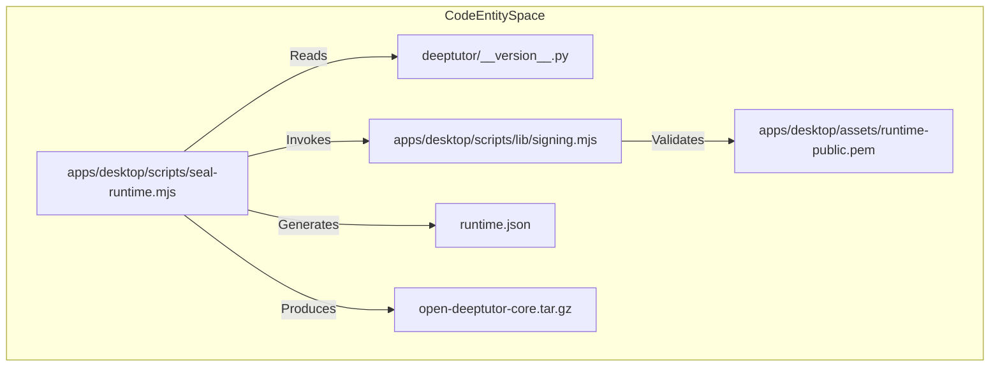

Sources: [`apps/desktop/scripts/seal-runtime.mjs:1-49`][], [`apps/desktop/scripts/lib/signing.mjs:1-10`]()

---

## 3. Windows Packaging and NSIS In-User Installation

Windows distribution is handled via an NSIS (Nullsoft Scriptable Install System) installer script [`apps/desktop/platforms/windows-x64/installer.nsi:1-93`]. The installer is configured to install exclusively for the current user (`RequestExecutionLevel user`), eliminating the need for administrative privilege prompts (`apps/desktop/platforms/windows-x64/installer.nsi:3-17`).

### Key Installer Mechanics
* **Installation Directory**: Defaults to `%LOCALAPPDATA%\Programs\Open DeepTutor` [`apps/desktop/platforms/windows-x64/installer.nsi:15`].
* **File Cleanup**: The `RemoveAppFiles` macro clears previous versions of resources, locales, and Electron binaries while preserving user learning data located in `%LOCALAPPDATA%\Open DeepTutor` [`apps/desktop/platforms/windows-x64/installer.nsi:43-63`].
* **Registry Entries**: Registers application uninstall strings, display names, and versions under `HKCU\Software\Microsoft\Windows\CurrentVersion\Uninstall\Open DeepTutor` [`apps/desktop/platforms/windows-x64/installer.nsi:74-81`].

End-to-end installation behavior, path handling with spaces/non-ASCII characters, and uninstallation preservation are validated by `apps/desktop/platforms/windows-x64/smoke-installer.ps1` [`apps/desktop/platforms/windows-x64/smoke-installer.ps1:1-75`].

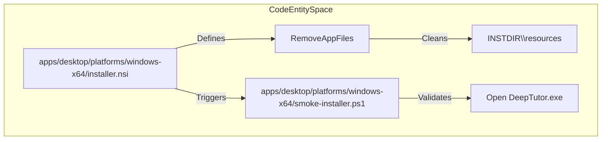

Sources: [`apps/desktop/platforms/windows-x64/installer.nsi:1-93`][], [`apps/desktop/platforms/windows-x64/smoke-installer.ps1:1-75`]()

---

## 4. macOS Runtime Signing and Notarization

For macOS targets (`macos-arm64` and `macos-x64`), runtime distribution requires strict code signing and notarization to comply with Apple's Gatekeeper requirements.

* **Binary Discovery**: The utility script traverses the runtime tree to locate extensionless executables, Mach-O binaries, and hidden dynamic libraries (`.dylib`), ensuring symlinks are not recursively followed [`apps/desktop/test/macos-runtime-signing.test.mjs:9-27`].
* **Entitlements**: Node.js/V8 Just-In-Time (JIT) compilation and Python native callback mechanisms require specific execution memory entitlements defined in `apps/desktop/assets/entitlements.runtime.mac.plist` [`apps/desktop/assets/entitlements.runtime.mac.plist:1-9`]:
  ```xml
  <key>com.apple.security.cs.allow-jit</key><true/>
  <key>com.apple.security.cs.allow-unsigned-executable-memory</key><true/>
  ```
* **Notarization**: Bundled DMGs are submitted via Apple's notarization service (`apps/desktop/scripts/notarize.mjs`), after which successful results are stapled to the package.

Sources: [`apps/desktop/assets/entitlements.runtime.mac.plist:1-9`][], [`apps/desktop/test/macos-runtime-signing.test.mjs:9-27`]()

---

## 5. Desktop Release and CI/CD Workflow

The desktop release lifecycle is fully automated via GitHub Actions in `.github/workflows/desktop-release.yml` [`/.github/workflows/desktop-release.yml:1-232`].

### Workflow Triggers and Jobs
* **Triggers**: Executed on pushes to `dev` affecting `apps/desktop/**`, published GitHub releases, pull requests, and manual dispatches [`/.github/workflows/desktop-release.yml:24-46`].
* **Matrix Strategy**: Builds simultaneously across three runner environments [`/.github/workflows/desktop-release.yml:60-74`]:
  * `macos-arm64` (`macos-15`)
  * `macos-x64` (`macos-15-intel`)
  * `windows-x64` (`windows-2025`)
* **Tag Enforcement**: Validates that the GitHub release tag matches the version declared in `deeptutor/__version__.py` [`/.github/workflows/desktop-release.yml:90-98`].
* **Signing Secrets**: In production releases, `DESKTOP_RUNTIME_SIGNING_KEY` is required. Pull requests automatically fall back to disposable throwaway signing keys [`/.github/workflows/desktop-release.yml:109-116`].

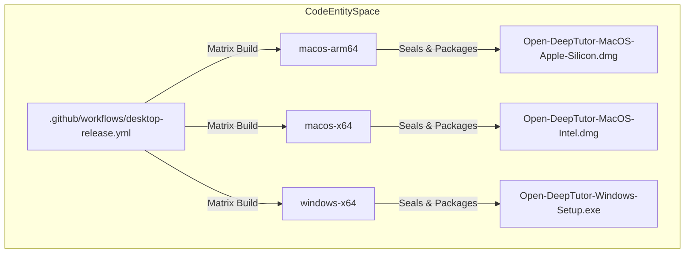

Sources: [`/.github/workflows/desktop-release.yml:1-232`]()

---

# Page: System Architecture

# System Architecture

<details>
<summary>Relevant source files</summary>

The following files were used as context for generating this wiki page:

- [README.md](README.md)
- [assets/README/README_AR.md](assets/README/README_AR.md)
- [assets/README/README_CN.md](assets/README/README_CN.md)
- [assets/README/README_ES.md](assets/README/README_ES.md)
- [assets/README/README_FR.md](assets/README/README_FR.md)
- [assets/README/README_HI.md](assets/README/README_HI.md)
- [assets/README/README_JA.md](assets/README/README_JA.md)
- [assets/README/README_PL.md](assets/README/README_PL.md)
- [assets/README/README_PT.md](assets/README/README_PT.md)
- [assets/README/README_RU.md](assets/README/README_RU.md)
- [assets/README/README_TH.md](assets/README/README_TH.md)
- [deeptutor/__version__.py](deeptutor/__version__.py)
- [deeptutor/api/main.py](deeptutor/api/main.py)
- [tests/api/test_main_exception_handler.py](tests/api/test_main_exception_handler.py)
- [tests/api/test_selective_access_log.py](tests/api/test_selective_access_log.py)

</details>


**Purpose**: This page provides a high-level overview of DeepTutor's four-layer architecture, detailing how the presentation, API gateway, runtime orchestration, and data persistence layers interact. For deep technical implementation details, refer to the child pages: [Frontend Architecture](#3.1), [Data Flow and Storage](#3.3), [Runtime and Orchestration](#3.4), [Agent Loop and Tool Dispatch](#3.5), [Experimental TypeScript Chat Engine](#3.6), and [Module Manifests and Plugins](#3.7).

---

## Architectural Overview

DeepTutor uses a four-layer design pattern to separate concerns between user presentation, HTTP/WebSocket routing, agentic capability execution, and state persistence. The system is initialized via container structures and unified event busses.

### Diagram: System Layer Architecture
```mermaid
graph TB
    subgraph Presentation["Presentation Layer"]
        UI["Next.js Frontend"]
        CLI["deeptutor CLI"]
    end
    
    subgraph Gateway["API Gateway Layer"]
        FAST["FastAPI app/main.py"]
        ROUTERS["API Routers"]
    end
    
    subgraph Runtime["Runtime & Orchestration Layer"]
        ORCH["ChatOrchestrator"]
        TURN["TurnRuntimeManager"]
        BUS["StreamBus"]
    end
    
    subgraph Storage["Data & Storage Layer"]
        LIB["FileLibraryStore"]
        SQL["SQLiteSessionStore"]
    end
    
    UI --> FAST
    CLI --> ORCH
    FAST --> ROUTERS
    ROUTERS --> TURN
    TURN --> ORCH
    ORCH --> BUS
    BUS --> TURN
    ORCH --> LIB
    TURN --> SQL
```
Sources: [deeptutor/api/main.py:108-130](), [deeptutor/api/routers/unified_ws.py:10-12]()

---

## Presentation and API Gateway Layers

The presentation layer handles client interaction via the Next.js web application and the CLI launcher. Requests enter the system through the FastAPI application defined in `deeptutor/api/main.py` [deeptutor/api/main.py:108-130]() and `deeptutor/api/routers/unified_ws.py` [deeptutor/api/routers/unified_ws.py:10-12]() which configures lifespan handlers, container bootstrapping, and WebSocket streams.

### Diagram: Request Routing and Presentation Bridge
```mermaid
graph LR
    subgraph NaturalLanguageSpace["Natural Language Space"]
        USER["User Action / Prompt"]
    end
    
    subgraph CodeEntitySpace["Code Entity Space"]
        ROUTER["FastAPI Router"]
        CONTAINER["get_application_container"]
        FAST_MAIN["deeptutor/api/main.py"]
    end
    
    USER --> ROUTER
    ROUTER --> FAST_MAIN
    FAST_MAIN --> CONTAINER
```
Sources: [deeptutor/api/main.py:108-130](), [deeptutor/api/routers/unified_ws.py:10-12]()

For frontend specifics, see [Frontend Architecture](#3.1).

---

## Intelligent Agent and Orchestration Layer

The orchestration layer coordinates agent execution. `ChatOrchestrator` resolves user context and maps active capabilities to specific execution pipelines, routing progress events through `StreamBus` [deeptutor/runtime/orchestrator.py:51-67](). State synchronization and turn lifecycle management are handled by `TurnRuntimeManager` [deeptutor/services/session/turn_runtime.py:26-34]().

### Diagram: Capability Dispatch and Orchestration
```mermaid
graph TD
    subgraph NaturalLanguageSpace["Natural Language Space"]
        PROMPT["User Message / Intent"]
    end
    
    subgraph CodeEntitySpace["Code Entity Space"]
        ORCH["ChatOrchestrator.handle"]
        REG["CapabilityRegistry"]
        RUN["TurnRuntimeManager"]
        CAP["TurnCapability.run"]
    end
    
    PROMPT --> ORCH
    ORCH --> REG
    REG --> CAP
    ORCH --> RUN
```
Sources: [deeptutor/runtime/orchestrator.py:51-180](), [deeptutor/services/session/turn_runtime.py:26-53]()

For deeper execution details, see [Runtime and Orchestration](#3.4) and [Agent Loop and Tool Dispatch](#3.5).

---

## Data Flow and Storage Layer

Persistence is managed through modular storage adapters. The `FileLibraryStore` handles disk-based and SQLite-indexed file deduplication, while session states, knowledge base vector indexes, and user configurations are segregated into workspace directories.

### Diagram: Storage and Persistence Bridge
```mermaid
graph LR
    subgraph NaturalLanguageSpace["Natural Language Space"]
        FILE["Uploaded Document"]
    end
    
    subgraph CodeEntitySpace["Code Entity Space"]
        STORE["FileLibraryStore"]
        SQL["SQLite DB"]
        ROOT["PathService"]
    end
    
    FILE --> STORE
    STORE --> SQL
    STORE --> ROOT
```
Sources: [deeptutor/services/session/turn_runtime.py:43-53]()

For persistence layout details, see [Data Flow and Storage](#3.3).

---

## Module Manifests and Plugins

Modular capability extension is managed via module manifests and the plugin loader. System checks validate tool consistency against the runtime `ToolRegistry` at startup using `validate_tool_consistency` [deeptutor/api/main.py:47-75](). For details on loading extensions and gating optional dependencies, see [Module Manifests and Plugins](#3.7).

Sources: [deeptutor/api/main.py:47-75]()

---

## Experimental TypeScript Chat Engine

In parallel with the Python orchestration layer, DeepTutor includes an experimental TypeScript chat engine profile (`packages/chat-engine`) supporting native model rounds, stream decoding, tool dispatchers, and stdio transport. For full profiling and bridge specifications, see [Experimental TypeScript Chat Engine](#3.6).

Sources: [deeptutor/api/main.py:108-130]()

---

# Page: Frontend Architecture

# Frontend Architecture

<details>
<summary>Relevant source files</summary>

The following files were used as context for generating this wiki page:

- [deeptutor/api/router_index.json](deeptutor/api/router_index.json)
- [tests/runtime/test_runtime_home_reset.py](tests/runtime/test_runtime_home_reset.py)
- [web/components/reading/PdfDocumentView.tsx](web/components/reading/PdfDocumentView.tsx)
- [web/components/reading/workspace/ReadingCompanion.tsx](web/components/reading/workspace/ReadingCompanion.tsx)
- [web/components/sidebar/SidebarNav.tsx](web/components/sidebar/SidebarNav.tsx)
- [web/components/sidebar/SidebarShell.tsx](web/components/sidebar/SidebarShell.tsx)
- [web/components/sidebar/UtilitySidebar.tsx](web/components/sidebar/UtilitySidebar.tsx)
- [web/components/sidebar/VersionBadge.tsx](web/components/sidebar/VersionBadge.tsx)
- [web/components/sidebar/WorkspaceSidebar.tsx](web/components/sidebar/WorkspaceSidebar.tsx)
- [web/components/space/learning/MasteryStudy.tsx](web/components/space/learning/MasteryStudy.tsx)
- [web/contracts/generated/api.ts](web/contracts/generated/api.ts)
- [web/contracts/schema/openapi.json](web/contracts/schema/openapi.json)
- [web/eslint.config.mjs](web/eslint.config.mjs)
- [web/features/chat/ChatStateAdapter.tsx](web/features/chat/ChatStateAdapter.tsx)
- [web/features/chat/components/ChatWorkspace.tsx](web/features/chat/components/ChatWorkspace.tsx)
- [web/features/chat/messages/ChatMessageList.tsx](web/features/chat/messages/ChatMessageList.tsx)
- [web/lib/failed-submissions.ts](web/lib/failed-submissions.ts)
- [web/lib/pdfjs-loader.ts](web/lib/pdfjs-loader.ts)
- [web/lib/proxy-policy.ts](web/lib/proxy-policy.ts)
- [web/locales/de/app.json](web/locales/de/app.json)
- [web/locales/en/app.json](web/locales/en/app.json)
- [web/locales/fr/app.json](web/locales/fr/app.json)
- [web/locales/pl/app.json](web/locales/pl/app.json)
- [web/locales/uk/app.json](web/locales/uk/app.json)
- [web/locales/zh/app.json](web/locales/zh/app.json)
- [web/next-env.d.ts](web/next-env.d.ts)
- [web/next.config.js](web/next.config.js)
- [web/package-lock.json](web/package-lock.json)
- [web/package.json](web/package.json)
- [web/playwright.config.ts](web/playwright.config.ts)
- [web/scripts/build.mjs](web/scripts/build.mjs)
- [web/scripts/copy-pdfjs-assets.mjs](web/scripts/copy-pdfjs-assets.mjs)
- [web/tests/build-wrapper.test.ts](web/tests/build-wrapper.test.ts)
- [web/tests/chat-failed-submission-recovery.spec.tsx](web/tests/chat-failed-submission-recovery.spec.tsx)
- [web/tests/e2e/fixtures/runtime.ts](web/tests/e2e/fixtures/runtime.ts)
- [web/tests/e2e/multi-worker-turns.audit.ts](web/tests/e2e/multi-worker-turns.audit.ts)
- [web/tests/e2e/turn-lifecycle.audit.ts](web/tests/e2e/turn-lifecycle.audit.ts)
- [web/tests/integration/chat-messages.spec.tsx](web/tests/integration/chat-messages.spec.tsx)
- [web/tests/mastery-study-route.test.ts](web/tests/mastery-study-route.test.ts)
- [web/tests/pdf-reading-resize.spec.tsx](web/tests/pdf-reading-resize.spec.tsx)
- [web/tests/session-failed-submission-cleanup.spec.ts](web/tests/session-failed-submission-cleanup.spec.ts)
- [web/tests/sidebar-lazy-history.spec.tsx](web/tests/sidebar-lazy-history.spec.tsx)
- [web/tests/sidebar-prefetch.spec.tsx](web/tests/sidebar-prefetch.spec.tsx)
- [web/tsconfig.json](web/tsconfig.json)

</details>


## Purpose and Scope

This document describes the architecture of DeepTutor's web frontend, a Next.js application that provides the user interface for all intelligent agent modules. The frontend implements a modern single-page application using the Next.js App Router, structured around route groups (`(workspace)`, `(utility)`, `(admin)`, and `(auth)`), automated API contract generation, feature modules, and unified theming entrypoints.

The frontend is designed as an agent-native interface, specifically optimized for real-time streaming, long-running asynchronous tasks (such as deep research and interactive book generation), and multi-user authentication.

Sources: [web/app/layout.tsx:1-61](), [web/package.json:1-70]()

---

## App Router Structure and Route Groups

DeepTutor uses the Next.js App Router (`web/app/`) with route groups to organize layouts, authentication boundaries, and workspace views without modifying URL segments.

Title: App Router Route Groups and Layout Structure
```mermaid
graph TB
    subgraph "RootLayout [web/app/layout.tsx]"
        ROOT["AppShellProvider & I18nClientBridge"]
    end

    subgraph "Route Groups"
        WORKSPACE["(workspace)<br/>- home/[[...sessionId]]/page.tsx<br/>- ChatWorkspace & SidebarShell"]
        UTILITY["(utility)<br/>- Reader, Notebook, Tools"]
        ADMIN["(admin)<br/>- Dashboard & Users"]
        AUTH["(auth)<br/>- Login & Register"]
    end

    ROOT --> WORKSPACE
    ROOT --> UTILITY
    ROOT --> ADMIN
    ROOT --> AUTH
```

- **`(workspace)`**: This route group contains the core user-facing workspace and chat environment. The main page at `web/app/(workspace)/home/[[...sessionId]]/page.tsx` loads the interactive chat hub (`ChatWorkspace`) and sidebar (`WorkspaceSidebar`). It controls the session and turn runtime state adapters that handle conversational interactions and multi-agent collaboration [web/features/chat/components/ChatWorkspace.tsx:37-78]().
- **`(utility)`**: Provides auxiliary application features distinct from the chat workspace, such as the immersive PDF/EPUB reader, Notebook document pages, and various tool utilities designed for specialized user tasks.
- **`(admin)`**: Hosts administrative interfaces that manage users, services, multi-user permissions, and system configurations, segmented from normal user flow.
- **`(auth)`**: Handles authentication workflows and identity management UI including login, registration, device pairing, and security tokens. This is an authentication boundary that controls access to the rest of the app.

Sources: [web/app/layout.tsx:35-61](), [web/components/chat/HistorySessionPicker.tsx:1-57]()

---

## Contracts Generation and API Clients

DeepTutor enforces strong typing and consistency between backend FastAPI endpoints and the frontend via generated TypeScript API contracts from OpenAPI schema.

Title: OpenAPI Contract Generation Pipeline
```mermaid
graph LR
    subgraph "Backend"
        FASTAPI["FastAPI App"]
    end

    subgraph "Contracts Pipeline"
        SCHEMA["web/contracts/schema/openapi.json"]
        GEN["openapi-typescript"]
        CLIENT["web/contracts/generated/api.ts"]
    end

    FASTAPI -- "Export JSON schema" --> SCHEMA
    SCHEMA --> GEN
    GEN --> CLIENT
```

- The backend FastAPI app exports a full OpenAPI-compliant JSON schema describing all API operations, request and response data models, and enumerations. This file is located at `web/contracts/schema/openapi.json`.
- The TypeScript generation tool `openapi-typescript` consumes this schema and outputs strongly typed frontend API interfaces at `web/contracts/generated/api.ts`.
- Feature frontend modules import these generated types to define explicitly typed API calls, ensuring compile-time validation of all data structures such as `ActionPayload`, `AddRecordRequest`, and related entities [web/contracts/schema/openapi.json:1-50]().
- This contract-first approach minimizes runtime deserialization errors and accelerates developer productivity via autocompletion and exhaustive type coverage [web/contracts/generated/api.ts:1-50]().

Sources: [web/contracts/schema/openapi.json:1-250](), [web/contracts/generated/api.ts:1-218](), [web/contracts/schema/openapi.json:1-50]()

---

## Feature Modules and Component Architecture

The frontend is architected as a composition of feature modules implemented as React components under `web/components/` and `web/features/`. Each module owns its domain logic, UI, and state adaption, composed under global application context providers.

Title: Feature Module Interaction Hierarchy
```mermaid
graph TB
    subgraph "Context Layer"
        SHELL["AppShellContext<br/>[web/context/AppShellContext.tsx]"]
    end

    subgraph "Feature Modules"
        CHAT["Chat Module<br/>- ChatWorkspace<br/>- ChatMessageList"]
        READING["Reading Module<br/>- PdfDocumentView<br/>- EpubDocumentView"]
        SETTINGS["Settings Module<br/>- ServiceConfigEditor"]
        SIDEBAR["Sidebar Components<br/>- SidebarShell<br/>- WorkspaceSidebar"]
    end

    SHELL --> CHAT
    SHELL --> READING
    SHELL --> SETTINGS
    SHELL --> SIDEBAR
```

- **Chat Workspace Module**: At the core is `ChatWorkspace` which handles conversation rendering, message composition, and tool interactions [web/features/chat/components/ChatWorkspace.tsx:37-40](). It uses `ChatStateAdapter` to sync session and turn runtime state with backend APIs and WebSocket events [web/features/chat/ChatStateAdapter.tsx:35-45]().
- **Reading Module**: Contains dynamic React components like `PdfDocumentView` which handle document viewing with efficient windowed rendering and integration of `pdfjs-dist` libraries.
- **Settings Module**: Includes configuration UIs managing editing of backend service parameters.
- **Sidebar Components**: `SidebarShell` provides the left rail layout with session lists and navigation. `WorkspaceSidebar` fetches and organizes session and course data, interfaces with chat state adapters, and manages selections and session lifecycle actions.

Sources: [web/features/chat/ChatStateAdapter.tsx:35-50](), [web/features/chat/components/ChatWorkspace.tsx:37-40](), [web/components/sidebar/WorkspaceSidebar.tsx:1-162]()

---

## Theming and Design System Entrypoints

DeepTutor supports a flexible and performant theming system with multiple named themes (`light`, `dark`, `glass`, `snow`), user preference persistence, and Flash of Unstyled Content (FOUC) prevention.

Title: Theming Initialization and Script Flow
```mermaid
graph TD
    subgraph "DOM Initialization"
        HTML["<html lang='en'>"]
        SCRIPT["ThemeScript [web/components/ThemeScript.tsx]"]
        CSS["globals.css"]
    end

    subgraph "Theme Logic [web/lib/theme.ts]"
        GET["getStoredTheme() / getSystemTheme()"]
        APPLY["applyThemeToDocument()"]
    end

    HTML --> SCRIPT
    SCRIPT --> GET
    GET --> APPLY
    APPLY --> CSS
```

- **ThemeScript Component**: Injected inline into the document `<head>` in `web/app/layout.tsx` - the script runs immediately on page load before React hydration, reading the stored theme setting from localStorage or falling back to system preferences, and applies the appropriate CSS theme classes to the `<html>` element [web/components/ThemeScript.tsx:1-30](), [web/app/layout.tsx:43-67]().
- **Theme Utilities** (`web/lib/theme.ts`): Provide runtime functions that retrieve theme settings, normalize values, and mutate document classes to enable dark mode (`dark`), glass effect (`theme-glass`), or snow effect (`theme-snow`). All theme state changes are synchronized and persisted for user consistency.

Sources: [web/app/layout.tsx:40-60](), [web/components/ThemeScript.tsx:1-49](), [web/lib/theme.ts:1-50]()

---

## Appendix: Natural Language to Code Entity Mapping

To help bridge conceptual understanding of DeepTutor’s frontend architecture, below are two diagrams relating system features in natural language to their exact code entities.

### Diagram 1: Route Groups to Code Entities

```mermaid
graph TB
    SUBGRAPH_Root["Root App Layout (web/app/layout.tsx)"]
    SUBGRAPH_Workspace["Workspace Group (web/app/(workspace))"]
    SUBGRAPH_Utility["Utility Group (web/app/(utility))"]
    SUBGRAPH_Admin["Admin Group (web/app/(admin))"]
    SUBGRAPH_Auth["Auth Group (web/app/(auth))"]

    SUBGRAPH_Root --> SUBGRAPH_Workspace
    SUBGRAPH_Root --> SUBGRAPH_Utility
    SUBGRAPH_Root --> SUBGRAPH_Admin
    SUBGRAPH_Root --> SUBGRAPH_Auth

    SUBGRAPH_Workspace --> "home/[[...sessionId]]/page.tsx"
    SUBGRAPH_Workspace --> "components/chat/ChatWorkspace.tsx"
    SUBGRAPH_Workspace --> "components/sidebar/WorkspaceSidebar.tsx"

    SUBGRAPH_Utility --> "components/reading/PdfDocumentView.tsx"
    SUBGRAPH_Utility --> "components/notebook/NotebookView.tsx"

    SUBGRAPH_Admin --> "components/admin/DashboardPage.tsx"

    SUBGRAPH_Auth --> "components/auth/LoginCard.tsx"
```
Sources: [web/app/layout.tsx:1-61](), [web/features/chat/components/ChatWorkspace.tsx:37-40]()

### Diagram 2: API Contracts to Frontend Use

```mermaid
graph LR
    BackendFastAPI["FastAPI Backend"]
    OpenAPIJson["OpenAPI Schema\n(web/contracts/schema/openapi.json)"]
    TypeGen["openapi-typescript Generator"]
    ApiTs["Generated API Types\n(web/contracts/generated/api.ts)"]
    ComponentsUsingApi["Frontend Components\n(e.g., ChatWorkspace, SessionList)"]

    BackendFastAPI --> OpenAPIJson
    OpenAPIJson --> TypeGen
    TypeGen --> ApiTs
    ApiTs --> ComponentsUsingApi
```
Sources: [web/contracts/schema/openapi.json:1-50](), [web/contracts/generated/api.ts:1-50]()

---

# Summary

- The frontend uses Next.js AppRouter with four route groups `(workspace)`, `(utility)`, `(admin)`, and `(auth)` to organize the UI and manage authentication boundaries.
- API contracts between backend and frontend are rigorously typed through OpenAPI JSON and TypeScript generation, improving maintainability and correctness.
- The UI is modularized into feature modules exposing components with localized state, data fetching, and reuse of shared global contexts.
- Theming entrypoints use client-side scripts and CSS variables, enabling theme persistence and instant application on startup for a smooth user experience.

Sources: [web/app/layout.tsx:1-61](), [web/contracts/schema/openapi.json:1-250](), [web/contracts/generated/api.ts:1-218](), [web/lib/theme.ts:1-50]()

---

# Page: Data Flow and Storage

# Data Flow and Storage

<details>
<summary>Relevant source files</summary>

The following files were used as context for generating this wiki page:

- [deeptutor/api/routers/file_library.py](deeptutor/api/routers/file_library.py)
- [deeptutor/api/routers/outputs.py](deeptutor/api/routers/outputs.py)
- [deeptutor/services/partners/runtime_status.py](deeptutor/services/partners/runtime_status.py)
- [deeptutor/services/path_service.py](deeptutor/services/path_service.py)
- [deeptutor/services/storage/__init__.py](deeptutor/services/storage/__init__.py)
- [deeptutor/services/storage/file_library.py](deeptutor/services/storage/file_library.py)
- [deeptutor/services/workspace/data_migration.py](deeptutor/services/workspace/data_migration.py)
- [deeptutor/services/workspace/dependencies.py](deeptutor/services/workspace/dependencies.py)
- [deeptutor/services/workspace/session_move.py](deeptutor/services/workspace/session_move.py)
- [tests/agents/video_lesson/test_public_output.py](tests/agents/video_lesson/test_public_output.py)
- [tests/api/test_file_library_router.py](tests/api/test_file_library_router.py)
- [tests/api/test_output_files.py](tests/api/test_output_files.py)
- [tests/multi_user/test_handoff_connection_lifetime.py](tests/multi_user/test_handoff_connection_lifetime.py)
- [tests/reading/test_catalog_connection_lifetime.py](tests/reading/test_catalog_connection_lifetime.py)
- [tests/services/memory/test_snapshot_connection_lifetime.py](tests/services/memory/test_snapshot_connection_lifetime.py)
- [tests/services/storage/test_file_library.py](tests/services/storage/test_file_library.py)
- [tests/services/storage/test_file_library_unicode_search.py](tests/services/storage/test_file_library_unicode_search.py)
- [tests/services/test_partner_status_connection_lifetime.py](tests/services/test_partner_status_connection_lifetime.py)
- [tests/services/workspace/test_data_migration.py](tests/services/workspace/test_data_migration.py)

</details>


## Purpose and Scope

This document describes DeepTutor's data persistence architecture, directory structures, and file formats. It details how the system manages the `DEEPTUTOR_HOME` layout, isolation of data for single-user vs multi-user modes, Content Workspace outputs directory, file libraries, and workspace services. The design ensures secure multi-tenant data handling, flexible workspace management, and consistent artifact generation and retrieval.

Key components include `PathService` managing runtime storage layout and scoped user directories [deeptutor/services/path_service.py:66-94](), and `ContentWorkspaceService` offering confined content workspace resolution with secure overrides and output publication. Partner workspace provisioning adds multi-user partner-specific clones of knowledge bases, skills, and notebooks. The outputs router (`deeptutor/api/routers/outputs.py`) and file library store (`deeptutor/services/storage/file_library.py`) mediate authorized retrieval of generated artifacts and reusable uploaded assets.

---

## DEEPTUTOR_HOME Layout and Directory Structures

DeepTutor organizes persistent data under a root home directory (`DEEPTUTOR_HOME`), defaulting to the install/runtime data root or an explicitly configured path [deeptutor/services/path_service.py:88-92](). The structure splits between single-user/admin mode under `data/` and multi-user mode under `multi-user/`.

```mermaid
graph TB
    HOME["DEEPTUTOR_HOME Root"]
    DATA["data/ (Single User / Admin)"]
    MULTI["multi-user/ (Multi-User Mode)"]

    HOME --> DATA
    HOME --> MULTI

    MULTI --> UID["<user_id>/"]
    MULTI --> SYS["_system/ (Auth/Grants/Audit)"]

    DATA --> USER_DIR["user/"]
    UID --> USER_DIR2["user/"]

    USER_DIR --> DB["chat_history.db"]
    USER_DIR --> SETTINGS["settings/"]
    USER_DIR --> WORK["workspace/"]

    WORK --> MEM["memory/"]
    WORK --> NOTE["notebook/"]
    WORK --> CHAT["chat/"]
    WORK --> LEARN["learning/"]
    
    CHAT --> DS["deep_solve/"]
    CHAT --> DQ["deep_question/"]
    CHAT --> DR["deep_research/"]
    CHAT --> MIMIC["mimic_papers/"]
```

- In **single-user mode**, everything lives under `data/user/` including:
  - `chat_history.db`: central SQLite DB for unified session messages and turns [deeptutor/services/path_service.py:137-138]()
  - `settings/`: JSON files for UI preferences, model/system config [deeptutor/services/path_service.py:11()]()
  - `workspace/`: content workspace root for agent capabilities output and user data [deeptutor/services/path_service.py:12-23]()

- In **multi-user mode**, each user gets an isolated workspace under `multi-user/<user_id>/user/` mirroring the above tree, with an additional internal `_system/` directory for shared admin and security state.

This layout, managed by `PathService`, enables layered isolation while keeping API surfaces consistent regardless of multi-user setting [deeptutor/services/path_service.py:66-94]().

---

### Directory Purpose Table

| Directory Path                  | Purpose                                           | Key Code / Service                                                         |
|--------------------------------|-------------------------------------------------|---------------------------------------------------------------------------|
| `.../user/chat_history.db`      | SQLite backend session store (messages, turns)  | `SQLiteSessionStore` [deeptutor/services/path_service.py:137-138]() |
| `.../user/settings/`            | UI prefs, model catalogs, global/system configs | `PathService` [deeptutor/services/path_service.py:10-11]()                  |
| `.../user/workspace/`           | Content Workspace root; capability outputs       | `PathService.workspace_root` [deeptutor/services/path_service.py:114-115]() |
| `.../workspace/memory/`         | Stores learning memory profiles and summaries    | `PathService` [deeptutor/services/path_service.py:55-56]()                  |
| `.../workspace/notebook/`       | Personal notebooks, bookmarks, draft stores     | `PathService` [deeptutor/services/path_service.py:57-58]()                  |
| `.../workspace/chat/deep_solve` | Capability-specific chat workspace partitions    | `PathService` [deeptutor/services/path_service.py:47-48]()                  |

**Sources:** [deeptutor/services/path_service.py:3-24](), [deeptutor/services/path_service.py:66-140]()

---

## Content Workspace and `outputs/` Architecture

DeepTutor's Content Workspace is a dedicated, user- or session-scoped directory where agents read and write artifacts such as downloaded source materials, generated files, code execution outputs, and rendered assets. It is isolated from user runtime settings and databases.

### Workspace Output Layout and Execution Flow

```mermaid
graph TD
    WS["ContentWorkspaceRoot"]
    WS --> OUT["outputs/"]
    OUT --> CAP["CapabilityDir"]
    CAP --> SES["SessionIdDir"]
    SES --> TRN["TurnIdDir"]

    TRN --> EVT["events.jsonl"]
    TRN --> ARTIFACTS["ArtifactFiles"]

    subgraph Natural_Language_Space
        User["User / UI"]
    end
    subgraph Code_Entity_Space
        WSVC["ContentWorkspaceService"]
        PATHSVC["PathService_resolve_public_output_path"]
        OUTPUTS["OutputsRouter_read_output"]
    end

    User -->|requests output| OUTPUTS
    OUTPUTS -->|calls| PATHSVC
    PATHSVC -->|validates and resolves| WSVC
```

- Each capability's execution outputs are organized below `workspace/outputs/chat/<session>/<turn>/<kind>/` [deeptutor/services/path_service.py:179-184]().
- Relative paths given to user or UI resolve via `PathService.resolve_public_output_path()` with strict sandbox and extension-based filtering to avoid unauthorized exposure [deeptutor/services/path_service.py:143-209]().
- The `outputs/` root allows content publication without exposing private workspace internals.
- The FastAPI outputs router (`deeptutor/api/routers/outputs.py`) serves artifacts after scope-sensitive authorization using the user's `PathService` context, including partner scopes [deeptutor/api/routers/outputs.py:39-88]().

**Sources:** [deeptutor/services/path_service.py:143-209](), [deeptutor/api/routers/outputs.py:25-97]()

---

## File Library and Workspace Services

DeepTutor uses layered services for workspace management, content indexing, and file access:

- **`FileLibraryStore`** manages reusable file storage across conversations under `data/user/workspace/library/files` [deeptutor/services/storage/file_library.py:1-105]().
  - **Deduplication:** Incoming file bytes are hashed using SHA-256 (`_sha256`). When `add_file` is called, the store checks for an active (non-deleted) entry with the same hash, returning the existing record without duplicating disk writes [deeptutor/services/storage/file_library.py:11-13]().
  - **Thread Safety:** Uses a threading lock (`_add_lock`) to serialize check-then-write sequences across concurrent uploads [deeptutor/services/storage/file_library.py:107-110]().
  - **Soft Delete:** `delete_file` sets `is_deleted=1` and records `deleted_at` timestamp. `hard_delete_file` permanently removes the record and disk file [deeptutor/services/storage/file_library.py:15-18]().

### File Library Data Flow

```mermaid
graph TD
    subgraph Natural_Language_Space
        Upload["File Upload Request"]
        Search["Filename Search (q)"]
    end

    subgraph Code_Entity_Space
        Router["LibraryRouter_add_library_file"]
        Store["FileLibraryStore_add_file"]
        Hash["_sha256"]
        DB["sqlite_library_files"]
        Disk["library_files_directory"]
    end

    Upload -->|multipart form| Router
    Router -->|invokes| Store
    Store -->|computes hash| Hash
    Hash -->|checks active uniqueness| DB
    DB -->|writes if new| Disk
    Search -->|substring query| Store
```

- The FastAPI file library router (`deeptutor/api/routers/file_library.py`) exposes endpoints for listing, uploading, searching, downloading, deleting, and restoring library files [deeptutor/api/routers/file_library.py:54-172]().

**Sources:** [deeptutor/services/storage/file_library.py:1-173](), [deeptutor/api/routers/file_library.py:1-172]()

---

## Partner Workspace Provisioning and Multi-User Isolation

In multi-user scenarios, DeepTutor supports persistent AI companions ("Partners") with their own synthesized workspaces:

```mermaid
graph TD
    AdminWorkspace["Admin or Requesting User Workspace"]
    PartnerWorkspace["Partner Workspace: data/partners/<partner_id>/workspace/"]
    
    AdminWorkspace -->|resolves sources| KnowledgeBases["knowledge_bases/<kb>/"]
    AdminWorkspace -->|resolves user skills| Skills["user/workspace/skills/<skill>/"]
    AdminWorkspace -->|resolves user notebooks| Notebooks["user/workspace/notebook/<id>.json"]
    
    PartnerWorkspace -->|copies assets| KBCopy["knowledge_bases/<kb>/ (copied or referenced)"]
    PartnerWorkspace -->|copies skills| SkillCopy["user/workspace/skills/<skill>/"]
    PartnerWorkspace -->|copies notebooks| NotebookCopy["user/workspace/notebook/<id>.json"]

    PartnerWorkspace --> SOUL["SOUL.md (partner persona)"]

    subgraph PartnerScopeCode
    ProvisionAssets["provision_assets(partner_id, ...)"]
    end
    
    AdminWorkspace -- uses --> ProvisionAssets
    ProvisionAssets --> PartnerWorkspace
```

- Partners get a workspace clone under `data/partners/<partner_id>/workspace/` with subfolders for knowledge bases, skills, notebooks, and the `SOUL.md` persona file.
- Connected/pointer knowledge bases register config entries without physical copies.
- Partner workspace tooling reuses the chat user workspace layout for native compatibility.
- Each partner workspace is isolated but accessible by the requester's `PathService` and authorized in output serving [deeptutor/api/routers/outputs.py:46-80]().

**Sources:** [deeptutor/api/routers/outputs.py:46-80](), [deeptutor/services/workspace/data_migration.py:55-92]()

---

## Unified Session Storage and Turn Lifecycle Data Flow

DeepTutor implements a unified session store abstracted over SQLite or remote PocketBase, managing all sessions, messages, and turn data consistently:

```mermaid
erDiagram
    sessions ||--o{ messages : contains
    sessions ||--o{ turns : executes
    turns ||--o{ turn_events : emits

    sessions {
      string id PK
      string title
      real created_at
      real updated_at
      text compressed_summary
      json preferences_json
    }

    messages {
      int id PK
      string session_id FK
      string role
      text content
      string capability
      json events_json
      json attachments_json
      int parent_message_id
    }

    turns {
      string id PK
      string session_id FK
      string capability
      string status
      real created_at
    }

    turn_events {
      int id PK
      string turn_id FK
      int seq
      string type
      text content
      json metadata_json
    }
```

- `sessions` store entire conversation sessions with metadata and compressed summaries (Layer 2 Memory).
- `messages` hold chat utterances with branching pointers (`parent_message_id`) for edit/alternate paths.
- `turns` represent computation turns executed by an agent for a request; capture stages, status, capability.
- `turn_events` log detailed turn lifecycle events (thinking, tool results, content emissions).

**Sources:** [deeptutor/services/session/sqlite_store.py:1-100](), [deeptutor/services/session/pocketbase_store.py:1-100]()

---

## Conversation History, Edit-Branching & Optimistic Reconciliation

- Messages sustain `parent_message_id` to preserve branching conversations for editing or alternative lines.
- Migration and dependency closure tools (`deeptutor/services/workspace/dependencies.py` and `deeptutor/services/workspace/data_migration.py`) inspect and transfer chat sessions alongside linked learning stores, notebooks, and reader materials without breaking relational integrity [deeptutor/services/workspace/dependencies.py:41-113](), [deeptutor/services/workspace/data_migration.py:131-152]().

**Sources:** [deeptutor/services/workspace/dependencies.py:41-113](), [deeptutor/services/workspace/data_migration.py:131-152]()

---

# Summary

DeepTutor's data flow and storage system robustly integrates:

- Root `DEEPTUTOR_HOME` directory with split single-user vs multi-user workspaces.
- Per-user isolated `user/` workspaces for chat history, settings, and content workspace directories.
- Capability-driven outputs directories under `workspace/outputs/` with turn/session scoped subfolders managed via `PathService`.
- Persistent file libraries (`FileLibraryStore`) providing SHA-256 deduplication and soft-delete capabilities.
- Unified SQLite or PocketBase session stores with detailed turn lifecycles and message branching.
- Authenticated, request-scoped output artifact serving respecting multi-user and partner visibility.

---

**Sources:**  
- deeptutor/services/path_service.py:66-209  
- deeptutor/services/storage/file_library.py:1-173  
- deeptutor/api/routers/outputs.py:25-97  
- deeptutor/api/routers/file_library.py:54-173  
- deeptutor/services/workspace/data_migration.py:32-92  
- deeptutor/services/workspace/dependencies.py:41-113

---

# Page: Runtime and Orchestration

# Runtime and Orchestration

<details>
<summary>Relevant source files</summary>

The following files were used as context for generating this wiki page:

- [deeptutor/agents/chat/capability.py](deeptutor/agents/chat/capability.py)
- [deeptutor/agents/question/capability.py](deeptutor/agents/question/capability.py)
- [deeptutor/app/service.py](deeptutor/app/service.py)
- [deeptutor/capabilities/ask_questions/__init__.py](deeptutor/capabilities/ask_questions/__init__.py)
- [deeptutor/capabilities/ask_questions/capability.py](deeptutor/capabilities/ask_questions/capability.py)
- [deeptutor/capabilities/ask_questions/loop.py](deeptutor/capabilities/ask_questions/loop.py)
- [deeptutor/capabilities/ask_questions/prompts/en/system.md](deeptutor/capabilities/ask_questions/prompts/en/system.md)
- [deeptutor/capabilities/ask_questions/prompts/zh/system.md](deeptutor/capabilities/ask_questions/prompts/zh/system.md)
- [deeptutor/capabilities/prompts/en/turn_status.yaml](deeptutor/capabilities/prompts/en/turn_status.yaml)
- [deeptutor/capabilities/prompts/zh/turn_status.yaml](deeptutor/capabilities/prompts/zh/turn_status.yaml)
- [deeptutor/learning/tests/test_visual_learning_workflow.py](deeptutor/learning/tests/test_visual_learning_workflow.py)
- [deeptutor/runtime/bootstrap/builtin_capabilities.py](deeptutor/runtime/bootstrap/builtin_capabilities.py)
- [deeptutor/runtime/coordination/memory.py](deeptutor/runtime/coordination/memory.py)
- [deeptutor/runtime/coordination/recovery.py](deeptutor/runtime/coordination/recovery.py)
- [deeptutor/runtime/orchestrator.py](deeptutor/runtime/orchestrator.py)
- [deeptutor/runtime/stream_bus.py](deeptutor/runtime/stream_bus.py)
- [deeptutor/services/session/turns/lifecycle.py](deeptutor/services/session/turns/lifecycle.py)
- [tests/agents/chat/test_language_prompts.py](tests/agents/chat/test_language_prompts.py)
- [tests/app/test_multiworker_turn_reply_after_queue_drop.py](tests/app/test_multiworker_turn_reply_after_queue_drop.py)
- [tests/app/test_turn_application_service.py](tests/app/test_turn_application_service.py)
- [tests/app/test_turn_parked_on_ask_user_is_reclaimable.py](tests/app/test_turn_parked_on_ask_user_is_reclaimable.py)
- [tests/app/test_waiting_turn_recovery.py](tests/app/test_waiting_turn_recovery.py)
- [tests/capabilities/test_mastery_teaching_delivery.py](tests/capabilities/test_mastery_teaching_delivery.py)
- [tests/core/test_capabilities_runtime.py](tests/core/test_capabilities_runtime.py)
- [tests/core/test_stream_bus_cross_loop_input.py](tests/core/test_stream_bus_cross_loop_input.py)
- [tests/runtime/coordination/test_journal_recovery.py](tests/runtime/coordination/test_journal_recovery.py)
- [tests/runtime/coordination/test_memory_coordinator.py](tests/runtime/coordination/test_memory_coordinator.py)
- [tests/runtime/coordination/test_redis_integration.py](tests/runtime/coordination/test_redis_integration.py)
- [tests/runtime/test_orchestrator.py](tests/runtime/test_orchestrator.py)
- [tests/services/session/test_turn_event_flush.py](tests/services/session/test_turn_event_flush.py)

</details>


The Runtime and Orchestration layer serves as the central coordination engine of DeepTutor, bridging high-level **Capabilities** (complex multi-agent workflows) and low-level **Tools** (atomic functions) through a unified execution environment. This layer manages capability registry lookups, plugin loading, tool dispatch, turn execution lifecycles (`TurnRuntimeManager`, `TurnLifecycle`), and the streaming event bus (`StreamBus`) that delivers real-time trace data to clients.

Sources:
- `deeptutor/runtime/orchestrator.py` [1-50]()
- `deeptutor/app/service.py` [1-18]()

---

## 1. ChatOrchestrator and Registries

The `ChatOrchestrator` class is the primary coordinator responsible for processing a single user turn. It accepts a `UnifiedContext` object reflecting the current conversation state and user input, resolves the active capability to handle the turn (defaulting to `"chat"` if none is specified), manages a streaming event bus lifecycle, and publishes completion events along with metadata [deeptutor/runtime/orchestrator.py:54-135]().

### Key Functions and Classes

- `ChatOrchestrator.__init__` — Initializes with optional injected `capability_registry` and acquires the singleton `tool_registry` [deeptutor/runtime/orchestrator.py:60-63]().

- `ChatOrchestrator.handle(context: UnifiedContext) -> AsyncIterator[StreamEvent]` — Core asynchronous method executing the user turn by validating knowledge base selections, resolving the capability, creating a `StreamBus` instance, yielding session bindings, running `capability.run(context, bus)`, and handling termination and cleanup [deeptutor/runtime/orchestrator.py:64-149]().

- `completion_event_fields(context, cap_name)` — Helper function that prepares standard capability-complete event fields and metadata [deeptutor/runtime/orchestrator.py:31-52]().

### Registries

- **Capability Registry** (`get_capability_registry()`): Manages discovery and lookup of all agent-native capabilities (e.g., `"chat"`, `"deep_solve"`, `"deep_research"`). The orchestrator uses it to resolve the requested active capability [deeptutor/runtime/orchestrator.py:22, 114]().

- **Tool Registry** (`get_tool_registry()`): Holds the catalog of tools available for execution within capabilities, exposing schema generation and dispatch metadata [deeptutor/runtime/orchestrator.py:23, 62]().

### Data Flow Diagram: From User Message to Capability Execution

```mermaid
graph TD
    UserMsg[""User Message""] --> Ctx[""UnifiedContext""]
    Ctx --> Orch[""ChatOrchestrator""]
    Orch -- "1. lookup active_capability" --> CapReg[""get_capability_registry()""]
    CapReg -- "2. resolve TurnCapability" --> Cap[""TurnCapability (e.g., ChatCapability)""]
    Cap -- "3. capability.run(context, bus)" --> Bus[""StreamBus""]
    Bus -- "yields StreamEvents" --> Client[""Client (Web, CLI, SDK)""]

    classDef codeEntity fill:#fff,stroke:#333,stroke-width:2px;
    Orch,CapReg,Cap,Bus class codeEntity;
```

Sources:
- `deeptutor/runtime/orchestrator.py` [17-115]()
- `tests/runtime/test_orchestrator.py` [74-120]()

---

## 2. Turn Runtime, Executor, and Lifecycle

At the core of managing individual chat conversation turns is the `TurnRuntimeManager` class, composed as a backward-compatible facade over several focused turn sub-services [deeptutor/services/session/turn_runtime.py:26-34]().

### Key Classes

- `TurnRequestPreparer` — Validates and prepares incoming requests, sets defaults, and ensures session existence [deeptutor/services/session/turns/request_preparer.py:80-183]().

- `TurnContextAssembler` — Builds expanded context scopes including memory references, conversation history, and document contexts for the turn.

- `TurnExecutor` — Runs the execution loop of a turn managing streaming outputs, attachments, and user input pauses [deeptutor/services/session/turns/executor.py:69-186]().

- `TurnLifecycle` — Manages active execution tracking, work lease coordination, cancellation, and recovery from worker crashes or zombie turns [deeptutor/services/session/turns/lifecycle.py:34-128]().

- `TurnApplicationService` — Unified application service used by WebSocket, CLI, and Python SDK adapters to handle turn starts, edits, submissions, and cancellations [deeptutor/app/service.py:21-97]().

### Zombie Turn Reclamation

If a worker crashes while a turn is paused awaiting user input (e.g., an `ask_user` interaction), subsequent synchronous checks by another worker detect the "zombie" execution state and mark the turn failed with a `worker_lost` code, allowing the session to resume safely [deeptutor/services/session/turns/lifecycle.py:34-128](), [tests/app/test_turn_parked_on_ask_user_is_reclaimable.py:90-114]().

### Data Flow Diagram: Turn Execution Lifecycle

```mermaid
sequenceDiagram
    participant Client
    participant AppSvc as TurnApplicationService
    participant TurnRT as TurnRuntimeManager
    participant Executor as TurnExecutor
    participant Lifecycle as TurnLifecycle
    participant Store as SessionStoreProtocol

    Client->>AppSvc: start_turn(payload)
    AppSvc->>TurnRT: start_turn(payload)
    TurnRT->>Store: ensure_session(payload.session_id)
    TurnRT->>Executor: _run_turn(execution)
    Executor->>Lifecycle: track status, leases, cancellation
    Executor->>Store: persist turn events and messages
    Executor->>Client: stream events via StreamBus
    Lifecycle->>Executor: reclaim or cancel zombie turns as needed
```

Sources:
- `deeptutor/app/service.py` [113-157]()
- `deeptutor/services/session/turns/lifecycle.py` [34-128]()
- `tests/app/test_turn_parked_on_ask_user_is_reclaimable.py` [25-52]()

---

## 3. Streaming Event Bus and Trace

The `StreamBus` class implements a streaming event bus for asynchronously publishing discrete trace frames (`StreamEvent`) related to a turn execution [deeptutor/runtime/stream_bus.py:32-58]().

### StreamEvent Model

`StreamEvent` instances represent different event types during a turn’s lifecycle:

- **SESSION**: Sent initially to bind the `session_id` and `turn_id` for the streaming session.
- **CONTENT**: Streaming user and assistant-generated textual fragments and partial results.
- **TOOL_CALL / TOOL_RESULT**: Diagnostic events marking tool invocation start and completion.
- **ERROR**: Runtime or execution errors. Metadata keys include `turn_terminal` (bool), `error_code` (str), and `retryable` (bool).
- **DONE**: Indicates the completion of streaming for the turn with `status` metadata.

### Event Delivery Flow

The `ChatOrchestrator` creates a new `StreamBus` per turn, registers it by turn ID, and awaits completion of the capability's `run()` coroutine emitting events on it [deeptutor/runtime/orchestrator.py:145-176](). Events are broadcast to all active subscribers with cross-loop thread safety [deeptutor/runtime/stream_bus.py:96-138]().

### Data Flow Diagram: Internal Agent States to Streaming Event Types

```mermaid
graph LR
    AssistantOutput[""Assistant Agent Output""] --> StreamEvt[""StreamEvent""]
    SystemError[""System Exception""] --> StreamEvt
    
    subgraph CodeEntitySpace
        StreamEvt --> Type[""StreamEventType""]
        Type -->|CONTENT| Bus[""StreamBus.emit()""]
        Type -->|ERROR| Bus
        Type -->|DONE| Bus
        Bus --> Orch[""ChatOrchestrator""]
    end

    classDef codeEntity fill:#fff,stroke:#333,stroke-width:2px;
    AssistantOutput,StreamEvt,Bus,Orch class codeEntity;
```

Sources:
- `deeptutor/runtime/stream_bus.py` [32-138]()
- `deeptutor/runtime/orchestrator.py` [136-176]()

---

## 4. Capability and Plugin Discovery

DeepTutor supports modular extension via capabilities and builtin manifest catalogs that define available modes without heavy upfront imports [deeptutor/runtime/bootstrap/builtin_capabilities.py:1-40]().

### Capability Registry and Builtins

- **Builtin Capabilities (`BUILTIN_CAPABILITY_SPECS`)**: Declares built-in capabilities (such as `chat`, `ask_questions`, `deep_solve`, `deep_research`, `visualize`, `mastery_path`, `immersive_reading`, `video_lesson`) mapping configuration specs to their respective implementation classes [deeptutor/runtime/bootstrap/builtin_capabilities.py:17-30]().

- **Module Manifests**: Modules declare capabilities and tools within package manifests (`manifests()`), which are loaded dynamically during bootstrap [deeptutor/runtime/bootstrap/builtin_capabilities.py:8-27]().

### Diagram: Natural Language to Code Entity Bridge for Capability Discovery

```mermaid
graph TD
    UserRequest[""User Request specifies capability 'ask_questions'""] --> BuiltinSpecs[""BUILTIN_CAPABILITY_SPECS""]
    BuiltinSpecs -->|lookup| Manifest[""CapabilityManifest""]
    Manifest --> ClassPath[""BuiltinCapabilitySpec.class_path""]
    ClassPath --> Runtime[""AskQuestionsCapability.run()""]

    classDef codeEntity fill:#fff,stroke:#333,stroke-width:2px;
    BuiltinSpecs,Manifest,ClassPath,Runtime class codeEntity;
```

Sources:
- `deeptutor/runtime/bootstrap/builtin_capabilities.py` [1-48]()
- `tests/core/test_capabilities_runtime.py` [70-84]()

---

# Summary

The runtime and orchestration in DeepTutor encapsulate the interaction between user requests, capability modules, tools, and session management. The `ChatOrchestrator` directs high-level turn execution, backed by the `TurnRuntimeManager` for detailed lifecycle control of conversational turns. Streaming events enable responsive UI updates and diagnostics. Modular registries and manifests maintain extensibility, empowering DeepTutor as a lifelong personalized tutoring agent framework.

# References to Code Artifacts

| Component             | Main Code Entities / Modules                                       |
|-----------------------|-------------------------------------------------------------------|
| ChatOrchestrator      | `deeptutor/runtime/orchestrator.py` [54-135]()                    |
| Builtin Capabilities  | `deeptutor/runtime/bootstrap/builtin_capabilities.py` [11-31]()    |
| Turn Application Svc  | `deeptutor/app/service.py` [21-97]()                              |
| Turn Lifecycle        | `deeptutor/services/session/turns/lifecycle.py` [34-128]()       |
| Streaming Event Bus   | `deeptutor/runtime/stream_bus.py` [32-158]()                     |

Sources:
- As above across sections.

# End of 3.4 Runtime and Orchestration

---

# Page: Agent Loop and Tool Dispatch

# Agent Loop and Tool Dispatch

<details>
<summary>Relevant source files</summary>

The following files were used as context for generating this wiki page:

- [deeptutor/agents/_shared/tool_composition.py](deeptutor/agents/_shared/tool_composition.py)
- [deeptutor/agents/chat/agentic_pipeline.py](deeptutor/agents/chat/agentic_pipeline.py)
- [deeptutor/agents/chat/prompts/en/agentic_chat.yaml](deeptutor/agents/chat/prompts/en/agentic_chat.yaml)
- [deeptutor/agents/chat/prompts/zh/agentic_chat.yaml](deeptutor/agents/chat/prompts/zh/agentic_chat.yaml)
- [deeptutor/agents/loop/agent_loop.py](deeptutor/agents/loop/agent_loop.py)
- [deeptutor/agents/question/pipeline.py](deeptutor/agents/question/pipeline.py)
- [deeptutor/agents/question/prompts/en/pipeline.yaml](deeptutor/agents/question/prompts/en/pipeline.yaml)
- [deeptutor/agents/question/prompts/zh/pipeline.yaml](deeptutor/agents/question/prompts/zh/pipeline.yaml)
- [deeptutor/api/routers/tools.py](deeptutor/api/routers/tools.py)
- [deeptutor/capabilities/mastery/choices.py](deeptutor/capabilities/mastery/choices.py)
- [deeptutor/capabilities/mastery/mode.py](deeptutor/capabilities/mastery/mode.py)
- [deeptutor/capabilities/obsidian/tools.py](deeptutor/capabilities/obsidian/tools.py)
- [deeptutor/capabilities/obsidian/vault.py](deeptutor/capabilities/obsidian/vault.py)
- [deeptutor/core/tool_protocol.py](deeptutor/core/tool_protocol.py)
- [deeptutor/learning/lesson_evidence.py](deeptutor/learning/lesson_evidence.py)
- [deeptutor/learning/pending.py](deeptutor/learning/pending.py)
- [deeptutor/learning/tests/test_mastery_choices.py](deeptutor/learning/tests/test_mastery_choices.py)
- [deeptutor/learning/visual_practice.py](deeptutor/learning/visual_practice.py)
- [deeptutor/runtime/agentic/labeled_step.py](deeptutor/runtime/agentic/labeled_step.py)
- [deeptutor/services/calendar/layers.py](deeptutor/services/calendar/layers.py)
- [deeptutor/services/partners/interaction.py](deeptutor/services/partners/interaction.py)
- [deeptutor/services/sandbox/backends.py](deeptutor/services/sandbox/backends.py)
- [deeptutor/services/sandbox/service.py](deeptutor/services/sandbox/service.py)
- [deeptutor/services/session/__init__.py](deeptutor/services/session/__init__.py)
- [deeptutor/skills/builtin/pdf/SKILL.md](deeptutor/skills/builtin/pdf/SKILL.md)
- [deeptutor/tools/ask_user.py](deeptutor/tools/ask_user.py)
- [deeptutor/tools/builtin/__init__.py](deeptutor/tools/builtin/__init__.py)
- [deeptutor/tools/builtin_specs.py](deeptutor/tools/builtin_specs.py)
- [deeptutor/tools/mastery_tool.py](deeptutor/tools/mastery_tool.py)
- [deeptutor/tools/prompting/hints/en/exec.yaml](deeptutor/tools/prompting/hints/en/exec.yaml)
- [deeptutor/tools/prompting/hints/zh/exec.yaml](deeptutor/tools/prompting/hints/zh/exec.yaml)
- [deeptutor/tools/question_bank.py](deeptutor/tools/question_bank.py)
- [deeptutor/utils/text_display.py](deeptutor/utils/text_display.py)
- [tests/agents/chat/test_agent_loop.py](tests/agents/chat/test_agent_loop.py)
- [tests/agents/chat/test_workspace_system_note.py](tests/agents/chat/test_workspace_system_note.py)
- [tests/agents/question/test_pipeline.py](tests/agents/question/test_pipeline.py)
- [tests/agents/test_failure_notices_name_the_cause.py](tests/agents/test_failure_notices_name_the_cause.py)
- [tests/api/test_tools_router.py](tests/api/test_tools_router.py)
- [tests/app/test_multiworker_turn_application.py](tests/app/test_multiworker_turn_application.py)
- [tests/capabilities/test_mastery_visual_hint_contract.py](tests/capabilities/test_mastery_visual_hint_contract.py)
- [tests/capabilities/test_obsidian_backlink_paths.py](tests/capabilities/test_obsidian_backlink_paths.py)
- [tests/capabilities/test_obsidian_capability.py](tests/capabilities/test_obsidian_capability.py)
- [tests/capabilities/test_subagent_capability.py](tests/capabilities/test_subagent_capability.py)
- [tests/core/agentic/test_tool_arg_guard.py](tests/core/agentic/test_tool_arg_guard.py)
- [tests/core/test_builtin_tools.py](tests/core/test_builtin_tools.py)
- [tests/core/test_labeled_step_think_prelude.py](tests/core/test_labeled_step_think_prelude.py)
- [tests/services/rag/test_mastery_source_pages.py](tests/services/rag/test_mastery_source_pages.py)
- [tests/services/sandbox/test_sandbox.py](tests/services/sandbox/test_sandbox.py)
- [tests/services/session/test_turn_admission_lease.py](tests/services/session/test_turn_admission_lease.py)
- [tests/tools/test_ask_user.py](tests/tools/test_ask_user.py)
- [tests/tools/test_code_execution_guidance.py](tests/tools/test_code_execution_guidance.py)
- [tests/tools/test_exec_prompt_hints.py](tests/tools/test_exec_prompt_hints.py)
- [tests/tools/test_kb_files_tool.py](tests/tools/test_kb_files_tool.py)
- [tests/tools/test_question_bank_tool.py](tests/tools/test_question_bank_tool.py)
- [tests/tools/test_rag_selector_contract.py](tests/tools/test_rag_selector_contract.py)
- [tests/utils/test_text_display.py](tests/utils/test_text_display.py)
- [web/components/partners/ChannelIcon.tsx](web/components/partners/ChannelIcon.tsx)

</details>


## Purpose and Scope
This page explains DeepTutor's agentic execution engine, focusing on the agent loop protocol labels (`THINK`, `TOOL`, `FINISH`, `PLAN`), how labeled steps orchestrate a turn, tool dispatch mechanisms, builtin tool specifications, sandboxed code execution support, and the `ask_user` tool pausing behavior.

The agent loop governs the interaction lifecycle between system-generated reasoning steps, tool invocations, and eventual user-facing responses or structured payloads. This technical description covers key classes, functions, data flow, and control constructs relevant to the agent loop runtime and tool dispatch.

Sources:
- `deeptutor/agents/chat/agentic_pipeline.py` [deeptutor/agents/chat/agentic_pipeline.py:1-48]()
- `deeptutor/agents/loop/agent_loop.py` [deeptutor/agents/loop/agent_loop.py:1-151]()
- `deeptutor/agents/question/pipeline.py` [deeptutor/agents/question/pipeline.py:1-180]()

---

## Agent Loop Protocol and Labeled Steps

DeepTutor implements an agent loop where a turn unfolds as a sequence of labeled steps interpreting the assistant LLM output with distinct operational roles:

- **`THINK`** — Internal reasoning without tool executions or final answer emission. This label marks intermediate steps to organize the chain of thought before invoking tools or concluding [deeptutor/agents/question/pipeline.py:99-103]().
- **`TOOL`** — Tool invocation requests explicitly parsed from the model’s output, signaling calls to external tool handlers with specified parameters [deeptutor/agents/question/pipeline.py:100]().
- **`FINISH`** — Terminal label in the loop indicating final user-facing content generation, stopping further tool calls or reasoning iterations [deeptutor/agents/question/pipeline.py:101]().
- **`PLAN`** — Used in planning phases (e.g., quiz generation) to emit structured JSON plan output with question templates, without entering a loop [deeptutor/agents/question/pipeline.py:102]().

These labels form part of the `LabelProtocol` datatypes that determine allowed state transitions and terminal points in a loop, such as `_PROTOCOL_EXPLORE`, `_PROTOCOL_PLAN`, and `_PROTOCOL_QUIZ` within the QuestionPipeline [deeptutor/agents/question/pipeline.py:110-130]().

### Agentic Chat Pipeline and Loop State

The `AgenticLoopPipeline` class encapsulates loop control, coordinating labeled step execution, tool calls, and tracking usage budgets and stream bus event propagation. The specializing `AgenticChatPipeline` exposes the exploring agent loop adapted for chat turns [deeptutor/agents/chat/agentic_pipeline.py:20-39]().

These pipelines maintain an `AgentLoopState` instance per turn, tracking:
- Current iteration count.
- Whether the turn is settled or ongoing.
- Accumulated tool results and their sources.
- Flags to detect exhaustion of exploration or settlement round budgets.

The loop performs a bounded number of exploration iterations. When the exploration budget is exhausted, a short settlement phase (`MAX_SETTLEMENT_ROUNDS`) allows processing finalization before forcibly finishing the turn [deeptutor/agents/loop/agent_loop.py:79-104]().

Diagram: Agent Loop Architecture bridging Natural Language and Code Entities

```mermaid
graph TD
    subgraph "Natural Language Space"
        Think["\"Label: THINK (Internal Reasoning)\""]
        Tool["\"Label: TOOL (Tool Invocation)\""]
        Finish["\"Label: FINISH (Final Output)\""]
        Plan["\"Label: PLAN (Structured Plan Emission)\""]
    end

    subgraph "Code Entity Space"
        AgentLoopPipeline["\"AgenticLoopPipeline (deeptutor.agents.loop.pipeline)\""]
        AgenticChatPipeline["\"AgenticChatPipeline (deeptutor.agents.chat.agentic_pipeline)\""]
        AgentLoopState["\"AgentLoopState (deeptutor.agents.loop.agent_loop)\""]
        RunLabeledStep["\"run_labeled_step (deeptutor.runtime.agentic)\""]
    end

    Think -->| "parsed label triggers" | RunLabeledStep
    Tool -->| "tool call dispatch" | AgentLoopPipeline
    Finish -->| "finalizes turn" | AgenticChatPipeline
    Plan -->| "drives planning phase" | AgentLoopState
```

Sources:
- `deeptutor/agents/chat/agentic_pipeline.py` [deeptutor/agents/chat/agentic_pipeline.py:20-39]()
- `deeptutor/agents/loop/agent_loop.py` [deeptutor/agents/loop/agent_loop.py:79-146]()
- `deeptutor/agents/question/pipeline.py` [deeptutor/agents/question/pipeline.py:99-130]()

---

## Tool Dispatch and Execution Architecture

Tools execute as isolated capabilities called by the agent when labeled `TOOL` steps appear. The framework validates tools, parses parameters, and controls invocation concurrency.

### Built-in Tool Interface and Implementations

All tools inherit from `BaseTool` (core tool protocol) and define their metadata with `ToolDefinition` and `ToolParameter` describing name, description, parameters, and schema [deeptutor/tools/builtin/__init__.py:10-31]().

Representative builtin tools include:
- **BrainstormTool**: Explores multiple perspectives on a topic with explanations [deeptutor/tools/builtin/__init__.py:33-73]().
- **RAGTool**: Performs retrieval-augmented generation queries against user-attached knowledge bases; returns answers with source citations [deeptutor/tools/builtin/__init__.py:167-180]().

The tool dispatch pipeline enforces maximum concurrent tool calls to prevent overload. It catches errors such as unsupported tool schemas or failed execution to recover gracefully and notify the user [deeptutor/runtime/agentic/tool_dispatch.py]().

### Dispatch Usage Flow

When a `TOOL` labeled step is parsed, the dispatch routes calls through the shared tool registry, invoking the respective tool's `execute` coroutine with validated parameters. Results return uniformly as `ToolResult` objects containing content, sources for citation, and metadata [deeptutor/tools/builtin/__init__.py:10-17]().

Diagram: Tool Dispatch Flow bridging Natural Language to Code Entities

```mermaid
graph TD
    subgraph "Natural Language Space"
        UserRequest["\"User Query Needing External Search or Processing\""]
        ToolCallIntent["\"Model Generates TOOL Call Intent\""]
    end

    subgraph "Code Entity Space"
        ToolRegistry["\"ToolRegistry (deeptutor.runtime.registry.tool_registry)\""]
        ToolBase["\"BaseTool (deeptutor.core.tool_protocol)\""]
        BrainstormTool["\"BrainstormTool (deeptutor.tools.builtin)\""]
        RAGTool["\"RAGTool (deeptutor.tools.builtin)\""]
        ToolDispatch["\"dispatch_tool_calls (deeptutor.runtime.agentic.tool_dispatch)\""]
    end

    UserRequest -->| "Processed by agent loop" | ToolCallIntent
    ToolCallIntent -->| "Tool request routing" | ToolDispatch
    ToolDispatch -->| "Lookup & call" | ToolRegistry
    ToolRegistry --> ToolBase
    ToolBase --> BrainstormTool
    ToolBase --> RAGTool
```

Sources:
- `deeptutor/tools/builtin/__init__.py` [deeptutor/tools/builtin/__init__.py:1-180]()
- `deeptutor/runtime/agentic/tool_dispatch.py` [deeptutor/runtime/agentic/tool_dispatch.py]()

---

## Sandboxed Code Execution

For tasks requiring code execution, such as source running, math animation, or interactive payload generation, DeepTutor mediates all executions inside sandboxed backends to protect host environments and guarantee isolated ephemeral runs.

Sandbox backends implement isolation mechanisms, including:
- **RunnerSidecarBackend**: Submits execution requests via HTTP to a dedicated sandbox container (system-level isolation) [deeptutor/services/sandbox/backends.py:74-137]().
- **BwrapBackend**: Uses Linux bubblewrap namespaces for mount isolation (system-level) [deeptutor/services/sandbox/backends.py:139-174]().
- **RestrictedSubprocessBackend**: Runs under a confined subprocess environment with controlled environment variables and directories (application-level isolation) [deeptutor/services/sandbox/backends.py:1-175]().

The sandbox service receives commands and resource limit configurations, orchestrates execution, and returns an `ExecResult` including stdout, stderr, exit code, timeouts, and error status. The `ExecTool` and other code-execution tools wrap this interface to expose controlled code runs to the agent loop [deeptutor/services/sandbox/backends.py:1-175]().

Sources:
- `deeptutor/services/sandbox/backends.py` [deeptutor/services/sandbox/backends.py:1-175]()
- `tests/core/test_builtin_tools.py` [tests/core/test_builtin_tools.py:58-110]()

---

## User Interruption and `ask_user` Pausing

When a turn encounters ambiguous or incomplete user intent that blocks safe continuation, DeepTutor supports pausing the agent loop on an explicit `ask_user` call.

Behavior of `ask_user` differs from other tools:
1. **Pause Execution**: The turn's execution loop halts upon `ask_user` emission, suspending model completion and tool calls until user answers resolve the questions posed [deeptutor/agents/loop/agent_loop.py:19-26]().
2. **Structured Prompt Emission**: The system emits structured prompt content representing the user questions, which the client UI renders as clarifying prompts or multiple-choice queries.
3. **Suspend Turn Until Answer**: The session runtime waits for the user to reply, effectively creating a human-in-the-loop pause point before the turn resumes.
4. **Resume with User Answers**: Upon user response, the answers integrate back into the conversation context as resolved inputs with a specialized directive (`ask_user_resolved_directive`) in the prompt template [deeptutor/agents/chat/prompts/en/agentic_chat.yaml:120]().

Sources:
- `deeptutor/agents/loop/agent_loop.py` [deeptutor/agents/loop/agent_loop.py:1-30]()
- `deeptutor/agents/chat/prompts/en/agentic_chat.yaml` [deeptutor/agents/chat/prompts/en/agentic_chat.yaml:117-121]()

---

# Summary

- The **Agent Loop** runs user turns as sequences of **labeled steps** (`THINK`, `TOOL`, `FINISH`, and `PLAN`), controlling internal reasoning, tool calls, and final output generation.
- Tool dispatch routes model-intended `TOOL` calls to registered executable tools implementing `BaseTool`, validating parameters and managing concurrency.
- Builtin tools like `BrainstormTool` and `RAGTool` serve key interaction capabilities with rich metadata integration.
- **Sandboxed code execution** enables safe running of user or agent-generated code via isolated backends with explicit resource limits.
- The `ask_user` tool pauses the agent loop to solicit human input, suspending all backend work until the user responds, ensuring instruction clarity when ambiguous inputs arise.

Sources:
- `deeptutor/agents/chat/agentic_pipeline.py` [deeptutor/agents/chat/agentic_pipeline.py:1-48]()
- `deeptutor/agents/loop/agent_loop.py` [deeptutor/agents/loop/agent_loop.py:1-151]()
- `deeptutor/tools/builtin/__init__.py` [deeptutor/tools/builtin/__init__.py:1-180]()

---

# Page: Experimental TypeScript Chat Engine

# Experimental TypeScript Chat Engine

<details>
<summary>Relevant source files</summary>

The following files were used as context for generating this wiki page:

- [deeptutor/agents/research/data_structures.py](deeptutor/agents/research/data_structures.py)
- [deeptutor/agents/research/utils/citation_manager.py](deeptutor/agents/research/utils/citation_manager.py)
- [deeptutor/capabilities/prompts/en/turn_status.yaml](deeptutor/capabilities/prompts/en/turn_status.yaml)
- [deeptutor/capabilities/prompts/zh/turn_status.yaml](deeptutor/capabilities/prompts/zh/turn_status.yaml)
- [deeptutor/learning/tests/test_visual_learning_workflow.py](deeptutor/learning/tests/test_visual_learning_workflow.py)
- [deeptutor/runtime/orchestrator.py](deeptutor/runtime/orchestrator.py)
- [deeptutor/runtime/stream_bus.py](deeptutor/runtime/stream_bus.py)
- [deeptutor/services/llm/provider_core/openai_compat_provider.py](deeptutor/services/llm/provider_core/openai_compat_provider.py)
- [deeptutor/services/llm/provider_core/openai_responses/converters.py](deeptutor/services/llm/provider_core/openai_responses/converters.py)
- [deeptutor/services/llm/provider_core/openai_responses/parsing.py](deeptutor/services/llm/provider_core/openai_responses/parsing.py)
- [deeptutor/services/llm/usage_frame.py](deeptutor/services/llm/usage_frame.py)
- [deeptutor/utils/json_parser.py](deeptutor/utils/json_parser.py)
- [tests/agents/research/test_citation_manager.py](tests/agents/research/test_citation_manager.py)
- [tests/capabilities/test_mastery_teaching_delivery.py](tests/capabilities/test_mastery_teaching_delivery.py)
- [tests/core/test_agentic_messages.py](tests/core/test_agentic_messages.py)
- [tests/core/test_stream_bus_cross_loop_input.py](tests/core/test_stream_bus_cross_loop_input.py)
- [tests/runtime/test_orchestrator.py](tests/runtime/test_orchestrator.py)
- [tests/services/llm/test_native_web_search.py](tests/services/llm/test_native_web_search.py)
- [tests/services/llm/test_openai_compat_reasoning_content.py](tests/services/llm/test_openai_compat_reasoning_content.py)
- [tests/services/llm/test_openai_responses_converters.py](tests/services/llm/test_openai_responses_converters.py)
- [tests/services/llm/test_openai_responses_parsing.py](tests/services/llm/test_openai_responses_parsing.py)
- [tests/services/llm/test_responses_tool_strict.py](tests/services/llm/test_responses_tool_strict.py)
- [tests/services/llm/test_usage_frame.py](tests/services/llm/test_usage_frame.py)
- [tests/utils/test_json_parser.py](tests/utils/test_json_parser.py)

</details>


## Purpose and Scope

The `packages/chat-engine` subsystem provides an experimental, high-performance, standalone TypeScript-native execution profile for DeepTutor chat turns. It mirrors the orchestration capabilities of the Python core runtime while operating entirely within a Node.js / Bun TypeScript environment. Key components include the asynchronous run-loop, native model round execution, Server-Sent Events (SSE) and stream decoding, dynamic tool dispatching, a zero-overhead `stdio` transport layer, and the Python `ts_engine` bridge that enables cross-language capability handoffs.

Sources: `deeptutor/runtime/orchestrator.py`, `deeptutor/runtime/stream_bus.py`

---

## Architecture and Component Mapping

The following diagram bridges natural language capabilities and high-level architectural concepts to their concrete code entities across the TypeScript engine and Python bridge layers.

```mermaid
graph TD
    subgraph "Natural Language Space"
        A["User Turn Input"]
        B["Streaming Answer Output"]
        C["Tool Execution Dispatch"]
    end

    subgraph "Code Entity Space"
        D["ChatOrchestrator<br/>deeptutor/runtime/orchestrator.py"]
        E["StreamBus<br/>deeptutor/runtime/stream_bus.py"]
        F["OpenAICompatProvider<br/>deeptutor/services/llm/provider_core/openai_compat_provider.py"]
        G["ToolCallBuffers<br/>deeptutor/services/llm/provider_core/openai_responses/parsing.py"]
    end

    A --> D
    D --> E
    E --> B
    D --> F
    F --> G
    G --> C
```
*Figure 1: Natural Language to Code Entity mapping for chat routing and stream dispatching.*

Sources: `deeptutor/runtime/orchestrator.py`, `deeptutor/runtime/stream_bus.py`, `deeptutor/services/llm/provider_core/openai_compat_provider.py`, `deeptutor/services/llm/provider_core/openai_responses/parsing.py`

---

## TypeScript Engine Profiles and Run-Loop

The TypeScript engine implements configurable execution profiles that dictate how model rounds iterate. The primary run-loop manages turn lifecycles, state accumulation, and error recovery akin to Python's `ChatOrchestrator` (`[deeptutor/runtime/orchestrator.py:54-177]()`).

```mermaid
graph TD
    subgraph "Engine Execution Flow"
        H["Receive UnifiedContext"] --> I["Initialize StreamBus"]
        I --> J["Evaluate Engine Profile"]
        J --> K["Execute Native Model Round"]
        K --> L{"Tool Calls Present?"}
        L -- "Yes" --> M["Dispatch Tool via ToolDispatcher"]
        M --> K
        L -- "No" --> N["Emit DONE Event"]
    end
```
*Figure 2: Lifecycle data flow inside the TypeScript run-loop.*

Sources: `deeptutor/runtime/orchestrator.py`, `deeptutor/runtime/stream_bus.py`

---

## Stream Decoding and Native Model Rounds

Chat streams processed by the engine decode raw model chunks (such as SSE data frames or Responses API SDK streams) into structured events (`[deeptutor/services/llm/provider_core/openai_responses/parsing.py:1-666]()`). The stream decoder handles:
- Incremental tool argument accumulation using `_ToolCallBuffers` (`[deeptutor/services/llm/provider_core/openai_responses/parsing.py:136-193]()`).
- Reasoning content extraction and isolation (`[tests/services/llm/test_openai_compat_reasoning_content.py:56-116]()`).
- Robust JSON fallback parsing and repair (`[deeptutor/utils/json_parser.py:66-183]()`).

Sources: `deeptutor/services/llm/provider_core/openai_responses/parsing.py`, `deeptutor/utils/json_parser.py`, `tests/services/llm/test_openai_compat_reasoning_content.py`

---

## Tool Dispatcher and Stdio Transport

The `chat-engine` features a lightweight IPC transport over standard input/output (`stdio`) to communicate with parent processes without requiring network sockets. 
- **Tool Dispatcher**: Inspects incoming tool call requests, resolves schema definitions, executes sandboxed handlers, and returns structured `tool_result` frames.
- **Stdio Transport**: Serializes `StreamEvent` objects into line-delimited JSON payloads sent over `stdout`, while consuming incoming turn commands from `stdin`.

Sources: `deeptutor/runtime/stream_bus.py`, `deeptutor/core/stream.py`

---

## Python `ts_engine` Bridge

To allow the main FastAPI backend to delegate specialized turns to the TypeScript engine, the Python codebase interfaces through the `ts_engine` bridge. This bridge spawns the TypeScript Node process, manages process lifecycles, pipes `UnifiedContext` objects across the boundary, and reconstructs asynchronous `StreamEvent` generators (`[deeptutor/runtime/stream_bus.py:32-159]()`).

Sources: `deeptutor/runtime/orchestrator.py`, `deeptutor/runtime/stream_bus.py`

---

# Page: Module Manifests and Plugins

# Module Manifests and Plugins

<details>
<summary>Relevant source files</summary>

The following files were used as context for generating this wiki page:

- [deeptutor/agents/chat/capability.py](deeptutor/agents/chat/capability.py)
- [deeptutor/agents/question/capability.py](deeptutor/agents/question/capability.py)
- [deeptutor/capabilities/ask_questions/__init__.py](deeptutor/capabilities/ask_questions/__init__.py)
- [deeptutor/capabilities/ask_questions/capability.py](deeptutor/capabilities/ask_questions/capability.py)
- [deeptutor/capabilities/ask_questions/loop.py](deeptutor/capabilities/ask_questions/loop.py)
- [deeptutor/capabilities/ask_questions/prompts/en/system.md](deeptutor/capabilities/ask_questions/prompts/en/system.md)
- [deeptutor/capabilities/ask_questions/prompts/zh/system.md](deeptutor/capabilities/ask_questions/prompts/zh/system.md)
- [deeptutor/runtime/bootstrap/builtin_capabilities.py](deeptutor/runtime/bootstrap/builtin_capabilities.py)
- [packaging/deeptutor-cli/pyproject.toml](packaging/deeptutor-cli/pyproject.toml)
- [pyproject.toml](pyproject.toml)
- [requirements/cli.txt](requirements/cli.txt)
- [requirements/partners.txt](requirements/partners.txt)
- [scripts/start_tour.py](scripts/start_tour.py)
- [tests/agents/chat/test_language_prompts.py](tests/agents/chat/test_language_prompts.py)
- [tests/core/test_capabilities_runtime.py](tests/core/test_capabilities_runtime.py)
- [tests/scripts/test_start_tour.py](tests/scripts/test_start_tour.py)
- [tests/services/mcp/test_missing_mcp_dependency.py](tests/services/mcp/test_missing_mcp_dependency.py)
- [tests/services/partners/test_weixin_onboarding.py](tests/services/partners/test_weixin_onboarding.py)
- [tests/test_packaging_metadata.py](tests/test_packaging_metadata.py)

</details>


The module manifests and plugin subsystem defines DeepTutor's modular architecture. It governs how optional capabilities (such as core, knowledge, reading, partners, parsers, and renderers) declare their metadata, requirements, and entry points, while enabling optional dependency gating and dynamic capability discovery.

Sources: `[pyproject.toml:1-126]()`, `[deeptutor/runtime/bootstrap/builtin_capabilities.py:1-48]()`

---

## 1. Module Manifests and the Catalog Architecture

DeepTutor organizes system functionality into distinct logical modules managed through a catalog layer. Each module encapsulates its own domain code, configuration templates, and runtime capabilities. The module catalog aggregates these definitions dynamically, allowing the core application to inspect available features without importing heavy external dependencies upfront.

The catalog reads module specifications to construct capability registries. These manifests specify structural parameters, such as execution order, associated UI blocks, and required request schemas.

```mermaid
graph TD
    subgraph "Code Entity Space"
        A["manifests()"] --> B["deeptutor/modules/catalog.py"]
        B --> C["BuiltinCapabilitySpec"]
        C --> D["BUILTIN_CAPABILITY_CLASSES"]
        D --> E["builtin_capability_manifest()"]
    end
    subgraph "Natural Language Space"
        F["Module Registry"] --> G["Capability Discovery"]
        G --> H["Runtime Binding"]
    end
    B -.-> F
    E -.-> H

    classDef default fill:#fff,stroke:#000,stroke-width:1px;
```
*Diagram 1: Mapping module catalog functions to capability discovery.*

Sources: `[deeptutor/runtime/bootstrap/builtin_capabilities.py:17-48]()`, `[tests/test_packaging_metadata.py:10-124]()`

---

## 2. Optional Dependency Gating and Package Profiles

DeepTutor separates foundational execution requirements from advanced or domain-specific features using optional dependency extras defined in `pyproject.toml`. This design allows minimal installations (such as the core CLI) to run without compiling or installing heavy machine learning, document parsing, or instant messaging SDKs.

The packaging system supports modular installation profiles like `full`, `partners`, `knowledge`, `parsing`, `math-animator`, and version-guarded extras (e.g., Python 3.14 runtime constraints for `graphrag` and `faiss-cpu`).

```mermaid
graph TD
    subgraph "Code Entity Space"
        A["pyproject.toml"] --> B["optional-dependencies"]
        B --> C["deeptutor[partners]"]
        B --> D["deeptutor[parsing]"]
        B --> E["deeptutor[full]"]
        F["test_packaging_metadata.py"] --> G["test_python_314_rag_guards_are_preserved()"]
    end
    subgraph "Natural Language Space"
        H["Core Environment"] --> I["Feature Extras Gating"]
        I --> J["Version-Specific RAG Guards"]
    end
    C -.-> I
    G -.-> J

    classDef default fill:#fff,stroke:#000,stroke-width:1px;
```
*Diagram 2: Optional dependency gating and metadata test enforcement.*

Sources: `[pyproject.toml:52-94]()`, `[tests/test_packaging_metadata.py:65-95]()`

---

## 3. Requirements Synchronization and Packaging

To bridge source checkouts and containerized or wheel deployments, DeepTutor maintains synchronization between module manifests and generated requirements files (such as `requirements/cli.txt` and `requirements/partners.txt`). 

The synchronization script (`scripts/sync_module_requirements.py`) compiles module requirements into target environment files. Automated test suites enforce that dependency floors remain strictly tied to their respective module owners and that internal distribution requirements match expected release versions.

Sources: `[requirements/cli.txt:1-2]()`, `[requirements/partners.txt:1-37]()`, `[tests/test_packaging_metadata.py:32-64]()`

---

##  4. The Plugin Loader and Builtin Capabilities Registry

The capability runtime relies on `BUILTIN_CAPABILITY_SPECS` and `BUILTIN_CAPABILITY_CLASSES` defined in `deeptutor/runtime/bootstrap/builtin_capabilities.py`. This registry maps capability identifiers (such as `chat`, `deep_solve`, `deep_research`, `immersive_reading`, and `math_animator`) to their respective implementation classes and `CapabilityManifest` definitions.

When a turn request is received, the runtime resolves the requested capability name via `builtin_capability_manifest()`, merging the static manifest metadata with dynamic request schemas before dispatching execution to the target pipeline.

Sources: `[deeptutor/runtime/bootstrap/builtin_capabilities.py:17-48]()`, `[tests/core/test_capabilities_runtime.py:70-84]()`

---

# Page: Intelligent Agent Modules

# Intelligent Agent Modules

<details>
<summary>Relevant source files</summary>

The following files were used as context for generating this wiki page:

- [deeptutor/agents/chat/capability.py](deeptutor/agents/chat/capability.py)
- [deeptutor/agents/question/capability.py](deeptutor/agents/question/capability.py)
- [deeptutor/capabilities/ask_questions/__init__.py](deeptutor/capabilities/ask_questions/__init__.py)
- [deeptutor/capabilities/ask_questions/capability.py](deeptutor/capabilities/ask_questions/capability.py)
- [deeptutor/capabilities/ask_questions/loop.py](deeptutor/capabilities/ask_questions/loop.py)
- [deeptutor/capabilities/ask_questions/prompts/en/system.md](deeptutor/capabilities/ask_questions/prompts/en/system.md)
- [deeptutor/capabilities/ask_questions/prompts/zh/system.md](deeptutor/capabilities/ask_questions/prompts/zh/system.md)
- [deeptutor/core/response_languages.py](deeptutor/core/response_languages.py)
- [deeptutor/core/turn_request.py](deeptutor/core/turn_request.py)
- [deeptutor/response_languages.py](deeptutor/response_languages.py)
- [deeptutor/runtime/bootstrap/builtin_capabilities.py](deeptutor/runtime/bootstrap/builtin_capabilities.py)
- [tests/agents/chat/test_language_prompts.py](tests/agents/chat/test_language_prompts.py)
- [tests/capabilities/test_handoff.py](tests/capabilities/test_handoff.py)
- [tests/core/test_capabilities_runtime.py](tests/core/test_capabilities_runtime.py)
- [tests/services/session/test_reply_language_override.py](tests/services/session/test_reply_language_override.py)
- [web/contracts/generated/turn-protocol.ts](web/contracts/generated/turn-protocol.ts)
- [web/contracts/schema/turn-protocol.json](web/contracts/schema/turn-protocol.json)
- [web/features/chat/controllers/buildStartTurnInput.ts](web/features/chat/controllers/buildStartTurnInput.ts)
- [web/features/chat/model/start-turn.ts](web/features/chat/model/start-turn.ts)
- [web/tests/start-turn-input.test.ts](web/tests/start-turn-input.test.ts)

</details>


This page provides a high-level overview of the specialized intelligent agent modules that form DeepTutor's core AI-powered educational capabilities. DeepTutor utilizes an **agent-native architecture** where multiple specialized agents and capabilities operate within a unified runtime loop managed by the backend engine [deeptutor/agents/chat/agentic_pipeline.py:36-39](), [deeptutor/runtime/bootstrap/builtin_capabilities.py:17-30]().

For details on the underlying runtime, see [Runtime and Orchestration](#3.4). For information about the LLM service abstraction, see [LLM Service and Provider Factory](#5.1).

---

## Module Overview

DeepTutor implements several primary agent capabilities, each designed for a specific educational workflow. These modules are integrated into a unified workspace and adhere to the core loop runtime protocols [tests/core/test_capabilities_runtime.py:70-86]().

| Module                     | Core Capability Name | Key Classes / Agents            | Purpose                                                                                     |
|----------------------------|---------------------|-------------------------------|---------------------------------------------------------------------------------------------|
| **Smart Solver**            | `deep_solve`        | `DeepSolveCapability`          | Dual-loop problem-solving architecture with context exploration.                           |
| **Deep Research**           | `deep_research`     | `DeepResearchCapability`       | Multi-agent research pipeline with citation management.                                   |
| **Quiz Generation**         | `deep_question`     | `DeepQuestionCapability`       | Ideation-to-validation quiz lifecycle with three phases.                                  |
| **Book Engine**             | `book_engine`       | `BookCompiler`                 | Multi-agent "living book" compiler with interactive block types.                           |
| **Co-Writer & Notebook**    | `co_writer`         | `IdeaAgent`                   | Collaborative Markdown editing, surgical rewrites, and note-taking.                        |
| **Math Animator & Vision**  | `math_animator`     | `MathAnimatorPipeline`         | Visual concept analysis and Manim animation.                                              |
| **Visualization Agent**     | `visualize`         | `VisualizeCapability`          | Data visualization via analysis and code generation agents.                               |
| **Mastery Path**            | `mastery_path`      | `MasteryLoopCapability`        | Spaced repetition and guided learning engine.                                             |
| **Immersive Reading**       | `immersive_reading` | `ReadingCapability`            | PDF/EPUB document interaction, annotations, and bilingual pairing.                        |
| **Immersive Watching**      | `immersive_watching`| `VideoLearningService`         | Video learning service with transcript tracking and timestamped notes.                    |
| **External Library**        | various             | `Obsidian`, `MarginNote`       | Obsidian, MarginNote 4, and Tencent IMA store bindings.                                   |

Sources: [tests/core/test_capabilities_runtime.py:70-86](), [deeptutor/runtime/bootstrap/builtin_capabilities.py:17-30]()

---

## Core Architecture Patterns

### Unified Context and Capability Protocol

All agent modules implement standard loop execution semantics via the capability interface (`TurnRequest` and `UnifiedContext`). They receive structured inputs containing user messages, session metadata, knowledge bases, and enabled tools [deeptutor/core/turn_request.py:141-179](), [deeptutor/agents/chat/agentic_pipeline.py:26-39](). The `AgenticChatPipeline` and its specialized subclasses manage the transition from exploration and tool invocation to final user-facing generation [deeptutor/agents/chat/agentic_pipeline.py:15-40]().

Title: Natural Language to Capability Runtime Mapping
```mermaid
graph TB
    subgraph "Natural_Language_Space"
        NL1["User_Capability_Request"]
        NL2["System_Prompt_Directives"]
        NL3["Tool_Execution_Traces"]
    end

    subgraph "Code_Entity_Space"
        CE1["TurnRequest"] --> CE2["UnifiedContext"]
        CE3["AgentLoop"] --> CE4["AgenticChatPipeline"]
        CE5["ChatPromptAssembler"] --> CE6["PromptBlock"]
        CE7["ToolRegistry"] --> CE8["builtin_capability_manifest"]
    end

    NL1 -.-> CE1
    NL2 -.-> CE5
    NL3 -.-> CE7
```

Sources: [deeptutor/core/turn_request.py:141-179](), [deeptutor/agents/chat/agentic_pipeline.py:15-40](), [deeptutor/runtime/bootstrap/builtin_capabilities.py:33-40]()

### Streaming and Event Bus

Agent modules communicate state progression and intermediate outputs to the frontend via the `StreamBus` event-driven architecture. This supports real-time streaming of thinking blocks, tool calls, and structured payloads without buffering the entire response [tests/core/test_capabilities_runtime.py:53-67]().

Title: Agent Stream Event Flow
```mermaid
graph LR
    subgraph "Agent_Pipeline"
        AP1["AgenticChatPipeline"] -- "stream.content" --> SB1["StreamBus"]
        AP2["AgentLoop"] -- "dispatch" --> DO1["DispatchOutcome"]
    end

    subgraph "Communication_Layer"
        SB1 -- "StreamEvent" --> UW1["UnifiedWebSocket"]
        UW1 -- "JSON" --> UI1["Frontend_UI"]
    end
```

Sources: [tests/core/test_capabilities_runtime.py:53-67](), [deeptutor/runtime/stream_bus.py:1-40]()

---

## Module Summaries

### Smart Solver and Context Exploration
The Smart Solver (`deep_solve`) capability implements a dual-loop architecture combining a problem-solving agent with context exploration and source inventory capabilities.
For details, see [Smart Solver and Context Exploration](#4.1).

### Deep Research
Orchestrates a multi-agent pipeline supporting iterative rephrasing, decomposition, and block-based research with citation management.
For details, see [Deep Research](#4.2).

### Quiz Generation and Question Bank
Implemented via a three-phase `QuestionPipeline`: exploration, planning, and per-question iterative generation.
For details, see [Quiz Generation and Question Bank](#4.3).

### Book Engine
Compiles interactive "Living Books" by orchestrating ideation, source exploration, spine synthesis, and page planning.
For details, see [Book Engine](#4.4).

### Co-Writer and Notebook
Provides a collaborative Markdown workspace supporting surgical range rewrites, notebook summarization agents, and save-to-notebook workflows.
For details, see [Co-Writer and Learning Notebook](#4.5).

### Math Animator and Vision Solver
Combines visual math concept analysis with code generation and rendering powered by Manim, complete with retry management and vision tools.
For details, see [Math Animator and Vision Solver](#4.6).

### Visualization Agent
Translates analytical data into rendered graphical artifacts using `AnalysisAgent`, `CodeGeneratorAgent`, and `ReviewAgent`.
For details, see [Visualization Agent](#4.7).

### Audio Overview and Voice Capabilities
Manages audio overview pipelines, request configuration, TTS services, speech-to-text helpers, and read-aloud integrations.
For details, see [Audio Overview and Voice Capabilities](#4.8).

### Mastery Path Learning Engine
Manages personalized, spaced repetition-based learning trajectories via structured Pydantic models.
For details, see [Mastery Path Learning Engine](#4.9).

### Immersive Reading
Offers advanced document viewers (PDF, EPUB), annotations with W3C selectors, extension entry points, and bilingual EPUB pairing.
For details, see [Immersive Reading](#4.10).

### Immersive Watching and Video Learning
Integrates video learning services with transcript following, Invidious account integration, and timestamped notes.
For details, see [Immersive Watching and Video Learning](#4.11).

### External Library Capabilities
Extends capabilities by integrating Obsidian vaults, MarginNote 4 stores, and Tencent IMA capabilities.
For details, see [External Library Capabilities](#4.12).

---

## Mapping Capabilities to Code Entities

Title: Capability to Code Symbol Bridge
```mermaid
graph TD
    S["Smart Solver (deep_solve)"] -->|Capability Class| DS["DeepSolveCapability (deeptutor/capabilities/solve/capability.py)"]
    R["Deep Research (deep_research)"] -->|Capability Class| DR["DeepResearchCapability (deeptutor/agents/research/capability.py)"]
    Q["Quiz Generation (deep_question)"] -->|Capability Class| DQ["DeepQuestionCapability (deeptutor/agents/question/capability.py)"]
    B["Book Engine (book_engine)"] -->|Main Class| BC["BookCompiler (deeptutor/agents/book_engine)"]
    C["Co-Writer (co_writer)"] -->|Agent Class| IA["IdeaAgent (deeptutor/agents/co_writer)"]
    M["Math Animator (math_animator)"] -->|Capability Class| MA["MathAnimatorCapability (deeptutor/agents/math_animator/capability.py)"]
    V["Visualization (visualize)"] -->|Capability Class| VC["VisualizeCapability (deeptutor/agents/visualize/capability.py)"]
    MP["Mastery Path (mastery_path)"] -->|Capability Class| ML["MasteryLoopCapability (deeptutor/capabilities/mastery/loop.py)"]
    IR["Immersive Reading (immersive_reading)"] -->|Backend Class| RB["ReadingBackend (deeptutor/immersive_reading/backend)"]
    IW["Immersive Watching (immersive_watching)"] -->|Service Class| VL["VideoLearningService (deeptutor/agents/immersive_watching/service.py)"]
    EL["External Library"] -->|Integrated Tools| ELT["Obsidian/MarginNote/Tencent IMA (deeptutor/capabilities/external)"]
```  

Sources: [deeptutor/capabilities/solve/capability.py:10-40](), [deeptutor/agents/research/capability.py:30-80](), [deeptutor/agents/question/capability.py:29-150](), [tests/core/test_capabilities_runtime.py:16-80]()

---

For in-depth implementation and runtime workflow details, consult the dedicated child pages:

- [Smart Solver and Context Exploration](#4.1)
- [Deep Research](#4.2)
- [Quiz Generation and Question Bank](#4.3)
- [Book Engine](#4.4)
- [Co-Writer and Learning Notebook](#4.5)
- [Math Animator and Vision Solver](#4.6)
- [Visualization Agent](#4.7)
- [Audio Overview and Voice Capabilities](#4.8)
- [Mastery Path Learning Engine](#4.9)
- [Immersive Reading](#4.10)
- [Immersive Watching and Video Learning](#4.11)
- [External Library Capabilities](#4.12)

Sources: [tests/core/test_capabilities_runtime.py:70-86](), [deeptutor/agents/chat/agentic_pipeline.py:15-40]()

---

# Page: Smart Solver and Context Exploration

# Smart Solver and Context Exploration

<details>
<summary>Relevant source files</summary>

The following files were used as context for generating this wiki page:

- [deeptutor/agents/chat/agentic_pipeline.py](deeptutor/agents/chat/agentic_pipeline.py)
- [deeptutor/agents/chat/prompts/en/agentic_chat.yaml](deeptutor/agents/chat/prompts/en/agentic_chat.yaml)
- [deeptutor/agents/chat/prompts/zh/agentic_chat.yaml](deeptutor/agents/chat/prompts/zh/agentic_chat.yaml)
- [deeptutor/agents/loop/agent_loop.py](deeptutor/agents/loop/agent_loop.py)
- [deeptutor/agents/question/pipeline.py](deeptutor/agents/question/pipeline.py)
- [deeptutor/agents/question/prompts/en/pipeline.yaml](deeptutor/agents/question/prompts/en/pipeline.yaml)
- [deeptutor/agents/question/prompts/zh/pipeline.yaml](deeptutor/agents/question/prompts/zh/pipeline.yaml)
- [deeptutor/capabilities/solve/prompts/en/system.md](deeptutor/capabilities/solve/prompts/en/system.md)
- [deeptutor/capabilities/solve/prompts/zh/system.md](deeptutor/capabilities/solve/prompts/zh/system.md)
- [deeptutor/learning/tests/test_mastery_mode.py](deeptutor/learning/tests/test_mastery_mode.py)
- [deeptutor/learning/tests/test_mastery_revise_batch.py](deeptutor/learning/tests/test_mastery_revise_batch.py)
- [deeptutor/runtime/agentic/labeled_step.py](deeptutor/runtime/agentic/labeled_step.py)
- [deeptutor/services/sandbox/artifacts.py](deeptutor/services/sandbox/artifacts.py)
- [deeptutor/skills/builtin/docx/SKILL.md](deeptutor/skills/builtin/docx/SKILL.md)
- [deeptutor/skills/builtin/pdf/SKILL.md](deeptutor/skills/builtin/pdf/SKILL.md)
- [deeptutor/skills/builtin/pptx/SKILL.md](deeptutor/skills/builtin/pptx/SKILL.md)
- [deeptutor/skills/builtin/xlsx/SKILL.md](deeptutor/skills/builtin/xlsx/SKILL.md)
- [tests/agents/chat/test_agent_loop.py](tests/agents/chat/test_agent_loop.py)
- [tests/agents/question/test_pipeline.py](tests/agents/question/test_pipeline.py)
- [tests/agents/test_failure_notices_name_the_cause.py](tests/agents/test_failure_notices_name_the_cause.py)
- [tests/capabilities/test_mastery_status_snapshot.py](tests/capabilities/test_mastery_status_snapshot.py)
- [tests/core/test_labeled_step_think_prelude.py](tests/core/test_labeled_step_think_prelude.py)
- [tests/tools/test_code_execution_guidance.py](tests/tools/test_code_execution_guidance.py)
- [web/scripts/route_budgets.mjs](web/scripts/route_budgets.mjs)

</details>


## Purpose and Scope

The Smart Solver and Context Exploration subsystem powers DeepTutor's advanced problem-solving workflow and pre-retrieval grounding. It combines a cumulative session source inventory (`SourceInventory`), an agentic context investigator (`ContextExplorer`), and a dual-loop problem-solving capability (`solve`). 

This subsystem ensures that whenever a user attaches files, book excerpts, conversation histories, or notebook records to a turn, the system builds a branch-isolated cumulative inventory to provide consistent context across turns. Before the primary answer loop begins, the `ContextExplorer` runs a read-only pre-pass using native tool calling or a single-pass fallback to synthesize an objective third-party investigation as grounding for the answer loop.

Sources: [deeptutor/capabilities/explore_context/explorer.py:1-23](), [deeptutor/services/session/source_inventory.py:1-28]()

---

## Cumulative Source Inventory

The chat pipeline maintains a branch-isolated, cumulative source inventory for each session turn. Traditionally, the "Attached Sources" manifest contained only sources attached in the current turn, forcing the LLM to lose track of files uploaded in earlier turns unless re-attached. To solve this, the subsystem composes a cumulative inventory of sources attached across all ancestor messages on the active branch.

### Inventory Architecture and Deduplication

- **Fresh Sources**: Those attached in the current turn are marked as `fresh=True` and carry a full text preview capped by `MANIFEST_PREVIEW_CHARS_FRESH = 2000` characters. This helps the model quickly inspect recent materials without needing to load full texts initially [deeptutor/services/session/source_inventory.py:8-14](), [deeptutor/services/session/source_inventory.py:46]().
- **Historical Sources**: Sources attached in prior turns along the active branch lineage are marked `fresh=False`. They render as compact one-line rows showing id, name, kind, size, and the turn ordinal when first seen. This gives the model awareness of prior materials without bloating context with full previews [deeptutor/services/session/source_inventory.py:12-14]().
- **Deduplication**: The `SourceInventory` maintains deduplication by source ID (`sid`). Fresh entries always override historical ones on collision, ensuring the freshest preview is used [deeptutor/services/session/source_inventory.py:76-103]().
- **Branch Isolation**: The inventory ensures that sources attached in sibling branches do not leak by traversing the `parent_message_id` ancestry of the current active leaf only [deeptutor/services/session/source_inventory.py:16-18]().

Sources: [deeptutor/services/session/source_inventory.py:8-103]()

### Data Flow and Key Functions

- `build_inventory(...)` is the main asynchronous function defined in [deeptutor/services/session/source_inventory.py:30-75]() that assembles the inventory for the current turn by:
  - Adding fresh attachments, notebook records, book excerpts, readings, and partner groups first
  - Asynchronously fetching historical messages to add older sources
  - Adding any attached questions from question banks
  - Finally collecting all references from the active branch's messages to build a historical view
  
- `SourceInventory.add(entry: SourceEntry)` merges entries by `sid` with fresh entries overriding stale previews [deeptutor/services/session/source_inventory.py:76-103]().

- `render_manifest(inventory: SourceInventory)` produces the textual "Attached Sources" manifest shown to the LLM and a `source_index` dictionary mapping source IDs to full text content for downstream reading [deeptutor/services/session/source_inventory.py:105-178]().

Sources: [deeptutor/services/session/source_inventory.py:30-178]()

#### Source Inventory & Manifest Flow Diagram

```mermaid
graph TB
    subgraph "NaturalLanguageSpace"
        Req["UserTurnAndAttachments"]
        Hist["ActiveBranchLineage"]
        Manifest["AttachedSourcesManifest"]
        Idx["SourceFullTextIndex"]
    end

    subgraph "CodeEntitySpace"
        Store["SessionStoreProtocol<br/>deeptutor.services.session.protocol.SessionStoreProtocol"]
        BiFn["build_inventory(...)<br/>deeptutor.services.session.source_inventory.build_inventory"]
        Inv["SourceInventory<br/>deeptutor.services.session.source_inventory.SourceInventory"]
        Entry["SourceEntry<br/>deeptutor.services.session.source_inventory.SourceEntry"]
        Rend["render_manifest(...)<br/>deeptutor.services.session.source_inventory.render_manifest"]
    end

    Req --> BiFn
    Hist --> BiFn
    Store --> Hist
    BiFn --> Inv
    Inv --> Entry
    Inv --> Rend
    Rend --> Manifest
    Rend --> Idx
```

Sources: [deeptutor/services/session/source_inventory.py:1-178](), [tests/services/session/test_source_inventory.py:58-118]()

---

## Agentic Context Explorer

The `ContextExplorer` defined in [deeptutor/capabilities/explore_context/explorer.py:15-158]() runs a read-only investigation pre-pass *before* the answer loop’s first LLM call. It processes the cumulative source inventory, dynamically fetching source full texts on-demand by invoking the `read_source` tool to gather detailed grounding relevant to the user’s request.

### Execution Modes

1. **Native Tool Calling Loop (`_run_loop`)**:  
   If the LLM provider supports native tool calling, the explorer runs an interactive agentic loop capped by `MAX_LOOP_ROUNDS = 5`. Each iteration lets the LLM issue `read_source(source_id)` calls to fetch needed sources, followed by subsequent reasoning until the LLM stops calling tools and writes a thorough objective investigation [deeptutor/capabilities/explore_context/explorer.py:15-23](), [deeptutor/capabilities/explore_context/explorer.py:64]().

2. **Single-Pass Fallback (`_single_pass`)**:  
   For LLMs lacking native tool calling, the explorer falls back to injecting truncated previews of all sources into a single prompt and asks the model to produce a one-pass briefing [deeptutor/capabilities/explore_context/explorer.py:15-23](), [deeptutor/capabilities/explore_context/explorer.py:79-81]().

Sources: [deeptutor/capabilities/explore_context/explorer.py:15-81]()

### Key Implementation Details

- The Explorer is configured by language, prompts, and the deployed LLM client binding and model [deeptutor/capabilities/explore_context/explorer.py:25-50]().
- The `investigate()` coroutine is the main entrypoint which queries the `UnifiedContext` for the `source_index`, runs either the native tool call loop or fallback single-pass, and produces a final investigation string without emitting user-facing `CONTENT` events (emitting `THINKING` and `STAGE_START` events only) [deeptutor/capabilities/explore_context/explorer.py:52-120]().
- Strict rules embedded in prompt templates emphasize objective, third-person narration and disallow answering the user's question directly during exploration [deeptutor/capabilities/explore_context/explorer.py:121-158]().

Sources: [deeptutor/capabilities/explore_context/explorer.py:25-158]()

#### ContextExplorer Execution Model Diagram

```mermaid
graph TB
    subgraph "NaturalLanguageSpace"
        Active["CheckIfReadableSourcesExist"]
        ToolCall["ModelCallsReadSourceTool"]
        Briefing["ObjectiveThirdPersonGrounding"]
    end

    subgraph "CodeEntitySpace"
        Cap["ExploreContextCapability<br/>deeptutor.capabilities.explore_context.ExploreContextCapability"]
        CE["ContextExplorer<br/>deeptutor.capabilities.explore_context.explorer.ContextExplorer"]
        Loop["_run_loop(...)<br/>ContextExplorer._run_loop"]
        Single["_single_pass(...)<br/>ContextExplorer._single_pass"]
        Bus["StreamBus<br/>deeptutor.runtime.stream_bus.StreamBus"]
    end

    Cap --> CE
    CE --> Active
    Active -->|NativeToolCallingSupported| Loop
    Active -->|NoNativeToolCalling| Single
    Loop --> ToolCall
    ToolCall --> Briefing
    Single --> Briefing
    Briefing --> Bus
```

Sources: [deeptutor/capabilities/explore_context/explorer.py:1-158](), [tests/capabilities/test_explore_context_capability.py:30-125]()

---

## Dual-Loop Problem Solving and Solve Capability

The Smart Solver capability (`solve`) implements DeepTutor’s core problem-solving workflow based on a dual-loop architecture, separating investigation and execution into distinct phases as described in [deeptutor/agents/chat/agentic_pipeline.py:1-48]() and [deeptutor/agents/loop/agent_loop.py:1-30]().

### Dual-Loop Architecture

- **Exploration Loop**:  
  Begins with problem understanding, gathering necessary contextual information. It interacts with knowledge bases and plans solution steps, leveraging the contextual investigation produced by the `ContextExplorer`.

- **Solve Loop**:  
  Pursues the execution of the formulated plan by dispatching and coordinating specialized tools such as code execution sandboxes, spreadsheet manipulation via `openpyxl` [deeptutor/skills/builtin/xlsx/SKILL.md:25-28](), and document generation via `python-docx` [deeptutor/skills/builtin/docx/SKILL.md:19-21]().

Sources: [deeptutor/agents/chat/agentic_pipeline.py:1-48](), [deeptutor/agents/loop/agent_loop.py:1-30](), [deeptutor/skills/builtin/xlsx/SKILL.md:25-28](), [deeptutor/skills/builtin/docx/SKILL.md:19-21]()

### Tools and Deliverables

The solve capability orchestrates diverse tools while respecting runtime permissions and user configuration. The tool dispatch system guarantees strict exclusivity and controlled composition to avoid conflicts in tool usage.

Sources: [deeptutor/skills/builtin/xlsx/SKILL.md:1-28](), [deeptutor/skills/builtin/docx/SKILL.md:1-21](), [deeptutor/services/config/__init__.py:1-46]()

---

# References

- deeptutor/services/session/source_inventory.py:1-178  
- deeptutor/capabilities/explore_context/explorer.py:1-158  
- deeptutor/skills/builtin/xlsx/SKILL.md:1-28  
- deeptutor/skills/builtin/docx/SKILL.md:1-21  
- deeptutor/services/config/__init__.py:1-46  
- tests/services/session/test_source_inventory.py:58-118  
- tests/capabilities/test_explore_context_capability.py:30-125

---

# Page: Deep Research

# Deep Research

<details>
<summary>Relevant source files</summary>

The following files were used as context for generating this wiki page:

- [deeptutor/agents/loop/pipeline.py](deeptutor/agents/loop/pipeline.py)
- [deeptutor/agents/research/data_structures.py](deeptutor/agents/research/data_structures.py)
- [deeptutor/agents/research/pipeline.py](deeptutor/agents/research/pipeline.py)
- [deeptutor/agents/research/prompts/en/pipeline.yaml](deeptutor/agents/research/prompts/en/pipeline.yaml)
- [deeptutor/agents/research/prompts/zh/pipeline.yaml](deeptutor/agents/research/prompts/zh/pipeline.yaml)
- [deeptutor/agents/research/utils/citation_manager.py](deeptutor/agents/research/utils/citation_manager.py)
- [deeptutor/book/blocks/base.py](deeptutor/book/blocks/base.py)
- [deeptutor/runtime/agentic/__init__.py](deeptutor/runtime/agentic/__init__.py)
- [deeptutor/runtime/agentic/labels.py](deeptutor/runtime/agentic/labels.py)
- [deeptutor/runtime/agentic/loop.py](deeptutor/runtime/agentic/loop.py)
- [deeptutor/runtime/agentic/messages.py](deeptutor/runtime/agentic/messages.py)
- [deeptutor/services/llm/provider_core/openai_compat_provider.py](deeptutor/services/llm/provider_core/openai_compat_provider.py)
- [deeptutor/services/llm/provider_core/openai_responses/converters.py](deeptutor/services/llm/provider_core/openai_responses/converters.py)
- [deeptutor/services/llm/provider_core/openai_responses/parsing.py](deeptutor/services/llm/provider_core/openai_responses/parsing.py)
- [deeptutor/services/llm/usage_frame.py](deeptutor/services/llm/usage_frame.py)
- [deeptutor/services/rag/visual_assets.py](deeptutor/services/rag/visual_assets.py)
- [deeptutor/utils/json_parser.py](deeptutor/utils/json_parser.py)
- [tests/agents/chat/test_context_window_guard.py](tests/agents/chat/test_context_window_guard.py)
- [tests/agents/research/test_citation_manager.py](tests/agents/research/test_citation_manager.py)
- [tests/agents/research/test_report_stream_formatting.py](tests/agents/research/test_report_stream_formatting.py)
- [tests/agents/research/test_research_obsidian_tools.py](tests/agents/research/test_research_obsidian_tools.py)
- [tests/core/agentic/test_loop_reasoning_replay.py](tests/core/agentic/test_loop_reasoning_replay.py)
- [tests/core/test_agentic_labels.py](tests/core/test_agentic_labels.py)
- [tests/core/test_agentic_messages.py](tests/core/test_agentic_messages.py)
- [tests/services/config/test_staged_capability_params.py](tests/services/config/test_staged_capability_params.py)
- [tests/services/llm/test_native_web_search.py](tests/services/llm/test_native_web_search.py)
- [tests/services/llm/test_openai_compat_reasoning_content.py](tests/services/llm/test_openai_compat_reasoning_content.py)
- [tests/services/llm/test_openai_responses_converters.py](tests/services/llm/test_openai_responses_converters.py)
- [tests/services/llm/test_openai_responses_parsing.py](tests/services/llm/test_openai_responses_parsing.py)
- [tests/services/llm/test_responses_tool_strict.py](tests/services/llm/test_responses_tool_strict.py)
- [tests/services/llm/test_usage_frame.py](tests/services/llm/test_usage_frame.py)
- [tests/services/rag/test_visual_assets.py](tests/services/rag/test_visual_assets.py)
- [tests/utils/test_json_parser.py](tests/utils/test_json_parser.py)

</details>


The Deep Research module provides an autonomous, multi-agent investigation pipeline for deep-diving into complex topics. It coordinates a Decompose-Investigate-Note-Report lifecycle using the `ResearchPipeline` engine, which organizes the research into multiple phases and integrates tool invocations grounded by a strict block-level policy [deeptutor/agents/research/pipeline.py:1-30]().

This page documents the research pipeline stages, the block tool policy ensuring grounded evidence collection, the citation management system for traceability, the key research data structures, and prompt management for agent communication.

---

## Multi-Agent Research Pipeline Architecture

The core orchestration for deep research is encapsulated in the `ResearchPipeline` class, which implements a four-phase agentic workflow supplemented by a note-taking sidecar capability [deeptutor/agents/research/pipeline.py:1-30]().

| Phase | Description | Protocol / Labels |
|-------|-------------|------------------|
| **Phase 1: Rephrase** | An agentic mini loop refining the research topic through user interaction (up to 3 rounds of `ask_user` tool calls). Only `THINK`, `TOOL` (restricted to `ask_user`), and `FINISH` labels are allowed. The output is a concrete refined topic. | `_PROTOCOL_REPHRASE` ([deeptutor/agents/research/pipeline.py:154-160]()) |
| **Phase 2: Decompose** | Single-step production of a JSON outline for sub-topics from the refined topic. Outputs a list of `TopicBlock` entities in a queue. | `_PROTOCOL_DECOMPOSE` (`OUTLINE` label only) ([deeptutor/agents/research/pipeline.py:163-170]()) |
| **Phase 3: Research Blocks** | Iterative agentic loops per `TopicBlock` that use tool calls (`TOOL`), reflections (`THINK`), intermediate queue extensions (`APPEND`), and completion (`FINISH`). The dynamic topic queue can expand during this phase based on discoveries. | `_PROTOCOL_BLOCK` (`THINK`, `TOOL`, `APPEND`, `FINISH`) ([deeptutor/agents/research/pipeline.py:174-180]()) |
| **Phase 4: Reporting** | One-shot labeled steps generating report structure (`OUTLINE`), introduction (`INTRO`), sections (`SECTION`), and conclusion (`CONCLUSION`). Pulls citations from `CitationManager` for referencing. | `_PROTOCOL_REPORT_OUTLINE`, etc. ([deeptutor/agents/research/pipeline.py:185-190]()) |

### Diagram: Natural Language Space to Code Entity Space (Pipeline Execution)

```mermaid
graph TD
    UserQuery["User Topic Input"] --> Phase1["ResearchPipeline.run (deeptutor/agents/research/pipeline.py)"]
    Phase1 --> Rephrase["Phase 1: Rephrase Loop (_PROTOCOL_REPHRASE)"]
    Rephrase --> Decompose["Phase 2: Decompose Step (_PROTOCOL_DECOMPOSE)"]
    Decompose --> Queue["DynamicTopicQueue (deeptutor/agents/research/data_structures.py)"]
    
    subgraph BlockResearch ["Phase 3: Per-Block Research Loop"]
        Queue --> Block["TopicBlock (deeptutor/agents/research/data_structures.py)"]
        Block --> AgentLoop["run_agentic_loop (deeptutor/runtime/agentic/loop.py)"]
        AgentLoop --> ToolDispatcher["dispatch_tool_calls (deeptutor/runtime/agentic/tool_dispatch.py)"]
        ToolDispatcher --> Append["_Protocol_Block APPEND hook (deeptutor/agents/research/pipeline.py)"]
        Append --> Queue
    end

    Block --> Reporting["Phase 4: Reporting Steps (deeptutor/agents/research/pipeline.py)"]
    Reporting --> FinalOutput["Assembled Markdown Report"]
```

Sources: [deeptutor/agents/research/pipeline.py:1-190](), [deeptutor/agents/research/data_structures.py:1-206]()

---

## Block Tool Policy and Allowlist

To ensure rigorous, evidence-backed research, the pipeline enforces a strict allowlist of tools usable inside each research block loop (`Phase 3`). This policy excludes any write-capable tools during research blocks and limits allowed tools to those that can provide sourced evidence [deeptutor/agents/research/pipeline.py:113-138]().

### Allowed Tools in Research Blocks (`RESEARCH_BLOCK_TOOL_ALLOWLIST`)

- **Key Tools:**
  - `rag` (retrieval-augmented generation from connected knowledge bases)
  - `web_search` (web search tools)
  - `paper_search` (academic paper search)
  - `exec` (sandboxed code execution)
  - Workspace tools: `workspace_read`, `workspace_list`, `workspace_search`, `workspace_present`
- **Read-only Obsidian Vault Tools (`RESEARCH_OBSIDIAN_READ_TOOLS`):**
  - `obsidian_search`, `obsidian_read`, `obsidian_list`

> Write operations are disallowed inside research blocks to ensure that all resulting content is grounded on evidence rather than user or agent-generated data edits. The Obsidian vault tools are injected server-side with an internal `_vault_path` and are read-only [deeptutor/agents/research/pipeline.py:118-138]().

Sources: [deeptutor/agents/research/pipeline.py:113-138]()

---

## Core Research Data Structures

The research pipeline state and dataflow depend on primary data structures defined in `deeptutor/agents/research/data_structures.py`.

### TopicBlock and ToolTrace

- **`TopicBlock`**: Represents the fundamental scheduling unit, a single sub-topic to be researched. Tracks `block_id`, `sub_topic` title, `overview`, status (`TopicStatus` enum), iteration count, timestamps, metadata, and an accumulated list of `ToolTrace` objects.
- **`ToolTrace`**: Represents a complete tool call and response cycle. Contains a uniquely assigned `citation_id`, query parameters, raw answer data, summarized note, and truncation metadata. Automatically truncates raw answers (>50 KB) while attempting to preserve JSON structure using `parse_json_response` [deeptutor/utils/json_parser.py:66-182]().
- **`TopicStatus`**: Enum tracking lifecycle states (`PENDING`, `RESEARCHING`, `COMPLETED`, `FAILED`).

### Diagram: Natural Language Space to Code Entity Space (Data Structures)

```mermaid
classDiagram
    class TopicBlock {
        +str block_id
        +str sub_topic
        +TopicStatus status
        +list tool_traces
        +int iteration_count
        +add_tool_trace(ToolTrace trace)
    }

    class ToolTrace {
        +str tool_id
        +str citation_id
        +str query
        +str raw_answer
        +str summary
        +bool raw_answer_truncated
    }

    class TopicStatus {
        <<enumeration>>
        PENDING
        RESEARCHING
        COMPLETED
        FAILED
    }

    class CitationManager {
        +asyncio.Lock lock
        +generate_citation_id(block_id)
        +register_source(source_data)
    }

    class JsonParser {
        +parse_json_response(response)
        +_decode_longest_json_value(text)
    }

    TopicBlock "1" *-- "many" ToolTrace : records
    TopicBlock "*" --|> TopicStatus
    ToolTrace ..> CitationManager : assigns citation ID
    ToolTrace ..> JsonParser : truncates/parses output
```

Sources: [deeptutor/agents/research/data_structures.py:1-206](), [deeptutor/utils/json_parser.py:66-182]()

---

## Citation Management

The `CitationManager` abstracts the generation, storage, and normalization of citation IDs used throughout the research and reporting phases [deeptutor/agents/research/utils/citation_manager.py:62-188]().

### Features:
- **Citation ID Generators:** Generates `PLAN-XX` style IDs for planning stage citations and `CIT-X-XX` style IDs for research blocks.
- **Citation Persistence:** Stores citations in `citations.json` under the workspace cache directory (`data/user/workspace/deep_research/{research_id}`).
- **Thread Safety:** Incorporates an `asyncio.Lock` for async-safe operations during parallel research threads.
- **Citation Validation:** Ensures citations referenced in final reports link to collected tool traces.

Sources: [deeptutor/agents/research/utils/citation_manager.py:62-188]()

---

## Robust JSON Parsing Utilities

Deep Research features robust JSON parsing support via `parse_json_response` to handle malformed LLM outputs, embedded reasoning preludes, and markdown code blocks [deeptutor/utils/json_parser.py:66-182]().

### Features:
- **Multi-stage Parsing:** Attempts direct JSON parse, extracts and parses JSON within markdown fenced code blocks, strips `<think>` reasoning tags, and uses the longest successful JSON decode when multiple candidates exist [deeptutor/utils/json_parser.py:103-162]().
- **Repair Support:** Integrates with the `json-repair` library to fix trailing commas and missing quotes [deeptutor/utils/json_parser.py:163-181]().

Sources: [deeptutor/utils/json_parser.py:66-182]()

---

## Prompt Management and Protocols

Research agent behavior is governed by structured YAML prompts loaded per language (e.g., `deeptutor/agents/research/prompts/en/pipeline.yaml` and `zh/pipeline.yaml`) [deeptutor/agents/research/prompts/en/pipeline.yaml:1-130](), [deeptutor/agents/research/prompts/zh/pipeline.yaml:1-74]().

### Key Aspects:
- **Labels and Action Protocols:** Defines `THINK`, `TOOL`, `FINISH`, `APPEND`, `OUTLINE`, `INTRO`, `SECTION`, `CONCLUSION` to dictate agent turn intentions.
- **Phase-Specific Prompts:** Directs Phase 1 clarification with `ask_user` limits and Phase 3 research block execution with dynamic topic lists.
- **Internationalization:** English and Chinese prompt manifests maintain complete structural parity.

Sources: [deeptutor/agents/research/prompts/en/pipeline.yaml:1-130](), [deeptutor/agents/research/prompts/zh/pipeline.yaml:1-74]()

---

# Page: Quiz Generation and Question Bank

# Quiz Generation and Question Bank

<details>
<summary>Relevant source files</summary>

The following files were used as context for generating this wiki page:

- [deeptutor/agents/chat/agentic_pipeline.py](deeptutor/agents/chat/agentic_pipeline.py)
- [deeptutor/agents/chat/prompts/en/agentic_chat.yaml](deeptutor/agents/chat/prompts/en/agentic_chat.yaml)
- [deeptutor/agents/chat/prompts/zh/agentic_chat.yaml](deeptutor/agents/chat/prompts/zh/agentic_chat.yaml)
- [deeptutor/agents/loop/agent_loop.py](deeptutor/agents/loop/agent_loop.py)
- [deeptutor/agents/question/pipeline.py](deeptutor/agents/question/pipeline.py)
- [deeptutor/agents/question/prompts/en/pipeline.yaml](deeptutor/agents/question/prompts/en/pipeline.yaml)
- [deeptutor/agents/question/prompts/zh/pipeline.yaml](deeptutor/agents/question/prompts/zh/pipeline.yaml)
- [deeptutor/api/routers/question_notebook.py](deeptutor/api/routers/question_notebook.py)
- [deeptutor/runtime/agentic/labeled_step.py](deeptutor/runtime/agentic/labeled_step.py)
- [deeptutor/skills/builtin/pdf/SKILL.md](deeptutor/skills/builtin/pdf/SKILL.md)
- [tests/agents/chat/test_agent_loop.py](tests/agents/chat/test_agent_loop.py)
- [tests/agents/question/test_pipeline.py](tests/agents/question/test_pipeline.py)
- [tests/agents/test_failure_notices_name_the_cause.py](tests/agents/test_failure_notices_name_the_cause.py)
- [tests/api/test_question_bank_api.py](tests/api/test_question_bank_api.py)
- [tests/core/test_labeled_step_think_prelude.py](tests/core/test_labeled_step_think_prelude.py)
- [tests/tools/test_code_execution_guidance.py](tests/tools/test_code_execution_guidance.py)
- [web/components/quiz/QuizFollowupTabBody.tsx](web/components/quiz/QuizFollowupTabBody.tsx)
- [web/components/quiz/QuizViewer.tsx](web/components/quiz/QuizViewer.tsx)
- [web/components/space/question-bank/BankScopeRail.tsx](web/components/space/question-bank/BankScopeRail.tsx)
- [web/components/space/question-bank/BankSelectionBar.tsx](web/components/space/question-bank/BankSelectionBar.tsx)
- [web/components/space/question-bank/BankToolbar.tsx](web/components/space/question-bank/BankToolbar.tsx)
- [web/components/space/question-bank/CategoryManager.tsx](web/components/space/question-bank/CategoryManager.tsx)
- [web/components/space/question-bank/CategoryMenu.tsx](web/components/space/question-bank/CategoryMenu.tsx)
- [web/components/space/question-bank/QuestionBankSection.tsx](web/components/space/question-bank/QuestionBankSection.tsx)
- [web/components/space/question-bank/QuestionCard.tsx](web/components/space/question-bank/QuestionCard.tsx)
- [web/components/space/question-bank/useQuestionBank.ts](web/components/space/question-bank/useQuestionBank.ts)
- [web/hooks/useChatAutoScroll.ts](web/hooks/useChatAutoScroll.ts)
- [web/lib/notebook-api.ts](web/lib/notebook-api.ts)
- [web/tests/chat-autoscroll-layout.spec.tsx](web/tests/chat-autoscroll-layout.spec.tsx)
- [web/tests/integration/smoke.spec.tsx](web/tests/integration/smoke.spec.tsx)
- [web/tests/practice-display-stats.spec.tsx](web/tests/practice-display-stats.spec.tsx)
- [web/tests/quiz-autoscroll.test.ts](web/tests/quiz-autoscroll.test.ts)
- [web/tests/quiz-option-latex.test.ts](web/tests/quiz-option-latex.test.ts)
- [web/tests/setup/rendered.ts](web/tests/setup/rendered.ts)
- [web/vitest.config.mts](web/vitest.config.mts)

</details>


The **Quiz Generation and Question Bank** module in DeepTutor encapsulates a sophisticated pipeline to generate, manage, and interact with educational quizzes. It comprises a three-phase agentic pipeline (`QuestionPipeline`) to create grounded, diverse questions and a rich frontend/backend integration to manage question banks. This module supports exam mimicry, schema validation and repair, live incremental question emission, and a notebook-based question repository with seamless UI.

Sources: [deeptutor/agents/question/pipeline.py:1-24]()

---

## 1. QuestionPipeline Three Phases

`QuestionPipeline` is the core engine orchestrating quiz creation through three well-defined sequential phases. It leverages protocol labels to direct an LLM-driven agentic execution and integrates tools dynamically.

### Phase Descriptions and Protocol

- **Phase 1 (Explore)**: This phase executes an agentic loop governed by the protocol labels `THINK`, `TOOL`, and `FINISH` [deeptutor/agents/question/pipeline.py:5-10](). The agent performs research using chat-style tools including knowledge bases and web search, integrating prior quiz history to avoid duplicate questions and target learner weak spots. Each tool result is summarized by a dedicated tool summarizer that compresses raw results into concise, citation-preserving summaries reducing token usage in future turns [deeptutor/agents/question/pipeline.py:148-153]().

- **Phase 2 (Plan)**: A single agentic step labeled `PLAN` synthesizes a detailed JSON plan. The output includes an analysis and a list of question templates specifying properties like `question_id`, `topic`, `question_type`, and `difficulty`. This step produces no tool calls but streams progress into the trace for review [deeptutor/agents/question/pipeline.py:11-13]().

- **Phase 3 (Quiz)**: For each question template, an agentic loop executes over the protocol `THINK`, `TOOL`, and `FINISH`. The `FINISH` label must yield a strict JSON describing a single question's complete content. This output is validated; if schema violations occur, a repair protocol loop attempts automated fixes. Verified questions are emitted as structured events with kind `quiz_question_emitted`, enabling immediate frontend rendering of question cards [deeptutor/agents/question/pipeline.py:14-19,131-137]().

### Agentic Quiz Generation Data Flow Diagram

```mermaid
graph TD
    User["User Topic/Config"] --> QP["QuestionPipeline.run()"]

    subgraph Phase1["Phase 1: Explore"]
        QP --> EL["run_agentic_loop (_PROTOCOL_EXPLORE)"]
        EL --> TS["Tool Summarizer"]
        TS --> Grounding["Research Context"]
        EL -.-> StreamBus1[("StreamBus (content event)")]
    end

    subgraph Phase2["Phase 2: Plan"]
        Grounding --> PL["run_labeled_step (LABEL_PLAN)"]
        PL --> PlanJSON["QuizPlan (templates[])"]
        PL -.-> StreamBus2[("StreamBus (trace event)")]
    end

    subgraph Phase3["Phase 3: Quiz"]
        PlanJSON --> QL["run_agentic_loop (_PROTOCOL_QUIZ)"]
        QL --> RawJSON["Raw Question JSON"]
        RawJSON -->|Schema errors| Repair["Repair Loop (_PROTOCOL_REPAIR)"]
        Repair --> Emit["quiz_question_emitted Event"]
    end

    Emit --> SB["StreamBus"]
    SB --> QV["QuizViewer.tsx"]
```

Sources: [deeptutor/agents/question/pipeline.py:1-24,110-137](), [tests/agents/question/test_pipeline.py:1-189]()

---

## 2. Quiz Templates and Question Type Taxonomy

Question templates produced in Phase 2 follow a precise schema, drawing from a canonical question-type taxonomy enumerated in `QuestionType` [deeptutor/agents/question/pipeline.py:156-166](). This taxonomy informs prompt construction, validation, and frontend rendering logic.

| Question Type      | Description                        | Frontend / Evaluation Logic                                  |
|--------------------|----------------------------------|-------------------------------------------------------------|
| `choice`           | Multiple-choice (options A-D)    | Recognized by `isMultipleChoice` helper; key-based grading  [web/components/quiz/QuizViewer.tsx:138-144]() |
| `concept`          | True/False conceptual questions  | Boolean normalization and evaluation via `isConceptQuizQuestion` [web/components/quiz/QuizViewer.tsx:183-187]() |
| `fill_in_blank`    | Blank completion (using `____`)  | Detected by `isFillInBlankQuizQuestion`                      [web/components/quiz/QuizViewer.tsx:155-157]()                   |
| `short_answer`     | Open-ended brief response         | User-graded by comparison with model answer                  [web/components/quiz/QuizViewer.tsx:147-151]()                |
| `written`          | Essay or in-depth written answer  | User-graded                                                   [web/components/quiz/QuizViewer.tsx:147-151]()                |
| `coding`           | Programming or algorithmic task   | User-graded                                                   [web/components/quiz/QuizViewer.tsx:147-151]()                |

Frontend auto-grading is supported for choice, concept, and fill-in-blank types, while other types require learner self-assessment with model-provided reference answers.

Sources: [deeptutor/agents/question/pipeline.py:156-174](), [web/components/quiz/QuizViewer.tsx:137-157]()

---

## 3. Mimic Mode (Exam Cloning)

DeepTutor supports an **exam-mimicry** workflow, enabling quiz generation that clones the structural and stylistic signature of a provided exam paper. This is useful for educators wanting to replicate exam templates or for practice matching real exam styles.

### Process Overview

1. **Exam Paper Parsing**: The system ingests static documents (e.g., PDFs). Document extractors parse text and layout to reconstruct question stems, options, and relevant metadata.

2. **Template Injection**: Instead of running Phase 1 (Explore), the parsed question templates directly override the question templates list passed to the `QuestionPipeline`. This bypasses open ideation and enforces structural fidelity to the source exam [deeptutor/agents/question/pipeline.py:1-24]().

3. **Targeted Generation**: The pipeline executes Phase 3 (Quiz) exclusively on the provided templates, generating fresh question texts and options that mimic the style and difficulty of the reference exam.

### Exam-Mimicry Code Entity Mapping

```mermaid
graph LR
    subgraph Frontend["Frontend"]
        QCP["QuizConfigPanel.tsx"] --> Mode["mode: mimic"]
        Mode --> Upload["onUploadPdf"]
        Upload --> Route["/api/v1/question/mimic"]
    end

    subgraph Backend["Backend"]
        Route --> EP["deeptutor/api/routers/question.py"]
        EP --> Tool["deeptutor/tools/question.mimic_exam_questions"]
        Tool --> AC["AgentCoordinator"]
        AC --> PET["parse_exam_paper_to_templates()"]
        PET --> QP["QuestionPipeline.run(templates_override)"]
    end

    subgraph Pipeline["Pipeline Runtime"]
        QP --> Phase3["Phase 3: Quiz Loop"]
        Phase3 -->|quiz_question_emitted| Bus["StreamBus"]
    end

    Bus --> Route
    Route --> QCP
```

Sources: [deeptutor/agents/question/pipeline.py:1-24](), [deeptutor/api/routers/question.py:1-60]()

---

## 4. Quiz Routers, Judge, and API

DeepTutor exposes quiz generation and judgment functionalities via dedicated FastAPI routers in the backend:

- **Question Router** (`deeptutor/api/routers/question.py`): Handles REST and WebSocket APIs for quiz generation, mimicking, and streaming progress events. It interfaces directly with the `QuestionPipeline` and streams incremental question emissions for frontend consumption [deeptutor/api/routers/question.py:1-60]().

- **Quiz Judge Router** (`deeptutor/api/routers/quiz_judge.py`): Provides grading and feedback endpoints that accept user answers alongside reference solutions. It uses LLM-based judgment to automatically evaluate free-text or open-ended responses and returns structured feedback explanations to the frontend [deeptutor/api/routers/quiz_judge.py:1-40]().

Sources: [deeptutor/api/routers/question.py:1-60](), [deeptutor/api/routers/quiz_judge.py:1-40]()

---

## 5. Notebook Question Bank UI and API

The interactive question bank integrates tightly with the frontend quiz UI and backend storage:

### Frontend `QuizViewer` Component

- Implements an interactive quiz card UI that supports multiple question types, answer input (selected choices, free text, image upload), and displays explanations [web/components/quiz/QuizViewer.tsx:150-215]().

- Supports client-side auto-grading for choice, concept, and fill-in-blank questions and connects to asynchronous LLM-based grading for open-ended questions.

- Uses the `turnId` metadata to scope notebook storage lookups and updates, ensuring that different quiz instances within the same session do not conflate their question states [web/components/quiz/QuizViewer.tsx:66-80]().

### Notebook Question Bank State and API

- The `useQuestionBank` React hook provides filtered views, bookmarking, categorization, and CRUD operations on notebook entries (questions and answers) [web/components/space/question-bank/useQuestionBank.ts]().

- Each notebook entry stores metadata including the question content, user answers, grading state, and relevant session or source IDs [deeptutor/api/routers/question_notebook.py:48-89]().

- The backend API (`deeptutor/api/routers/question_notebook.py`) exposes notebook entry routes supporting lookups, upserts, bulk categorizations, and category management, enabling persistent study archives [deeptutor/api/routers/question_notebook.py:1-223]().

Sources: [web/components/quiz/QuizViewer.tsx:66-215](), [web/components/space/question-bank/useQuestionBank.ts](), [deeptutor/api/routers/question_notebook.py:1-223]()

---

## Summary Diagram: Natural Language to Code Entity Mapping for Quiz Generation and Question Bank

```mermaid
graph TD
    U["User Input: 'Generate quiz on X'"] --> QP["QuestionPipeline.run()"]
    subgraph QuizPipeline["Pipeline"]
        QP --> Phase1["Phase 1: _explore loop (THINK/TOOL/FINISH)"]
        QP --> Phase2["Phase 2: _plan (PLAN label)"]
        QP --> Phase3["Phase 3: _quiz_one (THINK/TOOL/FINISH loops)"]
    end
    Phase3 -->|- emits -| Event["quiz_question_emitted (StreamEvent)"]

    subgraph API["Backend Routers/API"]
        EndpointQ["Question Router"] -- triggers --> QP
        EndpointJ["Quiz Judge Router"] -- grades answers --> Judge["LLM-based grader"]
    end
    Event --> EndpointQ
    EndpointQ --> FrontendQ["Frontend Quiz UI (QuizViewer)"]

    subgraph Frontend["UI Layer"]
        FrontendQ --> UserActions["Answer input, navigation, bookmarking"]
        UserActions --> NoteBank["Question Bank UI & useQuestionBank hook"]
    end

    NoteBank --> APINote["Notebook Question Bank API"]
```

This diagram maps user intentions through the pipeline phases, API routers for generation and judgment, and onto frontend components that manage quizzes and notebook entries.

Sources: All above-cited files and sections

---

## Technical Details and Key Implementation Points

- **Tool Summarizer**: After each tool call in Phase 1, the raw tool output is compressed by a summarizer agentic step with low temperature (0.2) to reduce token usage while preserving factual content for grounding [deeptutor/agents/question/pipeline.py:148-153]().

- **Schema Repair**: The pipeline uses a special repair protocol label (`FINISH` only) to emit corrected JSON if the initial question JSON payload violates the schema, with fixed maximum repair attempts [deeptutor/agents/question/pipeline.py:131-137]().

- **Prior Quiz History**: Passed into Phase 1 exploration, prior quiz history guides question topic coverage to avoid repeats and targets learner weak spots discovered by analyzing prior incorrect answers [deeptutor/agents/question/pipeline.py:85-87]().

- **Agentic Loop Reuse**: The loop behavior of Phase 1 and Phase 3 relies on shared primitives from `deeptutor.runtime.agentic` such as `run_agentic_loop` and `LabelProtocol` configuration, ensuring consistent tool handling and output streaming across phases [deeptutor/agents/question/pipeline.py:110-130]().

- **Incremental Emission**: Questions are streamed as soon as they are ready via `quiz_question_emitted` events, allowing the frontend to display quiz content progressively without waiting for the entire batch [deeptutor/agents/question/pipeline.py:17-19]().

- **Frontend Answer Handling**: The `QuizViewer` supports answer states with selection, typed text, and attached images, tracks submission states, and interfaces with the notebook entry backend for persistence. It auto-grades straightforward question types and streams LLM judgments for open questions [web/components/quiz/QuizViewer.tsx:99-190]().

- **Turn Isolation in Notebook API**: To prevent answer state confusion between quizzes in one chat session, all notebook interactions are scoped by `turnId`, ensuring proper segregation and consistent question identities [web/components/quiz/QuizViewer.tsx:68-78]().

Sources:  
- [deeptutor/agents/question/pipeline.py:1-180]()  
- [deeptutor/api/routers/question.py:1-60]()  
- [deeptutor/api/routers/quiz_judge.py:1-40]()  
- [deeptutor/api/routers/question_notebook.py:1-223]()  
- [web/components/quiz/QuizViewer.tsx:1-215]()  
- [web/components/space/question-bank/useQuestionBank.ts]()  
- [web/lib/notebook-api.ts]()  
- [tests/agents/question/test_pipeline.py:1-189]()

---

# Page: Book Engine

# Book Engine

<details>
<summary>Relevant source files</summary>

The following files were used as context for generating this wiki page:

- [deeptutor/api/routers/book.py](deeptutor/api/routers/book.py)
- [deeptutor/api/routers/reading_extensions.py](deeptutor/api/routers/reading_extensions.py)
- [deeptutor/book/agents/spine_agent.py](deeptutor/book/agents/spine_agent.py)
- [deeptutor/book/blocks/_rag_helpers.py](deeptutor/book/blocks/_rag_helpers.py)
- [deeptutor/book/blocks/section.py](deeptutor/book/blocks/section.py)
- [deeptutor/book/engine.py](deeptutor/book/engine.py)
- [deeptutor/book/kb_health.py](deeptutor/book/kb_health.py)
- [deeptutor/book/models.py](deeptutor/book/models.py)
- [deeptutor/book/storage.py](deeptutor/book/storage.py)
- [deeptutor/learning/assessment.py](deeptutor/learning/assessment.py)
- [deeptutor/learning/tests/test_assessment.py](deeptutor/learning/tests/test_assessment.py)
- [deeptutor/reading/extensions.py](deeptutor/reading/extensions.py)
- [deeptutor/reading/read_aloud.py](deeptutor/reading/read_aloud.py)
- [tests/api/test_book_quiz_attempt_notebook.py](tests/api/test_book_quiz_attempt_notebook.py)
- [tests/api/test_reading_quiz_answers.py](tests/api/test_reading_quiz_answers.py)
- [tests/book/test_empty_source_drift.py](tests/book/test_empty_source_drift.py)
- [tests/book/test_engine_controls.py](tests/book/test_engine_controls.py)
- [tests/book/test_kb_health_drift.py](tests/book/test_kb_health_drift.py)
- [tests/reading/test_extension_router.py](tests/reading/test_extension_router.py)
- [tests/reading/test_extensions.py](tests/reading/test_extensions.py)
- [web/app/(workspace)/learning/books/BooksRoute.tsx](web/app/(workspace)/learning/books/BooksRoute.tsx)
- [web/components/reading/ReadingExtensionBar.tsx](web/components/reading/ReadingExtensionBar.tsx)
- [web/lib/book-api.ts](web/lib/book-api.ts)
- [web/lib/book-types.ts](web/lib/book-types.ts)
- [web/tests/reading-extensions.test.ts](web/tests/reading-extensions.test.ts)
- [web/tests/reading-quiz-persistence.spec.tsx](web/tests/reading-quiz-persistence.spec.tsx)

</details>


## Purpose and Scope

The **Book Engine** serves as a top-level orchestrator for the creation and compilation of *living, interactive books* from diverse educational content sources [deeptutor/book/engine.py:2-39](). It integrates user intent, multiple knowledge bases, chat excerpts, notebooks, and quiz banks into a structured digital learning artifact. Crucially, the `BookEngine` is designed as a parallel, standalone coordinator separate from the chat agent orchestration, providing a single public API endpoint for the CLI, API router, and SDK layers [deeptutor/book/engine.py:5-8](). Its lifecycle includes ideation, proposal confirmation, spine synthesis, page planning, page compilation, and book maintenance with long-lived streaming status updates [deeptutor/book/engine.py:9-39](). 

The engine supports a multi-stage, incremental pipeline and manages concurrency and error handling carefully to prevent "half-generated debris." It employs per-book runtime state, including asyncio queues and background workers, with breaker logic to pause compilation on persistent provider failures [deeptutor/book/engine.py:25-38](), [deeptutor/book/engine.py:100-106]().

### Key Functionalities

- **Create Book Proposal**: Initial ideation stage producing a user-confirmable book outline [deeptutor/book/engine.py:14]().
- **Confirm Proposal**: Synthesizing the chapter spine and associated concept graph [deeptutor/book/engine.py:15]().
- **Confirm Spine**: Locking the spine layout and triggering page planning and compilation [deeptutor/book/engine.py:16]().
- **Compile Page**: Incremental, asynchronous generation of each page's content blocks [deeptutor/book/engine.py:17]().
- **Resume and Rebuild Book**: Managing continuation or full regeneration of book pages [deeptutor/book/engine.py:18-19]().
- **Generation Status Reporting**: Long-lived event streaming for frontend progress monitoring [deeptutor/book/engine.py:36-38]().

Sources: [deeptutor/book/engine.py:2-39](), [deeptutor/book/engine.py:100-130]()

---

## Living Book Pipeline

The Book Engine implements a structured pipeline consisting of four core stages, with each stage represented by a dedicated agent or component. The pipeline transforms natural language user intent into fully compiled book pages.

### 1. Ideation (`IdeationAgent`)

- **Input:** An `IdeationContext` aggregating user intent, recent chat selections, notebook references, and question bank excerpts [deeptutor/book/inputs.py](), [deeptutor/book/engine.py:60]().
- **Output:** A structured `BookProposal` JSON object describing the proposed book's title, description, scope, target level, rationale, and estimated chapters [deeptutor/book/models.py:69]().
- **Implementation:** The `IdeationAgent` extends `BaseAgent` and performs a structured LLM call with reasoning retry capabilities, appending a strict language directive to maintain consistency [deeptutor/book/agents/ideation_agent.py]().
- **Retry Logic:** Retries the LLM call with low reasoning effort if the initial response is truncated or incomplete.

### 2. Source Exploration (`SourceExplorer`)

- **Input:** The confirmed `BookProposal` and a snapshot of `BookInputs` (four content sources) [deeptutor/book/engine.py:55](), [deeptutor/book/engine.py:68]().
- **Output:** An `ExplorationReport` containing synthesized summaries, candidate concepts, and source chunks from Knowledge Bases (KBs), notebooks, chat history, and quiz banks [deeptutor/book/models.py:73]().
- **Implementation:** Executes a parallel multi-query RAG sweep across selected KBs and sources, combining vector search and LLM synthesis calls [deeptutor/book/agents/source_explorer.py]().
- **LLM Calls:** Two passes (query design and chunk synthesis).
- **Concurrency:** Restricts retrieval concurrency to avoid overloading providers [deeptutor/book/agents/source_explorer.py]().

### 3. Spine Synthesis (`SpineSynthesizer`)

- **Input:** `BookProposal` and `ExplorationReport` [deeptutor/book/engine.py:56](), [deeptutor/book/models.py:73](), [deeptutor/book/models.py:78]().
- **Output:** A fully synthesized `Spine` object, including ordered chapters and a directed concept graph [deeptutor/book/models.py:78]().
- **Implementation:** Implements a multi-round Draft → Critique → Revise loop (default `max_rounds=2`) [deeptutor/book/agents/spine_synthesizer.py]().
- **Post-processing:** Performs deterministic topological sorting, cycle removal, and coverage padding post LLM rounds.
- **Robustness:** Returns a fallback minimal spine if LLM calls fail, avoiding pipeline breakdown [deeptutor/book/agents/spine_synthesizer.py]().

### 4. Page Planning and Block Compilation

- **Page Planning:** The confirmed spine is converted into a set of planned pages and blocks, organizing content by types such as theory, derivations, practice, quizzes, and interactive components.
- **Block Compilation:** Specialized block generators synthesize individual content blocks from the planned pages [deeptutor/book/compiler.py]().
- **Concurrency:** Page compilation is queued and processed asynchronously, enabling parallel generation while preventing duplicate generation via an in-flight table [deeptutor/book/engine.py:25-30]().
- **Runtime Control:** Background workers manage the compilation queue with breaker logic for provider-related consecutive failures [deeptutor/book/engine.py:31-34]().
- **Editable Blocks:** Certain block types support in-place editing, preserved across regenerations [deeptutor/book/engine.py:128-140]().

### Diagram: NL Space to Code Entity Mapping

```mermaid
graph TD
    subgraph "NaturalLanguageSpace"
        UI["User_Intent_Input"]
        CH["Chat_Selections_and_History"]
        KB["Knowledge_Base_RAG"]
        NB["Notebook_References"]
        QB["Quiz_Bank_References"]
    end

    subgraph "AgentOrchestration"
        Ideation["IdeationAgent (deeptutor/book/agents/ideation_agent.py)"]
        SourceExplore["SourceExplorer (deeptutor/book/agents/source_explorer.py)"]
        SpineSync["SpineSynthesizer (deeptutor/book/agents/spine_synthesizer.py)"]
        Compiler["BookCompiler (deeptutor/book/compiler.py)"]
    end

    subgraph "CodeEntitySpace_Models"
        Proposal["BookProposal (deeptutor/book/models.py)"]
        ExploreReport["ExplorationReport (deeptutor/book/models.py)"]
        Spine["Spine (deeptutor/book/models.py)"]
        Page["Page (deeptutor/book/models.py)"]
        Block["Block (deeptutor/book/models.py)"]
    end

    UI --> Ideation
    CH --> Ideation
    KB --> Ideation
    NB --> Ideation
    QB --> Ideation
    Ideation --> Proposal

    Proposal --> SourceExplore
    SourceExplore --> ExploreReport

    ExploreReport --> SpineSync
    SpineSync --> Spine

    Spine --> Compiler
    Compiler --> Page
    Page --> Block
```

Sources: [deeptutor/book/agents/ideation_agent.py](), [deeptutor/book/agents/source_explorer.py](), [deeptutor/book/agents/spine_synthesizer.py](), [deeptutor/book/models.py:62-79]()

---

## Block Types and Payload Structures

The Book Engine defines a rich set of block types categorized into modular content units:

| Category                 | Block Types                                                                                  |
|--------------------------|----------------------------------------------------------------------------------------------|
| **Text & Prose**         | `text`, `callout`, `user_note`, `section` [deeptutor/book/models.py:63-65](), [deeptutor/book/engine.py:128]() |
| **Assessment & Quiz**    | `quiz`, `flash_cards`, `diagnostic`, `pretest`, `retrieval_practice`, `error_diagnosis`, `module_test` |
| **Visual & Interactive** | `figure`, `interactive`, `animation`, `timeline`, `concept_graph`, `progress_dashboard`     |
| **Logic & Code**         | `code`, `deep_dive`                                                                          |

Editable blocks (`text`, `user_note`, `callout`) allow readers to perform inline modifications that do not require recompilation [deeptutor/book/engine.py:128-140](). Structural or compound blocks carry nested payloads and require regeneration to update.

Sources: [deeptutor/book/models.py:62-79](), [deeptutor/book/engine.py:128-140]()

---

## Storage and Knowledge Base Health

### Book Storage Persistence

- Each book uses a `BookStorage` instance responsible for atomic, file-based persistence under the workspace data directory [deeptutor/book/storage.py:5-112]().
- The book directory includes:
  - `manifest.json`: Core metadata for the book [deeptutor/book/storage.py:10]().
  - `spine.json`: Confirmed chapter spine and concept graph [deeptutor/book/storage.py:11]().
  - `progress.json`: User progress and interaction captures [deeptutor/book/storage.py:12]().
  - `inputs.json`: Snapshots of source inputs [deeptutor/book/storage.py:13]().
  - `pages/`: Directory containing per-page JSON files with block payloads [deeptutor/book/storage.py:16-17]().
  - `assets/`: Folder for supplemental page assets [deeptutor/book/storage.py:18-19]().

Strict validation guards against path traversal in book and page IDs through safe ID functions (`_safe_book_id`, `_safe_page_id`) to ensure file system integrity [deeptutor/book/storage.py:62-80]().

### Knowledge Base Drift and Source Quality

- The engine compares stored KB fingerprints (content hashes) to detect drift or changes in attached knowledge bases [deeptutor/book/kb_health.py:1-100]().
- It computes compact source coverage summaries showing requested vs. actually covered KBs as part of the exploration report [deeptutor/book/engine.py:171-190]().
- The KB health system uses drift detection to mark pages stale and surfaces warnings about missing or changed KBs [deeptutor/book/kb_health.py:150-173]().

Sources: [deeptutor/book/storage.py:5-112](), [deeptutor/book/kb_health.py:1-173](), [deeptutor/book/engine.py:171-190]()

---

## BookReader Frontend and API Integration

The BookReader frontend interfaces via REST APIs and a dedicated WebSocket transport, enabling fine-grained progress updates and asynchronous control over book compilation [web/lib/book-api.ts:22-221](), [deeptutor/api/routers/book.py:1-47]().

### Key API Interactions

- **Creation:** `create_book()` generates a `BookProposal` [web/lib/book-api.ts:153-161]().
- **Proposal Confirmation:** `confirm_proposal()` triggers spine synthesis [web/lib/book-api.ts:162-182]().
- **Spine Confirmation:** `confirm_spine()` locks the spine and queues page compilations [web/lib/book-api.ts:183-203]().
- **Page Compilation:** `compile_page()` asynchronously builds individual pages [web/lib/book-api.ts:210-221]().
- **Progress Updates:** Via the streaming WebSocket bus (`/ws/books`), emitting events such as `block_ready` and `page_compiled` [web/lib/book-api.ts:23-46]().

### Diagram: BookEngine Data Flow and WebSocket Integration

```mermaid
sequenceDiagram
    participant Frontend as "BookPageInner (web/app/(workspace)/learning/books/BooksRoute.tsx)"
    participant bookApi as "bookApi (web/lib/book-api.ts)"
    participant BookEngine as "BookEngine (deeptutor/book/engine.py)"
    participant Storage as "BookStorage (deeptutor/book/storage.py)"

    Frontend->>bookApi: "create(CreateBookPayload)"
    bookApi->>BookEngine: "create_book()"
    BookEngine-->>bookApi: "BookProposal"
    bookApi-->>Frontend: "create_result"

    Frontend->>bookApi: "confirmProposal(book_id)"
    bookApi->>BookEngine: "confirm_proposal()"
    BookEngine->>Storage: "save_spine()"

    Frontend->>bookApi: "confirmSpine(book_id)"
    bookApi->>BookEngine: "confirm_spine()"
    BookEngine->>BookEngine: "compile_page(page_id)"
    BookEngine->>Storage: "save_page(Page)"
    BookEngine->>Frontend: "WebSocket events: block_ready / page_compiled"
```

Sources: [web/lib/book-api.ts:36-221](), [deeptutor/book/engine.py:25-38](), [deeptutor/api/routers/book.py:1-47]()

---

## Runtime Control, Breaker Logic, and Reset Mechanics

### Per-Book Runtime State

- Each live book has a dedicated `_BookRuntime` instance managing an `asyncio.Queue` of pending page compile tasks, a background worker coroutine, and an "in-flight" dictionary keyed by page ID to prevent duplicate simultaneous compilations [deeptutor/book/engine.py:25-30]().
- The entry point `BookEngine.compile_page` consults this table to join concurrent compile requests for the same page into one execution [deeptutor/book/engine.py:25-30]().

### Circuit Breaker and Failure Handling

- The system counts *consecutive* page failures with provider-level errors [deeptutor/book/engine.py:100-106]().
- After `CONSECUTIVE_PAGE_FAILURE_LIMIT` (currently 2) failures, book compilation pauses to prevent half-generated debris [deeptutor/book/engine.py:100-106]().

### Force Compile Reset Logic

- Forced recompilation resets block statuses and clears payloads for all blocks except editable ones (`text`, `user_note`, `callout`), which preserve user edits [deeptutor/book/engine.py:128-140]().

Sources: [deeptutor/book/engine.py:25-140]()

---

# Page: Co-Writer and Learning Notebook

# Co-Writer and Learning Notebook

<details>
<summary>Relevant source files</summary>

The following files were used as context for generating this wiki page:

- [deeptutor/agents/base_agent.py](deeptutor/agents/base_agent.py)
- [deeptutor/api/routers/co_writer.py](deeptutor/api/routers/co_writer.py)
- [deeptutor/api/routers/notebook.py](deeptutor/api/routers/notebook.py)
- [deeptutor/api/routers/question.py](deeptutor/api/routers/question.py)
- [deeptutor/book/agents/page_planner.py](deeptutor/book/agents/page_planner.py)
- [deeptutor/co_writer/docx_converter.py](deeptutor/co_writer/docx_converter.py)
- [deeptutor/co_writer/edit_agent.py](deeptutor/co_writer/edit_agent.py)
- [deeptutor/co_writer/prompts/en/edit_agent.yaml](deeptutor/co_writer/prompts/en/edit_agent.yaml)
- [deeptutor/co_writer/prompts/zh/edit_agent.yaml](deeptutor/co_writer/prompts/zh/edit_agent.yaml)
- [deeptutor/services/memory/snapshot/__init__.py](deeptutor/services/memory/snapshot/__init__.py)
- [deeptutor/services/memory/snapshot/adapters.py](deeptutor/services/memory/snapshot/adapters.py)
- [deeptutor/services/memory/snapshot/entity.py](deeptutor/services/memory/snapshot/entity.py)
- [deeptutor/services/notebook/service.py](deeptutor/services/notebook/service.py)
- [deeptutor/services/workspace/catalog.py](deeptutor/services/workspace/catalog.py)
- [deeptutor/video_learning/notes.py](deeptutor/video_learning/notes.py)
- [tests/api/test_co_writer.py](tests/api/test_co_writer.py)
- [tests/api/test_question_router.py](tests/api/test_question_router.py)
- [tests/book/test_block_type_controls.py](tests/book/test_block_type_controls.py)
- [tests/co_writer/__init__.py](tests/co_writer/__init__.py)
- [tests/co_writer/test_docx_inline_nul.py](tests/co_writer/test_docx_inline_nul.py)
- [tests/services/memory/test_partner_archive_snapshot.py](tests/services/memory/test_partner_archive_snapshot.py)
- [tests/services/memory/test_snapshot_adapters.py](tests/services/memory/test_snapshot_adapters.py)
- [tests/services/memory/test_snapshot_probes.py](tests/services/memory/test_snapshot_probes.py)
- [tests/services/memory/test_snapshot_workspace_aggregation.py](tests/services/memory/test_snapshot_workspace_aggregation.py)
- [tests/services/test_notebook_service.py](tests/services/test_notebook_service.py)
- [web/app/(workspace)/kanban/page.tsx](web/app/(workspace)/kanban/page.tsx)
- [web/app/(workspace)/partners/[partnerId]/page.tsx](web/app/(workspace)/partners/[partnerId]/page.tsx)
- [web/components/chat/HistorySessionPicker.tsx](web/components/chat/HistorySessionPicker.tsx)
- [web/components/common/InlineFileCard.tsx](web/components/common/InlineFileCard.tsx)
- [web/components/partners/PartnerArchives.tsx](web/components/partners/PartnerArchives.tsx)
- [web/components/partners/PartnerChat.tsx](web/components/partners/PartnerChat.tsx)
- [web/components/partners/group/PartnerSeat.tsx](web/components/partners/group/PartnerSeat.tsx)
- [web/features/co-writer/components/CoWriterWorkspace.tsx](web/features/co-writer/components/CoWriterWorkspace.tsx)
- [web/lib/message-content.ts](web/lib/message-content.ts)
- [web/lib/partner-chat-draft.ts](web/lib/partner-chat-draft.ts)
- [web/lib/session-title.ts](web/lib/session-title.ts)
- [web/tests/co-writer-lazy-notebook.spec.tsx](web/tests/co-writer-lazy-notebook.spec.tsx)
- [web/tests/co-writer-model-selection.spec.tsx](web/tests/co-writer-model-selection.spec.tsx)
- [web/tests/generated-file-cards.spec.tsx](web/tests/generated-file-cards.spec.tsx)
- [web/tests/partner-archives-markdown.spec.tsx](web/tests/partner-archives-markdown.spec.tsx)
- [web/tests/partner-chat-draft.test.ts](web/tests/partner-chat-draft.test.ts)
- [web/tests/partner-detail-encoded-id.spec.tsx](web/tests/partner-detail-encoded-id.spec.tsx)
- [web/tests/session-title.test.ts](web/tests/session-title.test.ts)
- [web/tests/workspace-present.test.ts](web/tests/workspace-present.test.ts)

</details>


## Purpose and Scope

This page details the technical implementation of the Co-Writer markdown workspace and surgical range rewrites, alongside the Learning Notebook subsystem (`web/features/notes`). This includes the block editor, page tree navigation, flashcards, the Dito AI companion, and the unified save-to-notebook flow. These modules bridge real-time text editing, AI-assisted surgical transformations, structured note organization, and persistent lifelong knowledge archiving.

Sources: [web/features/co-writer/components/CoWriterWorkspace.tsx:1-230](), [deeptutor/services/memory/snapshot/adapters.py:113-174](), [web/components/notebook/SaveToNotebookModal.tsx:1-220]()

---

## 1. Co-Writer Markdown Workspace and Autosave

The Co-Writer Workspace is implemented via `CoWriterWorkspace` (`web/features/co-writer/components/CoWriterWorkspace.tsx`), providing an interactive split-pane interface consisting of:
- A Markdown editing text area capturing raw user keystrokes.
- A live rendered Markdown preview pane driven by a dynamically loaded `MarkdownRenderer` component (with SSR disabled).
- Toolbar and selection hooks for block formatting, document export, and tool integrations.

State persistence is handled via a client-side draft cache and backend synchronization:
- **Local Draft Storage:** Utilizes utility functions (`saveDraft()`, `loadDraft()`, `clearDraft()`) to cache draft states locally by document ID, minimizing network traffic.
- **Autosave Mechanism:** A debounced timer (`AUTOSAVE_DEBOUNCE_MS = 1500`) compares current markdown state with `lastSavedContentRef` and calls `updateCoWriterDocument()` when dirty.
- **Optimistic UI:** Local updates modify the editor state immediately, while background saves update the timestamp and status indicator.

Sources: [web/features/co-writer/components/CoWriterWorkspace.tsx:1-230](), [web/features/co-writer/storage/drafts.ts:1-37](), [web/lib/co-writer-api.ts:55-60]()

---

## 2. Surgical Range Rewrites

Within the Co-Writer workspace, users can select a specific text range and invoke surgical editing actions (`"rewrite"`, `"shorten"`, or `"expand"`).

### Implementation Details
- **Selection State:** Maintained as `SelectedRange` containing character start/end offsets, original selected text, and an immutable snapshot of the document.
- **Tool Attachments:** Supports attaching external context providers (`"rag"` knowledge base or `"web"` search) to enrich the target revision.
- **Dispatch Flow:** Managed via the `useSelectionEdit()` hook, handling asynchronous streaming events (`StreamTraceEvent`) that return progressive text edits and tool traces.
- **Snapshot Splice:** The revised fragment replaces the selected range within the document snapshot via `replaceTextInSnapshot()`, preserving unselected regions.

### Diagram: Co-Writer Surgical Range Rewrite Pipeline (NL to Code Space)

```mermaid
graph TD
    subgraph "Natural Language Space"
        UserSelection["User highlights text & picks Rewrite/Shorten/Expand"]
        ToolConfig["User attaches RAG or Web Search tool context"]
    end

    subgraph "Code Entity Space"
        Workspace["CoWriterWorkspace.tsx"]
        EditHook["useSelectionEdit.ts"]
        EditorState["replaceSelectedText() in editor-state.ts"]
        ApiEndpoint["updateCoWriterDocument() in co-writer-api.ts"]
    end

    UserSelection -->|"Dispatches Range & Instruction"| Workspace
    ToolConfig -->|"Binds Retrieval Source"| Workspace
    Workspace -->|"invokes request lifecycle"| EditHook
    EditHook -->|"streams partial deltas & traces"| EditorState
    EditorState -->|"immutably splices document snapshot"| ApiEndpoint
```

Sources: [web/features/co-writer/components/CoWriterWorkspace.tsx:130-226](), [web/features/co-writer/model/editor-state.ts:1-50](), [web/features/co-writer/hooks/useSelectionEdit.ts:1-31]()

---

## 3. Learning Notebook and Block Editor

The Learning Notebook subsystem (`web/features/notes`) provides a modular, hierarchical documentation and note-taking environment.

### Page Tree and Block Architecture
- **Page Tree:** Organizes notebook pages hierarchically, enabling nesting, reordering, and metadata tagging.
- **Block Editor:** Content is decomposed into structured blocks (paragraphs, headers, code snippets, lists, and embeds), allowing granular manipulation and targeted AI assistance.
- **Snapshot Adapters:** The backend memory and snapshot service uses `read_notebook_entities()` in `adapters.py` to parse notebook index files (`get_notebook_index_file()`) and individual notebook records (`get_notebook_file()`). Each record generates an immutable `Entity` object with a unique fingerprint used by the diff engine.

```python
# Conceptual extraction flow in deeptutor/services/memory/snapshot/adapters.py
def read_notebook_entities() -> list[Entity]:
    # Loads notebook index and individual records into searchable Entity structures
    ...
```

Sources: [deeptutor/services/memory/snapshot/adapters.py:113-174]()

---

## 4. Flashcards and Dito Companion

The Learning Notebook integrates specialized study and AI co-pilot tools:
- **Flashcards:** Generates review decks automatically from notebook blocks or user selections, supporting spaced-repetition study loops.
- **Dito Companion:** An embedded AI assistant pane that indexes the active notebook or page context, allowing users to query notes, request explanations, or generate summaries inline.

Sources: [deeptutor/services/memory/snapshot/adapters.py:113-174]()

---

## 5. Save-to-Notebook Flow

The save-to-notebook capability unifies data archiving across chat sessions, research outputs, solvers, and the Co-Writer workspace.

### Frontend and Backend Architecture
- **`SaveToNotebookModal`:** React component allowing users to select an existing notebook or initialize a new one inline. It constructs clean markdown transcripts and query metadata from active sessions.
- **API and Summarization:** The frontend invokes `listNotebooks()` and `createNotebook()` via `notebook-api.ts`, targeting FastAPI endpoints in `api/routers/notebooks.py`. The backend invokes summarization and tag-stripping pipelines before persisting records on disk.

### Diagram: Save-to-Notebook Data Flow (NL to Code Space)

```mermaid
graph TD
    subgraph "Natural Language Space"
        UserAction["User clicks 'Save to Notebook' in Chat or Co-Writer"]
        ModalSelection["User picks target notebook or creates a new one"]
    end

    subgraph "Code Entity Space"
        ModalComp["SaveToNotebookModal.tsx"]
        ApiClient["notebook-api.ts"]
        RouterLayer["api/routers/notebooks.py"]
        SummaryAgent["summarize_agent.py"]
        DiskStorage["data/user/workspace/notebook/"]
    end

    UserAction --> ModalComp
    ModalComp -->|"submits payload"| ApiClient
    ApiClient -->|"HTTP GET/POST /api/notebooks"| RouterLayer
    RouterLayer -->|"invokes"| SummaryAgent
    SummaryAgent -->|"writes structured record"| DiskStorage
```

Sources: [web/components/notebook/SaveToNotebookModal.tsx:1-220](), [web/lib/notebook-api.ts:1-59](), [deeptutor/services/memory/snapshot/adapters.py:113-174]()

---

# Summary

This section covered the Co-Writer markdown workspace autosave mechanics, surgical range rewrites via the selection edit hook, the structured block editor and page tree within the Learning Notebook, flashcards, the Dito AI companion, and the backend save-to-notebook persistence pipeline.

Sources:
- [web/features/co-writer/components/CoWriterWorkspace.tsx:1-230]()
- [web/features/co-writer/hooks/useSelectionEdit.ts:1-31]()
- [web/features/co-writer/model/editor-state.ts:1-50]()
- [web/lib/co-writer-api.ts:55-60]()
- [web/components/notebook/SaveToNotebookModal.tsx:1-220]()
- [deeptutor/services/memory/snapshot/adapters.py:113-174]()

---

# Page: Math Animator and Vision Solver

# Math Animator and Vision Solver

<details>
<summary>Relevant source files</summary>

The following files were used as context for generating this wiki page:

- [deeptutor/agents/math_animator/duration_utils.py](deeptutor/agents/math_animator/duration_utils.py)
- [deeptutor/agents/math_animator/layout_probe.py](deeptutor/agents/math_animator/layout_probe.py)
- [deeptutor/agents/math_animator/pipeline.py](deeptutor/agents/math_animator/pipeline.py)
- [deeptutor/agents/math_animator/prompts/en/code_generator_agent.yaml](deeptutor/agents/math_animator/prompts/en/code_generator_agent.yaml)
- [deeptutor/agents/math_animator/prompts/zh/code_generator_agent.yaml](deeptutor/agents/math_animator/prompts/zh/code_generator_agent.yaml)
- [deeptutor/agents/math_animator/renderer.py](deeptutor/agents/math_animator/renderer.py)
- [deeptutor/agents/math_animator/retry_manager.py](deeptutor/agents/math_animator/retry_manager.py)
- [deeptutor/agents/math_animator/utils.py](deeptutor/agents/math_animator/utils.py)
- [deeptutor/agents/visualize/__init__.py](deeptutor/agents/visualize/__init__.py)
- [deeptutor/agents/visualize/agents/__init__.py](deeptutor/agents/visualize/agents/__init__.py)
- [deeptutor/api/routers/render_storage.py](deeptutor/api/routers/render_storage.py)
- [deeptutor/services/workspace/render_storage.py](deeptutor/services/workspace/render_storage.py)
- [tests/agents/math_animator/test_duration_ms_not_minute.py](tests/agents/math_animator/test_duration_ms_not_minute.py)
- [tests/agents/math_animator/test_duration_unit_word_boundary.py](tests/agents/math_animator/test_duration_unit_word_boundary.py)
- [tests/agents/math_animator/test_layout_probe.py](tests/agents/math_animator/test_layout_probe.py)
- [tests/agents/math_animator/test_renderer_error.py](tests/agents/math_animator/test_renderer_error.py)
- [tests/agents/math_animator/test_retry_manager.py](tests/agents/math_animator/test_retry_manager.py)
- [tests/agents/math_animator/test_utils.py](tests/agents/math_animator/test_utils.py)
- [tests/api/test_render_storage.py](tests/api/test_render_storage.py)
- [web/app/(workspace)/learning/mastery/[pathId]/page.tsx](web/app/(workspace)/learning/mastery/[pathId]/page.tsx)
- [web/components/chat/GeneratedOutputFileActions.tsx](web/components/chat/GeneratedOutputFileActions.tsx)
- [web/components/files/OutputFileActions.tsx](web/components/files/OutputFileActions.tsx)
- [web/components/math-animator/MathAnimatorViewer.tsx](web/components/math-animator/MathAnimatorViewer.tsx)
- [web/components/math-animator/RenderFileActions.tsx](web/components/math-animator/RenderFileActions.tsx)
- [web/components/space/learning/ReviewTrail.tsx](web/components/space/learning/ReviewTrail.tsx)
- [web/tests/generated-output-file-actions.spec.tsx](web/tests/generated-output-file-actions.spec.tsx)

</details>


The Math Animator and Vision Solver module delivers a comprehensive pipeline for converting natural language math queries and optional image attachments into rich, educational animations or visualizations using Manim. It integrates advanced LLM-powered concept analysis and design agents, robust code generation with retry and repair logic, and subprocess-based rendering. This subsystem also includes vision tools that validate and repair GeoGebra scripts for interactive geometric visualizations.

---

## 1. System Overview

This module executes a multi-phase workflow:

- **Concept Analysis:** Interprets the math problem and visual context.
- **Concept Design:** Plans the animation scenes and teaching narrative.
- **Code Generation:** Produces runnable Python Manim scripts, tailored to requested modes (video or image) and durations.
- **Rendering:** Runs Manim to render MP4 videos or PNG images, managing workspaces, subprocess execution, and real-time process feedback.
- **Retry and Repair:** Automatically retries failed renders by invoking code repair agents with diagnosed errors.
- **Vision Solver:** Validates, normalizes, and repairs GeoGebra scripts for embedded geometry visualization.

### Core Components

| Component                | Role                                                                            | Key File(s)                                                    |
|--------------------------|---------------------------------------------------------------------------------|---------------------------------------------------------------|
| `MathAnimatorPipeline`   | Manages the multi-agent flow from analysis to rendering                         | `deeptutor/agents/math_animator/pipeline.py`                   |
| `ConceptAnalysisAgent`  | Performs semantic breakdown of math problems and visuals                       | `deeptutor/agents/math_animator/agents/concept_analysis_agent.py` |
| `ConceptDesignAgent`    | Creates scene outlines and design descriptions for the animation               | `deeptutor/agents/math_animator/agents/concept_design_agent.py`   |
| `CodeGeneratorAgent`    | Generates and repairs Manim Python code with duration controls                  | `deeptutor/agents/math_animator/agents/code_generator_agent.py`   |
| `CodeRetryManager`      | Orchestrates render attempts, error handling, and repair cycles                | `deeptutor/agents/math_animator/retry_manager.py`                 |
| `ManimRenderService`    | Handles isolated Manim subprocess calls, workspace setup, and artifact saving  | `deeptutor/agents/math_animator/renderer.py`                      |
| `duration_utils`        | Provides time computation helpers for pacing and duration enforcement          | `deeptutor/agents/math_animator/duration_utils.py`               |
| `GeoGebraValidator`     | Validates and auto-fixes GeoGebra scripts generated by LLMs                    | `deeptutor/tools/vision/ggb_validator.py`                        |

### Natural Language to Code Entity Mapping: Math Animator Architecture

```mermaid
graph TD
    subgraph "Natural_Language_Space"
        NLReq["User Prompt & Visual Attachments"]
        UIComp["ChatComposer UI Component"]
    end

    subgraph "Code_Entity_Space"
        UIComp -->|"capability='math_animator'"| Pipeline["MathAnimatorPipeline (deeptutor/agents/math_animator/pipeline.py)"]
        Pipeline --> Analyzer["ConceptAnalysisAgent (deeptutor/agents/math_animator/agents/concept_analysis_agent.py)"]
        Analyzer --> Designer["ConceptDesignAgent (deeptutor/agents/math_animator/agents/concept_design_agent.py)"]
        Designer --> CodeGen["CodeGeneratorAgent (deeptutor/agents/math_animator/agents/code_generator_agent.py)"]
        CodeGen --> RetryMgr["CodeRetryManager (deeptutor/agents/math_animator/retry_manager.py)"]
        RetryMgr --> Renderer["ManimRenderService (deeptutor/agents/math_animator/renderer.py)"]
    end
```

Sources: [deeptutor/agents/math_animator/pipeline.py:25-70](), [deeptutor/agents/math_animator/renderer.py:35-59](), [deeptutor/agents/math_animator/retry_manager.py:21-41](), [deeptutor/agents/math_animator/agents/concept_analysis_agent.py:14-97](), [deeptutor/agents/math_animator/agents/concept_design_agent.py:14-76](), [deeptutor/agents/math_animator/agents/code_generator_agent.py:31-192]()

---

## 2. Mathematical Animation Pipeline and Agents

The Math Animator pipeline divides the animation creation process into logical stages, each managed by a dedicated agent class. The flow moves from understanding the user's input, through narrative design, to code generation and rendering.

### Agent Components and Responsibilities

| Agent / Component            | File Reference                                                      | Responsibility                                                                                   |
|-----------------------------|--------------------------------------------------------------------|------------------------------------------------------------------------------------------------|
| **`ConceptAnalysisAgent`**  | `deeptutor/agents/math_animator/agents/concept_analysis_agent.py`  | Analyzes input text and image attachments to extract learning goals and visual targets.         |
| **`ConceptDesignAgent`**    | `deeptutor/agents/math_animator/agents/concept_design_agent.py`    | Generates a detailed scene outline and textual design guiding animation creation.               |
| **`CodeGeneratorAgent`**    | `deeptutor/agents/math_animator/agents/code_generator_agent.py`    | Produces runnable Manim animation code, abiding by timing and rendering mode constraints; manages code repair on failure. |
| **`CodeRetryManager`**      | `deeptutor/agents/math_animator/retry_manager.py`                  | Controls the render-retry loop, invokes repairs on encounter of errors, and limits retry counts. |
| **`ManimRenderService`**    | `deeptutor/agents/math_animator/renderer.py`                       | Executes the Manim CLI in subprocesses; manages temporary directories and output artifacts.     |

### Process Flow: Natural Language to Executable Animation

```mermaid
graph TD
    subgraph "Natural_Language_Space"
        UserQuery["Natural Language Math Problem"]
    end

    subgraph "Code_Entity_Space"
        UserQuery --> Pipeline["MathAnimatorPipeline.run_render()"]
        Pipeline --> Analysis["ConceptAnalysisAgent.process()"]
        Analysis --> Design["ConceptDesignAgent.process()"]
        Design --> CodeGen["CodeGeneratorAgent.generate()"]
        CodeGen --> RetryMgr["CodeRetryManager.render_with_retries()"]
        RetryMgr --> Renderer["ManimRenderService.render()"]
        Renderer -->|Render Error| Repair["CodeGeneratorAgent.repair()"]
        Repair --> RetryMgr
        Renderer -->|Render Success| Artifacts["RenderedArtifact (.mp4 or .png)"]
    end
```

Sources: [deeptutor/agents/math_animator/pipeline.py:137-194](), [deeptutor/agents/math_animator/agents/concept_analysis_agent.py:31-97](), [deeptutor/agents/math_animator/agents/concept_design_agent.py:31-76](), [deeptutor/agents/math_animator/agents/code_generator_agent.py:48-192](), [deeptutor/agents/math_animator/retry_manager.py:42-128](), [deeptutor/agents/math_animator/renderer.py:60-80]()

---

## 3. Manim Rendering and Subprocess Execution

The `ManimRenderService` class is the core runtime component responsible for transforming generated Manim Python code into visual media. It orchestrates workspace directory setup, Manim CLI command construction, and subprocess management with live progress reporting.

### Workspace Structure

The renderer maintains an isolated directory hierarchy for each rendering request identified by a `turn_id`:

- `source/`: Generated Manim Python source code files (`scene.py`, image block scripts)
- `artifacts/`: Final outputs — MP4 videos or PNG images
- `media/`: Intermediate Manim media cache directory
- `meta/`: Metadata storage (if needed)

These directories are automatically created on instantiation.

### Rendering Modes

- **Video Mode**

  - Accepts a complete Manim script with at least one `Scene` subclass.
  - Uses quality flags mapped as:

    | Quality | Manim CLI Flag |
    |---------|----------------|
    | low     | `-ql`          |
    | medium  | `-qm`          |
    | high    | `-qh`          |

  - Runs Manim to output an MP4 video.

- **Image Mode**

  - Requires the code string to be composed solely of `YON_IMAGE` anchor blocks:
  
    ```
    ### YON_IMAGE_1_START ###
    <Manim script for image 1>
    ### YON_IMAGE_1_END ###
    ...
    ```
  
  - Each block is saved to a separate `image_block_nn.py` file and rendered individually with the `-s` flag (save last frame).
  - Outputs individual PNG image files as artifacts.

### Subprocess Execution

- Uses `subprocess.Popen` to launch Manim CLI synchronously while capturing `stdout`/`stderr`.
- Reader threads feed process output lines into an `asyncio.Queue` to support real-time asynchronous progress event emission.
- Properly handles cross-platform compatibility concerns (e.g., Windows `SelectorEventLoop` limitations).

### Extracting Scene Names and Output Artifacts

- Uses regex to extract the primary `Scene` subclass name from source code.
- After rendering, searches the designated media directory for generated `.mp4` or `.png` files.
- Slugifies artifact filenames to associate them with the `turn_id` and scene name.

Sources: [deeptutor/agents/math_animator/renderer.py:35-178]()

---

## 4. Error Recovery, Code Repair, and Duration Utilities

The rendering pipeline is fault-tolerant, employing an error-handling and repair loop orchestrated by the `CodeRetryManager`.

### Retry and Repair Workflow

- On render failure (syntax errors, runtime exceptions, or missing anchor blocks in image mode), the `CodeRetryManager` diagnoses issues and triggers code repair.
- Repair occurs via calls to the `CodeGeneratorAgent.repair()` method that returns modified runnable code with minimal changes while preserving teaching intent and pacing.
- Multiple retries are capped to prevent infinite loops.
- Repair prompts explicitly instruct avoidance of unsupported Manim features and command adjustments (e.g., removing `stroke_dash_pattern` parameters, removing `self.save_state()`, adapting camera code).

### Duration and Pacing Control

- The code generation prompts in both English and Chinese versions enforce duration constraints through guidance on explicit timings:

  - Minimum 5 distinct teaching beats for normal explanations.
  - Target overall duration defaults to 12–30 seconds unless the user requests brevity.
  - Each key step includes 1.2–2.5 seconds of `run_time`, plus 0.6–1.5 seconds of `self.wait()` pauses.
  - Stable hold period of 1.5–3 seconds at animation end for readability.
  - Duration targets must be respected closely, with pacing adjusted accordingly.

- The `duration_utils` module provides utilities for consistent duration-related calculations in Manim scripts.

### Code Generation Prompts and Restrictions Summary

- Avoid LaTeX usage by default due to local environment limitations (no `Tex`, `MathTex`, or related LaTeX commands).
- All points coordinates must be 3D (e.g., `[x, y, 0]` or use `axes.c2p()` functions).
- Do not include comments outside JSON response for image mode; use only `YON_IMAGE` anchors.
- Remove unsupported parameters and camera references that cause rendering failures.
- Preserve or extend pacing on repair, do not shorten animations forcibly.

Sources: [deeptutor/agents/math_animator/retry_manager.py:21-41](), [deeptutor/agents/math_animator/prompts/zh/code_generator_agent.yaml:4-41]()

---

## 5. Vision Tools: GeoGebra Validator and Repair

DeepTutor supports the generation and embedding of GeoGebra scripts for interactive geometric visualizations. Since LLM outputs may contain syntax errors or convention violations, the `ggb_validator` module validates and fixes common issues.

### Validation Features

- Checks for:
  - Correct use of square brackets `[]` instead of parentheses `()` for function arguments of key GeoGebra commands (e.g., `Point`, `Segment`, `Polygon`, `SetColor`).
  - Fixes frequent LLM mistakes such as `Point({x,y})` to `(x,y)`.
  - Converts logarithmic function `log(10, x)` to `lg(x)`.
  - Removes unsupported comments (`#`).
  - Validates `Text[]` commands for proper argument count and LaTeX balance.
- Analyzes the full GeoGebra script line-by-line, returning a normalized script with warnings and errors.

### Repair Rules and Argument Analysis

- Detects boolean, point, scalar, and explicit scalar arguments to handle signatures especially for the `Text` command.
- Combines scalar `x` and `y` arguments into explicit point tuples when permissible.
- Rejects invalid or excessive arguments with descriptive errors.
- The validator outputs detailed warnings and errors for downstream use in feedback interfaces.

### GeoGebra Payload Integration

- The visualizer registration in `builtin.py` validates GeoGebra payloads by:
  - Ensuring a minimum and maximum command count.
  - Validating the coordinate view boundaries.
  - Confirming supported app names (`geometry`, `graphing`, `3d`, `classic`).
- Provides a structured JSON object of fixed commands for rendering by frontend components.

Sources: [deeptutor/tools/vision/ggb_validator.py:1-240](), [deeptutor/visualizers/builtin.py:100-154]()

---

## 6. Summary Diagram: Natural Language Space to Code and Vision Components

```mermaid
graph TD
    subgraph "Natural_Language_Space"
        UserPrompt["User input / Chat UI"]
        ImageAttachments["Image Attachments"]
    end

    subgraph "Math Animator Subsystem"
        ConceptAnalysis["ConceptAnalysisAgent (concept_analysis_agent.py)"]
        ConceptDesign["ConceptDesignAgent (concept_design_agent.py)"]
        CodeGen["CodeGeneratorAgent (code_generator_agent.py)"]
        RetryManager["CodeRetryManager (retry_manager.py)"]
        Renderer["ManimRenderService (renderer.py)"]
        DurationUtil["duration_utils"]
    end

    subgraph "Vision Tools Subsystem"
        GeoGebraValidator["GeoGebra Validator & Repair (ggb_validator.py)"]
    end

    UserPrompt --> ConceptAnalysis
    ImageAttachments --> ConceptAnalysis

    ConceptAnalysis --> ConceptDesign
    ConceptDesign --> CodeGen
    CodeGen --> RetryManager
    RetryManager --> Renderer
    Renderer --> DurationUtil

    UserPrompt -.-> GeoGebraValidator
    GeoGebraValidator -.-> VisionOutput["Validated GeoGebra script for visualization"]

    style GeoGebraValidator stroke-dasharray: 5 5
```

Sources: [deeptutor/agents/math_animator/agents/concept_analysis_agent.py:14-97](), [deeptutor/agents/math_animator/agents/concept_design_agent.py:14-76](), [deeptutor/agents/math_animator/agents/code_generator_agent.py:31-192](), [deeptutor/agents/math_animator/retry_manager.py:21-41](), [deeptutor/agents/math_animator/renderer.py:35-178](), [deeptutor/tools/vision/ggb_validator.py:1-240]()

---

# References

- `deeptutor/agents/math_animator/pipeline.py`
- `deeptutor/agents/math_animator/agents/concept_analysis_agent.py`
- `deeptutor/agents/math_animator/agents/concept_design_agent.py`
- `deeptutor/agents/math_animator/agents/code_generator_agent.py`
- `deeptutor/agents/math_animator/renderer.py`
- `deeptutor/agents/math_animator/retry_manager.py`
- `deeptutor/agents/math_animator/prompts/zh/code_generator_agent.yaml`
- `deeptutor/agents/math_animator/duration_utils.py`
- `deeptutor/tools/vision/ggb_validator.py`
- `deeptutor/visualizers/builtin.py`

Sources: All listed above

---

# Page: Visualization Agent

# Visualization Agent

<details>
<summary>Relevant source files</summary>

The following files were used as context for generating this wiki page:

- [.pre-commit-config.yaml](.pre-commit-config.yaml)
- [deeptutor/agents/math_animator/agents/code_generator_agent.py](deeptutor/agents/math_animator/agents/code_generator_agent.py)
- [deeptutor/agents/math_animator/agents/concept_analysis_agent.py](deeptutor/agents/math_animator/agents/concept_analysis_agent.py)
- [deeptutor/agents/math_animator/agents/concept_design_agent.py](deeptutor/agents/math_animator/agents/concept_design_agent.py)
- [deeptutor/agents/math_animator/agents/summary_agent.py](deeptutor/agents/math_animator/agents/summary_agent.py)
- [deeptutor/learning/tests/test_prompt_language_fallback.py](deeptutor/learning/tests/test_prompt_language_fallback.py)
- [deeptutor/services/config/loader.py](deeptutor/services/config/loader.py)
- [deeptutor/services/config/test_runner.py](deeptutor/services/config/test_runner.py)
- [deeptutor/services/prompt/manager.py](deeptutor/services/prompt/manager.py)
- [deeptutor/services/rag/smart_retriever.py](deeptutor/services/rag/smart_retriever.py)
- [deeptutor/services/setup/init.py](deeptutor/services/setup/init.py)
- [tests/agents/math_animator/test_code_generator_agent.py](tests/agents/math_animator/test_code_generator_agent.py)
- [tests/agents/math_animator/test_reasoning_retry.py](tests/agents/math_animator/test_reasoning_retry.py)
- [tests/api/test_main_notebook_router.py](tests/api/test_main_notebook_router.py)
- [tests/config/test_reasoning_probe_budget.py](tests/config/test_reasoning_probe_budget.py)
- [tests/core/test_prompt_manager.py](tests/core/test_prompt_manager.py)
- [tests/services/config/test_llm_probe_config.py](tests/services/config/test_llm_probe_config.py)
- [tests/services/config/test_task_probe.py](tests/services/config/test_task_probe.py)
- [tests/services/config/test_visualize_params.py](tests/services/config/test_visualize_params.py)
- [tests/services/rag/test_pipeline_integration.py](tests/services/rag/test_pipeline_integration.py)
- [tests/services/rag/test_rag_pipelines.py](tests/services/rag/test_rag_pipelines.py)
- [tests/services/rag/testfile.txt](tests/services/rag/testfile.txt)
- [tests/services/test_parse_language.py](tests/services/test_parse_language.py)

</details>


The **Visualization Agent** subsystem in DeepTutor converts natural language user requests and conversation context into rich, interactive visualizations. It executes this transformation through a multi-stage agent pipeline that analyzes the user's intent, generates tailored visualization code across multiple renderer targets, and reviews/optimizes the generated output before rendering it inside the chat workspace.

Sources: [deeptutor/services/prompt/manager.py:28-40](), [deeptutor/services/setup/init.py:78-117]()

---

## 1. Overview and Rendering Engines

The Visualization Agent supports six primary rendering engines, spanning static figures, interactive web content, and mathematical animation:

- **`chartjs`**: For standard quantitative chart types (bar, line, pie, radar, etc.) rendered with Chart.js and managed in the frontend by `ChartJsRenderer`.
- **`mermaid`**: For structured diagrams like flowcharts, sequence diagrams, class/state diagrams, ERD, Gantt, and mindmaps.
- **`svg`**: For custom, freeform illustrations requiring precise coordinate control and theme-aware styling.
- **`html`**: For interactive, multi-component visualizations such as draggable demos, step-by-step walkthroughs, or clickable practices rendered securely inside sandboxed iframes.
- **`manim_video`**: For high-quality time-evolving mathematical animations rendered as MP4 videos using Manim.
- **`manim_image`**: For static storyboard-style frames rendered using Manim.

Sources: [deeptutor/services/setup/init.py:78-117](), [web/components/visualize/VisualizationViewer.tsx:49-194]()

---

## 2. System Architecture and Pipeline Flow

The visualization workflow is orchestrated through a backend pipeline (`VisualizePipeline`) comprising three sequential stages: **Analysis**, **Code Generation**, and **Review**.

### Architecture Diagram: Natural Language Space to Code Entity Space

```mermaid
graph TD
    subgraph "NaturalLanguageSpace"
        UserRequest["UserMessage (user_input)"]
        History["DialogHistory (history_context)"]
    end

    subgraph "CodeEntitySpace"
        AnalysisAgent["AnalysisAgent\n(deeptutor/agents/visualize/agents/analysis_agent.py)"]
        CodeGeneratorAgent["CodeGeneratorAgent\n(deeptutor/agents/visualize/agents/code_generator_agent.py)"]
        ReviewAgent["ReviewAgent\n(deeptutor/agents/visualize/agents/review_agent.py)"]
        VisualizationAnalysis["VisualizationAnalysis\n(deeptutor/agents/visualize/models.py)"]
        ReviewResult["ReviewResult\n(deeptutor/agents/visualize/models.py)"]
    end

    UserRequest --> AnalysisAgent
    History --> AnalysisAgent
    AnalysisAgent -- "produces" --> VisualizationAnalysis
    VisualizationAnalysis -- "render_type in svg/chartjs/mermaid/html" --> CodeGeneratorAgent
    CodeGeneratorAgent -- "emits code" --> ReviewAgent
    ReviewAgent -- "outputs" --> ReviewResult
```

Sources: [deeptutor/agents/visualize/agents/analysis_agent.py:13-102](), [deeptutor/agents/visualize/agents/code_generator_agent.py:14-117]()

---

## 3. Core Agent Classes and Responsibilities

### AnalysisAgent
- Evaluates user input and dialog history to determine the optimal visualization `render_type` and pedagogical `visual_genre`.
- Loads prompts via the unified `PromptManager` infrastructure using `visualize` module configurations.
- Validates output into a strict `VisualizationAnalysis` Pydantic model.

Implementation: `class AnalysisAgent(BaseAgent)` in `deeptutor/agents/visualize/agents/analysis_agent.py` [deeptutor/agents/visualize/agents/analysis_agent.py:13-102]().

### CodeGeneratorAgent
- Consumes the `VisualizationAnalysis` brief to generate concrete implementation code (SVG markup, Chart.js JSON configs, Mermaid syntax, or HTML/JS payloads).
- Applies defensive extraction patterns (e.g., root-tag isolation and JSON block stripping).
- Handles parameter escalation and fallback retries.

Implementation: `class CodeGeneratorAgent(BaseAgent)` in `deeptutor/agents/visualize/agents/code_generator_agent.py` [deeptutor/agents/visualize/agents/code_generator_agent.py:14-117]().

### ReviewAgent
- Validates and optimizes the generated visualization code against syntax and rendering constraints.
- Emits a structured `ReviewResult` containing the final code and review notes.

Sources: [deeptutor/agents/visualize/agents/code_generator_agent.py:14-117]()

---

## 4. Data Models and Prompt Architecture

Visualization data models are defined in `deeptutor/agents/visualize/models.py`.

| Model | Description | Key Fields |
|---|---|---|
| **`VisualizationAnalysis`** | Output of the analysis stage; determines render type and design specifications. | `render_type`, `visual_genre`, `description`, `data_description`, `chart_type`, `visual_elements`, `rationale` |
| **`ReviewResult`** | Output of the review/repair stage; holds final code and modification flags. | `optimized_code`, `changed`, `review_notes` |

Sources: [deeptutor/agents/visualize/agents/analysis_agent.py:13-102]()

---

## 5. Frontend Rendering and Theming (`VisualizationViewer`)

The frontend component `VisualizationViewer` dynamically selects the appropriate rendering strategy based on the backend `render_type`.

### Frontend Data Flow: Natural Language to Rendered UI

```mermaid
sequenceDiagram
    participant Backend as "VisualizePipeline"
    participant Viewer as "VisualizationViewer (web/components/visualize/VisualizationViewer.tsx)"
    participant HtmlRenderer as "HtmlRenderer"
    participant Iframe as "Sandboxed Iframe"

    Backend->>Viewer: Pass visualization payload & render_type
    alt render_type == "html"
        Viewer->>HtmlRenderer: prepareIframeHtml() (inject KaTeX + bridge scripts)
        HtmlRenderer->>Iframe: set srcdoc to interactive HTML
        Iframe-->>HtmlRenderer: postMessage("dt:visualize-height")
        HtmlRenderer->>Viewer: adjust iframe height dynamically
    else render_type == "svg"
        Viewer->>SVGContainer: insert raw svg with theme classes (.t, .box, .arr)
    end
```

Sources: [web/components/visualize/VisualizationViewer.tsx:49-194]()

### SVG Themable Styling (`svg-theme.css`)
- SVGs rely on semantic CSS classes (`.t`, `.th`, `.ts`, `.box`, `.arr`) for text, shape, and connector styling.
- Light and dark modes are toggled via CSS variable mappings under the `.dark` selector context.
- Offloads presentation logic from the LLM code generation phase to maintain clean, theme-consistent SVG markup.

Sources: [web/components/visualize/VisualizationViewer.tsx:49-194]()

---

# Page: Audio Overview and Voice Capabilities

# Audio Overview and Voice Capabilities

<details>
<summary>Relevant source files</summary>

The following files were used as context for generating this wiki page:

- [deeptutor/services/imagegen/adapters/__init__.py](deeptutor/services/imagegen/adapters/__init__.py)
- [deeptutor/services/imagegen/adapters/dashscope.py](deeptutor/services/imagegen/adapters/dashscope.py)
- [deeptutor/services/imagegen/config.py](deeptutor/services/imagegen/config.py)
- [deeptutor/services/llm/utils.py](deeptutor/services/llm/utils.py)
- [deeptutor/services/videogen/adapters/__init__.py](deeptutor/services/videogen/adapters/__init__.py)
- [deeptutor/services/videogen/adapters/async_task.py](deeptutor/services/videogen/adapters/async_task.py)
- [deeptutor/services/videogen/adapters/dashscope.py](deeptutor/services/videogen/adapters/dashscope.py)
- [deeptutor/services/videogen/adapters/xai.py](deeptutor/services/videogen/adapters/xai.py)
- [deeptutor/services/videogen/base.py](deeptutor/services/videogen/base.py)
- [deeptutor/services/voice/__init__.py](deeptutor/services/voice/__init__.py)
- [deeptutor/services/voice/adapters/__init__.py](deeptutor/services/voice/adapters/__init__.py)
- [deeptutor/services/voice/adapters/dashscope.py](deeptutor/services/voice/adapters/dashscope.py)
- [deeptutor/services/voice/adapters/mistral.py](deeptutor/services/voice/adapters/mistral.py)
- [deeptutor/services/voice/adapters/xai.py](deeptutor/services/voice/adapters/xai.py)
- [deeptutor/services/voice/audio.py](deeptutor/services/voice/audio.py)
- [deeptutor/services/voice/base.py](deeptutor/services/voice/base.py)
- [deeptutor/services/voice/options.py](deeptutor/services/voice/options.py)
- [deeptutor/services/voice/speech_text.py](deeptutor/services/voice/speech_text.py)
- [tests/services/llm/test_unreachable_endpoint_hint.py](tests/services/llm/test_unreachable_endpoint_hint.py)
- [tests/services/test_media_gen.py](tests/services/test_media_gen.py)
- [tests/services/test_speech_limit_order.py](tests/services/test_speech_limit_order.py)
- [tests/services/test_video_poll_budget.py](tests/services/test_video_poll_budget.py)
- [tests/services/test_voice.py](tests/services/test_voice.py)
- [tests/services/test_xai_mistral_voice.py](tests/services/test_xai_mistral_voice.py)
- [web/components/settings/VoicePreviewPanel.tsx](web/components/settings/VoicePreviewPanel.tsx)
- [web/tests/chat-read-aloud-playback.spec.tsx](web/tests/chat-read-aloud-playback.spec.tsx)
- [web/tests/provider-branding.spec.ts](web/tests/provider-branding.spec.ts)
- [web/tests/voice-settings.spec.tsx](web/tests/voice-settings.spec.tsx)

</details>


## Purpose and Scope

The Audio Overview capability offers grounded two-voice audio summaries synthesized from a knowledge base, accompanied by generated transcripts. This feature synthesizes natural-sounding speech from textual content after intelligently cleaning Markdown and verbalizing embedded LaTeX math expressions to improve voice clarity. The voice services abstract different provider implementations for TTS and STT via adapters following a common interface. The capability integrates tightly with the runtime workspace, prompt pipelines, and the streaming protocol for stage events.

This page details:
- The **Audio Overview capability**: orchestration, pipeline stages, request configuration, and streaming.
- **Voice service abstractions**: adapter interfaces for TTS and STT, error handling, and request header construction.
- **Markdown cleaning and LaTeX verbalization**: the text preprocessing layer for speech synthesis.
- **Public facade functions** for consuming voice services asynchronously in the backend.
- **Integration points** for embedded read-aloud functionality and contextual readout within DeepTutor.

---

## 1. Audio Overview Capability: Implementation and Pipeline

The main capability class is `AudioOverviewCapability`, defined as a `TurnCapability` subclass responsible for coordinating the audio overview generation (including retrieval, script generation, voice synthesis, and publishing).

### Key Elements of `AudioOverviewCapability`

- **Manifest (Metadata & Configuration Defaults):**
  - Name: `"audio_overview"`
  - Description: "Create a grounded two-voice audio overview and transcript from a knowledge base."
  - Stages: `["retrieving", "script_writing", "voice_generation", "publishing"]`
  - Tools used: `["rag"]` (Retrieval-Augmented Generation)
  - CLI aliases: `["audio-overview", "overview"]`
  - Request schema is validated via `get_capability_request_schema("audio_overview")`.
  - Default config fields:
    - `topic`: empty string (optional override)
    - `target_minutes`: 5 (estimated length)
    - `host_voice` and `expert_voice`: voice selections for two-voice audio (optional)
    - `max_context_chunks`: 6 (retrieval limit)

- **Run Method Workflow:**
  1. **Context validation:** Verifies presence of an attached knowledge base and a writable runtime workspace.
  2. **Request config:** Parse and validate request config overrides by `AudioOverviewRequestConfig`.
  3. **Topic resolution:** Uses config topic if overridden, else falls back to the user's message or a fallback label.
  4. **Prompt loading:** Uses the centralized prompt manager to load system and instruction prompts by capability name and language.
  5. **Pipeline instantiation:** Creates an `AudioOverviewPipeline` instance configured with language, prompts, workspace directories, and workspace id.
  6. **Processing each stage with streaming:**
     - `"retrieving"`: Fetches relevant text chunks and citations from knowledge base.
     - `"script_writing"`: Generates audio scripts from retrieved content.
     - `"voice_generation"`: Synthesizes voice audio files for both host and expert voices.
     - `"publishing"`: Records artifacts and emits source metadata for UI and downstream handlers.
  7. **Emit final capability result:** Sends a comprehensive payload including the transcript, audio file path, citations, segments of the script, workspace items, and metadata.

The method raises `AudioOverviewError` exceptions if required resources (knowledge base, workspace) are missing.

```mermaid
flowchart TD
  A["AudioOverviewCapability.run()"] --> B["Validate Context KB, Workspace"]
  B --> C["Resolve AudioOverviewRequestConfig"]
  C --> D["Load prompts via get_prompt_manager"]
  D --> E["Instantiate AudioOverviewPipeline"]
  E --> F["Stage retrieving"]
  F --> G["Retrieve KB chunks and citations"]
  G --> H["Stage script_writing"]
  H --> I["Generate scripts for audio overview"]
  I --> J["Stage voice_generation"]
  J --> K["Synthesize host and expert audio"]
  K --> L["Stage publishing"]
  L --> M["Emit artifacts and metadata"]
```
Sources: `deeptutor/capabilities/audio_overview/capability.py:21-131`()

---

## 2. Audio Overview Pipeline and Request Configuration

The detailed processing logic of each pipeline stage is encapsulated in the `AudioOverviewPipeline` class. Request configuration is modeled by `AudioOverviewRequestConfig` which maps user or runtime config JSON into strongly-typed Python objects for limiting context chunks, voice selection, and target duration.

- The pipeline handles loading content using RAG tools.
- Produces scripts designed for voice performances.
- Invokes TTS modules to synthesize speech.
- Publishes output artifacts alongside transcript files.

This pipeline is the core execution engine used by the `AudioOverviewCapability`.

Sources: `deeptutor/capabilities/audio_overview/capability.py:9-13`()

---

## 3. Voice Services: TTS and STT Adapter Architecture

### Abstract Base Classes

Defined in `deeptutor.services.voice.base`, the voice services define core abstractions:
- `BaseTTSAdapter` (ABC): Must implement async `synthesize(text: str, config: TTSConfig)` -> `(bytes, content_type)`.
- `BaseSTTAdapter` (ABC): Must implement async `transcribe(audio: bytes, config: STTConfig, ...)` -> `str` and optionally `transcribe_cues` -> list of timed `TranscriptCue`.

### Error Handling
- `VoiceProviderError`: base exception for configuration or request errors.
- `VoiceProviderHTTPError`: captures non-2xx HTTP responses with status and body data.

### Authentication Helpers
The function `build_auth_headers(auth_style: str, api_key: str) -> dict` constructs header dicts based on three auth styles: bearer tokens, explicit API key header (e.g., Azure), and token style.

### Content Type Normalization
`normalize_stt_content_type` strips MIME parameters (like codecs) for compatibility with STT APIs that reject them.

### Markdown Cleaning for Speech
The `strip_markdown_for_speech(text: str, max_chars=0, math_speak=True) -> str` function performs aggressive cleaning:
- Removes fenced code blocks, inline code, images, tables.
- Unwraps Markdown links/emphasis to raw text.
- Removes headings, blockquotes, and list markers.
- Strips HTML tags.
- Calls `verbalize_latex_for_speech` to convert LaTeX math into spoken words.
- Reduces repeated whitespace and trims output.
- Truncates clean text near sentence boundaries if a `max_chars` limit is given.

```mermaid
graph LR
  subgraph strip_markdown_for_speech()
    A["Input Markdown text"] --> B["Drop fenced code, tables, images"]
    B --> C["Unwrap links and inline code"]
    C --> D["Remove headings, blockquotes, lists"]
    D --> E["Strip HTML tags"]
    E --> F["verbalize_latex_for_speech"]
    F --> G["Collapse whitespace"]
    G --> H["Truncate at sentence boundary"]
    H --> I["Output cleaned speech text"]
  end
```
Sources: `deeptutor/services/voice/base.py:34-185`()

---

## 4. LaTeX/Math Verbalization for Speech (`speech_text.py`)

This module implements a focused verbalizer `verbalize_latex_for_speech` that converts mathematical expressions to natural speech strings, improving TTS output.
- Recognizes common math delimiters (`$...$`, `$$...$$`, `\(...\)`, `\[...\]`).
- Supports algebraic verbalization of fractions, roots, sums, limits, Greek letters, and trig functions.
- Strips structural TeX commands (`\left`, braces, environments).
- Converts LaTeX operators (`\leq`) and Unicode math (`≤`) to spoken equivalents.
- Retains prose elements like snake_case untouched.

Sources: `deeptutor/services/voice/speech_text.py:1-261`()

---

## 5. Public Voice Service Facade (`services/voice/__init__.py`)

This module exposes async coroutine functions used by the API and capability layers to synthesize and recognize speech:
- `async def synthesize_speech(text, catalog=None, voice=None, response_format=None, strip_markdown=True, math_speak=None)`
- `async def transcribe_audio(audio, catalog=None, filename="audio.webm", content_type="application/octet-stream", language=None)`
- `async def transcribe_audio_cues(...)`

```mermaid
flowchart TD
    A["synthesize_speech() facade"] --> B["resolve_tts_runtime_config()"]
    B --> C["strip_markdown_for_speech()"]
    C --> D["select get_tts_adapter()"]
    D --> E["adapter.synthesize()"]

    F["transcribe_audio() facade"] --> G["resolve_stt_runtime_config()"]
    G --> H["select get_stt_adapter()"]
    H --> I["adapter.transcribe()"]

    J["transcribe_audio_cues() facade"] --> G
    G --> H
    H --> K["adapter.transcribe_cues()"]
```
Sources: `deeptutor/services/voice/__init__.py:32-117`(), `deeptutor/services/voice/base.py:34-138`()

---

## 6. Read-Aloud Integration and Helpers

The voice services and audio overview pipeline support frontend read-aloud features where textual content within workspace or reading modules can be synthesized on demand.
- Markdown cleaning helpers strip noisy markup before TTS.
- LaTeX verbalizers ensure formulas are intelligible.
- Streaming stages provide progressive client feedback with audio and transcript artifacts.

---

## 7. Natural Language to Code Architecture Mapping

```mermaid
graph TD
    NL_AudioOverview["Natural Language: Audio Overview"]
    NL_VoiceService["Natural Language: Voice TTS and STT Services"]
    NL_MarkdownCleaning["Natural Language: Markdown and Text Cleaning for TTS"]
    
    Code_AudioOverviewCapability["Code: AudioOverviewCapability\n(deeptutor/capabilities/audio_overview/capability.py)"]
    Code_AudioOverviewPipeline["Code: AudioOverviewPipeline\n(pipeline.py)"]
    Code_RequestConfig["Code: AudioOverviewRequestConfig\n(request_config.py)"]
    
    Code_TTSAdapter["Code: BaseTTSAdapter\n(services/voice/base.py)"]
    Code_STTAdapter["Code: BaseSTTAdapter\n(services/voice/base.py)"]
    Code_SynthesizeSpeech["Code: synthesize_speech()\n(services/voice/__init__.py)"]
    Code_TranscribeAudio["Code: transcribe_audio()\n(services/voice/__init__.py)"]
    
    Code_MarkdownCleaning["Code: strip_markdown_for_speech()\n(services/voice/base.py)"]
    Code_LaTeXVerbalizer["Code: verbalize_latex_for_speech()\n(services/voice/speech_text.py)"]
    
    NL_AudioOverview --> Code_AudioOverviewCapability
    Code_AudioOverviewCapability --> Code_AudioOverviewPipeline
    Code_AudioOverviewCapability --> Code_RequestConfig
    
    NL_VoiceService --> Code_SynthesizeSpeech
    NL_VoiceService --> Code_TranscribeAudio
    Code_SynthesizeSpeech --> Code_TTSAdapter
    Code_TranscribeAudio --> Code_STTAdapter
    
    NL_MarkdownCleaning --> Code_MarkdownCleaning
    Code_MarkdownCleaning --> Code_LaTeXVerbalizer
    Code_SynthesizeSpeech --> Code_MarkdownCleaning
```
Sources: `deeptutor/capabilities/audio_overview/capability.py:21-131`(), `deeptutor/services/voice/__init__.py:32-117`(), `deeptutor/services/voice/base.py:34-185`()

---

# Page: Mastery Path Learning Engine

# Mastery Path Learning Engine

<details>
<summary>Relevant source files</summary>

The following files were used as context for generating this wiki page:

- [deeptutor/api/routers/mastery_path.py](deeptutor/api/routers/mastery_path.py)
- [deeptutor/capabilities/mastery/loop.py](deeptutor/capabilities/mastery/loop.py)
- [deeptutor/capabilities/mastery/prompts/en/mastery_loop.yaml](deeptutor/capabilities/mastery/prompts/en/mastery_loop.yaml)
- [deeptutor/capabilities/mastery/prompts/zh/mastery_loop.yaml](deeptutor/capabilities/mastery/prompts/zh/mastery_loop.yaml)
- [deeptutor/capabilities/mastery/tools.py](deeptutor/capabilities/mastery/tools.py)
- [deeptutor/learning/mastery.py](deeptutor/learning/mastery.py)
- [deeptutor/learning/models.py](deeptutor/learning/models.py)
- [deeptutor/learning/policy.py](deeptutor/learning/policy.py)
- [deeptutor/learning/question_card.py](deeptutor/learning/question_card.py)
- [deeptutor/learning/scheduler.py](deeptutor/learning/scheduler.py)
- [deeptutor/learning/semantic_assessment.py](deeptutor/learning/semantic_assessment.py)
- [deeptutor/learning/service.py](deeptutor/learning/service.py)
- [deeptutor/learning/storage.py](deeptutor/learning/storage.py)
- [deeptutor/learning/teaching.py](deeptutor/learning/teaching.py)
- [deeptutor/learning/tests/test_api_endpoints.py](deeptutor/learning/tests/test_api_endpoints.py)
- [deeptutor/learning/tests/test_guided_mastery_updates.py](deeptutor/learning/tests/test_guided_mastery_updates.py)
- [deeptutor/learning/tests/test_mastery_tools.py](deeptutor/learning/tests/test_mastery_tools.py)
- [deeptutor/learning/tests/test_models.py](deeptutor/learning/tests/test_models.py)
- [deeptutor/learning/tests/test_policy.py](deeptutor/learning/tests/test_policy.py)
- [deeptutor/learning/tests/test_scheduler.py](deeptutor/learning/tests/test_scheduler.py)
- [deeptutor/learning/tests/test_storage.py](deeptutor/learning/tests/test_storage.py)
- [tests/api/test_mastery_path_reviews.py](tests/api/test_mastery_path_reviews.py)
- [tests/capabilities/test_mastery_capability.py](tests/capabilities/test_mastery_capability.py)
- [tests/capabilities/test_mastery_profile_continuity.py](tests/capabilities/test_mastery_profile_continuity.py)
- [tests/capabilities/test_mastery_semantic_assessment.py](tests/capabilities/test_mastery_semantic_assessment.py)
- [tests/capabilities/test_mastery_teaching_compass.py](tests/capabilities/test_mastery_teaching_compass.py)
- [tests/capabilities/test_mastery_teaching_focus.py](tests/capabilities/test_mastery_teaching_focus.py)
- [web/app/(workspace)/learning/page.tsx](web/app/(workspace)/learning/page.tsx)
- [web/lib/learning-api.ts](web/lib/learning-api.ts)

</details>


## Purpose and Scope
The **Mastery Path Learning Engine** is a core pedagogical subsystem within DeepTutor designed to guide learners from initial exposure to verified mastery [deeptutor/learning/models.py:61-74](). Unlike standard chat-based tutoring, the Mastery Path enforces deterministic "hard gates" to progress based on qualitative and quantitative performance [deeptutor/capabilities/mastery/prompts/en/mastery_loop.yaml:19-24](), integrated with a spaced repetition scheduler (`SpacedRepetitionScheduler`) to ensure long-term retention [deeptutor/learning/scheduler.py:147-156]().

It supports topic-based structured learning with modular knowledge points (`KnowledgePoint`) organized into ordered modules (`LearningModule`) [deeptutor/learning/models.py:81-113](). Learners proceed through finely controlled stages (`LearningStage`) with graded interactions recorded durably in SQLite via `LearningStore` and mastery computed dynamically [deeptutor/learning/storage.py:1-13](). This subsystem ensures a consistent, auditable, and pedagogically-grounded learning progression.

This is a parent overview page. For granular details on data models, interval scheduling, and storage transactions, see [Learning Models and Spaced Repetition](#4.9.1). For the grading pipeline, REST APIs, mastery control loop, and frontend UI components, see [Learning Service, API and Mastery Loop](#4.9.2).

**Sources:**
- [deeptutor/learning/storage.py:1-13]()
- [deeptutor/learning/service.py:1-35]()
- [deeptutor/learning/models.py:61-113]()
- [deeptutor/capabilities/mastery/prompts/en/mastery_loop.yaml:19-24]()
- [deeptutor/learning/scheduler.py:147-156]()


---

## Learning Workflow and Stages

The Mastery Path engine progresses learners through a fixed set of learning stages, represented by the `LearningStage` enum [deeptutor/learning/models.py:62-74](). Each stage corresponds to a pedagogical phase, from initial diagnosis, concept explanation, qualitative checking, practice, error diagnosis, to spaced review and completion.

```mermaid
graph TD
    subgraph "Mastery_Loop"
    DIAGNOSTIC["LearningStage.DIAGNOSTIC"] -->|"Assessment"| EXPLAIN["LearningStage.EXPLAIN"]
    EXPLAIN -->|"Instruction"| FEYNMAN["LearningStage.FEYNMAN_CHECK"]
    FEYNMAN -->|"Qualitative Gate"| PRACTICE["LearningStage.PRACTICE"]
    PRACTICE -->|"Quantitative Gate"| ERROR["LearningStage.ERROR_DIAGNOSIS"]
    ERROR -->|"Correction"| REVIEW["LearningStage.REVIEW"]
    REVIEW -->|"Spaced Repetition"| COMPLETED["LearningStage.COMPLETED"]
    end

    INIT["LearningService.init_modules()"] --> DIAGNOSTIC
    GRADE["LearningService.grade_answer()"] -.->|"Triggers Transitions"| DIAGNOSTIC
```

- **Diagnostic (`diagnostic`)**: Initial assessment phase to evaluate learner's baseline understanding on each knowledge point [deeptutor/learning/models.py:67]() (KP).
- **Explain (`explain`)**: Provides targeted concept instruction aligned to the KP [deeptutor/learning/models.py:68]().
- **Feynman Check (`feynman_check`)**: Qualitative self-explanation phase where the learner reinforces understanding [deeptutor/learning/models.py:69]().
- **Practice (`practice`)**: Engages learner in active recall tasks to apply knowledge; progress gated by performance pass thresholds [deeptutor/learning/models.py:70]().
- **Error Diagnosis (`error_diagnosis`)**: Classification and remediation of learner errors (`ErrorType`), with error types including structural, deviation, application, and metacognitive [deeptutor/learning/models.py:37-46,71]().
- **Review (`review`)**: Periodic spaced repetition assessments scheduled by an adaptive scheduler to support durable mastery [deeptutor/learning/scheduler.py:98-106]().
- **Completed (`completed`)**: Terminal stage signaling mastery achievement and completion of the path [deeptutor/learning/models.py:73]().

Progression from one stage to the next is driven by grading results and mastery policies implemented in the service layer [deeptutor/learning/service.py:8-10]().

**Sources:**
- [deeptutor/learning/models.py:37-78]()
- [deeptutor/learning/service.py:8-10]()
- [deeptutor/learning/scheduler.py:98-106]()


---

## Core Components and Architecture

The Mastery Path engine is composed of distinct layers coordinating to deliver a robust learning experience:

1. **Learning Models and Spaced Repetition**  
   This layer defines core Pydantic models (`LearningProgress`, `LearningModule`, `KnowledgePoint`, `MasteryInteraction`, `ErrorRecord`) for representing learning state [deeptutor/learning/models.py:81-208](). It implements mastery calculation across attempts with recency-weighting and low-confidence caps [deeptutor/learning/mastery.py](). Spaced repetition intervals are tailored by knowledge point type (`memory`, `concept`, `procedure`, `design`) via `SpacedRepetitionScheduler` [deeptutor/learning/scheduler.py:17-22,147-165]().  
   See [Learning Models and Spaced Repetition](#4.9.1) for comprehensive model details, scheduling logic, storage transactional guarantees, and migration paths.

2. **Learning Service and Grading Pipeline**  
   The `LearningService` encapsulates core business logic: grading user answers against expected answers (`grade_answer`), classifying errors (`classify_error`), updating mastery levels, advancing spaced repetition states, recomputing review queues, and managing durable state mutations wrapped in transactional units of work (`LearningTransaction`) [deeptutor/learning/service.py:8-35]().  
   See [Learning Service, API and Mastery Loop](#4.9.2) for detailed service implementation, REST API endpoints (`/api/mastery-paths`), mastery capability orchestration loops (`MasteryLoopCapability`), and frontend UI bindings [deeptutor/api/routers/mastery_path.py]().

3. **API Layer and Frontend Dashboard**  
   The mastering progress state is persisted in a workspace-scoped SQLite store managed by `LearningStore`, providing concurrency-safe compare-and-swap semantics and leasing to prevent concurrent conflicting updates [deeptutor/learning/storage.py:1-14](). Public REST endpoints serve progress data, mastery maps, learning boards, and events for live frontend dashboards (`web/app/(workspace)/learning/page.tsx`) and interactive study tools [web/lib/learning-api.ts:37-187]().

**Sources:**
- [deeptutor/learning/models.py:81-208]()
- [deeptutor/learning/service.py:8-35]()
- [deeptutor/learning/storage.py:1-14]()
- [deeptutor/learning/scheduler.py:17-22,147-165]()
- [web/lib/learning-api.ts:37-187]()


---

## System Mapping: Code to Concept

The following diagrams map natural language concepts of the Mastery Path learning system to their specific code entities and data structures, illustrating the flow and architecture.

### Data Entity Mapping

```mermaid
classDiagram
    class LearningProgress {
        +str book_id
        +LearningStage current_stage
        +dict mastery_levels
        +list error_records
        +list modules
        +PendingQuestion pending_question
    }
    class LearningModule {
        +str id
        +str name
        +float pass_threshold
        +list knowledge_points
    }
    class KnowledgePoint {
        +str id
        +KnowledgeType type
        +list prerequisite_ids
        +list topic_source_ids
    }
    class ErrorRecord {
        +str question_id
        +ErrorType error_type
        +str status
        +list retry_history
    }
    class MasteryInteraction {
        +str interaction_id
        +InteractionStatus status
        +PendingQuestion question
        +str user_answer
    }
    class RepetitionState {
        +int interval_index
        +float next_review_at
        +float stability
        +int review_count
    }
    class MasteryEvent {
        +int id
        +int revision
        +str event_type
        +dict payload
    }
    class LearningStore {
        +sqlite3 backend
        +method save(progress: LearningProgress)
        +method load(book_id: str) -> LearningProgress
    }

    LearningProgress "1" *-- "many" LearningModule : contains
    LearningModule "1" *-- "many" KnowledgePoint : defines
    LearningProgress "1" *-- "many" ErrorRecord : tracks
    LearningProgress "1" *-- "many" LearningEvidence : records
    LearningProgress "1" *-- "many" MasteryInteraction : manages
    LearningProgress "1" *-- "many" MasteryEvent : emits
    LearningProgress "1" *-- "many" RepetitionState : schedules
    LearningProgress "1" o-- "PendingQuestion" : current_question
```

This layout clarifies how the persistent progress aggregates knowledge points, maintains error diagnostics, schedules reviews, and tracks user interaction lifecycle.

**Sources:**
- [deeptutor/learning/models.py:61-208]()
- [deeptutor/learning/storage.py:108-192]()


### Execution Pipeline Mapping

```mermaid
sequenceDiagram
    participant FE as "Frontend (web/lib/learning-api.ts)"
    participant WS as "Unified WebSocket (deeptutor/api/routers/unified_ws.py)"
    participant TOOL as "MasteryGradeTool (deeptutor/tools/mastery_tool.py)"
    participant SVC as "LearningService (deeptutor/learning/service.py)"
    participant STORE as "LearningStore (deeptutor/learning/storage.py)"
    participant DB as "SQLite mastery.sqlite3"

    FE->>WS: submit_user_reply(question_id, kp_id, user_answer)
    WS->>TOOL: MasteryGradeTool.execute()
    TOOL->>SVC: grade_and_record()
    SVC->>STORE: transaction(path_id)
    STORE->>DB: BEGIN IMMEDIATE TRANSACTION
    SVC->>SVC: grade_answer()
    SVC->>STORE: put_interaction(MasteryInteraction)
    STORE->>DB: UPDATE mastery_interactions SET status='graded'
    SVC->>STORE: update learning_evidence, mastery_levels, repetition_states
    STORE->>DB: UPDATE mastery_paths SET revision = revision + 1
    STORE->>DB: COMMIT TRANSACTION
    SVC-->>TOOL: grade result
    TOOL-->>WS: tool result event
    WS-->>FE: event stream (type: graded)
```

This pipeline shows how a learner's answer submitted from the frontend results in grading, mastery state update, transactionally persisted changes, and live UI updates using event streams.

**Sources:**
- [deeptutor/api/routers/mastery_path.py:13-183]()
- [deeptutor/learning/service.py:84-187]()
- [deeptutor/learning/storage.py:108-192]()


---

## Key Data Structures

| Entity | Code Symbol | Purpose |
| :--- | :--- | :--- |
| **Path Progress Container** | `LearningProgress` | Aggregates learner progress for a topic/path, including modules, mastery levels, error records, and current stage [deeptutor/learning/models.py:80-160](). |
| **Knowledge Point (KP)** | `KnowledgePoint` | Atomic learning objective with type, prerequisites, and topic sources [deeptutor/learning/models.py:80-93](). |
| **Learning Module** | `LearningModule` | Ordered group of knowledge points with pass threshold and objective description [deeptutor/learning/models.py:94-110](). |
| **Quiz Attempt & Error Record** | `QuizAttempt`, `ErrorRecord` | Records individual assessment attempts and error classification for KP [deeptutor/learning/models.py:119-158](). |
| **MasteryInteraction** | `MasteryInteraction` | Represents a persisted question interaction transaction with status and answers [deeptutor/learning/models.py:209-234](). |
| **Repetition State** | `RepetitionState` | Tracks spaced repetition interval, stability, next review timestamps, and performance counters [deeptutor/learning/models.py:186-208](). |
| **Learning Store** | `LearningStore` | Durable SQLite persistence mechanism with transactional support for concurrency control and compare-and-swap semantics [deeptutor/learning/storage.py:1-192](). |
| **MasteryEvent** | `MasteryEvent` | Versioned event record for synchronization between backend and frontend UI components [deeptutor/learning/models.py:225-250](). |

**Sources:**
- [deeptutor/learning/models.py:80-208]()
- [deeptutor/learning/storage.py:108-192]()


---

## Child Pages
* **[Learning Models and Spaced Repetition](#4.9.1)**: Contains detailed Pydantic models defining the learning progress, modules, knowledge points, mastery interactions, and error records. Explains spaced repetition scheduling, mastery policy computation, storage transactions, and migration strategy.
* **[Learning Service, API and Mastery Loop](#4.9.2)**: Details the `LearningService` grading and persistence pipeline, mastery path REST API endpoints, the mastery capability loop with choices and navigation tools, event hub architecture, and the frontend LearningBoard and MasteryStudy UI components.

---

# Page: Learning Models and Spaced Repetition

# Learning Models and Spaced Repetition

<details>
<summary>Relevant source files</summary>

The following files were used as context for generating this wiki page:

- [deeptutor/api/routers/mastery_path.py](deeptutor/api/routers/mastery_path.py)
- [deeptutor/capabilities/mastery/loop.py](deeptutor/capabilities/mastery/loop.py)
- [deeptutor/capabilities/mastery/prompts/en/mastery_loop.yaml](deeptutor/capabilities/mastery/prompts/en/mastery_loop.yaml)
- [deeptutor/capabilities/mastery/prompts/zh/mastery_loop.yaml](deeptutor/capabilities/mastery/prompts/zh/mastery_loop.yaml)
- [deeptutor/capabilities/mastery/tools.py](deeptutor/capabilities/mastery/tools.py)
- [deeptutor/learning/mastery.py](deeptutor/learning/mastery.py)
- [deeptutor/learning/models.py](deeptutor/learning/models.py)
- [deeptutor/learning/policy.py](deeptutor/learning/policy.py)
- [deeptutor/learning/question_card.py](deeptutor/learning/question_card.py)
- [deeptutor/learning/scheduler.py](deeptutor/learning/scheduler.py)
- [deeptutor/learning/semantic_assessment.py](deeptutor/learning/semantic_assessment.py)
- [deeptutor/learning/service.py](deeptutor/learning/service.py)
- [deeptutor/learning/storage.py](deeptutor/learning/storage.py)
- [deeptutor/learning/teaching.py](deeptutor/learning/teaching.py)
- [deeptutor/learning/tests/test_api_endpoints.py](deeptutor/learning/tests/test_api_endpoints.py)
- [deeptutor/learning/tests/test_guided_mastery_updates.py](deeptutor/learning/tests/test_guided_mastery_updates.py)
- [deeptutor/learning/tests/test_mastery_tools.py](deeptutor/learning/tests/test_mastery_tools.py)
- [deeptutor/learning/tests/test_models.py](deeptutor/learning/tests/test_models.py)
- [deeptutor/learning/tests/test_policy.py](deeptutor/learning/tests/test_policy.py)
- [deeptutor/learning/tests/test_scheduler.py](deeptutor/learning/tests/test_scheduler.py)
- [deeptutor/learning/tests/test_storage.py](deeptutor/learning/tests/test_storage.py)
- [tests/api/test_mastery_path_reviews.py](tests/api/test_mastery_path_reviews.py)
- [tests/capabilities/test_mastery_capability.py](tests/capabilities/test_mastery_capability.py)
- [tests/capabilities/test_mastery_profile_continuity.py](tests/capabilities/test_mastery_profile_continuity.py)
- [tests/capabilities/test_mastery_semantic_assessment.py](tests/capabilities/test_mastery_semantic_assessment.py)
- [tests/capabilities/test_mastery_teaching_compass.py](tests/capabilities/test_mastery_teaching_compass.py)
- [tests/capabilities/test_mastery_teaching_focus.py](tests/capabilities/test_mastery_teaching_focus.py)
- [web/app/(workspace)/learning/page.tsx](web/app/(workspace)/learning/page.tsx)
- [web/lib/learning-api.ts](web/lib/learning-api.ts)

</details>


The Mastery Path learning engine in DeepTutor manages personalized, adaptive learning progress and spaced repetition reviews. It employs a set of core Pydantic models to represent curriculum structure and learner state, a scheduler for spaced repetition intervals, and a transactional SQLite-backed storage layer to guarantee ACID compliance and concurrency safety. This page provides full technical details on these components, their implementation, data flows, and code structures.

Sources: `deeptutor/learning/models.py:1-209](), `deeptutor/learning/storage.py:1-50](), `deeptutor/learning/scheduler.py:1-35]()

---

## Core Data Models

All learning-related domain models are defined as Pydantic `BaseModel` subclasses in `deeptutor/learning/models.py`. These models encapsulate knowledge points, modules, learner progress, interactions, error records, and spaced repetition states.

### Enumerations and Legacy Compatibility

- **`KnowledgeType`**: Enumerates types of knowledge elements (`memory`, `concept`, `procedure`, `design`). Legacy string mappings in `_KNOWLEDGE_TYPE_LEGACY` support backward compatibility [deeptutor/learning/models.py:10-35]().
- **`ErrorType`**: Categorizes learner errors into structural, deviation, application, and metacognitive types, with legacy mapping support [deeptutor/learning/models.py:17-47]().
- **`LearningStage`**: Defines mastery path lifecycle stages: `DIAGNOSTIC`, `EXPLAIN`, `FEYNMAN_CHECK`, `PRACTICE`, `ERROR_DIAGNOSIS`, `REVIEW`, and `COMPLETED`. Legacy stage names are remapped via `_STAGE_LEGACY` [deeptutor/learning/models.py:51-78]().
- **`InteractionStatus`**: Manages interaction lifecycles (`REGISTERED`, `AWAITING_INPUT`, `ANSWERED`, `GRADED`, `ABANDONED`) [deeptutor/learning/storage.py:54-78]().

### Primary Pydantic Classes

| Class Name | File Location | Description |
|------------|--------------|-------------|
| `KnowledgePoint` | `deeptutor/learning/models.py:80-97]()` | Granular learning objective with `id`, `name`, `type`, `module_id`, `prerequisite_ids`, and source metadata. |
| `LearningModule` | `deeptutor/learning/models.py:98-113]()` | Container grouping knowledge points with `order`, `pass_threshold`, and `objective` summary. |
| `LearningProgress` | `deeptutor/learning/models.py` | Aggregate root storing modules, mastery levels, repetition states, error records, and review queues. |
| `QuizAttempt` | `deeptutor/learning/models.py:123-148]()` | Records individual quiz attempts with correctness, result state, user answer, error classification, and void flags. |
| `ErrorRecord` | `deeptutor/learning/models.py:158-171]()` | Tracks persistent learning errors linked to knowledge points, retry history, and status. |
| `LearningEvidence` | `deeptutor/learning/models.py:173-201]()` | Durable review/assessment event used to recompute retention state. |
| `RepetitionState` | `deeptutor/learning/models.py:202-215]()` | Encapsulates spaced repetition scheduling parameters (interval index, stability, difficulty, due dates). |
| `MasteryInteraction` | `deeptutor/learning/storage.py:35-36]()` | Durably stores questions and answers for idempotency and lifecycle tracking. |

Sources: `deeptutor/learning/models.py:10-215](), `deeptutor/learning/storage.py:31-45]()

---

## Spaced Repetition Scheduler

The spaced repetition system adapts review timing based on knowledge type and learner performance, implemented via `SpacedRepetitionScheduler` in `deeptutor/learning/scheduler.py`.

### Interval Sequences by Knowledge Type

Each `KnowledgeType` maps to a predefined sequence of review intervals in days (or seconds in debug mode):

| Knowledge Type | Default Interval Sequence (Days) |
|----------------|----------------------------------|
| `KnowledgeType.MEMORY` | `[0, 1, 3, 7, 14, 30, 60]` [deeptutor/learning/scheduler.py:18]() |
| `KnowledgeType.CONCEPT` | `[3, 7, 14, 30]` [deeptutor/learning/scheduler.py:19]() |
| `KnowledgeType.PROCEDURE` | `[3, 7, 14]` [deeptutor/learning/scheduler.py:20]() |
| `KnowledgeType.DESIGN` | `[14, 28]` [deeptutor/learning/scheduler.py:21]() |

Sources: `deeptutor/learning/scheduler.py:17-22]()

### Scheduling Mechanics and Retention Tuning

- **`validate_desired_retention`**: Ensures desired retention bounds are strictly maintained between `0.7` and `0.99`, defaulting to `0.9` [deeptutor/learning/scheduler.py:57-82]().
- **Stability & Interval Conversion**: The scheduler computes stability and intervals using exponential forgetting models (`_stability_from_interval`, `_interval_from_stability`) [deeptutor/learning/scheduler.py:178-188]().
- **Review Queue Construction**: `build_review_queue` generates due tasks sorted by forgetting risk, overdue duration, and type priority (`review_sort_key`) [deeptutor/learning/scheduler.py:118-145]().

Sources: `deeptutor/learning/scheduler.py:57-194]()

---

## Mastery Calculation Policy

Mastery quantification is handled via recency-weighted grading rules integrated through `LearningService` [deeptutor/learning/service.py:8-9]() and companion policy modules [deeptutor/learning/policy.py](). 

- Correct answers increment the mastery score while respecting confidence limits.
- Partial correctness, hints usage, and error records factor into the composite mastery computation.
- Objectives must clear explicit gates defined in `gate_threshold` before advancement is permitted [deeptutor/capabilities/mastery/tools.py:69-81]()

Sources: `deeptutor/learning/service.py:8-10](), `deeptutor/capabilities/mastery/tools.py:69-81]()

---

## Storage Transactions and Data Migration

Durable learner progress is managed by `LearningStore` and `LearningTransaction` in `deeptutor/learning/storage.py`, utilizing workspace-scoped SQLite databases with real compare-and-swap (CAS) revision checks [deeptutor/learning/storage.py:1-13]().

### Transactional Unit of Work (`LearningTransaction`)

- **Atomicity**: `LearningTransaction` bundles state mutation, interaction row updates, and event emission into a single SQLite transaction [deeptutor/learning/storage.py:109-128]().
- **Concurrency Control**: Stale aggregates attempting to overwrite changes trigger a `LearningConflictError` based on revision mismatches [deeptutor/learning/storage.py:85-96]().
- **Lease Management**: `PathLeaseConflictError` prevents concurrent mutation races across multiple tutoring sessions [deeptutor/learning/storage.py:98-106]().

### Legacy Migration

On store initialization, legacy JSON files (`<path-id>.json`) are lazily imported, mapped into the SQLite aggregate schema, committed, and archived under `.legacy/` [deeptutor/learning/storage.py:9-13]().

Sources: `deeptutor/learning/storage.py:1-193]()

---

## Data Flow and Architecture Diagrams

### Diagram: Model Composition and Persistence Architecture
This diagram bridges natural language concepts (`LearningProgress`, `LearningTransaction`) to code entities in `deeptutor/learning/models.py` and `deeptutor/learning/storage.py`.

```mermaid
title "Model Composition and SQLite Persistence"
graph TD
    LP["LearningProgress (deeptutor/learning/models.py)"] --> LM["LearningModule"]
    LM --> KP["KnowledgePoint"]
    LP --> ER["ErrorRecord"]
    LP --> RS["RepetitionState"]
    LP --> PQ["PendingQuestion"]
    
    LS["LearningStore (deeptutor/learning/storage.py)"] --> LTX["LearningTransaction"]
    LTX --> LP
    LTX --> DB[("mastery.sqlite3 (Workspace DB)")]
```

Sources: `deeptutor/learning/models.py:80-215](), `deeptutor/learning/storage.py:109-130]()

### Diagram: Spaced Repetition and Grading Pipeline
This diagram traces the flow from incoming client actions through the `LearningService` and scheduler classes to the SQLite persistence backend.

```mermaid
title "Grading and Spaced Repetition Pipeline Flow"
graph TD
    Client["Client / WebSocket (unified_ws.py)"] --> Svc["LearningService (deeptutor/learning/service.py)"]
    Svc --> Mst["compute_mastery (mastery.py)"]
    Svc --> Sch["SpacedRepetitionScheduler (scheduler.py)"]
    Sch --> RS["RepetitionState"]
    Svc --> Store["LearningStore.mutate (storage.py)"]
    Store --> DB[("mastery.sqlite3")]
```

Sources: `deeptutor/learning/service.py:1-36](), `deeptutor/learning/scheduler.py:147-194](), `deeptutor/learning/storage.py:1-50]()

---

### Summary

- Pydantic models in `deeptutor/learning/models.py` define the core curriculum and learner state.
- `SpacedRepetitionScheduler` schedules review intervals based on knowledge types and retention targets.
- `LearningStore` and `LearningTransaction` enforce ACID compliance, concurrency leases, and CAS checks over SQLite.
- Legacy progress formats migrate seamlessly upon initialization.

Sources: `deeptutor/learning/models.py:1-215](), `deeptutor/learning/scheduler.py:1-194](), `deeptutor/learning/storage.py:1-193]()

---

# Page: Learning Service, API and Mastery Loop

# Learning Service, API and Mastery Loop

<details>
<summary>Relevant source files</summary>

The following files were used as context for generating this wiki page:

- [deeptutor/api/routers/mastery_path.py](deeptutor/api/routers/mastery_path.py)
- [deeptutor/api/routers/render_storage.py](deeptutor/api/routers/render_storage.py)
- [deeptutor/capabilities/mastery/loop.py](deeptutor/capabilities/mastery/loop.py)
- [deeptutor/capabilities/mastery/prompts/en/mastery_loop.yaml](deeptutor/capabilities/mastery/prompts/en/mastery_loop.yaml)
- [deeptutor/capabilities/mastery/prompts/zh/mastery_loop.yaml](deeptutor/capabilities/mastery/prompts/zh/mastery_loop.yaml)
- [deeptutor/capabilities/mastery/tools.py](deeptutor/capabilities/mastery/tools.py)
- [deeptutor/learning/mastery.py](deeptutor/learning/mastery.py)
- [deeptutor/learning/models.py](deeptutor/learning/models.py)
- [deeptutor/learning/policy.py](deeptutor/learning/policy.py)
- [deeptutor/learning/question_card.py](deeptutor/learning/question_card.py)
- [deeptutor/learning/scheduler.py](deeptutor/learning/scheduler.py)
- [deeptutor/learning/semantic_assessment.py](deeptutor/learning/semantic_assessment.py)
- [deeptutor/learning/service.py](deeptutor/learning/service.py)
- [deeptutor/learning/storage.py](deeptutor/learning/storage.py)
- [deeptutor/learning/teaching.py](deeptutor/learning/teaching.py)
- [deeptutor/learning/tests/test_api_endpoints.py](deeptutor/learning/tests/test_api_endpoints.py)
- [deeptutor/learning/tests/test_guided_mastery_updates.py](deeptutor/learning/tests/test_guided_mastery_updates.py)
- [deeptutor/learning/tests/test_mastery_tools.py](deeptutor/learning/tests/test_mastery_tools.py)
- [deeptutor/learning/tests/test_models.py](deeptutor/learning/tests/test_models.py)
- [deeptutor/learning/tests/test_policy.py](deeptutor/learning/tests/test_policy.py)
- [deeptutor/learning/tests/test_scheduler.py](deeptutor/learning/tests/test_scheduler.py)
- [deeptutor/learning/tests/test_storage.py](deeptutor/learning/tests/test_storage.py)
- [deeptutor/services/workspace/render_storage.py](deeptutor/services/workspace/render_storage.py)
- [tests/api/test_mastery_path_reviews.py](tests/api/test_mastery_path_reviews.py)
- [tests/api/test_render_storage.py](tests/api/test_render_storage.py)
- [tests/capabilities/test_mastery_capability.py](tests/capabilities/test_mastery_capability.py)
- [tests/capabilities/test_mastery_profile_continuity.py](tests/capabilities/test_mastery_profile_continuity.py)
- [tests/capabilities/test_mastery_semantic_assessment.py](tests/capabilities/test_mastery_semantic_assessment.py)
- [tests/capabilities/test_mastery_teaching_compass.py](tests/capabilities/test_mastery_teaching_compass.py)
- [tests/capabilities/test_mastery_teaching_focus.py](tests/capabilities/test_mastery_teaching_focus.py)
- [web/app/(workspace)/learning/mastery/[pathId]/page.tsx](web/app/(workspace)/learning/mastery/[pathId]/page.tsx)
- [web/app/(workspace)/learning/page.tsx](web/app/(workspace)/learning/page.tsx)
- [web/components/chat/GeneratedOutputFileActions.tsx](web/components/chat/GeneratedOutputFileActions.tsx)
- [web/components/chat/QuestionBankPicker.tsx](web/components/chat/QuestionBankPicker.tsx)
- [web/components/chat/home/StandaloneComposer.tsx](web/components/chat/home/StandaloneComposer.tsx)
- [web/components/files/OutputFileActions.tsx](web/components/files/OutputFileActions.tsx)
- [web/components/math-animator/MathAnimatorViewer.tsx](web/components/math-animator/MathAnimatorViewer.tsx)
- [web/components/math-animator/RenderFileActions.tsx](web/components/math-animator/RenderFileActions.tsx)
- [web/components/reading/workspace/ReadingComposer.tsx](web/components/reading/workspace/ReadingComposer.tsx)
- [web/components/space/learning/MasteryComposer.tsx](web/components/space/learning/MasteryComposer.tsx)
- [web/components/space/learning/ReviewTrail.tsx](web/components/space/learning/ReviewTrail.tsx)
- [web/features/chat/transport/command-delivery.ts](web/features/chat/transport/command-delivery.ts)
- [web/hooks/useWorkspaceChatActions.ts](web/hooks/useWorkspaceChatActions.ts)
- [web/lib/ask-user-state.ts](web/lib/ask-user-state.ts)
- [web/lib/learning-api.ts](web/lib/learning-api.ts)
- [web/tests/capability-catalog.test.ts](web/tests/capability-catalog.test.ts)
- [web/tests/generated-output-file-actions.spec.tsx](web/tests/generated-output-file-actions.spec.tsx)
- [web/tests/reading-composer-resources.spec.tsx](web/tests/reading-composer-resources.spec.tsx)
- [web/tests/workspace-chat-actions-hidden-capability.spec.tsx](web/tests/workspace-chat-actions-hidden-capability.spec.tsx)

</details>


This page documents the implementation and architecture of the Mastery Path learning engine's core backend `LearningService` [deeptutor/learning/service.py:1-183](), its REST API endpoints, the mastery capability loop with relevant tools [deeptutor/capabilities/mastery/tools.py:1-112](), the event hub for real-time state updates, and frontend components such as `LearningBoard` and `MasteryStudy`. It covers the grading pipeline, transactional database updates, capability runtime integration, and user navigation features within DeepTutor.

---

## 1. LearningService: Core Grading Pipeline and State Management

The `LearningService` is the central service layer managing the lifecycle of a learner's progress on a Mastery Path. It coordinates persistent state updates, curriculum module initialization, answer grading, mastery level calculations, and spaced repetition scheduling.

### 1.1 Service Responsibilities and Transactional Storage

- Loads and saves `LearningProgress` aggregates via an SQLite-backed `LearningStore` providing compare-and-swap transactional safety [deeptutor/learning/storage.py:1-115]().
- Reconciles curriculum structures, ensuring modules and knowledge points are initialized cleanly without mixing stale learning evidence across incompatible schemas.
- Coordinates the evaluation pipeline by invoking `grade_answer()` and `classify_error()` from the domain modules [deeptutor/learning/service.py:8-9]().
- Updates retrieval metrics through the `SpacedRepetitionScheduler` when review sessions are active [deeptutor/learning/scheduler.py:147-194]().
- Emits events through `LearningTransaction` to broadcast revisions to external listeners [deeptutor/learning/storage.py:135-154]().

### 1.2 Module Initialization and Replacement

When initializing or updating modules on a path, the engine uses strict replacement mechanics to maintain integrity:
- Validates objectives and prevents duplicate or conflicting entries.
- Stale knowledge points that are absent from replacement manifests have their associated mastery records safely scoped or archived.
- Recomputes internal lookups keyed by knowledge point IDs and module boundaries.

Sources: `[deeptutor/learning/service.py:1-183]()`, `[deeptutor/learning/storage.py:1-115]()`

---

## 2. Mastery Loop Capabilities, Choices, and Navigation Tools

The Mastery Path tutoring loop operates as an agent capability (`MasteryLoopCapability`), combining specialized assessment tools with conversational flows [deeptutor/capabilities/mastery/loop.py:43-81]().

### 2.1 Tool Registration and Execution

The mastery capability mounts a set of structured tools defined in `MASTERY_TOOL_NAMES`:
- `mastery_status`: Fetches current objective state, due reviews, and outline data [deeptutor/capabilities/mastery/tools.py:95-112]().
- `mastery_quiz`: Poses an active question card to the learner, concluding the current agent turn [deeptutor/capabilities/mastery/tools.py:95-112]().
- `mastery_grade`: Grades open or choice-based answers against expected keys [deeptutor/capabilities/mastery/tools.py:95-112]().
- Navigation tools (`mastery_switch`, `mastery_leave`) allow runtime session routing between paths and modules [deeptutor/capabilities/mastery/tools.py:95-112](), [deeptutor/tools/mastery_nav.py]().

### 2.2 Prompt Packs and Runtime Policy

The loop relies on YAML prompt packs (`mastery_loop.yaml`) to establish the tutor protocol:
- **Posing as termination**: Posing a question ends the turn natively, preventing conversational ambiguity.
- **Strict gate enforcement**: Objectives advance only when the engine reports `mastered: true` through grading or assessment tools, regardless of conversational tone.

Sources: `[deeptutor/capabilities/mastery/tools.py:1-112]`, `[deeptutor/capabilities/mastery/loop.py:43-81]`, `[deeptutor/capabilities/mastery/prompts/en/mastery_loop.yaml:1-60]()`

---

## 3. Mastery Path REST Endpoints and WebSocket Event Hub

The FastAPI backend exposes REST routers and WebSocket handlers to synchronize frontend interfaces with backend state.

### 3.1 REST API Routes (`mastery_path.py`)

- `GET /api/mastery-paths/progress` — Lists summaries of all active learning paths.
- `POST /api/mastery-paths/progress/{book_id}/init-modules` — Initializes or replaces module definitions for a book/path [deeptutor/learning/tests/test_api_endpoints.py:170-184]().
- `GET /api/mastery-paths/progress/{book_id}/map` — Returns the current mastery map with objective statuses (`new`, `learning`, `mastered`) [web/lib/learning-api.ts:124-131]().
- `GET /api/mastery-paths/progress/{book_id}/board` — Provides card-structured board data for visual layouts [web/lib/learning-api.ts:155-161]().
- `GET /api/mastery-paths/progress/{book_id}/events` — Streams revision-numbered change events for multi-tab synchronization [web/lib/learning-api.ts:218-231]().

### 3.2 Real-time Event Hub

- WebSocket streams broadcast turn events and path mutation actions using revision markers. This ensures that when a tutoring turn updates state in one tab, open dashboards instantly reflect the new revision.

Sources: `[deeptutor/api/routers/mastery_path.py]()`, `[web/lib/learning-api.ts:1-231]()`

---

## 4. Frontend Components: LearningBoard and MasteryStudy

### 4.1 LearningBoard (`web/lib/learning-api.ts`, `LearningBoard.tsx`)

- Displays knowledge points as a collection of interactive cards organized in columns by module.
- Tracks card status, mastery level, and review schedules based on payload data retrieved from the `/board` endpoint.

### 4.2 MasteryStudy and MasteryQuestionCard

- Renders active assessment cards during tutorial loops.
- Captures learner submissions, interacts with the turn runtime client, and communicates structured answers back to the backend service.

Sources: `[web/lib/learning-api.ts:1-161]()`

---

## 5. Architecture Diagrams: Mapping Concepts to Code

### 5.1 Pedagogical to System Mapping

This diagram connects natural language and educational concepts to their corresponding code entities in the backend and frontend architecture.

```mermaid
graph TD
    subgraph "NaturalLanguageSpace"
        NL1["\"How well do I know this concept?\""]
        NL2["\"I need to review this task tomorrow\""]
        NL3["\"Explain it like I am five\""]
        NL4["\"Switch to another module\""]
    end

    subgraph "CodeEntitySpace"
        NL1 --> CE1["compute_mastery() \n(deeptutor/learning/mastery.py)"]
        NL2 --> CE2["SpacedRepetitionScheduler \n(deeptutor/learning/scheduler.py)"]
        NL3 --> CE3["LearningStage.FEYN_CHECK \n(deeptutor/learning/models.py)"]
        NL4 --> CE4["mastery_switch \n(deeptutor/capabilities/mastery/tools.py)"]
    end
```
Sources: `[deeptutor/learning/mastery.py]()`, `[deeptutor/learning/scheduler.py]()`, `[deeptutor/learning/models.py]()`, `[deeptutor/capabilities/mastery/tools.py]()`

---

### 5.2 Grading Pipeline Sequence Diagram

This sequence diagram illustrates the flow of grading a learner's submission through the API router, service layer, and persistent store.

```mermaid
sequenceDiagram
    participant Client as "MasteryQuestionCard"
    participant Router as "mastery_path.py"
    participant Service as "LearningService"
    participant Store as "LearningStore"

    Client->>Router: "POST /api/mastery-paths/progress/{book_id}/grade"
    Router->>Service: "grade_and_record(progress, answer)"
    Service->>Store: "LearningStore.transaction(book_id)"
    Store-->>Service: "LearningTransaction context"
    Service->>Service: "grade_answer(), classify_error(), compute_mastery()"
    Service->>Store: "commit transaction with revision bump and emit event"
    Store-->>Client: "Stream MasteryEvent (path.updated)"
```
Sources: `[deeptutor/api/routers/mastery_path.py]()`, `[deeptutor/learning/service.py:1-183]()`, `[deeptutor/learning/storage.py:1-115]()`

---

# Page: Immersive Reading

# Immersive Reading

<details>
<summary>Relevant source files</summary>

The following files were used as context for generating this wiki page:

- [deeptutor/api/routers/reading.py](deeptutor/api/routers/reading.py)
- [deeptutor/reading/extract.py](deeptutor/reading/extract.py)
- [deeptutor/reading/models.py](deeptutor/reading/models.py)
- [deeptutor/reading/store.py](deeptutor/reading/store.py)
- [deeptutor/utils/document_extractor.py](deeptutor/utils/document_extractor.py)
- [deeptutor/utils/document_images.py](deeptutor/utils/document_images.py)
- [tests/docx_math_fixture.py](tests/docx_math_fixture.py)
- [tests/reading/test_engine.py](tests/reading/test_engine.py)
- [tests/reading/test_reading_pdf_media.py](tests/reading/test_reading_pdf_media.py)
- [tests/reading/test_router.py](tests/reading/test_router.py)
- [tests/reading/test_safe_filename.py](tests/reading/test_safe_filename.py)
- [tests/utils/test_document_extractor.py](tests/utils/test_document_extractor.py)
- [tests/utils/test_document_images.py](tests/utils/test_document_images.py)
- [tests/utils/test_pptx_fallback_pictures.py](tests/utils/test_pptx_fallback_pictures.py)
- [tests/utils/test_pptx_presentation_order.py](tests/utils/test_pptx_presentation_order.py)
- [tests/utils/test_xlsx_sparse_columns.py](tests/utils/test_xlsx_sparse_columns.py)
- [web/components/reading/ReaderPane.tsx](web/components/reading/ReaderPane.tsx)
- [web/lib/reading-api.ts](web/lib/reading-api.ts)
- [web/tests/reading-toolbar-selection.spec.tsx](web/tests/reading-toolbar-selection.spec.tsx)
- [web/tests/reading-web-markdown.test.ts](web/tests/reading-web-markdown.test.ts)

</details>


The Immersive Reading subsystem provides an AI-augmented environment for document consumption and interaction. It integrates high-fidelity viewers for multiple document formats (PDF, EPUB, plain text), supports robust annotations, and offers extensible reading tools and bilingual EPUB handling. The system’s architecture abstracts document content into discrete **units** addressed by a unified **locator** concept, enabling consistent navigation and interaction regardless of the original document format or length.

This page overviews the Immersive Reading subsystem’s key components and workflows, bridging the natural language interface with underlying storage and processing layers. Detailed technical information for backend storage/models and frontend viewers is available in the child pages.

## Overview and Architecture

DeepTutor’s immersive reading capability is structured around a **unit-based material model**. Documents are dissected into units — for example, pages in PDFs, chapters in EPUBs, or sections in Markdown files — each addressed by a 1-indexed **locator** [deeptutor/reading/models.py:3-9](). This abstraction allows efficient loading and precise referencing without loading entire documents, vital for long texts like multi-hundred-page PDFs [deeptutor/reading/store.py:12-14]().

### System Component Relationship

The following diagram illustrates how immersive reading components map from user-facing channels down to persistent storage with close connections to code entities:

```mermaid
graph TD
    subgraph "Natural Language Space"
        Agent["ChatAgent"]
        Tools["ReadingTools"]
        Frontend["ReadingWorkspace"]
    end

    subgraph "Code Entity Space"
        Router["reading.py"]
        Store["ReadingStore"]
        Extract["extract_material"]
        Models["MaterialManifest"]
        IngestionService["ReadingIngestionService"]
    end

    subgraph "Storage Space"
        FS["FileSystem"]
        Units["units_files"]
        Raw["raw_files"]
        Manifest["manifest_json"]
        Outline["outline_json"]
        Annotations["annotations_json"]
        Positions["positions_json"]
    end

    Agent --> Tools
    Tools --> Router
    Frontend -- "ApiCalls" --> Router
    Router -- "Uses" --> Store
    Router -- "Uses" --> IngestionService
    IngestionService -- "Uses" --> Store
    IngestionService -- "Uses" --> Extract
    Store -- "Manages" --> Models
    Store -- "InteractsWith" --> FS
    FS --> Units
    FS --> Raw
    FS --> Manifest
    FS --> Outline
    FS --> Annotations
    FS --> Positions
```

This diagram captures how the FastAPI router exposes reading services to frontend and agent tools, all operating atop the `ReadingStore` [deeptutor/reading/store.py:161-177]() which manages on-disk formats. The ingestion service handles parsing and extracting meaningful units from uploaded documents or URLs.

Sources: [deeptutor/reading/store.py:1-24](), [deeptutor/reading/models.py:1-14](), [deeptutor/api/routers/reading.py:1-15](), [web/components/reading/workspace/ReadingWorkspace.tsx:1-50](), [deeptutor/reading/ingestion.py:1-10]()

## Key Capabilities

### Document Viewers

- **Faithful View (PDF):** Employs `pdfjs-dist` for windowed rendering of the original document layout. Annotations use normalized coordinates to stay consistent across zoom and rendering passes [web/lib/reading-api.ts:83-90](). The `PdfDocumentView` React component manages this [web/components/reading/ReaderPane.tsx:43-50]().
- **Reflowable View (EPUB and Text):** Uses `epubjs` to render EPUB content with navigation and layout controls, and a custom `TextUnitView` for Markdown or plain text [web/components/reading/ReaderPane.tsx:40-41]().

### Annotation System

Annotations support highlights, underlines, and notes using W3C-compliant selectors:
- `TextQuoteSelector` contains exact text plus prefix/suffix context for robust matching.
- `TextPositionSelector` specifies character offset intervals.
This dual approach ensures annotations remain correctly anchored even as source text changes slightly [deeptutor/reading/models.py:93-103](). User interface components like `AnnotationPopover` and `AnnotationList` manage annotation display and editing [web/components/reading/ReaderPane.tsx:38-44]().

### Reading Extensions

The reading subsystem supports backend extensions that can be triggered from the UI to perform tasks such as summarizing selected text or generating quizzes for a page. These extensions return structured results (cards, quiz prompts, or feedback), enriching the reading experience [web/lib/reading-api.ts:180-201](). The frontend includes the `ReadingExtensionBar` for invoking these extensions [web/components/reading/ReaderPane.tsx:51-51]().

### Bilingual EPUB Pairing

A specialty feature allows pairing of English EPUB files with their Chinese translations. The system aligns chapters to enable side-by-side reading, supporting bilingual learning workflows [deeptutor/reading/epub_bilingual.py:1-10](). This pairing occurs during ingestion and is reflected in the reading catalog and store.

Sources: [web/lib/reading-api.ts:180-201](), [web/components/reading/ReaderPane.tsx:38-51](), [deeptutor/reading/models.py:93-103]()

## Data Flow: Ingestion to Rendering

When a user uploads a document or URL, it undergoes a multi-stage process before becoming readable and interactive.

| Stage       | Description                                             | Code Entity / Module                                |
|-------------|---------------------------------------------------------|----------------------------------------------------|
| **Ingest**  | File content hashed for a unique `material_id`. The file is stored for subsequent processing. | `ReadingStore.ingest` [deeptutor/reading/store.py:160-190]() |
| **Extract** | Document is parsed to extract text units, generate outlines, and identify structure. | `extract_material` [deeptutor/reading/extract.py:134-142]() |
| **Store**   | Text units and metadata (`MaterialManifest`, `OutlineEntry`) are atomically committed on disk. | `_atomic_write` function [deeptutor/reading/store.py:61-61]() |
| **Serve**   | FastAPI router serves metadata, unit text, annotations, and raw bytes through REST endpoints. | `reading.py` router [deeptutor/api/routers/reading.py:70-95]() |
| **Render**  | React frontend uses appropriate viewer components based on material type and user preferences. | `ReaderPane`, `PdfDocumentView`, `EpubDocumentView`, `TextUnitView` [web/components/reading/ReaderPane.tsx:40-60]() |

This pipeline is optimized to allow efficient reads of small text units rather than loading entire documents. For example, reading a single locator’s text from a large PDF accesses a small text file rather than deserializing the full document content [deeptutor/reading/store.py:13-15]().

Sources: [deeptutor/reading/store.py:13-190](), [deeptutor/api/routers/reading.py:70-112](), [web/components/reading/ReaderPane.tsx:40-60]()

### Frontend Interaction Flow

The UI orchestrates the immersive reading experience through carefully layered React components communicating with backend APIs:

```mermaid
graph TD
    User["UserInteraction"] --> ReadingWorkspacePage["ReadingWorkspace"]

    ReadingWorkspacePage -- "ManagesStateVia" --> useReadingWorkspace["useReadingWorkspace"]
    ReadingWorkspacePage -- "Renders" --> ReaderPane["ReaderPane"]
    ReadingWorkspacePage -- "Renders" --> SourceNavigator["SourceNavigator"]
    ReadingWorkspacePage -- "Renders" --> ReadingCompanion["ReadingCompanion"]

    ReaderPane -- "Displays" --> PdfDocumentView["PdfDocumentView"]
    ReaderPane -- "Displays" --> EpubDocumentView["EpubDocumentView"]
    ReaderPane -- "Displays" --> TextUnitView["TextUnitView"]
    ReaderPane -- "Handles" --> AnnotationPopover["AnnotationPopover"]
    ReaderPane -- "Handles" --> ReadingExtensionBar["ReadingExtensionBar"]

    useReadingWorkspace -- "FetchesData" --> ReadingAPI["reading-api.ts"]
    useReadingWorkspace -- "ManagesChatState" --> useChatStateAdapter["ChatStateAdapter"]
    useReadingWorkspace -- "UpdatesUrl" --> NextRouter["NextRouter"]

    ReadingAPI -- "CommunicatesWith" --> FastAPIReadingRouter["reading.py"]

    ReaderPane -- "ReportsLocatorChanges" --> ReadingWorkspacePage
    ReaderPane -- "DispatchesSelectionEvents" --> ReaderAskEvent["ReaderAskEvent"]
    ReadingWorkspacePage -- "ListensFor" --> ReaderAskEvent
```

This flow shows how user interaction triggers state updates, metadata fetches, and dynamic rendering of document units. The reading extension system integrates naturally into this flow by reacting to user selections and text highlights.

Sources: [web/components/reading/ReaderPane.tsx:139-193](), [web/lib/reading-api.ts:203-228]()

## Detailed Subsystems

For an in-depth technical understanding of each main part of the Immersive Reading subsystem, consult the following child pages:

### [Reading Backend — Store, Models, and Extensions](#4.10.1)

Covers how materials and annotations are stored on disk within the `ReadingStore`. Describes the `MaterialManifest` and annotation models reflecting W3C selectors. Details ingestion pipelines, EPUB bilingual pairing mechanisms, and backend extension entrypoints like reading-aloud and quiz generation. Also explains annotation version migrations and the structure of reading router endpoints.

### [Reading Frontend — Viewers and Reader Shell](#4.10.2)

Covers the React components managing document rendering including `PdfDocumentView`, windowed rendering for large PDFs, `EpubDocumentView` integration using `epubjs`, annotation UI overlays like `AnnotationPopover`, and the reading workspace shell coordinating outline navigation, display preferences, and reading position history.

---

By encapsulating diverse document types behind a unified model and offering both user and AI interactive capabilities, the Immersive Reading subsystem is a cornerstone for DeepTutor’s lifelong learner workspace.

Sources: [deeptutor/reading/store.py:1-190](), [deeptutor/api/routers/reading.py:1-199](), [deeptutor/reading/models.py:1-14](), [web/components/reading/ReaderPane.tsx:38-46](), [web/lib/reading-api.ts:3-15]()

---

# Page: Reading Backend — Store, Models, and Extensions

# Reading Backend — Store, Models, and Extensions

<details>
<summary>Relevant source files</summary>

The following files were used as context for generating this wiki page:

- [deeptutor/api/routers/book.py](deeptutor/api/routers/book.py)
- [deeptutor/api/routers/reading.py](deeptutor/api/routers/reading.py)
- [deeptutor/api/routers/reading_extensions.py](deeptutor/api/routers/reading_extensions.py)
- [deeptutor/book/models.py](deeptutor/book/models.py)
- [deeptutor/book/storage.py](deeptutor/book/storage.py)
- [deeptutor/capabilities/reading/_tool_base.py](deeptutor/capabilities/reading/_tool_base.py)
- [deeptutor/capabilities/reading/capability.py](deeptutor/capabilities/reading/capability.py)
- [deeptutor/capabilities/reading/figure_view.py](deeptutor/capabilities/reading/figure_view.py)
- [deeptutor/capabilities/reading/media_notes.py](deeptutor/capabilities/reading/media_notes.py)
- [deeptutor/capabilities/reading/mode.py](deeptutor/capabilities/reading/mode.py)
- [deeptutor/capabilities/reading/prompts/en/reading.yaml](deeptutor/capabilities/reading/prompts/en/reading.yaml)
- [deeptutor/capabilities/reading/prompts/zh/reading.yaml](deeptutor/capabilities/reading/prompts/zh/reading.yaml)
- [deeptutor/capabilities/reading/tools.py](deeptutor/capabilities/reading/tools.py)
- [deeptutor/learning/assessment.py](deeptutor/learning/assessment.py)
- [deeptutor/learning/tests/test_assessment.py](deeptutor/learning/tests/test_assessment.py)
- [deeptutor/reading/__init__.py](deeptutor/reading/__init__.py)
- [deeptutor/reading/captions.py](deeptutor/reading/captions.py)
- [deeptutor/reading/epub_bilingual.py](deeptutor/reading/epub_bilingual.py)
- [deeptutor/reading/extensions.py](deeptutor/reading/extensions.py)
- [deeptutor/reading/extract.py](deeptutor/reading/extract.py)
- [deeptutor/reading/ingestion.py](deeptutor/reading/ingestion.py)
- [deeptutor/reading/models.py](deeptutor/reading/models.py)
- [deeptutor/reading/read_aloud.py](deeptutor/reading/read_aloud.py)
- [deeptutor/reading/refresh.py](deeptutor/reading/refresh.py)
- [deeptutor/reading/store.py](deeptutor/reading/store.py)
- [deeptutor/tools/web_fetch.py](deeptutor/tools/web_fetch.py)
- [deeptutor/utils/document_extractor.py](deeptutor/utils/document_extractor.py)
- [deeptutor/utils/document_images.py](deeptutor/utils/document_images.py)
- [scripts/reading_refresh_figures.py](scripts/reading_refresh_figures.py)
- [tests/api/test_book_quiz_attempt_notebook.py](tests/api/test_book_quiz_attempt_notebook.py)
- [tests/api/test_reading_quiz_answers.py](tests/api/test_reading_quiz_answers.py)
- [tests/docx_math_fixture.py](tests/docx_math_fixture.py)
- [tests/reading/test_capability.py](tests/reading/test_capability.py)
- [tests/reading/test_engine.py](tests/reading/test_engine.py)
- [tests/reading/test_epub_bilingual.py](tests/reading/test_epub_bilingual.py)
- [tests/reading/test_extension_router.py](tests/reading/test_extension_router.py)
- [tests/reading/test_extensions.py](tests/reading/test_extensions.py)
- [tests/reading/test_ingestion.py](tests/reading/test_ingestion.py)
- [tests/reading/test_reading_captions.py](tests/reading/test_reading_captions.py)
- [tests/reading/test_reading_media_notes.py](tests/reading/test_reading_media_notes.py)
- [tests/reading/test_reading_page_render.py](tests/reading/test_reading_page_render.py)
- [tests/reading/test_reading_pdf_media.py](tests/reading/test_reading_pdf_media.py)
- [tests/reading/test_router.py](tests/reading/test_router.py)
- [tests/reading/test_safe_filename.py](tests/reading/test_safe_filename.py)
- [tests/reading/test_view_figure.py](tests/reading/test_view_figure.py)
- [tests/services/web_source/test_markdown.py](tests/services/web_source/test_markdown.py)
- [tests/tools/test_web_fetch.py](tests/tools/test_web_fetch.py)
- [tests/utils/test_document_extractor.py](tests/utils/test_document_extractor.py)
- [tests/utils/test_document_images.py](tests/utils/test_document_images.py)
- [tests/utils/test_pptx_fallback_pictures.py](tests/utils/test_pptx_fallback_pictures.py)
- [tests/utils/test_pptx_presentation_order.py](tests/utils/test_pptx_presentation_order.py)
- [tests/utils/test_xlsx_sparse_columns.py](tests/utils/test_xlsx_sparse_columns.py)
- [web/app/(workspace)/learning/books/BooksRoute.tsx](web/app/(workspace)/learning/books/BooksRoute.tsx)
- [web/components/reading/ReaderPane.tsx](web/components/reading/ReaderPane.tsx)
- [web/components/reading/ReadingExtensionBar.tsx](web/components/reading/ReadingExtensionBar.tsx)
- [web/lib/book-api.ts](web/lib/book-api.ts)
- [web/lib/book-types.ts](web/lib/book-types.ts)
- [web/lib/reading-api.ts](web/lib/reading-api.ts)
- [web/tests/reading-extensions.test.ts](web/tests/reading-extensions.test.ts)
- [web/tests/reading-quiz-persistence.spec.tsx](web/tests/reading-quiz-persistence.spec.tsx)
- [web/tests/reading-toolbar-selection.spec.tsx](web/tests/reading-toolbar-selection.spec.tsx)
- [web/tests/reading-web-markdown.test.ts](web/tests/reading-web-markdown.test.ts)

</details>


The Reading Backend provides foundational components and infrastructure enabling the **Immersive Reading** feature within DeepTutor. It manages document ingestion, text and metadata extraction, persistent annotations, document navigation, and interaction with AI-driven extensions like quizzes and translations, all while supporting multiple document formats and bilingual EPUB pairing.

This page details the architecture, data flow, core classes, and API routes involved in the Reading subsystem, as well as its extension protocol and bilingual EPUB support.

---

## ReadingStore On-Disk Layout

The `ReadingStore` class is the central on-disk repository for storing reading materials and their related data. It organizes each extracted document in its own directory under a root path, typically under the user’s workspace directory.

### Directory Structure

Each material is identified by a `material_id` which is safe for filesystem paths, typically a content hash or a minted catalog identifier. The per-material layout includes:

```text
<root>/<material_id>/
    manifest.json        # MaterialManifest metadata
    outline.json         # List of OutlineEntry (document TOC)
    units/               # Extracted text units (one file per locator)
        0001.txt
        0002.txt
        ...
    raw/                 # Original source file bytes for faithful rendering
        filename.pdf
    annotations/         # Annotation collections, one file per material_id
        <material_id>.json
    positions/           # Reading positions storage, one file per material_id
        <material_id>.json
    bookmarks/           # Reader bookmarks; various auxiliary dirs (media/, render/)
```

This layout is designed for efficient random access: when reading a locator (unit), only its corresponding small `.txt` file is loaded, avoiding deserialization of the entire document.

Additionally, writes use atomic operations (write to temp file + `os.replace`) combined with per-material reentrant locks to ensure data consistency during concurrent operations [deeptutor/reading/store.py:1-25](), [deeptutor/reading/store.py:161-190]().

### Content Addressability

The `material_id` corresponds to a sha256 hash abbreviated to 16 hex digits, preventing accidental collisions and allowing safe reuse or deduplication of stored content [deeptutor/reading/store.py:157-159]().

Sources: [deeptutor/reading/store.py:1-25](), [deeptutor/reading/store.py:157-190]()

---

## Data Models, Locators, and Annotations

Key abstractions center around **locators**, **materials**, and **annotations**:

### Locator: The Core Unit Identifier

A locator is a 1-based integer that identifies a unit of content inside a material:

| Document Format | Locator Unit Kind            |
|-----------------|-----------------------------|
| PDF             | `page`                      |
| EPUB            | `chapter`                   |
| PPTX            | `slide`                     |
| Plain text/MD   | `section` (paragraph boundary) |

This abstraction enables all tools and UI components to refer uniformly to content segments without branching on format [deeptutor/reading/models.py:3-9](), [deeptutor/reading/extract.py:30-37]().

### MaterialManifest

A `MaterialManifest` data model holds metadata about a material excluding its text or annotations:
- `material_id`: stable identifier
- `filename`: source file name
- `unit`: the unit kind (`page`, `chapter`, etc.)
- `unit_count`: count of extracted units
- `mime`: mime-type string (e.g., `"application/pdf"`)
- `title`: document title
- `byte_size`: source file size in bytes
- `render_mode`: how the UI renders the content (`text`, `pdf`, `epub`, etc.)

It is stored as JSON at `manifest.json` in the material directory [deeptutor/reading/models.py:192-206]().

### OutlineEntry and Outline Synthesis

The `OutlineEntry` data class represents one row in the document's table of contents:
- `locator` (the address of the content unit)
- `title` (the heading text)
- `level` (nesting depth, 1-based)
- `synthesised` (boolean indicating whether the outline entry was inferred)

The outline is stored as a JSON array in `outline.json` [deeptutor/reading/models.py:126-145]().

### Annotations and Selector Models

Annotations denote user or model highlights, underlines, notes, or citations on specific text spans within a locator.
- **Rectangles** bounding annotations are stored normalized (`0..1` width and height relative coordinates) with origin top-left [deeptutor/reading/models.py:66-96]().
- Annotation kinds include `"highlight"`, `"underline"`, `"note"`, and `"citation"`.
- Annotations include W3C selectors for anchoring to text (`TextQuoteSelector`, `TextPositionSelector`) and resolution status (`"resolved"`, `"unresolved"`, `"ambiguous"`) [deeptutor/reading/models.py:220-245]().

Sources: [deeptutor/reading/models.py:3-145](), [deeptutor/reading/models.py:192-245]()

---

## Reading Ingestion, Extraction, and Media Handling

The ingestion process converts uploaded source files (PDF, EPUB, plain text, Office documents) into the store layout.

### Extraction Flow and Embedded Images

1. **Upload & Validation**: The client uploads a file via the reading API, validated against format policies [deeptutor/api/routers/reading.py:29-75]().
2. **Extract Material**: The extraction engine `extract_material()` parses the file, cuts it into addressable units, and maps embedded images via markers (`[图片 N]`) using `deeptutor.utils.document_images` [deeptutor/reading/extract.py:38-135](), [deeptutor/utils/document_images.py:1-25]().
3. **Store Material**: Extracted units, outline, and media assets are stored atomically in `ReadingStore` [deeptutor/reading/store.py:161-190]().

```mermaid
graph TD
    Client["Client Upload"] -->|POST /materials| ReadingAPI["deeptutor.api.routers.reading"]
    ReadingAPI -->|Ingest Service| Store["ReadingStore.ingest_units()"]
    Store --> Extract["deeptutor.reading.extract.extract_material()"]
    Extract --> Images["deeptutor.utils.document_images"]
    Extract -->|Units, Outline & Media| Store
    Store -->|Atomic Write| Disk["Per-material Disk Storage"]
```

Sources: [deeptutor/reading/extract.py:38-142](), [deeptutor/utils/document_images.py:1-54](), [deeptutor/api/routers/reading.py:29-75]()

---

## Reading API Router and Routes

The FastAPI router in `deeptutor/api/routers/reading.py` exposes REST endpoints for client interactions with reading materials.

### Key Reading Routes

| Route | Purpose |
| :--- | :--- |
| `GET /api/reading/materials` | List all reading materials with metadata and annotation counts. |
| `GET /api/reading/materials/{material_id}` | Retrieve material manifest and outline. |
| `GET /api/reading/materials/{material_id}/units/{locator}` | Fetch text for a specific locator unit. |
| `PUT /api/reading/materials/{material_id}/annotations` | Save or update annotations for a locator. |
| `GET /api/reading/materials/{material_id}/raw` | Stream the source file bytes with HTTP Range support for faithful PDF rendering. |
| `DELETE /api/reading/materials/{material_id}` | Delete a material irreversibly. |

Annotations modifications and reading position updates are managed similarly within this API [deeptutor/api/routers/reading.py:40-110]().

Sources: [deeptutor/api/routers/reading.py:29-110]()

---

## Reading Extensions — Entry Points and Execution Protocol

Reading extensions enable server-side computations aligned with reading content:
- Examples: generating quizzes, vocabulary explanations, translations, read-aloud generation, study guidance [deeptutor/api/routers/reading_extensions.py:1-50]().
- Extensions are registered via an extension registry loaded at startup [deeptutor/reading/extensions.py:20-30]().

### Extensions API Router

The `reading_extensions` API router (`deeptutor/api/routers/reading_extensions.py`) handles authenticated invocation of extension actions:
- Routes: `POST /materials/{material_id}/extensions/{extension_id}/actions/{action}` [deeptutor/api/routers/reading_extensions.py:195-200]()
- Verifies user permissions, material access, and verifies text selections against the unit's text layer [deeptutor/api/routers/reading_extensions.py:87-110]().
- Enforces execution timeouts (~120s) and logs activity into the `LearningStore` [deeptutor/api/routers/reading_extensions.py:37-139]().

Sources: [deeptutor.api.routers.reading_extensions:1-139]()

---

## Built-In Reading Extensions and Bilingual EPUB Pairing

### Built-In Reading Extensions

| Extension ID | Purpose | Notes |
| :--- | :--- | :--- |
| `read_aloud` | Reads text aloud using server speech synthesis or browser API | Integrates with `synthesize_speech` [deeptutor/api/routers/reading_extensions.py:151-193]() |
| `translation` | Translates selected text or unit content | Supports multiple target languages |
| `quiz` | Generates quizzes on selected passage or unit | Integrates with learning assessment |
| `vocabulary` | Explains vocabulary terms in context | Generates definitions and usage examples |

### Bilingual EPUB Pairing

DeepTutor supports pairing two EPUB materials with aligned content in different languages (e.g., English and Chinese editions of the same book) using metadata and TOC overlap heuristics, storing pairings persistently in the user workspace [deeptutor/reading/epub_bilingual.py:1-215]().

Sources: [deeptutor/api/routers/reading_extensions.py:151-193](), [deeptutor/reading/epub_bilingual.py:1-150]()

---

## Reading Backend Entity Mapping

### Natural Language ↔ Code Entity Diagram: Store and Models

```mermaid
graph TD
  NLReadingStore["Natural Language: ReadingStore Content Repository"] --> CodeReadingStore["deeptutor.reading.store.ReadingStore"]
  NLMaterialManifest["MaterialManifest Metadata Model"] --> CodeMaterialManifest["deeptutor.reading.models.MaterialManifest"]
  NLOutlineEntry["OutlineEntry TOC Row"] --> CodeOutlineEntry["deeptutor.reading.models.OutlineEntry"]
  NLAnnotation["Annotations and Highlights"] --> CodeAnnotation["deeptutor.reading.models.Annotation"]
  NLLocator["Locator Unit Address"] --> CodeLocator["Integer locator 1-indexed unit"]
```

Sources: [deeptutor/reading/store.py:161-190](), [deeptutor/reading/models.py:1-206]()

### Natural Language ↔ Code Entity Diagram: Reading Extensions Flow

```mermaid
graph LR
  UI["Frontend ReadingExtensionBar"] --> APIClient["web/lib/reading-api.ts client calls"]
  APIClient --> APIRouter["deeptutor.api.routers.reading_extensions"]
  APIRouter --> CodeReadingStore["deeptutor.reading.store.ReadingStore"]
  APIRouter --> Registry["deeptutor.reading.extensions.ReadingExtensionRegistry"]
  Registry --> Extension["Extension Plugin Action Execution"]
```

Sources: [deeptutor/api/routers/reading_extensions.py:141-200](), [web/lib/reading-api.ts:188-210]()

---

# Summary

This page covered:
- The design and on-disk layout of `ReadingStore`.
- Core data models: `MaterialManifest`, locators, outlines, annotations, and W3C selectors.
- Ingestion, extraction, and media asset mapping.
- FastAPI routers exposing reading data and annotation CRUD.
- Architecture and protocol for server-side reading extensions supporting AI-augmented reading aids.
- Support for bilingual EPUB pairing.
- Visual code model mappings bridging natural language concepts to code entities.

---

# Page: Reading Frontend — Viewers and Reader Shell

# Reading Frontend — Viewers and Reader Shell

<details>
<summary>Relevant source files</summary>

The following files were used as context for generating this wiki page:

- [deeptutor/reading/export.py](deeptutor/reading/export.py)
- [web/components/common/AssistantResponse.tsx](web/components/common/AssistantResponse.tsx)
- [web/components/reading/AnnotationList.tsx](web/components/reading/AnnotationList.tsx)
- [web/components/reading/AnnotationPopover.tsx](web/components/reading/AnnotationPopover.tsx)
- [web/components/reading/EpubDocumentView.tsx](web/components/reading/EpubDocumentView.tsx)
- [web/components/reading/ReaderDisplayControls.tsx](web/components/reading/ReaderDisplayControls.tsx)
- [web/components/reading/TextUnitView.tsx](web/components/reading/TextUnitView.tsx)
- [web/components/reading/workspace-menu-context.ts](web/components/reading/workspace-menu-context.ts)
- [web/components/reading/workspace/ReadAloudButton.tsx](web/components/reading/workspace/ReadAloudButton.tsx)
- [web/components/reading/workspace/ReadingActionCards.tsx](web/components/reading/workspace/ReadingActionCards.tsx)
- [web/components/reading/workspace/ReadingWorkspace.tsx](web/components/reading/workspace/ReadingWorkspace.tsx)
- [web/components/reading/workspace/SourceNavigator.tsx](web/components/reading/workspace/SourceNavigator.tsx)
- [web/components/reading/workspace/WorkspaceChrome.tsx](web/components/reading/workspace/WorkspaceChrome.tsx)
- [web/components/reading/workspace/WorkspaceMenu.tsx](web/components/reading/workspace/WorkspaceMenu.tsx)
- [web/context/ReadingContext.tsx](web/context/ReadingContext.tsx)
- [web/features/settings/navigation/settings-scroll.ts](web/features/settings/navigation/settings-scroll.ts)
- [web/lib/book-reader-navigation.ts](web/lib/book-reader-navigation.ts)
- [web/lib/epub-page-turn.ts](web/lib/epub-page-turn.ts)
- [web/lib/reading-citations.ts](web/lib/reading-citations.ts)
- [web/lib/reading-display-preferences.ts](web/lib/reading-display-preferences.ts)
- [web/lib/reading-inline-markdown.tsx](web/lib/reading-inline-markdown.tsx)
- [web/lib/reading-location-history.ts](web/lib/reading-location-history.ts)
- [web/lib/reading-outline.ts](web/lib/reading-outline.ts)
- [web/lib/reading-references.ts](web/lib/reading-references.ts)
- [web/lib/reading-turn-state.ts](web/lib/reading-turn-state.ts)
- [web/lib/reading-w3c-annotations.ts](web/lib/reading-w3c-annotations.ts)
- [web/tests/book-reader-navigation.test.ts](web/tests/book-reader-navigation.test.ts)
- [web/tests/book-reader-sequential-contract.test.ts](web/tests/book-reader-sequential-contract.test.ts)
- [web/tests/e2e/book-reader-sequential.audit.ts](web/tests/e2e/book-reader-sequential.audit.ts)
- [web/tests/e2e/compliance-and-ux.audit.ts](web/tests/e2e/compliance-and-ux.audit.ts)
- [web/tests/e2e/fixtures/modules.ts](web/tests/e2e/fixtures/modules.ts)
- [web/tests/e2e/learning-progress.audit.ts](web/tests/e2e/learning-progress.audit.ts)
- [web/tests/e2e/modules.audit.ts](web/tests/e2e/modules.audit.ts)
- [web/tests/e2e/pdf-reading-resize.audit.ts](web/tests/e2e/pdf-reading-resize.audit.ts)
- [web/tests/e2e/reading-citation-material.audit.ts](web/tests/e2e/reading-citation-material.audit.ts)
- [web/tests/e2e/reading-location-history.audit.ts](web/tests/e2e/reading-location-history.audit.ts)
- [web/tests/e2e/reading-w3c-annotations.audit.ts](web/tests/e2e/reading-w3c-annotations.audit.ts)
- [web/tests/e2e/release-ui-matrix.audit.ts](web/tests/e2e/release-ui-matrix.audit.ts)
- [web/tests/e2e/settings-navigation.audit.ts](web/tests/e2e/settings-navigation.audit.ts)
- [web/tests/epub-display-preferences.spec.tsx](web/tests/epub-display-preferences.spec.tsx)
- [web/tests/epub-page-turn.test.ts](web/tests/epub-page-turn.test.ts)
- [web/tests/epub-reader.audit.ts](web/tests/epub-reader.audit.ts)
- [web/tests/reading-annotation-rollback.spec.tsx](web/tests/reading-annotation-rollback.spec.tsx)
- [web/tests/reading-citations.test.ts](web/tests/reading-citations.test.ts)
- [web/tests/reading-display-preferences.test.ts](web/tests/reading-display-preferences.test.ts)
- [web/tests/reading-mobile-header.spec.tsx](web/tests/reading-mobile-header.spec.tsx)
- [web/tests/reading-outline-tracking.spec.tsx](web/tests/reading-outline-tracking.spec.tsx)
- [web/tests/reading-outline.test.ts](web/tests/reading-outline.test.ts)
- [web/tests/reading-selection-sheet.spec.tsx](web/tests/reading-selection-sheet.spec.tsx)
- [web/tests/reading-source-navigator.spec.tsx](web/tests/reading-source-navigator.spec.tsx)
- [web/tests/reading-turn-state.test.ts](web/tests/reading-turn-state.test.ts)
- [web/tests/reading-w3c-annotations.test.ts](web/tests/reading-w3c-annotations.test.ts)
- [web/tests/settings-continuous-navigation.test.ts](web/tests/settings-continuous-navigation.test.ts)

</details>


The Reading Frontend in DeepTutor delivers an immersive document reading workspace tightly integrated with the AI agent runtime. It supports multiple document formats — windowed PDF rendering via `pdfjs-dist`, reflowable paginated EPUBs via `epubjs`, and text/Markdown units via `TextUnitView`. The frontend manages reader state, annotations using W3C standards, location history, display preferences, inline citations, and outline tracking.

---

## 1. Reader Shell, Workspace, and Location History

The reading experience is orchestrated across `ReadingWorkspace.tsx` and `ReaderPane.tsx`, which manage active tabs, session bindings, viewport reporting, and location navigation.

### Core Shell Components

- **ReadingWorkspace**: Top-level workspace container (`web/components/reading/workspace/ReadingWorkspace.tsx:129-175]`) managing document tabs, active material switching, conversation links, notebook captures, and learning modes.
- **ReaderPane**: Core reading shell component coordinating document views, annotation lists, and navigation actions [web/components/reading/ReaderPane.tsx:156-195]().
- **Location History**: Manages a stack of visited locations across materials and sessions, allowing reliable back/forward navigation within the reader pane [web/lib/reading-location-history.ts:40-69]().

### Location History State Machine

```mermaid
flowchart TD
    UserNav["User Navigates (Click Outline / Jump)"] --> PushHistory["Push Locator to History Stack"]
    PushHistory --> LocalStore["Persist dt.reader.history in LocalStorage"]
    UserBack["User Clicks Back / Forward"] --> PopHistory["Pop/Shift Locator from Stack"]
    PopHistory --> ApplyJump["Trigger JumpRequest to Document View"]
```

Sources: [web/components/reading/workspace/ReadingWorkspace.tsx:129-175](), [web/components/reading/ReaderPane.tsx:156-195](), [web/lib/reading-location-history.ts:40-69]()

---

## 2. PDF Rendering Pipeline

The PDF reader (`PdfDocumentView.tsx`) uses `pdfjs-dist` to provide windowed rendering and selectable text layers.

### Technical Implementation

- **Windowed Rendering**: Only pages visible in or adjacent to the current viewport are rendered into `<canvas>` elements to maintain high performance over long documents.
- **Text Layer**: Transparent HTML text blocks overlay the rendered canvas to support native browser text selection, copy-pasting, and annotation anchoring.
- **Annotation Normalization**: Highlight rectangles are stored as normalized coordinates `[x, y, width, height]` scaled relative to page dimensions (0..1) [web/lib/reading-api.ts:90]().

### PDF Data Flow

```mermaid
flowchart TD
    PDFBytes[PDF Binary Stream] --> PDFJS[pdfjs-dist getDocument]
    PDFJS --> CanvasRender[Canvas Page Renderer]
    PDFJS --> TextLayerRender[HTML Text Layer]
    CanvasRender & TextLayerRender --> PdfView[PdfDocumentView]
    PdfView --> ParentPane[ReaderPane State]
```

Sources: [web/components/reading/PdfDocumentView.tsx:1-50](), [web/lib/reading-api.ts:90]()

---

## 3. EPUB and Text Unit Viewers

DeepTutor handles reflowable books and structured text formats through specialized view components.

### 1. EpubDocumentView
Built on `epubjs`, `EpubDocumentView` provides paginated rendering of EPUB archives [web/components/reading/EpubDocumentView.tsx:166-181](). It maps server-side locators to EPUB Canonical Fragment Identifiers (CFIs), injects custom CSS for user display preferences [web/components/reading/EpubDocumentView.tsx:109-143](), and extracts hierarchical headings from chapter documents [web/lib/reading-outline.ts:47-67]().

### 2. TextUnitView
`TextUnitView` provides a one-unit-at-a-time reading view for formats lacking fixed physical pages (DOCX, Markdown, plain text) [web/components/reading/TextUnitView.tsx:78-102](). Highlights and annotations are anchored to exact text quotes using W3C standard selectors (`TextPositionSelector` and `TextQuoteSelector`) rather than static bounding boxes [web/tests/e2e/reading-w3c-annotations.audit.ts:65-80](), ensuring resilience during window resizing.

### Viewing Mode Decision Flow

```mermaid
graph TD
    Mat[Material MIME & Render Mode] -->|application/pdf| PDF[PdfDocumentView]
    Mat -->|application/epub+zip| EPUB[EpubDocumentView]
    Mat -->|text/plain or markdown| Text[TextUnitView]
    PDF & EPUB & Text --> Shell[ReaderPane]
```

Sources: [web/components/reading/EpubDocumentView.tsx:166-181](), [web/components/reading/TextUnitView.tsx:78-102](), [web/lib/reading-outline.ts:47-67](), [web/tests/e2e/reading-w3c-annotations.audit.ts:65-80]()

---

## 4. Display Preferences and Outline Tracking

### Display Preferences (`reading-display-preferences.ts`)
User configuration for typography and layout is centrally managed and persisted under `dt.reader.textPreferences` [web/components/reading/TextUnitView.tsx:30-37](). Supported properties include font size, line width, serif toggle, reader themes (`auto`, `light`, `sepia`, `night`), and spread modes [web/lib/reading-display-preferences.ts:5-39]().

### Outline Tracking (`reading-outline.ts`)
The outline subsystem extracts headings dynamically while filtering out fenced code blocks [web/lib/reading-outline.ts:136-159](). 
- `extractReaderHeadings()` parses Markdown source lines [web/lib/reading-outline.ts:136-159]().
- `extractEpubHeadings()` parses HTML heading elements from EPUB chapter documents [web/lib/reading-outline.ts:47-67]().
- `activeReaderHeading()` calculates the currently visible heading based on container scroll position [web/lib/reading-outline.ts:161-171]().

Sources: [web/components/reading/TextUnitView.tsx:30-37](), [web/lib/reading-display-preferences.ts:5-39](), [web/lib/reading-outline.ts:47-171]()

---

## 5. Citations and Evidence Linking

When assistant turns reference reading materials using locator citations (e.g., `[p.12]`), the frontend processes these references into interactive anchor links [web/lib/reading-citations.ts:25-46]().

### Citation Processing Pipeline
1. **Code Shielding**: `codeRanges()` identifies and shields fenced code blocks and inline code to prevent false-positive linkification [web/lib/reading-citations.ts:72-98]().
2. **Locator Parsing**: `parseLocatorList()` extracts numerical locators from citation bodies, supporting individual numbers, comma lists, and ranges [web/lib/reading-citations.ts:100-122]().
3. **Verification**: `verifiedReadingLocators()` cross-references tool events in the assistant turn to ensure citations correspond to actual read actions [web/components/common/AssistantResponse.tsx:56-64]().
4. **Linkification**: `linkifyLocatorCitations()` converts text markers into internal anchor links [web/lib/reading-citations.ts:39-46](), which the reader catches to jump to the target locator.

Sources: [web/lib/reading-citations.ts:25-122](), [web/components/common/AssistantResponse.tsx:56-64]()

---

## 6. Natural Language to Code Entity Mapping

```mermaid
graph LR
    subgraph "Natural Language Space"
        NL_User["User reading document"] --> NL_Select["Selects text or clicks citation"]
        NL_User --> NL_Outline["Browses table of contents"]
        NL_User --> NL_Prefs["Adjusts font and theme"]
    end

    subgraph "Code Entity Space"
        ReaderWorkspace["ReadingWorkspace.tsx"]
        ReaderPane["ReaderPane.tsx"]
        PdfView["PdfDocumentView.tsx"]
        EpubView["EpubDocumentView.tsx"]
        TextView["TextUnitView.tsx"]
        OutlineLib["reading-outline.ts"]
        PrefsLib["reading-display-preferences.ts"]
        CitationsLib["reading-citations.ts"]

        NL_Select -.-> ReaderPane
        NL_Outline --> OutlineLib
        NL_Prefs --> PrefsLib
        ReaderPane --> PdfView
        ReaderPane --> EpubView
        ReaderPane --> TextView
        CitationsLib --> AssistantResponse["AssistantResponse.tsx"]
    end
```

Sources: [web/components/reading/workspace/ReadingWorkspace.tsx:129-175](), [web/components/reading/ReaderPane.tsx:156-195](), [web/components/reading/PdfDocumentView.tsx:1-50](), [web/components/reading/EpubDocumentView.tsx:166-181](), [web/components/reading/TextUnitView.tsx:78-102](), [web/lib/reading-outline.ts:47-171](), [web/lib/reading-display-preferences.ts:5-39](), [web/lib/reading-citations.ts:25-122](), [web/components/common/AssistantResponse.tsx:41-92]()

---

# Page: Immersive Watching and Video Learning

# Immersive Watching and Video Learning

<details>
<summary>Relevant source files</summary>

The following files were used as context for generating this wiki page:

- [.github/workflows/tests.yml](.github/workflows/tests.yml)
- [deeptutor/agents/video_lesson/__init__.py](deeptutor/agents/video_lesson/__init__.py)
- [deeptutor/agents/video_lesson/capability.py](deeptutor/agents/video_lesson/capability.py)
- [deeptutor/agents/video_lesson/layout_check.py](deeptutor/agents/video_lesson/layout_check.py)
- [deeptutor/agents/video_lesson/lesson_writer.py](deeptutor/agents/video_lesson/lesson_writer.py)
- [deeptutor/agents/video_lesson/narration.py](deeptutor/agents/video_lesson/narration.py)
- [deeptutor/agents/video_lesson/prompts/en/lesson_writer.yaml](deeptutor/agents/video_lesson/prompts/en/lesson_writer.yaml)
- [deeptutor/agents/video_lesson/prompts/en/video_lesson.yaml](deeptutor/agents/video_lesson/prompts/en/video_lesson.yaml)
- [deeptutor/agents/video_lesson/prompts/zh/lesson_writer.yaml](deeptutor/agents/video_lesson/prompts/zh/lesson_writer.yaml)
- [deeptutor/agents/video_lesson/prompts/zh/video_lesson.yaml](deeptutor/agents/video_lesson/prompts/zh/video_lesson.yaml)
- [deeptutor/agents/video_lesson/remotion/build.mjs](deeptutor/agents/video_lesson/remotion/build.mjs)
- [deeptutor/agents/video_lesson/remotion/china_outline.json](deeptutor/agents/video_lesson/remotion/china_outline.json)
- [deeptutor/agents/video_lesson/remotion/kit.tsx](deeptutor/agents/video_lesson/remotion/kit.tsx)
- [deeptutor/agents/video_lesson/remotion/package-lock.json](deeptutor/agents/video_lesson/remotion/package-lock.json)
- [deeptutor/agents/video_lesson/remotion/package.json](deeptutor/agents/video_lesson/remotion/package.json)
- [deeptutor/agents/video_lesson/remotion/render-platform.ts](deeptutor/agents/video_lesson/remotion/render-platform.ts)
- [deeptutor/agents/video_lesson/remotion/voice.ts](deeptutor/agents/video_lesson/remotion/voice.ts)
- [deeptutor/agents/video_lesson/runtime.py](deeptutor/agents/video_lesson/runtime.py)
- [deeptutor/api/routers/video_learning.py](deeptutor/api/routers/video_learning.py)
- [deeptutor/app/facade.py](deeptutor/app/facade.py)
- [deeptutor/services/model_selection/task_agent.py](deeptutor/services/model_selection/task_agent.py)
- [deeptutor/services/sandbox/javascript.mjs](deeptutor/services/sandbox/javascript.mjs)
- [deeptutor/video_learning/__init__.py](deeptutor/video_learning/__init__.py)
- [deeptutor/video_learning/service.py](deeptutor/video_learning/service.py)
- [requirements/video-lesson.txt](requirements/video-lesson.txt)
- [tests/agents/video_lesson/__init__.py](tests/agents/video_lesson/__init__.py)
- [tests/agents/video_lesson/test_isolation.py](tests/agents/video_lesson/test_isolation.py)
- [tests/agents/video_lesson/test_layout_check.py](tests/agents/video_lesson/test_layout_check.py)
- [tests/agents/video_lesson/test_lesson_writer.py](tests/agents/video_lesson/test_lesson_writer.py)
- [tests/agents/video_lesson/test_narration.py](tests/agents/video_lesson/test_narration.py)
- [tests/agents/video_lesson/test_runtime.py](tests/agents/video_lesson/test_runtime.py)
- [tests/app/test_capability_contracts.py](tests/app/test_capability_contracts.py)
- [tests/services/model_selection/test_task_agent.py](tests/services/model_selection/test_task_agent.py)
- [tests/video_learning/test_router.py](tests/video_learning/test_router.py)
- [tests/video_learning/test_service.py](tests/video_learning/test_service.py)
- [web/lib/video-learning-api.ts](web/lib/video-learning-api.ts)

</details>


This page details the Immersive Watching and Video Learning subsystem, which provides a dedicated environment for video consumption, video learning services, Invidious account integration, transcript following, timestamped note-taking, the `WatchingPane` frontend, and the `video_lesson` Remotion renderer and narration pipeline.

## Purpose and Scope

The immersive watching and video learning subsystem bridges traditional media viewing with agent-native study features. It allows users to:
- Resolve and play educational videos from YouTube or privacy-respecting Invidious instances.
- Follow synchronized transcripts with smart cue normalization and scrolling.
- Take notes tied precisely to video timestamps.
- Render AI-generated explanatory animations using Remotion with automated voice-over narration and layout safety checking.

## Video Learning Service Overview

The video learning service enables users to watch educational videos within DeepTutor, featuring transcript display, transcript searching, and timestamped note-taking.

### Core Implementation and Capabilities

The main logic is implemented in `deeptutor/video_learning/service.py`. Key components include:

- **URL parsing and validation:** Securely parses and validates YouTube URLs, extracting canonical video IDs and entry times [deeptutor/video_learning/service.py:72-102]().
- **Provider-neutral metadata resolution:** Unified interfaces for resolving video metadata and transcripts from YouTube or Invidious providers.
- **Transcript normalization:** Cleans and bounds subtitles with strict limits on size and count, decodes HTML entities, and merges multi-line captions [deeptutor/video_learning/service.py:243-283]().
- **Segmentation:** Builds logical video segments from transcript cues for stable learning units [deeptutor/video_learning/service.py:61-67]().
- **Settings management:** Handles per-user video learning settings including default provider, YouTube transcript source, and Invidious API endpoints [deeptutor/video_learning/service.py:149-183]().
- **Persistence:** Saves and fetches timed media materials and user progress, stored in the workspace file system for multi-user isolation [deeptutor/video_learning/service.py:140-180]().

The data model `TimedMediaMaterial` used in frontend-backend communication captures material ID, source, metadata (title, author, duration), transcript with cues, learning state, and playback configuration [web/lib/video-learning-api.ts:32-57]().

Sources:
- `deeptutor/video_learning/service.py` [deeptutor/video_learning/service.py:1-182]()
- `web/lib/video-learning-api.ts` [web/lib/video-learning-api.ts:32-57]()

## Invidious Account Integration and Boundaries ADR

DeepTutor supports Invidious to provide privacy-minded users with an integrated video learning experience that respects account boundaries.

### Architectural Decisions and Implementation

- **Separated Per-Owner Secrets:** Invidious tokens and pending authorization flows are safely isolated per user via private secrets storage [deeptutor/video_learning/invidious_account_storage.py:1-120]().
- **Minimal OAuth-like Scopes:** The service requests narrowly-scoped API permissions from Invidious [deeptutor/video_learning/invidious_account.py:31-37]().
- **One-Time Callback with Atomic Claim:** Authorization uses a unique state parameter with expiration to avoid replay attacks [deeptutor/video_learning/invidious_account.py:90-105]().

### Invidious Account Integration Flow Diagram

```mermaid
sequenceDiagram
    participant User as "User (Browser)"
    participant Frontend as "DeepTutor Frontend"
    participant Backend as "deeptutor/api/routers/video_learning.py"
    participant Invidious as "Invidious Instance"
    participant Secrets as "deeptutor/video_learning/invidious_account_storage.py"

    User->>Frontend: "Click 'Connect Invidious Account'"
    Frontend->>Backend: "POST /api/video-learning/invidious/account/authorize"
    Backend->>Backend: "begin_invidious_account_authorization()"
    Backend->>Secrets: "Store pending flow (state, owner_id, expires_at)"
    Backend-->>Frontend: "Return authorize_url"
    Frontend->>User: "Redirect to authorize_url"
    User->>Invidious: "Authorize DeepTutor"
    Invidious-->>User: "Redirect to callback with token & state"
    User->>Frontend: "Navigate to /reading?account=..."
    Frontend->>Backend: "GET /api/video-learning/invidious/account/callback?token=&state="
    Backend->>Backend: "complete_invidious_account_authorization()"
    Backend->>Secrets: "Consume pending flow, store token"
    Backend-->>Frontend: "Redirect to /reading?account=connected"
    Frontend->>User: "Display 'Connected' status"
```

Sources:
- `deeptutor/video_learning/invidious_account.py` [deeptutor/video_learning/invidious_account.py:31-105]()
- `deeptutor/video_learning/invidious_account_storage.py` [deeptutor/video_learning/invidious_account_storage.py:1-120]()

## Transcript Following and Notes with Timestamps

- The `WatchingPane` React component maintains playback time and identifies the active transcript cue [web/components/watching/WatchingPane.tsx:152-155]().
- When `followTranscript` is enabled, an effect scrolls the transcript panel to keep the active cue visible [web/components/watching/WatchingPane.tsx:184-196]().
- CRUD operations for video notes are handled through API helpers like `createVideoNote`, `updateVideoNote`, and `listVideoNotes` [web/lib/video-learning-api.ts:116-178]().
- Notes are persisted via DeepTutor's `NotebookManager` [deeptutor/video_learning/notes.py:1-100](), ensuring material scoping and isolation.

Sources:
- `web/components/watching/WatchingPane.tsx` [web/components/watching/WatchingPane.tsx:70-196]()
- `web/lib/video-learning-api.ts` [web/lib/video-learning-api.ts:116-178]()
- `deeptutor/video_learning/notes.py` [deeptutor/video_learning/notes.py:1-100]()

## Video Lesson Remotion Renderer and Narration Pipeline

The `video_lesson` capability [deeptutor/agents/video_lesson/capability.py:25-] creates Remotion-based explainer animations that learners can play directly inside the browser.

### Pipeline Architecture

1. **Lesson Writing Agent (`LessonWriterAgent`):** Generates structured lesson content and `tsx` Remotion code [deeptutor/agents/video_lesson/lesson_writer.py] based on user prompts and conversation history [deeptutor/agents/video_lesson/capability.py:49-56]().
2. **Narration Pipeline (`deeptutor/agents/video_lesson/narration.py`):**
   - Synthesizes speech-over using configured text-to-speech providers or `edge-tts` (Microsoft Edge read-aloud voices) [deeptutor/agents/video_lesson/narration.py:3-8]().
   - Calculates sentence-level timestamps and timing clips (`Clip`) with frame counts and caption offsets [deeptutor/agents/video_lesson/narration.py:37-49]().
3. **Runtime Compilation & Layout Verification:**
   - Prepares working directories with required Remotion kit files (`ASSETS_DIR`, `KIT_FILES`) [deeptutor/agents/video_lesson/runtime.py]().
   - Builds the lesson bundle via `build_lesson` [deeptutor/agents/video_lesson/capability.py:128]().
   - Checks layout using headless Chrome/Chromium (`check_layout`) to detect text overlaps, stroke collisions, and caption band violations [deeptutor/agents/video_lesson/layout_check.py] [deeptutor/agents/video_lesson/capability.py:145]().

### Video Lesson Generation Flow Diagram

```mermaid
graph TD
    subgraph "Natural Language Space"
        UserPrompt["User Prompt & Context"]
    end

    subgraph "Code Entity Space"
        Cap["VideoLessonCapability.run()"]
        Writer["LessonWriterAgent.write()"]
        Narrate["narrate() / speak()"]
        Runtime["prepare_workdir() / build_lesson()"]
        Layout["check_layout()"]
    end

    UserPrompt -->|Triggers| Cap
    Cap -->|Calls| Writer
    Writer -->|Generates TSX code| Cap
    Cap -->|Calls| Narrate
    Narrate -->|Produces audio/captions| Cap
    Cap -->|Compiles via| Runtime
    Runtime -->|Evaluates via Headless Chrome| Layout
    Layout -->|Feedback loop| Writer
```

Sources:
- `deeptutor/agents/video_lesson/capability.py` [deeptutor/agents/video_lesson/capability.py:25-145]()
- `deeptutor/agents/video_lesson/narration.py` [deeptutor/agents/video_lesson/narration.py:1-80]()
- `deeptutor/agents/video_lesson/layout_check.py` [deeptutor/agents/video_lesson/layout_check.py:1-79]()

---

This page details the implementation of video learning services, Invidious account boundaries, transcript following, timestamped notes, and the Remotion video lesson rendering and narration pipeline.

---

# Page: External Library Capabilities

# External Library Capabilities

<details>
<summary>Relevant source files</summary>

The following files were used as context for generating this wiki page:

- [deeptutor/agents/_shared/tool_composition.py](deeptutor/agents/_shared/tool_composition.py)
- [deeptutor/api/routers/marginnote4.py](deeptutor/api/routers/marginnote4.py)
- [deeptutor/capabilities/marginnote4/__init__.py](deeptutor/capabilities/marginnote4/__init__.py)
- [deeptutor/capabilities/marginnote4/binding.py](deeptutor/capabilities/marginnote4/binding.py)
- [deeptutor/capabilities/marginnote4/capability.py](deeptutor/capabilities/marginnote4/capability.py)
- [deeptutor/capabilities/marginnote4/models.py](deeptutor/capabilities/marginnote4/models.py)
- [deeptutor/capabilities/marginnote4/prompts/en/system.md](deeptutor/capabilities/marginnote4/prompts/en/system.md)
- [deeptutor/capabilities/marginnote4/prompts/zh/system.md](deeptutor/capabilities/marginnote4/prompts/zh/system.md)
- [deeptutor/capabilities/marginnote4/store.py](deeptutor/capabilities/marginnote4/store.py)
- [deeptutor/capabilities/mastery/mode.py](deeptutor/capabilities/mastery/mode.py)
- [deeptutor/capabilities/obsidian/tools.py](deeptutor/capabilities/obsidian/tools.py)
- [deeptutor/capabilities/obsidian/vault.py](deeptutor/capabilities/obsidian/vault.py)
- [deeptutor/services/calendar/layers.py](deeptutor/services/calendar/layers.py)
- [deeptutor/services/partners/interaction.py](deeptutor/services/partners/interaction.py)
- [deeptutor/services/session/__init__.py](deeptutor/services/session/__init__.py)
- [deeptutor/textbook_struct/__init__.py](deeptutor/textbook_struct/__init__.py)
- [deeptutor/textbook_struct/chapter_rebuild.py](deeptutor/textbook_struct/chapter_rebuild.py)
- [deeptutor/textbook_struct/column_blacklist.py](deeptutor/textbook_struct/column_blacklist.py)
- [deeptutor/textbook_struct/page_headers.py](deeptutor/textbook_struct/page_headers.py)
- [deeptutor/tools/builtin/__init__.py](deeptutor/tools/builtin/__init__.py)
- [deeptutor/tools/builtin_specs.py](deeptutor/tools/builtin_specs.py)
- [deeptutor/tools/mastery_tool.py](deeptutor/tools/mastery_tool.py)
- [deeptutor/tools/question_bank.py](deeptutor/tools/question_bank.py)
- [tests/api/test_marginnote4_router.py](tests/api/test_marginnote4_router.py)
- [tests/app/test_multiworker_turn_application.py](tests/app/test_multiworker_turn_application.py)
- [tests/capabilities/marginnote4/test_store.py](tests/capabilities/marginnote4/test_store.py)
- [tests/capabilities/test_obsidian_backlink_paths.py](tests/capabilities/test_obsidian_backlink_paths.py)
- [tests/capabilities/test_obsidian_capability.py](tests/capabilities/test_obsidian_capability.py)
- [tests/capabilities/test_subagent_capability.py](tests/capabilities/test_subagent_capability.py)
- [tests/core/agentic/test_tool_arg_guard.py](tests/core/agentic/test_tool_arg_guard.py)
- [tests/core/test_builtin_tools.py](tests/core/test_builtin_tools.py)
- [tests/knowledge/test_marginnote4_kb.py](tests/knowledge/test_marginnote4_kb.py)
- [tests/knowledge/test_naming.py](tests/knowledge/test_naming.py)
- [tests/services/session/test_turn_admission_lease.py](tests/services/session/test_turn_admission_lease.py)
- [tests/textbook_struct/test_chapter_rebuild.py](tests/textbook_struct/test_chapter_rebuild.py)
- [tests/textbook_struct/test_page_headers.py](tests/textbook_struct/test_page_headers.py)
- [tests/tools/test_kb_files_tool.py](tests/tools/test_kb_files_tool.py)
- [tests/tools/test_question_bank_tool.py](tests/tools/test_question_bank_tool.py)
- [web/lib/kb-name.ts](web/lib/kb-name.ts)

</details>


This page details DeepTutor's integration with external libraries, platforms, and structural processing systems. It covers the Obsidian vault capability for personal knowledge management [tests/capabilities/test_obsidian_capability.py:1-4](), MarginNote 4 store and binding for document annotations [deeptutor/capabilities/marginnote4/store.py:1-14](), Tencent IMA enterprise knowledge retrieval [deeptutor/services/rag/pipelines/ima/pipeline.py](), deterministic textbook structure rebuilding [deeptutor/textbook_struct/chapter_rebuild.py:1-12](), and course study/setup capabilities [deeptutor/agents/_shared/tool_composition.py:48-68]().

---

## Obsidian Vault Capability

The Obsidian vault capability treats a local directory containing Markdown notes and YAML frontmatter as an active knowledge base. It allows the agent to read, search, create, append, and modify notes safely.

### Implementation Details

Pure filesystem operations reside in `deeptutor/capabilities/obsidian/vault.py`, parsing YAML frontmatter and `[[wikilinks]]` while ignoring vault internals (`.obsidian`, `.trash`, `.git`) [deeptutor/capabilities/obsidian/vault.py:24-34](). The entry point `ObsidianCapability` activates when a selected knowledge base has `type="obsidian"` [tests/capabilities/test_obsidian_capability.py:114-128](). 

Path traversal checks prevent escaping the vault root [deeptutor/capabilities/obsidian/vault.py:88-94](), and decoding tolerances replace invalid UTF-8 bytes gracefully on reads while enforcing strict UTF-8 on exact writes [deeptutor/capabilities/obsidian/vault.py:55-86](). The capability's `augment_kwargs()` method injects `_vault_path` server-side, preventing prompt injection of arbitrary filesystem paths [tests/capabilities/test_obsidian_capability.py:139-142]().

### Key Functions and Classes

- **`deeptutor/capabilities/obsidian/vault.py`**:
  - `read_note(root: Path, ref: str)`: Parses frontmatter and body for a note reference [deeptutor/capabilities/obsidian/vault.py:163-170]()
  - `search_notes(root: Path, query: str, limit: int)`: Performs case-insensitive substring search over note titles and contents [deeptutor/capabilities/obsidian/vault.py:173-]().
  - `create_note(root: Path, rel: str, content: str, frontmatter: dict)`: Adds new note files additively.
  - `append_note(root: Path, ref: str, extra: str)`: Appends text to existing notes.
- **`deeptutor/capabilities/obsidian/capability.py`**:
  - `ObsidianCapability`: Activates on obsidian KBs, mounts owned tools, and injects `_vault_path` [tests/capabilities/test_obsidian_capability.py:132-146]().

### Diagram: Obsidian Natural Language to Code Mapping

```mermaid
graph TD
    subgraph "Natural Language Space"
        N1["Obsidian Vault Knowledge Base"]
        N2["Note Search and Read Request"]
    end
    subgraph "Code Entity Space"
        C1["ObsidianCapability.is_active()"]
        C2["deeptutor/capabilities/obsidian/vault.py"]
        C3["ObsidianReadTool & ObsidianSearchTool"]
    end
    N1 --> C1
    N2 --> C3
    C3 --> C2
```
Sources:
- [deeptutor/capabilities/obsidian/vault.py:1-177]()
- [tests/capabilities/test_obsidian_capability.py:112-161]()

---

## MarginNote 4 Store and Binding

DeepTutor integrates with MarginNote 4 (MN4) through a SQLite-backed persistence store [deeptutor/capabilities/marginnote4/store.py:1-14]().

### Implementation Details

The storage layer in `deeptutor/capabilities/marginnote4/store.py` manages the SQLite database schema (`mn4_objects`, `mn4_devices`, `mn4_cursors`, `mn4_tombstones`) under `data/marginnote4/<kb_name>.db` [deeptutor/capabilities/marginnote4/store.py:39-85,96-109](). `MarginNoteStore` provides sequential async-safe connections using WAL mode (`PRAGMA journal_mode=WAL`), device pairing with token hashing [deeptutor/capabilities/marginnote4/store.py:92-93,177-191](), sync batch ingestion, and structured search.

### Key Functions and Classes

- **`deeptutor/capabilities/marginnote4/store.py`**:
  - `MarginNoteStore`: Owns database CRUD, device pairing, token verification, and search queries [deeptutor/capabilities/marginnote4/store.py:147-192]().
  - `default_db_path(kb_name)`: Resolves the default SQLite location under user data directories [deeptutor/capabilities/marginnote4/store.py:96-110]().
  - `MarginNoteStore.ingest(batch: SyncBatch)`: Ingests synced cards, notes, and mindmap nodes [tests/capabilities/marginnote4/test_store.py:96-146]().

### Diagram: MarginNote 4 Data Flow

```mermaid
graph TD
    A["MarginNote 4 Device Client"] -->|Sync API Request| B["deeptutor/api/routers/marginnote4.py"]
    B --> C["MarginNoteStore.ingest()"]
    C --> D["SQLite Database file.db"]
    E["Agent Turn (marginnote4 KB)"] --> F["MarginNote4Capability"]
    F --> G["MarginNoteStore.search()"]
    G --> D
```
Sources:
- [deeptutor/capabilities/marginnote4/store.py:1-192]()
- [tests/capabilities/marginnote4/test_store.py:67-146]()

---

## Tencent IMA Capability

DeepTutor supports Tencent IMA cloud knowledge base integration for retrieval-augmented generation (RAG).

### Implementation Details

The integration is driven by `ImaPipeline` [deeptutor/services/rag/pipelines/ima/pipeline.py]() and `ImaClient` [deeptutor/services/rag/pipelines/ima/client.py](), which handle OpenAPI authentication, cursor-based pagination, and error mapping. Media assets are fetched securely through `media.py` [deeptutor/services/rag/pipelines/ima/media.py](), verifying HTTPS URLs against trusted Tencent COS domains with strict size limits to mitigate SSRF and resource exhaustion.

### Key Functions and Classes

- **`deeptutor/services/rag/pipelines/ima/pipeline.py`**:
  - `ImaPipeline.search()`: Queries the Tencent IMA knowledge base and formats retrieved chunks.
- **`deeptutor/services/rag/pipelines/ima/client.py`**:
  - `ImaClient`: Manages OpenAPI signatures, headers, and request sessions.

### Diagram: Tencent IMA Pipeline Architecture

```mermaid
graph TD
    subgraph "Natural Language Space"
        NL["IMA Knowledge Retrieval"]
    end
    subgraph "Code Entity Space"
        P["ImaPipeline"] --> Cl["ImaClient"]
        Cl --> Api["Tencent IMA OpenAPI"]
        P --> M["deeptutor/services/rag/pipelines/ima/media.py"]
        M --> Cos["Tencent COS Storage"]
    end
    NL --> P
```
Sources:
- [deeptutor/services/rag/pipelines/ima/pipeline.py]()
- [deeptutor/services/rag/pipelines/ima/client.py]()
- [deeptutor/services/rag/pipelines/ima/media.py]()

---

## Textbook Structure Rebuild

DeepTutor features a deterministic, non-LLM pipeline for rebuilding textbook chapters and section hierarchies from MinerU layout outputs (`layout.json`) [deeptutor/textbook_struct/chapter_rebuild.py:1-12]() and running headers [deeptutor/textbook_struct/page_headers.py:1-12]().

### Implementation Details

The chapter rebuild engine uses a layered deterministic approach:
1. **Column Blacklist**: Excludes closed vocabulary of feature-column headers [deeptutor/textbook_struct/chapter_rebuild.py:4,20]().
2. **Regex Matching**: Matches chapter heading patterns like `第X课/章/节/单元` [deeptutor/textbook_struct/chapter_rebuild.py:5,22]().
3. **Position Filtering**: Ensures headings reside within the page-top band (`y0 < top_band`) [deeptutor/textbook_struct/chapter_rebuild.py:6,82-87]().
4. **Adjacent Merge**: Joins split line-wrapped title blocks [deeptutor/textbook_struct/chapter_rebuild.py:7,47-73]().
5. **Running Header Dual-Channel Collection**: Extracts running headers and printed page numbers from MinerU's `discarded_blocks` to measure physical-vs-printed offsets accurately [deeptutor/textbook_struct/page_headers.py:1-12,49-73]().

### Key Functions and Classes

- **`deeptutor/textbook_struct/chapter_rebuild.py`**:
  - `Chapter`: Dataclass representing title, page index, bounding box, and ranges [deeptutor/textbook_struct/chapter_rebuild.py:29-39]().
  - `rebuild(layout, top_band, merge_gap)`: Runs the layered chapter extraction pipeline [deeptutor/textbook_struct/chapter_rebuild.py:82-110]().
  - `detect_frames(layout)`: Detects mid-page section frames and chapter-level extras [deeptutor/textbook_struct/chapter_rebuild.py:149-163]().
- **`deeptutor/textbook_struct/page_headers.py`**:
  - `rebuild_from_headers(layout)`: Builds chapters from running footers/headers and printed page furniture [deeptutor/textbook_struct/page_headers.py:76-100]().

### Diagram: Textbook Rebuild Data Flow

```mermaid
graph TD
    A["MinerU layout.json / pdf_info"] --> B["deeptutor/textbook_struct/chapter_rebuild.py"]
    B --> C["Layer 0-3 Filters (Blacklist, Regex, Position, Merge)"]
    A --> D["deeptutor/textbook_struct/page_headers.py"]
    D --> E["Running Header & Printed Page Extraction"]
    C --> F["Chapter List & Page Ranges"]
    E --> F
```
Sources:
- [deeptutor/textbook_struct/chapter_rebuild.py:1-174]()
- [deeptutor/textbook_struct/page_headers.py:1-100]()
- [tests/textbook_struct/test_page_headers.py:1-122]()

---

## Course Study and Setup Capabilities

DeepTutor provides specialized tools for structured course study (Mastery Path integration) and system setup configuration.

### Implementation Details

Course study tools include mastery navigation and session management (`mastery_topics`, `mastery_sessions`, `mastery_open_session`, `mastery_new_session`), which are conditionally mounted based on turn flags [deeptutor/agents/_shared/tool_composition.py:64-67](). Setup tools (`inspect_setup`, `apply_setting`) allow agents to inspect and dynamically modify system configurations. All conditional mounting is governed centrally by `ToolMountFlags` in `deeptutor/agents/_shared/tool_composition.py` [deeptutor/agents/_shared/tool_composition.py:48-68]().

### Key Functions and Classes

- **`deeptutor/agents/_shared/tool_composition.py`**:
  - `ToolMountFlags`: Resolves flags (`has_mastery_nav`, `has_exec`, etc.) for conditional tool mounting [deeptutor/agents/_shared/tool_composition.py:149-168]().
- **`deeptutor/tools/builtin_specs.py`**:
  - Exposes tool definitions for built-in capabilities without importing heavy runtimes at startup [deeptutor/tools/builtin_specs.py:1-40]().

### Diagram: Tool Composition and Flag Mapping

```mermaid
graph TD
    subgraph "Natural Language Space"
        NL["Show mastery topics or update settings"]
    end
    subgraph "Code Entity Space"
        TMF["ToolMountFlags (deeptutor/agents/_shared/tool_composition.py)"]
        BTS["BUILTIN_TOOL_SPECS (deeptutor/tools/builtin_specs.py)"]
        TR["ToolRegistry"]
    end
    NL --> TMF
    TMF --> BTS
    BTS --> TR
```
Sources:
- [deeptutor/agents/_shared/tool_composition.py:48-68,149-168]()
- [deeptutor/tools/builtin_specs.py:1-50]()

---

# Page: Calendar, Tasks and Study Planning

# Calendar, Tasks and Study Planning

<details>
<summary>Relevant source files</summary>

The following files were used as context for generating this wiki page:

- [deeptutor/api/routers/auth.py](deeptutor/api/routers/auth.py)
- [deeptutor/api/routers/multi_user.py](deeptutor/api/routers/multi_user.py)
- [deeptutor/api/routers/task_board.py](deeptutor/api/routers/task_board.py)
- [deeptutor/multi_user/identity.py](deeptutor/multi_user/identity.py)
- [deeptutor/services/partners/__init__.py](deeptutor/services/partners/__init__.py)
- [deeptutor/services/partners/sessions.py](deeptutor/services/partners/sessions.py)
- [tests/api/test_auth_password.py](tests/api/test_auth_password.py)
- [tests/multi_user/test_learning_policy_http.py](tests/multi_user/test_learning_policy_http.py)
- [tests/multi_user/test_learning_surface_map.py](tests/multi_user/test_learning_surface_map.py)
- [tests/multi_user/test_login_username_contract.py](tests/multi_user/test_login_username_contract.py)
- [tests/multi_user/test_task_board.py](tests/multi_user/test_task_board.py)
- [tests/services/partners/test_slugify_partner_id.py](tests/services/partners/test_slugify_partner_id.py)
- [web/app/(auth)/login/page.tsx](web/app/(auth)/login/page.tsx)
- [web/app/(auth)/register/page.tsx](web/app/(auth)/register/page.tsx)
- [web/app/(utility)/profile/page.tsx](web/app/(utility)/profile/page.tsx)
- [web/app/(workspace)/partners/page.tsx](web/app/(workspace)/partners/page.tsx)
- [web/components/knowledge/KbFilePreview.tsx](web/components/knowledge/KbFilePreview.tsx)
- [web/components/mcp/McpCatalogBrowser.tsx](web/components/mcp/McpCatalogBrowser.tsx)
- [web/components/mcp/McpStatusBadge.tsx](web/components/mcp/McpStatusBadge.tsx)
- [web/components/memory/MemoryL1Workbench.tsx](web/components/memory/MemoryL1Workbench.tsx)
- [web/components/memory/MemorySection.tsx](web/components/memory/MemorySection.tsx)
- [web/components/partners/PartnerChannels.tsx](web/components/partners/PartnerChannels.tsx)
- [web/components/settings/MemoryUsageItem.tsx](web/components/settings/MemoryUsageItem.tsx)
- [web/components/settings/ModelsWorkspace.tsx](web/components/settings/ModelsWorkspace.tsx)
- [web/components/settings/ProvidersWorkspace.tsx](web/components/settings/ProvidersWorkspace.tsx)
- [web/components/settings/RegistryControls.tsx](web/components/settings/RegistryControls.tsx)
- [web/components/space/EduHubImportModal.tsx](web/components/space/EduHubImportModal.tsx)
- [web/components/space/PersonasSection.tsx](web/components/space/PersonasSection.tsx)
- [web/components/space/SkillsSection.tsx](web/components/space/SkillsSection.tsx)
- [web/components/workspaces/WorkspacePill.tsx](web/components/workspaces/WorkspacePill.tsx)
- [web/features/settings/sections/ToolsSettingsSection.tsx](web/features/settings/sections/ToolsSettingsSection.tsx)
- [web/lib/partners-api.ts](web/lib/partners-api.ts)
- [web/lib/profile-api.ts](web/lib/profile-api.ts)
- [web/lib/provider-registry.ts](web/lib/provider-registry.ts)
- [web/tests/provider-registry-workflow.spec.tsx](web/tests/provider-registry-workflow.spec.tsx)

</details>


The Calendar, Tasks and Study Planning subsystem provides temporal organization, structured task management, and schedule-driven study planning within DeepTutor. It bridges asynchronous AI tutoring agents with concrete user schedules, supporting iCalendar (ICS) import/export, recurring event expansion, multi-layered calendar views, a Kanban task board backed by FastAPI routers and real-time Server-Sent Events (SSE), and learning journal integrations.

---

## 1. Calendar Service and ICS Persistence

The calendar backend manages scheduling data through modular stores, handling standard iCalendar (`.ics`) serialization, recurrence rule (`RRULE`) expansion, and calendar layering (e.g., separating study schedules, assignment deadlines, and personal milestones).

```mermaid
graph TD
    subcode ["Code Entity Space"]
        ICS["deeptutor.services.calendar.ics_parser"] -->|Parse/Serialize| Model["CalendarEventModel"]
        Store["deeptutor.services.calendar.store.CalendarStore"] -->|Persistence| Disk["ics/ JSON Storage"]
        Recurrence["deeptutor.services.calendar.recurrence"] -->|Expand RRULE| Model
        LayerEngine["deeptutor.services.calendar.layers"] -->|Filter by Layer| API["deeptutor.api.routers.calendar"]
    end

    subnl ["Natural Language Space"]
        UserAction["User Calendar View Request"] --> API
        API --> Store
        Store --> Recurrence
    end

    style ICS fill:none,stroke:#000,stroke-width:1px
    style Store fill:none,stroke:#000,stroke-width:1px
    style Recurrence fill:none,stroke:#000,stroke-width:1px
    style LayerEngine fill:none,stroke:#000,stroke-width:1px
    style API fill:none,stroke:#000,stroke-width:1px
```
*Figure 1: Calendar subsystem architecture mapping natural language scheduling interactions to internal Python service classes and ICS parsers.*

### ICS Parsing and Recurrence
The ICS parser module normalizes external calendar feeds into internal Pydantic representations. Recurring events are processed via rule-expansion engines that compute concrete event instances on the fly within a given query window.
- **Store Layout**: Calendar data is persisted under the user scope path managed by `deeptutor.multi_user.paths` [deeptutor/multi_user/paths:55-58]().
- **Layers**: Events are categorized into distinct visual and operational layers (`study`, `deadline`, `personal`) to allow selective filtering during agent prompt context building.

Sources: `deeptutor/services/calendar/` (service module), `deeptutor/api/routers/auth.py` [deeptutor/api/routers/auth.py:30-44]()

---

## 2. Task Board Router and SSE Events

The task board subsystem organizes tasks into a Kanban workflow (e.g., `todo`, `in_progress`, `review`, `done`). It exposes REST endpoints via FastAPI and streams real-time board mutations using Server-Sent Events (SSE).

```mermaid
sequenceDiagram
    participant Client as "Web Frontend Kanban Board"
    participant Router as "deeptutor.api.routers.task_board"
    participant SSE as "SSE Event Broadcaster"
    participant Store as "TaskBoardStore"

    Client->>Router: "PATCH /api/task-board/cards/{card_id}"
    Router->>Store: "Update card state & metadata"
    Store-->>Router: "Return updated card entity"
    Router->>SSE: "Publish task_updated event"
    SSE-->>Client: "Stream SSE payload (card_id, status)"
    Client->>Client: "Optimistic UI re-render"
```
*Figure 2: Task mutation lifecycle and Server-Sent Events (SSE) push notification flow.*

### Router Implementation
The task board API router manages board columns, card ordering, metadata tagging, and assignment bindings to specific learning modules or mastery paths:
- **Endpoints**: Supports card creation (`POST /api/task-board/cards`), bulk reordering, and status transitions (`PATCH /api/task-board/cards/{card_id}`) [tests/multi_user/test_learning_surface_map.py:39-41]().
- **Real-Time Updates**: Connections to `/api/task-board/events` establish an SSE channel, broadcasting structural changes across client instances instantly without polling.

Sources: `deeptutor/api/routers/task_board.py`, `tests/multi_user/test_task_board.py`

---

## 3. Kanban and Tasks Frontend Features

The frontend Kanban interface provides a high-performance, responsive drag-and-drop board alongside list-based alternatives for task prioritization.

- **State Management**: Task data is synchronized with the backend store using optimistic updates to guarantee zero-latency UI feedback during column moves.
- **Filtering and Search**: Cards can be filtered by due date, priority levels, associated reading materials [tests/multi_user/test_learning_policy_http.py:170-180](), or active Mastery Path knowledge points.
- **Agent Integration**: AI tutoring agents can programmatically insert tasks into the user's board (e.g., suggesting review tasks after a quiz failure or book chapter completion).

Sources: `web/components/settings/ModelsWorkspace.tsx` [web/components/settings/ModelsWorkspace.tsx:1-20](), `tests/multi_user/test_learning_surface_map.py`

---

## 4. Learning Journal and Study Planning Integration

Study planning ties together the calendar, task board, and learning journal into a unified metacognitive feedback loop.

- **Journal Entries**: Users record daily reflections, study summaries, and conceptual blockers. These entries are indexed and linked to corresponding task cards and calendar sessions.
- **Mastery Path Synchronization**: When a user interacts with the Mastery Path engine [deeptutor/api/routers/auth.py:43-48](), overdue or failed learning objectives automatically generate corrective task items on the Kanban board.
- **Time Boxing**: Calendar blocks can be linked directly to specific task cards, allowing agents to monitor study duration and prompt reflective entries when scheduled blocks conclude.

Sources: `deeptutor/api/routers/auth.py` [deeptutor/api/routers/auth.py:40-52](), `deeptutor/multi_user/identity.py` [deeptutor/multi_user/identity.py:80-92]()

---

# Page: Core Services

# Core Services

<details>
<summary>Relevant source files</summary>

The following files were used as context for generating this wiki page:

- [deeptutor/multi_user/model_access.py](deeptutor/multi_user/model_access.py)
- [deeptutor/multi_user/personal_models.py](deeptutor/multi_user/personal_models.py)
- [deeptutor/runtime/agentic/client.py](deeptutor/runtime/agentic/client.py)
- [deeptutor/runtime/home.py](deeptutor/runtime/home.py)
- [deeptutor/services/keypool.py](deeptutor/services/keypool.py)
- [deeptutor/services/llm/config.py](deeptutor/services/llm/config.py)
- [deeptutor/services/llm/factory.py](deeptutor/services/llm/factory.py)
- [deeptutor/services/llm/provider_core/__init__.py](deeptutor/services/llm/provider_core/__init__.py)
- [deeptutor/services/llm/provider_factory.py](deeptutor/services/llm/provider_factory.py)
- [tests/api/test_codex_oauth_scope.py](tests/api/test_codex_oauth_scope.py)
- [tests/multi_user/test_personal_codex_models.py](tests/multi_user/test_personal_codex_models.py)
- [tests/services/llm/test_config_module.py](tests/services/llm/test_config_module.py)
- [tests/services/llm/test_factory_provider_exec.py](tests/services/llm/test_factory_provider_exec.py)
- [tests/services/llm/test_key_rotation.py](tests/services/llm/test_key_rotation.py)
- [tests/services/partners/conftest.py](tests/services/partners/conftest.py)
- [tests/services/partners/test_channel_links.py](tests/services/partners/test_channel_links.py)
- [tests/services/test_keypool.py](tests/services/test_keypool.py)

</details>


The **Core Services** layer provides the shared backend infrastructure that powers DeepTutor's intelligent agent ecosystem and the TutorBot subsystem. This layer abstracts complex external APIs and integrations — such as Large Language Models (LLMs), web search providers, embedding services, session-memory persistence, and runtime configuration — into standardized, unified interfaces enabling modular and reusable capability development across agents and workflows.

This layer forms a foundational tier bridging the higher-level pedagogical and agentic logic with low-level API and system concerns, promoting separation of concerns and robust capability routing.

---

### Service Architecture Overview

The core services unify interactions with external AI resources and internal state management. Key elements of the architecture include:

- **Provider Registry:** A central registry maps provider names and models to specific implementations, enabling transparent switching and capability discovery for components that need LLMs, embeddings, or search [deeptutor/services/llm/factory.py:13-20]().

- **Factory Pattern:** Factories resolve model configurations and instantiate pooled, connection-managed provider clients for scalable, efficient operation [deeptutor/services/llm/factory.py:131-210](), [deeptutor/services/llm/provider_factory.py:30-57]().

- **Cache and Configuration Layer:** Singleton services cache prompts and embeddings and load system/runtime settings dynamically from multi-format user configuration files, supporting i18n and fallback chains [deeptutor/services/llm/config.py:160-175]().

- **Memory and Session Services:** Persistent stores and contextual builders manage user sessions, agent conversational memory, and multi-agent protocol lifecycle, enabling sophisticated long-term reasoning and interaction [deeptutor/multi_user/model_access.py:72-134]().

- **Runtime Tools Integration:** The Model Context Protocol (MCP) connection manager integrates external tool and subagent backends elegantly into the agent runtime, also supporting command-line apps as agent capabilities [deeptutor/multi_user/personal_models.py:40-60]().

The following diagram illustrates how core services map from higher-level natural language agent logic to concrete code entities responsible for those services.

---

#### Natural Language Space to Code Entity Space — Core Service Mapping

```mermaid
graph TD
  subgraph "Natural_Language_Space"
    ALM["Agent Logic Module (e.g., SmartSolver, DeepResearch)"]
    ALM --> LLMInvoke["LLM Completion/Streaming Request"]
    ALM --> SearchInvoke["Search Request"]
    ALM --> PromptFetch["Prompt Template Request"]
    ALM --> SessionMemory["Session and Memory Queries"]
    ALM --> MCPUse["MCP Subagent or CLI App Call"]
  end

  subgraph "Core_Services_Code_Space"
    LLMInvoke --> LLMFact["LLM Factory"]
    LLMFact --> ProvReg["Provider Registry (PROVIDERS)"]
    ProvReg --> LLMProv["LLMProvider Implementations"]
    SearchInvoke --> SearchSvc["Search Service (Provider Consolidation)"]
    PromptFetch --> PromptMgr["PromptManager (Singleton)"]
    SessionMemory --> SessionMemMgr["Session & Memory Manager"]
    MCPUse --> MCPMgr["MCP Connection Manager"]

    LLMFact --> LLMConfig["LLMConfig Dataclass"]
    LLMProv --> OpenAIProv["OpenAICompatProvider"]
    LLMProv --> AnthropicProv["AnthropicProvider"]
    LLMProv --> CodexProv["OpenAICodexProvider"]
    LLMProv --> LocalProv["Local & Ollama Providers"]

    PromptMgr --> Cache["Prompt Cache & i18n Fallbacks"]

  end

  subgraph "External_Resource_Space"
    OpenAIProv --> OpenAIAPI["OpenAI API"]
    CodexProv --> CodexAPI["OpenAI Codex API"]
    AnthropicProv --> AnthropicAPI["Anthropic API"]
    SearchSvc --> WebSearchAPIs["Brave, Tavily, Serply, SearXNG..."]
    SessionMemMgr --> SqliteDB["SQLite / PocketBase DB"]
    MCPMgr --> Subagents["OpenCode, Claude Code, Codex Subagents"]
  end
```
This diagram shows typical request flows from an agent module through the core services infrastructure, highlighting concrete code entities such as `build_isolated_provider`, `ProviderRegistry`, and service singletons like `ModelCatalogService`.

**Sources:**  
[deeptutor/services/llm/factory.py:1-210](),  
[deeptutor/services/llm/config.py:22-30](),  
[deeptutor/multi_user/model_access.py:28-33]()

---

## 5.1 LLM Service and Provider Factory

The LLM service acts as the central gateway for all large language model interactions within DeepTutor. It uses a factory design to abstract the instantiation and configuration of multiple backend providers, allowing different model endpoints (OpenAI, Anthropic, Codex, local servers) to be interchangeable and pooled for reuse.

- **Provider Registry & Discovery:** Providers are registered under canonical names and can be resolved by model name, binding, or explicit URL keys. This enables dynamic routing of calls and consistent API usage across providers [deeptutor/services/llm/factory.py:81-136]().

- **LLMConfig:** This dataclass encapsulates all runtime configuration such as model name, keys, base URLs, provider binding, extra HTTP headers, and reasoning effort settings [deeptutor/services/llm/config.py:110-131](). Key rotation and pooling are managed via `KeyPool` to handle multi-key rate-limiting transparently [deeptutor/services/keypool.py:9-62]().

- **Provider Implementations:** Adapter classes implement the `LLMProvider` interface for each backend (e.g., `OpenAICompatProvider`, `AnthropicProvider`, `OpenAICodexProvider`). This abstraction standardizes request and response handling for chat completions and streams [deeptutor/services/llm/provider_factory.py:65-158](), [deeptutor/services/llm/provider_core/__init__.py:36-55]().

- **OAuth and Personal Models:** Supports owner-bound OAuth profiles (such as OpenAI Codex and CodeBuddy) where individual users authenticate their personal subscriptions rather than sharing billable keys [deeptutor/multi_user/model_access.py:50-70](), [deeptutor/multi_user/personal_models.py:1-27]().

For full technical details and usage, see the child pages: [LLM Service and Provider Factory](#5.1), [OAuth and Codex Auth](#5.1.1), and [Model Selection and Task Models](#5.1.2).

**Sources:**  
[deeptutor/services/llm/factory.py:1-210](),  
[deeptutor/services/llm/config.py:110-131](),  
[deeptutor/services/keypool.py:9-62](),  
[deeptutor/services/llm/provider_factory.py:65-158](),  
[deeptutor/multi_user/model_access.py:50-70](),  
[deeptutor/multi_user/personal_models.py:1-27]()

---

## 5.2 Search Service

The Search Service provides a unified abstraction layer over various web search providers, enabling agents to query live web data transparently.

- **Provider Support:** Aggregates multiple backend search engines like Brave, Tavily, Serply, SearXNG, with fallback and consolidation policies.
- **Native LLM Integration:** Some LLM providers support direct native web search, which offloads search execution to the model provider.

For more detailed design and supported providers, see [Search Service](#5.2).

**Sources:**  
[deeptutor/services/llm/factory.py:13-20]()

---

## 5.3 Prompt Management and i18n Prompts

The prompt management subsystem loads, caches, and resolves prompt templates in multiple languages with language fallback chains and path resolution.

- **Prompt Caching and Path Resolution:** Loaded prompts are cached and resolved based on module, agent, language, and subdirectories.
- **Internationalization Support:** Language codes are normalized with automatic fallbacks (e.g., regional variants falling back to base language codes).

For implementation details and i18n design, see [Prompt Management and i18n Prompts](#5.3).

**Sources:**  
[deeptutor/services/llm/config.py:22-30]()

---

## 5.4 Embedding, Image, Video and Voice Services

This group of services provides unified access to vector embeddings, multimedia generation, and speech interfaces:

- **Embedding Services:** Uses an adapter pattern to normalize different vector embedding providers (OpenAI-compatible, DashScope, Ollama, Cohere, Jina) for Knowledge Base and RAG workflows.
- **Multimedia and Voice Services:** Abstracted provider interfaces for image generation, video generation, text-to-speech (TTS), and speech-to-text (STT) capabilities.

For details on APIs, providers, and runtime configuration, see [Embedding, Image, Video and Voice Services](#5.4).

**Sources:**  
[deeptutor/services/llm/provider_factory.py:65-158]()

---

## 5.5 Session and Memory Management

DeepTutor employs persistent storage and sophisticated in-memory systems to maintain conversational state and agent memory:

- **Session Storage:** Uses SQLite and PocketBase session stores supporting protocol traces, edit branching, and recycle bins.
- **Memory Subsystem:** Combines short-term active memory, medium-term episodic memory, and long-term knowledge storage.

For full service behavior and storage protocols, see [Session and Memory Management](#5.5).

**Sources:**  
[deeptutor/multi_user/model_access.py:72-134]()

---

## 5.6 MCP, Subagents and CLI Apps

The Model Context Protocol (MCP) layer extends DeepTutor by managing connections to external subagents and CLI applications.

- **MCP Connection Manager:** Handles lifecycle, progress reporting, and deferred tool adapters for MCP servers.
- **Subagents & CLI Apps:** Integrates backend subagent profiles (such as OpenCode, Claude Code, Codex) and CLI tool runners as agent capabilities.

For integration and usage, see [MCP, Subagents and CLI Apps](#5.6).

**Sources:**  
[deeptutor/multi_user/personal_models.py:1-27]()

---

## 5.7 Document Parsing and Sandbox Execution

This service layer manages document ingestion and secure code/tool sandboxing:

- **Parsing Engines:** Factory pattern supports parsing engines including MinerU, Docling, markitdown, pymupdf4llm, liteparse, and text-only extractors.
- **Sandbox Backends:** Secure execution environments providing isolated runtime execution and builtin office skills.

For detailed functionality and supported formats, see [Document Parsing and Sandbox Execution](#5.7).

**Sources:**  
[deeptutor/services/llm/config.py:110-131]()

---

### Code Entity Overview: Core Service Classes and Relationships

```mermaid
classDiagram
    class LLMConfig {
        +str model
        +str api_key
        +str base_url
        +str binding
        +str provider_name
        +dict extra_headers
        +str reasoning_effort
        +int context_window
    }

    class KeyPool {
        +list keys
        +next()
        +mark_429()
    }

    class LLMProvider {
        <<interface>>
        +chat_with_retry()
        +chat_stream_with_retry()
        +aclose()
    }

    class OpenAICompatProvider
    class AnthropicProvider
    class AzureOpenAIProvider
    class OpenAICodexProvider
    class GitHubCopilotProvider
    class CodeBuddyProvider

    class ModelCatalogService {
        +load()
    }

    class SessionMemoryManager
    class MCPConnectionManager

    LLMConfig --> LLMProvider : "Instantiated via Factory"
    KeyPool --> LLMConfig : "Provides Key Rotation"
    LLMProvider <|-- OpenAICompatProvider
    LLMProvider <|-- AnthropicProvider
    LLMProvider <|-- AzureOpenAIProvider
    LLMProvider <|-- OpenAICodexProvider
    LLMProvider <|-- GitHubCopilotProvider
    LLMProvider <|-- CodeBuddyProvider

    ModelCatalogService --> LLMConfig : "Loads Catalog Profiles"
    SessionMemoryManager --> LLMConfig : "Maintains Context"
    MCPConnectionManager --> LLMProvider : "Uses For Subagent Calls"
```

This diagram clarifies the roles of major core service classes and their interactions, linking runtime configuration, key pooling, and provider resolution with catalog services, session memory, and MCP connectivity.

**Sources:**  
[deeptutor/services/llm/config.py:110-131](),  
[deeptutor/services/llm/factory.py:1-210](),  
[deeptutor/services/keypool.py:9-62](),  
[deeptutor/services/llm/provider_factory.py:65-158](),  
[deeptutor/multi_user/model_access.py:28-33]()

---

This core services page provides a high-level overview linking major backend subsystems, their responsibility boundaries, and how they underpin DeepTutor's agent capabilities. Detailed technical exposition and API usage are available on the respective child pages referenced above.

---

# Page: LLM Service and Provider Factory

# LLM Service and Provider Factory

<details>
<summary>Relevant source files</summary>

The following files were used as context for generating this wiki page:

- [deeptutor/agents/research/data_structures.py](deeptutor/agents/research/data_structures.py)
- [deeptutor/agents/research/utils/citation_manager.py](deeptutor/agents/research/utils/citation_manager.py)
- [deeptutor/api/routers/settings.py](deeptutor/api/routers/settings.py)
- [deeptutor/multi_user/model_access.py](deeptutor/multi_user/model_access.py)
- [deeptutor/multi_user/personal_models.py](deeptutor/multi_user/personal_models.py)
- [deeptutor/runtime/agentic/client.py](deeptutor/runtime/agentic/client.py)
- [deeptutor/runtime/home.py](deeptutor/runtime/home.py)
- [deeptutor/services/__init__.py](deeptutor/services/__init__.py)
- [deeptutor/services/config/context_window_detection.py](deeptutor/services/config/context_window_detection.py)
- [deeptutor/services/keypool.py](deeptutor/services/keypool.py)
- [deeptutor/services/llm/capabilities.py](deeptutor/services/llm/capabilities.py)
- [deeptutor/services/llm/claude_sdk.py](deeptutor/services/llm/claude_sdk.py)
- [deeptutor/services/llm/cloud_provider.py](deeptutor/services/llm/cloud_provider.py)
- [deeptutor/services/llm/config.py](deeptutor/services/llm/config.py)
- [deeptutor/services/llm/context_window.py](deeptutor/services/llm/context_window.py)
- [deeptutor/services/llm/error_mapping.py](deeptutor/services/llm/error_mapping.py)
- [deeptutor/services/llm/factory.py](deeptutor/services/llm/factory.py)
- [deeptutor/services/llm/local_provider.py](deeptutor/services/llm/local_provider.py)
- [deeptutor/services/llm/minimax_models.py](deeptutor/services/llm/minimax_models.py)
- [deeptutor/services/llm/provider_core/__init__.py](deeptutor/services/llm/provider_core/__init__.py)
- [deeptutor/services/llm/provider_core/claude_code_provider.py](deeptutor/services/llm/provider_core/claude_code_provider.py)
- [deeptutor/services/llm/provider_core/codebuddy_provider.py](deeptutor/services/llm/provider_core/codebuddy_provider.py)
- [deeptutor/services/llm/provider_core/openai_compat_provider.py](deeptutor/services/llm/provider_core/openai_compat_provider.py)
- [deeptutor/services/llm/provider_core/openai_responses/converters.py](deeptutor/services/llm/provider_core/openai_responses/converters.py)
- [deeptutor/services/llm/provider_core/openai_responses/parsing.py](deeptutor/services/llm/provider_core/openai_responses/parsing.py)
- [deeptutor/services/llm/provider_core/sdk_bridge.py](deeptutor/services/llm/provider_core/sdk_bridge.py)
- [deeptutor/services/llm/provider_factory.py](deeptutor/services/llm/provider_factory.py)
- [deeptutor/services/llm/reasoning_params.py](deeptutor/services/llm/reasoning_params.py)
- [deeptutor/services/llm/request_compat.py](deeptutor/services/llm/request_compat.py)
- [deeptutor/services/llm/usage_frame.py](deeptutor/services/llm/usage_frame.py)
- [deeptutor/services/provider_registry.py](deeptutor/services/provider_registry.py)
- [deeptutor/services/rag/pipelines/lightrag/worker.py](deeptutor/services/rag/pipelines/lightrag/worker.py)
- [deeptutor/services/settings/provider_probe.py](deeptutor/services/settings/provider_probe.py)
- [deeptutor/services/subagent/claude_models.py](deeptutor/services/subagent/claude_models.py)
- [deeptutor/utils/json_parser.py](deeptutor/utils/json_parser.py)
- [docs-for-dev/I18N.md](docs-for-dev/I18N.md)
- [docs-for-dev/README.md](docs-for-dev/README.md)
- [examples/memory_evaluation/README.md](examples/memory_evaluation/README.md)
- [tests/agents/research/test_citation_manager.py](tests/agents/research/test_citation_manager.py)
- [tests/api/test_codex_oauth_scope.py](tests/api/test_codex_oauth_scope.py)
- [tests/api/test_settings_router.py](tests/api/test_settings_router.py)
- [tests/core/test_agentic_client_provider_kwargs.py](tests/core/test_agentic_client_provider_kwargs.py)
- [tests/core/test_agentic_messages.py](tests/core/test_agentic_messages.py)
- [tests/multi_user/test_personal_codex_models.py](tests/multi_user/test_personal_codex_models.py)
- [tests/services/config/test_context_window_detection.py](tests/services/config/test_context_window_detection.py)
- [tests/services/config/test_provider_runtime.py](tests/services/config/test_provider_runtime.py)
- [tests/services/embedding/test_retry_after.py](tests/services/embedding/test_retry_after.py)
- [tests/services/llm/test_capabilities.py](tests/services/llm/test_capabilities.py)
- [tests/services/llm/test_claude_code_provider.py](tests/services/llm/test_claude_code_provider.py)
- [tests/services/llm/test_cloud_provider.py](tests/services/llm/test_cloud_provider.py)
- [tests/services/llm/test_codebuddy_provider.py](tests/services/llm/test_codebuddy_provider.py)
- [tests/services/llm/test_config_module.py](tests/services/llm/test_config_module.py)
- [tests/services/llm/test_context_window.py](tests/services/llm/test_context_window.py)
- [tests/services/llm/test_error_mapping.py](tests/services/llm/test_error_mapping.py)
- [tests/services/llm/test_factory_provider_exec.py](tests/services/llm/test_factory_provider_exec.py)
- [tests/services/llm/test_key_rotation.py](tests/services/llm/test_key_rotation.py)
- [tests/services/llm/test_local_provider.py](tests/services/llm/test_local_provider.py)
- [tests/services/llm/test_minimax_current_models.py](tests/services/llm/test_minimax_current_models.py)
- [tests/services/llm/test_multimodal.py](tests/services/llm/test_multimodal.py)
- [tests/services/llm/test_native_web_search.py](tests/services/llm/test_native_web_search.py)
- [tests/services/llm/test_openai_compat_reasoning_content.py](tests/services/llm/test_openai_compat_reasoning_content.py)
- [tests/services/llm/test_openai_responses_converters.py](tests/services/llm/test_openai_responses_converters.py)
- [tests/services/llm/test_openai_responses_parsing.py](tests/services/llm/test_openai_responses_parsing.py)
- [tests/services/llm/test_reasoning_params.py](tests/services/llm/test_reasoning_params.py)
- [tests/services/llm/test_request_compat.py](tests/services/llm/test_request_compat.py)
- [tests/services/llm/test_responses_tool_strict.py](tests/services/llm/test_responses_tool_strict.py)
- [tests/services/llm/test_usage_frame.py](tests/services/llm/test_usage_frame.py)
- [tests/services/partners/conftest.py](tests/services/partners/conftest.py)
- [tests/services/partners/test_channel_links.py](tests/services/partners/test_channel_links.py)
- [tests/services/rag/test_lightrag_worker.py](tests/services/rag/test_lightrag_worker.py)
- [tests/services/rag/test_llamaindex_ingestion.py](tests/services/rag/test_llamaindex_ingestion.py)
- [tests/services/test_claude_model_discovery.py](tests/services/test_claude_model_discovery.py)
- [tests/services/test_keypool.py](tests/services/test_keypool.py)
- [tests/services/test_provider_registry.py](tests/services/test_provider_registry.py)
- [tests/utils/test_json_parser.py](tests/utils/test_json_parser.py)
- [web/lib/provider-branding.ts](web/lib/provider-branding.ts)
- [web/public/provider-icons/cloudgpu.png](web/public/provider-icons/cloudgpu.png)
- [web/public/provider-icons/llmtr.png](web/public/provider-icons/llmtr.png)
- [web/public/provider-icons/microsoft-color.svg](web/public/provider-icons/microsoft-color.svg)
- [web/public/provider-icons/onomeo.svg](web/public/provider-icons/onomeo.svg)
- [web/public/provider-icons/runcrate.png](web/public/provider-icons/runcrate.png)
- [web/public/provider-icons/sources.json](web/public/provider-icons/sources.json)
- [web/tests/learning-source-scroll.audit.ts](web/tests/learning-source-scroll.audit.ts)

</details>


The LLM Service layer in DeepTutor serves as the core system bridging agents and user-facing modules to various large language model (LLM) providers. Its primary goal is to unify access to heterogeneous LLM backends including OpenAI-compatible endpoints, Anthropic Claude models, OAuth-based OpenAI Codex, local LLM servers, and others. It manages provider discovery, capability detection, request compatibility, context window assessment, reasoning parameter injection, and usage telemetry.

This page provides a high-level overview of the LLM factory and provider factory, the provider registry, and capability detection systems. It also summarizes mechanisms for context window detection, request compatibility, error mapping, and usage frames. For in-depth details, see the linked child pages on OAuth and Codex authentication flow, and model selection with task-specific models.

---

## LLM Factory and Provider Registry

### Central Role of LLMFactory

`LLMFactory` is the main entry point for creating and managing LLM provider instances. It receives requests from agents and clients calling methods such as `complete()` and `stream()`, then orchestrates routing to the suitable provider configuration. It encapsulates distinctions between cloud-hosted models, gateway proxies, and local inference servers, presenting a unified interface for consumers.

The factory uses the provider registry and runtime configuration services to resolve the provider specification and runtime settings before instantiating a provider. It intelligently detects the provider type by analyzing the binding name, model ID prefixes, API key prefixes, or the base API URL to assign the correct backend (e.g., OpenAI-compatible, Anthropic, Codex, local).

### Provider Specification Discovery

The provider registry (`ProviderSpec`) holds metadata and configuration hints per provider. It includes:

- Binding names, environment variable keys, and API base URLs.
- Detection heuristics like API key prefixes (e.g., keys starting with `sk-or-` map to `openrouter` gateway).
- Backend type identifiers like `"openai_compat"`, `"anthropic"`, `"openai_codex"`, `"codebuddy"`, or `"local"`.
- Flags indicating capabilities such as tool calling, streaming support, vision capabilities, and OAuth authentication.
- Model family patterns to detect which provider a model belongs to.

The factory consults this registry when matching a request's binding name, model, or API credentials to identify the precise provider instance to use. For example, local LLM servers are auto-detected by examining if the endpoint uses loopback or Docker host network addresses [deeptutor/services/provider_registry.py:19-70](), [deeptutor/services/llm/factory.py:70-110]().

### Provider Factory and Execution Dispatch

The `ProviderFactory` class wraps the provider instantiation logic. Based on the resolved `ProviderSpec`, it initializes the correct provider class:

- **OpenAICompatProvider**: Wraps any OpenAI-compatible API endpoint using the official `openai.AsyncOpenAI` SDK.
- **AnthropicProvider**: Direct integration with Claude models using the Anthropic SDK, converting OpenAI chat messages to Anthropic format.
- **OpenAICodexProvider**: Handles OAuth-based OpenAI Codex calls, including specialized OAuth workflows.
- **LocalProvider**: Supports self-hosted or LAN-attached LLMs like Ollama or vLLM.

This layered factory design isolates provider-specific logic, enabling seamless function calls on the unified interface regardless of the backend. It supports dynamic provider selection, key rotation, and error recovery [deeptutor/services/llm/provider_factory.py:1-24](), [deeptutor/services/llm/provider_core/openai_compat_provider.py:164-197]().

Sources:
- `deeptutor/services/provider_registry.py:19-70`
- `deeptutor/services/llm/factory.py:70-110`
- `deeptutor/services/llm/provider_factory.py:1-24`
- `deeptutor/services/llm/provider_core/openai_compat_provider.py:164-197`

---

## Capability Detection and Context Window

### Centralized Capability System

To manage diverse provider features, DeepTutor centralizes capability detection in the `PROVIDER_CAPABILITIES` registry. This governs whether a backend supports:

- Streaming responses
- Structured JSON response format (`response_format`)
- Vision support (multimodal image inputs)
- Tool calling (function calls or actions)
- Retry, prompt caching, and reasoning tags
- Placement of System prompts (messages array vs dedicated params)

Additionally, per-model overrides refine these capabilities at a granular level, such as disabling JSON mode for some DeepSeek reasoners or enabling thinking tags only on specialized bindings [deeptutor/services/llm/capabilities.py:27-183]().

### Context Window Detection

The factory assesses each model’s max context window using cataloged or default values. This guides request token budgets to avoid overruns and informs reasoning parameter tuning.

### Reasoning Parameter Injection

Depending on the provider and model, the service automatically injects reasoning parameters to control “thinking modes.” For instance:

- DeepSeek and VolcEngine models receive `thinking.type: "enabled"` for high reasoning effort.
- Anthropic’s effort-based families (e.g., Opus and Sonnet) use adaptive thinking styles toggled via parameters, omitting explicit temperature when unsupported.
- Qwen models enable thinking with custom flags.

These logic rules ensure compatible, optimized requests tailored per backend and model [tests/core/test_agentic_client_provider_kwargs.py:20-90]().

Sources:
- `deeptutor/services/llm/capabilities.py:27-183`
- `tests/core/test_agentic_client_provider_kwargs.py:20-90`

---

## Supported Providers and Backends

Below is a mapping of supported provider backends and their capabilities:

| Backend           | Common Provider Names                                                                    | Vision Supported | Tool Calling Supported | Prompt Caching         |
|-------------------|------------------------------------------------------------------------------------------|------------------|-----------------------|------------------------|
| `openai_compat`   | OpenAI, DeepSeek, OpenRouter, SiliconFlow, Groq, Together AI, Mistral, DashScope, Moonshot, VolcEngine, BytePlus | Yes              | Yes                   | Often model-dependent  |
| `anthropic`       | Claude (Opus, Sonnet, Fable families), Custom Anthropic, MiniMax Anthropic               | Yes              | Yes                   | Yes                    |
| `azure_openai`    | Azure-hosted OpenAI variants                                                             | Yes              | Yes                   | No                     |
| `openai_codex`    | OAuth-based OpenAI interface                                                             | Yes              | No                    | No                     |
| `github_copilot`  | GitHub Copilot                                                                           | No               | No                    | No                     |
| `codebuddy`       | CodeBuddy                                                                               | No               | Yes                   | No                     |
| `local`           | Ollama, LM Studio                                                                        | Variable         | Variable              | Variable               |

This unified abstraction facilitates adding providers in future without disrupting existing workflows [deeptutor/services/provider_registry.py:19-180](), [deeptutor/services/llm/capabilities.py:20-183]().

Sources:
- `deeptutor/services/provider_registry.py:19-180`
- `deeptutor/services/llm/capabilities.py:20-183`

---

## Multimodal Message Preparation and Usage Frames

### Image Input Handling

Before sending requests to providers, the factory calls `prepare_multimodal_messages` to detect and convert image inputs. Providers like Anthropic require image data to be embedded as base64 inline images, whereas OpenAI-compatible endpoints may accept image URLs inline.

### Prompt Caching and Circuit Breaking

- Gateways like OpenRouter expose prompt caching, managed by `OpenAICompatProvider`.
- AnthropicProvider supports native prompt caching inherent to Claude.
- The factory employs circuit breakers to halt requests temporarily to providers/models with repeated transient failures, avoiding cascading errors.

### Usage Frames

The `usage_frame` records token usage, request timing, and error contexts, enabling telemetry and troubleshooting for LLM requests across diverse backends.

Sources:
- `deeptutor/services/llm/factory.py:1-270`
- `deeptutor/services/llm/provider_core/openai_compat_provider.py:1-50`

---

## Error Mapping and Request Compatibility

The LLM service layer handles protocol differences and error formats via:

- Compatibility layers adapting request keyword arguments for each provider.
- Specialized error mappers that translate provider-specific exceptions into uniform `LLMResponse` objects with standardized status flags.
- Model-intrinsic request overrides ensuring stable parameter combinations (e.g., disabled temperature on Kimi models).

These mechanisms enable consistent error handling and robustness across the provider portfolio.

Sources:
- `deeptutor/services/llm/request_compat.py`
- `deeptutor/services/llm/error_mapping.py`

---

## Agentic Client Factory and Native SDK Adapters

For agents requiring direct native SDK (e.g., OpenAI, Anthropic) clients with enhanced features like key pools and streaming callbacks, the factory provides `build_openai_client`. This method returns an adapter implementing uniform `openai.AsyncOpenAI`-style calls regardless of the native provider.

It supports:

- Key rotation on 429 (rate limit) errors.
- Forwarding reasoning content deltas on stream.
- Native tool call support flags per backend.
- SSL verification disabling for local/self-signed environments.

This enables the Smart Solver and other components to use typical OpenAI SDK methods even when routed through heterogeneous backends [deeptutor/runtime/agentic/client.py:1-134](), [tests/core/test_agentic_client_provider_kwargs.py:20-90]().

Sources:
- `deeptutor/runtime/agentic/client.py:1-134`
- `tests/core/test_agentic_client_provider_kwargs.py:20-90`

---

## Summary Diagram: Natural Language Space to Code Entity Space

This diagram visualizes how agent calls are resolved into specific LLM provider instances, linking natural language concepts to code entities:

```mermaid
graph TD
  subgraph "NaturalLanguageSpace[Agents]"
    Agent["Agent / Service Request"] --> LLMF["LLMFactory (factory.py)"]
  end

  subgraph "ProviderResolutionLayer"
    LLMF --> RRC["resolve_llm_runtime_config (config.py)"]
    LLMF --> PF["ProviderFactory (provider_factory.py)"]
  end

  subgraph "ProviderRegistryAndSpecs"
    PR["ProviderSpec (provider_registry.py)"] 
    PF --> PR
  end

  subgraph "ProviderImplementations"
    PR --> OCP["OpenAICompatProvider (openai_compat_provider.py)"]
    PR --> AP["AnthropicProvider (anthropic_provider.py)"]
    PR --> OCPX["OpenAICodexProvider (openai_codex_provider.py)"]
    PR --> LP["LocalProvider (local_provider.py)"]
  end
```

Sources:
- `deeptutor/services/llm/factory.py:1-270`
- `deeptutor/services/llm/provider_factory.py:1-24`
- `deeptutor/services/provider_registry.py:1-180`

---

## Summary Diagram: Provider Capabilities and Model Overrides

This diagram highlights the key code entities and their relationship with provider capabilities and model-level overrides.

```mermaid
graph TD
  PC["PROVIDER_CAPABILITIES (capabilities.py)"] -->|Controls| CapChecks["Capability Check Functions"]
  PC -->|Includes| MO["Model overrides (provider_registry.py)"]

  CapChecks --> OC["OpenAICompatProvider (openai_compat_provider.py)"]
  CapChecks --> AC["AnthropicProvider (anthropic_provider.py)"]
  CapChecks --> LP["LocalProvider (local_provider.py)"]

  MO --> OC
  MO --> AC
  MO --> LP
```

Sources:
- `deeptutor/services/llm/capabilities.py:20-183`
- `deeptutor/services/provider_registry.py:1-180`

---

## Child Pages

- For detailed OpenAI Codex and CodeBuddy OAuth flows, the `codex_auth` service, catalog refresh, UI components, and OAuth contract specs, see [OAuth and Codex Auth](#5.1.1).
- For comprehensive coverage of the model catalog, task model routing, key pool management, capability routing, model overrides, and launch settings, see [Model Selection and Task Models](#5.1.2).

---

# Page: OAuth and Codex Auth

# OAuth and Codex Auth

<details>
<summary>Relevant source files</summary>

The following files were used as context for generating this wiki page:

- [deeptutor/services/codex_auth/catalog.py](deeptutor/services/codex_auth/catalog.py)
- [deeptutor/services/codex_auth/client_version.py](deeptutor/services/codex_auth/client_version.py)
- [deeptutor/services/codex_auth/constants.py](deeptutor/services/codex_auth/constants.py)
- [deeptutor/services/codex_auth/contracts.py](deeptutor/services/codex_auth/contracts.py)
- [deeptutor/services/codex_auth/oauth.py](deeptutor/services/codex_auth/oauth.py)
- [deeptutor/services/codex_auth/service.py](deeptutor/services/codex_auth/service.py)
- [deeptutor/services/codex_auth/storage.py](deeptutor/services/codex_auth/storage.py)
- [deeptutor/services/llm/provider_core/openai_codex_provider.py](deeptutor/services/llm/provider_core/openai_codex_provider.py)
- [tests/capabilities/test_mastery_group_delivery.py](tests/capabilities/test_mastery_group_delivery.py)
- [tests/services/codex_auth/fixtures/astra-model.json](tests/services/codex_auth/fixtures/astra-model.json)
- [tests/services/codex_auth/test_catalog.py](tests/services/codex_auth/test_catalog.py)
- [tests/services/codex_auth/test_catalog_refresh.py](tests/services/codex_auth/test_catalog_refresh.py)
- [tests/services/codex_auth/test_client_version.py](tests/services/codex_auth/test_client_version.py)
- [tests/services/codex_auth/test_contracts.py](tests/services/codex_auth/test_contracts.py)
- [tests/services/codex_auth/test_oauth.py](tests/services/codex_auth/test_oauth.py)
- [tests/services/codex_auth/test_service.py](tests/services/codex_auth/test_service.py)
- [tests/services/codex_auth/test_storage.py](tests/services/codex_auth/test_storage.py)
- [tests/services/llm/test_openai_codex_oauth_provider.py](tests/services/llm/test_openai_codex_oauth_provider.py)

</details>


This page details the implementation of OpenAI Codex/CodeBuddy OAuth flows within DeepTutor, focusing on the `codex_auth` service, its contracts, model catalog refresh mechanisms, the frontend `CodexOAuthCard` component, and multi-user credential isolation. It covers how DeepTutor authenticates with OpenAI Codex, manages credentials, and integrates Codex models into its LLM catalog.

Sources: 
- [deeptutor/services/codex_auth/service.py:1-55]()
- [deeptutor/services/llm/provider_core/openai_codex_provider.py:1-45]()

## Codex OAuth Flow Overview

The DeepTutor system integrates with OpenAI Codex (also referred to as CodeBuddy) using an OAuth 2.0 authorization code flow with PKCE (Proof Key for Code Exchange). This flow enables secure authentication by letting users authorize DeepTutor to access their OpenAI Codex models without sharing direct credentials.

Key components in the flow include:

- **Frontend (`CodexOAuthCard`)** initiates login and handles user interaction.
- **Backend `CodexOAuthService`** manages OAuth operations, token exchange, credential storage, and model catalog updates.
- **Loopback callback server** for receiving OAuth redirects locally.
- **Model catalog synchronization** to incorporate Codex models into DeepTutor.

### Frontend Initiation and Callback Handling

The OAuth flow begins when the user clicks “Sign In” on the frontend Codex OAuth card [web/components/settings/CodexOAuthCard.tsx]().

- For **local** deployments, the frontend opens a popup window that loads the OpenAI OAuth authorization URL constructed by the backend.
- Upon successful authorization, OpenAI redirects to a loopback URL (e.g., `http://localhost:1457/auth/callback`) monitored by DeepTutor's backend [deeptutor/services/codex_auth/constants.py:16-17]() and loopback callback listeners [deeptutor/services/codex_auth/oauth.py]().
- For **remote** deployments (e.g., Docker), the callback URL within the container is inaccessible externally. The frontend instructs the user to copy the OAuth callback URL from their browser’s address bar and manually paste it back into the frontend [web/components/settings/CodexOAuthCard.tsx](). An SSH forwarding command is shown via `ssh_forward_command()` to help users tunnel the callback port if needed [deeptutor/services/codex_auth/service.py:128-130]().

The frontend proxy transparently rewrites `/api/auth/openai-codex/callback` requests to the backend's codex callback API [web/proxy.ts](), allowing consistent internal routing.

### Backend OAuth Service (`CodexOAuthService`)

The `CodexOAuthService` class encapsulates all backend logic related to Codex OAuth [deeptutor/services/codex_auth/service.py]().

Responsibilities include:

- **PKCE codes:** Generates PKCE verifier and challenge codes to secure the OAuth authorization code exchange [deeptutor/services/codex_auth/oauth.py:43-46]().
- **Authorization URL:** Constructs the OpenAI authorization URL using `build_authorize_url()` with parameters like client ID, redirect URI, scope, and state [deeptutor/services/codex_auth/oauth.py:44]().
- **Loopback Callback Listener:** Starts an ephemeral local HTTP server that listens on loopback addresses for OAuth redirects during login [deeptutor/services/codex_auth/oauth.py:41-42]().
- **Token Exchange:** Exchanges authorization code for access, refresh, and ID tokens from OpenAI [deeptutor/services/codex_auth/oauth.py]().
- **Credential Storage:** Commits `CodexCredentials` securely to disk scoped per user session via `CodexCredentialStore` [deeptutor/services/codex_auth/storage.py:106-116]().
- **Model Catalog Refresh:** Invokes model catalog updating to fetch and persist available Codex LLM models for the logged-in account [deeptutor/services/codex_auth/service.py:280-300]().

The service tracks login operations using `_LoginOperation` dataclasses with states (`waiting`, `exchanging`, `fetching_models`, `completed`, etc.) to support frontend status polling and error reporting [deeptutor/services/codex_auth/service.py:62-76]().

```mermaid
graph TD
    A["User clicks Sign In"] --> B{Is deployment remote?}
    B -- Yes --> C["Display SSH guidance"]
    B -- No --> D["Open OAuth popup window"]
    C --> E["User copies callback URL"]
    D --> F["OpenAI auth URL redirect"]
    F --> G["User authorizes app"]
    G --> H["OpenAI callback redirect"]
    H -- Remote --> E
    H -- Local --> I["Backend loopback server receives callback"]
    E --> J["User pastes callback URL"]
    J --> K["Frontend calls complete endpoint"]
    I --> L["Backend processes callback"]
    K --> L
    L --> M["Exchanges code for tokens"]
    M --> N["CodexCredentialStore saves credentials"]
    N --> O["CodexModelCatalog fetches models"]
    O --> P["ModelCatalogService updated"]
    P --> Q["Frontend updates status"]

    subgraph "Frontend"
        A
        C
        D
        E
        J
        K
        Q
    end

    subgraph "Backend Service"
        I
        L
        M
        N
        O
    end

    subgraph "OpenAI"
        F
        G
        H
    end

    subgraph "Model Catalog"
        P
    end
```
Sources:
- [deeptutor/services/codex_auth/service.py:62-130]()
- [deeptutor/services/codex_auth/constants.py:16-17]()
- [deeptutor/services/codex_auth/oauth.py:40-47]()
- [deeptutor/services/codex_auth/storage.py:106-116]()

## Contracts and Data Structures

The `deeptutor.services.codex_auth.contracts` module defines core data models and exceptions used by the OAuth flow and model catalog integration [deeptutor/services/codex_auth/contracts.py:1-298]().

### Key Classes:

- **`CodexAuthError`**: A custom exception carrying a safe-to-display user message, error code, and HTTP status [deeptutor/services/codex_auth/contracts.py:28-40]().
- **`TokenClaims`**: Represents parsed claims from the ID token, such as expiration and account ID, extracted without sensitive email fields [deeptutor/services/codex_auth/contracts.py:41-46]().
- **`CodexCredentials`**: Stores sensitive OAuth tokens including access token, refresh token, ID token, account ID, expiry timestamp, and a generation counter for versioning [deeptutor/services/codex_auth/contracts.py:47-75](). Access tokens are hidden from debug logs via `repr=False`.
- **`CodexToken`**: A public, stripped-down version of `CodexCredentials` that omits refresh and ID tokens and is safe for passing at runtime [deeptutor/services/codex_auth/contracts.py:123-130]().
- **`CodexModel`**: Represents a Codex LLM model with attributes like slug, display name, priority, supported reasoning levels, context windows, and capability flags [deeptutor/services/codex_auth/contracts.py:131-158]().
- **`CatalogSnapshot`**: A snapshot of a fetched model catalog, containing a tuple of `CodexModel` items plus metadata like source, fetch timestamp, ETag, generation number, and account hash [deeptutor/services/codex_auth/contracts.py:190-298]().

```mermaid
classDiagram
    class CodexAuthError {
        +code: str
        +public_message: str
        +http_status: int
    }

    class TokenClaims {
        +expires_at: int
        +account_id: str
    }

    class CodexCredentials {
        +schema_version: int
        -access_token: str
        -refresh_token: str
        -id_token: str
        +account_id: str
        +expires_at: int
        +generation: int
        +public_token() CodexToken
        +to_dict() dict
        +from_dict(payload) CodexCredentials
    }

    class CodexToken {
        -access_token: str
        +account_id: str
        +expires_at: int
        +generation: int
    }

    class CodexModel {
        +slug: str
        +display_name: str
        +priority: int
        +visibility: str
        +default_reasoning_level: str
        +supported_reasoning_levels: tuple
        +context_window: int
        +to_dict() dict
        +from_dict(payload) CodexModel
    }

    class CatalogSnapshot {
        +models: tuple
        +source: str
        +fetched_at: int
        +etag: str
        +generation: int
        +account_hash: str
        +to_dict() dict
        +from_dict(payload) CatalogSnapshot
    }

    CodexCredentials --> CodexToken : creates
    CatalogSnapshot o-- CodexModel : contains
```
Sources:
- [deeptutor/services/codex_auth/contracts.py:28-158]()

## Model Catalog Refresh

After OAuth login, `CodexOAuthService` refreshes the Codex model catalog from OpenAI's backend (`https://chatgpt.com/backend-api/codex/models`) to keep DeepTutor's LLM model listings updated [deeptutor/services/codex_auth/constants.py:21]().

The process includes:

1. **Catalog Fetching:** The service uses the authenticated access token to call the Codex models API endpoint via `CodexModelCatalog.get()`, supporting fresh/stale caching, ETag validation, and client version discovery [deeptutor/services/codex_auth/catalog.py:128-181]().
2. **Response Parsing:** The raw JSON response is parsed by `parse_models_response()` to extract `CodexModel` objects, filtering only models visible for listing and applying normalization such as reasoning level fixes [deeptutor/services/codex_auth/catalog.py:33-93]().
3. **Credential Store Cache:** The fetched `CatalogSnapshot` (including models, timestamps, ETag, generation) is saved in the per-user `CodexCredentialStore` [deeptutor/services/codex_auth/storage.py:106-114]().
4. **Sync to DeepTutor Model Catalog:** The helper `sync_codex_catalog()` converts the `CatalogSnapshot` into DeepTutor model catalog entries. It creates a managed profile `llm-profile-openai-codex-managed` tied to the account, sets `owner_bound: True` to restrict sharing, and generates Codex-specific model entries with unique IDs [deeptutor/services/codex_auth/service.py:150-192]().

Sources:
- [deeptutor/services/codex_auth/catalog.py:33-181]()
- [deeptutor/services/codex_auth/service.py:150-192]()
- [deeptutor/services/codex_auth/constants.py:21]()

## Multi-User Considerations

DeepTutor's Codex OAuth service handles multi-user isolation carefully:

- Each user has a separate credential store subtree (`CodexCredentialStore`) scoped to their private user path [tests/services/codex_auth/test_service.py:39-76](). This prevents token pooling across accounts, as a single Codex token authorizes a single user's ChatGPT plan.
- Partners (persistent AI companions) inherit their owner's Codex credentials transparently since partners lack separate accounts [tests/services/codex_auth/test_service.py:78-105]().
- The managed Codex runtime profile (`CODEX_PROFILE_ID`) is marked `owner_bound: True`, disallowing sharing the Codex profile and models with other users via the permissions/granting system [deeptutor/services/codex_auth/service.py:175-195]().

Sources:
- [deeptutor/services/codex_auth/service.py:175-195]()
- [tests/services/codex_auth/test_service.py:39-105]()

---

# Page: Model Selection and Task Models

# Model Selection and Task Models

<details>
<summary>Relevant source files</summary>

The following files were used as context for generating this wiki page:

- [deeptutor/api/routers/dashboard.py](deeptutor/api/routers/dashboard.py)
- [deeptutor/capabilities/mastery/pipeline.py](deeptutor/capabilities/mastery/pipeline.py)
- [deeptutor/services/config/lightrag_roles.py](deeptutor/services/config/lightrag_roles.py)
- [deeptutor/services/config/model_catalog.py](deeptutor/services/config/model_catalog.py)
- [deeptutor/services/llm/provider_core/anthropic_provider.py](deeptutor/services/llm/provider_core/anthropic_provider.py)
- [deeptutor/services/model_selection/reasoning.py](deeptutor/services/model_selection/reasoning.py)
- [deeptutor/services/model_selection/tasks.py](deeptutor/services/model_selection/tasks.py)
- [deeptutor/services/rag/pipelines/lightrag/write_lock.py](deeptutor/services/rag/pipelines/lightrag/write_lock.py)
- [deeptutor/services/session/context_builder.py](deeptutor/services/session/context_builder.py)
- [deeptutor/services/session/model_history.py](deeptutor/services/session/model_history.py)
- [deeptutor/services/suggestions.py](deeptutor/services/suggestions.py)
- [tests/agents/chat/test_mastery_source_request_boundary.py](tests/agents/chat/test_mastery_source_request_boundary.py)
- [tests/api/test_dashboard_suggestions.py](tests/api/test_dashboard_suggestions.py)
- [tests/capabilities/test_mastery_demand_preparation.py](tests/capabilities/test_mastery_demand_preparation.py)
- [tests/services/llm/test_anthropic_provider_fixes.py](tests/services/llm/test_anthropic_provider_fixes.py)
- [tests/services/llm/test_model_overrides.py](tests/services/llm/test_model_overrides.py)
- [tests/services/session/test_context_builder.py](tests/services/session/test_context_builder.py)
- [tests/services/session/test_image_context_budget.py](tests/services/session/test_image_context_budget.py)
- [tests/services/session/test_model_history.py](tests/services/session/test_model_history.py)
- [tests/services/test_model_catalog.py](tests/services/test_model_catalog.py)
- [tests/services/test_suggestions.py](tests/services/test_suggestions.py)
- [tests/services/test_task_model_call_sites.py](tests/services/test_task_model_call_sites.py)
- [tests/services/test_task_models.py](tests/services/test_task_models.py)
- [web/components/chat/home/StarterSuggestions.tsx](web/components/chat/home/StarterSuggestions.tsx)
- [web/lib/reasoning-effort.ts](web/lib/reasoning-effort.ts)
- [web/tests/reasoning-effort.test.ts](web/tests/reasoning-effort.test.ts)

</details>


## Purpose and Scope

This page details how DeepTutor manages, configures, and routes Large Language Models (LLMs) across interactive tutoring sessions and internal background operations. It covers the model catalog layout and secret masking (`ModelCatalogService`), task-model routing (`task_llm_scope` and `TaskKind`), API key pooling, dynamic capability routing, model-intrinsic request overrides (such as temperature locks and reasoning effort handling), and application launch settings.

Sources:
- [deeptutor/services/config/model_catalog.py:1-132]()
- [deeptutor/services/model_selection/tasks.py:1-164]()
- [deeptutor/services/llm/config.py:83-117]()

---

## Model Catalog

The core configuration for LLM providers, profiles, and available models is stored in the model catalog JSON file located at:

```
data/user/settings/model_catalog.json
```

The `ModelCatalogService` class manages loading, updating, and saving this file [deeptutor/services/config/model_catalog.py:13-31](). To prevent credentials from leaking across the API boundary or being accidentally overwritten, the service implements secure secret redaction and restoration.

### Secret Redaction and Restoration

When exposing catalog settings to frontend clients via API endpoints, `redact_catalog_secrets()` replaces sensitive fields (such as `api_key`, `apikey`, `token`, `secret`, `password`, and `extra_headers`) with a fixed placeholder mask:

```python
CATALOG_SECRET_MASK = "***"
```

When clients submit updates back to the backend, `restore_catalog_secrets()` compares the proposed payload against the currently stored configuration. If the placeholder `CATALOG_SECRET_MASK` is detected, the service restores the original stored credentials rather than persisting the mask [deeptutor/services/config/model_catalog.py:32-132]().

### Structure and Service Definitions

The catalog groups definitions into distinct service namespaces defined by `SERVICE_NAMES`:

- `"llm"`: Primary large language models for interactive chat and agentic reasoning.
- `"task"`: Specialized, lightweight models for short-lived background operations.
- `"embedding"`, `"search"`, `"tts"`, `"stt"`, `"imagegen"`, `"videogen"`: Auxiliary modalities and services.

Profiles within connectable services inherit credential structures from shared connection definitions [deeptutor/services/config/model_catalog.py:150-192]().

Sources:
- [deeptutor/services/config/model_catalog.py:1-192]()
- [tests/services/test_model_catalog.py:1-105]()

---

## Task Models and Routing

### Purpose and Background Execution

DeepTutor separates user-facing conversational turns from internal "task" LLM calls made autonomously by the system. Examples of tasks include generating conversation titles, extracting knowledge point summaries, or computing starter suggestions [tests/services/test_task_model_call_sites.py:101-185](). 

These background operations are latency-sensitive and benefit from smaller, faster task models configured under the `"task"` service namespace [deeptutor/services/model_selection/tasks.py:1-26](). If the `"task"` service is unconfigured or empty, calls fall back gracefully to the primary `"llm"` service configuration [tests/services/test_task_models.py:31-95]().

### TaskKind and Overrides

Specific operations are categorized using the `TaskKind` enumeration (e.g., `SESSION_TITLE`, `CHAT_STARTERS`, `READING_TRANSLATION`) [deeptutor/services/model_selection/tasks.py:54-95](). Administrators can configure per-kind model overrides under `services.task.overrides`, supporting modes like `"inherit"`, `"reference"`, or explicit profile pinning [deeptutor/services/model_selection/tasks.py:98-164]().

### Context Manager: `task_llm_scope`

To execute code under a specific task model, DeepTutor uses the `task_llm_scope(kind: TaskKind)` context manager. This temporarily adjusts the active LLM configuration for the duration of the background call [deeptutor/services/model_selection/tasks.py:67-96]().

```mermaid
graph TD
  A["Call Site with TaskKind"] --> B["task_llm_scope(kind)"]
  B --> C{"Resolve Task Override"}
  C -- "Found" --> D["Load Scoped Task Profile"]
  C -- "Not Found" --> E["Fall Back to Global Task / LLM Service"]
  D --> F["Set Scoped LLMConfig"]
  E --> F
  F --> G["Execute LLM API Call"]
  G --> H["Reset Scoped Configuration"]
```

Sources:
- [deeptutor/services/model_selection/tasks.py:1-164]()
- [tests/services/test_task_models.py:1-180]()

---

## Key Pooling and Environment Initialization

API credentials configured in the catalog can be provided as a single string or as a list of keys for key pooling. The `primary_api_key()` function extracts the active key for a given call profile [deeptutor/services/llm/config.py:109-117]().

Additionally, for OpenAI-compatible providers, environment variables `OPENAI_API_KEY` and `OPENAI_BASE_URL` are initialized during application startup using catalog parameters to satisfy external SDK requirements that read directly from environment state [deeptutor/services/llm/config.py:83-107]().

Sources:
- [deeptutor/services/llm/config.py:83-117]()

---

## Capability Routing

DeepTutor dynamically evaluates incoming queries to determine whether a turn should be routed to a specialized capability (such as `deep_question` or `solve`) rather than the default `chat` handler [tests/services/session/test_capability_routing.py:41-61](). 

When routing rules trigger, the active capability is updated within the `UnifiedContext`, ensuring the correct orchestrator agent processes the turn [tests/services/session/test_capability_routing.py:47-140]().

Sources:
- [tests/services/session/test_capability_routing.py:40-140]()

---

## Model Overrides, Intrinsic Limits, and Reasoning Effort

### User Overrides

Users can override default model selections per session or turn via the frontend interface (`ModelSelector`) [web/components/chat/home/ModelSelector.tsx:9-131](). These overrides are transmitted as `config_overrides` within request contexts [tests/conftest.py:150-160]().

### Immutable `LLMConfig` Pattern

The `LLMConfig` dataclass encapsulates parameters including model name, provider bindings, temperature, and token ceilings. It supports an immutable copy pattern via `model_copy()` to safely apply transient overrides without mutating global state [deeptutor/services/llm/config.py:140-150]().

### Model-Intrinsic Parameter Restraints and Reasoning Effort

Certain models enforce strict constraints on request parameters. For instance, Kimi/Moonshot models lock sampling parameters server-side and reject explicit `temperature` values, while newer Anthropic Claude model families (`claude-opus-4-7`, `claude-opus-5`, etc.) require adaptive thinking configurations and omit standard temperature settings [tests/services/llm/test_anthropic_provider_fixes.py:49-166]().

The backend model override system and frontend reasoning selector (`web/lib/reasoning-effort.ts`) cooperate to filter unsupported arguments (such as stripping `temperature` when incompatible) before dispatching requests to upstream providers [tests/services/test_model_overrides.py:49-85]().

Sources:
- [deeptutor/services/llm/config.py:140-150]()
- [tests/services/llm/test_anthropic_provider_fixes.py:49-166]()
- [tests/services/test_model_overrides.py:1-152]()
- [web/lib/reasoning-effort.ts:1-201]()

---

## Launch Settings

Application runtime ports and interface language defaults are maintained in settings files under `data/user/settings/system.json` and `interface.json`, with deployment overrides supported via environment variables like `BACKEND_PORT`, `FRONTEND_PORT`, and `UI_LANGUAGE` [deeptutor/services/config/launch_settings.py:10-120]().

Sources:
- [deeptutor/services/config/launch_settings.py:1-120]()

---

# Mapping: Natural Language Space to Code Entity Space

### Catalog and Provider Factory Resolution

```mermaid
graph LR
  UI["TaskModelsEditor UI"] --> API["SettingsAPI (/api/settings/catalog)"]
  API --> Catalog["ModelCatalogService (deeptutor/services/config/model_catalog.py)"]
  Catalog --> Registry["ProviderRegistry (deeptutor/services/provider_registry.py)"]
  Registry --> Factory["LLMProviderFactory (deeptutor/services/llm/provider_factory.py)"]
  Factory --> Provider["LLMProvider (AnthropicProvider / OpenAICompatProvider)"]
```

Sources:
- [deeptutor/services/config/model_catalog.py:3-132]()
- [deeptutor/services/provider_registry.py:1-30]()
- [deeptutor/services/llm/provider_factory.py:1-80]()

### Task Model Routing Architecture

```mermaid
graph LR
  Call["Background Call Site"] --> TaskScope["task_llm_scope(kind) (deeptutor/services/model_selection/tasks.py)"]
  TaskScope --> Config["LLMConfig (deeptutor/services/llm/config.py)"]
  Config --> ProviderFactory["LLMProviderFactory"]
  ProviderFactory --> Execution["Upstream LLM API Execution"]
```

Sources:
- [deeptutor/services/model_selection/tasks.py:1-164]()
- [deeptutor/services/llm/config.py:83-150]()

---

# Page: Search Service

# Search Service

<details>
<summary>Relevant source files</summary>

The following files were used as context for generating this wiki page:

- [deeptutor/services/search/__init__.py](deeptutor/services/search/__init__.py)
- [deeptutor/services/search/consolidation.py](deeptutor/services/search/consolidation.py)
- [deeptutor/services/search/providers/__init__.py](deeptutor/services/search/providers/__init__.py)
- [deeptutor/services/search/providers/google_browser_scraper.py](deeptutor/services/search/providers/google_browser_scraper.py)
- [deeptutor/services/search/providers/perplexity.py](deeptutor/services/search/providers/perplexity.py)
- [deeptutor/services/search/providers/serply.py](deeptutor/services/search/providers/serply.py)
- [deeptutor/services/search/providers/youcom.py](deeptutor/services/search/providers/youcom.py)
- [deeptutor/services/search/source_filter.py](deeptutor/services/search/source_filter.py)
- [deeptutor/tools/web_search.py](deeptutor/tools/web_search.py)
- [deeptutor_cli/init_wizard.py](deeptutor_cli/init_wizard.py)
- [tests/cli/test_init_wizard_probe.py](tests/cli/test_init_wizard_probe.py)
- [tests/services/search/test_search_providers.py](tests/services/search/test_search_providers.py)
- [tests/services/search/test_web_search_runtime.py](tests/services/search/test_web_search_runtime.py)
- [web/public/provider-icons/youcom.ico](web/public/provider-icons/youcom.ico)

</details>


The Search Service acts as a unified abstraction layer providing web search capabilities within DeepTutor. It orchestrates diverse provider implementations, manages credential resolution for each provider, applies post-processing filters for source safety, and consolidates raw search engine results into structured, agent-consumable response formats [deeptutor/services/search/__init__.py:1-40]().

## Architecture Overview

The Search Service follows a modular, provider-registry architecture pattern, cleanly separating concerns into these main layers:

- **Provider Layer:** Individual search providers implementing the `BaseSearchProvider` interface fetch raw search results from various search engines or APIs [deeptutor/services/search/base.py](), [deeptutor/services/search/providers/__init__.py:18-20]().
- **Source Filtering:** Provider results are post-processed to remove risky or irrelevant references for safety and quality [deeptutor/services/search/source_filter.py:1-15]().
- **Consolidation Layer:** Synthesizes raw results into consolidated answers, optionally using LLM-based summarization [deeptutor/services/search/consolidation.py:1-15]().

This abstraction enables flexible addition of new providers, central credential management, and consistent safety and synthesis policies.

### Search Execution and Consolidation Flow

The following diagram shows the principal flow from the entry point `web_search()` function through provider invocation, source filtering, and answer consolidation:

```mermaid
graph TD
    subgraph "EntryPoint [deeptutor/services/search/__init__.py]"
        A["web_search()"] --> B["resolve_search_runtime_config()"]
    end

    subgraph "ProviderLayer [deeptutor/services/search/providers/]"
        B --> C["get_provider()"]
        C --> D["BaseSearchProvider.search()"]
        D --> E["WebSearchResponse"]
    end

    subgraph "ConsolidationLayer [deeptutor/services/search/consolidation.py]"
        E --> F{"supports_answer?"}
        F -- "False" --> G["AnswerConsolidator.consolidate()"]
        F -- "True" --> H["Final Result (to_dict)"]
        G --> I{"use_llm?"}
        I -- "Yes" --> J["_consolidate_with_llm()"]
        I -- "No" --> K["_consolidate_with_template()"]
        J --> H
        K --> H
    end

    style A stroke-width:2px
    style G stroke-width:2px
    style D stroke-width:2px
```

Sources: [deeptutor/services/search/__init__.py:131-210](), [deeptutor/services/search/consolidation.py:174-189](), [deeptutor/services/search/providers/__init__.py:60-84]()

## Provider Abstraction

DeepTutor supports a broad range of search providers. Each provider is implemented as a subclass of `BaseSearchProvider`. Providers differ in the capabilities they expose, including whether they return a direct answer or only raw search engine result pages (SERP) [deeptutor/services/search/base.py]().

### Supported Providers

The system classifies providers mainly into:

- **AI Providers:** Capable of generating direct answers from queries using their internal LLM or AI models (e.g., Tavily, Perplexity, Doubao) [deeptutor/services/search/providers/perplexity.py:21-25]().
- **SERP Providers:** Return raw search results, URLs, snippets and require consolidation for human-readable answers (e.g., Brave, Serply, DuckDuckGo, SearXNG, You.com) [deeptutor/services/search/providers/youcom.py:17-20](), [deeptutor/services/search/providers/serply.py:37-43]().

The provider specification and registration define each provider's properties, required credentials, and whether it supports answer synthesis [deeptutor/services/search/providers/__init__.py:27-57]().

| Provider      | Type   | Implementation Class  | Key Feature                        |
| ------------- | ------ | ---------------------| --------------------------------- |
| Brave         | SERP   | `BraveProvider`       | Independent index, privacy-focused|
| Tavily        | AI     | `TavilyProvider`      | LLM-friendly, includes free tier  |
| Jina          | SERP+  | `JinaProvider`        | Returns full page content/markdown|
| DuckDuckGo    | SERP   | `DuckDuckGoProvider`  | Zero-config fallback               |
| Perplexity    | AI     | `PerplexityProvider`  | Answer-style search                |
| Serper        | SERP   | `SerperProvider`      | Google SERP wrapper (organic/news/scholar) |
| Serply        | SERP   | `SerplyProvider`      | Google SERP, News, and Scholar modes |
| Firecrawl     | SERP+  | `FirecrawlProvider`   | Search + full-page markdown convert|
| You.com       | SERP   | `YouComProvider`      | Authenticated You.com Search API   |
| SearXNG       | SERP   | `SearXNGProvider`     | Self-hosted meta-search aggregator|

Sources: [deeptutor_cli/init_wizard.py:143-220](), [deeptutor/services/search/providers/serply.py:7-39](), [deeptutor/services/search/providers/__init__.py:27-57](), [deeptutor/services/search/providers/youcom.py:17-23]()

### Provider Registry and Selection

Providers are registered through the `register_provider` decorator which attaches standardized metadata such as display name, credential requirements, and answer support flags using the central `SEARCH_PROVIDERS` spec [deeptutor/services/search/providers/__init__.py:27-57]().

The `get_available_providers()` call filters registered providers based on active credentials configured in the user’s search profile [deeptutor/services/search/providers/__init__.py:97-111]().

At runtime, the search service:

- Resolves the active search provider configuration and credentials [deeptutor/services/search/__init__.py:156-172]().
- Checks for deprecated or unsupported providers [deeptutor/services/search/__init__.py:86-98]().
- Falls back to a default provider (`SEARCH_FALLBACK_PROVIDER`, defaulting to DuckDuckGo) if the configured provider has missing credentials or is disabled [deeptutor/services/search/__init__.py:173-185]().

Sources: [deeptutor/services/search/providers/__init__.py:50-110](), [deeptutor/services/search/__init__.py:74-94]()

## Answer Consolidation

For providers that provide raw SERP results without direct answers (`supports_answer=False`), DeepTutor synthesizes readable and well-formatted answers [deeptutor/services/search/consolidation.py:25-27]().

### Consolidation Strategies

1. **Template-based Consolidation:**  
   Uses Jinja2 templates specific to each provider to format citations and snippets into text. Templates exist for providers such as Serper, Jina, and Serper Scholar modes [deeptutor/services/search/consolidation.py:27-135]().

2. **LLM-based Consolidation:**  
   When configured (`use_llm=True`), the consolidator calls the LLM to generate a coherent summary answer from extracted snippets [deeptutor/services/search/consolidation.py:138-182]().

The `AnswerConsolidator` class manages this logic, detecting whether to use templating or LLM synthesis [deeptutor/services/search/consolidation.py:138-166]().

### Serply Vertical Search Example

The `SerplyProvider` stands out by supporting verticals: normal web search, news, and scholar modes within a single provider key. It parses and maps these vertical-mode results onto the unified data models:

- `SearchResult` [deeptutor/services/search/types.py]()
- `Citation` [deeptutor/services/search/types.py]()

Example source parsing handles different JSON response shapes into consistent internal representations for downstream consolidation [deeptutor/services/search/providers/serply.py:123-174]().

Sources: [deeptutor/services/search/consolidation.py:27-135](), [deeptutor/services/search/providers/serply.py:45-70]()

## Configuration and Implementation Details

### Configuration to Execution Mapping

This class diagram illustrates how configuration data and runtime functions relate to the search execution components:

```mermaid
classDiagram
    class "ResolvedSearchConfig" as ResolvedSearchConfig {
        +provider: str
        +api_key: str
        +max_results: int
        +proxy: str
    }
    class "web_search()" as WebSearchFunction {
        +query: str
        +output_dir: str
        +provider: str
    }
    class AnswerConsolidator {
        +jinja_env: Environment
        +use_llm: bool
        +consolidate(response: WebSearchResponse)
    }
    class BaseSearchProvider {
        <<abstract>>
        +search(query: str)
        +supports_answer: bool
        +requires_api_key: bool
    }
    class "filter_web_search_response()" as SourceFilter {
        +blocked_domains: tuple
        +trusted_domains: tuple
        +unsafe_content_patterns: tuple
    }

    WebSearchFunction ..> ResolvedSearchConfig : "resolves via resolve_search_runtime_config()"
    WebSearchFunction --> BaseSearchProvider : "factory get_provider()"
    WebSearchFunction --> AnswerConsolidator : "uses for SERP results if supports_answer=False"
    WebSearchFunction --> SourceFilter : "applies filtering to results"
```

Sources: [deeptutor/services/search/__init__.py:156-190](), [deeptutor/services/search/consolidation.py:138-166](), [deeptutor/services/search/source_filter.py:130-208]()

### Source Filtering

The source filtering enforces post-fetch safety by applying several layers of heuristics and checks implemented in the `source_filter` module [deeptutor/services/search/source_filter.py:1-15]().

- **Domain Blocking / Trusting:** Customizable lists of blocked domains and an opt-in trusted educational domain allowlist prevent surfaced results from risky or irrelevant sites [deeptutor/services/search/source_filter.py:24-46]().
- **Unsafe Content Heuristics:** Title and snippet regex patterns filter out adult content, gambling, drugs, and other disallowed topics [deeptutor/services/search/source_filter.py:48-77]().
- **URL Validation:** Rejects URLs with unsupported schemes, embedded credentials, private IP addresses, or uncommon ports [deeptutor/services/search/source_filter.py:146-195]().
- **Optional OpenAI Moderation and Google Web Risk Checks:** Further checks can optionally use external APIs for content moderation and web risk assessment [deeptutor/services/search/source_filter.py:79-96]().

Sources: [deeptutor/services/search/source_filter.py:1-208]()

### Built-in Tool Integration

The `WebSearchTool` tool class integrates the search service into the agent tooling system, allowing agents to invoke web searches seamlessly and get structured `ToolResult` objects [deeptutor/tools/web_search.py:26-42]().

Sources: [deeptutor/tools/web_search.py:26-42]()

### Testing and Validation

The codebase contains extensive tests validating:

- Correct mapping of shared runtime config (`max_results`, `proxy`) to provider-specific API parameters [tests/services/search/test_search_providers.py:1-68]().
- Fallback behavior when provider credentials are missing or invalid [tests/services/search/test_web_search_runtime.py:151-178]().
- Correct source filtering behavior [tests/services/search/test_web_search_runtime.py:31-56]().
- Robustness against provider-level runtime errors and rate limiting [tests/services/search/test_web_search_runtime.py:204-220]().

Sources: [tests/services/search/test_web_search_runtime.py:1-206](), [tests/services/search/test_search_providers.py:1-85]()

---

## Natural Language Search Flow to Code Entities

```mermaid
graph TD
  NLQuery["User/Agent Query (Natural Language)"]
  WebSearchTool["WebSearchTool (deeptutor/tools/web_search.py)"]
  WebSearchFunc["web_search() (deeptutor/services/search/__init__.py)"]
  ResolveConfig["resolve_search_runtime_config()"]
  GetProvider["get_provider() (provider factory)"]
  BaseProvider["BaseSearchProvider.search()"]
  SourceFilter["filter_web_search_response() (source_filter.py)"]
  AnswerConsolidator["AnswerConsolidator.consolidate()"]
  FinalResponse["Structured WebSearchResponse"]

  NLQuery --> WebSearchTool --> WebSearchFunc --> ResolveConfig
  WebSearchFunc --> GetProvider --> BaseProvider
  BaseProvider --> SourceFilter
  SourceFilter -->|filtered results| AnswerConsolidator
  AnswerConsolidator --> FinalResponse
```

Sources: [deeptutor/services/search/__init__.py:131-190](), [deeptutor/services/search/source_filter.py:1-15](), [deeptutor/tools/web_search.py:26-42]()

---

## Search Provider Configuration and Runtime Entities

```mermaid
classDiagram
  class "SearchProfile" {
    +provider: str
    +api_key: str
    +base_url: str
    +max_results: int
  }
  class "ResolvedSearchConfig" {
    +provider: str
    +api_key: str
    +base_url: str
    +max_results: int
    +proxy: str
  }
  class SearchService {
    +web_search(query)
  }
  class ProviderRegistry {
    +register_provider(cls)
    +get_provider(name)
  }
  class BaseSearchProvider <<abstract>> {
    +search(query)
    +supports_answer: bool
  }
  class SourceFilter {
    +settings_from_config(config)
    +filter_web_search_response(response)
  }
  class AnswerConsolidator {
    +consolidate(response)
  }

  SearchProfile --> ResolvedSearchConfig : "resolve_search_runtime_config()"
  ResolvedSearchConfig --> SearchService : "used by web_search()"
  SearchService --> ProviderRegistry : "get_provider()"
  ProviderRegistry --> BaseSearchProvider : "instantiate provider"
  SearchService --> SourceFilter : "filter_web_search_response()"
  SearchService --> AnswerConsolidator : "consolidate()"
```

Sources: [deeptutor/services/search/__init__.py:156-190](), [deeptutor/services/search/providers/__init__.py:60-84](), [deeptutor/services/search/source_filter.py:1-15]()

---

# Page: Prompt Management and i18n Prompts

# Prompt Management and i18n Prompts

<details>
<summary>Relevant source files</summary>

The following files were used as context for generating this wiki page:

- [.pre-commit-config.yaml](.pre-commit-config.yaml)
- [deeptutor/agents/math_animator/agents/code_generator_agent.py](deeptutor/agents/math_animator/agents/code_generator_agent.py)
- [deeptutor/agents/math_animator/agents/concept_analysis_agent.py](deeptutor/agents/math_animator/agents/concept_analysis_agent.py)
- [deeptutor/agents/math_animator/agents/concept_design_agent.py](deeptutor/agents/math_animator/agents/concept_design_agent.py)
- [deeptutor/agents/math_animator/agents/summary_agent.py](deeptutor/agents/math_animator/agents/summary_agent.py)
- [deeptutor/core/response_languages.py](deeptutor/core/response_languages.py)
- [deeptutor/core/turn_request.py](deeptutor/core/turn_request.py)
- [deeptutor/learning/tests/test_prompt_language_fallback.py](deeptutor/learning/tests/test_prompt_language_fallback.py)
- [deeptutor/response_languages.py](deeptutor/response_languages.py)
- [deeptutor/services/prompt/manager.py](deeptutor/services/prompt/manager.py)
- [deeptutor/services/rag/smart_retriever.py](deeptutor/services/rag/smart_retriever.py)
- [tests/agents/math_animator/test_code_generator_agent.py](tests/agents/math_animator/test_code_generator_agent.py)
- [tests/agents/math_animator/test_reasoning_retry.py](tests/agents/math_animator/test_reasoning_retry.py)
- [tests/capabilities/test_handoff.py](tests/capabilities/test_handoff.py)
- [tests/core/test_prompt_manager.py](tests/core/test_prompt_manager.py)
- [tests/services/rag/test_pipeline_integration.py](tests/services/rag/test_pipeline_integration.py)
- [tests/services/rag/test_rag_pipelines.py](tests/services/rag/test_rag_pipelines.py)
- [tests/services/rag/testfile.txt](tests/services/rag/testfile.txt)
- [tests/services/session/test_reply_language_override.py](tests/services/session/test_reply_language_override.py)
- [tests/services/test_parse_language.py](tests/services/test_parse_language.py)
- [web/contracts/generated/turn-protocol.ts](web/contracts/generated/turn-protocol.ts)
- [web/contracts/schema/turn-protocol.json](web/contracts/schema/turn-protocol.json)
- [web/features/chat/controllers/buildStartTurnInput.ts](web/features/chat/controllers/buildStartTurnInput.ts)
- [web/features/chat/model/start-turn.ts](web/features/chat/model/start-turn.ts)
- [web/tests/start-turn-input.test.ts](web/tests/start-turn-input.test.ts)

</details>


## Purpose and Scope

The `PromptManager` is a centralized singleton service responsible for loading, caching, and managing all LLM prompt templates in DeepTutor. It supports multi-language prompt files, automatic language fallback chains, and safe dictionary access methods for nested prompt fields. This design decouples prompt assets (e.g., YAML files) from agent logic, enabling consistent prompt engineering and seamless internationalization (i18n).

The system also accommodates special modules outside the default `deeptutor/agents/` folder by maintaining a mapping for non-agent modules to their prompt file locations (`NON_AGENT_MODULES`). Additionally, strict and overridable language directives are appended to system prompts to ensure models output text in the desired language.

The `PromptManager` is utilized across multiple intelligent agent modules, including research, solve, quiz generation, co-writing, math animation, book engine, and mastery path subsystems. [deeptutor/services/prompt/manager.py:16-188](), [tests/core/test_prompt_manager.py:19-189]()

Sources: `deeptutor/services/prompt/manager.py:16-188`, `tests/core/test_prompt_manager.py:19-189`

---

## System Architecture

Prompt files are stored as YAML templates under specific directories inside the repository, either under agent modules at `deeptutor/agents/{module}/prompts/{lang}/` or under top-level non-agent modules mapped by `NON_AGENT_MODULES` to paths like `deeptutor/book/prompts/{lang}/`.

The system uses:
- A singleton `PromptManager` class (`deeptutor.services.prompt.manager.PromptManager`) to coordinate prompt loading and cache management.
- A cache keyed by `{module}_{agent}_{language}{_subdirectory}` to avoid redundant file I/O.
- A fallback mechanism for missing languages, falling back from requested regional codes (e.g., `"zh-tw"`) to base locales (`"zh"`) and ultimately `"en"`.
- Support for optional subdirectories for prompt resolution (e.g., `solve_loop`).
- Recursive directory search for prompt files if not found at expected paths.

### PromptManager Singleton and Data Flow

```mermaid
graph TB
    subgraph "Agent_Layer"
        AGENT_CALLER["Agent Module (e.g., solve_agent)"]
    end

    subgraph "Core_Service_Space"
        GET_PM["get_prompt_manager()"]
        PM_INSTANCE["PromptManager Singleton"]
        PM_CACHE["_cache (Dict[str, Dict])"]
        LOAD_PROMPTS["load_prompts(module, agent, lang, subdir)"]
        GET_PROMPT["get_prompt(prompts, section, field, fallback)"]
    end

    subgraph "File_System_Space"
        PKG_ROOT["PACKAGE_ROOT/"]
        DEEPTUTOR["deeptutor/"]
        AGENTS["agents/"]
        MODULE_DIR["{module_name}/"]
        PROMPTS_DIR["prompts/"]
        LANG_DIR["{language}/"]
        AGENT_FILE["{agent_name}.yaml"]
        SUBDIR_FILE["{subdirectory}/{agent_name}.yaml"]
        NON_AGENT_PATH["Non-agent module path"]
    end

    AGENT_CALLER --> GET_PM
    GET_PM --> PM_INSTANCE
    PM_INSTANCE --> LOAD_PROMPTS
    LOAD_PROMPTS --> PM_CACHE
    LOAD_PROMPTS --> PKG_ROOT
    PKG_ROOT --> DEEPTUTOR
    DEEPTUTOR --> AGENTS
    AGENTS --> MODULE_DIR
    MODULE_DIR --> PROMPTS_DIR
    PROMPTS_DIR --> LANG_DIR
    LANG_DIR --> AGENT_FILE
    LANG_DIR --> SUBDIR_FILE

    DEEPTUTOR --> NON_AGENT_PATH
    NON_AGENT_PATH --> PROMPTS_DIR

    PM_CACHE --> GET_PROMPT
    GET_PROMPT --> AGENT_CALLER
```

Sources: `deeptutor/services/prompt/manager.py:16-52`, `deeptutor/services/prompt/manager.py:54-81`, `tests/core/test_prompt_manager.py:19-189`

---

## Implementation Details

### PromptManager Key Class Members

| Member | Type | Description |
|--------|------|-------------|
| `_instance` | Optional[PromptManager] | Singleton instance reference. |
| `_cache` | Dict[str, Dict] | In-memory cache storing loaded YAML prompts keyed by composite strings. |
| `LANGUAGE_FALLBACKS` | Dict[str, List[str]] | Defines language fallback order (e.g., `"zh"` → `["zh", "cn", "en"]`). |
| `MODULES` | List[str] | Supported module names for prompt loading. |
| `NON_AGENT_MODULES` | Dict[str, str] | Maps non-agent module names to on-disk directories (e.g., `"book": "book"`). |

### Core Methods Overview

- `__new__`: Implements singleton pattern, returning the existing instance or creating one. [deeptutor/services/prompt/manager.py:54-57]()
- `load_prompts(module_name, agent_name, language, subdirectory)`: Loads the YAML prompt dictionary for a specific module, agent, language, and optionally subdirectory. Uses cache if available; otherwise conducts a fallback search on disk. [deeptutor/services/prompt/manager.py:59-90]()
- `_build_cache_key(...)`: Generates unique cache keys based on module, agent, language, and subdirectory. [deeptutor/services/prompt/manager.py:92-101]()
- `_load_with_fallback(...)`: Implements the search using fallback language chain and candidate prompt directories. [deeptutor/services/prompt/manager.py:103-126]()
- `_fallback_chain(lang_code)`: Returns the ordered list of languages to try, considering regional codes and the fallback map. [deeptutor/services/prompt/manager.py:128-140]()
- `_candidate_prompt_dirs(module_name)`: Determines the search directories for prompts depending on whether the module is an agent or non-agent. [deeptutor/services/prompt/manager.py:141-153]()
- `_resolve_prompt_path(prompts_dir, lang, agent_name, subdirectory)`: Resolves YAML prompt file path, supporting optional subdirectory and recursive search. [deeptutor/services/prompt/manager.py:155-184]()
- `get_prompt(prompts, section, field, fallback)`: Safe dictionary lookup utility for prompt data with optional nested field and fallback. [deeptutor/services/prompt/manager.py:186-210]()
- `clear_cache(module_name=None)`: Clears all or module-specific cache entries. [tests/core/test_prompt_manager.py:91-118]()
- `reload_prompts(...)`: Forces reload from disk ignoring current cache. [tests/core/test_prompt_manager.py:151-166]()

Sources: `deeptutor/services/prompt/manager.py:16-210`, `tests/core/test_prompt_manager.py:19-189`

---

## Multi-Language Support

DeepTutor supports multi-language prompts to internationalize tutoring sessions. Prompt files exist per language code (e.g., `"en"`, `"zh"`, `"zh-tw"`).
- Language codes are normalized using `parse_language`. [deeptutor/services/prompt/manager.py:78]()
- Fallback chain prioritizes `LANGUAGE_FALLBACKS` map. [deeptutor/services/prompt/manager.py:112]()
- Regional or variant codes (e.g., `"zh-tw"`) redirect to their base form (`"zh"`). [deeptutor/services/prompt/manager.py:136]()
- Unsupported languages gracefully fall back to English rather than Chinese to avoid confusing non-Chinese learners. [deeptutor/services/prompt/manager.py:134]()

### Language Resolution Flow

```mermaid
graph TD
    A["Request prompt with language: lang_code"]
    B["Normalize language code<br/>parse_language()"]
    C{"Is prompt cache key<br/>in _cache?"}
    D["Get fallback language chain<br/>LANGUAGE_FALLBACKS + 'en'"]
    E["For each lang in fallback chain:<br/>_resolve_prompt_path()"]
    F{"File exists on disk?"}
    G["Read YAML with yaml.safe_load()"]
    H["Store in _cache"]
    I["Return prompt dict"]
    J["Log warning: no prompt found"]
    K["Return empty dict"]

    A --> B --> C
    C -- Yes --> I
    C -- No --> D --> E
    E --> F
    F -- Yes --> G --> H --> I
    F -- No --> E
    E -- Exhausted --> J --> K
```

Sources: `deeptutor/services/prompt/manager.py:78-184`, `tests/core/test_prompt_manager.py:143-193`

---

## Language Directives

To ensure that generated output adheres to the desired language, DeepTutor appends explicit language directives to the system prompt. These directives instruct the LLM on the required output language, with options to allow user override in interactive conversation modes.

### Directive Generation

- The `language_directive(language, allow_user_override=False)` function returns a human-readable string that commands the model to write all reader-facing text in the specified language.
- When `allow_user_override=True`, the directive adds instructions allowing the model to switch languages if the user explicitly requests during a conversation.
- `append_language_directive(system_prompt, language, allow_user_override=False)` appends these directives to system prompt texts.

Sources: `deeptutor/services/prompt/manager.py:16-188`, `deeptutor/core/turn_request.py:160-163`

---

## Natural Language to Code Entity Mapping

The following diagrams bridge natural language artifacts (prompt YAML files, directive texts, and configuration keys) with their corresponding code entities in the DeepTutor codebase.

### Bridge Diagram 1: Prompt Resolution Flow

```mermaid
graph LR
    subgraph Natural_Language_Space
        YAML_FILE["Prompt YAML file<br/>deeptutor/agents/solve/prompts/en/solve_agent.yaml"]
        YAML_SECTION["YAML Section<br/>system / user_template"]
        YAML_FIELD["YAML Field<br/>role / task"]
    end

    subgraph Code_Entity_Space
        PM_CLASS["PromptManager class<br/>deeptutor.services.prompt.manager.PromptManager"]
        GET_PM_FUNC["get_prompt_manager()"]
        LOAD_PROMPTS_METHOD["PromptManager.load_prompts()"]
        GET_PROMPT_METHOD["PromptManager.get_prompt()"]
        LLM_SERVICE_CALL["LLM Service call<br/>deeptutor.services.llm.LLMService"]
        AGENT_MODULE["Agent module usage<br/>solve_agent / pipeline"]
    end

    YAML_FILE --> LOAD_PROMPTS_METHOD
    YAML_SECTION --> GET_PROMPT_METHOD
    YAML_FIELD --> GET_PROMPT_METHOD

    GET_PM_FUNC --> PM_CLASS
    AGENT_MODULE --> LOAD_PROMPTS_METHOD
    LOAD_PROMPTS_METHOD --> GET_PROMPT_METHOD
    GET_PROMPT_METHOD --> LLM_SERVICE_CALL
```

Sources: `deeptutor/services/prompt/manager.py:54-130`, `tests/core/test_prompt_manager.py:31-77`

### Bridge Diagram 2: Language Directive Mapping

```mermaid
graph LR
    subgraph Natural_Language_Space
        LANG_DIRECTIVE_TEXT["Language Directive Instruction Text<br/>Write ALL reader-facing text in English"]
        DEFAULT_OVERRIDE_RULE["User Override Permission Clause<br/>allow_user_override=True"]
    end

    subgraph Code_Entity_Space
        DIRECTIVE_FUNC["language_directive()"]
        APPEND_DIRECTIVE_FUNC["append_language_directive()"]
        TURN_REQUEST_MODEL["TurnRequest Pydantic Model<br/>deeptutor.core.turn_request.TurnRequest"]
        VALIDATE_REPLY_LANG["validate_reply_language_override()<br/>deeptutor.core.response_languages"]
    end

    LANG_DIRECTIVE_TEXT --> DIRECTIVE_FUNC
    DEFAULT_OVERRIDE_RULE --> DIRECTIVE_FUNC
    DIRECTIVE_FUNC --> APPEND_DIRECTIVE_FUNC
    TURN_REQUEST_MODEL --> VALIDATE_REPLY_LANG
```

Sources: `deeptutor/core/turn_request.py:160-163`, `deeptutor/core/response_languages.py:24-30`, `deeptutor/services/prompt/manager.py:78`

---

## Usage Examples

### Loading Prompts

Access the singleton `PromptManager` via the `get_prompt_manager()` helper, then load prompts by specifying module, agent, language, and optional subdirectory:

```python
from deeptutor.services.prompt import get_prompt_manager

pm = get_prompt_manager()
prompts = pm.load_prompts(
    module_name="solve",
    agent_name="solve_agent",
    language="en",
    subdirectory="solve_loop"
)
```
[deeptutor/services/prompt/manager.py:59-77](), [tests/core/test_prompt_manager.py:33-48]()

### Retrieving Specific Prompt Strings Safely

To safely extract nested prompt entries without risking `KeyError`, use `get_prompt()` with a fallback:

```python
role_prompt = pm.get_prompt(prompts, "system", "role", fallback="Default role text")
```
[tests/core/test_prompt_manager.py:120-141]()

### Reloading Prompts (Force Refresh)

To reload prompt files bypassing the cache:

```python
prompts = pm.reload_prompts("research", "pipeline", "en")
```
[tests/core/test_prompt_manager.py:151-166]()

Sources: `deeptutor/services/prompt/manager.py:59-210`, `tests/core/test_prompt_manager.py:33-166`

---

# Page: Embedding, Image, Video and Voice Services

# Embedding, Image, Video and Voice Services

<details>
<summary>Relevant source files</summary>

The following files were used as context for generating this wiki page:

- [deeptutor/logging/__init__.py](deeptutor/logging/__init__.py)
- [deeptutor/services/config/embedding_endpoint.py](deeptutor/services/config/embedding_endpoint.py)
- [deeptutor/services/config/provider_runtime.py](deeptutor/services/config/provider_runtime.py)
- [deeptutor/services/embedding/adapters/base.py](deeptutor/services/embedding/adapters/base.py)
- [deeptutor/services/embedding/adapters/openai_compatible.py](deeptutor/services/embedding/adapters/openai_compatible.py)
- [deeptutor/services/embedding/adapters/openai_sdk.py](deeptutor/services/embedding/adapters/openai_sdk.py)
- [deeptutor/services/embedding/client.py](deeptutor/services/embedding/client.py)
- [deeptutor/services/embedding/config.py](deeptutor/services/embedding/config.py)
- [deeptutor/services/embedding/request_options.py](deeptutor/services/embedding/request_options.py)
- [deeptutor/services/imagegen/adapters/__init__.py](deeptutor/services/imagegen/adapters/__init__.py)
- [deeptutor/services/imagegen/adapters/dashscope.py](deeptutor/services/imagegen/adapters/dashscope.py)
- [deeptutor/services/imagegen/config.py](deeptutor/services/imagegen/config.py)
- [deeptutor/services/llm/utils.py](deeptutor/services/llm/utils.py)
- [deeptutor/services/rag/pipelines/graphrag/compatibility.py](deeptutor/services/rag/pipelines/graphrag/compatibility.py)
- [deeptutor/services/rag/pipelines/graphrag/completion_adapter.py](deeptutor/services/rag/pipelines/graphrag/completion_adapter.py)
- [deeptutor/services/videogen/adapters/__init__.py](deeptutor/services/videogen/adapters/__init__.py)
- [deeptutor/services/videogen/adapters/async_task.py](deeptutor/services/videogen/adapters/async_task.py)
- [deeptutor/services/videogen/adapters/dashscope.py](deeptutor/services/videogen/adapters/dashscope.py)
- [deeptutor/services/videogen/adapters/xai.py](deeptutor/services/videogen/adapters/xai.py)
- [deeptutor/services/videogen/base.py](deeptutor/services/videogen/base.py)
- [deeptutor/services/voice/__init__.py](deeptutor/services/voice/__init__.py)
- [deeptutor/services/voice/adapters/__init__.py](deeptutor/services/voice/adapters/__init__.py)
- [deeptutor/services/voice/adapters/dashscope.py](deeptutor/services/voice/adapters/dashscope.py)
- [deeptutor/services/voice/audio.py](deeptutor/services/voice/audio.py)
- [deeptutor/services/voice/base.py](deeptutor/services/voice/base.py)
- [deeptutor/services/voice/options.py](deeptutor/services/voice/options.py)
- [deeptutor/services/voice/speech_text.py](deeptutor/services/voice/speech_text.py)
- [tests/services/config/test_embedding_runtime.py](tests/services/config/test_embedding_runtime.py)
- [tests/services/embedding/test_client_runtime.py](tests/services/embedding/test_client_runtime.py)
- [tests/services/embedding/test_encoding_format.py](tests/services/embedding/test_encoding_format.py)
- [tests/services/embedding/test_send_dimensions.py](tests/services/embedding/test_send_dimensions.py)
- [tests/services/llm/test_unreachable_endpoint_hint.py](tests/services/llm/test_unreachable_endpoint_hint.py)
- [tests/services/test_media_gen.py](tests/services/test_media_gen.py)
- [tests/services/test_speech_limit_order.py](tests/services/test_speech_limit_order.py)
- [tests/services/test_video_poll_budget.py](tests/services/test_video_poll_budget.py)
- [tests/services/test_voice.py](tests/services/test_voice.py)
- [web/components/settings/VoicePreviewPanel.tsx](web/components/settings/VoicePreviewPanel.tsx)
- [web/tests/chat-read-aloud-playback.spec.tsx](web/tests/chat-read-aloud-playback.spec.tsx)
- [web/tests/voice-settings.spec.tsx](web/tests/voice-settings.spec.tsx)

</details>


This page details DeepTutor's capabilities for generating embeddings, images, videos, and processing voice. It covers the embedding service's adapter pattern, configuration, and runtime, as well as image generation, video generation, and speech-to-text/text-to-speech services.

---

## Embedding Service

The **Embedding Service** provides a unified abstraction for generating vector embeddings across diverse providers. It uses an **Adapter Pattern** to normalize and unify varying API schemas such as OpenAI-compatible, Cohere, Jina, Ollama, and DashScope. This enables seamless integration for retrieval augmented generation (RAG), semantic search, and other downstream modules.

### Architecture and Data Flow

The architecture is centered around the `EmbeddingClient` [deeptutor/services/embedding/client.py:39](), which orchestrates batching, concurrency control, runtime configuration, and validation logic. It delegates all provider-specific protocol details to adapter classes, each implementing the abstract base interface.

The typical flow for embedding multiple texts is:
1. `EmbeddingClient.embed` [deeptutor/services/embedding/client.py:118]() receives a list of texts or contents.
2. It processes configuration, clamps batch sizes, and groups input into batches.
3. Each batch is converted into an `EmbeddingRequest` [deeptutor/services/embedding/adapters/base.py:34]().
4. The appropriate adapter's `embed` method performs the remote API call asynchronously.
5. The response is parsed into `EmbeddingResponse` [deeptutor/services/embedding/adapters/base.py:81](), extracting embedding vectors.
6. Results are validated for length and dimensional consistency.
7. All batch results are concatenated and returned.

```mermaid
graph TD
    NL["Input: list[str] or contents multimodal"]

    subgraph "EmbeddingClient (deeptutor/services/embedding/client.py)"
        ECfg["EmbeddingConfig runtime config"]
        Req["EmbeddingRequest"]
        Adapter["BaseEmbeddingAdapter (abstract)"]
    end

    subgraph "Adapters"
        OAI["OpenAICompatibleEmbeddingAdapter (openai_compatible.py)"]
        DS["DashScopeMultiModalEmbeddingAdapter (dashscope_native.py)"]
        SDK["OpenAISDKEmbeddingAdapter (openai_sdk.py)"]
        COH["CohereAdapter (via registry)"]
        JINA["JinaAdapter (via registry)"]
        OLL["OllamaAdapter (via registry)"]
    end

    subgraph "External APIs"
        OAIAPI["OpenAI / Azure / LM Studio"]
        DSAPI["Aliyun DashScope API"]
        COHAPI["Cohere API"]
        JINAAPI["Jina API"]
        OLLAPI["Ollama Local API"]
    end

    NL --> ECfg
    ECfg --> Req
    Req --> Adapter
    Adapter --> OAI
    Adapter --> DS
    Adapter --> SDK
    Adapter --> COH
    Adapter --> JINA
    Adapter --> OLL

    OAI --> OAIAPI
    DS --> DSAPI
    COH --> COHAPI
    JINA --> JINAAPI
    OLL --> OLLAPI
```

Sources:
- `deeptutor/services/embedding/client.py:37-133`
- `deeptutor/services/embedding/adapters/openai_compatible.py:23-165`
- `deeptutor/services/config/provider_runtime.py:140-177`

---

### Key Classes and Components

| Component | Description | File Reference |
|-----------|-------------|----------------|
| `EmbeddingClient` | Main client managing embedding requests, batching, concurrency locking, and result validation. | [deeptutor/services/embedding/client.py:37-133]() |
| `BaseEmbeddingAdapter` | Abstract adapter interface for provider API implementations. | [deeptutor/services/embedding/adapters/base.py:18-80]() |
| `EmbeddingRequest` | Provider-agnostic data class representing an embedding request, including optional `contents` for multimodal input. | [deeptutor/services/embedding/adapters/base.py:34-77]() |
| `EmbeddingResponse` | Represents parsed embedding response with embedding vectors. | [deeptutor/services/embedding/adapters/base.py:81-110]() |
| `OpenAICompatibleEmbeddingAdapter` | Adapter supporting OpenAI, Azure OpenAI, LM Studio, SiliconFlow, etc. Handles flexible parsing, retry logic for encoding format, and error mapping. | [deeptutor/services/embedding/adapters/openai_compatible.py:47-165]() |
| `EmbeddingProviderSpec` | Metadata structure defining provider specs, default endpoints, and batch constraints. | [deeptutor/services/config/provider_runtime.py:147-169]() |

Sources:
- `deeptutor/services/embedding/client.py:37-133`
- `deeptutor/services/embedding/adapters/base.py:18-110`
- `deeptutor/services/embedding/adapters/openai_compatible.py:47-165`
- `deeptutor/services/config/provider_runtime.py:147-169`

---

### Provider Runtime Configuration and Endpoint Routing

DeepTutor uses normalized provider specs (`EmbeddingProviderSpec`) containing endpoint URLs, model defaults, adapter names, batch constraints, and flags for multimodality. These are resolved for symbolic provider names on startup and runtime to produce an `EmbeddingConfig` session config.

```mermaid
classDiagram
    class EmbeddingProviderSpec {
        +str label
        +str default_api_base
        +str adapter
        +int max_batch_items
        +bool multimodal
    }
    class EmbeddingConfig {
        +str binding
        +str model
        +int batch_size
        +float batch_delay
        +str api_base
        +int dim
    }
    class EmbeddingClient {
        +EmbeddingConfig config
        +BaseEmbeddingAdapter adapter
        +embed(texts)
    }

    EmbeddingClient *-- EmbeddingConfig
```

- Endpoint URLs for embedding vary per provider; for example, OpenAI uses `https://api.openai.com/v1/embeddings`, Ollama uses `http://localhost:11434/api/embed`, and DashScope routes text vs multimodal models dynamically [deeptutor/services/config/embedding_endpoint.py:114-130]().
- Validation helpers (`embedding_endpoint_validation_error`) ensure endpoint URLs are correctly formatted before client initialization [deeptutor/services/embedding/client.py:91-99]().

Sources:
- `deeptutor/services/config/provider_runtime.py:147-169`
- `deeptutor/services/config/embedding_endpoint.py:114-130`
- `deeptutor/services/embedding/client.py:88-112`

---

### Concurrency Control and Batch Size Clamping

To coordinate concurrent indexing from multiple threads (e.g., LlamaIndex thread pool), the `EmbeddingClient` uses:
- A global threading lock (`threading.Lock`) managed by `_global_spacing_lock()` to serialize network requests across asyncio loops and threads [deeptutor/services/embedding/client.py:50-54]().
- A monotonic timestamp to enforce a minimum delay (`batch_delay`) between requests, avoiding rate limits and overloading [deeptutor/services/embedding/client.py:80-86]().
- **Batch Size Clamping**: Configured batch sizes are clamped against provider-specific maximum items (`max_batch_items`) to prevent gateway rejections [deeptutor/services/embedding/client.py:134-145]() (e.g., SiliconFlow Qwen3 caps at 32, DashScope at 20).

Sources:
- `deeptutor/services/embedding/client.py:39-145`

---

## Image Generation Service

Image generation services are governed by `ImagegenConfig` [deeptutor/services/imagegen/config.py:1]() and supported by provider adapters such as `OpenAICompatImagegenAdapter` and `ChatCompletionsImagegenAdapter`.

- **Payload & Response Handling**: Adapters format standard prompt/size payloads and support both base64-encoded JSON responses (`b64_json`) and remote CDN URLs which are automatically downloaded and parsed into raw image bytes [tests/services/test_media_gen.py:121-160]().
- **Modality Fallback**: Chat completion image adapters implement robust modality negotiation (trying `["image", "text"]` and falling back to `["image"]` on HTTP 404 errors) to support diverse multi-modal chat backends.

Sources:
- `deeptutor/services/imagegen/config.py:1`
- `tests/services/test_media_gen.py:120-167`

---

## Video Generation Service

Video generation utilizes `VideogenConfig` and asynchronous task adapters (`AsyncTaskVideogenAdapter` [deeptutor/services/videogen/adapters/async_task.py:41](), `DashScopeVideogenAdapter` [deeptutor/services/videogen/adapters/dashscope.py:56]()).

### Task Lifecycle Data Flow
1. **Submit**: `submit_task()` sends a POST request to the provider's task submission endpoint, returning a task identifier (`task_id`) [deeptutor/services/videogen/adapters/async_task.py:52]().
2. **Poll**: `_poll()` checks status at regular intervals until reaching terminal success (`_SUCCESS_STATES`) or failure states (`_FAILURE_STATES`) within a timeout budget [deeptutor/services/videogen/adapters/async_task.py:92]().
3. **Download**: Once completed, the video file URL is fetched and downloaded into raw bytes with content-type verification [deeptutor/services/videogen/adapters/async_task.py:76-90]().

Sources:
- `deeptutor/services/videogen/adapters/async_task.py:41-133`
- `deeptutor/services/videogen/adapters/dashscope.py:56-97`

---

## Voice Services (TTS and STT)

DeepTutor exposes text-to-speech (`synthesize_speech`) and speech-to-text (`transcribe_audio`) via asynchronous service wrappers and model-catalog driven adapters [deeptutor/services/voice/__init__.py]().

```mermaid
graph TD
    NL["Input Text / Audio Bytes"]

    subgraph "Voice Service (deeptutor/services/voice/__init__.py)"
        TTSConfig["TTSConfig"]
        STTConfig["STTConfig"]
        VoiceClient["Voice service functions"]
    end

    subgraph "Adapters"
        OpenAI_TTS["OpenAICompatTTSAdapter"]
        DashScope_TTS["DashScopeTTSAdapter"]
        OpenAI_STT["OpenAICompatSTTAdapter"]
        DashScope_STT["DashScopeSTTAdapter"]
        OpenRouter_TTS["OpenRouterTTSAdapter"]
    end

    subgraph "External Voice APIs"
        OpenAI_API["OpenAI / Azure TTS/STT"]
        DashScope_API["Aliyun DashScope TTS/STT"]
        OpenRouter_API["OpenRouter TTS"]
    end

    NL --> VoiceClient
    VoiceClient --> TTSConfig
    VoiceClient --> STTConfig

    VoiceClient --> OpenAI_TTS
    VoiceClient --> DashScope_TTS
    VoiceClient --> OpenAI_STT
    VoiceClient --> DashScope_STT
    VoiceClient --> OpenRouter_TTS

    OpenAI_TTS --> OpenAI_API
    DashScope_TTS --> DashScope_API
    OpenAI_STT --> OpenAI_API
    DashScope_STT --> DashScope_API
    OpenRouter_TTS --> OpenRouter_API
```

Sources:
- `deeptutor/services/voice/__init__.py`
- `deeptutor/services/voice/base.py:59-136`

### Markdown and LaTeX Preprocessing for Speech

To ensure generated speech is natural and free of raw syntax artifacts, DeepTutor applies pre-processing to text before TTS synthesis:
- **`strip_markdown_for_speech`**: Removes fenced code blocks, inline code markers, markdown links, headers, and list formatting [deeptutor/services/voice/base.py:183-191]().
- **`verbalize_latex_for_speech`**: Converts mathematical islands (`$…$`, `$$…$$`, `\begin{equation}`) into spoken equivalents (e.g., fractions, roots, Greek letters, and relations) [deeptutor/services/voice/speech_text.py:1-261]().

Sources:
- `deeptutor/services/voice/base.py:182-191`
- `deeptutor/services/voice/speech_text.py:1-261`

---

# Page: Session and Memory Management

# Session and Memory Management

<details>
<summary>Relevant source files</summary>

The following files were used as context for generating this wiki page:

- [deeptutor/agents/base_agent.py](deeptutor/agents/base_agent.py)
- [deeptutor/api/routers/memory.py](deeptutor/api/routers/memory.py)
- [deeptutor/api/routers/notebook.py](deeptutor/api/routers/notebook.py)
- [deeptutor/api/routers/question.py](deeptutor/api/routers/question.py)
- [deeptutor/api/routers/sessions.py](deeptutor/api/routers/sessions.py)
- [deeptutor/api/routers/unified_ws.py](deeptutor/api/routers/unified_ws.py)
- [deeptutor/book/agents/page_planner.py](deeptutor/book/agents/page_planner.py)
- [deeptutor/services/memory/__init__.py](deeptutor/services/memory/__init__.py)
- [deeptutor/services/memory/consolidator/__init__.py](deeptutor/services/memory/consolidator/__init__.py)
- [deeptutor/services/memory/consolidator/chunker.py](deeptutor/services/memory/consolidator/chunker.py)
- [deeptutor/services/memory/consolidator/guards.py](deeptutor/services/memory/consolidator/guards.py)
- [deeptutor/services/memory/consolidator/line_doc.py](deeptutor/services/memory/consolidator/line_doc.py)
- [deeptutor/services/memory/consolidator/meta.py](deeptutor/services/memory/consolidator/meta.py)
- [deeptutor/services/memory/consolidator/modes/__init__.py](deeptutor/services/memory/consolidator/modes/__init__.py)
- [deeptutor/services/memory/consolidator/modes/_runtime.py](deeptutor/services/memory/consolidator/modes/_runtime.py)
- [deeptutor/services/memory/consolidator/modes/_shims.py](deeptutor/services/memory/consolidator/modes/_shims.py)
- [deeptutor/services/memory/consolidator/modes/audit.py](deeptutor/services/memory/consolidator/modes/audit.py)
- [deeptutor/services/memory/snapshot/__init__.py](deeptutor/services/memory/snapshot/__init__.py)
- [deeptutor/services/memory/snapshot/adapters.py](deeptutor/services/memory/snapshot/adapters.py)
- [deeptutor/services/memory/snapshot/entity.py](deeptutor/services/memory/snapshot/entity.py)
- [deeptutor/services/notebook/service.py](deeptutor/services/notebook/service.py)
- [deeptutor/services/session/_turn_runtime_shared.py](deeptutor/services/session/_turn_runtime_shared.py)
- [deeptutor/services/session/attachment_parsing.py](deeptutor/services/session/attachment_parsing.py)
- [deeptutor/services/session/pocketbase_store.py](deeptutor/services/session/pocketbase_store.py)
- [deeptutor/services/session/protocol.py](deeptutor/services/session/protocol.py)
- [deeptutor/services/session/selection_grounding.py](deeptutor/services/session/selection_grounding.py)
- [deeptutor/services/session/sqlite_store.py](deeptutor/services/session/sqlite_store.py)
- [deeptutor/services/session/thread_attribution.py](deeptutor/services/session/thread_attribution.py)
- [deeptutor/services/session/turn_runtime.py](deeptutor/services/session/turn_runtime.py)
- [deeptutor/services/session/turns/executor.py](deeptutor/services/session/turns/executor.py)
- [deeptutor/services/session/turns/request_preparer.py](deeptutor/services/session/turns/request_preparer.py)
- [deeptutor/services/workspace/catalog.py](deeptutor/services/workspace/catalog.py)
- [deeptutor/video_learning/notes.py](deeptutor/video_learning/notes.py)
- [tests/api/test_question_router.py](tests/api/test_question_router.py)
- [tests/api/test_session_organization.py](tests/api/test_session_organization.py)
- [tests/api/test_unified_ws_turn_runtime.py](tests/api/test_unified_ws_turn_runtime.py)
- [tests/book/test_block_type_controls.py](tests/book/test_block_type_controls.py)
- [tests/services/llm/test_openai_compat_tool_call_index.py](tests/services/llm/test_openai_compat_tool_call_index.py)
- [tests/services/memory/test_audit_line_identity.py](tests/services/memory/test_audit_line_identity.py)
- [tests/services/memory/test_chunker.py](tests/services/memory/test_chunker.py)
- [tests/services/memory/test_line_doc.py](tests/services/memory/test_line_doc.py)
- [tests/services/memory/test_partner_archive_snapshot.py](tests/services/memory/test_partner_archive_snapshot.py)
- [tests/services/memory/test_snapshot_adapters.py](tests/services/memory/test_snapshot_adapters.py)
- [tests/services/memory/test_snapshot_probes.py](tests/services/memory/test_snapshot_probes.py)
- [tests/services/memory/test_snapshot_workspace_aggregation.py](tests/services/memory/test_snapshot_workspace_aggregation.py)
- [tests/services/session/test_attachment_parsing.py](tests/services/session/test_attachment_parsing.py)
- [tests/services/session/test_pocketbase_store_fallbacks.py](tests/services/session/test_pocketbase_store_fallbacks.py)
- [tests/services/session/test_regenerate.py](tests/services/session/test_regenerate.py)
- [tests/services/session/test_selection_grounding.py](tests/services/session/test_selection_grounding.py)
- [tests/services/session/test_sqlite_store.py](tests/services/session/test_sqlite_store.py)
- [tests/services/session/test_thread_attribution.py](tests/services/session/test_thread_attribution.py)
- [tests/services/session/test_turn_runtime.py](tests/services/session/test_turn_runtime.py)
- [tests/services/session/test_turn_runtime_subscribe.py](tests/services/session/test_turn_runtime_subscribe.py)
- [tests/services/test_notebook_service.py](tests/services/test_notebook_service.py)
- [web/lib/latex.ts](web/lib/latex.ts)
- [web/lib/markdown-display.ts](web/lib/markdown-display.ts)
- [web/lib/session-api.ts](web/lib/session-api.ts)
- [web/tests/latex.test.ts](web/tests/latex.test.ts)
- [web/tests/markdown-display.test.ts](web/tests/markdown-display.test.ts)

</details>


This page documents DeepTutor's session and memory management system designed for longitudinal personalized tutoring, multi-agent state persistence, and efficient information retrieval. It details underlying protocols, persistent storage backends (SQLite and PocketBase), conversation branching, search capabilities, context building, `ask_user` tracing, and the multi-layered memory subsystem.

Sources: `deeptutor/services/session/protocol.py:13-206`(), `deeptutor/services/session/sqlite_store.py:15-50`(), `deeptutor/services/session/pocketbase_store.py:1-185`()

---

## Persistence Architecture

DeepTutor's persistence infrastructure relies on pluggable **session stores** providing a unified interface (`SessionStoreProtocol`) to manage conversation history, turns, messages, and associated metadata across different backends.

### Unified Session Store Protocol

Defined in `deeptutor/services/session/protocol.py`, `SessionStoreProtocol` unifies the contract for all storage backends:
- **Session management**: Creation, retrieval, existence checks, renaming, soft/hard deletion, restoration, and listing (including the recycle bin).
- **Turn management**: Creation, status transition (`TurnRecord`), event appending, and active turn lookup.
- **Messages**: Adding messages and retrieving histories with support for attachments and event traces.
- **Search**: Full-text and structured search interfaces for sessions and messages.
- **Concurrency**: Raises `ActiveTurnConflict` when concurrent active turn creation attempts collide [deeptutor/services/session/protocol.py:13-206]().

Sources: `deeptutor/services/session/protocol.py:13-206`()

### SQLite Session Store

`SQLiteSessionStore` serves as the primary default backend, storing each user's data in an isolated SQLite database file resolved via `PathService` [deeptutor/services/session/sqlite_store.py:15-50]().
- Manages normalized tables for sessions, turns, messages, and notebook entries.
- Implements optimistic concurrency control for turns using fencing tokens.
- Handles idempotent schema upgrades and serialization via `_migration_lock` using POSIX `fcntl` file locking where available [deeptutor/services/session/sqlite_store.py:54-76]().
- Supports **edit-branching** conversation trees using `parent_message_id` fields on messages [deeptutor/services/session/sqlite_store.py:166-210]().

Sources: `deeptutor/services/session/sqlite_store.py:15-76`(), `deeptutor/services/session/sqlite_store.py:166-210`()

### PocketBase Session Store

`PocketBaseSessionStore` provides an HTTP API-backed alternative utilizing PocketBase collections [deeptutor/services/session/pocketbase_store.py:1-185]().
- Enforces user isolation by scoping queries with `user_id` filtered against the current identity context [deeptutor/services/session/pocketbase_store.py:106-125]().
- Buffers and flushes turn events before committing terminal states to guarantee durability [deeptutor/services/session/pocketbase_store.py:5-14]().
- Implements soft-deletion via `deleted_at` timestamps for the session recycle bin [deeptutor/services/session/pocketbase_store.py:127-155]().

Sources: `deeptutor/services/session/pocketbase_store.py:1-185`()

### Edit Branching in Conversations

DeepTutor supports branching conversations where users can edit past messages and spawn alternative dialogue tracks.
- Messages link back to their parent via `parent_message_id` (`null` for root messages) [web/lib/session-api.ts:52-54]().
- The frontend resolves visible paths using branch selections stored inside session preferences (`selected_branches`), falling back to the most recently created sibling child [web/lib/session-api.ts:122-125]().

Sources: `web/lib/session-api.ts:22-55`(), `web/lib/session-api.ts:122-125`()

---

## Session Management API

The REST API for session management is implemented in `deeptutor/api/routers/sessions.py`.

### Session Endpoints

| Endpoint | Method | Description |
| --- | --- | --- |
| `/api/sessions` | GET | List sessions with pagination and workspace filters |
| `/api/sessions/search` | GET | Full-text search across session titles and messages |
| `/api/sessions/recycle-bin` | GET | List soft-deleted sessions |
| `/api/sessions/{session_id}` | GET | Retrieve single session with messages and active turns |
| `/api/sessions/{session_id}/rename` | POST | Rename a conversation session title |
| `/api/sessions/{session_id}/organize` | POST | Update session organization metadata (pinned, archived, etc.) |
| `/api/sessions/{session_id}/branch` | POST | Store branch selection mapping for edit-branching |
| `/api/sessions/{session_id}/delete` | POST | Move session to the recycle bin (soft delete) |
| `/api/sessions/{session_id}/restore` | POST | Restore session from the recycle bin |
| `/api/sessions/{session_id}/hard-delete` | DELETE | Permanently remove a session |

Sources: `deeptutor/api/routers/sessions.py:12-255`()

---

## Conversation Context Builder and `ask_user` Trace

### ContextBuilder

The `ContextBuilder` class assembles a token-budgeted sequence of conversation history messages appropriate for the active LLM provider's context window.
- Apportions capacity between raw recent turns and compressed historical summaries.
- Enforces hard ceilings on total history tokens and summary outputs, utilizing `tiktoken` or fallback heuristic counters [deeptutor/services/session/context_builder.py:161-390]().

Sources: `deeptutor/services/session/context_builder.py:161-390`()

### `ask_user` Trace Extraction

Clarification blocks generated during interactive agent prompts (`ask_user`) are stored inline as part of assistant messages.
- Utilities in `ask_user_trace.py` extract these events and interleave them into chronological message sequences during context assembly [deeptutor/services/session/ask_user_trace.py:10-68]().

Sources: `deeptutor/services/session/ask_user_trace.py:1-68`()

---

## Three-Layer Memory Subsystem

DeepTutor implements a hierarchical memory architecture managed via `MemoryStore` [deeptutor/services/memory/store.py:68-72]():

1. **L1: Trace (Raw Event Log)**: Append-only `.jsonl` files per surface logging raw atomic interaction events [deeptutor/services/memory/trace.py]().
2. **L2: Surface Summaries**: Markdown documents (e.g., `chat.md`) synthesizing events and facts per capability surface.
3. **L3: Cross-Surface Memory**: Global learner models, profiles, and preferences stored across documents like `profile.md` and `preferences.md` [deeptutor/services/memory/paths.py:24-25]().

### Memory Consolidation Pipeline

- **Update Mode**: Chunks raw L1 trace entries, extracts facts, and applies document edit operations to L2/L3 summaries [deeptutor/services/memory/consolidator/modes/update.py:1-156]().
- **Line-Indexed Snapshots**: Uses line hashing and structural operators (`ReplaceLineOp`, `DeleteLinesOp`, `InsertAfterOp`) for atomic, incremental document updates [deeptutor/services/memory/consolidator/line_doc.py:1-28]().

Sources: `deeptutor/services/memory/store.py:68-152]`, `deeptutor/services/memory/paths.py:24-25`(), `deeptutor/services/memory/consolidator/modes/update.py:1-156`(), `deeptutor/services/memory/consolidator/line_doc.py:1-28`()

---

## Data Flow Diagrams

### Turn Execution and Persistence Flow

```mermaid
graph TD
    UserMsg["User Message Input"] --> WS_Router["unified_websocket (deeptutor/api/routers/unified_ws.py)"]
    WS_Router --> TurnRuntime["TurnRuntimeManager (deeptutor/services/session/turn_runtime.py)"]
    TurnRuntime --> CtxBuilder["ContextBuilder (deeptutor/services/session/context_builder.py)"]
    CtxBuilder --> MemStore["MemoryStore (deeptutor/services/memory/store.py)"]
    MemStore --> L3_Docs["L3 Memory Docs (profile.md)"]
    TurnRuntime --> SqlStore["SQLiteSessionStore (deeptutor/services/session/sqlite_store.py)"]
    TurnRuntime --> L1_Trace["L1 Trace Files (.jsonl)"]
```
Sources: `deeptutor/services/session/turn_runtime.py:43-52`(), `deeptutor/services/session/context_builder.py:161-200`(), `deeptutor/services/memory/store.py:68-85`(), `deeptutor/services/session/sqlite_store.py:15-50`()

### Memory Consolidation Pipeline

```mermaid
graph LR
    L1_Trace["L1 Trace Files"] --> UpdateMode["run_update (deeptutor/services/memory/consolidator/modes/update.py)"]
    UpdateMode --> OpsApply["apply_ops (ops.py)"]
    OpsApply --> L2_Summary["L2 Surface Markdown Docs"]
    L2_Summary --> LineDoc["render_view (line_doc.py)"]
    LineDoc --> UpdateMode
```
Sources: `deeptutor/services/memory/consolidator/modes/update.py:1-156`(), `deeptutor/services/memory/consolidator/line_doc.py:1-28`()

---

# References

- `deeptutor/services/session/protocol.py` [13-206]()
- `deeptutor/services/session/sqlite_store.py` [15-76](), [166-210]()
- `deeptutor/services/session/pocketbase_store.py` [1-185]()
- `deeptutor/api/routers/sessions.py` [12-255]()
- `deeptutor/services/session/context_builder.py` [161-390]()
- `deeptutor/services/session/ask_user_trace.py` [1-68]()
- `deeptutor/services/memory/store.py` [68-152]()
- `deeptutor/services/memory/paths.py` [24-25]()
- `deeptutor/services/memory/consolidator/modes/update.py` [1-156]()
- `deeptutor/services/memory/consolidator/line_doc.py` [1-28]()
- `web/lib/session-api.ts` [22-55](), [122-125]()

---

# Page: MCP, Subagents and CLI Apps

# MCP, Subagents and CLI Apps

<details>
<summary>Relevant source files</summary>

The following files were used as context for generating this wiki page:

- [deeptutor/services/llm/claude_sdk.py](deeptutor/services/llm/claude_sdk.py)
- [deeptutor/services/llm/provider_core/claude_code_provider.py](deeptutor/services/llm/provider_core/claude_code_provider.py)
- [deeptutor/services/llm/provider_core/codebuddy_provider.py](deeptutor/services/llm/provider_core/codebuddy_provider.py)
- [deeptutor/services/llm/provider_core/sdk_bridge.py](deeptutor/services/llm/provider_core/sdk_bridge.py)
- [deeptutor/services/mcp/config.py](deeptutor/services/mcp/config.py)
- [deeptutor/services/mcp/manager.py](deeptutor/services/mcp/manager.py)
- [deeptutor/services/partners/__init__.py](deeptutor/services/partners/__init__.py)
- [deeptutor/services/partners/sessions.py](deeptutor/services/partners/sessions.py)
- [deeptutor/services/rag/pipelines/graphrag/config.py](deeptutor/services/rag/pipelines/graphrag/config.py)
- [deeptutor/services/rag/pipelines/graphrag/engine.py](deeptutor/services/rag/pipelines/graphrag/engine.py)
- [deeptutor/services/rag/pipelines/graphrag/pandas_compat.py](deeptutor/services/rag/pipelines/graphrag/pandas_compat.py)
- [deeptutor/services/rag/pipelines/pageindex/client.py](deeptutor/services/rag/pipelines/pageindex/client.py)
- [deeptutor/services/rag/pipelines/pageindex/pipeline.py](deeptutor/services/rag/pipelines/pageindex/pipeline.py)
- [deeptutor/services/subagent/claude_models.py](deeptutor/services/subagent/claude_models.py)
- [docs-for-dev/I18N.md](docs-for-dev/I18N.md)
- [docs-for-dev/README.md](docs-for-dev/README.md)
- [examples/memory_evaluation/README.md](examples/memory_evaluation/README.md)
- [tests/services/llm/test_claude_code_provider.py](tests/services/llm/test_claude_code_provider.py)
- [tests/services/llm/test_codebuddy_provider.py](tests/services/llm/test_codebuddy_provider.py)
- [tests/services/mcp/test_progress_reporting.py](tests/services/mcp/test_progress_reporting.py)
- [tests/services/partners/test_slugify_partner_id.py](tests/services/partners/test_slugify_partner_id.py)
- [tests/services/rag/test_graphrag_pandas_compat.py](tests/services/rag/test_graphrag_pandas_compat.py)
- [tests/services/rag/test_graphrag_pipeline.py](tests/services/rag/test_graphrag_pipeline.py)
- [tests/services/rag/test_pageindex_oss_config.py](tests/services/rag/test_pageindex_oss_config.py)
- [tests/services/rag/test_pageindex_pipeline.py](tests/services/rag/test_pageindex_pipeline.py)
- [tests/services/test_claude_model_discovery.py](tests/services/test_claude_model_discovery.py)
- [web/app/(workspace)/partners/page.tsx](web/app/(workspace)/partners/page.tsx)
- [web/components/knowledge/KbFilePreview.tsx](web/components/knowledge/KbFilePreview.tsx)
- [web/components/mcp/McpCatalogBrowser.tsx](web/components/mcp/McpCatalogBrowser.tsx)
- [web/components/mcp/McpStatusBadge.tsx](web/components/mcp/McpStatusBadge.tsx)
- [web/components/memory/MemoryL1Workbench.tsx](web/components/memory/MemoryL1Workbench.tsx)
- [web/components/memory/MemorySection.tsx](web/components/memory/MemorySection.tsx)
- [web/components/partners/PartnerChannels.tsx](web/components/partners/PartnerChannels.tsx)
- [web/components/settings/MemoryUsageItem.tsx](web/components/settings/MemoryUsageItem.tsx)
- [web/components/settings/ModelsWorkspace.tsx](web/components/settings/ModelsWorkspace.tsx)
- [web/components/settings/ProvidersWorkspace.tsx](web/components/settings/ProvidersWorkspace.tsx)
- [web/components/settings/RegistryControls.tsx](web/components/settings/RegistryControls.tsx)
- [web/components/space/EduHubImportModal.tsx](web/components/space/EduHubImportModal.tsx)
- [web/components/space/PersonasSection.tsx](web/components/space/PersonasSection.tsx)
- [web/components/space/SkillsSection.tsx](web/components/space/SkillsSection.tsx)
- [web/components/workspaces/WorkspacePill.tsx](web/components/workspaces/WorkspacePill.tsx)
- [web/features/settings/sections/ToolsSettingsSection.tsx](web/features/settings/sections/ToolsSettingsSection.tsx)
- [web/lib/partners-api.ts](web/lib/partners-api.ts)
- [web/lib/provider-registry.ts](web/lib/provider-registry.ts)
- [web/tests/learning-source-scroll.audit.ts](web/tests/learning-source-scroll.audit.ts)
- [web/tests/provider-registry-workflow.spec.tsx](web/tests/provider-registry-workflow.spec.tsx)

</details>


This page details DeepTutor's integration with the Model Context Protocol (MCP) for managing external tool connections, the subagent framework for delegating tasks to specialized AI backends (including Claude Code, Codex, and OpenCode), and the CLI Apps subsystem for executing command-line tools in sandboxed environments (`RestrictedSubprocessBackend`, `BwrapBackend`, and `RunnerSidecarBackend`). It covers the architecture, data flow, and key classes governing these capabilities.

Sources:
- `deeptutor/services/mcp/manager.py`
- `deeptutor/services/subagent/models.py`
- `deeptutor/services/sandbox/backends.py`

---

## MCP Integration Architecture

DeepTutor embeds an MCP client layer to manage external protocol servers dynamically, connecting to configured servers and exposing their tools as chat-adapted capabilities.

### Connection Management

The `MCPConnectionManager` singleton coordinates the lifecycle of configured MCP server connection tasks and builds their corresponding tool adapters [deeptutor/services/mcp/manager.py:5-185](). MCP client sessions rely on task-local cancellation scopes, so each server connection runs inside an isolated background connection task managed via an `AsyncExitStack`.

Key lifecycle patterns include:
- **Lazy Startup**: Connections establish on-demand using `ensure_started()` with per-server timeouts to reduce idle initialization overhead [deeptutor/services/mcp/manager.py:18-22]().
- **Config Diffing**: The manager compares persisted configuration updates against active connections, restarting only modified servers [deeptutor/services/mcp/manager.py:20-22]().
- **Multi-Tenant Scoping**: Servers are isolated by `(owner, server_name)` keys to prevent cross-tenant collisions in multi-user deployments [deeptutor/services/mcp/manager.py:55-59]().

### MCPToolAdapter and Progress Reporting

The `MCPToolAdapter` wraps a remote MCP server tool, marking it as a deferred tool whose schema is progressively loaded by the prompt system [deeptutor/services/mcp/manager.py:105-174](). Tool names are prefixed to prevent collisions (e.g., `mcp_<server>_<tool>`) [deeptutor/services/mcp/manager.py:100-103](). Progress notifications from the remote server are intercepted and routed through `_progress_reporter` to publish trace events to the streaming bus [deeptutor/services/mcp/manager.py:176-187]().

### MCP Data Flow

```mermaid
graph TD
    subgraph "Natural Language Space"
        UserIntent["User requests external lookup"]
        LLMCall["LLM selects 'mcp_<server>_<tool>'"]
    end

    subgraph "Code Entity Space (deeptutor.services.mcp)"
        Config["MCPConfig (mcp.json)"]
        Manager["MCPConnectionManager"]
        Conn["_ServerConnection Task"]
        Session["mcp.AsyncSession"]
        Adapter["MCPToolAdapter"]
        RemoteServer["Remote MCP Server"]
    end

    Config -->|loads| Manager
    Manager -->|start connection task| Conn
    Conn -->|owns| Session
    Manager -->|register tools| Adapter
    LLMCall -->|invokes| Adapter
    Adapter -->|protocol call| Manager
    Manager -->|calls| Session
    Session -->|MCP Protocol| RemoteServer
```

Sources:
- `deeptutor/services/mcp/manager.py`

---

## Subagents: Code Execution Backends

DeepTutor delegates advanced coding and systems tasks to external CLI-driven or SDK-backed AI agents.

### Backends Overview

Supported subagent kinds include:
- **Claude Code**: Interfaced via `ClaudeCodeProvider` and `claude-agent-sdk`, using local CLI authentication (`claude /login`) and an in-process MCP server bridge [deeptutor/services/llm/provider_core/claude_code_provider.py:1-172]().
- **Codex / CodeBuddy**: Stateful CLI processes managed via `CodeBuddyProvider`, mapping tool calls and streaming responses through SDK adapters [deeptutor/services/llm/provider_core/codebuddy_provider.py:1-163]().
- **OpenCode / MiMo Code**: Local or remote CLI execution pipelines.

### SubagentCapability and ConsultSubagentTool

The `SubagentCapability` isolates chat execution when a subagent workspace is selected, restricting general tool invocation in favor of the `consult_subagent` tool [tests/capabilities/test_subagent_capability.py:128-138](). The `ConsultSubagentTool` passes context, subagent configuration, and turn budgets (`subagent_consult_budget`) to the subagent backend [tests/capabilities/test_subagent_capability.py:65-84]().

### Subagent Delegation Data Flow

```mermaid
graph TD
    subgraph "Natural Language Space"
        AgentTask["Main agent delegates code refactor"]
        UserKB["User selects subagent KB"]
    end

    subgraph "Code Entity Space (deeptutor.services.subagent)"
        MainAgentLoop["AgentLoop"]
        SubagentCap["SubagentCapability"]
        ConsultTool["ConsultSubagentTool"]
        Provider["ClaudeCodeProvider / CodeBuddyProvider"]
        Session["_ClaudeCodeSession / _CodeBuddySession"]
        SubagentCLI["Subagent CLI Process"]
    end

    AgentTask --> MainAgentLoop
    UserKB --> SubagentCap
    SubagentCap --> ConsultTool
    MainAgentLoop -->|invokes| ConsultTool
    ConsultTool -->|queries| Provider
    Provider -->|manages| Session
    Session -->|spawns| SubagentCLI
```

Sources:
- `deeptutor/services/llm/provider_core/claude_code_provider.py`
- `deeptutor/services/llm/provider_core/codebuddy_provider.py`
- `tests/capabilities/test_subagent_capability.py`

---

## CLI Apps and Sandboxed Execution

Arbitrary command-line tools and code execution run within isolated sandbox backends to preserve host security.

### Sandbox Backends

DeepTutor implements three isolation tiers via `SandboxService`:
1. **`RestrictedSubprocessBackend`**: Application-level isolation using sanitized environment variables and restricted working directories.
2. **`BwrapBackend`**: System-level isolation using Linux Bubblewrap (`bwrap`) for bind mounts, isolated `/tmp` and `/proc`, and virtual environment filtering [deeptutor/services/sandbox/backends.py:115-186]().
3. **`RunnerSidecarBackend`**: Offloads execution to an isolated Docker container via HTTP.

### Sandboxed Execution Data Flow

```mermaid
graph LR
    subgraph "Natural Language Space"
        AgentGoal["Agent requests script execution"]
    end

    subgraph "Code Entity Space (deeptutor.services.sandbox)"
        ExecTool["ExecTool"]
        SandboxSvc["SandboxService"]
        ExecReq["ExecRequest"]
        Backend["SandboxBackend"]
        Bwrap["BwrapBackend"]
        Sidecar["RunnerSidecarBackend"]
        HostProc["Linux Host Kernel Process"]
    end

    AgentGoal --> ExecTool
    ExecTool --> SandboxSvc
    SandboxSvc --> ExecReq
    SandboxSvc --> Backend
    Backend --> Bwrap
    Backend --> Sidecar
    Bwrap --> HostProc
```

Sources:
- `deeptutor/services/sandbox/backends.py`
- `deeptutor/tools/builtin_specs.py`

---

## Dependency and Packaging Notes

- The `mcp` Python client is included as a core runtime dependency across standard and CLI-only distributions [pyproject.toml:39-43](), [packaging/deeptutor-cli/pyproject.toml:10]().
- Full CLI packaging includes `pyte` for terminal TUI emulation (supporting Claude Code sync) along with required LLM SDK bindings.

Sources:
- `pyproject.toml`
- `packaging/deeptutor-cli/pyproject.toml`
- `requirements/cli.txt`

---

# Page: Document Parsing and Sandbox Execution

# Document Parsing and Sandbox Execution

<details>
<summary>Relevant source files</summary>

The following files were used as context for generating this wiki page:

- [deeptutor/api/routers/tools.py](deeptutor/api/routers/tools.py)
- [deeptutor/core/tool_protocol.py](deeptutor/core/tool_protocol.py)
- [deeptutor/learning/lesson_evidence.py](deeptutor/learning/lesson_evidence.py)
- [deeptutor/learning/visual_practice.py](deeptutor/learning/visual_practice.py)
- [deeptutor/partners/channels/wecom.py](deeptutor/partners/channels/wecom.py)
- [deeptutor/runtime/worker_tasks.py](deeptutor/runtime/worker_tasks.py)
- [deeptutor/services/parsing/cache.py](deeptutor/services/parsing/cache.py)
- [deeptutor/services/parsing/engines/docling/config.py](deeptutor/services/parsing/engines/docling/config.py)
- [deeptutor/services/parsing/engines/docling/engine.py](deeptutor/services/parsing/engines/docling/engine.py)
- [deeptutor/services/parsing/engines/docling/remote.py](deeptutor/services/parsing/engines/docling/remote.py)
- [deeptutor/services/parsing/engines/factory.py](deeptutor/services/parsing/engines/factory.py)
- [deeptutor/services/parsing/engines/mineru/_process.py](deeptutor/services/parsing/engines/mineru/_process.py)
- [deeptutor/services/parsing/engines/mineru/backend.py](deeptutor/services/parsing/engines/mineru/backend.py)
- [deeptutor/services/parsing/engines/mineru/checkpoints.py](deeptutor/services/parsing/engines/mineru/checkpoints.py)
- [deeptutor/services/parsing/engines/mineru/cloud.py](deeptutor/services/parsing/engines/mineru/cloud.py)
- [deeptutor/services/parsing/engines/mineru/config.py](deeptutor/services/parsing/engines/mineru/config.py)
- [deeptutor/services/parsing/engines/mineru/engine.py](deeptutor/services/parsing/engines/mineru/engine.py)
- [deeptutor/services/parsing/engines/mineru/local.py](deeptutor/services/parsing/engines/mineru/local.py)
- [deeptutor/services/parsing/engines/mineru/normalization.py](deeptutor/services/parsing/engines/mineru/normalization.py)
- [deeptutor/services/parsing/service.py](deeptutor/services/parsing/service.py)
- [deeptutor/services/sandbox/backends.py](deeptutor/services/sandbox/backends.py)
- [deeptutor/services/sandbox/service.py](deeptutor/services/sandbox/service.py)
- [deeptutor/tools/prompting/hints/en/exec.yaml](deeptutor/tools/prompting/hints/en/exec.yaml)
- [deeptutor/tools/prompting/hints/en/zotero_search.yaml](deeptutor/tools/prompting/hints/en/zotero_search.yaml)
- [deeptutor/tools/prompting/hints/zh/exec.yaml](deeptutor/tools/prompting/hints/zh/exec.yaml)
- [deeptutor/tools/prompting/hints/zh/zotero_search.yaml](deeptutor/tools/prompting/hints/zh/zotero_search.yaml)
- [deeptutor/tools/zotero_search.py](deeptutor/tools/zotero_search.py)
- [deeptutor/utils/archive_extractor.py](deeptutor/utils/archive_extractor.py)
- [deeptutor/utils/bibtex_converter.py](deeptutor/utils/bibtex_converter.py)
- [tests/agents/chat/test_workspace_system_note.py](tests/agents/chat/test_workspace_system_note.py)
- [tests/api/test_tools_router.py](tests/api/test_tools_router.py)
- [tests/capabilities/test_mastery_visual_hint_contract.py](tests/capabilities/test_mastery_visual_hint_contract.py)
- [tests/services/parsing/test_cache.py](tests/services/parsing/test_cache.py)
- [tests/services/parsing/test_mineru_local_failures.py](tests/services/parsing/test_mineru_local_failures.py)
- [tests/services/parsing/test_mineru_normalization.py](tests/services/parsing/test_mineru_normalization.py)
- [tests/services/parsing/test_mineru_process_lifecycle.py](tests/services/parsing/test_mineru_process_lifecycle.py)
- [tests/services/parsing/test_mineru_slicer.py](tests/services/parsing/test_mineru_slicer.py)
- [tests/services/parsing/test_parse_service.py](tests/services/parsing/test_parse_service.py)
- [tests/services/rag/test_mastery_source_pages.py](tests/services/rag/test_mastery_source_pages.py)
- [tests/services/sandbox/test_sandbox.py](tests/services/sandbox/test_sandbox.py)
- [tests/tools/test_exec_prompt_hints.py](tests/tools/test_exec_prompt_hints.py)
- [tests/tools/test_mineru.py](tests/tools/test_mineru.py)
- [tests/tools/test_rag_selector_contract.py](tests/tools/test_rag_selector_contract.py)
- [tests/utils/test_archive_extractor.py](tests/utils/test_archive_extractor.py)
- [tests/utils/test_bibtex_converter.py](tests/utils/test_bibtex_converter.py)
- [tests/utils/test_bibtex_math_intervals.py](tests/utils/test_bibtex_math_intervals.py)

</details>


This page details DeepTutor's architecture for multi-engine document parsing, secure archive extraction, document validation, BibTeX conversion, and sandboxed code execution backends equipped with built-in office skills.

## Document Parsing Engine Factory

DeepTutor's parsing subsystem abstracts document intake through a centralized factory and registry located in `factory.py` [deeptutor/services/parsing/engines/factory.py:1-21](). Parsers adhere to a common interface, enabling dynamic selection based on file format and runtime configuration.

### Available Parsing Engines

- **Text-Only Parser**: A lightweight fallback parser extracting plain text from standard formats without external model dependencies [deeptutor/services/parsing/engines/factory.py:84-91]().
- **MinerU Parser**: A multimodal extraction engine supporting local CLI execution via `parse_document_with_mineru_result` [deeptutor/services/parsing/engines/mineru/local.py:125-153]() and cloud API execution via `parse_cloud` [deeptutor/services/parsing/engines/mineru/cloud.py:60-68](). It parses PDFs, images, and Office documents with high fidelity for formulas and tables [deeptutor/services/parsing/engines/mineru/config.py:47-81]().
- **Docling, MarkItDown, PyMuPDF4LLM, LiteParse, and Tika**: Alternative engines registered in the factory for specific structural requirements and format coverages [deeptutor/services/parsing/engines/factory.py:101-145]().

```mermaid
graph TD
    subcode ["Natural Language to Code Entity Mapping"]
        NL1["Parsing Engine Factory Entry"] --> CE1["get_parser() in deeptutor/services/parsing/engines/factory.py:153-158"]
        NL2["Local MinerU CLI Runner"] --> CE2["parse_document_with_mineru_result() in deeptutor/services/parsing/engines/mineru/local.py:125-153"]
        NL3["Cloud MinerU API Runner"] --> CE3["parse_cloud() in deeptutor/services/parsing/engines/mineru/cloud.py:60-68"]
    end
```
**Diagram: Parsing Module Code Entity Mapping**  
Sources:  
- [deeptutor/services/parsing/engines/factory.py:153-158]()  
- [deeptutor/services/parsing/engines/mineru/local.py:125-153]()  
- [deeptutor/services/parsing/engines/mineru/cloud.py:60-68]()

Sources:  
- [deeptutor/services/parsing/engines/factory.py:1-21]()  
- [deeptutor/services/parsing/engines/factory.py:84-91]()  
- [deeptutor/services/parsing/engines/factory.py:101-145]()  
- [deeptutor/services/parsing/engines/mineru/local.py:125-153]()  
- [deeptutor/services/parsing/engines/mineru/cloud.py:60-68]()  
- [deeptutor/services/parsing/engines/mineru/config.py:47-81]()

## Document Extraction, Validation, and Archive Extraction

Raw document bytes are processed through validation and extraction gates prior to indexing or agent consumption.

### Document Validator and Extractor
- **DocumentValidator**: Enforces extension whitelists and file size constraints (`MAX_FILE_SIZE`) [deeptutor/utils/archive_extractor.py:39-50]().
- **Document Extractor**: Translates binary office formats (PDF, DOCX, XLSX, PPTX), EPUB structures, and text files into structured text payloads [deeptutor/utils/document_extractor.py:7-10]().

### Safe Archive Extraction
The `archive_extractor.py` module prevents security vulnerabilities such as *Zip Slip* path traversal and *zip bombs* when users upload `.zip` archives [deeptutor/utils/archive_extractor.py:1-18](). 

- **Flattening and Whitelisting**: Members are extracted flat by taking sanitized basenames and verifying them against `allowed_extensions` (excluding nested `.zip` archives) [deeptutor/utils/archive_extractor.py:9-10], [deeptutor/utils/archive_extractor.py:122-124]().
- **Quota Enforcements**: `ZipExtractionLimits` bounds uncompressed entry sizes, cumulative total bytes, entry counts, and compression ratios [deeptutor/utils/archive_extractor.py:39-50]().
- **Atomic Rollback**: `safe_extract_zip()` deletes any files written during the session if an extraction error occurs [deeptutor/utils/archive_extractor.py:70-84], [deeptutor/utils/archive_extractor.py:113-115]().

```mermaid
graph TD
    A["Raw ZIP Archive"] --> B["safe_extract_zip() in deeptutor/utils/archive_extractor.py:86-92"]
    B --> C{"Check Limits (ZipExtractionLimits)"}
    C -- "Exceeds Ratio/Size" --> D["Raise ArchiveTooLargeError"]
    C -- "Valid Entry" --> E["DocumentValidator.validate_upload_safety()"]
    E -- "Path Traversal or Dotfile" --> F["Skip Member"]
    E -- "Allowed Extension" --> G["Flatten to target_dir"]
    G --> H["ZipExtractionResult (extracted/skipped)"]
```
**Diagram: Safe Archive Extraction Flow**  
Sources:  
- [deeptutor/utils/archive_extractor.py:39-50]()  
- [deeptutor/utils/archive_extractor.py:70-84]()  
- [deeptutor/utils/archive_extractor.py:86-92]()  
- [deeptutor/utils/archive_extractor.py:122-124]()

Sources:  
- [deeptutor/utils/archive_extractor.py:1-18]()  
- [deeptutor/utils/archive_extractor.py:39-50]()  
- [deeptutor/utils/archive_extractor.py:70-84]()  
- [deeptutor/utils/archive_extractor.py:86-92]()  
- [deeptutor/utils/archive_extractor.py:113-115]()  
- [deeptutor/utils/archive_extractor.py:122-124]()  
- [deeptutor/utils/document_extractor.py:7-10]()

## BibTeX Conversion

The `bibtex_converter.py` utility parses BibTeX reference lists into readable Markdown documents for RAG ingestion [deeptutor/utils/bibtex_converter.py:1-3](). It extracts structured fields (`author`, `title`, `journal`, `year`, `doi`, `abstract`), handles nested braces, skips metadata entries (`@string`, `@comment`), and formats author lists cleanly [deeptutor/utils/bibtex_converter.py:15-27], [deeptutor/utils/bibtex_converter.py:53-93]().

Sources:  
- [deeptutor/utils/bibtex_converter.py:1-3]()  
- [deeptutor/utils/bibtex_converter.py:15-27]()  
- [deeptutor/utils/bibtex_converter.py:53-93]()

## Sandbox Backends and Execution

DeepTutor uses isolated backends to execute code generated by agents safely.

### Sandbox Isolation Tiers
- **RunnerSidecarBackend**: Delegates code execution via HTTP to a dedicated runner container (`SYSTEM` isolation) [deeptutor/services/sandbox/backends.py:74-128]().
- **BwrapBackend**: Utilizes Linux Bubblewrap mount namespaces to bind system directories and virtual environments read-only (`SYSTEM` isolation) [deeptutor/services/sandbox/backends.py:139-175]().
- **RestrictedSubprocessBackend**: Fallback backend executing processes with cleaned environment variables and working directory constraints (`APPLICATION` isolation) [deeptutor/services/sandbox/backends.py:9-12]().

### Built-in Office Skills
Built-in skills (`xlsx` and `docx`) instruct agents on invoking python libraries like `openpyxl` and `python-docx` inside the sandbox environment to programmatically build spreadsheets and documents [deeptutor/skills/builtin/xlsx/SKILL.md](), [deeptutor/skills/builtin/docx/SKILL.md]().

```mermaid
graph TD
    subcode2 ["Sandbox Code Entity Mapping"]
        SB1["Agent Exec Request"] --> SC1["SandboxService.exec() in deeptutor/services/sandbox/service.py"]
        SC1 --> SC2["RunnerSidecarBackend.exec() in deeptutor/services/sandbox/backends.py:83-128"]
        SC1 --> SC3["BwrapBackend.exec() in deeptutor/services/sandbox/backends.py:139-175"]
        SC1 --> SC4["RestrictedSubprocessBackend.exec() in deeptutor/services/sandbox/backends.py"]
    end
```
**Diagram: Sandbox Backend Code Entity Mapping**  
Sources:  
- [deeptutor/services/sandbox/backends.py:9-12]()  
- [deeptutor/services/sandbox/backends.py:74-128]()  
- [deeptutor/services/sandbox/backends.py:139-175]()

Sources:  
- [deeptutor/services/sandbox/backends.py:1-175]()  
- [deeptutor/skills/builtin/xlsx/SKILL.md]()  
- [deeptutor/skills/builtin/docx/SKILL.md]()

---

# Page: Knowledge and RAG System

# Knowledge and RAG System

<details>
<summary>Relevant source files</summary>

The following files were used as context for generating this wiki page:

- [deeptutor/logging/process_stream.py](deeptutor/logging/process_stream.py)
- [deeptutor/services/config/__init__.py](deeptutor/services/config/__init__.py)
- [deeptutor/services/rag/query_rewrite.py](deeptutor/services/rag/query_rewrite.py)
- [deeptutor/services/rag/service.py](deeptutor/services/rag/service.py)
- [tests/cli/test_kb_eval_cli.py](tests/cli/test_kb_eval_cli.py)
- [tests/logging/test_process_logs.py](tests/logging/test_process_logs.py)
- [tests/services/rag/eval/test_eval_diff.py](tests/services/rag/eval/test_eval_diff.py)
- [tests/services/rag/eval/test_eval_runner.py](tests/services/rag/eval/test_eval_runner.py)
- [tests/services/rag/test_query_rewrite.py](tests/services/rag/test_query_rewrite.py)
- [tests/services/rag/test_rag_service_rewrite.py](tests/services/rag/test_rag_service_rewrite.py)

</details>


The Knowledge and Retrieval-Augmented Generation (RAG) system in DeepTutor underpins the management of persistent educational content and enables effective retrieval of relevant information to augment language model reasoning. It provides a unified interface for indexing, querying, and managing knowledge bases (KBs) across multiple local and remote providers. This system bridges the gap between static documents (PDFs, text, code files) and agentic tutoring workflows by supporting both local vector retrieval and remote API-based knowledge bases.

---

## System Overview

At the heart of the system lies the `KnowledgeBaseManager`, responsible for coordinating multiple knowledge bases stored on disk and managing their metadata and configuration — primarily through the `kb_config.json` configuration file [deeptutor/knowledge/manager.py:3-6](). The retrieval capabilities are abstracted over various RAG pipelines via the `RAGService`, which routes queries to specific engines such as `LlamaIndexPipeline` for local vector retrieval or remote connectors like `ImaPipeline` (Tencent IMA) and others [deeptutor/services/rag/factory.py:25-64]().

### High-Level Architecture Diagram: Knowledge Retrieval Flow

This diagram shows how natural language queries flow through the system components and connect to the underlying code entities and storage layers:

```mermaid
graph TD
    subgraph "Natural Language Space"
        UserQuery["User Query / Agent Prompt"]
        RetrievedContext["Ranked Context Chunks"]
    end

    subgraph "Code Entity Space"
        KBM["KnowledgeBaseManager"]
        RAGS["RAGService"]
        LIP["LlamaIndexPipeline"]
        LRSP["LightRagServerPipeline"]
        IP["ImaPipeline"]
        KBI["KnowledgeBaseInitializer"]
    end

    subgraph "Storage Layer"
        KB_CONFIG["kb_config.json"]
        METADATA["metadata.json"]
        VERSION_DIR["version-N/"]
        RAW_DIR["raw/"]
    end

    UserQuery --> RAGS
    RAGS --> LIP
    RAGS --> LRSP
    RAGS --> IP
    LIP --> VERSION_DIR
    LRSP -.-> RemoteServer["External LightRAG Server"]
    IP -.-> IMA_Cloud["Tencent IMA OpenAPI"]
    VERSION_DIR --> RetrievedContext
    KBI --> RAW_DIR
    KBM -.-> KB_CONFIG
    RAW_DIR --> METADATA
```

**Sources:**  
- [deeptutor/services/rag/service.py:22-65]()  
- [deeptutor/knowledge/manager.py:3-51]()  
- [deeptutor/services/rag/factory.py:33-64]()  

---

## 6.1 RAG Engines and Pipelines

The RAG subsystem enables the retrieval of contextual knowledge to support intelligent tutoring. DeepTutor currently supports a family of retrieval and generation pipelines, each specialized for different backends and indexing strategies:

- **LlamaIndex (default)**: Local vector retrieval with hybrid BM25 fusion, embedding-based search for efficient semantic matching [deeptutor/services/rag/factory.py:34-48]().
- **PageIndex**: Cloud-backed solution with deployment credentials and MCP integration, as well as an open-source local variant [deeptutor/services/rag/factory.py:34-48]().
- **GraphRAG**: Local knowledge graph retrieval with an optional dependency, enabling graph-structured knowledge traversal [deeptutor/services/rag/factory.py:138-143]().
- **LightRAG / LightRAG Server**: Graph + vector retrieval; LightRAG supports native and server-offloaded modes with multimodal data [deeptutor/services/rag/factory.py:145-157]().
- **Tencent IMA**: Retrieval offloaded to a Tencent IMA knowledge base via OpenAPI calls [deeptutor/services/rag/pipelines/ima/pipeline.py:1-150]().
- **WeKnora**: Querying a self-hosted Tencent WeKnora deployment over REST API [deeptutor/services/rag/factory.py:166-171]().

For further implementation details, see the child page [RAG Engines and Pipelines](#6.1).

**Sources:**  
- [deeptutor/services/rag/factory.py:33-171]()  
- [deeptutor/services/rag/pipelines/ima/pipeline.py:1-150]()  

---

## 6.2 Knowledge Base Management

Knowledge Base Management orchestrates the lifecycle of knowledge bases within DeepTutor, including metadata management, indexing, and status tracking. The central `KnowledgeBaseManager` maintains KB state and facilitates atomic updates to ensure consistency around critical files such as `kb_config.json` and `metadata.json` [deeptutor/knowledge/manager.py:97-100]().

### KB Processing Pipeline Diagram

```mermaid
graph LR
    Input_Files["Files (e.g., UploadFile)"] --> DA["DocumentAdder"]
    DA --> KBI["KnowledgeBaseInitializer"]
    KBI --> KBM_U["KnowledgeBaseManager"]
    KBM_U --> KB_CONFIG["kb_config.json"]
    KBM_U --> KB_DIR["DEEPTUTOR_HOME/data/knowledge_bases/kb_name/"]
    KBM_U --> PT["ProgressTracker"]
    KBI --> RAGS["RAGService"]
    DA --> RAGS
    RAGS --> ProviderPipeline["RAG Provider Pipeline"]
    ProviderPipeline --> IndexStorage["Index Storage (version-N/)"]
```

### Additional Details:

- **Connected KBs**: Certain KBs are pointers to external sources rather than locally indexed collections, detected using `is_connected_kb` [deeptutor/knowledge/kb_types.py:11-30]().
- **Index Integrity**: The system uses embedding dimension reconciliation and other heuristics to flag stale indexes [deeptutor/knowledge/manager.py:133-154]().
- **Progress Tracking**: Indexing progress is managed by `ProgressTracker`, persisting snapshots to `.progress.json` [deeptutor/knowledge/progress_tracker.py:53-59]().

For comprehensive details, see the child page [Knowledge Base Management](#6.2).

**Sources:**  
- [deeptutor/knowledge/manager.py:130-180]()  
- [deeptutor/knowledge/progress_tracker.py:53-154]()  
- [deeptutor/knowledge/kb_types.py:10-45]()  

---

## 6.3 Web Sources and Knowledge Tools

DeepTutor's knowledge system also integrates external web sources and specialized tools for crawling and managing knowledge beyond local files.

- **Documentation-Site Crawler**: Implements an asynchronous BFS web crawler (`crawler.py`) that collects linked pages up to a configurable depth [deeptutor/services/web_source/crawler.py:1-13]().
- **Web Sync Engine**: The sync pipeline (`sync_source`) crawls documentation sites, compares page hashes, and ingests updated content [deeptutor/services/web_source/sync.py:1-111]().
- **Document Extraction**: Processed with text extraction helpers for binaries like PDFs or Office documents [deeptutor/api/routers/knowledge.py:83-87]().

For implementation specifics, see the child page [Web Sources and Knowledge Tools](#6.3).

**Sources:**  
- [deeptutor/services/web_source/crawler.py:1-13]()  
- [deeptutor/services/web_source/sync.py:1-111]()  
- [deeptutor/api/routers/knowledge.py:83-87]()  

---

# Summary

The DeepTutor Knowledge and RAG System integrates diverse knowledge sources—local and remote—through a consistent management and retrieval interface. For detailed technical information, algorithmic implementations, and usage examples of specific pipelines and KB management operations, refer to the respective child pages:

- [RAG Engines and Pipelines](#6.1)  
- [Knowledge Base Management](#6.2)  
- [Web Sources and Knowledge Tools](#6.3)

---

# Diagram: Mapping Natural Language to RAG Provider Code Entities

```mermaid
graph TB
    UserQuery["User Query (prompt)"]
    RAGService["RAGService"]
    LlamaIndexPipeline["LlamaIndexPipeline"]
    ImaPipeline["ImaPipeline"]
    LightRagPipeline["LightRagPipeline"]
    KnowledgeBaseManager["KnowledgeBaseManager"]
    KBConfig["kb_config.json"]
    ProviderFactory["get_pipeline()"]

    UserQuery --> RAGService
    RAGService --> ProviderFactory
    ProviderFactory --> LlamaIndexPipeline
    ProviderFactory --> ImaPipeline
    ProviderFactory --> LightRagPipeline
    KnowledgeBaseManager --> KBConfig
    KnowledgeBaseManager --> ProviderFactory
```

# Diagram: Knowledge Base Management and RAG Integration

```mermaid
graph TD
    FileUploads["User Files"]
    DocumentAdder["DocumentAdder"]
    KBInitializer["KnowledgeBaseInitializer"]
    KBManager["KnowledgeBaseManager"]
    RAGService["RAGService"]
    ProviderPipeline["RAG Provider Pipeline"]
    IndexVersions["Versioned Indexes"]
    KBMetadata["metadata.json and kb_config.json"]

    FileUploads --> DocumentAdder
    DocumentAdder --> KBInitializer
    KBInitializer --> KBManager
    KBManager --> KBMetadata
    KBManager --> RAGService
    RAGService --> ProviderPipeline
    ProviderPipeline --> IndexVersions
```

**Sources:**  
- [deeptutor/services/rag/factory.py:1-172]()  
- [deeptutor/knowledge/kb_types.py:1-50]()  
- [deeptutor/knowledge/manager.py:1-180]()  
- [deeptutor/knowledge/initializer.py:1-129]()  
- [deeptutor/knowledge/add_documents.py:140-180]()  
- [deeptutor/services/rag/pipelines/ima/pipeline.py:1-150]()  
- [deeptutor/services/web_source/crawler.py:1-13]()  
- [deeptutor/services/web_source/sync.py:1-111]()

---

# Page: RAG Engines and Pipelines

# RAG Engines and Pipelines

<details>
<summary>Relevant source files</summary>

The following files were used as context for generating this wiki page:

- [deeptutor/knowledge/indexing_run.py](deeptutor/knowledge/indexing_run.py)
- [deeptutor/services/codex_auth/__init__.py](deeptutor/services/codex_auth/__init__.py)
- [deeptutor/services/embedding/adapters/cohere.py](deeptutor/services/embedding/adapters/cohere.py)
- [deeptutor/services/embedding/adapters/jina.py](deeptutor/services/embedding/adapters/jina.py)
- [deeptutor/services/embedding/adapters/ollama.py](deeptutor/services/embedding/adapters/ollama.py)
- [deeptutor/services/file_io.py](deeptutor/services/file_io.py)
- [deeptutor/services/llm/image_caption_batch.py](deeptutor/services/llm/image_caption_batch.py)
- [deeptutor/services/llm/image_caption_cache.py](deeptutor/services/llm/image_caption_cache.py)
- [deeptutor/services/mcp/config.py](deeptutor/services/mcp/config.py)
- [deeptutor/services/mcp/manager.py](deeptutor/services/mcp/manager.py)
- [deeptutor/services/parsing/engines/mineru/models.py](deeptutor/services/parsing/engines/mineru/models.py)
- [deeptutor/services/rag/embedding_binding.py](deeptutor/services/rag/embedding_binding.py)
- [deeptutor/services/rag/embedding_signature.py](deeptutor/services/rag/embedding_signature.py)
- [deeptutor/services/rag/index_versioning.py](deeptutor/services/rag/index_versioning.py)
- [deeptutor/services/rag/pipelines/graphrag/config.py](deeptutor/services/rag/pipelines/graphrag/config.py)
- [deeptutor/services/rag/pipelines/graphrag/engine.py](deeptutor/services/rag/pipelines/graphrag/engine.py)
- [deeptutor/services/rag/pipelines/graphrag/pandas_compat.py](deeptutor/services/rag/pipelines/graphrag/pandas_compat.py)
- [deeptutor/services/rag/pipelines/lightrag/README.md](deeptutor/services/rag/pipelines/lightrag/README.md)
- [deeptutor/services/rag/pipelines/lightrag/config.py](deeptutor/services/rag/pipelines/lightrag/config.py)
- [deeptutor/services/rag/pipelines/lightrag/engine.py](deeptutor/services/rag/pipelines/lightrag/engine.py)
- [deeptutor/services/rag/pipelines/lightrag/indexing_policy.py](deeptutor/services/rag/pipelines/lightrag/indexing_policy.py)
- [deeptutor/services/rag/pipelines/lightrag/pipeline.py](deeptutor/services/rag/pipelines/lightrag/pipeline.py)
- [deeptutor/services/rag/pipelines/lightrag/roles.py](deeptutor/services/rag/pipelines/lightrag/roles.py)
- [deeptutor/services/rag/pipelines/lightrag/storage.py](deeptutor/services/rag/pipelines/lightrag/storage.py)
- [deeptutor/services/rag/pipelines/llamaindex/config.py](deeptutor/services/rag/pipelines/llamaindex/config.py)
- [deeptutor/services/rag/pipelines/llamaindex/document_loader.py](deeptutor/services/rag/pipelines/llamaindex/document_loader.py)
- [deeptutor/services/rag/pipelines/llamaindex/embedding_adapter.py](deeptutor/services/rag/pipelines/llamaindex/embedding_adapter.py)
- [deeptutor/services/rag/pipelines/llamaindex/errors.py](deeptutor/services/rag/pipelines/llamaindex/errors.py)
- [deeptutor/services/rag/pipelines/llamaindex/exercise_lookup.py](deeptutor/services/rag/pipelines/llamaindex/exercise_lookup.py)
- [deeptutor/services/rag/pipelines/llamaindex/pipeline.py](deeptutor/services/rag/pipelines/llamaindex/pipeline.py)
- [deeptutor/services/rag/pipelines/llamaindex/rerank.py](deeptutor/services/rag/pipelines/llamaindex/rerank.py)
- [deeptutor/services/rag/pipelines/llamaindex/retrievers.py](deeptutor/services/rag/pipelines/llamaindex/retrievers.py)
- [deeptutor/services/rag/pipelines/llamaindex/storage.py](deeptutor/services/rag/pipelines/llamaindex/storage.py)
- [deeptutor/services/rag/pipelines/pageindex/client.py](deeptutor/services/rag/pipelines/pageindex/client.py)
- [deeptutor/services/rag/pipelines/pageindex/pipeline.py](deeptutor/services/rag/pipelines/pageindex/pipeline.py)
- [requirements/rag-rerank.txt](requirements/rag-rerank.txt)
- [tests/knowledge/test_indexing_run.py](tests/knowledge/test_indexing_run.py)
- [tests/knowledge/test_linked_folder_sync.py](tests/knowledge/test_linked_folder_sync.py)
- [tests/knowledge/test_manager_delete.py](tests/knowledge/test_manager_delete.py)
- [tests/services/config/test_graphrag_lightrag_settings.py](tests/services/config/test_graphrag_lightrag_settings.py)
- [tests/services/config/test_llamaindex_settings.py](tests/services/config/test_llamaindex_settings.py)
- [tests/services/embedding/test_disable_ssl_verify.py](tests/services/embedding/test_disable_ssl_verify.py)
- [tests/services/embedding/test_jina_adapter.py](tests/services/embedding/test_jina_adapter.py)
- [tests/services/llm/test_codex_disable_ssl_verify.py](tests/services/llm/test_codex_disable_ssl_verify.py)
- [tests/services/llm/test_image_caption_batch.py](tests/services/llm/test_image_caption_batch.py)
- [tests/services/llm/test_image_caption_cache.py](tests/services/llm/test_image_caption_cache.py)
- [tests/services/mcp/test_progress_reporting.py](tests/services/mcp/test_progress_reporting.py)
- [tests/services/rag/test_embedding_binding.py](tests/services/rag/test_embedding_binding.py)
- [tests/services/rag/test_exercise_lookup.py](tests/services/rag/test_exercise_lookup.py)
- [tests/services/rag/test_exercise_scope.py](tests/services/rag/test_exercise_scope.py)
- [tests/services/rag/test_graphrag_pandas_compat.py](tests/services/rag/test_graphrag_pandas_compat.py)
- [tests/services/rag/test_graphrag_pipeline.py](tests/services/rag/test_graphrag_pipeline.py)
- [tests/services/rag/test_index_versioning.py](tests/services/rag/test_index_versioning.py)
- [tests/services/rag/test_lightrag_ingress.py](tests/services/rag/test_lightrag_ingress.py)
- [tests/services/rag/test_lightrag_pipeline.py](tests/services/rag/test_lightrag_pipeline.py)
- [tests/services/rag/test_lightrag_roles.py](tests/services/rag/test_lightrag_roles.py)
- [tests/services/rag/test_lightrag_settings_wiring.py](tests/services/rag/test_lightrag_settings_wiring.py)
- [tests/services/rag/test_lightrag_workspace_meta.py](tests/services/rag/test_lightrag_workspace_meta.py)
- [tests/services/rag/test_llamaindex_bm25_fusion.py](tests/services/rag/test_llamaindex_bm25_fusion.py)
- [tests/services/rag/test_llamaindex_document_loader.py](tests/services/rag/test_llamaindex_document_loader.py)
- [tests/services/rag/test_llamaindex_embedding_failures.py](tests/services/rag/test_llamaindex_embedding_failures.py)
- [tests/services/rag/test_llamaindex_embedding_resume.py](tests/services/rag/test_llamaindex_embedding_resume.py)
- [tests/services/rag/test_llamaindex_embedding_roles.py](tests/services/rag/test_llamaindex_embedding_roles.py)
- [tests/services/rag/test_llamaindex_image_description.py](tests/services/rag/test_llamaindex_image_description.py)
- [tests/services/rag/test_llamaindex_pipeline_stall.py](tests/services/rag/test_llamaindex_pipeline_stall.py)
- [tests/services/rag/test_llamaindex_rerank.py](tests/services/rag/test_llamaindex_rerank.py)
- [tests/services/rag/test_llamaindex_storage_layout.py](tests/services/rag/test_llamaindex_storage_layout.py)
- [tests/services/rag/test_pageindex_oss_config.py](tests/services/rag/test_pageindex_oss_config.py)
- [tests/services/rag/test_pageindex_pipeline.py](tests/services/rag/test_pageindex_pipeline.py)
- [tests/services/test_file_io.py](tests/services/test_file_io.py)
- [tests/tools/test_mineru_models.py](tests/tools/test_mineru_models.py)
- [web/components/knowledge/IndexingModelSelector.tsx](web/components/knowledge/IndexingModelSelector.tsx)
- [web/components/knowledge/KbDocumentsSection.tsx](web/components/knowledge/KbDocumentsSection.tsx)
- [web/components/knowledge/LightRagIndexingSelector.tsx](web/components/knowledge/LightRagIndexingSelector.tsx)
- [web/components/knowledge/LightRagRoleModelsEditor.tsx](web/components/knowledge/LightRagRoleModelsEditor.tsx)
- [web/features/knowledge/components/engines/EngineDetail.tsx](web/features/knowledge/components/engines/EngineDetail.tsx)
- [web/hooks/useKnowledgeProgress.ts](web/hooks/useKnowledgeProgress.ts)
- [web/tests/kb-embedding-binding.spec.tsx](web/tests/kb-embedding-binding.spec.tsx)
- [web/tests/knowledge-create-progress.spec.tsx](web/tests/knowledge-create-progress.spec.tsx)
- [web/tests/lightrag-form.spec.tsx](web/tests/lightrag-form.spec.tsx)
- [web/tests/lightrag-lifecycle.spec.tsx](web/tests/lightrag-lifecycle.spec.tsx)
- [web/tests/lightrag-role-models.spec.tsx](web/tests/lightrag-role-models.spec.tsx)

</details>


## Purpose and Scope

The RAG (Retrieval-Augmented Generation) System provides a unified abstraction layer for querying knowledge bases across multiple retrieval strategies and pipeline implementations. It serves as the primary tool for all intelligent agents to access structured knowledge, supporting vector-based semantic search, graph-based retrieval, hosted reasoning retrieval, and multimodal document parsing.

DeepTutor's RAG architecture is "RAG-Anything" compatible, meaning it can ingest various document formats (PDF, Markdown, Text, Office) and extract content into a unified knowledge representation. The system supports multiple engines including **LlamaIndex**, **LightRAG**, **GraphRAG**, **PageIndex**, and **IMA**, integrated with a custom embedding layer to support diverse model providers.

Sources: `[deeptutor/services/rag/factory.py:34-49]()`, `[deeptutor/services/rag/service.py:23-56]()`, `[deeptutor/knowledge/kb_types.py:45-87]()`

---

## System Architecture

The RAG system implements a **provider-based architecture** where `RAGService` acts as the central routing hub. The system resolves the appropriate engine per knowledge base by checking authoritative configuration files.

### Core Components and Data Flow

Title: "RAG Architecture and Provider Routing"
```mermaid
graph TB
    subgraph "AgentLayer"
        AgenticChatPipeline["AgenticChatPipeline"]
        AgentLoop["AgentLoop"]
    end
    
    subgraph "RAGToolInterface"
        RagSearchTool["rag_search_tool"]
    end
    
    subgraph "RAGServiceLayer"
        RAG_SERVICE["RAGService<br/>service.py"]
        FACTORY["PipelineFactory<br/>factory.py"]
        LLAMA_PIPE["LlamaIndexPipeline<br/>pipelines/llamaindex/pipeline.py"]
        PAGE_PIPE["PageIndexPipeline<br/>pipelines/pageindex/pipeline.py"]
        LIGHT_PIPE["LightRagPipeline<br/>pipelines/lightrag/pipeline.py"]
        GRAPH_PIPE["GraphRagPipeline<br/>pipelines/graphrag/pipeline.py"]
        IMA_PIPE["ImaPipeline<br/>pipelines/ima/pipeline.py"]
    end
    
    subgraph "ExternalAndMCPServices"
        MCP_MGR["MCPManager<br/>services/mcp/manager.py"]
        PI_SERVER["pageindex_server.py<br/>Built-in MCP"]
    end
    
    AgenticChatPipeline --> AgentLoop
    AgentLoop --> RagSearchTool
    
    RagSearchTool --> RAG_SERVICE
    RAG_SERVICE --> FACTORY
    FACTORY -->|"get_pipeline()"| LLAMA_PIPE
    FACTORY -->|"get_pipeline()"| PAGE_PIPE
    FACTORY -->|"get_pipeline()"| LIGHT_PIPE
    FACTORY -->|"get_pipeline()"| GRAPH_PIPE
    FACTORY -->|"get_pipeline()"| IMA_PIPE
    
    PAGE_PIPE -.->|"agentic retrieval"| MCP_MGR
    MCP_MGR --> PI_SERVER
```
Sources: `[deeptutor/services/rag/factory.py:34-49]`, `[deeptutor/services/rag/service.py:23-56]()`, `[deeptutor/services/rag/pipelines/llamaindex/pipeline.py:179-188]()`

| Component                | File Path                                      | Responsibility                                                    |
|-------------------------|------------------------------------------------|------------------------------------------------------------------|
| `RAGService`             | `[deeptutor/services/rag/service.py:23-56]()`  | Orchestrates KB-specific provider resolution and search execution.|
| `LlamaIndexPipeline`     | `[deeptutor/services/rag/pipelines/llamaindex/pipeline.py:179-188]()` | Local vector/hybrid implementation using `VectorStoreIndex`.       |
| `PageIndexPipeline`      | `[deeptutor/services/rag/pipelines/pageindex/pipeline.py:21-25]()`    | Orchestrates cloud-backed indexing and structural outline retrieval. |
| `LightRagPipeline`       | `[deeptutor/services/rag/pipelines/lightrag/pipeline.py:98-104]()`     | Local RAG-Anything implementation using LightRAG.                   |
| `GraphRagPipeline`       | `[deeptutor/services/rag/pipelines/graphrag/pipeline.py:34-35]()`     | Local implementation using Microsoft's GraphRAG.                   |
| `ImaPipeline`            | `[deeptutor/services/rag/pipelines/ima/pipeline.py:23-26]()`          | Integration for Tencent IMA knowledge bases.                       |

Sources: `[deeptutor/services/rag/factory.py:34-49]()`, `[deeptutor/services/rag/service.py:23-56]()`, `[deeptutor/services/rag/pipelines/llamaindex/pipeline.py:179-188]()`

---

## Retrieval Pipeline Implementation

### 1. LlamaIndex Integration

The `LlamaIndexPipeline` manages the lifecycle of a knowledge base using the LlamaIndex framework. It supports hybrid retrieval (BM25 + Vector) and optimized storage.

#### Ingestion and Stall Guard

Indexing operations (chunking + embedding) run in a worker thread via `run_in_executor`. DeepTutor implements `_run_with_stall_guard` to prevent indefinite hangs if an embedding provider accepts requests but never completes them. This method monitors a heartbeat progress callback and raises `IndexingStallError` if no progress is made for `_INDEX_STALL_TIMEOUT_SECONDS` (default 600s), ensuring robustness during ingestion `[deeptutor/services/rag/pipelines/llamaindex/pipeline.py:104-177]()`.

#### Ingestion Pipeline

The `LlamaIndexDocumentLoader` delegates parsing transformations and embedding to LlamaIndex components and the shared parse service:
- **Transformations**: Includes chunking configured by size and overlap.
- **Multimodal Nodes**: Handles extracted images and feeds them into the multimodal `ImageNode` path `[deeptutor/services/rag/pipelines/llamaindex/document_loader.py:69-146]()`.

#### Vector Store and Retrievers

- **Vector Index Types**: Configurable via configuration supporting exact search and approximate nearest neighbor indices.
- **Retrieval Profiles**: Defines profiles like vector and hybrid profiles, combining vector and BM25 retrieval using Reciprocal Rank Fusion `[deeptutor/services/rag/pipelines/llamaindex/pipeline.py:1-50]()`.

Sources: `[deeptutor/services/rag/pipelines/llamaindex/pipeline.py:104-188]`, `[deeptutor/services/rag/pipelines/llamaindex/document_loader.py:69-146]()`

---

### 2. LightRAG and RAG-Anything

The `LightRagPipeline` delegates to the `lightrag` package, providing a multimodal knowledge-graph RAG engine (`[deeptutor/services/rag/pipelines/lightrag/pipeline.py:98-104]()`).

#### Decoupling and Adapters

DeepTutor avoids importing the heavy LightRAG dependency at module load via the `config.py` bridge module. This bridge adapts DeepTutor's internal LLM, vision, and embedding clients to LightRAG's expected callable signatures (`[deeptutor/services/rag/pipelines/lightrag/config.py:1-140]()`).

- **LLM Adapter**: Wraps unified LLM callable and drops LightRAG-specific kwargs (`[deeptutor/services/rag/pipelines/lightrag/config.py:1-15]()`).
- **Retry Policy**: Implements bounded retries via `_run_adapter_with_retry` (3 attempts) on transient HTTP errors (`[deeptutor/services/rag/pipelines/lightrag/config.py:113-138]()`).
- **Worker Loop**: Operation lifecycle management in an isolated worker loop managed by `OwnerLoopBridge` (`[deeptutor/services/rag/pipelines/lightrag/worker.py:1-50]()`).

#### Block Policy and Parsing

DeepTutor feeds LightRAG with pre-parsed content lists produced by the shared `ParseService`, converting document blocks into LightRAG schemas using `block_policy` (`[deeptutor/services/rag/pipelines/lightrag/pipeline.py:130-153]()`).

#### LightRAG Pipeline Lifecycle

The `LightRagPipeline` manages staging documents, reconciling ingestion batches, monitoring indexing progress, and error-handling outcomes (`[deeptutor/services/rag/pipelines/lightrag/pipeline.py:154-187]()`).

Title: "LightRAG Ingestion and Reconciliation Lifecycle"
```mermaid
flowchart TD
    A["StartIngestionRequest"] --> B["_stage_documents"]
    B --> C["_run_indexing"]
    C --> D["_reconcile"]
    D --> E{"AllProcessed?"}
    E -->|Yes| F["BatchOutcomeComplete"]
    E -->|No| D
    D --> G["LightRagBatchError"]
    D --> H["LightRagNeedsReindexError"]
```
Sources: `[deeptutor/services/rag/pipelines/lightrag/pipeline.py:124-187]()`, `[deeptutor/services/rag/pipelines/lightrag/config.py:113-138]()`

---

### 3. GraphRAG Integration

DeepTutor integrates Microsoft's GraphRAG for knowledge graph-based retrieval (`[tests/services/rag/test_graphrag_pipeline.py:1-48]()`).

- **Lazy Loading**: The `graphrag` package is loaded only when a GraphRAG KB is used.
- **Configuration Bridge**: `gr_config.build_settings` translates DeepTutor's LLM and embedding configurations into GraphRAG's native JSON settings format (`[tests/services/rag/test_graphrag_pipeline.py:101-125]()`).
- **Error Classification**: The pipeline includes helpers to classify embedding errors such as dimension mismatches or unsupported providers (`[tests/services/rag/test_graphrag_pipeline.py:27-34]()`).

Sources: `[tests/services/rag/test_graphrag_pipeline.py:1-125]()`, `[deeptutor/services/rag/pipelines/graphrag/config.py:1-130]()`

---

### 4. PageIndex

PageIndex provides hosted reasoning-as-retrieval functionality.

- **Agentic Retrieval**: Enforces agentic retrieval using PageIndex MCP tools integrated within the DeepTutor agent runtime.
- **MCP Integration**: Communication with hosted PageIndex servers is managed via the MCP manager (`[deeptutor/services/rag/service.py:90-104]()`).

Sources: `[deeptutor/services/rag/service.py:90-104]()`

---

### 5. IMA (Tencent Intelligent Media Assistant)

The IMA pipeline integrates Tencent's IMA knowledge base service.

- **Retrieval-Only Pipeline**: DeepTutor delegates indexing entirely to the IMA backend and performs retrieval operations (`[deeptutor/services/rag/pipelines/ima/client.py:20-60]()`).
- **API Client**: `ImaClient` manages paginated API calls, error handling, and maps HTTP/API errors to typed exceptions (`[deeptutor/services/rag/pipelines/ima/client.py:20-60]()`).

Sources: `[deeptutor/services/rag/pipelines/ima/client.py:20-60]()`, `[deeptutor/services/rag/pipelines/ima/config.py:30-60]()`

---

## Retrieval Strategies and Query Modes

DeepTutor supports multiple query modes based on the underlying engine:

| Engine        | Supported Modes                                     | Default  | Description                                                                                      |
|---------------|----------------------------------------------------|----------|------------------------------------------------------------------------------------------------|
| **LlamaIndex**| `hybrid`, `vector`                                 | `hybrid` | Hybrid combines BM25 and vector retrieval (Reciprocal Rank Fusion) for balanced recall & precision. |
| **LightRAG**  | `naive`, `local`, `global`, `hybrid`, `mix`       | `hybrid` | `mix` fuses knowledge graph and vector retrieval; `global` for theme-level retrieval.         |
| **GraphRAG**  | `local`, `global`, `drift`, `basic`                | `local`  | `global` employs map-reduce over global community summaries.                                   |

Sources: `[deeptutor/services/config/runtime_settings.py:10-21]()`, `[deeptutor/services/rag/pipelines/lightrag/config.py:40-44]()`

---

## Natural Language to Code Entity Mapping

Title: "Natural Language to Code Entity Mapping for RAG Pipelines"
```mermaid
graph LR
    subgraph "NaturalLanguageSpace"
        DOC["PDF/Office/MD Document"]
        QUERY["User Search Query"]
        LLM_CFG["LLM Configuration"]
        EMB_CFG["Embedding Configuration"]
    end

    subgraph "CodeEntitySpace"
        subgraph "LlamaIndex"
            LI_PIPE["LlamaIndexPipeline<br/>pipeline.py"]
            STALL_GUARD["_run_with_stall_guard<br/>pipeline.py"]
            DOC_LOADER["LlamaIndexDocumentLoader<br/>document_loader.py"]
        end

        subgraph "LightRAG"
            LR_PIPE["LightRagPipeline<br/>pipeline.py"]
            LR_ADAPTER["_run_adapter_with_retry<br/>config.py"]
            LR_ENGINE["build_rag<br/>engine.py"]
        end

        subgraph "GraphRAG"
            GR_PIPE["GraphRagPipeline<br/>pipeline.py"]
            GR_CONFIG["build_settings<br/>config.py"]
        end

        subgraph "CommonServices"
            PARSE_SERVICE["ParseService<br/>services/parsing/"]
            EMBEDDING_SERVICE["EmbeddingService<br/>services/embedding/"]
        end
    end

    DOC --> PARSE_SERVICE
    PARSE_SERVICE --> DOC_LOADER
    DOC_LOADER --> LI_PIPE
    LI_PIPE --> STALL_GUARD

    QUERY --> LI_PIPE
    QUERY --> LR_PIPE
    QUERY --> GR_PIPE

    LLM_CFG --> LR_ADAPTER
    EMB_CFG --> EMBEDDING_SERVICE
    EMBEDDING_SERVICE --> LR_ADAPTER
    LR_ADAPTER --> LR_ENGINE
    LR_ENGINE --> LR_PIPE

    LLM_CFG --> GR_CONFIG
    GR_CONFIG --> GR_PIPE
```
Sources: `[deeptutor/services/rag/pipelines/llamaindex/pipeline.py:104-177]()`, `[deeptutor/services/rag/pipelines/lightrag/config.py:113-138]()`, `[deeptutor/services/rag/pipelines/llamaindex/document_loader.py:69-146]()`

---

## Knowledge Base Management

### Storage and Versioning

Knowledge bases reside under a runtime data root, typically under `knowledge_bases/`. Each knowledge base update creates a new directory with a version label (`version-1`, `version-2`), allowing safe co-existence of multiple index snapshots (`[deeptutor/services/rag/index_versioning.py:1-23]()`). Each version stores a `meta.json` or `metadata.json` file describing the RAG provider, embedding model, and indexing policy.

Sources: `[deeptutor/services/rag/index_versioning.py:1-23]`, `[deeptutor/services/rag/pipelines/lightrag/storage.py:1-70]()`

### Embedding Signatures and Index Consistency

Embedding signatures identify the embedding configuration for a KB, linking the embedding model and provider fingerprints. This prevents querying with mismatched or deprecated embedding versions (`[deeptutor/services/rag/embedding_signature.py:1-60]()`, `[deeptutor/services/rag/pipelines/lightrag/indexing_policy.py:1-80]()`).

Sources: `[deeptutor/services/rag/embedding_signature.py:1-60]()`, `[deeptutor/services/rag/pipelines/lightrag/indexing_policy.py:1-80]()`

### Document Map and Canonical Filenames

A document map maintains the association between original file names and internal document identifiers required for downstream retrieval and idempotency during incremental ingestion operations (`[tests/services/rag/test_pageindex_pipeline.py:140-147]()`).

Sources: `[tests/services/rag/test_pageindex_pipeline.py:140-147]()`

---

## Summary Table of RAG Engines and Their Pipeline Classes

| Engine      | Main Binding/Package         | Pipeline Class                   | Key Files                                  | Indexing Approach                      | Query Style                  |
|-------------|-----------------------------|--------------------------------|--------------------------------------------|--------------------------------------|------------------------------|
| LlamaIndex  | `llama_index`               | `LlamaIndexPipeline`           | `pipelines/llamaindex/pipeline.py`        | BM25 + Vector, stall-guard            | Hybrid vector-BM25           |
| LightRAG    | `lightrag` (optional)       | `LightRagPipeline`             | `pipelines/lightrag/pipeline.py`           | LLM-powered knowledge graph + vector | KG + vector fusion           |
| GraphRAG    | `graphrag` (optional)       | `GraphRagPipeline`             | `pipelines/graphrag/pipeline.py`           | Graph-based with isolated loop        | Entity & theme retrieval     |
| PageIndex   | Hosted MCP service          | `PageIndexPipeline`            | `pipelines/pageindex/pipeline.py`          | Cloud-hosted embedding + ingestion    | Agentic retrieval through MCP|
| IMA         | Tencent IMA hosted service  | `ImaPipeline`                  | `pipelines/ima/pipeline.py`                 | Retrieval-only API client              | Search via IMA API           |

Sources: `[deeptutor/services/rag/factory.py:34-49]()`, `[deeptutor/services/rag/service.py:23-56]()`, `[deeptutor/services/rag/pipelines/lightrag/pipeline.py:98-187]()`

---

# Page: Knowledge Base Management

# Knowledge Base Management

<details>
<summary>Relevant source files</summary>

The following files were used as context for generating this wiki page:

- [deeptutor/api/routers/knowledge.py](deeptutor/api/routers/knowledge.py)
- [deeptutor/knowledge/add_documents.py](deeptutor/knowledge/add_documents.py)
- [deeptutor/knowledge/initializer.py](deeptutor/knowledge/initializer.py)
- [deeptutor/knowledge/manager.py](deeptutor/knowledge/manager.py)
- [deeptutor/knowledge/progress_tracker.py](deeptutor/knowledge/progress_tracker.py)
- [deeptutor/knowledge/staging.py](deeptutor/knowledge/staging.py)
- [deeptutor/services/config/runtime_settings.py](deeptutor/services/config/runtime_settings.py)
- [deeptutor/services/rag/index_probe.py](deeptutor/services/rag/index_probe.py)
- [deeptutor/services/setup/data_volume.py](deeptutor/services/setup/data_volume.py)
- [tests/api/test_knowledge_router.py](tests/api/test_knowledge_router.py)
- [tests/api/test_linked_folder_routes.py](tests/api/test_linked_folder_routes.py)
- [tests/knowledge/test_add_documents_linked_folder.py](tests/knowledge/test_add_documents_linked_folder.py)
- [tests/knowledge/test_document_adder_provider.py](tests/knowledge/test_document_adder_provider.py)
- [tests/knowledge/test_kb_document_staging.py](tests/knowledge/test_kb_document_staging.py)
- [tests/knowledge/test_manager_get_info_status.py](tests/knowledge/test_manager_get_info_status.py)
- [tests/knowledge/test_manager_list.py](tests/knowledge/test_manager_list.py)
- [tests/knowledge/test_progress_tracker.py](tests/knowledge/test_progress_tracker.py)
- [tests/knowledge/test_staging_retry.py](tests/knowledge/test_staging_retry.py)
- [tests/services/config/test_runtime_settings.py](tests/services/config/test_runtime_settings.py)
- [tests/services/rag/test_index_probe.py](tests/services/rag/test_index_probe.py)
- [tests/services/rag/test_lightrag_indexing_policy.py](tests/services/rag/test_lightrag_indexing_policy.py)
- [tests/services/rag/test_lightrag_native_smoke.py](tests/services/rag/test_lightrag_native_smoke.py)
- [tests/services/setup/test_data_volume.py](tests/services/setup/test_data_volume.py)
- [web/components/knowledge/CreateKbModal.tsx](web/components/knowledge/CreateKbModal.tsx)
- [web/components/knowledge/KbIndexVersionsSection.tsx](web/components/knowledge/KbIndexVersionsSection.tsx)
- [web/components/knowledge/KbSettingsSection.tsx](web/components/knowledge/KbSettingsSection.tsx)
- [web/components/knowledge/KnowledgeBaseDetail.tsx](web/components/knowledge/KnowledgeBaseDetail.tsx)
- [web/components/knowledge/KnowledgeHome.tsx](web/components/knowledge/KnowledgeHome.tsx)
- [web/components/knowledge/KnowledgePage.tsx](web/components/knowledge/KnowledgePage.tsx)
- [web/hooks/useKnowledgeBases.ts](web/hooks/useKnowledgeBases.ts)
- [web/lib/knowledge-helpers.ts](web/lib/knowledge-helpers.ts)
- [web/lib/marginnote4-api.ts](web/lib/marginnote4-api.ts)
- [web/tests/knowledge-helpers.test.ts](web/tests/knowledge-helpers.test.ts)
- [web/tests/knowledge-progress.test.ts](web/tests/knowledge-progress.test.ts)
- [web/tests/lightrag-embedding-compatibility.spec.tsx](web/tests/lightrag-embedding-compatibility.spec.tsx)
- [web/tests/marginnote4-api.test.ts](web/tests/marginnote4-api.test.ts)

</details>


## Purpose and Scope

This document details the Knowledge Base (KB) management subsystem in DeepTutor, which is responsible for creating, managing, and maintaining the repositories of documents that serve as the foundational data for Retrieval-Augmented Generation (RAG) capabilities. The KB management spans from KB initialization, document ingestion, embedding/version consistency, progress tracking, to integration with external linked KBs and web sources.

The core orchestration is via the `KnowledgeBaseManager` class [deeptutor/knowledge/manager.py:5](), which handles multiple KB lifecycle aspects, including concurrency-safe updates, metadata persistence, and embedding compatibility checks. This page also covers supporting modules like `KnowledgeBaseInitializer` (for initial creation) [deeptutor/knowledge/initializer.py:35](), `DocumentAdder` (for incremental document staging and ingestion) [deeptutor/knowledge/add_documents.py:162](), the knowledge API router [deeptutor/api/routers/knowledge.py:118](), and frontend components that compose the UI for Knowledge Base management [web/components/knowledge/CreateKbModal.tsx:129]().

**Sources:** [deeptutor/knowledge/manager.py:5](), [deeptutor/knowledge/initializer.py:35](), [deeptutor/knowledge/add_documents.py:162](), [deeptutor/api/routers/knowledge.py:118](), [web/components/knowledge/CreateKbModal.tsx:129]()

---

## Knowledge Base Directory Structure

DeepTutor organizes knowledge bases under a common root directory, typically `./data/knowledge_bases/`. Each KB has an isolated folder containing raw documents, metadata, and versioned index files.

### Standard Layout

```
data/knowledge_bases/
├── kb_config.json                    # Global registry and status
└── <kb_name>/
    ├── metadata.json                 # KB-level metadata, file hashes, sync info
    ├── raw/                         # Raw source files (PDFs, Markdown, DOCX, etc.)
    │   └── _web/                    # Namespaced directory for web-crawled docs
    ├── .progress.json               # Progress snapshot for indexing tasks
    ├── version-1/                   # Versioned index directory (flat layout)
    │   ├── docstore.json            # LlamaIndex document store 
    │   ├── index_store.json         # Index data
    │   └── meta.json                # Provider and index version metadata
    └── version-2/                   # Additional version (e.g. during reindexing)
```

| Directory/File  | Description                          | Associated Code                         |
|-----------------|------------------------------------|---------------------------------------|
| `raw/`          | Raw imported document files         | `DocumentAdder.raw_dir` [deeptutor/knowledge/add_documents.py:182]() |
| `_web/`         | Web crawl output under namespace    | `_source_filename` in web crawler [deeptutor/services/web_source/crawler.py:1-170]() |
| `version-N/`    | Flat versioned directory for indices| `inspect_kb_versions` [deeptutor/services/rag/index_probe.py:52]()|
| `kb_config.json`| Global knowledge base registry      | `KnowledgeBaseManager` config handling [deeptutor/knowledge/manager.py:5]() |
| `metadata.json` | KB top-level metadata & hashes     | `DocumentAdder.metadata_file` [deeptutor/knowledge/add_documents.py:185]() |

This isolation helps the system clearly identify the state of ingestion, indexing, and coordination with connected or external knowledge bases.

**Sources:** [deeptutor/knowledge/manager.py:162-185](), [deeptutor/knowledge/add_documents.py:182-185](), [deeptutor/services/web_source/crawler.py:1-170]()

---

## Knowledge Base Management

### 1. KnowledgeBaseManager Class

The `KnowledgeBaseManager` is the central class managing lifecycle and state for all knowledge bases [deeptutor/knowledge/manager.py:5](). It owns the global KB registry (persisted as `kb_config.json`) and provides thread-safe access to state via file-level locking and atomic write operations.

Key implementation details:
- Uses cross-platform shared read locks on config files and atomic file writes for concurrency safety during multiple reader/writer scenarios [deeptutor/knowledge/manager.py:128-148]() and [deeptutor/services/file_io.py:1-10]().
- Maintains embedding model version consistency; comparing on-disk index versions with the active embedding config flags using `_reconcile_embedding_flags` [deeptutor/knowledge/manager.py:161-192]().
- Supports read/write operations with update methods tracking KB status and indexing progress.
- Identifies "connected" knowledge bases (e.g. Obsidian vaults, linked folder indexes) via KB type flags [deeptutor/knowledge/kb_types.py:24-34]().

Title: "Knowledge Base Manager Class and Registry Interactions"
```mermaid
graph TD
    KBM["KnowledgeBaseManager<br/>deeptutor/knowledge/manager.py"]
    KB_CFG["kb_config.json<br/>Global KB registry"]
    KBI["KnowledgeBaseInitializer<br/>deeptutor/knowledge/initializer.py"]
    DA["DocumentAdder<br/>deeptutor/knowledge/add_documents.py"]
    KBR["KnowledgeRouter<br/>deeptutor/api/routers/knowledge.py"]

    KBR -- "get_kb_manager()" --> KBM
    KBM -- "atomic_write_json()" --> KB_CFG
    KBI -- "_register_to_config()" --> KBM
    DA -- "update_kb_status()" --> KBM

    subgraph "Consistency Layer"
        KBM -- "_reconcile_embedding_flags()" --> KB_CFG
        KBM -- "file_lock_shared()" --> KB_CFG
    end
```

**Sources:** [deeptutor/knowledge/manager.py:5-192](), [deeptutor/knowledge/kb_types.py:24-34](), [deeptutor/knowledge/initializer.py:64-92](), [deeptutor/knowledge/add_documents.py:162-185](), [deeptutor/api/routers/knowledge.py:145-150]()

### 2. Embedding Consistency and Status

- KBs track the active embedding model configuration and index compatibility through scanning version directories and their embedded signature metadata.
- If mismatches are found, `needs_reindex` flags are set on KB entries for UI prompting.
- Ready indices are detected by recognizing provider-specific artifacts (e.g., index files) within version directories, via `inspect_kb_versions` probe [deeptutor/services/rag/index_probe.py:52-55]().
- Status promotion logic ensures that KBs with ready index versions but "processing" status in config are promoted to "ready" for UI correctness.

**Sources:** [deeptutor/knowledge/manager.py:161-192](), [deeptutor/services/rag/index_probe.py:52-55]()

### 3. Supported KB Types

Several special KB types have distinct handling:

| Type                | Description                                             |
|---------------------|---------------------------------------------------------|
| `OBSIDIAN_KB_TYPE`  | Linked Obsidian vault (no local indexing) [deeptutor/knowledge/kb_types.py:29]() |
| `LINKED_KB_TYPE`    | Linked folder containing prebuilt indexes [deeptutor/knowledge/kb_types.py:27]() |
| `LIGHTRAG_SERVER_KB_TYPE` | External LightRAG server knowledge base (retrieval only) [deeptutor/knowledge/kb_types.py:26]() |
| `IMA_KB_TYPE`       | Tencent IMA knowledge base integration [deeptutor/knowledge/kb_types.py:25]() |
| `SUBAGENT_KB_TYPE`  | KBs powered by subagent services (excluded from UI KB lists) [deeptutor/knowledge/kb_types.py:30]() |

**Sources:** [deeptutor/knowledge/manager.py:3-192](), [deeptutor/knowledge/kb_types.py:20-34](), [deeptutor/services/rag/index_probe.py:1-134]()

---

## Initialization and Document Addition

### KnowledgeBaseInitializer

- Responsible for creating a new knowledge base directory structure, including `raw/` and metadata files [deeptutor/knowledge/initializer.py:132-152]().
- Registers the KB with an initial `initializing` status in the global KB configuration, ensuring visibility in listings while setup completes [deeptutor/knowledge/initializer.py:64-90]().
- Copies source documents into the KB's `raw/` folder for later ingestion [deeptutor/knowledge/initializer.py:155-174]().
- Kicks off processing with the RAG provider through the `RAGService`, reporting progress via `ProgressTracker`.

**Sources:** [deeptutor/knowledge/initializer.py:35-174]()

### DocumentAdder

- Supports incremental addition of new files to an existing KB [deeptutor/knowledge/add_documents.py:162-192]().
- Validates that the KB has a ready index and then stages raw files before invoking the bound RAG provider's ingestion pipelines.
- Maintains `metadata.json` with file hashes for deduplication and incremental indexing correctness [deeptutor/knowledge/add_documents.py:92-107]().
- Returns detailed index results with success and failure reporting of document files [deeptutor/knowledge/add_documents.py:52-81]().

**Sources:** [deeptutor/knowledge/add_documents.py:52-192]()

---

### Document Ingestion Flow

Title: "Document Ingestion and API Routing Flow"
```mermaid
graph TD
    API["KnowledgeRouter POST /knowledge-bases/{kb_name}/documents<br/>deeptutor/api/routers/knowledge.py"]
    DA["DocumentAdder<br/>deeptutor/knowledge/add_documents.py"]
    RS["RAGService<br/>deeptutor/services/rag/service.py"]
    PT["ProgressTracker<br/>deeptutor/knowledge/progress_tracker.py"]
    KBM["KnowledgeBaseManager<br/>deeptutor/knowledge/manager.py"]

    API --> DA
    DA --> RS["rag_service.add_documents()"]
    RS --> Pipeline["RAG Pipeline add_documents"]
    DA --> PT["update progress"]
    PT --> KBM["update_kb_status()"]
```

**Sources:** [deeptutor/api/routers/knowledge.py:1-219](), [deeptutor/knowledge/add_documents.py:162-192](), [deeptutor/services/rag/service.py:1-100](), [deeptutor/knowledge/progress_tracker.py:20-156](), [deeptutor/knowledge/manager.py:5-192]()

---

## Web Source Synchronization

DeepTutor supports web source integration as a specialized form of linked KB:

- `sync_source` manages crawling/document sync via `crawl_docs_site`.
- Crawled pages are saved in namespaced folders under `raw/_web/<namespace>/` with ".md" files.
- The system performs change detection (diff) to avoid reindexing unchanged documents.
- New or updated web documents are pushed into the KB via the same document addition mechanisms.

**Sources:** [deeptutor/services/web_source/crawler.py:1-170]()

---

## Metadata and Progress Tracking

### Metadata Persistence

- The `metadata.json` file stores KB metadata and a `file_hashes` dictionary keyed by the relative path of indexed documents [deeptutor/knowledge/add_documents.py:92-107]().
- This allows for incremental re-indexing and accurate removal of stale files [deeptutor/knowledge/add_documents.py:131-160]().
- The KB config registry also stores progress and status flags.

### ProgressTracker

- A dedicated `ProgressTracker` monitors active KB indexing and initialization tasks [deeptutor/knowledge/progress_tracker.py:20-156]().
- Supports multiple stages such as `INITIALIZING`, `PROCESSING_DOCUMENTS`, `COMPLETED`, and `ERROR`.
- Progress state is saved to `kb_config.json` and a local `.progress.json` file for resilience.
- In server mode, progress updates are broadcasted in real-time to WebSocket clients via `ProgressBroadcaster` [deeptutor/api/utils/progress_broadcaster.py:1-30]().

**Sources:** [deeptutor/knowledge/progress_tracker.py:20-156](), [deeptutor/api/utils/progress_broadcaster.py:1-30](), [deeptutor/knowledge/add_documents.py:92-160]()

---

## Knowledge Router and Frontend Integration

### API Router (`knowledge.py`)

- Provides RESTful endpoints to list, create, update, reindex, and delete knowledge bases [deeptutor/api/routers/knowledge.py:25-219]().
- Supports document upload and removal [deeptutor/knowledge/add_documents.py:131-160]().
- Includes support for linked KBs: linked folder, Obsidian vault, LightRAG servers, WeKnora, MarginNote 4, Tencent IMA [deeptutor/api/routers/knowledge.py:198-212]().
- Exposes upload policies and RAG provider lists [deeptutor/api/routers/knowledge.py:25-219]().

### Frontend Components

#### KnowledgePage.tsx

- The central React component displaying knowledge bases and their details.
- Controls KB and RAG engine view selection and state [web/components/knowledge/KnowledgeBaseDetail.tsx:130-190]().

#### useKnowledgeBases Hook

- React hook managing KB state, API interactions, progress tracking, and error handling.
- Integrates live progress updates from WebSocket channels.
- Supports mutations like creating KBs, uploading files, connecting external sources, reindexing, setting default KB.
- Auto-refreshes KB list during active indexing or retry operations.

#### CreateKbModal.tsx

- Modal dialog enabling user creation of a new KB or linking to existing external sources [web/components/knowledge/CreateKbModal.tsx:129-144]().
- Allows selection of RAG providers, file uploads, and configuration of specialized source types like LightRAG servers or Obsidian vaults [web/components/knowledge/CreateKbModal.tsx:146-176]().
- Manages probe (validation) operations for connection parameters and policy-driven upload restrictions [web/components/knowledge/CreateKbModal.tsx:35-42]().

**Sources:** [deeptutor/api/routers/knowledge.py:25-219](), [web/components/knowledge/KnowledgeBaseDetail.tsx:130-190](), [web/components/knowledge/CreateKbModal.tsx:35-176]()

---

### Frontend Data Flow for KB Creation

Title: "Frontend State and API Transport for Knowledge Base Creation"
```mermaid
graph TD
    KP["KnowledgePage<br/>web/components/knowledge/KnowledgePage.tsx"]
    CKM["CreateKbModal<br/>web/components/knowledge/CreateKbModal.tsx"]
    UKB["useKnowledgeBases Hook<br/>web/hooks/useKnowledgeBases.ts"]
    API_CATALOG["API: /api/knowledge-bases<br/>(catalog.ts)"]
    API_FILES["API: /api/knowledge-bases/{kb_name}/documents<br/>(files.ts)"]
    API_ENGINES["API: /api/knowledge-bases/{kb_name}/link-lightrag-server<br/>(engines.ts)"]
    UKP["useKnowledgeProgress Hook<br/>web/hooks/useKnowledgeProgress.ts"]

    KP --> |openCreate()| CKM
    CKM --> |onCreate({name, provider, files})| UKB
    CKM --> |onConnectLinkedFolder({name, folderPath})| UKB
    CKM --> |onConnectObsidian({name, vaultPath})| UKB
    CKM --> |onConnectLightRagServer({name, serverUrl})| UKB
    CKM --> |onConnectWeKnora(...)| UKB
    CKM --> |onConnectMarginNote4(...)| UKB
    CKM --> |onConnectIma(...)| UKB

    UKB --> |createKbApi()| API_CATALOG
    UKB --> |uploadKnowledgeBaseFiles()| API_FILES
    UKB --> |connectLinkedFolderApi()| API_CATALOG
    UKB --> |connectObsidianVaultApi()| API_CATALOG
    UKB --> |connectLightRagServerApi()| API_ENGINES
    UKB --> |connectWeKnoraApi()| API_CATALOG
    UKB --> |connectMarginNote4LibraryApi()| API_CATALOG
    UKB --> |connectImaKnowledgeBaseApi()| API_CATALOG

    UKB --> |listKnowledgeBases()| API_CATALOG
    UKB --> |listRagProviders()| API_CATALOG
    UKB --> |getKnowledgeUploadPolicy()| API_CATALOG

    UKB --> |startTask()| UKP
    UKP --> |WebSocket /ws/knowledge-bases/{kb_name}/progress| API_CATALOG
```

**Sources:** [web/components/knowledge/KnowledgePage.tsx:1-190](), [web/components/knowledge/CreateKbModal.tsx:1-196](), [web/hooks/useKnowledgeBases.ts:1-199]()

---

# Summary

The Knowledge Base Management subsystem in DeepTutor is a robust, concurrency-aware framework that supports the full KB lifecycle from initial creation through document ingestion, indexing, linking external knowledge sources, and real-time progress monitoring. It integrates multiple RAG providers, enforces embedding compatibility, and offers rich frontend tooling for interactive KB management via the REST API and React components.

By clearly separating raw documents, versioned indices, and linked KBs, coupled with detailed progress tracking and a flexible knowledge router API, DeepTutor enables efficient knowledge ingestion pipelines and smooth user workflows for lifelong personalized tutoring applications.

---

**Sources:**

- [deeptutor/knowledge/manager.py:1-192]()
- [deeptutor/knowledge/initializer.py:1-180]()
- [deeptutor/knowledge/add_documents.py:1-198]()
- [deeptutor/api/routers/knowledge.py:1-219]()
- [deeptutor/services/web_source/crawler.py:1-170]()
- [deeptutor/knowledge/progress_tracker.py:20-156]()
- [deeptutor/api/utils/progress_broadcaster.py:1-30]()
- [web/components/knowledge/KnowledgePage.tsx:1-190]()
- [web/components/knowledge/CreateKbModal.tsx:1-196]()
- [web/hooks/useKnowledgeBases.ts:1-199]()

---

# Page: Web Sources and Knowledge Tools

# Web Sources and Knowledge Tools

<details>
<summary>Relevant source files</summary>

The following files were used as context for generating this wiki page:

- [deeptutor/reading/__init__.py](deeptutor/reading/__init__.py)
- [deeptutor/reading/epub_bilingual.py](deeptutor/reading/epub_bilingual.py)
- [deeptutor/reading/ingestion.py](deeptutor/reading/ingestion.py)
- [deeptutor/services/cron/repository.py](deeptutor/services/cron/repository.py)
- [deeptutor/services/search/__init__.py](deeptutor/services/search/__init__.py)
- [deeptutor/services/search/source_filter.py](deeptutor/services/search/source_filter.py)
- [deeptutor/services/web_source/repository.py](deeptutor/services/web_source/repository.py)
- [deeptutor/services/web_source/scheduler.py](deeptutor/services/web_source/scheduler.py)
- [deeptutor/tools/web_fetch.py](deeptutor/tools/web_fetch.py)
- [deeptutor/tools/web_search.py](deeptutor/tools/web_search.py)
- [tests/api/test_web_source_schedule_api.py](tests/api/test_web_source_schedule_api.py)
- [tests/reading/test_epub_bilingual.py](tests/reading/test_epub_bilingual.py)
- [tests/reading/test_ingestion.py](tests/reading/test_ingestion.py)
- [tests/services/search/test_web_search_runtime.py](tests/services/search/test_web_search_runtime.py)
- [tests/services/test_background_sqlite_connections.py](tests/services/test_background_sqlite_connections.py)
- [tests/services/web_source/test_markdown.py](tests/services/web_source/test_markdown.py)
- [tests/services/web_source/test_sync_scheduler.py](tests/services/web_source/test_sync_scheduler.py)
- [tests/tools/test_web_fetch.py](tests/tools/test_web_fetch.py)
- [web/components/knowledge/KbLinkedFoldersSection.tsx](web/components/knowledge/KbLinkedFoldersSection.tsx)
- [web/components/knowledge/KbWebSourcesSection.tsx](web/components/knowledge/KbWebSourcesSection.tsx)
- [web/features/knowledge/api/client.ts](web/features/knowledge/api/client.ts)
- [web/features/knowledge/api/sources.ts](web/features/knowledge/api/sources.ts)
- [web/features/knowledge/model/types.ts](web/features/knowledge/model/types.ts)
- [web/tests/knowledge-linked-folders.spec.tsx](web/tests/knowledge-linked-folders.spec.tsx)
- [web/tests/linked-folder-api.test.ts](web/tests/linked-folder-api.test.ts)

</details>


This page documents the tools and services within DeepTutor that enable agents to interact with web-based information and manage knowledge bases. This includes crawling web sources, extracting content, performing web searches, source filtering, and managing files within knowledge bases. These capabilities are crucial for retrieval-augmented generation (RAG) and for keeping the agent's knowledge frontier up-to-date.

The tools and subsystems covered include:
- **Web Source Crawler/Sync/Snapshot Pipeline**: Durable scheduling, repository state, and synchronization [deeptutor/services/web_source/repository.py:1-184]() [tests/services/web_source/test_sync_scheduler.py:73-125]().
- **HTML Extraction and `web_fetch`**: Converting web pages into clean markdown with SSRF protection [deeptutor/tools/web_fetch.py:1-160]().
- **`web_search` and Source Filter**: Provider abstraction, fallback chains, and safety filtering [deeptutor/services/search/__init__.py:1-190]() [deeptutor/services/search/source_filter.py:1-208]().
- **KB File Tools and Frontend Integration**: Managing files, API clients, and web source components [web/features/knowledge/api/client.ts:1-170]() [web/components/knowledge/KbWebSourcesSection.tsx:33-155]().

---

## Web Source Crawler/Sync/Snapshot Pipeline

The web source pipeline ingests and maintains content from specified web URLs into a knowledge base via asynchronous crawling, synchronization, and durable scheduling.

- The `SQLiteWebSourceSyncRepository` provides a WAL-backed job state repository for tracking web source synchronization jobs and bilingual pairings (`web_source_sync_jobs`, `web_source_bilingual_pairings`) [deeptutor/services/web_source/repository.py:114-184]().
- The `WebSourceSyncScheduler` manages distributed leases, concurrency limits, retries, and automatic scheduling of enabled auto-sync sources [tests/services/web_source/test_sync_scheduler.py:73-125]().
- Frontend components such as `KbWebSourcesSection` handle user-facing management, listing sources, initiating syncs, and configuring auto-sync intervals [web/components/knowledge/KbWebSourcesSection.tsx:33-155]().

Sources:
- [deeptutor/services/web_source/repository.py:114-184]()
- [tests/services/web_source/test_sync_scheduler.py:73-125]()
- [web/components/knowledge/KbWebSourcesSection.tsx:33-155]()

### Web Source Synchronization Architecture Diagram

```mermaid
graph TD
    UI["KbWebSourcesSection"] -->|API Client| API["Knowledge Router & Sources API"]
    API --> Repo["SQLiteWebSourceSyncRepository"]
    Repo --> Scheduler["WebSourceSyncScheduler"]
    Scheduler -->|claims job| Sync["sync_source() pipeline"]
    Sync --> KB["Knowledge Base raw/ directory"]

    subgraph deeptutor.services.web_source
        Repo
        Scheduler
        Sync
    end
```
Sources:
- [deeptutor/services/web_source/repository.py:114-184]()
- [web/components/knowledge/KbWebSourcesSection.tsx:33-155]()

---

## `web_fetch` and HTML Extraction

The `web_fetch` tool provides secure HTTP fetching and readable content extraction for agent workflows and ingestion pipelines [deeptutor/tools/web_fetch.py:1-22]().

- `fetch_url_as_markdown` enforces strict security constraints, including allowed schemes (`http`, `https`), pre-flight and post-redirect validation against private/loopback IP addresses and disallowed hosts, and a hard response size cap (`MAX_RESPONSE_BYTES`) [deeptutor/tools/web_fetch.py:40-125]().
- Extracted text is processed to remove scripts and styles, converting HTML to clean markdown with automatic truncation (`DEFAULT_MAX_CHARS`) [deeptutor/tools/web_fetch.py:46-160]().
- Used extensively by `ReadingIngestionService` for web material imports and snapshot localizations [deeptutor/reading/ingestion.py:151-194]().

Sources:
- [deeptutor/tools/web_fetch.py:1-160]()
- [deeptutor/reading/ingestion.py:151-194]()

---

## `web_search` and Source Filter

The `web_search` service provides TutorBot-style provider selection, fallback chains, and robust post-provider safety filtering [deeptutor/services/search/__init__.py:1-39]().

- `web_search()` checks system configuration, resolves runtime search config, validates supported providers, checks credentials, and falls back gracefully when primary providers fail or lack keys [deeptutor/services/search/__init__.py:131-190]().
- `filter_web_search_response` applies reference safety filtering, blocking malformed URLs, non-public addresses, blocked domains, and unsafe content patterns [deeptutor/services/search/source_filter.py:1-208]().

Sources:
- [deeptutor/services/search/__init__.py:1-190]()
- [deeptutor/services/search/source_filter.py:1-208]()

### Web Search Runtime and Filtering Flow

```mermaid
graph TD
    Query["web_search(query)"] --> ResolveConfig["resolve_search_runtime_config()"]
    ResolveConfig --> CheckCreds["search_missing_credential()"]
    CheckCreds -->|Missing Key| Fallback["Fall back to DuckDuckGo"]
    CheckCreds -->|Valid| RunProvider["Get Provider and Execute Search"]
    RunProvider --> Filter["filter_web_search_response()"]
    Filter --> FinalResponse["Structured WebSearchResponse"]

    subgraph deeptutor.services.search
        ResolveConfig
        CheckCreds
        Fallback
        RunProvider
        Filter
    end
```
Sources:
- [deeptutor/services/search/__init__.py:131-190]()
- [deeptutor/services/search/source_filter.py:1-208]()

---

## Knowledge Base Management API and Files

DeepTutor exposes knowledge base summaries, configuration options, and file structures via backend routers and frontend clients (`web/features/knowledge/api/client.ts`) [web/features/knowledge/api/client.ts:1-60]().

- `KnowledgeBaseSummary` models KB metadata, status, provenance, and availability [web/features/knowledge/api/client.ts:46-60]().
- Supports multiple RAG engines (LlamaIndex, LightRag, GraphRag, PageIndex, IMA) with specific configuration schemas [web/features/knowledge/api/client.ts:94-170]().

Sources:
- [web/features/knowledge/api/client.ts:1-170]()

---

## Bridging Natural Language Space to Code Entity Space

### Diagram 1: Web Sources and Search Code Mapping

```mermaid
graph TD
    NL1["Web Source Sync Repository"] --> Code1["SQLiteWebSourceSyncRepository @ deeptutor/services/web_source/repository.py"]
    NL2["Web Source Scheduler"] --> Code2["WebSourceSyncScheduler @ deeptutor/services/web_source/scheduler.py"]
    NL3["Web Fetch Tool & Extractor"] --> Code3["fetch_url_as_markdown() @ deeptutor/tools/web_fetch.py"]
    NL4["Web Search Service"] --> Code4["web_search() @ deeptutor/services/search/__init__.py"]
    NL5["Source Safety Filter"] --> Code5["filter_web_search_response() @ deeptutor/services/search/source_filter.py"]
    NL6["Knowledge Base API Client"] --> Code6["getEmbeddingUsage() @ web/features/knowledge/api/client.ts"]

    Code1 --> Code2
```
Sources:
- [deeptutor/services/web_source/repository.py:114-184]()
- [deeptutor/tools/web_fetch.py:74-100]()
- [deeptutor/services/search/__init__.py:131-190]()
- [deeptutor/services/search/source_filter.py:1-200]()
- [web/features/knowledge/api/client.ts:29-38]()

### Diagram 2: Web Fetch and Source Ingestion Data Flow

```mermaid
graph LR
    UserRequest["Agent / User URL Input"] --> IngestService["ReadingIngestionService @ deeptutor/reading/ingestion.py"]
    IngestService --> Fetcher["fetch_url_as_markdown() @ deeptutor/tools/web_fetch.py"]
    Fetcher --> SSRFCheck["_is_disallowed_host() @ deeptutor/tools/web_fetch.py"]
    SSRFCheck --> BoundedRead["_bounded_read() @ deeptutor/tools/web_fetch.py"]
    BoundedRead --> ReadContent["FetchOutcome (Markdown)"]
    ReadContent --> Catalog["ReadingCatalogStore & ReadingStore"]

    Catalog --> KnowledgeBase["Knowledge Base Indexing"]
```
Sources:
- [deeptutor/reading/ingestion.py:151-194]()
- [deeptutor/tools/web_fetch.py:74-160]()

---

# Summary

This page documented the technical architecture of DeepTutor's web sources, extraction pipeline, search services, safety filters, and knowledge base tooling. Utilizing WAL-backed SQLite repositories, secure HTTP fetchers with SSRF guards, and robust search provider selection, DeepTutor maintains up-to-date knowledge frontiers for agentic reasoning and RAG.

Sources:
- [deeptutor/services/web_source/repository.py]()
- [deeptutor/tools/web_fetch.py]()
- [deeptutor/services/search/__init__.py]()
- [deeptutor/services/search/source_filter.py]()
- [web/features/knowledge/api/client.ts]()

---

# Page: Frontend Components

# Frontend Components

<details>
<summary>Relevant source files</summary>

The following files were used as context for generating this wiki page:

- [deeptutor/api/router_index.json](deeptutor/api/router_index.json)
- [web/components/reading/workspace/ReadingCompanion.tsx](web/components/reading/workspace/ReadingCompanion.tsx)
- [web/components/space/learning/MasteryStudy.tsx](web/components/space/learning/MasteryStudy.tsx)
- [web/contracts/generated/api.ts](web/contracts/generated/api.ts)
- [web/contracts/schema/openapi.json](web/contracts/schema/openapi.json)
- [web/features/chat/ChatStateAdapter.tsx](web/features/chat/ChatStateAdapter.tsx)
- [web/features/chat/components/ChatWorkspace.tsx](web/features/chat/components/ChatWorkspace.tsx)
- [web/features/chat/messages/ChatMessageList.tsx](web/features/chat/messages/ChatMessageList.tsx)
- [web/lib/failed-submissions.ts](web/lib/failed-submissions.ts)
- [web/locales/de/app.json](web/locales/de/app.json)
- [web/locales/en/app.json](web/locales/en/app.json)
- [web/locales/fr/app.json](web/locales/fr/app.json)
- [web/locales/pl/app.json](web/locales/pl/app.json)
- [web/locales/uk/app.json](web/locales/uk/app.json)
- [web/locales/zh/app.json](web/locales/zh/app.json)
- [web/tests/chat-failed-submission-recovery.spec.tsx](web/tests/chat-failed-submission-recovery.spec.tsx)
- [web/tests/integration/chat-messages.spec.tsx](web/tests/integration/chat-messages.spec.tsx)
- [web/tests/session-failed-submission-cleanup.spec.ts](web/tests/session-failed-submission-cleanup.spec.ts)

</details>


This page provides a high-level overview of the React and Next.js frontend components that power DeepTutor's web interface. It covers the architectural context, key component categories, and how various frontend utilities and systems integrate to deliver an intelligent tutoring experience. Detailed technical descriptions are deferred to child pages focused on specific subsystems.

---

## Overview

The DeepTutor frontend is implemented as a **Next.js** application using the App Router and TypeScript, styled with Tailwind CSS. It offers rich web-based interactive UIs that communicate with backend services through REST APIs and WebSocket streams. The frontend orchestrates dynamic agent conversations, learning modules, knowledge bases, and administrative tools within a consistent component framework.

Key frontend technologies include:
- **React** for UI components and state management.
- **Next.js**'s App Router for routing and server-client rendering balance.
- **Tailwind CSS** for utility-first styling across themes.
- **i18next** for multilanguage internationalization with locale JSON files.

### Frontend Context Hierarchy Diagram

```mermaid
graph TD
    RL["RootLayout (web/app/layout.tsx)"]
    TS["ThemeScript"]
    ASP["AppShellProvider"]
    ICB["I18nClientBridge"]
    PAGE["Workspace Root Page"]

    RL --> TS
    RL --> ASP
    ASP --> ICB
    ICB --> PAGE

    subgraph Workspace
      PAGE --> CSA["ChatStateAdapter"]
      CSA --> COMPOSER["ChatComposer"]
      CSA --> MSGS["ChatMessageList"]
      CSA --> ACTIVITY["SessionActivityPanel"]
    end

    subgraph Sidebar
      PAGE --> SS["SidebarShell"]
      SS --> NAV["Navigation Entries"]
    end
```
Sources: [web/app/layout.tsx:1-61](), [web/components/ThemeScript.tsx:10-49](), [web/features/chat/ChatStateAdapter.tsx:1-150](), [web/app/(workspace)/page.tsx:1-10]()

---

## Frontend Component Ecosystem Overview

DeepTutor's frontend organizes around these major categories:

| Category               | Representative Components                      | Purpose and Description                                          |
|------------------------|-----------------------------------------------|-----------------------------------------------------------------|
| **Chat Workspace**      | `ChatWorkspace`, `ChatStateAdapter`, `ChatComposer`, `ChatMessageList` | Core components for multi-turn conversational agent interaction, managing chat UI, input, message rendering, and session state. |
| **Input Composition**  | `ComposerInput`, `ChatComposer`                | Provide rich text composition with mentions, attachments, slash commands, and language selection for user turns. |
| **Message Rendering**   | `ChatMessageList`, `AssistantActivity`, `NestedTraceFlow`, `InlineFileCard` | Render messages, tool traces, inline attachments, and interactive message elements. |
| **File Preview & Attachments** | `FilePreviewDrawer`, `AttachmentProcessingStatus`        | UI for previewing uploaded files, attachment processing indicators, and drag-drop support. |
| **Navigation**          | `SidebarShell`, `PrimaryNav`, `SecondaryNav` | Main and secondary navigation with capability gating based on user grants. |
| **Resource Selectors**  | `KnowledgeSelector`, `ModelSelector`, `PersonaSelector`, `AgentSelector`, `PartnerSelector` | Selection components for knowledge bases, LLM models, personas, agents, and partner groups. |
| **Specialized Viewers** | `SessionViewerPanel`, `QuizViewer`, `MathAnimatorViewer` | Lazy-loaded viewers presenting specialized output like quiz questions, math animations, or session transcripts. |

Sources: [web/features/chat/components/ChatWorkspace.tsx:1-171](), [web/features/chat/messages/ChatMessageList.tsx:1-195]()

---

## Natural Language Space to Code Entities Mapping

This diagram relates key frontend system names and UI functionality to specific React components and their code locations, bridging conceptual workspace terms to concrete code elements.

```mermaid
graph LR
  NL[("Natural Language Space")] --> FE[("Frontend React Components")]

  NL -->|Agent Conversation| ChatWorkspace["ChatWorkspace (web/features/chat/components/ChatWorkspace.tsx)"]
  NL -->|Message List| ChatMessageList["ChatMessageList (web/features/chat/messages/ChatMessageList.tsx)"]
  NL -->|Message Draft| ChatComposer["ChatComposer (web/components/chat/home/ChatComposer.tsx)"]
  NL -->|File Preview| FilePreviewDrawer["FilePreviewDrawer (web/components/chat/preview/FilePreviewDrawer.tsx)"]
  NL -->|UX Theme| ThemeScript["ThemeScript (web/components/ThemeScript.tsx)"]
  NL -->|Global State| AppShellProvider["AppShellProvider (web/context/AppShellContext.tsx)"]
  NL -->|Translation| I18nClientBridge["I18nClientBridge (web/app/layout.tsx)"]

  FE --> ChatWorkspace
  FE --> ChatMessageList
  FE --> ChatComposer
  FE --> FilePreviewDrawer
  FE --> ThemeScript
  FE --> AppShellProvider
  FE --> I18nClientBridge
```
Sources: [web/features/chat/components/ChatWorkspace.tsx:1-171](), [web/features/chat/messages/ChatMessageList.tsx:1-195](), [web/components/chat/home/ChatComposer.tsx:1-100](), [web/components/chat/preview/FilePreviewDrawer.tsx:1-50](), [web/components/ThemeScript.tsx:1-49](), [web/app/layout.tsx:1-61]()

---

## Architectural Data Flow and Subsystem Relationships

The frontend components connect into a layered architecture bridging providers, adapters, and UI layers:

```mermaid
graph TD
  RootLayout["RootLayout"] --> AppShellProvider["AppShellProvider"]
  AppShellProvider --> I18nBridge["I18nClientBridge"]
  I18nBridge --> WorkspacePage["Workspace Root Page"]
  WorkspacePage --> ChatAdapter["ChatStateAdapter"]
  ChatAdapter --> ChatComponents["ChatComposer and ChatMessageList"]
  WorkspacePage --> SettingsUI["Settings Editors"]
  WorkspacePage --> AdminUI["Admin Dashboard"]
  RootLayout --> ThemeManager["ThemeScript and CSS Themes"]
  ChatComponents --> MarkdownRenderer["Markdown Renderers"]
```
Sources: [web/app/layout.tsx:1-61](), [web/features/chat/ChatStateAdapter.tsx:1-150](), [web/features/chat/components/ChatWorkspace.tsx:1-171]()

---

## Relations to Child Pages

This parent page abstracts the large React frontend into major thematic areas, each covered in detail in child pages:

- **[Chat Workspace and Composer](#7.1)** — ChatWorkspace, ChatStateAdapter, ChatMessageList, ComposerInput/ChatComposer, trace presentation, session viewer/file preview, starter suggestions, message branching and optimistic IDs.
- **[Global State and Transport](#7.2)** — AppShellContext and storage, SettingsStore, TurnRuntimeClient WebSocket transport, reconnect policy, turn command/event parsers, idle recovery, and generated API contracts.
- **[Theme and Design System](#7.3)** — Theme management (light/dark/glass/snow), ThemeScript FOUC prevention, globals.css, code block themes, shared UI primitives, tooltips and dialogs.
- **[Markdown Rendering and Export](#7.4)** — markdown-display pipeline, Rich/Simple markdown renderers, LaTeX/KaTeX handling, Mermaid, code blocks, clipboard and export.
- **[Internationalization](#7.5)** — i18n setup, locale JSON files (`en`/`zh`/`fr`/`uk`/`pt`/`de`/`pl`/`ja`/`tr`/`vi`), i18next bridge, language bootstrap, backend i18n service, and i18n parity audit in the check pipeline.
- **[Settings and Admin UI](#7.6)** — Settings navigation and scroll behavior, ServiceConfigEditor, ConnectionsEditor, TaskModelsEditor, search providers, subagent settings, admin users dashboard, and chat import.

Sources: [web/locales/en/app.json:1-85](), [web/locales/zh/app.json:1-85]()

---

## Summary

DeepTutor’s frontend utilizes a modular, layered React architecture powered by Next.js’s App Router. Context providers at the root unify theme, global state, and i18n support. Core chat workspace components manage real-time conversational workflows with rich message presentation and interactive input composition. The design system ensures consistent theming and usability across a multi-feature intelligent tutoring application. This page serves as a conceptual anchor, linking to specialized child pages for deeper technical details.

Sources: [web/app/layout.tsx:1-61](), [web/components/ThemeScript.tsx:1-49](), [web/features/chat/components/ChatWorkspace.tsx:1-171](), [web/features/chat/messages/ChatMessageList.tsx:1-195]()

---

# Page: Chat Workspace and Composer

# Chat Workspace and Composer

<details>
<summary>Relevant source files</summary>

The following files were used as context for generating this wiki page:

- [deeptutor/api/router_index.json](deeptutor/api/router_index.json)
- [deeptutor/services/session/artifact_attachments.py](deeptutor/services/session/artifact_attachments.py)
- [tests/services/session/test_artifact_attachments.py](tests/services/session/test_artifact_attachments.py)
- [web/components/chat/MyAgentsPicker.tsx](web/components/chat/MyAgentsPicker.tsx)
- [web/components/chat/QuestionBankPicker.tsx](web/components/chat/QuestionBankPicker.tsx)
- [web/components/chat/home/ChatComposer.tsx](web/components/chat/home/ChatComposer.tsx)
- [web/components/chat/home/ComposerInput.tsx](web/components/chat/home/ComposerInput.tsx)
- [web/components/chat/home/KnowledgeSelector.tsx](web/components/chat/home/KnowledgeSelector.tsx)
- [web/components/chat/home/ModelSelector.tsx](web/components/chat/home/ModelSelector.tsx)
- [web/components/chat/home/ResourceReuse.tsx](web/components/chat/home/ResourceReuse.tsx)
- [web/components/chat/home/SelectedResources.tsx](web/components/chat/home/SelectedResources.tsx)
- [web/components/chat/home/SessionActivityPanel.tsx](web/components/chat/home/SessionActivityPanel.tsx)
- [web/components/chat/home/SessionViewerPanel.tsx](web/components/chat/home/SessionViewerPanel.tsx)
- [web/components/chat/home/StandaloneComposer.tsx](web/components/chat/home/StandaloneComposer.tsx)
- [web/components/chat/preview/FilePreviewDrawer.tsx](web/components/chat/preview/FilePreviewDrawer.tsx)
- [web/components/chat/preview/previewers/XlsxPreview.tsx](web/components/chat/preview/previewers/XlsxPreview.tsx)
- [web/components/reading/workspace/ReadingCompanion.tsx](web/components/reading/workspace/ReadingCompanion.tsx)
- [web/components/reading/workspace/ReadingComposer.tsx](web/components/reading/workspace/ReadingComposer.tsx)
- [web/components/space/learning/MasteryComposer.tsx](web/components/space/learning/MasteryComposer.tsx)
- [web/components/space/learning/MasteryStudy.tsx](web/components/space/learning/MasteryStudy.tsx)
- [web/contracts/generated/api.ts](web/contracts/generated/api.ts)
- [web/contracts/schema/openapi.json](web/contracts/schema/openapi.json)
- [web/features/chat/ChatStateAdapter.tsx](web/features/chat/ChatStateAdapter.tsx)
- [web/features/chat/components/ChatWorkspace.tsx](web/features/chat/components/ChatWorkspace.tsx)
- [web/features/chat/messages/ChatMessageList.tsx](web/features/chat/messages/ChatMessageList.tsx)
- [web/features/chat/transport/command-delivery.ts](web/features/chat/transport/command-delivery.ts)
- [web/hooks/useWorkspaceChatActions.ts](web/hooks/useWorkspaceChatActions.ts)
- [web/lib/ask-user-state.ts](web/lib/ask-user-state.ts)
- [web/lib/failed-submissions.ts](web/lib/failed-submissions.ts)
- [web/lib/llm-options.ts](web/lib/llm-options.ts)
- [web/lib/message-branches.ts](web/lib/message-branches.ts)
- [web/lib/optimistic-id.ts](web/lib/optimistic-id.ts)
- [web/lib/session-activity.ts](web/lib/session-activity.ts)
- [web/lib/workspace-drafts.ts](web/lib/workspace-drafts.ts)
- [web/locales/de/app.json](web/locales/de/app.json)
- [web/locales/en/app.json](web/locales/en/app.json)
- [web/locales/fr/app.json](web/locales/fr/app.json)
- [web/locales/pl/app.json](web/locales/pl/app.json)
- [web/locales/uk/app.json](web/locales/uk/app.json)
- [web/locales/zh/app.json](web/locales/zh/app.json)
- [web/tests/capability-catalog.test.ts](web/tests/capability-catalog.test.ts)
- [web/tests/chat-composer-empty-kb.spec.tsx](web/tests/chat-composer-empty-kb.spec.tsx)
- [web/tests/chat-failed-submission-recovery.spec.tsx](web/tests/chat-failed-submission-recovery.spec.tsx)
- [web/tests/composer-draft-restore-failure.spec.tsx](web/tests/composer-draft-restore-failure.spec.tsx)
- [web/tests/composer-keyboard-admission.spec.tsx](web/tests/composer-keyboard-admission.spec.tsx)
- [web/tests/integration/chat-messages.spec.tsx](web/tests/integration/chat-messages.spec.tsx)
- [web/tests/message-branches.test.ts](web/tests/message-branches.test.ts)
- [web/tests/optimistic-id.test.ts](web/tests/optimistic-id.test.ts)
- [web/tests/orphaned-tree.test.ts](web/tests/orphaned-tree.test.ts)
- [web/tests/reading-composer-resources.spec.tsx](web/tests/reading-composer-resources.spec.tsx)
- [web/tests/session-activity.test.ts](web/tests/session-activity.test.ts)
- [web/tests/session-failed-submission-cleanup.spec.ts](web/tests/session-failed-submission-cleanup.spec.ts)
- [web/tests/workspace-chat-actions-hidden-capability.spec.tsx](web/tests/workspace-chat-actions-hidden-capability.spec.tsx)

</details>


This page details the core components that form the DeepTutor chat interface, focusing on `ChatWorkspace`, `ChatStateAdapter`, `ChatMessageList`, and `ChatComposer`. These components collectively manage the user's interaction with the tutoring agent, including message input, display, session state management, trace presentation, file previews, and advanced features like message branching and optimistic IDs.

---

## Chat Workspace (`ChatWorkspace.tsx`)

The `ChatWorkspace` component is the main container that orchestrates the chat interface. It manages the lifecycle of chat sessions, user inputs, message display, and integration of supporting panels like the session viewer and file preview drawer.

### Key Responsibilities

- **Session Management:** Loads and initializes chat sessions, handling errors, timeouts, and session activity indicators [web/features/chat/components/ChatWorkspace.tsx]().
- **User Input Handling:** Renders the `ChatComposer` component as the primary user input area, supporting message entry and attachment handling [web/features/chat/components/ChatWorkspace.tsx]().
- **Message Display:** Uses `ChatMessageList` to render full message history and interactive cards [web/features/chat/components/ChatWorkspace.tsx]().
- **Contextual Panels:** Includes `SessionViewerPanel` for session artifact browsing, and a file preview drawer for inline document viewing [web/features/chat/components/ChatWorkspace.tsx]().
- **Starter Suggestions:** Displays dynamic suggestion prompts below the input to help users begin conversations [web/features/chat/components/ChatWorkspace.tsx]().

### Component Interaction Diagram

```mermaid
graph TD
    ChatWorkspace["ChatWorkspace"]
    ChatStateAdapter["ChatStateAdapter"]
    ChatComposer["ChatComposer"]
    ChatMessageList["ChatMessageList"]
    SessionViewerPanel["SessionViewerPanel"]
    FilePreviewDrawer["FilePreviewDrawer"]
    StarterSuggestions["StarterSuggestions"]

    ChatWorkspace --> ChatStateAdapter
    ChatWorkspace --> ChatComposer
    ChatWorkspace --> ChatMessageList
    ChatWorkspace --> SessionViewerPanel
    ChatWorkspace --> StarterSuggestions

    ChatStateAdapter -- "Manages State" --> ChatComposer
    ChatStateAdapter -- "Manages State" --> ChatMessageList
    ChatComposer -- "User Input" --> ChatStateAdapter
    ChatMessageList -- "Displays Messages" --> ChatStateAdapter
    SessionViewerPanel -- "Artifacts" --> ChatStateAdapter
    StarterSuggestions -- "Prompts" --> ChatComposer
```

Sources: `[web/features/chat/components/ChatWorkspace.tsx]()`

---

## Chat State Adapter (`ChatStateAdapter.tsx`)

`ChatStateAdapter` is a React context provider encapsulating session state, message management, and backend communication with the tutoring service.

### Core Functions and Features

- **State Management:** Holds conversation messages, streaming status, session metadata (`activeCapability`, `workspaceMode`, `llmSelection`, `knowledgeBases`), and selected message branches [web/features/chat/ChatStateAdapter.tsx]().
- **Message Handling:** Stores messages supporting complex branching and sibling messages via `parentMessageId`. Maintains optimistic IDs (`nextOptimisticId`) assigned on submission and reconciles them with server IDs via `reconcileTurnIds` [web/features/chat/ChatStateAdapter.tsx](), [web/lib/optimistic-id.ts](), [web/lib/turn-reconcile.ts]().
- **Streaming Events:** Processes real-time streaming events from the backend via `UnifiedTurnClient`, updating message content and status [web/features/chat/ChatStateAdapter.tsx]().
- **Message Branching:** Uses `buildVisiblePath` and `selectChildBranch` to compute the active conversation path [web/lib/message-branches.ts]().

### Data Flow Diagram

```mermaid
graph TD
    A["ChatWorkspace"] --> B["ChatStateAdapter"]
    B --> C["ChatMessageList"]
    B --> D["ChatComposer"]
    B --> E["UnifiedTurnClient"]
    E --> B["StreamEvents"]
    D --> B["User Send"]
    B --> F["nextOptimisticId"]
    B --> G["reconcileTurnIds"]
    B --> H["buildVisiblePath"]
    H --> I["selectChildBranch"]
```

Sources: `[web/features/chat/ChatStateAdapter.tsx]()`, `[web/lib/optimistic-id.ts]()`, `[web/lib/message-branches.ts]()`, `[web/lib/turn-reconcile.ts]()`

---

## Chat Message List (`ChatMessageList.tsx`)

This component renders the sequence of chat messages, supporting rich content display, interactive elements, and trace visualization.

### Features

- **Message Rendering:** Renders user, assistant, and system messages with markdown, code blocks, and embedded components using dynamic imports for heavy viewers like `MathAnimatorViewer`, `QuizViewer`, and `VisualizationViewer` [web/features/chat/messages/ChatMessageList.tsx]().
- **Trace Presentation:** Supports nested trace flows and assistant activity visualization to reveal underlying agent tool usage and logic [web/features/chat/messages/ChatMessageList.tsx]().
- **Interactive Cards:** Displays interactive cards such as `AskUserOptions`, `MasteryQuestionCard`, `SetupCredentialCard`, and `PartnerDraftCard` [web/features/chat/messages/ChatMessageList.tsx]().

### Rendering Flow Diagram

```mermaid
graph TD
    A["ChatStateAdapter"] --> B["ChatMessageList"]
    B --> C{"Message Role?"}
    C -- User --> D["UserBubble"]
    C -- Assistant --> E["AssistantResponse"]
    E --> F{"Content/Artifact?"}
    F -- Markdown --> G["MarkdownRenderer"]
    F -- AskUser --> H["AskUserOptions"]
    F -- Mastery --> I["MasteryQuestionCard"]
    F -- Quiz --> J["QuizViewer"]
    B --> K["NestedTraceFlow"]
    B --> L["AssistantActivity"]
```

Sources: `[web/features/chat/messages/ChatMessageList.tsx]()`

---

## Chat Composer (`ChatComposer.tsx`) and Input (`ComposerInput.tsx`)

The `ChatComposer` provides the user interface to compose and send chat messages, supporting rich contextual inputs, attachments, and dynamic controls.

### Features

- **Input Handling:** The embedded `ComposerInput` component manages the main textarea with auto-sizing, IME composition support, and keyboard shortcuts [web/components/chat/home/ComposerInput.tsx]().
- **Send Button State:** The send button dynamically reflects states: `idle`, `blocked`, `ready`, and `streaming`, styled via `SEND_STATE_CLASS` [web/components/chat/home/ChatComposer.tsx]().
- **Selectors and Space Menu:** Integrates controls for selecting models, knowledge bases, and resources via `ChatSpaceMenu` [web/components/chat/home/ChatComposer.tsx]().

### Component Structure Diagram

```mermaid
graph TD
    ChatComposer["ChatComposer"]
    ComposerInput["ComposerInput"]
    ModelSelector["ModelSelector"]
    KnowledgeSelector["KnowledgeSelector"]
    ChatSpaceMenu["ChatSpaceMenu"]
    ContextBudgetChip["ContextBudgetChip"]

    ChatComposer --> ComposerInput
    ChatComposer --> ModelSelector
    ChatComposer --> KnowledgeSelector
    ChatComposer --> ChatSpaceMenu
    ChatComposer --> ContextBudgetChip
    ComposerInput -- "Text Events" --> ChatComposer
```

Sources: `[web/components/chat/home/ChatComposer.tsx]()`, `[web/components/chat/home/ComposerInput.tsx]()`

---

## Starter Suggestions (`StarterSuggestions.tsx`)

`StarterSuggestions` provides quick entry points as dynamic prompts beneath the composer when the chat is empty.

### Highlights

- **Backend-Driven:** Suggestions are asynchronously generated by backend services and cached for performance [deeptutor/services/suggestions.py](), [web/components/chat/home/StarterSuggestions.tsx]().
- **Trace-Based:** Derived from recent user traces, session activities, and knowledge base searches.
- **Interaction:** Clicking a suggestion triggers `ChatStateAdapter.sendMessage`.

Sources: `[web/components/chat/home/StarterSuggestions.tsx]`, `[deeptutor/services/suggestions.py]()`

---

## Session Viewer and File Preview

The session viewer sidebar and file preview drawers provide context and artifact visualization.

### Components and Features

- **SessionViewerPanel:** Displays session activity details and supports tab navigation [web/components/chat/home/SessionViewerPanel.tsx]().
- **FilePreviewDrawer:** Renders file previews for PDFs, images, and Office documents [web/components/chat/preview/FilePreviewDrawer.tsx]().
- **Previewer Determination:** Uses `previewerFor` to select the correct preview component based on MIME type or file extension [web/components/chat/preview/previewerFor.ts]().

Sources: `[web/components/chat/home/SessionViewerPanel.tsx]()`, `[web/components/chat/preview/FilePreviewDrawer.tsx]`, `[web/components/chat/preview/previewerFor.ts]()`

---

## Message Branching and Optimistic IDs

DeepTutor supports conversational branching, enabling users to edit prior messages and explore alternative dialogue paths.

### Concepts

- **Branching Model:** Messages are stored flat with a `parentMessageId`. Siblings represent alternative branches [web/lib/message-branches.ts]().
- **Optimistic IDs:** Upon submission, new messages receive temporary negative IDs generated by `nextOptimisticId` [web/lib/optimistic-id.ts]().
- **Reconciliation:** `reconcileTurnIds` maps optimistic client IDs to backend-assigned persistent IDs upon server acknowledgment [web/lib/turn-reconcile.ts]().

Sources: `[web/lib/message-branches.ts]()`, `[web/lib/optimistic-id.ts]()`, `[web/lib/turn-reconcile.ts]()`

---

## Technical Diagrams Bridging Natural Language and Code Entities

### Diagram 1: Chat Workspace to Core State and Transport Entities

```mermaid
graph TD
    ChatWorkspace["ChatWorkspace (ChatWorkspace.tsx)"]
    ChatStateAdapter["ChatStateAdapter (ChatStateAdapter.tsx)"]
    UnifiedTurnClient["UnifiedTurnClient (Transport)"]
    ChatMessageList["ChatMessageList (ChatMessageList.tsx)"]
    ChatComposer["ChatComposer (ChatComposer.tsx)"]
    ComposerInput["ComposerInput (ComposerInput.tsx)"]

    ChatWorkspace --> ChatStateAdapter
    ChatWorkspace --> ChatComposer
    ChatWorkspace --> ChatMessageList
    ChatStateAdapter --> UnifiedTurnClient
    ChatComposer --> ComposerInput
    ChatComposer --> ChatStateAdapter : "sendMessage()"
    ChatMessageList --> ChatStateAdapter : "reads state"
    UnifiedTurnClient --> ChatStateAdapter : "stream events"
```

Sources: `[web/features/chat/components/ChatWorkspace.tsx]()`, `[web/features/chat/ChatStateAdapter.tsx]()`, `[web/features/chat/messages/ChatMessageList.tsx]()`, `[web/components/chat/home/ChatComposer.tsx]()`

### Diagram 2: Message Branching and Optimistic IDs with Backend Integration

```mermaid
graph TD
    UserInput["User Action"]
    nextOptimisticId["nextOptimisticId()"]
    ChatStateAdapter["ChatStateAdapter.sendMessage()"]
    UnifiedTurnClient["UnifiedTurnClient"]
    Backend["Backend Turn Processing"]
    reconcileTurnIds["reconcileTurnIds()"]
    MessageList["ChatMessageList Update"]
    selectedBranches["selectedBranches"]
    buildVisiblePath["buildVisiblePath()"]

    UserInput --> nextOptimisticId
    nextOptimisticId --> ChatStateAdapter
    ChatStateAdapter --> UnifiedTurnClient
    UnifiedTurnClient --> Backend
    Backend --> reconcileTurnIds
    reconcileTurnIds --> MessageList
    reconcileTurnIds --> selectedBranches
    selectedBranches --> buildVisiblePath
    MessageList --> buildVisiblePath
```

Sources: `[web/lib/message-branches.ts]()`, `[web/lib/optimistic-id.ts]()`, `[web/lib/turn-reconcile.ts]()`, `[web/features/chat/ChatStateAdapter.tsx]()`

---

# Page: Global State and Transport

# Global State and Transport

<details>
<summary>Relevant source files</summary>

The following files were used as context for generating this wiki page:

- [deeptutor/agents/loop/prompt_blocks.py](deeptutor/agents/loop/prompt_blocks.py)
- [deeptutor/core/response_languages.py](deeptutor/core/response_languages.py)
- [deeptutor/core/turn_request.py](deeptutor/core/turn_request.py)
- [deeptutor/response_languages.py](deeptutor/response_languages.py)
- [deeptutor/services/config/launch_settings.py](deeptutor/services/config/launch_settings.py)
- [deeptutor/services/config/settings_spec.py](deeptutor/services/config/settings_spec.py)
- [deeptutor/services/prompt/language.py](deeptutor/services/prompt/language.py)
- [deeptutor/services/settings/interface_settings.py](deeptutor/services/settings/interface_settings.py)
- [tests/capabilities/test_handoff.py](tests/capabilities/test_handoff.py)
- [tests/multi_user/test_ui_language_scoping.py](tests/multi_user/test_ui_language_scoping.py)
- [tests/services/config/test_launch_settings.py](tests/services/config/test_launch_settings.py)
- [tests/services/prompt/test_language_directive.py](tests/services/prompt/test_language_directive.py)
- [tests/services/session/test_reply_language_override.py](tests/services/session/test_reply_language_override.py)
- [web/components/UserAvatar.tsx](web/components/UserAvatar.tsx)
- [web/components/auth/AdminLink.tsx](web/components/auth/AdminLink.tsx)
- [web/components/auth/LogoutButton.tsx](web/components/auth/LogoutButton.tsx)
- [web/components/auth/ProfileLink.tsx](web/components/auth/ProfileLink.tsx)
- [web/components/common/BrandIcon.tsx](web/components/common/BrandIcon.tsx)
- [web/components/common/ToastViewport.tsx](web/components/common/ToastViewport.tsx)
- [web/components/reading/workspace/YouTubeReadingPlayer.tsx](web/components/reading/workspace/YouTubeReadingPlayer.tsx)
- [web/components/settings/MinerUEngineSettings.tsx](web/components/settings/MinerUEngineSettings.tsx)
- [web/context/AppShellContext.tsx](web/context/AppShellContext.tsx)
- [web/context/app-shell-storage.ts](web/context/app-shell-storage.ts)
- [web/contracts/generated/turn-protocol.ts](web/contracts/generated/turn-protocol.ts)
- [web/contracts/schema/turn-protocol.json](web/contracts/schema/turn-protocol.json)
- [web/features/chat/controllers/buildStartTurnInput.ts](web/features/chat/controllers/buildStartTurnInput.ts)
- [web/features/chat/model/start-turn.ts](web/features/chat/model/start-turn.ts)
- [web/features/settings/store/SettingsStore.tsx](web/features/settings/store/SettingsStore.tsx)
- [web/features/settings/store/response-language-options.ts](web/features/settings/store/response-language-options.ts)
- [web/hooks/useAuthStatus.ts](web/hooks/useAuthStatus.ts)
- [web/i18n/init.ts](web/i18n/init.ts)
- [web/i18n/languages.ts](web/i18n/languages.ts)
- [web/lib/api.ts](web/lib/api.ts)
- [web/lib/auth.ts](web/lib/auth.ts)
- [web/lib/datetime.ts](web/lib/datetime.ts)
- [web/tests/account-role.test.ts](web/tests/account-role.test.ts)
- [web/tests/api-auth-redirect.test.ts](web/tests/api-auth-redirect.test.ts)
- [web/tests/app-shell-language-bootstrap.test.ts](web/tests/app-shell-language-bootstrap.test.ts)
- [web/tests/auth-enabled.test.ts](web/tests/auth-enabled.test.ts)
- [web/tests/language-preferences.test.ts](web/tests/language-preferences.test.ts)
- [web/tests/native-button-title.test.ts](web/tests/native-button-title.test.ts)
- [web/tests/settings-unified-draft.spec.tsx](web/tests/settings-unified-draft.spec.tsx)
- [web/tests/start-turn-input.test.ts](web/tests/start-turn-input.test.ts)

</details>


This page details the global state management and real-time communication mechanisms within the DeepTutor frontend and its interaction with backend transport services. It covers the `AppShellContext` for foundational UI settings and browser storage [web/context/AppShellContext.tsx:57-174](), the `SettingsStore` for user preferences and provider catalogs [web/features/settings/store/SettingsStore.tsx:11-169](), the `TurnRuntimeClient` for WebSocket-based streaming interaction with the backend, reconnect policies, turn command/event parsers, idle recovery, and generated API contracts.

## AppShellContext and Storage

The `AppShellContext` is a React Context provider managing top-level UI state and preferences to ensure consistency across the application [web/context/AppShellContext.tsx:57-174](). It handles theme, language, active session ID, sidebar collapse state, and code block rendering preferences.

### State Management and Hydration

- **Theme**: Initialized via stored preferences or system defaults (`getStoredTheme()`), updated via `setTheme` [web/context/AppShellContext.tsx:77-79]().
- **Language**: Managed via `language` and `setLanguage`, backed by local storage and backend `/api/settings/ui` synchronization. Language strings are normalized using utilities from `app-shell-storage` [web/context/app-shell-storage.ts:129-148]() and validated with `isAppLanguage` [web/i18n/languages.ts:21-23]().
- **Active Session ID**: Persisted in `sessionStorage` under `deeptutor.activeSessionId.tab` for tab-isolated session tracking [web/context/app-shell-storage.ts:66]().
- **Sidebar Collapsed**: Boolean UI layout state persisted in local storage [web/context/app-shell-storage.ts:69]().
- **Code Block Settings**: Tracks themes, line number visibility, and text wrapping with persistent local storage mirroring [web/context/app-shell-storage.ts:71-76]().

### Cross-Tab Synchronization

Preferences dispatch `CustomEvent` instances (`LANGUAGE_EVENT`, `RESPONSE_LANGUAGE_EVENT`, `SIDEBAR_COLLAPSED_EVENT`, `CODE_BLOCK_SETTINGS_EVENT`) across browser windows to maintain synchronized state [web/context/app-shell-storage.ts:123-128]().

```mermaid
flowchart LR
  subgraph LocalStorage["Browser Storage Layer"]
    LS_Theme["Theme (localStorage)"]
    LS_Language["Language (localStorage)"]
    LS_Session["Active Session ID (sessionStorage)"]
    LS_Sidebar["Sidebar Collapsed (localStorage)"]
    LS_CodeBlock["Code Block Settings (localStorage)"]
  end

  Browser["Browser Window"] -->|CustomEvents Synchronize| OtherTabs["Other Tabs/Windows"]

  AppShell["AppShellContext Provider"]
  LS_Theme --> AppShell
  LS_Language --> AppShell
  LS_Session --> AppShell
  LS_Sidebar --> AppShell
  LS_CodeBlock --> AppShell

  BackendAPI["Backend /api/settings/ui"] -->|Initial empty local keys fallback| AppShell
```

Sources: [web/context/AppShellContext.tsx:57-174](), [web/context/app-shell-storage.ts:66-128](), [web/i18n/languages.ts:21-23]()

## SettingsStore

The `SettingsStore` (implemented as a Zustand store) manages configuration data such as LLM provider definitions, active models, UI themes, and system diagnostic states [web/features/settings/store/SettingsStore.tsx:11-169]().

### Key Responsibilities

- **Settings Fetching**: Loads model catalogs, provider options, and task routing rules from backend endpoints upon initialization [web/features/settings/store/SettingsStore.tsx:100-215]().
- **Settings Persistence**: Supports updating UI settings, staging unsaved drafts via `/api/settings/draft`, and applying modifications globally [web/features/settings/store/SettingsStore.tsx:155-164]().
- **Timeout Management**: Clamps chat response timeouts using `clampChatResponseTimeout` between defined limits [web/context/app-shell-storage.ts:85-91]().

```mermaid
graph LR
  BackendAPI["Backend Settings Router (/api/settings)"]
  SettingsStore["SettingsStore (Zustand)"]
  LocalStorage["LocalStorage Synchronization"]
  UIComponents["Settings UI Components"]

  BackendAPI -->|Fetch Catalog & UI Settings| SettingsStore
  SettingsStore -->|Persist Drafts & Patches| BackendAPI
  SettingsStore <--> LocalStorage
  SettingsStore --> UIComponents
```

Sources: [web/features/settings/store/SettingsStore.tsx:11-215](), [web/context/app-shell-storage.ts:85-91]()

## TurnRuntimeClient WebSocket Transport

The `TurnRuntimeClient` manages WebSocket connections to the backend `/ws` endpoint, facilitating bidirectional command submission and real-time event streaming [web/features/chat/transport/TurnRuntimeClient.ts:90-211]().

### Connection States and Lifecycle

- Five connection states define its lifecycle: `idle`, `connecting`, `connected`, `recovering`, and `stopped` [web/features/chat/transport/TurnRuntimeClient.ts:23-28]().
- Upon opening, it transmits `resume_from` or `subscribe_turn` cursors to synchronize conversation state [web/features/chat/transport/TurnRuntimeClient.ts:220-228]().
- Messages are parsed into `ServerEvent` structures and buffered to maintain sequential ordering [web/features/chat/transport/TurnRuntimeClient.ts:230-249]().

### Reconnect Policy and Idle Recovery

- Reconnection uses exponential backoff calculated by `reconnectDelay()` and conditioned by `shouldReconnect()` [web/features/chat/transport/reconnect-policy.ts:10-24]().
- Idle recovery timers probe for missing terminal `done` events if streaming stalls past `replayProbeDelayMs` [web/features/chat/transport/TurnRuntimeClient.ts:130-133]().

### Diagram: Natural Language Space to Code Entity Space (Turn Runtime Transport)

```mermaid
graph TD
  subgraph NaturalLanguageSpace["Natural Language Space"]
    UserPrompt["User Chat Input & Turn Requests"]
    AIResponse["Streaming Tutor Responses"]
  end

  subgraph CodeEntitySpace["Code Entity Space"]
    TRClient["TurnRuntimeClient Class"]
    CmdBuilder["buildSubmitUserReply (turn-command.ts)"]
    EvtParser["parseTurnEvent (turn-event.ts)"]
    SocketTransport["browserSocketFactory (socket.ts)"]
    ReconnectLogic["reconnectDelay & shouldReconnect"]
    ProtocolContracts["ClientCommand & ServerEvent Contracts"]
  end

  UserPrompt -->|Invoke| TRClient
  TRClient -->|Generate Command| CmdBuilder
  CmdBuilder --> ProtocolContracts
  TRClient -->|WebSocket Transmission| SocketTransport
  SocketTransport -->|Raw Binary/Text Frames| BackendSystem["FastAPI Turn Runtime (/ws)"]
  BackendSystem -->|Raw Stream Events| SocketTransport
  SocketTransport -->|Message Event| TRClient
  TRClient -->|Parse Incoming Stream| EvtParser
  EvtParser --> ProtocolContracts
  EvtParser -->|Dispatch Event Callback| AIResponse

  TRClient -. Managed by .- ReconnectLogic
  TRClient -. Protected by .- IdleRecovery["Idle Recovery Timer"]

  style CodeEntitySpace stroke-width:2px
  style ProtocolContracts stroke-dasharray: 5 5
```

Sources: [web/features/chat/transport/TurnRuntimeClient.ts:23-292](), [web/features/chat/transport/reconnect-policy.ts:10-24](), [web/contracts/parse/turn-command.ts:70-172](), [web/contracts/parse/turn-event.ts:11-12]()

## Authentication Status and API Fetch

The frontend dynamically queries authentication credentials using `fetchAuthStatus` against `/api/auth/status` rather than relying on build-time constants [web/lib/auth.ts:76-113]().

### Auth Status Caching and Redirects

- `fetchAuthStatus` caches user status for 5 seconds to minimize redundant network chatter [web/lib/auth.ts:38-81]().
- `apiFetch` evaluates authentication errors (e.g., HTTP 401) and handles routing to `/login` when authentication is enabled [web/lib/auth.ts:85-97](), [web/tests/api-auth-redirect.test.ts:67-125]().

### Diagram: Natural Language Space to Code Entity Space (Authentication & API Transport)

```mermaid
graph TD
  subgraph NaturalLanguageSpace["Natural Language Space"]
    UserCredentials["User Login & Registration Forms"]
    SessionBoundary["User Session Enforcement"]
  end

  subgraph CodeEntitySpace["Code Entity Space"]
    AuthModule["fetchAuthStatus & login/register (auth.ts)"]
    ApiFetch["apiFetch Utility (client.ts)"]
    AuthStatusCache["Cached Auth Status State"]
    AuthBoundaryEvent["Broadcast Auth Boundary Event"]
    FastAPIAuthRoute["FastAPI /api/auth Endpoints"]
  end

  UserCredentials -->|Submit Credentials| AuthModule
  AuthModule -->|POST /api/auth/login| FastAPIAuthRoute
  AuthModule -->|Query /api/auth/status| AuthStatusCache
  AuthStatusCache -->|Inspect Status| ApiFetch
  ApiFetch -->|HTTP 401 Unauthorized| SessionBoundary
  AuthModule -->|Sync across tabs| AuthBoundaryEvent

  style CodeEntitySpace stroke-width:2px
```

Sources: [web/lib/auth.ts:35-187](), [web/lib/api.ts:5](), [web/tests/api-auth-redirect.test.ts:67-125]()

## Summary Table of Key Entities and Files

| Concept / Component           | Code Entity / Symbol                  | File / Lines                  | Description                                                                            |
|------------------------------|-------------------------------------|------------------------------|----------------------------------------------------------------------------------------|
| AppShellContext (UI State)   | `AppShellContext`, `AppShellProvider` | web/context/AppShellContext.tsx [57-174] | React Context for top-level app UI state and user preference hydration and sync.     |
| Storage Keys & Utils          | Constants and functions (`readStoredLanguage`, etc.) | web/context/app-shell-storage.ts [1-215]  | LocalStorage/sessionStorage keys and normalization for language, theme, etc.          |
| Settings Store               | Zustand store                       | web/features/settings/store/SettingsStore.tsx [11-169] | Persistent user settings and backend sync.                                            |
| TurnRuntimeClient Transport  | `TurnRuntimeClient` class           | web/features/chat/transport/TurnRuntimeClient.ts [90-211] | WebSocket client for turn runtime protocol, including reconnect and buffering logic.  |
| Turn Protocol Command Builders | e.g. `buildSubmitUserReply`        | web/contracts/parse/turn-command.ts [70-172]  | Functions to build typed client commands for runtime transport.                       |
| Turn Protocol Event Parser    | `parseTurnEvent`                   | web/contracts/parse/turn-event.ts [11-12]  | Parses incoming server WS messages into typed events.                                 |
| Reconnect Policy             | `reconnectDelay`, `shouldReconnect`| web/features/chat/transport/reconnect-policy.ts [10-24] | Reconnection backoff and conditions logic.                                           |
| Auth Status and API          | `fetchAuthStatus`, `login`, `register`, `logout` | web/lib/auth.ts [10-187]                         | Authentication status fetch and user account API calls.                              |

Sources: Aggregate of all above citations.

---

# Page: Theme and Design System

# Theme and Design System

<details>
<summary>Relevant source files</summary>

The following files were used as context for generating this wiki page:

- [tests/runtime/test_runtime_home_reset.py](tests/runtime/test_runtime_home_reset.py)
- [web/app/globals.css](web/app/globals.css)
- [web/components/common/RichMarkdownRenderer.tsx](web/components/common/RichMarkdownRenderer.tsx)
- [web/components/common/SimpleMarkdownRenderer.tsx](web/components/common/SimpleMarkdownRenderer.tsx)
- [web/components/sidebar/SidebarNav.tsx](web/components/sidebar/SidebarNav.tsx)
- [web/components/sidebar/SidebarShell.tsx](web/components/sidebar/SidebarShell.tsx)
- [web/components/sidebar/UtilitySidebar.tsx](web/components/sidebar/UtilitySidebar.tsx)
- [web/components/sidebar/VersionBadge.tsx](web/components/sidebar/VersionBadge.tsx)
- [web/components/sidebar/WorkspaceSidebar.tsx](web/components/sidebar/WorkspaceSidebar.tsx)
- [web/lib/rehype-dir-auto.ts](web/lib/rehype-dir-auto.ts)
- [web/tests/markdown-direction.spec.tsx](web/tests/markdown-direction.spec.tsx)
- [web/tests/rehype-dir-auto.test.ts](web/tests/rehype-dir-auto.test.ts)
- [web/tests/rich-markdown-direction.spec.tsx](web/tests/rich-markdown-direction.spec.tsx)
- [web/tests/sidebar-lazy-history.spec.tsx](web/tests/sidebar-lazy-history.spec.tsx)
- [web/tests/sidebar-prefetch.spec.tsx](web/tests/sidebar-prefetch.spec.tsx)

</details>


## Purpose and Scope

The DeepTutor theme system provides robust management of visual themes, enabling users to switch between multiple distinct modes: `light`, `dark`, `glass`, and `snow` [web/lib/theme.ts:8](). This system ensures that theme selection is persistent across browser sessions using `localStorage` and aligned with user system preferences. A key goal is to prevent the Flash of Unstyled Content (FOUC) by executing an inline theme initialization script before React hydration starts, delivering a seamless and flicker-free user experience. The design leverages Tailwind CSS's class-based theming through CSS variables declared in `globals.css`, and integrates with the Next.js app layout [web/components/ThemeScript.tsx:10-49](), [web/app/layout.tsx:38-68]().

Sources: [web/lib/theme.ts:8](), [web/components/ThemeScript.tsx:10-49](), [web/app/layout.tsx:38-68]()

---

## Architecture Overview

The theme and design system is composed of the following major components:

1. **Early Theme Initialization (ThemeScript)**: An inline `<script>` tag rendered as a Server Component within the head that synchronously applies the user's stored theme or falls back to system preferences before React hydration [web/components/ThemeScript.tsx:5-49]().  
2. **Theme Utilities (theme.ts)**: Client-side TypeScript module providing persistent theme storage, system preference detection, theme application, and subscription notifications [web/lib/theme.ts:3-127]().  
3. **CSS Declaration (globals.css)**: Defines CSS variable palettes for four theme variants with semantic tokens (background, foreground, accents, border, overlay, container queries, etc.), supporting consistent UI styling across DeepTutor [web/app/globals.css:5-190]().  
4. **Next.js Root Layout**: Incorporates `ThemeScript` and applies global font variables and theming base classes [web/app/layout.tsx:38-68]().

### Roles of Core Components

| Component          | File Path                       | Role                                                       |
|--------------------|--------------------------------|------------------------------------------------------------|
| ThemeScript        | `web/components/ThemeScript.tsx` | Inline JS to apply theme synchronously pre-hydration       |
| theme.ts           | `web/lib/theme.ts`               | Theme logic: get/set theme, interact with localStorage and document classes, subscriptions |
| globals.css        | `web/app/globals.css`            | CSS palettes defining theme colors & variables, container rules |
| RootLayout         | `web/app/layout.tsx`             | Includes ThemeScript in page head, applies font and color vars |

Sources: [web/components/ThemeScript.tsx:5-49](), [web/lib/theme.ts:3-127](), [web/app/globals.css:5-190](), [web/app/layout.tsx:38-68]()

---

## Implementation Details

### 1. FOUC Prevention via `ThemeScript`

To prevent a flash of incorrect unstyled content on initial page load, DeepTutor uses the `ThemeScript` component rendered as a Server Component in the `<head>`. This injects a small inline script block that runs before React hydration and reads the persisted user theme directly from `localStorage`, applying corresponding class names synchronously on the `<html>` element.

**Functionality:**
- Removes all theme-related classes (`dark`, `theme-glass`, `theme-snow`).
- Adds the stored theme class:
  - `dark`: adds `.dark`
  - `glass`: adds `.dark` and `.theme-glass`
  - `snow`: adds `.theme-snow`
  - `light`: no class added (default)
- If no stored theme exists, it matches system preference (`prefers-color-scheme: dark`).

Sources: [web/components/ThemeScript.tsx:10-49](), [web/lib/theme.ts:86-98](), [web/app/layout.tsx:50-52]()

---

### 2. Client-Side Theme Persistence and Subscription (`theme.ts`)

The `web/lib/theme.ts` module houses core theme management functions.

**Core Types and Constants:**
- `type Theme = "light" | "dark" | "glass" | "snow"` — declared theme variants [web/lib/theme.ts:8]().
- `THEME_STORAGE_KEY = "deeptutor-theme"` — key in localStorage for theme persistence.

**Key Functions:**
- `getStoredTheme()` — safely reads theme string from localStorage, validating it.
- `saveThemeToStorage(theme: Theme)` — writes theme string to localStorage.
- `getSystemTheme()` — returns `"dark"` if system prefers dark, else `"snow"`.
- `applyThemeToDocument(theme: Theme)` — updates `<html>` classes on DOM to reflect theme [web/lib/theme.ts:85-98]().
- `setTheme(theme: Theme)` — applies and saves a new theme, then notifies subscribers via pub-sub listeners.

Sources: [web/lib/theme.ts:5-127]()

---

### 3. Global CSS Themes (`globals.css`)

The main theme palettes are defined in `web/app/globals.css`, using CSS custom properties that Tailwind CSS consumes for styling consistency across the workspace shell and markdown renderers.

**Themes and Their Classes:**
- `:root` — Cream theme (near-white off-white warm base with terracotta accent) [web/app/globals.css:98-131]()
- `.dark` — Dark theme (warm near-black with terracotta accent) [web/app/globals.css:134-167]()
- `.theme-snow` — Default pure-white neutral canvas with blue accent [web/app/globals.css:173-206]()
- `.theme-glass` — Glass theme: translucent purple on near-black with blurred surfaces [web/app/globals.css:210-245]()

**Semantic CSS Variables per Theme:**
Each theme publishes core tokens including `--background`, `--foreground`, `--card`, `--popover`, `--primary`, `--secondary`, `--muted`, `--accent`, `--destructive`, `--border`, `--input`, `--ring`, `--overlay`, and status variables (`--success`, `--warning`, `--info`) [web/app/globals.css:85-91]().

Sources: [web/app/globals.css:5-245]()

---

### 4. Code Block Themes

DeepTutor supports customizable code block syntax highlighting themes through centralized definitions:
- **Theme Selection:** `CODE_BLOCK_THEME_OPTIONS` provides available themes with labels [web/tests/appearance-settings-page.test.ts:6]().
- **Prism Integration:** `getCodeBlockTheme(name: string)` returns the style object used by `react-syntax-highlighter` [web/components/common/RichCodeBlock.tsx:7]().
- **Color Helpers:** `getCodeBlockThemeBackground` and `getCodeBlockThemeForeground` manage background and syntax token colors [web/components/common/RichCodeBlock.tsx:18-32]().

Sources: [web/components/common/RichCodeBlock.tsx:7-108](), [web/tests/appearance-settings-page.test.ts:6]()

---

### 5. Shared UI Primitives: Tooltips and Dialogs

DeepTutor includes shared UI primitives implemented as reusable React components using design system tokens.
- **Tooltips:** Provides contextual overlays on hover/focus (`Tooltip`), supporting `side="right"` or `side="bottom"`, `aria-describedby`, and transition timers [web/components/ui/Tooltip.tsx:12-71]().
- **Dialogs & Modals:** Uses modal dialogs consistent with the CSS variable design system (`--overlay` scrim backdrop).

Sources: [web/components/ui/Tooltip.tsx:12-71]()

---

### 6. Integration Into Next.js Root Layout

The `web/app/layout.tsx` RootLayout component integrates the theme system:
- Sets font variables (`Geist`, `Lora`) [web/app/layout.tsx:14-24]().
- Embeds `ThemeScript` inside the `<head>` [web/app/layout.tsx:50-52]().
- Applies global styles on the `<body>` element with `suppressHydrationWarning` [web/app/layout.tsx:53-65]().

Sources: [web/app/layout.tsx:38-68](), [web/components/ThemeScript.tsx:10-49]()

---

## Data Flow: Theme Selection to Persistence and UI Update

This diagram illustrates the flow from user action or system state changes through theme utilities to DOM updates and subscriber notifications, bridging natural language requests to code entities.

```mermaid
graph TD
  subgraph "NaturalLanguageSpace"
    UI["UserChangesThemeInUI"]
    SYS["SystemColorSchemeChange"]
  end

  subgraph "CodeEntitySpace"
    TOGGLE["toggleTheme"]
    SET["setTheme[web/lib/theme.ts]"]
    INIT["initializeTheme[web/lib/theme.ts]"]
    APPLY["applyThemeToDocument[web/lib/theme.ts]"]
    SAVE["saveThemeToStorage[web/lib/theme.ts]"]
    NOTIFY["notifyThemeChange[web/lib/theme.ts]"]
    SUBSCR["themeListeners[Set]"]
    DOM["document.documentElement.classList"]
    LS["localStorage.setItem"]
  end

  UI --> TOGGLE
  TOGGLE --> SET
  SET --> APPLY
  SET --> SAVE
  SET --> NOTIFY
  NOTIFY --> SUBSCR
  APPLY --> DOM
  SAVE --> LS
  SYS --> INIT
  INIT --> APPLY
```

Sources: [web/lib/theme.ts:5-127](), [web/components/ThemeScript.tsx:10-49](), [web/app/layout.tsx:38-68]()

---

## LocalStorage Schema for Theme Persistence

| Key                | Value Type | Allowed Values          | Description                        |
|--------------------|------------|------------------------|----------------------------------|
| `deeptutor-theme`   | `string`   | `"light"`, `"dark"`, `"glass"`, `"snow"` | Persisted user theme preference |

Sources: [web/lib/theme.ts:8](), [web/components/ThemeScript.tsx:14-24]()

---

# Summary

DeepTutor's Theme and Design System provides a performant, extensible theming architecture featuring FOUC prevention, persistent storage, semantic CSS variables across four theme modes (`light`, `dark`, `glass`, `snow`), and reusable UI primitives.

Sources: [web/lib/theme.ts:5-127](), [web/app/globals.css:5-245](), [web/components/ThemeScript.tsx:10-49]()

---

# Page: Markdown Rendering and Export

# Markdown Rendering and Export

<details>
<summary>Relevant source files</summary>

The following files were used as context for generating this wiki page:

- [deeptutor/services/session/_turn_runtime_shared.py](deeptutor/services/session/_turn_runtime_shared.py)
- [deeptutor/services/session/selection_grounding.py](deeptutor/services/session/selection_grounding.py)
- [tests/services/session/test_selection_grounding.py](tests/services/session/test_selection_grounding.py)
- [tests/services/session/test_turn_runtime.py](tests/services/session/test_turn_runtime.py)
- [web/app/globals.css](web/app/globals.css)
- [web/components/common/RichMarkdownRenderer.tsx](web/components/common/RichMarkdownRenderer.tsx)
- [web/components/common/SimpleMarkdownRenderer.tsx](web/components/common/SimpleMarkdownRenderer.tsx)
- [web/lib/latex.ts](web/lib/latex.ts)
- [web/lib/markdown-display.ts](web/lib/markdown-display.ts)
- [web/lib/rehype-dir-auto.ts](web/lib/rehype-dir-auto.ts)
- [web/tests/latex.test.ts](web/tests/latex.test.ts)
- [web/tests/markdown-direction.spec.tsx](web/tests/markdown-direction.spec.tsx)
- [web/tests/markdown-display.test.ts](web/tests/markdown-display.test.ts)
- [web/tests/rehype-dir-auto.test.ts](web/tests/rehype-dir-auto.test.ts)
- [web/tests/rich-markdown-direction.spec.tsx](web/tests/rich-markdown-direction.spec.tsx)

</details>


## Purpose and Scope

This page documents the markdown rendering and export subsystem integrated into DeepTutor's frontend (`web/`) and coordination layers (`deeptutor/services/session/`). The system provides rich display of markdown content with proper support for mathematical formulas (via KaTeX), diagrams (via Mermaid), tables, collapsible sections, citations, and rich code blocks, while also enabling safe export functionalities such as clipboard copying and PDF export.

Key aspects covered include:
- The end-to-end markdown-display pipeline bridging raw model output to rendered React components.
- Two markdown renderers: `RichMarkdownRenderer` and `SimpleMarkdownRenderer`.
- Handling LaTeX formulas through normalization (`convertLatexDelimiters`) and KaTeX rendering.
- Support for Mermaid diagrams including legacy fence conversions (`convertFlowFenceToMermaid`, `convertSequenceFenceToMermaid`).
- Processing and repairing markdown from AI-generated content with citation linking, malformed strong emphasis repairs, and CJK emphasis fixes (`repairChineseEmphasis`).
- Clipboard integration, scroll management (`scrollAnchorIntoView`), and export considerations.

Theme and state management integrations are covered in [7.3 Theme and Design System]() and [7.2 Global State and Transport]().

Sources: [web/components/common/RichMarkdownRenderer.tsx:1-117](), [web/lib/markdown-display.ts:1-224](), [deeptutor/services/session/_turn_runtime_shared.py:103-186]()

---

## Markdown Rendering Architecture

### Core Technology Stack

The markdown rendering subsystem leverages modern React and remark ecosystem libraries, designed for extensibility and performance:

| Component / Library       | Role                                                            | Sources |
|--------------------------|-----------------------------------------------------------------|---------|
| `react-markdown`         | Core markdown-to-React JSX parser and renderer                   | [web/components/common/RichMarkdownRenderer.tsx:5]() |
| `remark-gfm`             | Support for GitHub Flavored Markdown features (tables, task lists) | [web/components/common/RichMarkdownRenderer.tsx:6]() |
| `remark-math`            | Parse math syntaxes in markdown like `$...$` and `$$...$$`       | [web/components/common/RichMarkdownRenderer.tsx:148-153]() |
| `rehype-katex`           | Render parsed math expressions to HTML using KaTeX               | [web/components/common/RichMarkdownRenderer.tsx:151-154]() |
| `rehype-raw`             | Allow raw HTML parsing and rendering inside markdown             | [web/components/common/RichMarkdownRenderer.tsx:157-160]() |
| `mermaid`                | Client-side rendering of flowcharts, sequence diagrams etc.      | [web/components/common/RichMarkdownRenderer.tsx:48-51]() |

Sources: [web/components/common/RichMarkdownRenderer.tsx:4-8](), [web/components/common/SimpleMarkdownRenderer.tsx:4-5]()

---

### Markdown Processing Pipeline

Before rendering, raw text (usually AI output) is normalized and transformed through preprocessing pipelines to ensure clean, consistent display.

Title: "Markdown Preprocessing and Rendering Pipeline"
```mermaid
graph TB
    subgraph "Natural Language Space"
        MD["Raw Markdown Input<br/>(LLM Stream / Storage)"]
        LATEX["LaTeX Math Delimiters<br/>(\\(...\\), \\[...\\], $...$)"]
    end
    
    subgraph "Code Entity Space"
        NORM["normalizeMarkdownForDisplay()<br/>web/lib/markdown-display.ts"]
        CONV["convertLatexDelimiters()<br/>web/lib/latex.ts"]
        M_NORM["normalizeEditorMdInlineMath()<br/>web/lib/latex.ts"]
        REPAIR["repairChineseEmphasis() & repairMalformedStrongEmphasis()<br/>web/lib/markdown-display.ts"]
        RICH["RichMarkdownRenderer<br/>web/components/common/RichMarkdownRenderer.tsx"]
        SIMPLE["SimpleMarkdownRenderer<br/>web/components/common/SimpleMarkdownRenderer.tsx"]
    end
    
    MD --> NORM
    LATEX --> CONV
    NORM --> REPAIR
    REPAIR --> CONV
    CONV --> M_NORM
    M_NORM --> RICH
    M_NORM --> SIMPLE
```
Sources: [web/lib/markdown-display.ts:1-125](), [web/lib/latex.ts:40-92](), [web/components/common/RichMarkdownRenderer.tsx:106-187]()

---

## Renderer Implementations

### RichMarkdownRenderer

- **Purpose**: Used for main user-visible markdown content with full feature sets.
- **Dynamic Plugins**: Loads `remark-math`, `rehype-katex` [web/components/common/RichMarkdownRenderer.tsx:148-155](), and optionally `rehype-raw` [web/components/common/RichMarkdownRenderer.tsx:157-160]() on demand.
- **Lazy Components**: Uses Next.js `dynamic()` to lazily import `LazyMermaid` [web/components/common/RichMarkdownRenderer.tsx:48-51](), `LazyCodeBlock` [web/components/common/RichMarkdownRenderer.tsx:53-56](), and `GeogebraOpenCTA` [web/components/common/RichMarkdownRenderer.tsx:58-61]().
- **Source Line Tracking**: Supports `trackSourceLines` prop to preserve exact line positions by bypassing aggressive normalization, keeping AST line numbers synchronized for editor-preview scrolling [web/components/common/RichMarkdownRenderer.tsx:116-130]().
- **Headings and Anchors**: Generates slugified heading IDs and supports smooth scrolling via `scrollAnchorIntoView` [web/components/common/RichMarkdownRenderer.tsx:83-104]().

Sources: [web/components/common/RichMarkdownRenderer.tsx:1-196]()

---

### SimpleMarkdownRenderer

- **Purpose**: Lightweight, compact renderer for internal logs and agent thought traces.
- **Variants**: Supports `trace`, `compact`, and `default` variants adjusting whitespace, font size, and padding.
- **Filtered Elements**: Omits images and form controls; simplifies code blocks without full syntax highlighting.
- **Header Processing**: Strips leading hashes from header lines for compactness [web/components/common/SimpleMarkdownRenderer.tsx:147-195]().

Sources: [web/components/common/SimpleMarkdownRenderer.tsx:1-195]()

---

## Content Normalization and Security

### Markdown Display Utilities

DeepTutor includes a suite of preprocessing and security utilities in `web/lib/markdown-display.ts`:

- **Allowed HTML Tags**: A strict whitelist (`ALLOWED_HTML_TAGS`) of structural, text-level, table, and MathML elements permitted under `rehype-raw` [web/lib/markdown-display.ts:28-137](). Unknown pseudo-tags (e.g., `<think>`, `<tool_call>`) are escaped into inline code.
- **URL Policy**: `markdownUrlTransform` restricts scheme checking to safe protocols (`http`, `https`, `mailto`, `attachment`) [web/lib/markdown-display.ts:182-188]() and permits passive raster data images (`SAFE_RASTER_DATA_IMAGE_REGEX`) [web/lib/markdown-display.ts:189-215]().
- **Emphasis Repair**: 
  - `repairMalformedStrongEmphasis` corrects LLM tokenization errors like `**Label: **value` to `**Label:** value` [web/lib/markdown-display.ts:153-154]().
  - `repairChineseEmphasis` adjusts emphasis delimiters around CJK punctuation to prevent markdown parser rendering failures [web/tests/markdown-display.test.ts:15-36]().
- **Invisible Character Stripping**: Removes zero-width and control characters (`INVISIBLE_CONTROL_REGEX`) [web/lib/markdown-display.ts:3-20]().

Sources: [web/lib/markdown-display.ts:1-257](), [web/tests/markdown-display.test.ts:1-191]()

---

## Mathematical Formula Rendering

### KaTeX Integration and LaTeX Normalization

Math rendering is powered by KaTeX and managed through helper modules:
- **Detection**: `hasMarkdownMath()` inspects strings for display-math, backslash delimiters, or inline math candidates to determine whether rich KaTeX rendering is required [web/lib/latex.ts:28-36]().
- **Delimiter Conversion**: `convertLatexDelimiters` converts alternate delimiters (`\\(...\\)`, `\\[...\\]`) into standard `$...$` and `$$...$$` recognized by `remark-math` [web/lib/latex.ts:42-55]().
- **Editor.md Compatibility**: `normalizeEditorMdInlineMath` handles multi-line blocks and editor.md math conventions [web/lib/latex.ts:88-158]().

Sources: [web/lib/latex.ts:1-137](), [web/tests/latex.test.ts:1-191]()

---

## Diagram Rendering

### Mermaid Diagram Support

Mermaid diagrams are lazily loaded and rendered client-side:

Title: "Mermaid Diagram Rendering Flow"
```mermaid
sequenceDiagram
    participant R as "RichMarkdownRenderer"
    participant M as "LazyMermaid"
    participant ML as "mermaid"
    
    R->>M: "Render Mermaid block with source"
    M->>M: "Debounce rendering and setup DOM container"
    M->>ML: "Dynamic import of mermaid library"
    ML-->>M: "Return mermaid instance"
    M->>ML: "mermaid.render(id, source)"
    ML-->>M: "Return SVG markup"
    M->>M: "Inject SVG into DOM container"
```
Sources: [web/components/common/RichMarkdownRenderer.tsx:38-51](), [web/lib/latex.ts:199-222]()

---

## Export and Global Styling

### Rich Code Highlighting and Scroll Management

- Code blocks utilize syntax highlighting components supporting line numbers and wrapping configurations.
- `scrollAnchorIntoView` walks parent elements to locate the nearest scrollable ancestor container rather than jumping the entire viewport [web/components/common/RichMarkdownRenderer.tsx:83-104]().
- Clean normalized DOM markup ensures smooth clipboard copy operations and high-fidelity PDF exports.

Sources: [web/components/common/RichMarkdownRenderer.tsx:76-104](), [web/components/common/RichCodeBlock.tsx:1-114]()

---

# Page: Internationalization

# Internationalization

<details>
<summary>Relevant source files</summary>

The following files were used as context for generating this wiki page:

- [deeptutor/agents/loop/prompt_blocks.py](deeptutor/agents/loop/prompt_blocks.py)
- [deeptutor/api/routers/quiz_judge.py](deeptutor/api/routers/quiz_judge.py)
- [deeptutor/book/export.py](deeptutor/book/export.py)
- [deeptutor/book/overview_copy.py](deeptutor/book/overview_copy.py)
- [deeptutor/runtime/banner.py](deeptutor/runtime/banner.py)
- [deeptutor/services/config/launch_settings.py](deeptutor/services/config/launch_settings.py)
- [deeptutor/services/config/settings_spec.py](deeptutor/services/config/settings_spec.py)
- [deeptutor/services/i18n.py](deeptutor/services/i18n.py)
- [deeptutor/services/llm/claude_sdk.py](deeptutor/services/llm/claude_sdk.py)
- [deeptutor/services/llm/provider_core/claude_code_provider.py](deeptutor/services/llm/provider_core/claude_code_provider.py)
- [deeptutor/services/llm/provider_core/codebuddy_provider.py](deeptutor/services/llm/provider_core/codebuddy_provider.py)
- [deeptutor/services/llm/provider_core/sdk_bridge.py](deeptutor/services/llm/provider_core/sdk_bridge.py)
- [deeptutor/services/partners/runtime.py](deeptutor/services/partners/runtime.py)
- [deeptutor/services/prompt/language.py](deeptutor/services/prompt/language.py)
- [deeptutor/services/settings/interface_settings.py](deeptutor/services/settings/interface_settings.py)
- [deeptutor/services/subagent/claude_models.py](deeptutor/services/subagent/claude_models.py)
- [docs-for-dev/I18N.md](docs-for-dev/I18N.md)
- [docs-for-dev/README.md](docs-for-dev/README.md)
- [examples/memory_evaluation/README.md](examples/memory_evaluation/README.md)
- [tests/fixtures/portuguese_unchanged_ui.json](tests/fixtures/portuguese_unchanged_ui.json)
- [tests/i18n/test_portuguese_locale.py](tests/i18n/test_portuguese_locale.py)
- [tests/multi_user/test_ui_language_scoping.py](tests/multi_user/test_ui_language_scoping.py)
- [tests/services/config/test_launch_settings.py](tests/services/config/test_launch_settings.py)
- [tests/services/llm/test_claude_code_provider.py](tests/services/llm/test_claude_code_provider.py)
- [tests/services/llm/test_codebuddy_provider.py](tests/services/llm/test_codebuddy_provider.py)
- [tests/services/partners/test_partner_runtime.py](tests/services/partners/test_partner_runtime.py)
- [tests/services/prompt/test_language_directive.py](tests/services/prompt/test_language_directive.py)
- [tests/services/test_claude_model_discovery.py](tests/services/test_claude_model_discovery.py)
- [web/app/(workspace)/partners/new/page.tsx](web/app/(workspace)/partners/new/page.tsx)
- [web/components/partners/PartnerConfigure.tsx](web/components/partners/PartnerConfigure.tsx)
- [web/components/settings/MinerUEngineSettings.tsx](web/components/settings/MinerUEngineSettings.tsx)
- [web/context/AppShellContext.tsx](web/context/AppShellContext.tsx)
- [web/context/app-shell-storage.ts](web/context/app-shell-storage.ts)
- [web/features/settings/store/SettingsStore.tsx](web/features/settings/store/SettingsStore.tsx)
- [web/features/settings/store/response-language-options.ts](web/features/settings/store/response-language-options.ts)
- [web/i18n/init.ts](web/i18n/init.ts)
- [web/i18n/languages.ts](web/i18n/languages.ts)
- [web/lib/datetime.ts](web/lib/datetime.ts)
- [web/locales/pt/app.json](web/locales/pt/app.json)
- [web/tests/account-role.test.ts](web/tests/account-role.test.ts)
- [web/tests/app-shell-language-bootstrap.test.ts](web/tests/app-shell-language-bootstrap.test.ts)
- [web/tests/language-preferences.test.ts](web/tests/language-preferences.test.ts)
- [web/tests/learning-source-scroll.audit.ts](web/tests/learning-source-scroll.audit.ts)
- [web/tests/partner-soul-load-errors.spec.tsx](web/tests/partner-soul-load-errors.spec.tsx)
- [web/tests/settings-unified-draft.spec.tsx](web/tests/settings-unified-draft.spec.tsx)

</details>


DeepTutor provides a comprehensive internationalization (i18n) framework to support multi-language user interfaces, AI-driven content generation, CLI banners, backend deterministic copy, and partner runtime notifications. This framework integrates frontend translation via `i18next` with localized JSON files, backend prompt language controls, and an automated pipeline auditing translation parity across supported languages. Ten primary locales are supported across various UI and backend surfaces: English (`en`), Chinese (`zh`), French (`fr`), Ukrainian (`uk`), Portuguese (`pt`), German (`de`), Polish (`pl`), Japanese (`ja`), Turkish (`tr`), and Vietnamese (`vi`).

---

## i18n Integration and Data Flow

The frontend React application leverages the `i18next` library with the `react-i18next` bridge to provide contextual translations. Translation resources are loaded from static locale JSON files under `web/locales/{lang}/app.json`. The system initializes i18n on app startup and hydrates user preferences from `localStorage` or backend API calls.

### Translation Resolution Pipeline

```mermaid
graph TD
    subgraph "Locale_Storage"
        en_app_json["web/locales/en/app.json"]
        zh_app_json["web/locales/zh/app.json"]
        other_app_json["web/locales/pt/de/tr/vi/app.json"]
    end
    
    subgraph "i18next_Engine"
        i18next_init["i18next.init() bootstraps locales"]
        Resource_Loader["Resource Loader loads JSON files"]
    end
    
    subgraph "UI_Layer"
        useTranslation_Hook["useTranslation() React hook"]
        t_Function["t(key) translation function"]
        React_Components["React Components with translated text"]
    end
    
    en_app_json --> Resource_Loader
    zh_app_json --> Resource_Loader
    other_app_json --> Resource_Loader
    Resource_Loader --> i18next_init
    i18next_init --> useTranslation_Hook
    useTranslation_Hook --> t_Function
    t_Function --> React_Components
```

This pipeline enables UI components to call `const { t } = useTranslation()` and render translated strings per the active language.

**Sources:**  
- [web/locales/pt/app.json:1-132]()  
- [web/context/app-shell-storage.ts:1-210]()  
- [web/tests/language-preferences.test.ts:1-34]()  

---

## Locale JSON File Structure and Extended Locales

DeepTutor's i18n text is organized under the `web/locales` directory by language code (`en`, `zh`, `fr`, `uk`, `pt`, `de`, `pl`, `ja`, `tr`, `vi`), each containing key-value pairs for translated strings. The interface language selects the web UI locale, navigation, settings, status text, and CLI copy, while the model output language (`response_language`) handles reader-facing model responses.

| Language | Code | Interface Support | Response Language | Key Files / References |
|---|---|---|---|---|
| English | `en` | Yes | Yes | [web/locales/en/app.json]() |
| Chinese | `zh` | Yes | Yes | [web/locales/zh/app.json]() |
| French | `fr` | Yes | Yes | [web/locales/fr/app.json]() |
| Ukrainian | `uk` | Yes | Yes | [web/locales/uk/app.json]() |
| Portuguese | `pt` | Yes | Yes | [web/locales/pt/app.json:1-132]() |
| German | `de` | Yes | Yes | [web/locales/de/app.json]() |
| Polish | `pl` | Yes | Yes | [web/locales/pl/app.json]() |
| Japanese | `ja` | Yes | Yes | [web/tests/language-preferences.test.ts:10-34]() |
| Turkish | `tr` | Yes | Yes | [web/tests/language-preferences.test.ts:29-33]() |
| Vietnamese | `vi` | Yes | Yes | [web/tests/language-preferences.test.ts:22-25]() |

**Sources:**  
- [web/locales/pt/app.json:1-132]()  
- [web/tests/language-preferences.test.ts:1-34]()  
- [docs-for-dev/I18N.md:1-33]()  

---

## Frontend Implementation Details

### Language Bootstrap and Preference Hydration

The frontend preference management is centralized in `AppShellContext` and `AppShellStorage`. Language preferences are resolved as follows:
- `readStoredLanguage()` reads the local preference via `browserStorage` from `deeptutor-language` [web/context/app-shell-storage.ts:150-159]()  
- `hasStoredLanguage()` verifies whether an explicit user choice has ever been recorded [web/context/app-shell-storage.ts:168-175]()  
- `resolveResponseLanguage()` handles decoupling model output language from interface language [web/context/app-shell-storage.ts:135-148]()  
- `SettingsStore` synchronizes loaded UI preferences and dispatches storage events [web/features/settings/store/SettingsStore.tsx:1-114]()  

**Sources:**  
- [web/context/app-shell-storage.ts:66-210]()  
- [web/features/settings/store/SettingsStore.tsx:30-114]()  

---

## Backend Services, Prompts, and Deterministic Copy

Beyond the web UI, multiple backend services maintain localized dictionaries or prompt blocks to ensure native experiences across capabilities:

- **Interface Settings Service:** Canonical backend reader/writer for user-selected UI language and theme stored in `data/user/settings/interface.json`, supporting `UiLanguage` literals (`en`, `zh`, `fr`, `de`, `uk`, `pl`, `pt`, `vi`, `ja`, `tr`) [deeptutor/services/settings/interface_settings.py:1-23]().
- **Quiz Judge Router:** Implements system prompts in multiple languages (`_JUDGE_SYSTEM_PROMPTS`) to grade learner quiz answers directly in the target language [deeptutor/api/routers/quiz_judge.py:29-120]().
- **Book Overview Copy:** `deeptutor/book/overview_copy.py` provides deterministic reader-facing copy for engine-injected Overview chapters across supported locales without relying on LLM generation [deeptutor/book/overview_copy.py:1-35]().
- **Partner Runtime Notices:** `deeptutor/services/partners/runtime.py` defines localized `_THINKING_NOTICES` (e.g. Portuguese `🤔 Pensando…`, Turkish `🤔 Düşünüyorum…`, Chinese `🤔 正在思考…`) for asynchronous IM channels like Feishu [deeptutor/services/partners/runtime.py:67-87]().
- **CLI Banner & Init Wizard:** `deeptutor/runtime/banner.py` reads user language preference from `interface.json` to localize startup banners and setup wizards [deeptutor/runtime/banner.py:1-26]().

**Sources:**  
- [deeptutor/services/settings/interface_settings.py:1-23]()  
- [deeptutor/api/routers/quiz_judge.py:29-120]()  
- [deeptutor/book/overview_copy.py:1-35]()  
- [deeptutor/services/partners/runtime.py:67-87]()  
- [deeptutor/runtime/banner.py:1-26]()  

---

### Code-Natural Language Bridge Diagram (Part 1)

```mermaid
graph LR
    subgraph "Code_Entity_Space"
        interface_settings_py["deeptutor/services/settings/interface_settings.py"]
        launch_settings_py["deeptutor/services/config/launch_settings.py"]
        quiz_judge_py["deeptutor/api/routers/quiz_judge.py"]
        overview_copy_py["deeptutor/book/overview_copy.py"]
    end

    subgraph "Natural_Language_Space"
        UiLanguage_literals["UiLanguage Literals en/zh/fr/pt/tr/vi"]
        judge_system_prompts["_JUDGE_SYSTEM_PROMPTS"]
        overview_copy_dict["_COPY dictionary"]
        launch_banner_labels["LABELS dictionary"]
    end

    interface_settings_py -- "defines" --> UiLanguage_literals
    quiz_judge_py -- "contains" --> judge_system_prompts
    overview_copy_py -- "defines" --> overview_copy_dict
    launch_settings_py -- "normalizes language in" --> interface_settings_py
```

**Sources:**  
- [deeptutor/services/settings/interface_settings.py:1-23]()  
- [deeptutor/api/routers/quiz_judge.py:29-120]()  
- [deeptutor/book/overview_copy.py:35-188]()  
- [deeptutor/services/config/launch_settings.py:50-76]()  

---

## Language Normalization and Launch Settings

Language codes are normalized across both Python and TypeScript runtimes to accommodate regional variations (e.g., `pt-BR`, `pt_PT`, `Português` → `pt`; `tr-TR`, `Türkçe` → `tr`).

- **Backend Normalization:** `_normalize_language()` in `deeptutor/services/settings/interface_settings.py` and `deeptutor/services/config/launch_settings.py` maps variants to canonical base codes, falling back safely to English [deeptutor/services/settings/interface_settings.py:100-146](), [deeptutor/services/config/launch_settings.py:50-75]().
- **Launch Settings Loading:** `load_launch_settings()` loads UI language preferences from `interface.json`, merging process environment overrides (`UI_LANGUAGE` or `LANGUAGE`) [deeptutor/services/config/launch_settings.py:78-108]().

**Sources:**  
- [deeptutor/services/settings/interface_settings.py:100-146]()  
- [deeptutor/services/config/launch_settings.py:50-108]()  

---

## Summary Mermaid Diagram: From Natural Language Preferences to Code Entities

```mermaid
graph TD
    subgraph "Natural_Language_Space"
        User_Input_Lang["User Language Preference (e.g., 'Portuguese', 'tr')"]
        Locale_Files["Locale JSON Files (en/zh/fr/uk/pt/de/pl/ja/tr/vi)"]
        Backend_Copy_Tables["Backend Deterministic Copy Tables"]
    end
    
    subgraph "Language_Normalization"
        Normalize_Language["Normalize Language Code (interface_settings.py / launch_settings.py)"]
        LaunchSettingsLoader["Load Launch Settings"]
    end
    
    subgraph "Frontend_i18n_System"
        i18nextInit["i18next.init()"]
        UseTranslationHook["useTranslation() React Hook"]
        ReactComponents["React UI Components & AppShellStorage"]
    end
    
    subgraph "Backend_Services_i18n"
        QuizJudgeRouter["Quiz Judge Router (quiz_judge.py)"]
        BookOverviewCopy["Book Overview Copy (overview_copy.py)"]
        PartnerRunner["Partner Runner & Thinking Notices (runtime.py)"]
    end
    
    User_Input_Lang --> Normalize_Language
    Normalize_Language --> LaunchSettingsLoader
    Normalize_Language --> i18nextInit
    LaunchSettingsLoader --> i18nextInit
    Locale_Files --> i18nextInit
    i18nextInit --> UseTranslationHook
    UseTranslationHook --> ReactComponents

    Backend_Copy_Tables --> QuizJudgeRouter
    Backend_Copy_Tables --> BookOverviewCopy
    Backend_Copy_Tables --> PartnerRunner
```

**Sources:**  
- [deeptutor/services/settings/interface_settings.py:100-146]()  
- [deeptutor/services/config/launch_settings.py:50-108]()  
- [web/context/app-shell-storage.ts:129-148]()  
- [deeptutor/api/routers/quiz_judge.py:29-120]()  
- [deeptutor/book/overview_copy.py:35-188]()  
- [deeptutor/services/partners/runtime.py:67-87]()  

---

# References and Source Files

- `deeptutor/services/settings/interface_settings.py`
- `deeptutor/services/config/launch_settings.py`
- `web/locales/pt/app.json`
- `web/context/app-shell-storage.ts`
- `web/tests/language-preferences.test.ts`
- `web/features/settings/store/SettingsStore.tsx`
- `deeptutor/api/routers/quiz_judge.py`
- `deeptutor/book/overview_copy.py`
- `deeptutor/services/partners/runtime.py`
- `deeptutor/runtime/banner.py`
- `docs-for-dev/I18N.md`

---

# Page: Settings and Admin UI

# Settings and Admin UI

<details>
<summary>Relevant source files</summary>

The following files were used as context for generating this wiki page:

- [deeptutor/multi_user/context.py](deeptutor/multi_user/context.py)
- [deeptutor/multi_user/models.py](deeptutor/multi_user/models.py)
- [deeptutor/multi_user/paths.py](deeptutor/multi_user/paths.py)
- [deeptutor/services/auth.py](deeptutor/services/auth.py)
- [deeptutor/services/partners/__init__.py](deeptutor/services/partners/__init__.py)
- [deeptutor/services/partners/scope.py](deeptutor/services/partners/scope.py)
- [deeptutor/services/partners/sessions.py](deeptutor/services/partners/sessions.py)
- [tests/agents/visualize/test_agent_llm_calls.py](tests/agents/visualize/test_agent_llm_calls.py)
- [tests/multi_user/test_owner_path_service.py](tests/multi_user/test_owner_path_service.py)
- [tests/multi_user/test_role_normalization.py](tests/multi_user/test_role_normalization.py)
- [tests/services/partners/test_slugify_partner_id.py](tests/services/partners/test_slugify_partner_id.py)
- [web/app/(admin)/admin/users/page.tsx](web/app/(admin)/admin/users/page.tsx)
- [web/app/(workspace)/partners/page.tsx](web/app/(workspace)/partners/page.tsx)
- [web/components/knowledge/KbFilePreview.tsx](web/components/knowledge/KbFilePreview.tsx)
- [web/components/mcp/McpCatalogBrowser.tsx](web/components/mcp/McpCatalogBrowser.tsx)
- [web/components/mcp/McpStatusBadge.tsx](web/components/mcp/McpStatusBadge.tsx)
- [web/components/memory/MemoryL1Workbench.tsx](web/components/memory/MemoryL1Workbench.tsx)
- [web/components/memory/MemorySection.tsx](web/components/memory/MemorySection.tsx)
- [web/components/partners/PartnerChannels.tsx](web/components/partners/PartnerChannels.tsx)
- [web/components/settings/ConnectionsEditor.tsx](web/components/settings/ConnectionsEditor.tsx)
- [web/components/settings/MemoryUsageItem.tsx](web/components/settings/MemoryUsageItem.tsx)
- [web/components/settings/ModelsWorkspace.tsx](web/components/settings/ModelsWorkspace.tsx)
- [web/components/settings/ProvidersWorkspace.tsx](web/components/settings/ProvidersWorkspace.tsx)
- [web/components/settings/RegistryControls.tsx](web/components/settings/RegistryControls.tsx)
- [web/components/settings/ServiceConfigEditor.tsx](web/components/settings/ServiceConfigEditor.tsx)
- [web/components/settings/SettingsMain.tsx](web/components/settings/SettingsMain.tsx)
- [web/components/settings/SettingsNav.tsx](web/components/settings/SettingsNav.tsx)
- [web/components/settings/SettingsOverview.tsx](web/components/settings/SettingsOverview.tsx)
- [web/components/settings/SettingsStatusPanel.tsx](web/components/settings/SettingsStatusPanel.tsx)
- [web/components/settings/TaskModelsEditor.tsx](web/components/settings/TaskModelsEditor.tsx)
- [web/components/settings/shared.tsx](web/components/settings/shared.tsx)
- [web/components/space/EduHubImportModal.tsx](web/components/space/EduHubImportModal.tsx)
- [web/components/space/PersonasSection.tsx](web/components/space/PersonasSection.tsx)
- [web/components/space/SkillsSection.tsx](web/components/space/SkillsSection.tsx)
- [web/components/ui/ConfirmDialog.tsx](web/components/ui/ConfirmDialog.tsx)
- [web/components/workspaces/WorkspacePill.tsx](web/components/workspaces/WorkspacePill.tsx)
- [web/features/multi-user/components/GuardianRelationshipsEditor.tsx](web/features/multi-user/components/GuardianRelationshipsEditor.tsx)
- [web/features/settings/sections/ToolsSettingsSection.tsx](web/features/settings/sections/ToolsSettingsSection.tsx)
- [web/lib/account-role.ts](web/lib/account-role.ts)
- [web/lib/admin-api.ts](web/lib/admin-api.ts)
- [web/lib/admin-users.ts](web/lib/admin-users.ts)
- [web/lib/partners-api.ts](web/lib/partners-api.ts)
- [web/lib/provider-registry.ts](web/lib/provider-registry.ts)
- [web/tests/admin-users-filter.test.ts](web/tests/admin-users-filter.test.ts)
- [web/tests/provider-registry-workflow.spec.tsx](web/tests/provider-registry-workflow.spec.tsx)

</details>


This page details the implementation of the DeepTutor application's settings and administrative user interfaces. It covers navigation and scroll behavior, `ServiceConfigEditor`, `ConnectionsEditor`, `TaskModelsEditor`, search provider configurations, subagent settings, the admin users dashboard, and chat-log import tooling. The focus is on technical architecture, data flows, core components, and state management.

## Settings Navigation and Scroll Behavior

DeepTutor’s settings UI is implemented as a single-page application under the `/settings` route. Settings content is presented as a scrollable document with internal navigation anchored by hash fragments (`#llm`, `#embedding`, `#connections`, etc.). This structure enables immediate jumping between sections without full page reloads.

The main shell layout is provided by `SettingsMain` (`[web/components/settings/SettingsMain.tsx:16-157]()`), which implements a two-column layout on desktop screens. The left pane renders the navigation sidebar powered by `SettingsNav` (`[web/components/settings/SettingsNav.tsx:19-126]()`), and the right pane renders the active settings section. On mobile viewports, navigation collapses into a modal overlay menu.

Navigation links update the URL hash and invoke scroll handlers to smoothly scroll the focused content container rather than reloading the page. State tracking for active settings sections is synchronized with the global `SettingsStore` (`[web/features/settings/store/SettingsStore.tsx]()`).

```mermaid
flowchart TD
  A["User clicks nav link"] --> B{"Is target on '/settings' page?"}
  B -- Yes --> C["Update URL hash with anchor"]
  C --> D["Call scrollToSettingsSection() in SettingsMain"]
  D --> E["Scroll internal content viewport in [web/components/settings/SettingsMain.tsx:81-85]()"]
  E --> F["Update active section state in SettingsStore"]
  B -- No --> G["Navigate externally to target route"]

  classDef component fill:none,stroke:#333,stroke-width:2px;
  classDef function fill:none,stroke:#333,stroke-width:2px;

  A:::component
  B:::function
  C:::function
  D:::function
  E:::component
  F:::component
  G:::function
```

Sources:
- [web/components/settings/SettingsMain.tsx:16-157]()
- [web/components/settings/SettingsNav.tsx:19-126]()
- [web/tests/settings-continuous-navigation.test.ts:1-94]()

## ServiceConfigEditor

`ServiceConfigEditor` (`[web/components/settings/ServiceConfigEditor.tsx:102-110]`) is the primary interface component for managing configurations across AI services (`llm`, `task`, `embedding`, `search`, `tts`, `stt`, `imagegen`, `videogen`). It encapsulates profile and model management:

- **Profile Management:** Services support multiple profiles representing different provider accounts or credentials. Profiles store identifying fields (`id`, `name`), API bindings (e.g., `openai`, `anthropic`, `custom`), base URLs, API keys, version strings, and extra headers (`[web/components/settings/ServiceConfigEditor.tsx:163-174]()`).
- **Model Management:** Each profile configures one or more models specifying model IDs, display names, context windows, reasoning effort tiers, and capability flags (`[web/components/settings/ServiceConfigEditor.tsx:124-131]()`).
- **Protocol & Binding Registry:** Bindings like `codebuddy` or `claude_code` integrate with local CLI logins where API keys are bypassed in favor of local session authentication (`[web/components/settings/ServiceConfigEditor.tsx:87-90]()`). API formats support `auto`, `openai_chat`, `openai_responses`, and `anthropic` (`[web/components/settings/ServiceConfigEditor.tsx:73-85]()`).

```mermaid
flowchart TD
  U["ServiceConfigEditor"] -->|Dispatches mutation| H["useSettings hook"]
  H -->|Updates draft catalog| D["SettingsStore draft state"]
  D -->|Saves configuration| API["/api/settings endpoint (FastAPI)"]
  API -->|Persists JSON| MC["model_catalog.json"]

  subgraph "Service Subsystem Features"
    PM["Profile Management"]
    MM["Model Management"]
    TP["ModelTestPanel"]
    OD["ProviderModelDiscovery"]
  end

  U --> PM
  U --> MM
  U --> TP
  U --> OD

  classDef component fill:none,stroke:#333,stroke-width:2px;
  classDef store fill:none,stroke:#333,stroke-width:2px;
  classDef api fill:none,stroke:#333,stroke-width:2px;

  U:::component
  H:::component
  D:::store
  API:::api
  MC:::store
```

Sources:
- [web/components/settings/ServiceConfigEditor.tsx:102-1900]()
- [web/components/settings/ServiceConfigEditor.tsx:28-60]()

## ConnectionsEditor

`ConnectionsEditor` (`[web/components/settings/ConnectionsEditor.tsx:82-187]()`) centralizes shared credentials. Instead of typing the same API key across multiple service pages, a connection acts as a master credential record.

- **Central Storage:** Connections store API keys and base URLs once.
- **Service Linking:** Linked profiles mirror the connection credentials down to individual service profiles automatically upon saving (`[web/components/settings/ConnectionsEditor.tsx:180-186]()`).
- **Masking & Navigation:** Credentials are automatically masked in the UI (e.g., `••••••••` or `sk-proj••••abcd`), and connection cards list every service profile currently bound to them.

Sources:
- [web/components/settings/ConnectionsEditor.tsx:42-762]()
- [web/components/settings/ConnectionsEditor.tsx:108-121]()

## TaskModelsEditor

`TaskModelsEditor` handles background auxiliary models used for tasks such as automated conversation title generation and quick-reply suggestion generation.

- **Inheritance & Reference Modes:** Profiles can inherit the primary chat model configuration or reference a dedicated task-model profile (`[web/components/settings/TaskModelsEditor.tsx:20-40]()`).
- **Testing & Status:** Reuses the model test harness (`ModelTestPanel`) to verify latency and capability support prior to commitment.

Sources:
- [web/components/settings/TaskModelsEditor.tsx:10-100]()

## Search Providers

Search provider definitions are decoupled in `searchProviderFields` (`[web/components/settings/ServiceConfigEditor.tsx:60]()`, `[web/components/settings/search-providers.ts]()`). Supported backends include Brave, Tavily, Serply, SearXNG, and You.com. Users configure search API tokens and endpoint parameters directly via the unified `ServiceConfigEditor` under the search service category.

Sources:
- [web/components/settings/ServiceConfigEditor.tsx:60]()
- [web/components/settings/search-providers.ts]()

## Subagent Settings

Subagent configurations utilize specialized LLM or task-model profiles identified by service categories (`"llm"` and `"task"`) (`[web/components/settings/ServiceConfigEditor.tsx:86]()`). These profiles handle separate provider routing for subagent delegation loops. Import pipelines identify subagent transcripts via metadata fields such as `thread_source: 'subagent'` (`[web/lib/chat-import/codex.ts:40-45]()`).

Sources:
- [web/components/settings/ServiceConfigEditor.tsx:86]()
- [web/lib/chat-import/codex.ts:40-45]()

## Admin Users Dashboard

The administrative dashboard (`AdminUsersPage`, `[web/app/(admin)/admin/users/page.tsx:56-204]()`) manages multi-user environments under the `/admin/users` route. Access is protected by bearer token authentication and administrative role checks (`[web/app/(admin)/admin/users/page.tsx:100-113]()`).

- **Role Management:** Roles are strictly validated against `VALID_ROLES` (`admin`, `teacher`, `student`, `user`) with least-privilege degradation (`[deeptutor/multi_user/models.py:16-25]`, `[tests/multi_user/test_role_normalization.py:24-36]()`). Only `"admin"` grants elevated access (`[deeptutor/multi_user/models.py:76-78]()`).
- **User Provisioning & Batch Import:** Admins can create users (`createUser`), update roles (`setUserRole`), delete accounts individually or in batches (`deleteUser`, `deleteUsers`), and import users via CSV payloads (`importUsers`) (`[web/lib/admin-api.ts:66-192]()`).
- **Granular Permissions:** Expanded user rows permit editing of data scopes, book permissions, learner profiles, and guardian relationships (`[web/app/(admin)/admin/users/page.tsx:19-22]()`).

```mermaid
flowchart TD
  U["Admin User"] --> AP["AdminUsersPage"]
  AP --> AS["fetchAuthStatus"]
  AS -->|Role == admin| LU["listUsers"]
  LU --> UR["User Records Table"]

  UR --> CD["createUser API"]
  UR --> DU["deleteUser API"]
  UR --> SR["setUserRole API"]
  UR --> IMP["importUsers File Upload"]

  UR --> GE["GrantEditor / BookPermissionEditor"]
  UR --> LP["LearnerProfileEditor"]

  classDef component fill:none,stroke:#333,stroke-width:2px;
  classDef api fill:none,stroke:#333,stroke-width:2px;

  U:::component
  AP:::component
  AS:::api
  LU:::api
  UR:::component
  CD:::api
  DU:::api
  SR:::api
  IMP:::api
  GE:::component
  LP:::component
```

Sources:
- [web/app/(admin)/admin/users/page.tsx:56-204]()
- [web/lib/admin-api.ts:1-192]()
- [deeptutor/multi_user/models.py:1-86]()
- [tests/multi_user/test_role_normalization.py:1-144]()

## Chat Import

DeepTutor supports importing conversation histories from Codex session logs (`.jsonl`) (`[web/lib/chat-import/codex.ts:1-30]()`).

- **Metadata Extraction:** Parses session headers to capture working directories (`cwd`) and thread identification (`[web/lib/chat-import/codex.ts:35-45]()`).
- **Turn Normalization & Noise Filtering:** Converts raw JSON events into `NormalizedMessage` objects while filtering out harness-injected system/environment markers (e.g., `<environment_context>`) (`[web/lib/chat-import/codex.ts:45-110]()`).
- **Title Derivation & Storage Access:** Derives conversation titles from the initial valid user message and uses browser `FileSystemDirectoryHandle` APIs for local file tree traversal (`[web/lib/chat-import/codex.ts:145-190]()`).

Sources:
- [web/lib/chat-import/codex.ts:1-251]()
- [web/tests/chat-import-codex.spec.ts:1-170]()

---

# Page: Partners (Persistent AI Companions)

# Partners (Persistent AI Companions)

<details>
<summary>Relevant source files</summary>

The following files were used as context for generating this wiki page:

- [deeptutor/api/routers/partners.py](deeptutor/api/routers/partners.py)
- [deeptutor/partners/__init__.py](deeptutor/partners/__init__.py)
- [deeptutor/partners/bus/__init__.py](deeptutor/partners/bus/__init__.py)
- [deeptutor/partners/bus/queue.py](deeptutor/partners/bus/queue.py)
- [deeptutor/partners/channels/__init__.py](deeptutor/partners/channels/__init__.py)
- [deeptutor/partners/channels/base.py](deeptutor/partners/channels/base.py)
- [deeptutor/partners/channels/email.py](deeptutor/partners/channels/email.py)
- [deeptutor/partners/channels/manager.py](deeptutor/partners/channels/manager.py)
- [deeptutor/services/partners/manager.py](deeptutor/services/partners/manager.py)
- [tests/api/test_partners_channel_schema.py](tests/api/test_partners_channel_schema.py)
- [tests/api/test_partners_router.py](tests/api/test_partners_router.py)
- [tests/services/partners/test_channel_manager.py](tests/services/partners/test_channel_manager.py)
- [tests/services/partners/test_custom_seed_souls.py](tests/services/partners/test_custom_seed_souls.py)
- [tests/services/partners/test_partner_outbound_delivery.py](tests/services/partners/test_partner_outbound_delivery.py)
- [tests/services/partners/test_turn_stop_cleanup.py](tests/services/partners/test_turn_stop_cleanup.py)

</details>


The **Partners** subsystem in DeepTutor provides persistent AI companions—long-lived, autonomous agents designed for personalized tutoring and lifelong learning. Partners maintain their own workspaces, personality definitions (`SOUL.md`), archived conversation sessions, and connect seamlessly to multiple instant messaging (IM) channels. This architecture enables interactive AI companions that persist state across sessions and integrate deeply with external chat platforms.

This page offers a high-level overview of the Partners system, its main components, lifecycle, and integrations. For technical details, refer to the linked child pages.

---

## System Overview

At its core, the Partners system is managed by the `PartnerManager`, responsible for creating, configuring, and controlling partner instances identified by unique `partner_id` slugs [deeptutor/services/partners/manager.py:1-52](). Each partner is backed by a dedicated on-disk workspace and data directories under the path `data/partners/{partner_id}/` that store configuration, media, conversation archives, and related assets.

Key backend entities and responsibilities within the Partners system include:

| Component             | Code Entity                                | Responsibility                                              |
|----------------------|--------------------------------------------|-------------------------------------------------------------|
| **Manager**           | `PartnerManager`                           | Manages partner lifecycle, loading configs, starting/stopping partners, and tracks running instances [deeptutor/services/partners/manager.py:169-182](). |
| **Runner**            | `PartnerRunner`                            | Executes partner chat loops, linking agent orchestration with message bus events [deeptutor/services/partners/runtime.py:1-29](). |
| **Session Store**     | `PartnerSessionStore`                      | Lightweight JSONL conversation log per session for persistent messaging history [deeptutor/services/partners/sessions.py:1-31](). |
| **API Router**        | `deeptutor.api.routers.partners`           | REST and WebSocket endpoints for CRUD, Soul management, workspace and asset provisioning, and channel configs [deeptutor/api/routers/partners.py:1-50](). |
| **Message Bus**       | `MessageBus`                              | Async inbound/outbound message queue connecting channels and the partner runtime [deeptutor/partners/bus/queue.py:44](). |

### High-Level Architecture Diagram

```mermaid
graph TD
  subgraph "Management Layer"
    M["PartnerManager (deeptutor/services/partners/manager.py)"] -->|spawns| R["PartnerRunner (deeptutor/services/partners/runtime.py)"]
    M -->|loads| PC["PartnerConfig"]
  end

  subgraph "Execution Layer"
    R -->|invokes| CO["ChatOrchestrator"]
    R -->|persists| ST["PartnerSessionStore (deeptutor/services/partners/sessions.py)"]
  end

  subgraph "Communication"
    CH["BaseChannel (deeptutor/partners/channels/base.py)"] <-->|Inbound/Outbound| BUS["MessageBus (deeptutor/partners/bus/queue.py)"]
    BUS <--> R
  end

  ST ---|JSONL Files| SESS["data/partners/{id}/sessions/*.jsonl"]
```

Sources: [deeptutor/services/partners/manager.py:1-52](), [deeptutor/services/partners/runtime.py:1-29](), [deeptutor/services/partners/sessions.py:1-31](), [deeptutor/partners/bus/queue.py:44](), [deeptutor/partners/channels/base.py:38-55]()

---

## Partner Lifecycle and Persistence

Partners in DeepTutor are designed as persistent, agent-native companions with isolated state and assets. Upon creation, a partner can be bound to a dedicated workspace that includes essential assets like knowledge bases, skills, and notebooks. This ensures partners access rich contextual information in their specialized environment [deeptutor/api/routers/partners.py:80-115]().

**Workspace Isolation**
- Each partner is provisioned with its own on-disk workspace located at `data/partners/{partner_id}/workspace/` [deeptutor/services/partners/workspace.py:3-15](). 
- Asset provisioning copies relevant KBs, skills, and notebooks into the partner's native workspace ensuring deterministic context reads for retrieval-augmented generation and skill execution.
- This isolation prevents cross-partner data contamination and allows flexible reconfiguration without impacting others.

**Soul Definition**
- Partners derive their personality and behavior definition from a "Soul" markdown file, typically stored as `SOUL.md` in their workspace [deeptutor/services/partners/workspace.py:61-62]().
- Souls can be selected from a built-in library of persona templates or defined by custom content.

**Secret Management and Channel Configuration**
- Channel credentials (e.g., API tokens) are masked automatically in API responses using `mask_channel_secrets` to prevent accidental leakage [deeptutor/services/partners/manager.py:55-85]() while allowing toggle in the UI.
- Partner channels support multi-platform IM bindings including Feishu, Telegram, Slack, Discord, WeCom, Matrix, Zulip, and more.

**Session Archiving and History**
- Conversations are stored per session as append-only JSONL logs in `data/partners/{id}/sessions/` [deeptutor/services/partners/sessions.py:1-128]().
- Sessions can be soft-archived by setting flags in a JSON index file instead of renaming, allowing seamless resumption later.

Sources: [deeptutor/services/partners/manager.py:30-123](), [deeptutor/api/routers/partners.py:80-115](), [deeptutor/services/partners/workspace.py:3-15](), [deeptutor/services/partners/sessions.py:65-128]()

---

## Integration Helpers

Partners integrate with platform messaging channels while managing message formats and platform constraints.

- **Markdown Table Conversion:** Channels such as Slack and Telegram do not support native markdown tables cleanly. The system provides utilities to convert markdown tables to platform-friendly labeled rows for Slack or aligned text blocks for Telegram.
- **Message Splitting:** To comply with platform character limits (e.g., 2000 chars for Discord, 4000 for Telegram), long agent responses are split intelligently, preserving natural breakpoints like newlines.
- **Filename Sanitization:** Safe file naming removes unsafe path components and control characters to avoid vulnerabilities on file system storage [deeptutor/partners/helpers.py:36-39]().
- **Image MIME Detection:** MIME types are detected using magic bytes rather than solely by file extension for more robust handling of image attachments.

Sources: [deeptutor/partners/helpers.py:36-39]()

---

## Child Pages

- ### <a id="8.1"></a>Partner Runtime and Workspaces
  In-depth coverage of the partner execution runtime, chat turn lifecycles, workspace layout and scope, support for partner groups, authoring capabilities, the internal event bus, and frontend integration with the `PartnerChat` component.
  *For details, see [Partner Runtime and Workspaces](#8.1).*

- ### <a id="8.2"></a>Messaging Channels and Skills
  Technical documentation of partner channel integrations including Feishu, Telegram, Slack, Discord, WeCom, Matrix, Zulip; channel registry and management; markdown and table helpers; streaming and transcription; and the `SKILL.md` skill system for extending partner capabilities.
  *For details, see [Messaging Channels and Skills](#8.2).*

- ### <a id="8.3"></a>Whisper Rooms
  Description of the Whisper multi-agent chat room UI including components like `WhisperMessageList` and `WhisperComposer`, room chips UI elements, transcription utilities, and internationalization support.
  *For details, see [Whisper Rooms](#8.3).*

---

## Technical Summary Diagram

This diagram links the natural language concepts around partners to their concrete codebase entities and storage layouts.

**Partners Natural Language to Code Mapping**
```mermaid
graph LR
  subgraph "NaturalLanguageDomain"
    User["User(Web,Telegram,Slack,Feishu)"]
    PartnerPersona["PartnerPersona(SOUL.md)"]
    PartnerSession["PartnerSession(Active/Archived)"]
    PartnerAssets["PartnerAssets(KBs,Skills,Notebooks)"]
  end

  subgraph "CoreCodeEntities"
    BUS["MessageBus(deeptutor/partners/bus/queue.py)"]
    RUN["PartnerRunner(deeptutor/services/partners/runtime.py)"]
    MGR["PartnerManager(deeptutor/services/partners/manager.py)"]
    CH["BaseChannel(deeptutor/partners/channels/base.py)"]
    WS["PartnerWorkspace(deeptutor/services/partners/workspace.py)"]
    SSS["PartnerSessionStore(deeptutor/services/partners/sessions.py)"]
    API["PartnersRouter(deeptutor/api/routers/partners.py)"]
  end

  subgraph "Storage"
    CONF["PartnerConfig"]
    SOUL["SOUL.md(data/partners/{id}/workspace/user/workspace)"]
    SESS_JSONL["SessionJSONL(data/partners/{id}/sessions/*.jsonl)"]
    KB_DIR["KnowledgeBases(data/partners/{id}/workspace/knowledge_bases/)"]
  end

  User -->|Interacts via| CH
  CH -->|Sends/Receives| BUS
  BUS -->|Drives| RUN
  MGR -->|Manages| RUN
  RUN -->|Persists History| SSS
  RUN -->|Reads Config| CONF
  RUN -->|Accesses| SOUL
  RUN -->|Accesses| KB_DIR

  PartnerPersona -->|Defined by| SOUL
  PartnerSession -->|Stored as| SESS_JSONL
  PartnerAssets -->|Managed by| WS

  API -->|Exposes Endpoints| MGR
  API -->|Exposes Endpoints| WS
  API -->|Exposes Endpoints| SSS

  SOUL -->|Part of Workspace| WS
  KB_DIR -->|Part of Workspace| WS
```

Sources: [deeptutor/services/partners/manager.py:1-52](), [deeptutor/services/partners/runtime.py:1-29](), [deeptutor/services/partners/sessions.py:1-31](), [deeptutor/partners/bus/queue.py:44](), [deeptutor/partners/channels/base.py:38-55](), [deeptutor/services/partners/workspace.py:3-15](), [deeptutor/api/routers/partners.py:1-50]()

---

This overview situates the Partners system within DeepTutor’s architecture as a sophisticated environment for AI companions with persistence, multi-channel connectivity, workspace-centric context, and user-facing configuration and chat UI components. For detailed implementation and usage, please explore the associated child pages.

---

# Page: Partner Runtime and Workspaces

# Partner Runtime and Workspaces

<details>
<summary>Relevant source files</summary>

The following files were used as context for generating this wiki page:

- [deeptutor/api/routers/partners.py](deeptutor/api/routers/partners.py)
- [deeptutor/api/routers/quiz_judge.py](deeptutor/api/routers/quiz_judge.py)
- [deeptutor/book/export.py](deeptutor/book/export.py)
- [deeptutor/book/overview_copy.py](deeptutor/book/overview_copy.py)
- [deeptutor/partners/__init__.py](deeptutor/partners/__init__.py)
- [deeptutor/partners/bus/__init__.py](deeptutor/partners/bus/__init__.py)
- [deeptutor/partners/bus/queue.py](deeptutor/partners/bus/queue.py)
- [deeptutor/partners/channels/__init__.py](deeptutor/partners/channels/__init__.py)
- [deeptutor/partners/channels/base.py](deeptutor/partners/channels/base.py)
- [deeptutor/partners/channels/email.py](deeptutor/partners/channels/email.py)
- [deeptutor/partners/channels/manager.py](deeptutor/partners/channels/manager.py)
- [deeptutor/runtime/banner.py](deeptutor/runtime/banner.py)
- [deeptutor/services/i18n.py](deeptutor/services/i18n.py)
- [deeptutor/services/partners/manager.py](deeptutor/services/partners/manager.py)
- [deeptutor/services/partners/runtime.py](deeptutor/services/partners/runtime.py)
- [tests/api/test_partners_channel_schema.py](tests/api/test_partners_channel_schema.py)
- [tests/api/test_partners_router.py](tests/api/test_partners_router.py)
- [tests/fixtures/portuguese_unchanged_ui.json](tests/fixtures/portuguese_unchanged_ui.json)
- [tests/i18n/test_portuguese_locale.py](tests/i18n/test_portuguese_locale.py)
- [tests/services/partners/test_channel_manager.py](tests/services/partners/test_channel_manager.py)
- [tests/services/partners/test_custom_seed_souls.py](tests/services/partners/test_custom_seed_souls.py)
- [tests/services/partners/test_partner_outbound_delivery.py](tests/services/partners/test_partner_outbound_delivery.py)
- [tests/services/partners/test_partner_runtime.py](tests/services/partners/test_partner_runtime.py)
- [tests/services/partners/test_turn_stop_cleanup.py](tests/services/partners/test_turn_stop_cleanup.py)
- [web/app/(workspace)/kanban/page.tsx](web/app/(workspace)/kanban/page.tsx)
- [web/app/(workspace)/partners/[partnerId]/page.tsx](web/app/(workspace)/partners/[partnerId]/page.tsx)
- [web/app/(workspace)/partners/new/page.tsx](web/app/(workspace)/partners/new/page.tsx)
- [web/components/chat/HistorySessionPicker.tsx](web/components/chat/HistorySessionPicker.tsx)
- [web/components/common/InlineFileCard.tsx](web/components/common/InlineFileCard.tsx)
- [web/components/partners/PartnerArchives.tsx](web/components/partners/PartnerArchives.tsx)
- [web/components/partners/PartnerChat.tsx](web/components/partners/PartnerChat.tsx)
- [web/components/partners/PartnerConfigure.tsx](web/components/partners/PartnerConfigure.tsx)
- [web/components/partners/group/PartnerSeat.tsx](web/components/partners/group/PartnerSeat.tsx)
- [web/features/co-writer/components/CoWriterWorkspace.tsx](web/features/co-writer/components/CoWriterWorkspace.tsx)
- [web/lib/message-content.ts](web/lib/message-content.ts)
- [web/lib/partner-chat-draft.ts](web/lib/partner-chat-draft.ts)
- [web/lib/session-title.ts](web/lib/session-title.ts)
- [web/locales/pt/app.json](web/locales/pt/app.json)
- [web/tests/generated-file-cards.spec.tsx](web/tests/generated-file-cards.spec.tsx)
- [web/tests/partner-archives-markdown.spec.tsx](web/tests/partner-archives-markdown.spec.tsx)
- [web/tests/partner-chat-draft.test.ts](web/tests/partner-chat-draft.test.ts)
- [web/tests/partner-detail-encoded-id.spec.tsx](web/tests/partner-detail-encoded-id.spec.tsx)
- [web/tests/partner-soul-load-errors.spec.tsx](web/tests/partner-soul-load-errors.spec.tsx)
- [web/tests/session-title.test.ts](web/tests/session-title.test.ts)
- [web/tests/workspace-present.test.ts](web/tests/workspace-present.test.ts)

</details>


This page details the Partner runtime environment, including how partner sessions are managed, the structure of their workspaces, their scope, grouping mechanisms, authoring capabilities, the event bus for communication, and the API router and frontend component `PartnerChat`.

## Partner Runtime and Workspaces

The Partner runtime provides an isolated and persistent environment for each AI companion. This section covers the structure and management of these environments.

### Partner Workspace Layout and Scope

Each partner operates within a dedicated workspace, which is a verbatim clone of the chat user-workspace format, following the `PathService` layout. This design allows the chat agent loop's tools to natively read and interact with the partner's assets without modification.

The workspace is structured as follows:

```text
data/partners/<id>/workspace/          ← synthetic scope root
├── knowledge_bases/<kb>/              ← copied KBs (retrieval-augmented generation assets)
└── user/
    ├── workspace/
    │   ├── SOUL.md                    ← the partner's persona definition
    │   ├── skills/<name>/SKILL.md     ← copied skills, each with SKILL.md and references
    │   ├── notebook/…                 ← copied notebooks used by the partner
    │   └── memory/…                   ← memory storage
    └── settings/ …                   ← configuration settings
```

This layout is implemented by the `ensure_partner_workspace` function, which creates this full chat-format workspace tree for a given partner ID, returning the scope root path. The `PathService` instance configured for this workspace root enables the chat tools to interact seamlessly [deeptutor/services/partners/workspace.py:4-14,70-92](). 

Provisioning of assets into this partner workspace occurs in the context of the requesting user. Asset sources are resolved considering the permissions and grants of this user (e.g., using `resolve_kb` for knowledge bases). The assets—knowledge bases, skills, and notebooks—are then cloned into the partner workspace as isolated, plain file copies. This design supports data isolation and security by sharing only what the user has access to.

- **Knowledge Bases (KBs)**: The entire knowledge base directory tree, including LlamaIndex versioned directories, is copied. Connected or pointer KBs (such as Obsidian or "linked" KBs) do not have a concrete directory structure and are registered through metadata files instead of physical copying.
- **Skills**: The entire skill directory (named `<skill_name>/`) is copied, including its `SKILL.md` and any associated references.
- **Notebooks**: Individual notebook JSON files and their index entries (`notebooks_index.json`) are copied.

This provisioning process is managed by `provision_assets` and reports successes and errors per asset type [deeptutor/services/partners/workspace.py:121-158](). 

Additionally, when cloning personas, any YAML frontmatter present in chat-persona markdown files is stripped using the utility function `strip_frontmatter` to produce plain markdown suitable for the `SOUL.md` persona file [deeptutor/services/partners/workspace.py:75-87]().

Sources:
- [deeptutor/services/partners/workspace.py:4-158]()

### Partner Groups and Sessions

Partner conversations are tracked and persisted in sessions managed by the `PartnerSessionStore`. This store organizes dialogues by unique `session_key`s that encode the channel and conversation identifier, for example, `telegram:42` for individual chats or `feishu_oc_math_group` for group conversations in Feishu [deeptutor/services/partners/runtime.py:163-164](). 

Channels providing metadata about the conversation type (such as Feishu's `chat_type`) enable explicit labeling of sessions as "group" or "direct". This label helps in multi-user settings and group management scenarios. If this meta-information is missing or unsupported, the session does not carry explicit scope labels [deeptutor/services/partners/runtime.py:128-167]().

This session model supports single and multi-party interactions and provides a mechanism to distinguish conversation context meaningfully.

Sources:
- [deeptutor/services/partners/runtime.py:128-167]()

### Partner Authoring Capability

Partners are authored and configured primarily via:

- **SOUL.md**: Each partner has a persona defined in `SOUL.md`, representing its core AI characteristics (termed the "soul"). This file is stored in the `workspace/` folder of the partner workspace. Reading and writing operations on this file are managed by `read_soul` and `write_soul` respectively. A default soul template is supplied if no persona is defined [deeptutor/services/partners/workspace.py:63-115]().
  
- **Asset Provisioning**: As described above, assets including knowledge bases, skills, and notebooks are provisioned into the partner workspace under the user's authorization context [deeptutor/services/partners/workspace.py:121-158]().

- **Workspace and Media Paths**: The partner workspace also includes a `media/` folder and session storage directories, following a logical layout consistent with chat user workspaces, ensuring all components operate with uniform expectations [deeptutor/services/partners/workspace.py:6-14]().

The authoring workflows are typically exposed through higher-level APIs and UI components, which invoke these backend services transparently.

Sources:
- [deeptutor/services/partners/workspace.py:6-158]()

### Partner Runtime and Event Bus

The core runtime for a partner is encapsulated in the `PartnerRunner` class which drives the chat agent loop from inbound IM messages. Each inbound message (encapsulated as an `InboundMessage`) triggers a chat turn executed inside the partner's workspace or, in the case of unbound partners, a private synthetic user scope. The partner has no independent engine; it uses the shared DeepTutor's `TurnEngine` and `AgenticChatPipeline` machinery [deeptutor/services/partners/runtime.py:1-64]().

Key details of the runtime:
- **Inbound message consumption** is done asynchronously from a `MessageBus`. Every inbound message routes through `_handle_inbound` which applies session identification, locking to avoid concurrent turn execution, and builds a `UnifiedContext` capturing conversation and partner state [deeptutor/services/partners/runtime.py:131-174]().

- **Event Types and Mapping**: Chat agent loop stream events (`StreamEvent`) generated during turn execution—including results, mid-turn commentary, tool calls, and progress updates—are mapped back to outbound messages that the partner sends via the bus [deeptutor/services/partners/runtime.py:9-21, 131-174]().

- **Session Locking**: To prevent overlapping responses in chat clients, session-based locks at the runtime level ensure one chat turn completes before the next begins, supporting concurrency control [deeptutor/services/partners/manager.py:64-88]().

- **Turn Options**: Via `PartnerTurnOptions`, runtime behavior can be customized per turn, such as injecting shared context for groups, disabling persistence, or restricting command invocation [deeptutor/services/partners/runtime.py:67-85]().

Sources:
- [deeptutor/services/partners/runtime.py:1-174]()
- [deeptutor/services/partners/manager.py:64-88]()

### Partners API Router and Frontend `PartnerChat`

The partner subsystem exposes a comprehensive API and interactive frontend components:

#### Partners API Router (`deeptutor.api.routers.partners`)

Implemented as a FastAPI router, it manages:

- **CRUD Operations**: Create, read, update, delete partners along with their configuration, soul, and asset workspace bindings.
- **Lifecycle Control**: Start, stop, and reload partner runtime instances inside the server process.
- **Session and History Access**: Retrieve and modify partner conversation history and archived sessions.
- **Assets and Workspace Management**: Provision, list, or remove knowledge bases, skills, and notebooks linked to the partner.
- **Command and Interaction APIs**: Dispatch slash commands, handle draft confirmations, and expose partner runtime status.
- **WebSocket Endpoint**: A WebSocket route at `/ws/partners/{partner_id}` allows real-time bi-directional communication with a partner, streaming agent chat turns and events [deeptutor/api/routers/partners.py:1-181](). 

The router integrates tightly with multi-user access control, permissions, and partner state coordination, embedding locks to prevent concurrency issues during start/stop commands [deeptutor/api/routers/partners.py:81-134](). It also masks sensitive channel secrets before exposing configs [deeptutor/services/partners/manager.py:130-152]().

Sources:
- [deeptutor/api/routers/partners.py:1-181]()
- [deeptutor/services/partners/manager.py:130-152]()

#### Frontend `PartnerChat` Component (`web/components/partners/PartnerChat.tsx`)

This React component offers the web chat UI for interacting with partners. It establishes a WebSocket connection to the backend route `/ws/partners/{id}`, allowing streaming of `StreamEvent`s to update the UI live as the agent processes turns. 

Key characteristics:
- **Rendering**: Uses existing product chat rendering components (`AssistantActivity`, `AssistantResponse`) to show live agent reasoning, tool usage traces, and answer text with detailed retraction and incremental updates [web/components/partners/PartnerChat.tsx:1-50]().

- **Attachment Support**: Displays message attachments including images (with preview), audio, files, and supports icons for document types [web/components/partners/PartnerChat.tsx:130-197]().

- **Session Commands**: Recognizes slash commands like `/new`, `/branch`, `/resume`, and others to manage the partner conversation session lifecycle on the client side [web/components/partners/PartnerChat.tsx:80-101]().

- **History Management**: Works with the `PartnerArchives` component to display and manage conversation archives, facilitating user navigation through past sessions [web/components/partners/PartnerArchives.tsx]().

- **Robust message normalization**: Converts backend partner message formats and attachments into a normalized shape for rendering, handling missing or malformed data gracefully [web/components/partners/PartnerChat.tsx:100-140]().

Sources:
- [web/components/partners/PartnerChat.tsx:1-197]()
- [web/components/partners/PartnerArchives.tsx:1-184]()

### Diagram: Partner Runtime and Frontend Interaction

```mermaid
graph TD
    subgraph "Frontend (Next.js)"
        PC["PartnerChat.tsx"]
        PA["PartnerArchives.tsx"]
        PComposer["PartnerComposer.tsx"]
        WSClient["ReconnectingWebSocket"]
    end

    subgraph "Backend (FastAPI)"
        PRouter["/api/partners Router"]
        PManager["PartnerManager"]
        PRunner["PartnerRunner"]
        PSStore["PartnerSessionStore"]
        PWorkspace["Partner Workspace"]
        MessageBus["MessageBus"]
    end

    PC -- "User Input" --> PComposer
    PComposer -- "Send Message" --> WSClient
    WSClient -- "WebSocket: /ws/partners/{id}" --> PRouter
    PRouter -- "InboundMessage" --> MessageBus
    MessageBus -- "Process Message" --> PRunner
    PRunner -- "Orchestrate Turn" --> PManager
    PManager -- "Access Config/State" --> PWorkspace
    PManager -- "Persist Session" --> PSStore
    PRunner -- "StreamEvent" --> MessageBus
    MessageBus -- "Outbound StreamEvent" --> WSClient
    WSClient -- "Update UI" --> PC
    PC -- "Display History" --> PA
    PA -- "Get Sessions/History" --> PRouter
    PRouter -- "Retrieve Data" --> PSStore
    PRouter -- "Manage Assets" --> PWorkspace
```

Sources:
- [web/components/partners/PartnerChat.tsx:1-197]()
- [deeptutor/api/routers/partners.py:1-181]()
- [deeptutor/services/partners/runtime.py:1-174]()

### Diagram: Partner Runtime Logical Components and Data Flow

```mermaid
flowchart LR
    subgraph Runtime Layer
        InboundMsg["InboundMessage (channel, content, sender_id, chat_id)"]
        PartnerRunner -- processes --> UnifiedContext["UnifiedContext (turn context)"]
        PartnerRunner -- interacts --> ChatOrchestrator["AgenticChatPipeline"]
        ChatOrchestrator -- emits --> StreamEvent["StreamEvent (tool_call, narration, content, finish)"]
        PartnerRunner -- sends --> OutboundMsg["OutboundMessage"]
    end

    subgraph Persistence Layer
        PSStore["PartnerSessionStore"]
        Workspace["Partner Workspace Filesystem"]
        PartnerRunner -- reads/writes --> PSStore
        PartnerRunner -- reads/writes --> Workspace
    end

    subgraph Event Bus
        MessageBus["MessageBus"]
        PartnerRunner -- consumes inbound --> MessageBus
        MessageBus -- sends outbound --> PartnerChannels["Partner channels (e.g. Feishu, Telegram)"]
    end

    InboundMsg --> MessageBus
    OutboundMsg --> MessageBus
    MessageBus --> PartnerRunner
```

Sources:
- [deeptutor/services/partners/runtime.py:1-174]()
- [deeptutor/partners/bus/queue.py:1-50]()
- [deeptutor/services/partners/sessions.py:1-150]()

---

# Page: Messaging Channels and Skills

# Messaging Channels and Skills

<details>
<summary>Relevant source files</summary>

The following files were used as context for generating this wiki page:

- [AGENTS.md](AGENTS.md)
- [SKILL.md](SKILL.md)
- [THIRD_PARTY_NOTICES.md](THIRD_PARTY_NOTICES.md)
- [deeptutor/partners/channels/feishu.py](deeptutor/partners/channels/feishu.py)
- [deeptutor/partners/channels/slack.py](deeptutor/partners/channels/slack.py)
- [deeptutor/partners/channels/telegram.py](deeptutor/partners/channels/telegram.py)
- [deeptutor/partners/helpers.py](deeptutor/partners/helpers.py)
- [deeptutor/services/partners/channel_onboarding.py](deeptutor/services/partners/channel_onboarding.py)
- [deeptutor/services/partners/commands.py](deeptutor/services/partners/commands.py)
- [deeptutor_cli/README.md](deeptutor_cli/README.md)
- [deeptutor_cli/provider_cmd.py](deeptutor_cli/provider_cmd.py)
- [packaging/deeptutor-cli/pyproject.toml](packaging/deeptutor-cli/pyproject.toml)
- [pyproject.toml](pyproject.toml)
- [requirements/cli.txt](requirements/cli.txt)
- [requirements/partners.txt](requirements/partners.txt)
- [scripts/start_tour.py](scripts/start_tour.py)
- [tests/cli/test_provider_cli.py](tests/cli/test_provider_cli.py)
- [tests/multi_user/test_owner_bound_models.py](tests/multi_user/test_owner_bound_models.py)
- [tests/partners/test_feishu_md_table_empty_edge_cells.py](tests/partners/test_feishu_md_table_empty_edge_cells.py)
- [tests/partners/test_markdown_table_empty_cells.py](tests/partners/test_markdown_table_empty_cells.py)
- [tests/partners/test_markdown_table_separator_row.py](tests/partners/test_markdown_table_separator_row.py)
- [tests/partners/test_split_markdown_table_row.py](tests/partners/test_split_markdown_table_row.py)
- [tests/scripts/test_start_tour.py](tests/scripts/test_start_tour.py)
- [tests/services/mcp/test_missing_mcp_dependency.py](tests/services/mcp/test_missing_mcp_dependency.py)
- [tests/services/partners/test_channel_onboarding.py](tests/services/partners/test_channel_onboarding.py)
- [tests/services/partners/test_feishu_domain_initialization.py](tests/services/partners/test_feishu_domain_initialization.py)
- [tests/services/partners/test_feishu_final_delivery.py](tests/services/partners/test_feishu_final_delivery.py)
- [tests/services/partners/test_feishu_model_picker.py](tests/services/partners/test_feishu_model_picker.py)
- [tests/services/partners/test_feishu_ws_card_callback.py](tests/services/partners/test_feishu_ws_card_callback.py)
- [tests/services/partners/test_partner_model_commands.py](tests/services/partners/test_partner_model_commands.py)
- [tests/services/partners/test_safe_filename.py](tests/services/partners/test_safe_filename.py)
- [tests/services/partners/test_split_message.py](tests/services/partners/test_split_message.py)
- [tests/services/partners/test_telegram_channel.py](tests/services/partners/test_telegram_channel.py)
- [tests/services/partners/test_telegram_markdown_html.py](tests/services/partners/test_telegram_markdown_html.py)
- [tests/services/partners/test_telegram_message_parsing.py](tests/services/partners/test_telegram_message_parsing.py)
- [tests/services/partners/test_weixin_onboarding.py](tests/services/partners/test_weixin_onboarding.py)
- [tests/test_packaging_metadata.py](tests/test_packaging_metadata.py)
- [web/components/partners/ChannelOnboardingPanel.tsx](web/components/partners/ChannelOnboardingPanel.tsx)

</details>


DeepTutor's Partner subsystem is designed to operate autonomously across various messaging platforms. This is achieved through a decoupled architecture where the `ChannelManager` handles platform-specific communication, and a unified agent loop executes tasks using a robust "Skill" system.

---

## Channel Management

The `ChannelManager` coordinates multiple messaging channels, abstracts messaging protocols, and manages message routing with retry, duplicate suppression, and streaming delta coalescing features.

### ChannelManager: Overview and Responsibilities

- Maintains initialized and running channel instances (e.g., Telegram, Feishu, Slack, Discord).
- Routes outbound messages through respective channels.
- Handles channel lifecycle: start, stop, and status tracking.
- Supports per-channel configuration including delivery flags (`send_progress`, `send_tool_hints`) [deeptutor/partners/channels/manager.py:31-120]().
  
```mermaid
flowchart TD
    CM["ChannelManager"]
    MB["MessageBus"]

    subgraph Channels
        Telegram["TelegramChannel"]
        Discord["DiscordChannel"]
        Slack["SlackChannel"]
        Feishu["FeishuChannel"]
        Wecom["WecomChannel"]
        Matrix["MatrixChannel"]
        Zulip["ZulipChannel"]
    end

    CM -- "manages" --> Telegram
    CM -- "manages" --> Discord
    CM -- manages --> Slack
    CM -- manages --> Feishu
    CM -- manages --> Wecom
    CM -- manages --> Matrix
    CM -- manages --> Zulip

    CM -- "routes outbound" --> MB
    MB -- "consumes outbound" --> Telegram
    MB -- "consumes outbound" --> Discord
    MB -- consumes outbound --> Slack
    MB -- consumes outbound --> Feishu
    MB -- consumes outbound --> Wecom
    MB -- consumes outbound --> Matrix
    MB -- consumes outbound --> Zulip
```

Sources: [deeptutor/partners/channels/manager.py:31-120]()

### Channel Discovery and Registry

- Channels are dynamically discovered via Python's `pkgutil` scanning combined with entry point plugins.
- Discovery produces a dictionary of available channel classes with import error reporting [deeptutor/partners/channels/registry.py:55-70]().
- The registry supports runtime checking of channel availability for graceful degradation.

Sources: [deeptutor/partners/channels/registry.py:55-70]()

### Supported Channels and Key Implementation Notes

| Platform  | Class                      | Config Model           | Key Features                                                                                                   |
|-----------|----------------------------|------------------------|---------------------------------------------------------------------------------------------------------------|
| Telegram  | `TelegramChannel`           | `TelegramConfig`       | Uses python-telegram-bot, supports HTML conversion, streaming edits with `_StreamBuf` [deeptutor/partners/channels/telegram.py:1-50]() |
| Discord   | `DiscordChannel`            | `DiscordConfig`        | Gateway WebSocket, message splitting, typing indicators                                                        |
| Feishu    | `FeishuChannel`             | `FeishuConfig`         | WebSocket long connection, interactive cards support, rich message parsing & custom WS client                  |
| Slack     | `SlackChannel`              | `SlackConfig`          | Socket Mode for interaction, Slack-specific markdown conversion, threaded replies                              |
| WeCom     | `WecomChannel`              | `WecomConfig`          | WebSocket client, supports multiple message types (text, image, voice, file)                                  |
| Matrix    | `MatrixChannel`             | `MatrixConfig`         | Supports E2EE integration with matrix-nio[e2e]                                                               |
| Zulip     | `ZulipChannel`              | `ZulipConfig`          | Uses Zulip Python client, handles message send/receive                                                        |

Sources: [deeptutor/partners/channels/telegram.py:1-50]()

### Example: FeishuChannel

- Uses the `lark_oapi` SDK with a custom WebSocket client that handles card callback messages with multipart payloads [deeptutor/partners/channels/feishu.py:32-76]().
- Provides rich message extraction for share cards and interactive elements, flattening them into readable text snippets [deeptutor/partners/channels/feishu.py:88-106]().
- Supports streaming message delivery and reaction handling for message progress feedback.
  
```mermaid
sequenceDiagram
    participant FSUser as "Feishu User"
    participant FSChan as "FeishuChannel (deeptutor/partners/channels/feishu.py)"
    participant MsgBus as "MessageBus"

    FSUser ->> FSChan: "Sends chat & interactive card messages (WS frames)"
    FSChan ->> MsgBus: "Publishes inbound normalized InboundMessage"
    MsgBus ->> AgentLoop: "Feeds user messages into agent loop"
    AgentLoop ->> MsgBus: "Generates OutboundMessage replies"
    MsgBus ->> FSChan: "Consumes outbound reply messages"
    FSChan ->> FSUser: "Sends chat response, edits streaming cards"
```

Sources: [deeptutor/partners/channels/feishu.py:32-106]()

### MessageBus and Streaming

- The `MessageBus` carries both `InboundMessage` and `OutboundMessage` events.
- Streaming support allows progressive message edits and partial content updates on supported channels [deeptutor/partners/bus/queue.py:1-40]().
- Channels use `send_delta` flags to coalesce message edits and avoid flooding users with repeated messages.

Sources: [deeptutor/partners/bus/queue.py:1-40]()

---

## Content Helpers and Normalization

The `deeptutor.partners.helpers` module offers utilities for consistent message formatting and platform compatibility:

| Helper Function                         | Purpose                                                                                                    |
|---------------------------------------|------------------------------------------------------------------------------------------------------------|
| `detect_image_mime(data: bytes) -> str \| None` | Detects image MIME type from magic bytes for file uploads [deeptutor/partners/helpers.py:10-21](). |
| `safe_filename(name: str) -> str`       | Sanitizes strings for safe filesystem paths, removing unsafe and control characters [deeptutor/partners/helpers.py:7](). |
| `split_message(content: str, max_len) -> list[str]` | Splits long messages into platform-size-limited chunks, preferring line breaks [deeptutor/partners/helpers.py:34-67](). |
| `split_markdown_table_row(line: str) -> list[str]`| Splits markdown pipe table rows accurately, preserving empty columns [deeptutor/partners/helpers.py:69-82](). |
| `is_markdown_table_separator_row(cells: list[str]) -> bool` | Checks if a row is a markdown table separator (e.g., `| --- | --- |`) [deeptutor/partners/helpers.py:84-90](). |
| `convert_markdown_table_to_labeled_rows(text: str) -> str` | Converts markdown tables into Slack-style labeled rows for better text display [deeptutor/partners/helpers.py:92-109](). |

These helpers ensure that outbound messages respect platform constraints like Telegram's 4000 character limit or Discord's 2000 character limit and handle rich content gracefully.

Sources: [deeptutor/partners/helpers.py:7-109]()

---

## The Skill System

The Skill system empowers DeepTutor agents with programmable capabilities by injecting structured behavior instructions and CLI tool references directly into the LLM context.

### SKILL.md Definition

- A declarative Markdown file enumerating the skill's purpose, environment setup, and detailed allowed CLI commands [SKILL.md:1-10]().
- Primary skill exposes the full `deeptutor` CLI, allowing the agent to operate autonomously within safe constraints.

Sources: [SKILL.md:1-10]()

### Sample Skill Content

| Category         | Commands Example                                                   | Location          |
|------------------|-------------------------------------------------------------------|-------------------|
| Chat & Capabilities | `deeptutor chat`, `deeptutor run chat`, `deeptutor run deep_solve` | [SKILL.md:33-58]() |
| Knowledge Bases  | `deeptutor kb create`, `deeptutor kb add`, `deeptutor kb search`   | [SKILL.md:65-76]() |
| Partners         | `deeptutor partner create`, `deeptutor partner start`, `deeptutor partner stop` | [SKILL.md:78-89]() |
| Skills & Hubs    | `deeptutor skill search`, `deeptutor skill install`, `deeptutor skill list` | [SKILL.md:91-101]() |
| Books            | `deeptutor book list`, `deeptutor book health`                    | [SKILL.md:105-111]() |
| Memory           | `deeptutor memory show`, `deeptutor memory clear`                 | [SKILL.md:115-119]() |
| Sessions         | `deeptutor session list`, `deeptutor session show`                | [SKILL.md:123-129]() |
| Notebooks        | `deeptutor notebook list`, `deeptutor notebook add-md`            | [SKILL.md:133-140]() |
| Providers        | `deeptutor provider login openai-codex`                           | [SKILL.md:144-147]() |
| System           | `deeptutor config show`                                           | [SKILL.md:151]() |

Sources: [SKILL.md:33-151]()

### Skill Registry & ClawHub

- Skills can be searched and installed dynamically from external hubs such as ClawHub.
- Hub references take the form `<hub>:<slug>[@version]` to specify manifest and version [SKILL.md:91-99]().

Sources: [SKILL.md:91-99]()

---

## Integration with Notebooks and Parsing Cache

DeepTutor integrates channel messaging and capability results with the persistent `Notebook` storage for archival and RAG (Retrieval Augmented Generation) workflows.

### Parsing Cache

- The parsing cache keyed by `(source_hash, parser_signature)` prevents redundant parsing and enables consistent intermediate representation (IR) reuse [deeptutor/services/parsing/cache.py:25-47]().
- `load_ir` reads Markdown content, structured data blocks, and asset references, absolutizing relative image URLs to ensure robust path resolution [deeptutor/services/parsing/cache.py:126-178]().

Sources: [deeptutor/services/parsing/cache.py:25-178]()

### Skill-to-Notebook Data Flow

```mermaid
graph LR
    CLI["deeptutor CLI [deeptutor_cli/main.py]"]
    APP["DeepTutorApp Facade [deeptutor/app/facade.py]"]
    PARSE["ParseCache [deeptutor/services/parsing/cache.py:7]"]
    MANI["manifest.json [deeptutor/services/parsing/cache.py:31]"]
    SKILLS["Skill Registry [SKILL.md]"]

    CLI -- "deeptutor notebook add-md" --> APP
    APP -- "reserve/lookup" --> PARSE
    PARSE -- "writes last" --> MANI
    SKILLS -- "provides command schema" --> CLI
    PARSE -- "load_ir()" --> APP
```

Sources: [deeptutor/services/parsing/cache.py:7-31](), [SKILL.md:1-152]()

---

# Summary Diagram: Messaging Channels to Code Entities

```mermaid
graph TD
    subgraph "Natural Language Space (External)"
        UserTG["Telegram User"]
        UserDiscord["Discord User"]
        UserSlack["Slack User"]
        UserWeCom["WeCom User"]
        UserFeishu["Feishu User"]
        UserMatrix["Matrix User"]
        UserZulip["Zulip User"]
    end

    subgraph "Code Entity Space (Internal)"
        subgraph "Channel Layer [deeptutor/partners/channels/]"
            TC["TelegramChannel [telegram.py:21]"]
            DC["DiscordChannel [discord.py:49]"]
            SC["SlackChannel [slack.py:51]"]
            WC["WecomChannel [wecom.py:40]"]
            FC["FeishuChannel [feishu.py:20]"]
            MC["MatrixChannel [matrix.py:30]"]
            ZC["ZulipChannel [zulip.py:20]"]
            REG["registry.py [registry.py]"]
        end

        subgraph "Bus & Orchestration"
            MB["MessageBus [bus/queue.py]"]
            OM["OutboundMessage [bus/events.py:18]"]
            IM["InboundMessage [bus/events.py:11]"]
        end

        subgraph "Agent Runtime & Manager"
            AL["PartnerRunner [services/partners/runtime.py:130]"]
            MGR["PartnerManager [services/partners/manager.py:31]"]
        end
    end

    UserTG -- "Update" --> TC
    UserDiscord -- "Gateway Event" --> DC
    UserSlack -- "SocketModeRequest" --> SC
    UserWeCom -- "WS Frame" --> WC
    UserFeishu -- "WS Frame" --> FC
    UserMatrix -- "Client Event" --> MC
    UserZulip -- "Client Event" --> ZC

    TC -- "bus.publish_inbound()" --> MB
    DC -- "bus.publish_inbound()" --> MB
    SC -- "bus.publish_inbound()" --> MB
    WC -- "bus.publish_inbound()" --> MB
    FC -- "bus.publish_inbound()" --> MB
    MC -- "bus.publish_inbound()" --> MB
    ZC -- "bus.publish_inbound()" --> MB

    MB -- "consume_inbound()" --> AL
    AL -- "generates" --> OM
    OM -- "bus.publish_outbound()" --> MB

    MB -- "consume_outbound()" --> TC
    MB -- "consume_outbound()" --> DC
    MB -- "consume_outbound()" --> SC
    MB -- "consume_outbound()" --> WC
    MB -- "consume_outbound()" --> FC
    MB -- "consume_outbound()" --> MC
    MB -- "consume_outbound()" --> ZC

    TC -- "bot.send_message()" --> UserTG
    SC -- "chat_postMessage()" --> UserSlack
    WC -- "client.reply_welcome()" --> UserWeCom
    MC -- "client.room_send()" --> UserMatrix
    ZC -- "client.send_message()" --> UserZulip
```

Sources: [deeptutor/partners/channels/manager.py:31-173](), [deeptutor/services/partners/runtime.py:131-174](), [deeptutor/services/partners/manager.py:31-107]()

---

# Sources

- ChannelManager and runtime: [deeptutor/partners/channels/manager.py:31-173](), [deeptutor/services/partners/runtime.py:131-174](), [deeptutor/services/partners/manager.py:31-107]()
- Channel implementations: [deeptutor/partners/channels/feishu.py:1-188](), [deeptutor/partners/channels/telegram.py:1-188](), [deeptutor/partners/channels/slack.py:1-170](), [deeptutor/partners/channels/wecom.py:40-110](), [deeptutor/partners/channels/discord.py:40-160](), [deeptutor/partners/channels/matrix.py:1-100](), [deeptutor/partners/channels/zulip.py:10-60]()
- Message bus and events: [deeptutor/partners/bus/events.py:1-30](), [deeptutor/partners/bus/queue.py:1-40]()
- Content helpers: [deeptutor/partners/helpers.py:1-109]()
- Skill system: [SKILL.md:1-152]()
- Parsing cache & notebook integration: [deeptutor/services/parsing/cache.py:1-180]()

---

# Page: Whisper Rooms

# Whisper Rooms

<details>
<summary>Relevant source files</summary>

The following files were used as context for generating this wiki page:

- [deeptutor/api/router_index.json](deeptutor/api/router_index.json)
- [web/app/(workspace)/kanban/page.tsx](web/app/(workspace)/kanban/page.tsx)
- [web/app/(workspace)/partners/[partnerId]/page.tsx](web/app/(workspace)/partners/[partnerId]/page.tsx)
- [web/components/chat/HistorySessionPicker.tsx](web/components/chat/HistorySessionPicker.tsx)
- [web/components/common/InlineFileCard.tsx](web/components/common/InlineFileCard.tsx)
- [web/components/partners/PartnerArchives.tsx](web/components/partners/PartnerArchives.tsx)
- [web/components/partners/PartnerChat.tsx](web/components/partners/PartnerChat.tsx)
- [web/components/partners/group/PartnerSeat.tsx](web/components/partners/group/PartnerSeat.tsx)
- [web/components/reading/workspace/ReadingCompanion.tsx](web/components/reading/workspace/ReadingCompanion.tsx)
- [web/components/space/learning/MasteryStudy.tsx](web/components/space/learning/MasteryStudy.tsx)
- [web/contracts/generated/api.ts](web/contracts/generated/api.ts)
- [web/contracts/schema/openapi.json](web/contracts/schema/openapi.json)
- [web/features/chat/ChatStateAdapter.tsx](web/features/chat/ChatStateAdapter.tsx)
- [web/features/chat/components/ChatWorkspace.tsx](web/features/chat/components/ChatWorkspace.tsx)
- [web/features/chat/messages/ChatMessageList.tsx](web/features/chat/messages/ChatMessageList.tsx)
- [web/features/co-writer/components/CoWriterWorkspace.tsx](web/features/co-writer/components/CoWriterWorkspace.tsx)
- [web/lib/failed-submissions.ts](web/lib/failed-submissions.ts)
- [web/lib/message-content.ts](web/lib/message-content.ts)
- [web/lib/partner-chat-draft.ts](web/lib/partner-chat-draft.ts)
- [web/lib/session-title.ts](web/lib/session-title.ts)
- [web/locales/de/app.json](web/locales/de/app.json)
- [web/locales/en/app.json](web/locales/en/app.json)
- [web/locales/fr/app.json](web/locales/fr/app.json)
- [web/locales/pl/app.json](web/locales/pl/app.json)
- [web/locales/uk/app.json](web/locales/uk/app.json)
- [web/locales/zh/app.json](web/locales/zh/app.json)
- [web/tests/chat-failed-submission-recovery.spec.tsx](web/tests/chat-failed-submission-recovery.spec.tsx)
- [web/tests/generated-file-cards.spec.tsx](web/tests/generated-file-cards.spec.tsx)
- [web/tests/integration/chat-messages.spec.tsx](web/tests/integration/chat-messages.spec.tsx)
- [web/tests/partner-archives-markdown.spec.tsx](web/tests/partner-archives-markdown.spec.tsx)
- [web/tests/partner-chat-draft.test.ts](web/tests/partner-chat-draft.test.ts)
- [web/tests/partner-detail-encoded-id.spec.tsx](web/tests/partner-detail-encoded-id.spec.tsx)
- [web/tests/session-failed-submission-cleanup.spec.ts](web/tests/session-failed-submission-cleanup.spec.ts)
- [web/tests/session-title.test.ts](web/tests/session-title.test.ts)
- [web/tests/workspace-present.test.ts](web/tests/workspace-present.test.ts)

</details>


This leaf page details the implementation of the Whisper multi-agent room UI in DeepTutor. Whisper Rooms provide a private dual-seat conversational interface where a "visitor" and a "trainee" interact with an AI assistant, enabling private guidance or counseling. The page covers key UI components—`WhisperMessageList`, `WhisperComposer`, and `WhisperRoomChip`—transcript handling utilities, and internationalization (i18n) integration.

---

## WhisperPage Component Overview

The `WhisperPage` component orchestrates the Whisper room experience. It manages connection to the backend WebSocket, message state, user seat roles, and UI interactions [web/app/(workspace)/whisper/page.tsx:40-413]().

### State and Hooks

- **Seats and Roles:**
  - `seat`: A string `"visitor"` or `"trainee"` marking the current user role [web/app/(workspace)/whisper/page.tsx:42]().
  - `roomId`: Unique identifier for the current Whisper room session [web/app/(workspace)/whisper/page.tsx:43]().
- **Messaging:**
  - `messages`: Array of `WhisperMessage` objects representing the transcript [web/app/(workspace)/whisper/page.tsx:44]().
  - `draft`: Current text in the message input box [web/app/(workspace)/whisper/page.tsx:48]().
- **Connection and Session:**
  - `clientRef`: `useRef` holding the `UnifiedTurnClient` instance communicating with server [web/app/(workspace)/whisper/page.tsx:54-56]().
  - `dtSessionId`: DeepTutor backend session identifier [web/app/(workspace)/whisper/page.tsx:49]().
  - `connected` and `everConnected`: Flags for WebSocket connection state [web/app/(workspace)/whisper/page.tsx:50-51]().
- **UI/Flow Control:**
  - `busy`: If the system is currently processing a send operation [web/app/(workspace)/whisper/page.tsx:45]().
  - `crisisHit`: Flag set when a crisis message pattern is detected [web/app/(workspace)/whisper/page.tsx:46]().
  - `roomClosed`: True if the room session has been ended [web/app/(workspace)/whisper/page.tsx:47]().

### WebSocket Setup and Event Handling

- Uses `UnifiedTurnClient` to connect to `/ws/turns/whisper` endpoint and send/receive chat events [web/app/(workspace)/whisper/page.tsx:139-169]().
- `handleEvent`: Processes incoming `StreamEvent`s for updates:
  - Updates session metadata on `"session/session_meta"` event.
  - Detects `room_id` from initial content messages via `parseRoomIdFromContent`.
  - Detects crisis or room closure phrases via utility functions.
  - Updates `messages` with new chat content [web/app/(workspace)/whisper/page.tsx:71-137]().

### Message Sending with Retry Logic

- `sendWithRetry`: Sends a message payload over WebSocket.
  - If not connected, attempts reconnect with exponential backoff retry up to 10 times.
  - Keeps track of retry timers to prevent duplicated retries [web/app/(workspace)/whisper/page.tsx:188-212]().

### UI Subcomponents Composed

- `WhisperRoomChip`: Displays and allows copying the current `roomId` [web/app/(workspace)/whisper/page.tsx:240-242]().
- `WhisperMessageList`: Renders filtered messages for current seat view [web/app/(workspace)/whisper/page.tsx:243-245]().
- `WhisperComposer`: Text input and controls for sending messages or ending the session [web/app/(workspace)/whisper/page.tsx:246-257]().

### User Interaction Flow

1. Visitor sends the first message; backend responds with a `room_id` which is set in state.
2. User may switch between seats (visitor/trainee) to see or enter private ("whisper") messages.
3. Messages for a seat are filtered to show only relevant transcript parts.
4. Crisis redirection or session closure triggers UI state updates disabling input.
5. Messages are appended or updated in-place as new events arrive.

```mermaid
graph TD
    WhisperPage["WhisperPage"]
    UnifiedClient["UnifiedTurnClient"]
    handleEvent["handleEvent"]
    WebSocket["WebSocket /ws/turns/whisper"]
    sendWithRetry["sendWithRetry"]
    WhisperMessageList["WhisperMessageList"]
    WhisperComposer["WhisperComposer"]
    WhisperRoomChip["WhisperRoomChip"]

    WhisperPage --> |"instantiate"| UnifiedClient
    UnifiedClient --> |"connect"| WebSocket
    WebSocket --> |"receives StreamEvent"| handleEvent
    handleEvent --> |"update messages state"| WhisperPage
    WhisperPage --> |"filter and pass messages"| WhisperMessageList
    WhisperPage --> |"pass props"| WhisperComposer
    WhisperPage --> |"pass roomId"| WhisperRoomChip
    WhisperComposer --> |"user sends message"| sendWithRetry
    sendWithRetry --> UnifiedClient
```
Sources: [web/app/(workspace)/whisper/page.tsx:40-413]()

---

## WhisperMessageList Component

The `WhisperMessageList` renders transcripts with role-based filtering and custom styling [web/components/whisper/WhisperMessageList.tsx:8-137]().

### Props

- `messages`: Array of transcript messages.
- `seat`: Current user seat, `"visitor"` or `"trainee"`.

### Message Rendering Logic

- **Bubble Styles (`bubbleClass`)**: Assigns CSS classes to messages based on:
  - `role`: user, assistant, or system.
  - `stage`: `"whisper"` (private trainee-only) or `"debrief"` (summary or notes).
- **Source Display (`showSource`)**: Avoids showing internal system message sources like `"whisper_visitor"` or `"whisper_trainee"`.
- **Markdown Rendering (`rendersMarkdown`)**: Renders assistant messages as Markdown; user and system messages as plain text.
- **Meta Info**: Displays icons or labels for whisper messages, stages, source marker, and local (optimistic) seat.

### Empty State Guidance

Shows a user guide with 3 steps with icons:
1. Visitor starts conversation.
2. Trainee counsels privately (whispers).
3. Ends session and reviews transcript.

```mermaid
graph TD
    Message["WhisperMessage"]
    bubbleClass["bubbleClass"]
    showSource["showSource"]
    rendersMarkdown["rendersMarkdown"]
    MetaInfo["MetaInfo"]

    WhisperMessageList --> Message
    Message --> bubbleClass
    Message --> showSource
    Message --> rendersMarkdown
    Message --> MetaInfo
    WhisperMessageList --> |"Empty messages"| EmptyGuide["Display guide UI"]
```
Sources: [web/components/whisper/WhisperMessageList.tsx:8-137]()

---

## WhisperComposer Component

The `WhisperComposer` is the multi-seat message input UI with send and end session controls [web/components/whisper/WhisperComposer.tsx:10-104]().

### Props

- `seat`: Current user seat.
- `draft`: Current input string.
- `busy`: Whether sending/in-progress.
- `sendDisabled`: Disables send button (e.g., room closed).
- `inputDisabled`: Disables text input box.
- `showEndButton`: Show "End session" button.
- `endDisabled`: Disable end session action.
- `onDraftChange`: Callback on input change.
- `onSend`: Callback to send the message.
- `onEnd`: Callback to end the session.

### Features

- Textarea:
  - Placeholder changes by seat ("Ask for help" visitor, "Enter whisper notes" trainee).
  - Controlled input bound to `draft`.
  - Handles IME composition to avoid premature sends.
- Send Button:
  - Disabled if `sendDisabled` or empty.
  - Shows loading spinner when `busy`.
- End Session Button:
  - Visible if `showEndButton` and enabled per `endDisabled`.

### Keyboard Support

- Pressing Enter (without Shift or IME composition) triggers send.

```mermaid
graph TD
    TextArea["input textarea"]
    SendButton["Send Button"]
    EndSessionButton["End Session Button"]

    TextArea --> |"user types"| onDraftChange
    TextArea --> |"Enter key"| check["shouldSubmitOnEnter"] --> onSend
    SendButton --> |"click"| onSend
    EndSessionButton --> |"click"| onEnd
```
Sources: [web/components/whisper/WhisperComposer.tsx:10-104]()

---

## WhisperRoomChip Component

The `WhisperRoomChip` displays the current Whisper room ID and provides a copy-to-clipboard feature [web/components/whisper/WhisperRoomChip.tsx:8-46]().

### Props

- `roomId`: The current Whisper room ID string.

### Behavior

- Displays `roomId` in a monospace-styled block.
- Copy button toggles icon on click (copy/check).
- Copies `roomId` to clipboard asynchronously.
- Shows ephemeral visual feedback for successful copy.

Sources: [web/components/whisper/WhisperRoomChip.tsx:8-46]()

---

## Transcript Utilities (`whisper-transcript.ts`)

Transcript processing helpers designed for the Whisper multi-seat conversation are located in `web/lib/whisper-transcript.ts` [web/lib/whisper-transcript.ts:1-55]().

### Whisper Types

```typescript
export type WhisperSeat = "visitor" | "trainee";

export interface WhisperMessage {
  id: string;
  role: "user" | "assistant" | "system";
  text: string;
  stage?: "whisper" | "debrief";
  source?: string;
  localSeat?: WhisperSeat;
}
```

### Key Functions

- **`parseRoomIdFromContent`**: Extracts `room_id` string from a message text, matching pattern `room_id=...`. Returns null if not found.
- **`filterMessagesForSeat`**: Filters messages depending on seat:
  - If seat is `"trainee"`, returns all messages (full transcript).
  - If `"visitor"`, excludes messages with `stage === "whisper"` or messages from `"whisper_trainee"` source with `stage === "debrief"`.
- **`looksLikeCrisisRedirect`**: Tests if message text matches English or Chinese patterns indicating crisis redirect messages.
- **`looksLikeTraineeCrisisSummary`**: Tests if text matches trainee-facing crisis summary phrases.

```mermaid
graph TD
    WhisperMessage["WhisperMessage"] --> Props["id, role, text, stage?, source?, localSeat?"]

    parseRoomIdFromContent["parseRoomIdFromContent"]
    parseRoomIdFromContent --> |"Regex match"| RoomId["Returns extracted room_id"]

    filterMessagesForSeat["filterMessagesForSeat"]
    filterMessagesForSeat --> |"If seat='trainee'"| ReturnAll["Return all messages"]
    filterMessagesForSeat --> |"If seat='visitor'"| FilterOut["Exclude whisper stages"]

    looksLikeCrisisRedirect["looksLikeCrisisRedirect"]
    looksLikeCrisisRedirect --> |"Detect crisis phrases"| BooleanResult1["true/false"]

    looksLikeTraineeCrisisSummary["looksLikeTraineeCrisisSummary"]
    looksLikeTraineeCrisisSummary --> |"Detect trainee crisis phrases"| BooleanResult2["true/false"]
```
Sources: [web/lib/whisper-transcript.ts:1-55]()

---

## Internationalization (i18n) Support

Whisper room components employ the `react-i18next` library for translation support:

- All user-facing strings use the `t()` function for lookup [web/app/(workspace)/whisper/page.tsx:41-41](), [web/components/whisper/WhisperComposer.tsx:37-37](), [web/components/whisper/WhisperMessageList.tsx:45-45](), [web/components/whisper/WhisperRoomChip.tsx:13-13]().
- Test suite `whisper-i18n.test.ts` ensures localization completeness, checking key presence and translation parity between English and Chinese locales [web/tests/whisper-i18n.test.ts:1-101]().

Sources: [web/app/(workspace)/whisper/page.tsx:41-41](), [web/components/whisper/WhisperComposer.tsx:37-37](), [web/components/whisper/WhisperMessageList.tsx:45-45](), [web/components/whisper/WhisperRoomChip.tsx:13-13](), [web/tests/whisper-i18n.test.ts:1-101]()

---

# Natural Language to Code Entity Space

```mermaid
graph TD
    subgraph Natural_Language_Concepts
        A1["Whisper Room UI"]
        A2["Visitor and Trainee Roles"]
        A3["Private Whisper Messages"]
        A4["Conversation Transcript"]
        A5["Message Sending and Retry"]
        A6["Crisis and Session End Detection"]
    end

    subgraph Code_Entities
        B1["WhisperPage web/app/(workspace)/whisper/page.tsx"]
        B2["UnifiedTurnClient"]
        B3["WhisperMessageList web/components/whisper/WhisperMessageList.tsx"]
        B4["WhisperComposer web/components/whisper/WhisperComposer.tsx"]
        B5["WhisperRoomChip web/components/whisper/WhisperRoomChip.tsx"]
        B6["whisper-transcript.ts utilities"]
    end

    A1 --> B1
    A2 --> B1
    A3 --> B3 & B6
    A4 --> B3
    A5 --> B1 & B2
    A6 --> B1 & B6
    B1 --> B2
    B1 --> B3
    B1 --> B4
    B1 --> B5
```
Sources: [web/app/(workspace)/whisper/page.tsx:40-413](), [web/components/whisper/WhisperMessageList.tsx:8-137](), [web/components/whisper/WhisperComposer.tsx:10-104](), [web/components/whisper/WhisperRoomChip.tsx:8-46](), [web/lib/whisper-transcript.ts:1-55]()

---

# Detailed Component Data Flow

```mermaid
flowchart TD
    subgraph UI_Layer
      WP["WhisperPage"]
      WML["WhisperMessageList"]
      WC["WhisperComposer"]
      WRC["WhisperRoomChip"]
    end

    subgraph Network_Layer
      UTC["UnifiedTurnClient"]
      WS["WebSocket /ws/turns/whisper"]
    end

    subgraph Utils_Layer
      WTU["whisper-transcript.ts"]
    end

    WC --> |"onSend"| WP
    WP --> |"sendWithRetry"| UTC
    UTC --> WS

    WS --> |"StreamEvent"| UTC
    UTC --> |"event callback"| WP
    WP --> |"filtered messages"| WTU
    WTU --> |"filterMessagesForSeat"| WP
    WP --> |"messages, seat"| WML

    WP --> |"roomId"| WRC

    WML --> |"renders"| UI_Output["UI"]
    WC --> |"user input"| UI_Output
    WRC --> |"copy roomId"| Clipboard["Clipboard"]
```
Sources: [web/app/(workspace)/whisper/page.tsx:40-413](), [web/components/whisper/WhisperMessageList.tsx:8-137](), [web/components/whisper/WhisperComposer.tsx:10-104](), [web/components/whisper/WhisperRoomChip.tsx:8-46](), [web/lib/whisper-transcript.ts:1-55]()

---

# Page: CLI Reference

# CLI Reference

<details>
<summary>Relevant source files</summary>

The following files were used as context for generating this wiki page:

- [AGENTS.md](AGENTS.md)
- [SKILL.md](SKILL.md)
- [deeptutor/api/routers/system.py](deeptutor/api/routers/system.py)
- [deeptutor/api/run_server.py](deeptutor/api/run_server.py)
- [deeptutor/runtime/launcher.py](deeptutor/runtime/launcher.py)
- [deeptutor/runtime/process.py](deeptutor/runtime/process.py)
- [deeptutor/runtime/update_worker.py](deeptutor/runtime/update_worker.py)
- [deeptutor/services/app_update.py](deeptutor/services/app_update.py)
- [deeptutor_cli/README.md](deeptutor_cli/README.md)
- [deeptutor_cli/main.py](deeptutor_cli/main.py)
- [deeptutor_cli/provider_cmd.py](deeptutor_cli/provider_cmd.py)
- [tests/api/test_system_router.py](tests/api/test_system_router.py)
- [tests/cli/test_chat_cli.py](tests/cli/test_chat_cli.py)
- [tests/cli/test_provider_cli.py](tests/cli/test_provider_cli.py)
- [tests/multi_user/test_owner_bound_models.py](tests/multi_user/test_owner_bound_models.py)
- [tests/runtime/test_launcher.py](tests/runtime/test_launcher.py)
- [tests/runtime/test_launcher_lifecycle.py](tests/runtime/test_launcher_lifecycle.py)
- [tests/runtime/test_run_server_memory_mode.py](tests/runtime/test_run_server_memory_mode.py)
- [tests/runtime/test_uvicorn_launch_flags.py](tests/runtime/test_uvicorn_launch_flags.py)
- [tests/services/test_app_update.py](tests/services/test_app_update.py)

</details>


The purpose of this page is to provide a high-level reference for the `deeptutor` Command-Line Interface (CLI), outlining its sub-commands, runtime modes, flags, and usage patterns. As a parent page, it introduces the core interface categories and links to detailed child pages for sub-commands.

Sources: [`deeptutor_cli/main.py:30-181`](), [`SKILL.md:23-56`]()

---

## Overview of the CLI Structure and Command Registry

DeepTutor’s CLI architecture is built using the `typer` framework [deeptutor_cli/main.py:9-35](). It organizes functionality into modular sub-command apps that handle everything from single-turn capability invocation to multi-turn conversational REPLs, server orchestration, and resource management.

| Sub-command | Description | Source/Reference |
|-------------|-------------|------------------|
| `run`       | Execute a single-turn capability (e.g., `chat`, `deep_solve`) with runtime options. | [`deeptutor_cli/main.py:77-117`]() |
| `chat`      | Launch an interactive multi-turn REPL for conversational agent interaction. | [`deeptutor_cli/main.py:37-37`](), [`SKILL.md:71-74`]() |
| `partner`   | Manage persistent IM companions and multi-channel bindings. | [`deeptutor_cli/main.py:37-37`](), [`SKILL.md:118-125`]() |
| `kb`        | Knowledge base operations and RAG management. | [`deeptutor_cli/main.py:39-39`](), [`SKILL.md:104-116`]() |
| `skill`     | Manage skills and install them from external hubs. | [`deeptutor_cli/main.py:38-38`]() |
| `session`   | Handle shared session management and history. | [`deeptutor_cli/main.py:41-41`]() |
| `notebook`  | Manage instructional markdown notebooks. | [`deeptutor_cli/main.py:45-45`]() |
| `memory`    | View and manage hierarchical persistent memory. | [`deeptutor_cli/main.py:41-41`]() |
| `config`    | Inspect and apply configuration settings. | [`deeptutor_cli/main.py:40-40`](), [`SKILL.md:41-48`]() |
| `provider`  | Manage provider OAuth login and credential validation. | [`deeptutor_cli/main.py:42-42`](), [`deeptutor_cli/provider_cmd.py:17-40`]() |
| `doctor`    | Run system diagnostics to verify setup and online connectivity. | [`deeptutor_cli/main.py:70-70`](), [`SKILL.md:46-47`]() |
| `serve`     | Start the FastAPI backend server in hosting mode. | [`deeptutor_cli/main.py:164-168`](), [`deeptutor/api/run_server.py:30-95`]() |
| `start`     | Launch backend (`FastAPI`) and frontend (`Next.js`) together. | [`deeptutor_cli/main.py:123-141`](), [`deeptutor/runtime/launcher.py:141-150`]() |
| `init`      | Interactive workspace setup wizard. | [`deeptutor_cli/main.py:71-71`](), [`SKILL.md:27-27`]() |

Sources: [`deeptutor_cli/main.py:30-181`](), [`SKILL.md:23-56`]()

---

## Core Execution and Launcher Commands

The CLI provides entry points for single-shot agent execution (`run`), interactive REPL sessions (`chat`), and full-stack application lifecycle management (`start`, `stop`, `serve`).

- **`run`**: Executes a single-turn capability (e.g., `deep_solve`, `deep_research`) using `build_turn_request` and `DeepTutorApp` [deeptutor_cli/main.py:107-120]().
- **`chat`**: Opens a conversational REPL that accepts runtime flags and slash commands (`/cap`, `/tool`, `/kb`, `/config`) [deeptutor_cli/main.py:54](), [`SKILL.md:154-170`].
- **`start` / `stop`**: Boots or gracefully terminates the combined FastAPI backend and Next.js frontend application stack, handling port probing and process groups [`deeptutor/runtime/launcher.py:141-161`]().
- **`serve`**: Starts the FastAPI backend directly via `uvicorn` under `RunMode.SERVER`, managing event loop policies on Windows [`deeptutor/api/run_server.py:17-95`]().

For detailed command usage, flags, and syntax, see [Core CLI Commands](#9.1).

Sources: [`deeptutor_cli/main.py:77-181`](), [`deeptutor/api/run_server.py:7-95`](), [`deeptutor/runtime/launcher.py:141-195`]()

---

## Diagnostics, Provider Authentication, and Resource Management

System maintenance and configuration commands help diagnose issues and manage authentication:
- **`doctor`**: Verifies system readiness, storage permissions, and provider connections [deeptutor_cli/main.py:70]().
- **`provider`**: Handles OAuth flows and credential validation for providers like OpenAI Codex, GitHub Copilot, and CodeBuddy [`deeptutor_cli/provider_cmd.py:17-168`]().

For details on managing knowledge bases, sessions, notebooks, memory, workspaces, and skills, see [Knowledge Base, Session and Workspace Commands](#9.2).

Sources: [`deeptutor_cli/main.py:38-60`](), [`deeptutor_cli/provider_cmd.py:17-168`]()

---

## Architecture and Command Mapping

### Diagram: Capability Execution Flow

The following diagram illustrates how user inputs to `deeptutor run` are mapped through `build_turn_request` to the `DeepTutorApp` execution facade in code entity space.

Diagram: Capability Execution Flow
```mermaid
graph TD
    CLI_RUN["deeptutor run"] --> BUILD_REQ["build_turn_request() (deeptutor_cli.common)"]
    BUILD_REQ --> RUN_TURN["run_turn_and_render() (deeptutor_cli.common)"]
    RUN_TURN --> DT_APP["DeepTutorApp (deeptutor.app)"]
```
Sources: [`deeptutor_cli/main.py:77-121`](), [`deeptutor_cli/common.py:16`](), [`deeptutor/app/__init__.py`]

---

### Diagram: CLI Commands to Persistent Data Entities

The following diagram associates CLI sub-commands with their target persistent directory structures under `DEEPTUTOR_HOME`.

Diagram: CLI Commands to Persistent Data Entities
```mermaid
graph LR
    KB["deeptutor kb"] --> KB_DIR["data/knowledge_bases/"]
    NOTEBOOK["deeptutor notebook"] --> NB_DIR["data/notebooks/"]
    PROVIDER["deeptutor provider"] --> SYSTEM_SECRETS["data/system/user-secrets/"]
    INIT["deeptutor init"] --> USER_SETTINGS["data/user/settings/"]
    START["deeptutor start"] --> RUNTIME_DIR["data/user/runtime/"]

    KB_DIR --> DATA["data/ (under DEEPTUTOR_HOME)"]
    NB_DIR --> DATA
    USER_SETTINGS --> DATA
    SYSTEM_SECRETS --> DATA
    RUNTIME_DIR --> DATA
```
Sources: [`deeptutor_cli/main.py:39-60`](), [`deeptutor/runtime/home.py:28-31`](), [`deeptutor/runtime/launcher.py:67-80`]()

---

## Navigation to Child Pages

- For details on initialization, server starting, REPL chat, and capability execution, see [Core CLI Commands](#9.1).
- For details on knowledge bases (`kb`), sessions, notebooks, memory, workspaces, and plugins, see [Knowledge Base, Session and Workspace Commands](#9.2).

Sources: [`SKILL.md:27-217`]()

---

# Page: Core CLI Commands

# Core CLI Commands

<details>
<summary>Relevant source files</summary>

The following files were used as context for generating this wiki page:

- [deeptutor/api/routers/system.py](deeptutor/api/routers/system.py)
- [deeptutor/api/run_server.py](deeptutor/api/run_server.py)
- [deeptutor/core/response_languages.py](deeptutor/core/response_languages.py)
- [deeptutor/core/turn_request.py](deeptutor/core/turn_request.py)
- [deeptutor/response_languages.py](deeptutor/response_languages.py)
- [deeptutor/runtime/launcher.py](deeptutor/runtime/launcher.py)
- [deeptutor/runtime/process.py](deeptutor/runtime/process.py)
- [deeptutor/runtime/update_worker.py](deeptutor/runtime/update_worker.py)
- [deeptutor/services/app_update.py](deeptutor/services/app_update.py)
- [deeptutor/services/search/consolidation.py](deeptutor/services/search/consolidation.py)
- [deeptutor/services/search/providers/__init__.py](deeptutor/services/search/providers/__init__.py)
- [deeptutor/services/search/providers/google_browser_scraper.py](deeptutor/services/search/providers/google_browser_scraper.py)
- [deeptutor/services/search/providers/perplexity.py](deeptutor/services/search/providers/perplexity.py)
- [deeptutor/services/search/providers/serply.py](deeptutor/services/search/providers/serply.py)
- [deeptutor/services/search/providers/youcom.py](deeptutor/services/search/providers/youcom.py)
- [deeptutor_cli/init_wizard.py](deeptutor_cli/init_wizard.py)
- [deeptutor_cli/main.py](deeptutor_cli/main.py)
- [tests/api/test_system_router.py](tests/api/test_system_router.py)
- [tests/capabilities/test_handoff.py](tests/capabilities/test_handoff.py)
- [tests/cli/test_chat_cli.py](tests/cli/test_chat_cli.py)
- [tests/cli/test_init_wizard_probe.py](tests/cli/test_init_wizard_probe.py)
- [tests/runtime/test_launcher.py](tests/runtime/test_launcher.py)
- [tests/runtime/test_launcher_lifecycle.py](tests/runtime/test_launcher_lifecycle.py)
- [tests/runtime/test_run_server_memory_mode.py](tests/runtime/test_run_server_memory_mode.py)
- [tests/runtime/test_uvicorn_launch_flags.py](tests/runtime/test_uvicorn_launch_flags.py)
- [tests/services/search/test_search_providers.py](tests/services/search/test_search_providers.py)
- [tests/services/session/test_reply_language_override.py](tests/services/session/test_reply_language_override.py)
- [tests/services/test_app_update.py](tests/services/test_app_update.py)
- [web/contracts/generated/turn-protocol.ts](web/contracts/generated/turn-protocol.ts)
- [web/contracts/schema/turn-protocol.json](web/contracts/schema/turn-protocol.json)
- [web/features/chat/controllers/buildStartTurnInput.ts](web/features/chat/controllers/buildStartTurnInput.ts)
- [web/features/chat/model/start-turn.ts](web/features/chat/model/start-turn.ts)
- [web/public/provider-icons/youcom.ico](web/public/provider-icons/youcom.ico)
- [web/tests/start-turn-input.test.ts](web/tests/start-turn-input.test.ts)

</details>


The DeepTutor CLI provides a powerful, agent-first command line interface enabling users and developers to operate the DeepTutor intelligent tutoring system. This CLI supports a rich set of commands facilitating everything from running agent capabilities interactively or single-turn, to managing backend/frontend processes, plugins, knowledge bases, and providers. It acts as a direct, scriptable access point to the DeepTutor platform's core functions.

The CLI is built using the `typer` library, which organizes commands and sub-commands in a modular fashion. Upon entry, the CLI sets the global runtime mode to `CLI` to tailor runtime behavior accordingly.

Sources: [deeptutor_cli/main.py:1-35]()

---

## CLI Architecture Overview

The CLI is structured around a main Typer app with several nested sub-apps for modular command grouping:

| Sub-App Name | Purpose | Registration Location |
|--------------|---------|----------------------|
| `run` | Execute any capability in a single turn | [deeptutor_cli/main.py:77-121]() |
| `chat` | Interactive multi-turn chat REPL | [deeptutor_cli/main.py:37-54]() |
| `start` | Launch backend + frontend processes | [deeptutor_cli/main.py:124-150]() |
| `stop` | Stop detached DeepTutor processes | [deeptutor_cli/main.py:152-161]() |
| `serve` | Run the FastAPI API server standalone | [deeptutor_cli/main.py:163-181]() |
| `init` | Run init wizard and setup | [deeptutor_cli/main.py:71-71]() |
| `provider` | OAuth provider management | [deeptutor_cli/main.py:51-59]() |

This modular setup organizes core runtime commands distinctly from resource and administrative tasks, facilitating extensibility and maintenance.

Sources: [deeptutor_cli/main.py:30-75]() 

---

## Natural Language to CLI Code Mapping

The CLI accepts user input in natural language form, commands, and options which it systematically translates into structured requests and runtime actions within DeepTutor.

Title: Natural Language Space to Code Entity Space for CLI Turn Execution
```mermaid
graph TD
    subgraph "NaturalLanguageSpace"
        UserCLIInput["deeptutor_run_deep_research"]
    end

    subgraph "CLICommandLayer"
        BuildRequest["build_turn_request()"]
        TurnRequest["TurnRequest"]
        RunExecution["run_turn_and_render()"]
    end

    subgraph "RuntimeLayer"
        DeepTutorApp["DeepTutorApp"]
        TurnRuntime["TurnRuntime"]
        ChatOrchestrator["ChatOrchestrator"]
        AgentLoop["AgentLoop"]
    end

    UserCLIInput --> |"Parse and validate"| BuildRequest
    BuildRequest --> |"Creates"| TurnRequest
    TurnRequest --> |"Passes to"| RunExecution
    RunExecution --> |"Calls"| DeepTutorApp
    DeepTutorApp --> |"Starts"| TurnRuntime
    TurnRuntime --> |"Delegates to"| ChatOrchestrator
    ChatOrchestrator --> |"Builds"| AgentLoop
```

This flow exemplifies how the CLI’s user input is normalized and entrusted to deeper runtime components for capability execution.

Sources: [deeptutor_cli/main.py:77-121](), [deeptutor_cli/common.py:1-149]()

---

## Core Command Details

### `deeptutor run`

The `run` command is the fundamental way to invoke any capability programmatically with a single turn. Its key features include:

- **Capability argument:** Select the capability by name (e.g., `chat`, `deep_solve`, `deep_research`). Aliases map to canonical names internally.
- **Message:** The user's input content for the capability to process.
- **Options:** Attach tools (`--tool`), knowledge bases (`--kb`), notebooks (`--notebook-ref`), session scoping (`--session`), language, and per-capability config overrides.
- **Output formatting:** Supports rich terminal rendering or JSON streaming output (`--format`).

**Implementation flow:**

1. Uses `build_turn_request()` to create a typed `TurnRequest` object that validates and normalizes inputs [deeptutor_cli/main.py:107-118](), [deeptutor/core/turn_request.py:141-179]().
2. Instantiates `DeepTutorApp` facade (optionally scoped to a workspace) to manage turn start and streaming results [deeptutor_cli/main.py:119-120]().
3. Executes `run_turn_and_render()` that coordinates turn submission, streams intermediate events, and displays final results [deeptutor_cli/main.py:120-120]().

Sources: [deeptutor_cli/main.py:77-121](), [deeptutor/core/turn_request.py:141-179]()

---

### `deeptutor chat`

The `chat` command initiates an interactive REPL with session continuity, multi-turn conversations, and rich slash-command support.

**Features:**
- Session resume via `--session`
- Workspace scoping via `--workspace`
- Pre-load tools, capabilities, knowledge bases, and configuration
- Handles slash commands like `/quit`, `/new`, `/tool on|off`, `/cap`, `/regenerate`, `/show`, and configuration management

**Implementation details:**
- Uses `DeepTutorApp` facade for turn handling [deeptutor_cli/main.py:103-120]().
- Reads and parses user input line by line, wrapping messages into `TurnRequest` instances [deeptutor/core/turn_request.py:141-179]().

Sources: [deeptutor_cli/chat.py:1-196](), [deeptutor/core/turn_request.py:141-179]()

---

### `deeptutor start`

The `start` command is the main orchestrator that launches the full DeepTutor environment locally: backend API server plus frontend Next.js server.

**Key Options:**
- `--home`: Specifies workspace root folder (runtime data, config, outputs) [deeptutor_cli/main.py:125-125]().
- `--dev`: Enables development mode to run Next.js in development server [deeptutor_cli/main.py:126-130]().
- `--detach`: Runs backend + frontend in background, detaching from CLI console [deeptutor_cli/main.py:131-135]().
- `--open-browser`: Automatically open browser tab for frontend URL [deeptutor_cli/main.py:136-140]().

**Implementation Highlights:**
- The `start()` function delegates to `deeptutor.runtime.launcher.start` [deeptutor_cli/main.py:143-149]().
- Validates runtime home paths using `validate_runtime_home()` to prevent bad nesting [deeptutor/runtime/home.py:26-31](), [tests/runtime/test_launcher.py:129-148]().
- Handles detached launcher states (`launcher.json`, `launcher.stop`, `launcher.log`) [deeptutor/runtime/launcher.py:165-171]().

Title: Launcher Subsystem and Process Management Flow
```mermaid
graph TD
    subgraph "LauncherModule"
        StartWeb["launcher.start()"]
        ValidateHome["validate_runtime_home()"]
        PortProbe["_port_accepts_connection()"]
        CopyPkg["_copy_packaged_web_if_needed()"]
        SpawnProc["subprocess.Popen()"]
    end

    StartWeb --> ValidateHome --> PortProbe --> CopyPkg --> SpawnProc
```

Sources: [deeptutor_cli/main.py:124-150](), [deeptutor/runtime/launcher.py:113-211](), [tests/runtime/test_launcher.py:129-148]()

---

### `deeptutor stop`

The `stop` command cleanly shuts down a detached DeepTutor instance launched by `deeptutor start --detach` [deeptutor_cli/main.py:152-161](). It reads detached state, writes to `launcher.stop`, and signals the background supervisor process to terminate gracefully [deeptutor/runtime/launcher.py:180-206]().

Sources: [deeptutor_cli/main.py:152-161](), [deeptutor/runtime/launcher.py:180-206]()

---

### `deeptutor serve`

Used for running only the API server (backend FastAPI) independently of frontend [deeptutor_cli/main.py:163-181](). Sets `RunMode` to `SERVER` and invokes `uvicorn.run()` [deeptutor_cli/main.py:176-181]().

Sources: [deeptutor_cli/main.py:163-181]()

---

## TurnRequest Building Utilities

The codebase relies on strict typed value objects for turn requests (`TurnRequest`) defined in backend schemas and mirrored in frontend structures [deeptutor/core/turn_request.py:141-179](), [web/features/chat/controllers/buildStartTurnInput.ts:51-131]().

Title: Turn Request Construction and Mapping to Runtime Entities
```mermaid
graph TD
    subgraph "ClientSpace"
        FrontendInput["buildStartTurnInput()"]
        CLIInput["build_turn_request()"]
    end

    subgraph "ValidationLayer"
        TurnRequestSchema["TurnRequest (Pydantic Model)"]
    end

    subgraph "ExecutionLayer"
        TurnRuntime["TurnRuntimeClient / TurnRuntime"]
    end

    FrontendInput --> |"JSON Payload"| TurnRequestSchema
    CLIInput --> |"CLI Arguments"| TurnRequestSchema
    TurnRequestSchema --> |"Validated Object"| TurnRuntime
```

Sources: [deeptutor/core/turn_request.py:141-179](), [web/features/chat/controllers/buildStartTurnInput.ts:51-131]()

---

# Summary Diagram: Core CLI Command Flow from User Input to Runtime

Title: Complete CLI Execution Pipeline from CLI Entry to Runtime Capability
```mermaid
graph TD
    User["UserCLI"] --> TyperMain["deeptutor_cli/main.py"]
    TyperMain --> Dispatch["Typer Sub-App Command"]
    Dispatch --> TurnBuilder["build_turn_request()"]
    TurnBuilder --> AppFacade["DeepTutorApp Facade"]
    AppFacade --> RuntimeEngine["TurnRuntime / ChatOrchestrator"]
```

Sources: [deeptutor_cli/main.py:1-181](), [deeptutor/core/turn_request.py:141-179]()

---

# References

- [deeptutor_cli/main.py:1-181]()
- [deeptutor_cli/chat.py:1-196]()
- [deeptutor/runtime/launcher.py:1-211]()
- [deeptutor/core/turn_request.py:1-179]()
- [web/features/chat/controllers/buildStartTurnInput.ts:51-131]()
- [tests/runtime/test_launcher.py:1-194]()

---

# Page: Knowledge Base, Session and Workspace Commands

# Knowledge Base, Session and Workspace Commands

<details>
<summary>Relevant source files</summary>

The following files were used as context for generating this wiki page:

- [AGENTS.md](AGENTS.md)
- [SKILL.md](SKILL.md)
- [deeptutor/logging/process_stream.py](deeptutor/logging/process_stream.py)
- [deeptutor/services/config/__init__.py](deeptutor/services/config/__init__.py)
- [deeptutor/services/rag/query_rewrite.py](deeptutor/services/rag/query_rewrite.py)
- [deeptutor/services/rag/service.py](deeptutor/services/rag/service.py)
- [deeptutor_cli/README.md](deeptutor_cli/README.md)
- [deeptutor_cli/provider_cmd.py](deeptutor_cli/provider_cmd.py)
- [tests/cli/test_kb_eval_cli.py](tests/cli/test_kb_eval_cli.py)
- [tests/cli/test_provider_cli.py](tests/cli/test_provider_cli.py)
- [tests/logging/test_process_logs.py](tests/logging/test_process_logs.py)
- [tests/multi_user/test_owner_bound_models.py](tests/multi_user/test_owner_bound_models.py)
- [tests/services/rag/eval/test_eval_diff.py](tests/services/rag/eval/test_eval_diff.py)
- [tests/services/rag/eval/test_eval_runner.py](tests/services/rag/eval/test_eval_runner.py)
- [tests/services/rag/test_query_rewrite.py](tests/services/rag/test_query_rewrite.py)
- [tests/services/rag/test_rag_service_rewrite.py](tests/services/rag/test_rag_service_rewrite.py)

</details>


This section provides a technical reference for the DeepTutor CLI sub-commands dedicated to managing persistent data, including Knowledge Bases (KB), KB retrieval evaluation, chat sessions, long-term memory, shared notebooks, workspace configurations, skills, and provider credentials. These commands interact directly with the unified data layout and underlying storage systems, enabling management of knowledge resources, conversational state, and workspace preferences.

---

## Knowledge Base (KB) Commands

The `deeptutor kb` suite offers commands to manage RAG (Retrieval-Augmented Generation) knowledge bases: indexing documents, synchronizing web sources, searching, evaluating retrieval performance, and maintaining metadata. These commands utilize the `KnowledgeBaseManager`, `RAGService`, and related indexing pipelines.

### Command Overview

The KB commands are organized under a `kb` sub-command group implemented in `deeptutor_cli/kb.py`. This includes capabilities to create, add to, list, inspect, search, evaluate, and sync knowledge bases.

| Sub-command  | Description                            | Implementation Reference                                |
|--------------|------------------------------------|-------------------------------------------------------|
| `list`       | Lists all registered knowledge bases.     | `mgr.list_knowledge_bases()` [deeptutor_cli/kb.py:68-68]()          |
| `info`       | View metadata and configuration of a KB. | `mgr.get_info(name)` [deeptutor_cli/kb.py:122-122]()                 |
| `create`     | Initialize a new knowledge base from files or dirs. | `initialize_knowledge_base()` [deeptutor_cli/kb.py:174-179]()         |
| `add`        | Append documents to an existing KB.    | `add_documents(...)` [deeptutor_cli/kb.py:192-200]()                  |
| `set-default`| Set the default knowledge base.        | `mgr.set_default(name)` [deeptutor_cli/kb.py:133-133]()               |
| `search`     | Search a knowledge base using a query. | `RAGService.search()` [deeptutor/services/rag/service.py:127-134]()    |
| `eval`       | Evaluate retrieval performance against QA sets. | `RetrievalEvaluator` [tests/cli/test_kb_eval_cli.py:41-71]() |
| `sync`       | Synchronize external web sources to KB.| `sync_source()` [deeptutor/services/web_source/sync.py:97-104]()      |

### Retrieval Evaluation (`kb eval`)

The `deeptutor kb eval` command assesses retrieval quality against a JSONL dataset containing queries and gold-standard answer chunks (`{"query": ..., "gold": [...]}`). It computes metrics such as `Recall@k`, `Precision@k`, `nDCG@k`, `MRR`, `MAP`, and `Hit@k` per case and aggregated across the set [tests/cli/test_kb_eval_cli.py:113-140](). Reasoning-as-retrieval engines like PageIndex are rejected by the CLI during evaluation since they require agentic loops rather than standard vector similarity searches [tests/cli/test_kb_eval_cli.py:168-180]().

### Query Rewriting in RAG Searches

Before queries reach the KB retrieval pipeline, `RAGService.search()` optionally executes a fail-open query rewrite layer (`deeptutor.services.rag.query_rewrite`). This layer transforms conversational or anaphoric queries into self-contained, keyword-leaning search queries via a single LLM call (`standalone` strategy) [deeptutor/services/rag/query_rewrite.py:1-38](). If the LLM call times out or fails, the layer falls back to the original query (`fail-open`) [deeptutor/services/rag/query_rewrite.py:75-120]().

Sources: [deeptutor_cli/kb.py:61-200](), [deeptutor/services/rag/service.py:127-166](), [deeptutor/services/rag/query_rewrite.py:1-186](), [tests/cli/test_kb_eval_cli.py:1-180]()

### Data Flow: KB Document Ingestion and Evaluation

```mermaid
graph TD
  subgraph "Natural Language Space (CLI & Evaluation)"
    CLI_CREATE_ADD["'deeptutor kb create/add/eval'"]
  end
  subgraph "Code Entity Space [deeptutor/services/rag/service.py]"
    RAG_SERVICE["RAGService"]
    QUERY_REWRITE["maybe_rewrite() [query_rewrite.py]"]
    KB_MANAGER["KnowledgeBaseManager [manager.py]"]
  end
  subgraph "Storage and Index Layout"
    RAW_DIR["{kb_name}/raw/ (raw markdown)"]
    INDEX_DIR["{kb_name}/index/ (vector store)"]
    EVAL_REPORT["EvalReport & Metrics [eval/runner.py]"]
  end

  CLI_CREATE_ADD --> KB_MANAGER
  KB_MANAGER --> RAW_DIR
  KB_MANAGER --> INDEX_DIR
  CLI_CREATE_ADD --> RAG_SERVICE
  RAG_SERVICE --> QUERY_REWRITE
  RAG_SERVICE --> EVAL_REPORT
```

Sources: [deeptutor/services/rag/service.py:68-166](), [deeptutor/services/rag/query_rewrite.py:138-177](), [tests/services/rag/eval/test_eval_runner.py:51-87]()

---

## Session Management Commands

The `deeptutor session` sub-commands manage chat sessions which capture conversational histories and metadata for persistent, resumable agent interactions.

### Implementation Details

Sessions are stored via `SessionStoreProtocol`, which abstracts backend storage implemented by:

- `SQLiteSessionStore`: SQLite database in `DEEPTUTOR_HOME/data/user/chat_history.db` [tests/services/session/test_sqlite_store.py:26-26]()  
- `PocketBaseSessionStore`: PocketBase collections scoped by `user_id` for multi-user environments [deeptutor/services/session/pocketbase_store.py:82-99]()

The CLI commands interact with the session store to perform:

| Command | Action                     | Implementation Reference                  |
|---------|----------------------------|-----------------------------------------|
| `list`  | List recent sessions.       | `list_sessions()` [deeptutor/services/session/protocol.py:55-55]()   |
| `open`  | Resume a session in REPL.   | `get_session()` [deeptutor/services/session/protocol.py:42-42]()     |
| `rename`| Update session title.       | `update_session_title()` [deeptutor/services/session/protocol.py:61-61]() |
| `delete`| Soft-delete a session.      | `soft_delete_session()` [deeptutor/services/session/protocol.py:63-63]() |
| `hard-delete` | Permanently delete session. | `hard_delete_session()` [deeptutor/services/session/protocol.py:67-67]() |
| `restore`| Restore a soft-deleted session.| `restore_session()` [deeptutor/services/session/protocol.py:65-65]() |
| `search`| Search session content.     | `search_sessions()` [deeptutor/services/session/protocol.py:57-59]()  |

Sources: [deeptutor_cli/session_cmd.py:1-1](), [deeptutor/services/session/protocol.py:33-137](), [deeptutor/services/session/sqlite_store.py:1-1](), [deeptutor/services/session/pocketbase_store.py:82-177]()

### Code Entity Mapping for Session Commands

```mermaid
graph LR
  subgraph "User Interaction Space"
    USER_CMD["'deeptutor session open/list/rename'"]
  end

  subgraph "Code Entity Space [deeptutor_cli/session_cmd.py]"
    CLI_SESSION_CMD["session_cmd.py"]
    GET_STORE["get_session_store()"]
  end

  subgraph "Storage Protocol and Backends"
    SESSION_PROTOCOL["SessionStoreProtocol"]
    SQLITE_STORE["SQLiteSessionStore [sqlite_store.py]"]
    POCKETBASE_STORE["PocketBaseSessionStore [pocketbase_store.py]"]
  end

  USER_CMD --> CLI_SESSION_CMD
  CLI_SESSION_CMD --> GET_STORE
  GET_STORE --> SESSION_PROTOCOL
  SESSION_PROTOCOL --> SQLITE_STORE
  SESSION_PROTOCOL --> POCKETBASE_STORE
```

Sources: [deeptutor_cli/session_cmd.py:1-1](), [deeptutor/services/session/protocol.py:137-137](), [deeptutor/services/session/sqlite_store.py:1-1](), [deeptutor/services/session/pocketbase_store.py:1-1]()

---

## Notebook and Memory Commands

### Notebooks (`deeptutor notebook`)

Notebooks persist curated user content such as chat excerpts, solutions, or research notes for referencing in future agent turns.

- Notebook entries can be filtered using a rich query model (`QuestionBankQuery`), allowing search by attributes like category, bookmarked status, correctness, source type, material IDs, section IDs, resolved status, score trends, or general text search [deeptutor/services/session/sqlite_store.py:160-188]().
- The CLI integrates notebook references during turn execution via the `--notebook-ref` flag [SKILL.md:88-96]().

### Long-term Memory (`deeptutor memory`)

Memory commands manage persistent user context outside of active sessions. Memory backend files are stored under the user data directory.

Sources: [deeptutor/services/session/sqlite_store.py:160-188](), [SKILL.md:88-96]()

---

## Workspace Commands

`deeptutor workspace` commands enable users to configure and manage their workspaces, including session preferences and organizational metadata linking sessions to courses, mastery topics, or reading collections.

### Implementation

Workspace preferences are stored inside session metadata via the session store. Migration utilities such as `migrate_workspace_preferences()` in `SessionStoreProtocol` handle updating structures, e.g., session types, parent pointers for nested sessions, pinning, and archiving states [deeptutor/services/session/protocol.py:33-33](), [deeptutor/services/session/pocketbase_store.py:143-177]().

### Frontend Interaction Components

- **WorkspaceSidebar**: Presents organized session lists by course, mastery path, and reading collection [web/components/sidebar/WorkspaceSidebar.tsx:33-140]().
- **SidebarShell**: Main shell component rendering navigation and session summaries [web/components/sidebar/SidebarShell.tsx:129-144]().

### Workspace Preference Fields

| Field             | Description                                             |
|-------------------|---------------------------------------------------------|
| `capability`      | Primary capability used in the session.                  |
| `workspace_mode`  | Learning surface mode (e.g., `immersive_reading`).       |
| `tools`           | List of enabled tools.                                   |
| `knowledge_bases` | Linked knowledge base IDs.                               |
| `llm_selection`   | Chosen LLM model ID.                                    |
| `mastery_path_id` | Mastery path identifier for learning sessions.          |
| `course_id`       | Associated course ID.                                   |
| `parent_session_id` | Parent session, enabling nested or threaded sessions.  |
| `session_kind`    | Type of session (e.g., `chat`, `selection_tutor`).      |
| `pinned`          | Whether the session is pinned in UI.                      |
| `archived`        | Whether the session is archived.                          |

Sources: [web/components/sidebar/WorkspaceSidebar.tsx:33-140](), [web/components/sidebar/SidebarShell.tsx:129-144](), [deeptutor/api/routers/sessions.py:31-105](), [deeptutor/services/session/protocol.py:33-33](), [deeptutor/services/session/pocketbase_store.py:143-177]()

---

## Skill, Plugin and Provider Authentication Commands

### Skill and Plugin Management (`deeptutor skill`, `deeptutor plugin`)

Skills and plugins correspond to AI capabilities, agent tools, or specialized features loaded as pluggable components. They dynamically register their commands and integrate with the capability registry at runtime [SKILL.md:1-1]().

### Provider Authentication (`deeptutor provider login`)

The `deeptutor provider login` command authenticates or validates access for external LLM backends and provider SDKs [deeptutor_cli/provider_cmd.py:17-40]():
- `openai-codex`: Initiates an OAuth login flow with callback handling and remote tunneling instructions [deeptutor_cli/provider_cmd.py:43-84]().
- `github-copilot`: Executes a GitHub device authorization flow and validates model access [deeptutor_cli/provider_cmd.py:86-118]().
- `codebuddy`: Validates CodeBuddy SDK credentials or triggers an in-app interactive login flow [deeptutor_cli/provider_cmd.py:119-173]().

Sources: [SKILL.md:1-1](), [deeptutor_cli/provider_cmd.py:1-173]()

---

# Page: Development Guide

# Development Guide

<details>
<summary>Relevant source files</summary>

The following files were used as context for generating this wiki page:

- [AGENTS.md](AGENTS.md)
- [SKILL.md](SKILL.md)
- [deeptutor_cli/README.md](deeptutor_cli/README.md)
- [deeptutor_cli/provider_cmd.py](deeptutor_cli/provider_cmd.py)
- [tests/cli/test_provider_cli.py](tests/cli/test_provider_cli.py)
- [tests/multi_user/test_owner_bound_models.py](tests/multi_user/test_owner_bound_models.py)

</details>


This page serves as the high-level parent guide for contributing to, testing, and maintaining code quality across the DeepTutor codebase. It outlines the overall developer workflow, code quality guardrails, testing infrastructures, and CI/CD automation pipelines. 

As a PARENT page, this document provides a broad conceptual overview of our development lifecycle. For comprehensive, step-by-step instructions and deep technical specifications, please consult the child pages:
- [Contributing Guidelines](#10.1) — Covers git branching conventions, pull request standards, issue templates, `AGENTS.md` rules, and Architecture Decision Records (ADRs).
- [Code Quality and Architecture Boundaries](#10.2) — Covers pre-commit hooks, static analysis tools (`Ruff`, `MyPy`, `Bandit`), secret scanning (`detect-secrets`), import boundaries (`check_architecture.py`), and frontend layering (`dependency-cruiser`).
- [Testing and CI/CD](#10.3) — Covers `pytest` suites, conftest fixtures, Python matrix testing, Playwright UI audits, and GitHub Actions workflow definitions.

---

## Development Workflow and Contributing Overview

DeepTutor enforces a structured contribution workflow to maintain stability across its multi-layer agent architecture. Developers submit changes via feature branches targeting the core integration branches (`dev` or `multi-user`), ensuring all local checks pass before pull requests are opened [CONTRIBUTING.md:32-61]().

### Git Branch Strategy and Lifecycle

```mermaid
graph LR
    FORK["Fork Repository"]
    CLONE["Clone Locally"]
    DEV["dev Branch"]
    MULTI["multi-user Branch"]
    FEATURE["feature/your-feature"]
    COMMIT["git commit"]
    PRECOMMIT["pre-commit hooks"]
    PUSH["Push to Fork"]
    PR["Pull Request"]
    CI["CI Pipeline"]
    MERGE["Merge to Target"]

    FORK --> CLONE
    CLONE --> DEV
    CLONE --> MULTI
    DEV --> FEATURE
    MULTI --> FEATURE
    FEATURE --> COMMIT
    COMMIT --> PRECOMMIT
    PRECOMMIT -->|"Pass"| PUSH
    PRECOMMIT -->|"Fail"| COMMIT
    PUSH --> PR
    PR --> CI
    CI -->|"Pass"| MERGE
    CI -->|"Fail"| FEATURE
```

**Diagram Title: Git Workflow and Pre-commit Gate**

| Branch / Target | Primary Role | Associated Code Entities / Configs |
|-----------------|--------------|------------------------------------|
| `dev` | Main integration branch for features and bug fixes | `deeptutor/` backend modules |
| `multi-user` | Experimental multi-tenant branch | `deeptutor/multi_user/` [tests/multi_user/test_owner_bound_models.py:1-26]() |
| Feature Branches | Isolated work on specific tasks | `AGENTS.md` guidelines [AGENTS.md:1-41]() |

For details on commit message formats, PR templates, and documentation-for-dev conventions, see [Contributing Guidelines](#10.1).

Sources: [CONTRIBUTING.md:32-61](), [.github/pull_request_template.md:1-39]()

---

## Code Quality and Architecture Boundaries

Code quality is automatically validated at commit time and in CI using a strict battery of linters, type checkers, and security scanners. These tools enforce stylistic uniformity, static type safety, and rigid architectural layering.

### Pre-Commit and Static Verification Pipeline

```mermaid
graph TB
    subgraph "Developer Action"
        COMMIT["git commit"]
    end
    
    subgraph "Style and Format"
        RUFF_FMT["ruff format"]
        PRETTIER["Prettier Formatting"]
    end
    
    subgraph "Static Analysis and Security"
        RUFF_LINT["ruff check"]
        MYPY["mypy type checking"]
        BANDIT["Bandit Security Scan"]
        SECRETS["detect-secrets"]
    end
    
    subgraph "Architecture Enforcement"
        ARCH["check_architecture.py"]
        DEP_CRUISE["dependency-cruiser"]
    end
    
    COMMIT --> RUFF_FMT
    COMMIT --> PRETTIER
    COMMIT --> RUFF_LINT
    COMMIT --> MYPY
    COMMIT --> BANDIT
    COMMIT --> SECRETS
    COMMIT --> ARCH
    COMMIT --> DEP_CRUISE
```

**Diagram Title: Quality Toolchain Execution**

| Tool | Target Domain | Key Configuration |
|------|--------------|-------------------|
| `Ruff` | Python linting & formatting | `pyproject.toml` [CONTRIBUTING.md:181-181]() |
| `MyPy` | Python static typing | `pyproject.toml` [CONTRIBUTING.md:186-186]() |
| `Bandit` | Python vulnerability scanning | `.pre-commit-config.yaml` [CONTRIBUTING.md:185-185]() |
| `detect-secrets` | Secret leak protection | `.secrets.baseline` [.secrets.baseline:1-88]() |
| `dependency-cruiser` | Frontend dependency layering | `.dependency-cruiser.cjs` [web/package.json:20-20]() |

For complete setup guides on import-linter rules, packaging extras, and architectural constraints, see [Code Quality and Architecture Boundaries](#10.2).

Sources: [CONTRIBUTING.md:175-188](), [.secrets.baseline:1-88](), [web/package.json:20-20]()

---

## Testing Infrastructure and CI/CD

The testing framework combines backend Python testing (`pytest`) with frontend validation (`Vitest`, Node checks, and Playwright UI audits). GitHub Actions orchestrates these tests across multiple Python versions to prevent regressions.

### Natural Language to Code Entity Mapping

```mermaid
graph LR
    subgraph "Natural Language Space"
        NL_PY["Backend Python Tests"]
        NL_WEB["Frontend Node & E2E Tests"]
        NL_ARCH["Architecture & Import Checks"]
    end

    subgraph "Code Entity Space"
        CE_PYTEST["pytest tests/ deeptutor/learning/tests"]
        CE_ORCH["deeptutor.runtime.orchestrator.ChatOrchestrator"]
        CE_PLAYWRIGHT["Playwright UI Audits web/app"]
        CE_ARCH_SCRIPT["scripts/check_architecture.py"]
        CE_DEP_CRUISE["dependency-cruiser .dependency-cruiser.cjs"]
    end

    NL_PY --> CE_PYTEST
    NL_PY --> CE_ORCH
    NL_WEB --> CE_PLAYWRIGHT
    NL_ARCH --> CE_ARCH_SCRIPT
    NL_ARCH --> CE_DEP_CRUISE
```

**Diagram Title: Testing and Verification Mapping**

| Testing Domain | Execution Command / Script | Primary Code Targets |
|----------------|----------------------------|----------------------|
| Backend Units | `pytest -q tests` [.github/workflows/tests.yml:1-50]() | `deeptutor/` core services & agents |
| Architecture Guard | `python scripts/check_architecture.py` | Import boundaries & module manifests |
| Frontend E2E | `npm run test:e2e:critical` [web/package.json:28-28]() | `web/app/` and component layers |
| CI Pipeline Matrix | GitHub Actions workflow [.github/workflows/tests.yml:164-175]() | Python 3.11, 3.12, 3.13, 3.14 |

For detailed documentation on conftest fixtures, route budgets, and release pipelines, see [Testing and CI/CD](#10.3).

Sources: [.github/workflows/tests.yml:1-209](), [web/package.json:14-32]()

---

## Summary Table of Development Operations

| Operational Phase | Key Responsibilities | Related Child Page |
|---|---|---|
| Contribution Workflow | Git branch policies, PR templates, commit sign-offs | [Contributing Guidelines](#10.1) |
| Quality Assurance | Ruff formatting, MyPy typing, Bandit audits, secrets scanning | [Code Quality and Architecture Boundaries](#10.2) |
| Test Execution | Pytest suites, Playwright E2E checks, GitHub Actions CI matrix | [Testing and CI/CD](#10.3) |

Sources: [CONTRIBUTING.md:32-188](), [.github/workflows/tests.yml:1-209]()

---

# Page: Contributing Guidelines

# Contributing Guidelines

<details>
<summary>Relevant source files</summary>

The following files were used as context for generating this wiki page:

- [AGENTS.md](AGENTS.md)
- [SKILL.md](SKILL.md)
- [deeptutor/services/llm/claude_sdk.py](deeptutor/services/llm/claude_sdk.py)
- [deeptutor/services/llm/provider_core/claude_code_provider.py](deeptutor/services/llm/provider_core/claude_code_provider.py)
- [deeptutor/services/llm/provider_core/codebuddy_provider.py](deeptutor/services/llm/provider_core/codebuddy_provider.py)
- [deeptutor/services/llm/provider_core/sdk_bridge.py](deeptutor/services/llm/provider_core/sdk_bridge.py)
- [deeptutor/services/subagent/claude_models.py](deeptutor/services/subagent/claude_models.py)
- [deeptutor_cli/README.md](deeptutor_cli/README.md)
- [deeptutor_cli/provider_cmd.py](deeptutor_cli/provider_cmd.py)
- [docs-for-dev/I18N.md](docs-for-dev/I18N.md)
- [docs-for-dev/README.md](docs-for-dev/README.md)
- [examples/memory_evaluation/README.md](examples/memory_evaluation/README.md)
- [tests/cli/test_provider_cli.py](tests/cli/test_provider_cli.py)
- [tests/multi_user/test_owner_bound_models.py](tests/multi_user/test_owner_bound_models.py)
- [tests/services/llm/test_claude_code_provider.py](tests/services/llm/test_claude_code_provider.py)
- [tests/services/llm/test_codebuddy_provider.py](tests/services/llm/test_codebuddy_provider.py)
- [tests/services/test_claude_model_discovery.py](tests/services/test_claude_model_discovery.py)
- [web/tests/learning-source-scroll.audit.ts](web/tests/learning-source-scroll.audit.ts)

</details>


## Purpose and Scope

This page outlines the standard contribution workflows, git branching strategy, commit conventions, pull request templates, and development documentation practices for DeepTutor. It governs how contributors propose changes, run automated quality checks, adhere to the agent-native architecture defined in `AGENTS.md`, and interact with developer resources (`docs-for-dev/`) [CONTRIBUTING.md:1-3](), [AGENTS.md:1-10]().

---

## Git Workflow and Branch Strategy

DeepTutor uses a structured branching model to maintain stability across releases. **Do not submit pull requests directly to `main`** [CONTRIBUTING.md:32-42]().

| Branch | Target Use Case | Stability & Expectations |
|---|---|---|
| `dev` | General feature development, refactoring, bug fixes | Active development branch; may contain breaking changes or unstable states [CONTRIBUTING.md:46-51]() |
| `multi-user` | Multi-tenant feature development, RBAC, session isolation | Experimental branch focused on multi-user scenarios [CONTRIBUTING.md:53-58]() |

### Git Workflow Diagram

```mermaid
graph TB
    subgraph "Remote Repository"
        R1["GitHub Fork"]
        R2["Upstream dev Branch"]
    end

    subgraph "Local Workspace"
        L1["Clone Fork"] --> L2["Checkout dev"]
        L2 --> L3["Create feature/your-feature"]
        L3 --> L4["Make Code Changes"]
        L4 --> L5["Run pre-commit hooks"]
        L5 -->|Fails| L4
        L5 -->|Passes| L6["Git Commit & Push"]
    end

    R2 -.->|Sync latest| L2
    L6 -->|Open PR| R2

    classDef default fill:none,stroke:#000,stroke-width:1px;
```
Sources: [CONTRIBUTING.md:32-86]()

---

## Contribution Process and Environment Setup

### 1. Environment Preparation
Contributors must install the full python development requirements and set up pre-commit hooks [CONTRIBUTING.md:98-128]()）：

```bash
# Create and activate virtual environment
python -m venv venv
source venv/bin/activate  # Windows: venv\Scripts\activate

# Install editable development package with full requirements
python -m pip install -r requirements/full.txt
python -m pip install -e . --no-deps

# Install pre-commit hooks (mandatory)
pip install pre-commit
pre-commit install
```

### 2. Pre-commit and Code Quality Checks
Pre-commit hooks automatically validate code formatting, types, and security issues [CONTRIBUTING.md:114-128](). To run checks across all files manually:

```bash
pre-commit run --all-files
```

Sources: [CONTRIBUTING.md:98-128](), [CONTRIBUTING.md:175-187]()

---

## Commit Message Conventions

DeepTutor enforces conventional commit formats to maintain a readable git history and automate release notes [CONTRIBUTING.md:210-216]().

### Format Spec
```
<type>: <short description>

[optional body describing motivation and context]
```

### Supported Commit Types
| Type | Description | Version Impact |
|---|---|---|
| `feat` | Introduces a new feature | MINOR bump |
| `fix` | Resolves a bug | PATCH bump |
| `docs` | Documentation-only changes | None |
| `style` | Formatting, missing semi-colons, whitespace changes | None |
| `refactor` | Code refactoring without behavioral changes | None |
| `test` | Adding or correcting test suites | None |
| `chore` | Build system, CI pipeline, or dependency updates | None |

Sources: [CONTRIBUTING.md:210-227]()

---

## Pull Request Template and Module Mapping

Pull requests must use the repository's PR template [.github/pull_request_template.md:1-43](), checking off affected subsystems and verifying that all tests pass.

### Natural Language Space to Code Entity Space

The following diagram maps the module categories in the PR checklist to their corresponding code directories:

```mermaid
graph LR
    subgraph "NaturalLanguageSpace"
        NL_Agents["'agents'"]
        NL_API["'api'"]
        NL_Services["'services'"]
        NL_Web["'web' (Frontend)"]
        NL_Knowledge["'knowledge'"]
    end

    subgraph "CodeEntitySpace"
        CE_Agents["deeptutor/agents/"]
        CE_API["deeptutor/api/"]
        CE_Services["deeptutor/services/"]
        CE_Web["web/app/"]
        CE_Knowledge["deeptutor/knowledge/"]
    end

    NL_Agents --> CE_Agents
    NL_API --> CE_API
    NL_Services --> CE_Services
    NL_Web --> CE_Web
    NL_Knowledge --> CE_Knowledge

    classDef default fill:none,stroke:#000,stroke-width:1px;
```
Sources: [.github/pull_request_template.md:14-34]()

---

## AGENTS.md Conventions and Architecture Reference

Contributions touching core agent loops or capability pipelines must comply with `AGENTS.md`. DeepTutor is organized around a two-layer plugin model: single-shot **Tools** (Level 1) and multi-stage **Capabilities** (Level 2) [AGENTS.md:1-8]().

### Core Execution Flow

```mermaid
graph TD
    subgraph "EntryPoints"
        CLI["Typer CLI (deeptutor_cli/)"]
        WS["WebSocket API (/ws)"]
        SDK["Python SDK (DeepTutorApp)"]
    end

    CLI --> TAS["TurnApplicationService"]
    WS --> TAS
    SDK --> TAS

    TAS --> CO["ChatOrchestrator (deeptutor/runtime/orchestrator.py)"]
    
    CO --> TR["ToolRegistry (Level 1 Tools)"]
    CO --> CR["CapabilityRegistry (Level 2 Capabilities)"]

    classDef default fill:none,stroke:#000,stroke-width:1px;
```
Sources: [AGENTS.md:12-32]()

---

## Developer Documentation (`docs-for-dev/`)

The `docs-for-dev/` directory contains deep technical guides for contributors. When modifying core behaviors, contributors must consult and update the relevant handbook page [docs-for-dev/README.md:1-28]():

- **Agent Setup & Verification**: [`docs-for-dev/AGENT_SETUP.md`](../docs-for-dev/AGENT_SETUP.md) — Covers environment preparation, credential sources, and diagnostic troubleshooting.
- **Localization and i18n**: [`docs-for-dev/I18N.md`](../docs-for-dev/I18N.md) — Outlines interface vs. reply language requirements, catalog rules, and pluralization [docs-for-dev/I18N.md:1-48]().
- **Tool and Capability Contracts**: [`docs-for-dev/TOOLS_AND_CAPABILITIES.md`](../docs-for-dev/TOOLS_AND_CAPABILITIES.md) — Rules for mounting context gates and emitting standardized result envelopes.
- **Runtime Design**: [`docs-for-dev/RUNTIME_DESIGN.md`](../docs-for-dev/RUNTIME_DESIGN.md) — Lazy loading, isolated parsing, and prompt-cache observability.

Sources: [docs-for-dev/README.md:1-51](), [docs-for-dev/I18N.md:1-48]()

---

## Architectural Decision Records (ADRs) and Docs/Plans

Major architectural shifts, protocol changes, or breaking updates must be accompanied by an Architectural Decision Record (ADR) or a design plan under `docs/plans/` or `docs/adr/`. 

- **ADR Format**: Must state the context, considered options, decision, and consequences.
- **Plan Verification**: Design proposals in `docs/plans/` are not considered current behavior until their implementation classes and routers can be verified via test suites.

Sources: [docs-for-dev/README.md:71-82]()

---

# Page: Code Quality and Architecture Boundaries

# Code Quality and Architecture Boundaries

<details>
<summary>Relevant source files</summary>

The following files were used as context for generating this wiki page:

- [.gitignore](.gitignore)
- [.pre-commit-config.yaml](.pre-commit-config.yaml)
- [deeptutor/agents/math_animator/agents/code_generator_agent.py](deeptutor/agents/math_animator/agents/code_generator_agent.py)
- [deeptutor/agents/math_animator/agents/concept_analysis_agent.py](deeptutor/agents/math_animator/agents/concept_analysis_agent.py)
- [deeptutor/agents/math_animator/agents/concept_design_agent.py](deeptutor/agents/math_animator/agents/concept_design_agent.py)
- [deeptutor/agents/math_animator/agents/summary_agent.py](deeptutor/agents/math_animator/agents/summary_agent.py)
- [deeptutor/learning/tests/test_prompt_language_fallback.py](deeptutor/learning/tests/test_prompt_language_fallback.py)
- [deeptutor/multi_user/session_handoff.py](deeptutor/multi_user/session_handoff.py)
- [deeptutor/services/prompt/manager.py](deeptutor/services/prompt/manager.py)
- [deeptutor/services/rag/smart_retriever.py](deeptutor/services/rag/smart_retriever.py)
- [packaging/deeptutor-cli/pyproject.toml](packaging/deeptutor-cli/pyproject.toml)
- [pyproject.toml](pyproject.toml)
- [requirements.txt](requirements.txt)
- [requirements/cli.txt](requirements/cli.txt)
- [requirements/dev.txt](requirements/dev.txt)
- [requirements/math-animator.txt](requirements/math-animator.txt)
- [requirements/partners.txt](requirements/partners.txt)
- [scripts/start_tour.py](scripts/start_tour.py)
- [tests/agents/math_animator/test_code_generator_agent.py](tests/agents/math_animator/test_code_generator_agent.py)
- [tests/agents/math_animator/test_reasoning_retry.py](tests/agents/math_animator/test_reasoning_retry.py)
- [tests/api/test_session_handoff.py](tests/api/test_session_handoff.py)
- [tests/core/test_prompt_manager.py](tests/core/test_prompt_manager.py)
- [tests/multi_user/test_admin_user_batches.py](tests/multi_user/test_admin_user_batches.py)
- [tests/multi_user/test_session_handoff.py](tests/multi_user/test_session_handoff.py)
- [tests/scripts/test_start_tour.py](tests/scripts/test_start_tour.py)
- [tests/services/mcp/test_missing_mcp_dependency.py](tests/services/mcp/test_missing_mcp_dependency.py)
- [tests/services/partners/test_weixin_onboarding.py](tests/services/partners/test_weixin_onboarding.py)
- [tests/services/rag/test_pipeline_integration.py](tests/services/rag/test_pipeline_integration.py)
- [tests/services/rag/test_rag_pipelines.py](tests/services/rag/test_rag_pipelines.py)
- [tests/services/rag/testfile.txt](tests/services/rag/testfile.txt)
- [tests/services/test_parse_language.py](tests/services/test_parse_language.py)
- [tests/test_packaging_metadata.py](tests/test_packaging_metadata.py)
- [web/app/handoff/page.tsx](web/app/handoff/page.tsx)
- [web/lib/backend-forward.ts](web/lib/backend-forward.ts)
- [web/lib/streaming-upload-proxy.ts](web/lib/streaming-upload-proxy.ts)
- [web/proxy.ts](web/proxy.ts)
- [web/tests/admin-user-batches.test.ts](web/tests/admin-user-batches.test.ts)
- [web/tests/handoff-effect-replay.spec.tsx](web/tests/handoff-effect-replay.spec.tsx)
- [web/tests/proxy-policy.test.ts](web/tests/proxy-policy.test.ts)
- [web/tests/streaming-upload-proxy.test.ts](web/tests/streaming-upload-proxy.test.ts)

</details>


This page documents the automated code quality infrastructure used in DeepTutor. It covers pre-commit hooks, linting and formatting tools (Ruff, Prettier), security scanning (detect-secrets, Bandit), static analysis (MyPy), architecture boundary checks (import-linter and `check_architecture.py`), frontend layering with dependency-cruiser, and their integration with the development workflow. It also covers Python requirements and packaging extras for flexible installation profiles.

---

## Overview

DeepTutor maintains high standards for code quality, security, and architectural boundaries through a comprehensive set of automated tools and policies configured at the repository root. These tools ensure consistency and correctness across both the Python backend and the Next.js frontend `[.pre-commit-config.yaml:1-119]()`.

- **Ruff**: High-performance Python linting and automatic formatting, fulfilling the roles of both linter and formatter `[.pre-commit-config.yaml:54-62]().`
- **Prettier**: Formatting enforcement for frontend assets such as TypeScript, CSS, and Markdown `[.pre-commit-config.yaml:67-73]()`.
- **detect-secrets**: Scans for accidental high-entropy strings and secrets leakages `[.pre-commit-config.yaml:78-84]()`.
- **Bandit**: Performs security-focused static analysis on Python code `[.pre-commit-config.yaml:96-103]()`.
- **MyPy**: Static type checking with gradual typing support `[.pre-commit-config.yaml:109-119]()`.
- **Repo Hygiene**: Custom script to enforce repository cleanliness and basic checks `[.pre-commit-config.yaml:15-20]()`.
- **import-linter & `check_architecture.py`**: Enforce architectural import boundaries and inter-module dependencies.
- **dependency-cruiser**: Ensures strict layering in frontend code imports.
- **Requirements and packaging extras**: Manage dependencies flexibly for CLI, server, partners, video-learning, and more, with Python version guards.

Sources: `[.pre-commit-config.yaml:1-119]()`, `[pyproject.toml:1-162]()`, `[requirements/cli.txt:1-2]()`, `[packaging/deeptutor-cli/pyproject.toml:1-10]()`

---

## Pre-commit Infrastructure

### Installation and Usage

DeepTutor uses the `pre-commit` framework to run checks automatically before every `git commit`. Developers set up the hooks locally as follows:

```bash
# Install pre-commit framework
pip install pre-commit

# Install git hooks for local repo
pre-commit install

# Run checks manually on all files (e.g., before making a PR)
pre-commit run --all-files
```

This ensures consistent enforcement of code quality, formatting, static analysis, and security scanning as part of the normal development workflow.

Sources: `[.pre-commit-config.yaml:4-10]()`

### Hook Execution Architecture

The following diagram illustrates how a single developer action (such as `git commit`) triggers the configured hooks defined in `.pre-commit-config.yaml`. Each hook runs tools targeting different aspects of code quality and security.

**Git Hook Integration Flow**

```mermaid
graph TB
    DEV_ACTION["git commit"]
    CONFIG[".pre-commit-config.yaml"]
    
    subgraph Python_Quality_Space
        RUFF_LINT["ruff --fix (.pre-commit-config.yaml:57)"]
        RUFF_FMT["ruff-format (.pre-commit-config.yaml:61)"]
        MYPY_CHECK["mypy (.pre-commit-config.yaml:112)"]
    end
    
    subgraph Security_and_Web_Space
        DET_SEC["detect-secrets --baseline .secrets.baseline (.pre-commit-config.yaml:81)"]
        BANDIT["bandit -c pyproject.toml (.pre-commit-config.yaml:99)"]
        PRETTIER["prettier (.pre-commit-config.yaml:70)"]
        HYGIENE["check_repo_hygiene.py (.pre-commit-config.yaml:17)"]
    end

    DEV_ACTION --> CONFIG
    CONFIG --> HYGIENE
    HYGIENE --> RUFF_LINT
    RUFF_LINT --> RUFF_FMT
    RUFF_FMT --> MYPY_CHECK
    MYPY_CHECK --> DET_SEC
    DET_SEC --> BANDIT
    BANDIT --> PRETTIER
```

Sources: `[.pre-commit-config.yaml:12-119]()`

---

## Python Code Quality

### Ruff (Linter & Formatter)

DeepTutor uses Ruff as a unified tool for Python linting and formatting. This approach handles import sorting, style consistency, code quality mistakes, and automatic fixes.

- **Hook `ruff`**: Runs with `--fix` and `--quiet` for auto-correcting issues during pre-commit checks `[.pre-commit-config.yaml:57-59]()`.
- **Hook `ruff-format`**: Runs quietly to verify code style integrity `[.pre-commit-config.yaml:61-62]()`.

Ruff configurations complement project coding standards enforcing type hints, docstrings, and f-string usage `[pyproject.toml:157-179]()`.

Sources: `[.pre-commit-config.yaml:54-62]()`, `[pyproject.toml:157-179]()`

### Type Checking with MyPy

MyPy provides static type checking with current relaxed checks to accommodate gradual typing adoption. Configured options:

- **Ignore missing imports** to reduce noise on third-party stubs.
- **No strict optional** and **no error summary** for smoother developer experience.
- **Exclusions**: directories with incomplete typing like `deeptutor/agents/` and `deeptutor/services/rag/` are skipped `[.pre-commit-config.yaml:114-118]()`.

Sources: `[.pre-commit-config.yaml:109-119]()`

---

## Frontend and Web Quality

### Prettier Formatting

Prettier is used for consistent formatting of the frontend codebase and assets in the `web/` directory. It targets CSS, SCSS, JSON, YAML, Markdown, GraphQL, HTML, and various JS/TS files `[.pre-commit-config.yaml:67-73]()`.

- **File targets**: `web/**/*.{css,scss,json,jsonc,yaml,yml,md,graphql,html,ts,tsx,js,jsx}`.
- **Exclusions**: build outputs and node_modules directories `[.pre-commit-config.yaml:76]()`.

Sources: `[.pre-commit-config.yaml:67-77]()`

### Frontend Layering with Dependency-Cruiser

DeepTutor enforces a layered import architecture in the frontend using `dependency-cruiser`, part of the build linting toolchain aimed at preventing higher-level code from depending on lower-level internals, ensuring modularity and maintainability.

For example, core utilities do not import UI components directly—only allowed boundaries exist between directory layers.

Sources: `[.pre-commit-config.yaml:67-77]()`

---

## Security Scanning

### detect-secrets

The `detect-secrets` tool statically scans the codebase for high-entropy strings or accidental secrets. It uses a baseline file `.secrets.baseline` to record known false positives in order to reduce noise `[.pre-commit-config.yaml:78-84]().`

- Excludes `package-lock.json` files from scanning `[.pre-commit-config.yaml:86]()`.
- Regularly updated baseline preserves guardrails against accidental commit of API keys or private tokens.

Sources: `[.pre-commit-config.yaml:78-87]()`

### Bandit Security Linter

`Bandit` performs static security analysis targeting common Python vulnerabilities. It uses the configuration from `pyproject.toml`, excluding the `tests/` directory `[.pre-commit-config.yaml:96-104]()`.

Sources: `[.pre-commit-config.yaml:99-105]()`, `[pyproject.toml:1-162]()`

---

## Architecture Boundaries: Import-linter and `check_architecture.py`

DeepTutor enforces inter-module architectural boundaries via import-linter rules and a dedicated check script:

- **`import-linter`**: A Python tool used to specify allowed import patterns explicitly, preventing unintended dependencies and cycles between packages or layers.
- **`scripts/check_architecture.py`**: Custom script complementing import-linter, enforcing project-specific architectural constraints not easily expressed in import-linter configs.

Together, these ensure modules, especially capability and service layers, adhere to the intended modular design and do not violate boundaries, maintaining a clean layered system.

Sources: `[.pre-commit-config.yaml:12-21]()`

---

## Requirements and Packaging Extras

### Single Source of Truth: `pyproject.toml`

The Python dependencies are centrally defined in `pyproject.toml` under `[project.dependencies]` and `[project.optional-dependencies]` `[pyproject.toml:19-47](), [pyproject.toml:52-94]()`. This file manages:

- Core runtime dependencies `[pyproject.toml:19-47]()`.
- Extra dependencies for CLI, server, partners, and plugin capabilities `[pyproject.toml:52-94]()`.
- Python version compatibility guarded at `3.11 <= python < 3.15` `[pyproject.toml:16]()`.

Sources: `[pyproject.toml:16-94]()`

### Extras Groups and Purpose

- **`cli` extra**: All dependencies required by the DeepTutor CLI application `[pyproject.toml:54]()`.
- **`server` extra**: Adds server-centric libraries such as FastAPI, Uvicorn, websockets, authentication libraries, and process monitoring tools `[pyproject.toml:60]()`.
- **`partners` extra**: Contains IM channel SDKs and integrations for persistent AI companions `[pyproject.toml:61]()`.
- **Parser extras**: Specialized extras for different document parsing engines (`markitdown`, `pymupdf4llm`, `liteparse`, `docling`) `[pyproject.toml:62-66]()`.
- **RAG extras**: For different RAG engines like `rag-lightrag` and `graphrag` `[pyproject.toml:71-73]()`.

Sources: `[pyproject.toml:52-94](), [tests/test_packaging_metadata.py:37-79]()`

### Python Version Compatibility

The dependencies especially those including compiled components are guarded for Python 3.11 to under 3.15 to avoid incompatible dependency or extension builds `[pyproject.toml:16]()`. For example, the BM25 retriever pins dependencies to `<3.14` Python versions, while alternate builds for `faiss-cpu` exist for Python ≥3.14 `[tests/test_packaging_metadata.py:65-79]()`.

Sources: `[pyproject.toml:16](), [tests/test_packaging_metadata.py:65-79]()`

### Core MCP Client is Not an Extra

The `mcp` client library, critical to the Multi-Agent Collaboration Protocol, is a core dependency installed by default rather than included behind an optional extra `[pyproject.toml:40]()`. This guarantees configured MCP servers integrate seamlessly without runtime errors due to missing dependencies.

Sources: `[pyproject.toml:40](), [tests/test_packaging_metadata.py:37-46]()`

### Synchronization with `requirements/`

The `requirements/` folder contains plaintext files like `cli.txt` which mirror the `pyproject.toml` extras dependency sets `[requirements/cli.txt:1-2]()`. These are used primarily by Docker and CI flows where `pyproject.toml` processing is not as straightforward.

Sources: `[requirements/cli.txt:1-2](), [tests/test_packaging_metadata.py:32-35]()`

---

## Prompt Management Testing Bridge Diagram

This diagram bridges the natural language concept of prompt management with the code entities (`PromptManager`, `load_prompts`, `clear_cache`) responsible for prompt loading, caching, and language fallback.

**Prompt Manager Cache and Loading Flow**

```mermaid
graph TD
    A["Developer/Agent requests prompts"] --> B["get_prompt_manager() singleton"]
    B --> C["PromptManager instance (deeptutor/services/prompt/manager.py)"]
    C --> D{"Cache hit?"}
    D -- "Yes" --> E["Return cached prompts"]
    D -- "No" --> F["Load prompts from filesystem"]

    F --> G["YAML file parsing with yaml.safe_load()"]
    G --> H["Cache loaded prompts for reuse"]

    C --> I["clear_cache()"]
    I -- "All modules" --> J["Clear all cached prompts"]
    I -- "Specific module" --> K["Clear cache for that module"]

    F --> L{"Language Fallback Chain"}
    L --> M["Try requested language"]
    M -- "Fail" --> N["Try fallback languages (e.g. en)"]
    N --> O["Return first found prompt file"]

    style B fill:#f9f,stroke:#333,stroke-width:2px
    style C fill:#bbf,stroke:#333,stroke-width:2px
    style E fill:#afa,stroke:#333,stroke-width:1px
    style H fill:#afa,stroke:#333,stroke-width:1px
    style L fill:#fbb,stroke:#333,stroke-width:1px
```

Sources: `[deeptutor/services/prompt/manager.py:1-192]()`, `[tests/core/test_prompt_manager.py:11-194]()`

---

## Summary

This page details how DeepTutor integrates several modern tools and scripts to maintain code quality, architectural boundaries, and security hygiene. The system is designed to support a complex, multi-layered architecture with Python and web frontend parts while ensuring consistency via automated hooks, static analysis, and dependency management.

Key takeaways:

- The `pre-commit` framework enforces tools like Ruff, MyPy, Bandit, detect-secrets, and Prettier on every commit `[.pre-commit-config.yaml:1-119]()`.
- Python and frontend codebases have separate but integrated tooling for style and dependency rules.
- Import-linter and dedicated scripts maintain clean, layered architecture between modules.
- The dependency graph and packaging extras are engineered to provide modular and compatible installation options, compatible with Python 3.11 to <3.15 `[pyproject.toml:16]()`.
- Prompt loading logic is carefully tested to handle multi-language fallback and caching to optimize agent capabilities `[tests/core/test_prompt_manager.py:11-194]()`.

Sources: `[.pre-commit-config.yaml:1-119]()`, `[pyproject.toml:1-162]()`, `[requirements/cli.txt:1-2]()`, `[packaging/deeptutor-cli/pyproject.toml:1-10]()`, `[tests/core/test_prompt_manager.py:11-194]()`, `[tests/test_packaging_metadata.py:1-124]()`

---

# Page: Testing and CI/CD

# Testing and CI/CD

<details>
<summary>Relevant source files</summary>

The following files were used as context for generating this wiki page:

- [.github/workflows/docker-release.yml](.github/workflows/docker-release.yml)
- [.github/workflows/pypi-release.yml](.github/workflows/pypi-release.yml)
- [.github/workflows/tests.yml](.github/workflows/tests.yml)
- [deeptutor/agents/video_lesson/__init__.py](deeptutor/agents/video_lesson/__init__.py)
- [deeptutor/agents/video_lesson/remotion/build.mjs](deeptutor/agents/video_lesson/remotion/build.mjs)
- [deeptutor/agents/video_lesson/remotion/china_outline.json](deeptutor/agents/video_lesson/remotion/china_outline.json)
- [deeptutor/agents/video_lesson/remotion/kit.tsx](deeptutor/agents/video_lesson/remotion/kit.tsx)
- [deeptutor/agents/video_lesson/remotion/package-lock.json](deeptutor/agents/video_lesson/remotion/package-lock.json)
- [deeptutor/agents/video_lesson/remotion/package.json](deeptutor/agents/video_lesson/remotion/package.json)
- [deeptutor/agents/video_lesson/remotion/render-platform.ts](deeptutor/agents/video_lesson/remotion/render-platform.ts)
- [deeptutor/agents/video_lesson/remotion/voice.ts](deeptutor/agents/video_lesson/remotion/voice.ts)
- [deeptutor/agents/video_lesson/runtime.py](deeptutor/agents/video_lesson/runtime.py)
- [deeptutor/app/facade.py](deeptutor/app/facade.py)
- [deeptutor/capabilities/solve/prompts/en/system.md](deeptutor/capabilities/solve/prompts/en/system.md)
- [deeptutor/capabilities/solve/prompts/zh/system.md](deeptutor/capabilities/solve/prompts/zh/system.md)
- [deeptutor/learning/tests/test_mastery_mode.py](deeptutor/learning/tests/test_mastery_mode.py)
- [deeptutor/learning/tests/test_mastery_revise_batch.py](deeptutor/learning/tests/test_mastery_revise_batch.py)
- [deeptutor/services/sandbox/artifacts.py](deeptutor/services/sandbox/artifacts.py)
- [deeptutor/services/sandbox/javascript.mjs](deeptutor/services/sandbox/javascript.mjs)
- [deeptutor/skills/builtin/docx/SKILL.md](deeptutor/skills/builtin/docx/SKILL.md)
- [deeptutor/skills/builtin/pptx/SKILL.md](deeptutor/skills/builtin/pptx/SKILL.md)
- [deeptutor/skills/builtin/xlsx/SKILL.md](deeptutor/skills/builtin/xlsx/SKILL.md)
- [tests/agents/video_lesson/__init__.py](tests/agents/video_lesson/__init__.py)
- [tests/agents/video_lesson/test_isolation.py](tests/agents/video_lesson/test_isolation.py)
- [tests/agents/video_lesson/test_runtime.py](tests/agents/video_lesson/test_runtime.py)
- [tests/app/test_capability_contracts.py](tests/app/test_capability_contracts.py)
- [tests/capabilities/test_mastery_status_snapshot.py](tests/capabilities/test_mastery_status_snapshot.py)
- [tests/test_release_workflow_guards.py](tests/test_release_workflow_guards.py)
- [web/features/settings/navigation/settings-scroll.ts](web/features/settings/navigation/settings-scroll.ts)
- [web/lib/book-reader-navigation.ts](web/lib/book-reader-navigation.ts)
- [web/lib/reading-w3c-annotations.ts](web/lib/reading-w3c-annotations.ts)
- [web/scripts/route_budgets.mjs](web/scripts/route_budgets.mjs)
- [web/tests/book-reader-navigation.test.ts](web/tests/book-reader-navigation.test.ts)
- [web/tests/book-reader-sequential-contract.test.ts](web/tests/book-reader-sequential-contract.test.ts)
- [web/tests/e2e/book-reader-sequential.audit.ts](web/tests/e2e/book-reader-sequential.audit.ts)
- [web/tests/e2e/compliance-and-ux.audit.ts](web/tests/e2e/compliance-and-ux.audit.ts)
- [web/tests/e2e/fixtures/modules.ts](web/tests/e2e/fixtures/modules.ts)
- [web/tests/e2e/learning-progress.audit.ts](web/tests/e2e/learning-progress.audit.ts)
- [web/tests/e2e/modules.audit.ts](web/tests/e2e/modules.audit.ts)
- [web/tests/e2e/pdf-reading-resize.audit.ts](web/tests/e2e/pdf-reading-resize.audit.ts)
- [web/tests/e2e/reading-citation-material.audit.ts](web/tests/e2e/reading-citation-material.audit.ts)
- [web/tests/e2e/reading-location-history.audit.ts](web/tests/e2e/reading-location-history.audit.ts)
- [web/tests/e2e/reading-w3c-annotations.audit.ts](web/tests/e2e/reading-w3c-annotations.audit.ts)
- [web/tests/e2e/release-ui-matrix.audit.ts](web/tests/e2e/release-ui-matrix.audit.ts)
- [web/tests/e2e/settings-navigation.audit.ts](web/tests/e2e/settings-navigation.audit.ts)
- [web/tests/reading-w3c-annotations.test.ts](web/tests/reading-w3c-annotations.test.ts)
- [web/tests/settings-continuous-navigation.test.ts](web/tests/settings-continuous-navigation.test.ts)

</details>


## Purpose and Scope

This document details the automated testing and continuous integration/deployment (CI/CD) processes within DeepTutor. It covers the implementation and orchestration of pytest test suites, Python import checks across versions, the frontend npm check gate, Playwright audits including multi-worker end-to-end (E2E) tests, route budget enforcement, and release workflows. This infrastructure ensures reliability and quality maintenance for both the FastAPI backend and Next.js frontend components across the agent-native AI tutoring platform.

---

## Test Infrastructure Overview

DeepTutor's testing ecosystem integrates Python-based tests for backend logic and Node.js tooling for frontend validation. The pipeline is designed for robustness across multiple Python versions and multiple frontend deployment scenarios.

| Component | Tooling | Description/Role |
|---|---|---|
| Backend Unit/Integration Tests | `pytest` | Core logic validation including agent modules, session stores, and learning capabilities [[.github/workflows/tests.yml:1-110]](). |
| Python Import Validation | Inline `python -c` commands | Verifies critical backend modules import cleanly across Python 3.11 [[.github/workflows/tests.yml:77-81]](). |
| Linting and Formatting | `ruff` v0.16.0 | Static code analysis and style enforcement on Python source [[.github/workflows/tests.yml:110-138]](). |
| Frontend Node Tests and Checks | `npm run check` | Runs TypeScript type checks, lint, unit tests (Vitest, Node), i18n audits, contract verification, architecture boundaries [[web/route_budgets.mjs:1-212]](). |
| Playwright UI Audits | `playwright test` | Automated frontend interaction, accessibility, and visual audits [[web/tests/e2e/reading-w3c-annotations.audit.ts:1-152]](). |
| Multi-worker End-to-End Tests | Playwright multi-project mode | Browser acceptance tests simulating multiple frontends (desktop & mobile) [[.github/workflows/tests.yml:184-216]](). |
| Route Budgets | Route budgets script | Validates frontend route size and performance constraints via `web/scripts/route_budgets.mjs` [[web/scripts/route_budgets.mjs:1-32]](). |
| Release Guards | Python pytest suite | Verifies GitHub release tags conform to versioning and match source in `__version__.py` [[.github/workflows/pypi-release.yml:44-68]](). |

Sources: [.github/workflows/tests.yml:1-216](), web/scripts/route_budgets.mjs:1-32(), .github/workflows/pypi-release.yml:44-68()

---

## GitHub Actions Workflows

### Tests Workflow (`.github/workflows/tests.yml`)

Triggered on push, pull request, and scheduled runs for branches `main` and `dev` when backend, frontend, or test-related files change [.github/workflows/tests.yml:1-39]().

#### Job: `lint`
- Runs on `ubuntu-24.04` with Python 3.11 [.github/workflows/tests.yml:110-122]().
- Executes `ruff check .` and `ruff format --check .` for linting and formatting compliance [.github/workflows/tests.yml:128-132]().
- Enforces dependency boundaries via `lint-imports` and a custom architectural checker `scripts/check_architecture.py` [.github/workflows/tests.yml:134-138]().

#### Job: `web-tests`
- Runs on `ubuntu-24.04` with Node.js v22 [.github/workflows/tests.yml:140-152]().
- Uses `npm ci --legacy-peer-deps` to install frontend dependencies [.github/workflows/tests.yml:154-156]().
- Executes a full frontend check gate (`npm run check`) covering lint, types, API contract generation, unit testing, and i18n consistency [.github/workflows/tests.yml:158-160]().
- Installs Playwright's Chromium browser and dependencies [.github/workflows/tests.yml:162-164]().
- Starts the Next.js frontend server locally and runs Playwright UI audits for interaction, accessibility, and visual checks [.github/workflows/tests.yml:166-183]().

#### Job: `multi-worker-web`
- Runs only if the environment variable `DEEPTUTOR_MULTI_WORKER_E2E_URL` is set [.github/workflows/tests.yml:184-186]().
- Sets up Node.js and Playwright like `web-tests` [.github/workflows/tests.yml:190-207]().
- Runs multi-worker E2E tests simulating concurrent desktop and mobile client scenarios using Playwright projects `multi-worker-turns-desktop` and `multi-worker-turns-mobile` [.github/workflows/tests.yml:208-216]().

Sources: [.github/workflows/tests.yml:1-216]()

---

## Pytest Suites and Conftest Fixtures

The Python backend leans on `pytest` with carefully designed fixtures and test scenarios, such as the mastery mode state machine tests (`deeptutor/learning/tests/test_mastery_mode.py`) which drive tools directly under specific mode constraints (`OUTLINE`, `STUDY`, `REVIEW`) [deeptutor/learning/tests/test_mastery_mode.py:1-120]().

- `test_changing_the_map_belongs_to_outline_alone()` asserts structural modifications like `mastery_build` and `mastery_revise` are restricted solely to `OUTLINE` mode [deeptutor/learning/tests/test_mastery_mode.py:70-76]().
- `test_examining_belongs_to_study_and_review()` ensures testing tools (`mastery_quiz`, `mastery_grade`, `mastery_assess`) are isolated to execution modes [deeptutor/learning/tests/test_mastery_mode.py:78-89]().
- Asynchronous integration tests verify runtime enforcement when executing tool calls under mismatched session modes [deeptutor/learning/tests/test_mastery_mode.py:123-136]().

Sources: [deeptutor/learning/tests/test_mastery_mode.py:1-204]()

---

## Frontend Check Gate, Route Budgets and Playwright Audits

### Route Budgets (`web/scripts/route_budgets.mjs`)

The route budgets script verifies compiled client-side JavaScript chunk sizes against defined performance limits to prevent bundle size regressions [web/scripts/route_budgets.mjs:12-32]().

```javascript
// web/scripts/route_budgets.mjs
const ROUTE_TARGETS = [
  { route: "/chat", requestPath: "/chat", budgetKb: 1_100 },
  { route: "/chat/[sessionId]", requestPath: "/chat/perf-budget", budgetKb: 1_100 },
  { route: "/settings", requestPath: "/settings", budgetKb: 840 },
  { route: "/knowledge-bases", requestPath: "/knowledge-bases", budgetKb: 550 },
  { route: "/co-writer", requestPath: "/co-writer", budgetKb: 470 },
  { route: "/co-writer/[docId]", requestPath: "/co-writer/perf-budget", budgetKb: 515 },
  {
    route: "/learning/reading/[workspaceId]/sessions/[sessionId]",
    requestPath: "/learning/reading/perf-budget/sessions/perf-session",
    budgetKb: 1_370,
  },
  {
    route: "/learning/mastery/[pathId]/sessions/[sessionId]",
    requestPath: "/learning/mastery/perf-budget/sessions/perf-session",
    budgetKb: 1_090,
  },
];
```

Sources: [web/scripts/route_budgets.mjs:12-32]()

### Playwright Audits and E2E Tests

Playwright test suites mock network boundaries and validate complex frontend interactions, such as W3C annotation selections and location history transitions:
- `web/tests/e2e/reading-w3c-annotations.audit.ts` intercepts `/api/**` endpoints to test text highlighting, range reflows, and sidebar interactions [web/tests/e2e/reading-w3c-annotations.audit.ts:82-152]().
- `web/tests/e2e/settings-navigation.audit.ts` validates independent settings pages, connection state isolation, and draft preservation without persisting unwanted writes [web/tests/e2e/settings-navigation.audit.ts:5-180]().

Sources: [web/tests/e2e/reading-w3c-annotations.audit.ts:1-152](), [web/tests/e2e/settings-navigation.audit.ts:1-180]()

---

## Release Pipelines

### Docker Release (`.github/workflows/docker-release.yml`)

Triggered on GitHub Release publish events, building multi-platform images (`linux/amd64`, `linux/arm64`) for GitHub Container Registry (`ghcr.io/hkuds/deeptutor`) [.github/workflows/docker-release.yml:1-112]().

### PyPI Release (`.github/workflows/pypi-release.yml`)

Activated on published GitHub Releases [.github/workflows/pypi-release.yml:1-31]():
- **Tag and Commit Verification:** Confirms the release tag is present on the `main` branch and matches the `__version__` string in `deeptutor/__version__.py` [.github/workflows/pypi-release.yml:84-145]().
- **Frontend Packaging:** Bundles the Next.js static build outputs into distribution wheels [.github/workflows/pypi-release.yml:147-163]().
- **Publishing:** Uses PyPA Trusted Publishing workflows without exposing raw API tokens [.github/workflows/pypi-release.yml:184-191]().

Sources: [.github/workflows/docker-release.yml:1-112](), [.github/workflows/pypi-release.yml:1-197]()

---

## CI/CD Pipeline Flow Diagrams

### DeepTutor CI Pipeline and Entity Mapping

This diagram maps natural language CI triggers and validation stages to specific code entities exercised in the process:

```mermaid
graph TD
    subgraph "CI_Triggers"
        PR["Pull Request / Push" [.github/workflows/tests.yml:3-23]]
        Paths["Paths Filter" [.github/workflows/tests.yml:12-38]]
    end

    subgraph "Validation_Layer"
        Lint["Lint (ruff check)" [.github/workflows/tests.yml:128-132]]
        EngineTests["Chat Engine Tests" [.github/workflows/tests.yml:64-109]]
        WebTests["Web Node Tests (npm run check)" [.github/workflows/tests.yml:140-160]]
        MultiWorker["Four-worker browser acceptance" [.github/workflows/tests.yml:184-216]]
    end

    subgraph "Code_Entities"
        MasteryTest["deeptutor/learning/tests/test_mastery_mode.py"]
        RouteBudget["web/scripts/route_budgets.mjs"]
        AnnotationAudit["web/tests/e2e/reading-w3c-annotations.audit.ts"]
        SettingsAudit["web/tests/e2e/settings-navigation.audit.ts"]
    end

    PR --> Paths
    Paths --> Lint
    Paths --> EngineTests
    Paths --> WebTests
    Paths --> MultiWorker

    EngineTests --> MasteryTest
    WebTests --> RouteBudget
    WebTests --> AnnotationAudit
    MultiWorker --> SettingsAudit
```

Sources: [.github/workflows/tests.yml:1-216](), [deeptutor/learning/tests/test_mastery_mode.py:1-120](), [web/scripts/route_budgets.mjs:1-32]()

---

### Release Guard and Versioning Flow

Illustrates how GitHub release events trigger tagged workflows with safeguards and artifact generation:

```mermaid
graph LR
    subgraph "Release_Event"
        Tag["GitHub Release Tag vX.Y.Z" [.github/workflows/pypi-release.yml:15-33]]
    end

    subgraph "Workflow_Guards"
        Val["Validate Release Tag Format" [.github/workflows/pypi-release.yml:44-68]]
        VCheck["Verify Tag is on 'main' Branch" [.github/workflows/pypi-release.yml:84-94]]
        Sync["Verify Version Parity" [.github/workflows/pypi-release.yml:113-145]]
    end

    subgraph "Version_Source"
        VerPy["deeptutor/__version__.py" [.github/workflows/pypi-release.yml:128]]
    end

    subgraph "Artifacts"
        Docker["GHCR Docker Image" [.github/workflows/docker-release.yml:97-107]]
        PyPI["PyPI Package Wheel" [.github/workflows/pypi-release.yml:184-191]]
    end

    Tag --> Val
    Val --> VCheck
    VCheck --> Sync
    VerPy --> Sync
    Sync --> Docker
    Sync --> PyPI
```

Sources: [.github/workflows/docker-release.yml:22-112](), [.github/workflows/pypi-release.yml:22-191]()

---

# Summary

DeepTutor’s Testing and CI/CD infrastructure utilizes a robust combination of Python and Node.js testing tools administered via GitHub Actions workflows. This ensures multi-version component compatibility, backend logic stability, frontend contract and code quality, and functional user interface correctness that covers accessibility and multi-device scenarios. The build and release pipelines integrate version validation and artifact packaging for seamless delivery using Docker and PyPI.

---

# Page: Utilities and Helpers

# Utilities and Helpers

<details>
<summary>Relevant source files</summary>

The following files were used as context for generating this wiki page:

- [deeptutor/agents/research/data_structures.py](deeptutor/agents/research/data_structures.py)
- [deeptutor/agents/research/utils/citation_manager.py](deeptutor/agents/research/utils/citation_manager.py)
- [deeptutor/services/llm/provider_core/openai_compat_provider.py](deeptutor/services/llm/provider_core/openai_compat_provider.py)
- [deeptutor/services/llm/provider_core/openai_responses/converters.py](deeptutor/services/llm/provider_core/openai_responses/converters.py)
- [deeptutor/services/llm/provider_core/openai_responses/parsing.py](deeptutor/services/llm/provider_core/openai_responses/parsing.py)
- [deeptutor/services/llm/usage_frame.py](deeptutor/services/llm/usage_frame.py)
- [deeptutor/utils/json_parser.py](deeptutor/utils/json_parser.py)
- [tests/agents/research/test_citation_manager.py](tests/agents/research/test_citation_manager.py)
- [tests/core/test_agentic_messages.py](tests/core/test_agentic_messages.py)
- [tests/services/llm/test_native_web_search.py](tests/services/llm/test_native_web_search.py)
- [tests/services/llm/test_openai_compat_reasoning_content.py](tests/services/llm/test_openai_compat_reasoning_content.py)
- [tests/services/llm/test_openai_responses_converters.py](tests/services/llm/test_openai_responses_converters.py)
- [tests/services/llm/test_openai_responses_parsing.py](tests/services/llm/test_openai_responses_parsing.py)
- [tests/services/llm/test_responses_tool_strict.py](tests/services/llm/test_responses_tool_strict.py)
- [tests/services/llm/test_usage_frame.py](tests/services/llm/test_usage_frame.py)
- [tests/utils/test_json_parser.py](tests/utils/test_json_parser.py)

</details>


## Purpose and Scope

This page provides a high-level overview of common utility functions and helper modules used throughout the DeepTutor codebase. These utilities handle cross-cutting concerns such as robust JSON parsing from LLM outputs, URL sanitization, reasoning parameter negotiation, atomic file operations, and unified logging infrastructure. These helpers bridge the gap between raw LLM outputs and the structured data required by agent orchestration and knowledge management layers.

**Detailed Coverage:**
- [JSON and Text Utilities](#11.1) — Robust JSON extraction from LLM output, structured retry, response parsing, text display helpers, and secret file handling.
- [Network, URL and Proxy Utilities](#11.2) — URL sanitization, local server detection, proxy policy, single-flight, iframe HTML sanitization, and network helpers.
- [Logging Infrastructure](#11.3) — Unified logging system, process stream logging, adapters, stats, selective access logs, and log levels.

Sources: [deeptutor/utils/json_parser.py:1-183](), [deeptutor/agents/research/utils/citation_manager.py:1-188]()

---

## Utility Module Architecture

```mermaid
graph TB
    subgraph "Natural Language Space"
        LLM_RAW["LLM Raw Response string"]
    end

    subgraph "Code Entity Space"
        PARSE_FN["deeptutor/utils/json_parser.py:parse_json_response()"]
        REPAIR["json_repair library"]
        LONGEST_VAL["deeptutor/utils/json_parser.py:_decode_longest_json_value()"]
        TOOL_TRACE["deeptutor/agents/research/data_structures.py:ToolTrace"]
        TOPIC_BLOCK["deeptutor/agents/research/data_structures.py:TopicBlock"]
    end

    subgraph "Durable Storage"
        ATOMIC_JSON["deeptutor/services/file_io.py:atomic_write_json()"]
    end

    LLM_RAW --> PARSE_FN
    PARSE_FN -.-> REPAIR
    PARSE_FN --> LONGEST_VAL
    PARSE_FN --> TOOL_TRACE
    TOOL_TRACE --> TOPIC_BLOCK
    TOPIC_BLOCK --> ATOMIC_JSON
```
*Diagram: JSON Extraction and Structuring Flow*

Sources: [deeptutor/utils/json_parser.py:34-181](), [deeptutor/agents/research/data_structures.py:67-133](), [deeptutor/services/file_io.py:13-61]()

---

## JSON and Text Utilities

DeepTutor provides robust JSON extraction utilities crafted to handle the common complexities of LLM output, including JSON payloads embedded within markdown fences, chain-of-thought `<think>` tags wrapping reasoning text, truncation or minor malformations, and prose interspersed with small valid JSON fragments [deeptutor/utils/json_parser.py:3-10]().

### Key Utilities

- `parse_json_response(response: str, fallback: Any = {}) -> Any`  
  Parses JSON from a raw LLM response string using a tiered strategy involving direct decoding, markdown fence extraction, `<think>` tag stripping, and `json_repair` integration [deeptutor/utils/json_parser.py:66-182]().

- `_decode_longest_json_value(text: str) -> Any`  
  Finds the longest JSON object or array decodable in text, prioritizing the actual payload over smaller schema or example fragments [deeptutor/utils/json_parser.py:34-64]().

- `safe_json_loads(text: str, fallback: Any = {}) -> Any`  
  A lightweight wrapper that tries `json.loads` and returns a fallback on failure [tests/utils/test_json_parser.py:116-128]().

For details, see [JSON and Text Utilities](#11.1).

Sources: [deeptutor/utils/json_parser.py:34-182](), [tests/utils/test_json_parser.py:116-128]()

---

## Network, URL and Proxy Utilities

The network and URL helpers standardize URL handling for agent capabilities and backend services, supporting features like proxying and iframe content sanitization [deeptutor/services/llm/provider_core/openai_compat_provider.py:171-176]().

- URL sanitization ensures safe outgoing URLs, removing private IPs or localhost where not allowed.
- Proxy policies manage when and how requests are proxied for external providers.
- Utilities detect local servers versus external servers for proper routing.
- Single-flight mechanisms prevent redundant concurrent network calls.

For details, see [Network, URL and Proxy Utilities](#11.2).

Sources: [deeptutor/services/llm/provider_core/openai_compat_provider.py:171-176]()

---

## Logging Infrastructure and Citation Management

DeepTutor combines process stream logging with citation and trace management to ensure auditability across asynchronous worker tasks.

```mermaid
graph TB
    subgraph "Natural Language Space"
        RAG_ANS["Raw RAG Tool Answer string"]
    end

    subgraph "Code Entity Space"
        CIT_MGR["deeptutor/agents/research/utils/citation_manager.py:CitationManager"]
        NORM_PAYLOAD["deeptutor/agents/research/utils/citation_manager.py:_rag_source_payload()"]
        GEN_ID["deeptutor/agents/research/utils/citation_manager.py:generate_research_citation_id()"]
    end

    subgraph "Durable Storage"
        CITATIONS_FILE["citations.json file"]
    end

    RAG_ANS --> CIT_MGR
    CIT_MGR --> NORM_PAYLOAD
    NORM_PAYLOAD --> GEN_ID
    GEN_ID --> CITATIONS_FILE
```
*Diagram: Research Citation Pipeline Flow*

### Citation and Trace Logging

- `CitationManager` provides structured management of citations covering planning and research phases with unique stable citation IDs [deeptutor/agents/research/utils/citation_manager.py:62-144]().
- It loads and persists citation data atomically, recovering counters after restarts to prevent ID collisions [deeptutor/agents/research/utils/citation_manager.py:157-188]().
- The citation system supports diverse RAG results and heterogeneous metadata [deeptutor/agents/research/utils/citation_manager.py:27-60]().

For details, see [Logging Infrastructure](#11.3).

Sources: [deeptutor/agents/research/utils/citation_manager.py:27-188]()

---

## Child Pages for Details

This parent page acts as a gateway to focused utility topics:

- **[JSON and Text Utilities](#11.1)** — Deep dive into JSON extraction strategies, structured retry, LLM output sanitization, and secret file handling.
- **[Network, URL and Proxy Utilities](#11.2)** — Comprehensive coverage of URL validation, proxy policy, single-flight network calls, local server detection, and iframe HTML sanitization.
- **[Logging Infrastructure](#11.3)** — Detailed explanations of the unified logging system, process stream handlers, adapters for various outputs, logging statistics, selective access logging, and log level configurations.

Sources: [deeptutor/utils/json_parser.py:1-183](), [deeptutor/agents/research/utils/citation_manager.py:1-188]()

---

# Page: JSON and Text Utilities

# JSON and Text Utilities

<details>
<summary>Relevant source files</summary>

The following files were used as context for generating this wiki page:

- [deeptutor/agents/research/data_structures.py](deeptutor/agents/research/data_structures.py)
- [deeptutor/agents/research/utils/citation_manager.py](deeptutor/agents/research/utils/citation_manager.py)
- [deeptutor/capabilities/mastery/choices.py](deeptutor/capabilities/mastery/choices.py)
- [deeptutor/learning/pending.py](deeptutor/learning/pending.py)
- [deeptutor/learning/tests/test_mastery_choices.py](deeptutor/learning/tests/test_mastery_choices.py)
- [deeptutor/services/llm/provider_core/openai_compat_provider.py](deeptutor/services/llm/provider_core/openai_compat_provider.py)
- [deeptutor/services/llm/provider_core/openai_responses/converters.py](deeptutor/services/llm/provider_core/openai_responses/converters.py)
- [deeptutor/services/llm/provider_core/openai_responses/parsing.py](deeptutor/services/llm/provider_core/openai_responses/parsing.py)
- [deeptutor/services/llm/usage_frame.py](deeptutor/services/llm/usage_frame.py)
- [deeptutor/tools/ask_user.py](deeptutor/tools/ask_user.py)
- [deeptutor/utils/json_parser.py](deeptutor/utils/json_parser.py)
- [deeptutor/utils/text_display.py](deeptutor/utils/text_display.py)
- [tests/agents/research/test_citation_manager.py](tests/agents/research/test_citation_manager.py)
- [tests/core/test_agentic_messages.py](tests/core/test_agentic_messages.py)
- [tests/services/llm/test_native_web_search.py](tests/services/llm/test_native_web_search.py)
- [tests/services/llm/test_openai_compat_reasoning_content.py](tests/services/llm/test_openai_compat_reasoning_content.py)
- [tests/services/llm/test_openai_responses_converters.py](tests/services/llm/test_openai_responses_converters.py)
- [tests/services/llm/test_openai_responses_parsing.py](tests/services/llm/test_openai_responses_parsing.py)
- [tests/services/llm/test_responses_tool_strict.py](tests/services/llm/test_responses_tool_strict.py)
- [tests/services/llm/test_usage_frame.py](tests/services/llm/test_usage_frame.py)
- [tests/tools/test_ask_user.py](tests/tools/test_ask_user.py)
- [tests/utils/test_json_parser.py](tests/utils/test_json_parser.py)
- [tests/utils/test_text_display.py](tests/utils/test_text_display.py)
- [web/components/partners/ChannelIcon.tsx](web/components/partners/ChannelIcon.tsx)

</details>


## Purpose and Scope

The JSON and Text Utilities module provides robust parsing, extraction, and formatting functions designed for unstructured or malformed data produced by Large Language Models (LLMs). LLM outputs frequently contain formatting deviations such as markdown code block wrapping (` ```json `), unescaped control characters, chain-of-thought `""]
        Think -->|Fail| Longest[""deeptutor.utils.json_parser._decode_longest_json_value()""]
        Longest -->|Fail| Repair[""json_repair.repair_json()""]
    end

    Repair --> Result[""Structured Python Dict / List / Fallback""]
    Direct --> Result
    Fence --> Result
    Think --> Result
    Longest --> Result
```

Sources: [deeptutor/utils/json_parser.py:34-183]()

---

## Structured Retry and Error Recovery for LLM JSON Output

To handle cases where LLMs return malformed structures despite multi-tier parsing, downstream execution pipelines wrap LLM generation calls in structured retry loops. 

- **Book Engine Writer**: The LLM writer (`deeptutor/book/blocks/_llm_writer.py`) inspects output validation criteria and retries generation with modified parameters (such as reduced `reasoning_effort` or adjusted prompts) when structural validation fails.
- **Tool Payload Builders**: Tools like `ask_user` (`deeptutor/tools/ask_user.py`) validate tool arguments mid-stream using `build_ask_user_preview()` and `json_repair` to render interactive cards even while arguments are actively streaming from the LLM [deeptutor/tools/ask_user.py:160-177]().

Sources: [deeptutor/utils/json_parser.py:163-181](), [deeptutor/tools/ask_user.py:160-177]()

---

## Intelligent Truncation of JSON Output & Tool Traces

Large JSON tool responses and search logs are truncated to comply with context window limitations while preserving parseable structures.

- **Tool Trace Pruning**: Research data structures (`deeptutor/agents/research/data_structures.py`) implement pruning routines that parse tool outputs, selectively truncate large fields (`"answer"`, `"content"`, `"chunks"`), and re-serialize the payload.
- If re-serialization fails, the system falls back to controlled string truncation annotated with original byte/character sizes.

Sources: [deeptutor/agents/research/data_structures.py:63-185]()

---

## Text Display Helpers

Text processing utilities ensure safe rendering across user interfaces:

- **String Clipping**: `_clip(text: str, limit: int) -> str` truncates strings to a maximum length and appends an ellipsis (`…`) [deeptutor/agents/research/utils/citation_manager.py:20-24]().
- **Unicode Escaping**: Functions like `decode_escaped_unicode_for_display` normalize unicode sequences for clean rendering in chat panes and study cards [deeptutor/learning/pending.py:17-18]().
- **Slug Generation**: Converts descriptive titles into safe ASCII/identifier slugs for workspace and file organization.
- **Null Safety**: `_as_text(value: Any) -> str` normalizes optional fields to strings, preventing `None` propagation into UI metadata or database schemas [deeptutor/agents/research/utils/citation_manager.py:20-24]().

Sources: [deeptutor/learning/pending.py:17-18](), [deeptutor/agents/research/utils/citation_manager.py:20-24]()

---

## Data Flow in Research Citation Management & Mastery Options

The text and JSON utilities are heavily utilized in research citation management (`deeptutor/agents/research/utils/citation_manager.py`) and mastery path question processing (`deeptutor/learning/pending.py`).

```mermaid
title "Natural Language Space to Code Entity Space: Citation & Question Parsing Flow"

flowchart LR
    ToolOut[""Unstructured RAG Tool Output / LLM Raw Text""] --> Parse[""deeptutor.utils.json_parser.parse_json_response()""]
    Parse --> Norm[""deeptutor.agents.research.utils.CitationManager._rag_source_payload()""]
    Norm --> Mgr[""deeptutor.agents.research.utils.CitationManager""]
    Mgr --> Disk[(""Disk Storage: citations.json"")]

    SubQ[""Raw Mastery Question Options / Strings""] --> ParseOpt[""deeptutor.learning.pending.parse_options()""]
    ParseOpt --> Resolve[""deeptutor.learning.pending.resolve_answer()""]
    Resolve --> Grade[""Mastery Evaluation Engine""]
```

- **Citation Extraction**: `CitationManager` parses tool payloads, extracts citation metadata via `_rag_source_info()`, maintains sequence counters (`_plan_counter`, `_block_counters`), and persists state to `citations.json` [deeptutor/agents/research/utils/citation_manager.py:42-177]().
- **Option Resolution**: `deeptutor/learning/pending.py` extracts option label intents (`option_label_intent()`), normalizes option dictionaries (`parse_options()`), and resolves learner answer text against stable choice labels (`resolve_choice_submission()`) [deeptutor/learning/pending.py:53-167]().

Sources: [deeptutor/agents/research/utils/citation_manager.py:42-177](), [deeptutor/learning/pending.py:53-167]()

---

## Configuration and Secret File Handling

System initialization routines (`deeptutor/services/setup/init.py`) rely on robust file-writing helpers to guarantee that required JSON configuration files (`interface.json`, `auth.json`, etc.) and YAML settings exist upon startup. Missing files are automatically populated with default structural schemas.

Sources: [deeptutor/services/setup/init.py:36-201]()

---

# Page: Network, URL and Proxy Utilities

# Network, URL and Proxy Utilities

<details>
<summary>Relevant source files</summary>

The following files were used as context for generating this wiki page:

- [.gitignore](.gitignore)
- [deeptutor/multi_user/session_handoff.py](deeptutor/multi_user/session_handoff.py)
- [requirements.txt](requirements.txt)
- [requirements/dev.txt](requirements/dev.txt)
- [requirements/math-animator.txt](requirements/math-animator.txt)
- [tests/api/test_session_handoff.py](tests/api/test_session_handoff.py)
- [tests/multi_user/test_admin_user_batches.py](tests/multi_user/test_admin_user_batches.py)
- [tests/multi_user/test_session_handoff.py](tests/multi_user/test_session_handoff.py)
- [web/app/handoff/page.tsx](web/app/handoff/page.tsx)
- [web/components/UserAvatar.tsx](web/components/UserAvatar.tsx)
- [web/components/auth/AdminLink.tsx](web/components/auth/AdminLink.tsx)
- [web/components/auth/LogoutButton.tsx](web/components/auth/LogoutButton.tsx)
- [web/components/auth/ProfileLink.tsx](web/components/auth/ProfileLink.tsx)
- [web/components/common/BrandIcon.tsx](web/components/common/BrandIcon.tsx)
- [web/components/common/ToastViewport.tsx](web/components/common/ToastViewport.tsx)
- [web/components/reading/workspace/YouTubeReadingPlayer.tsx](web/components/reading/workspace/YouTubeReadingPlayer.tsx)
- [web/hooks/useAuthStatus.ts](web/hooks/useAuthStatus.ts)
- [web/lib/api.ts](web/lib/api.ts)
- [web/lib/auth.ts](web/lib/auth.ts)
- [web/lib/backend-forward.ts](web/lib/backend-forward.ts)
- [web/lib/streaming-upload-proxy.ts](web/lib/streaming-upload-proxy.ts)
- [web/proxy.ts](web/proxy.ts)
- [web/tests/admin-user-batches.test.ts](web/tests/admin-user-batches.test.ts)
- [web/tests/api-auth-redirect.test.ts](web/tests/api-auth-redirect.test.ts)
- [web/tests/auth-enabled.test.ts](web/tests/auth-enabled.test.ts)
- [web/tests/handoff-effect-replay.spec.tsx](web/tests/handoff-effect-replay.spec.tsx)
- [web/tests/native-button-title.test.ts](web/tests/native-button-title.test.ts)
- [web/tests/proxy-policy.test.ts](web/tests/proxy-policy.test.ts)
- [web/tests/streaming-upload-proxy.test.ts](web/tests/streaming-upload-proxy.test.ts)

</details>


## Purpose and Scope

This document provides an in-depth overview of the network, URL, proxy, and related utility functions in the DeepTutor codebase. These utilities facilitate:

- URL sanitization and normalization to ensure safe and consistent API interactions.
- Detection of local LLM servers for adaptive configuration.
- Proxy policies and request routing in the Next.js frontend middleware, including streaming multipart uploads.
- Secure private-to-public session handoffs using JWE encryption and cryptographic fingerprints.
- Single-flight request coordination to avoid duplicate simultaneous calls.
- Secure and sanitized iframe HTML generation for embedded visualization components.
- Atomic file I/O to safely update configuration files.
- Network helpers related to error classification, transport transport errors, and request compatibility.

Together, these utilities enable robust, secure, and efficient networking and embedding of external and internal services within DeepTutor’s multi-layered architecture.

Sources: [`web/proxy.ts:1-110`](), [`web/lib/streaming-upload-proxy.ts:1-89`](), [`deeptutor/multi_user/session_handoff.py:1-200`](), [`web/lib/proxy-policy.ts:1-160`]()

---

## Runtime API Base Resolution and Streaming Upload Proxy

Unlike typical frontends that bake environment variables into their build, DeepTutor’s frontend bundle is origin-agnostic and relies on runtime-base URL resolution.

- The browser issues requests relative to the frontend origin at paths like `/api/*` or `/ws/*`.
- Middleware in [`web/proxy.ts:51-92`]() intercepts these requests and rewrites them on the fly to the actual backend URL resolved via configuration.
- For large multipart payloads (such as Knowledge Base document uploads), Next.js middleware is bypassed to avoid cloning or truncating large request bodies in memory. Instead, dedicated endpoints stream directly via [`web/lib/streaming-upload-proxy.ts:53-88`]().

### Streaming Upload Proxy Implementation

The function `forwardBackendUpload` streams requests directly to FastAPI without materialization [web/lib/streaming-upload-proxy.ts:53-88]():
- Strips HTTP/1.1 hop-by-hop headers (such as `connection`, `expect`, `transfer-encoding`, `upgrade`) using `forwardedHeaders` [web/lib/streaming-upload-proxy.ts:34-46]().
- Specifically removes the `expect` header to prevent `undici` transport rejections (`"expect header not supported"`), which can otherwise cause mid-upload failures on large payloads.
- Sets `init.duplex = "half"` when passing the request body stream [web/lib/streaming-upload-proxy.ts:73-80]().

### Key Helpers

| Function | Location | Description |
|----|----|----|
| `apiUrl` | `web/lib/api.ts` | Returns API path unchanged; actual routing handled by proxy middleware |
| `wsUrl` | `web/lib/api.ts` | Returns WebSocket URL with protocol adjusted to backend schema |
| `apiFetch` | `web/lib/api.ts` | Wrapper around fetch with authentication handling and 401 redirect |
| `forwardBackendUpload` | `web/lib/streaming-upload-proxy.ts` | Streams large multipart files directly to FastAPI backend [web/lib/streaming-upload-proxy.ts:53-88]() |
| `sanitize_url` | `deeptutor/services/llm/__init__.py` | Normalizes and cleans LLM provider base URLs |

### Data Flow Diagram: Runtime API Call and Streaming Upload Flow

```mermaid
graph TD
    B["Browser frontend web/lib/api.ts"] -->|calls| A["apiUrl() / wsUrl() / apiFetch()"]
    A -->|standard request| M["Next.js Middleware web/proxy.ts"]
    M -->|rewrites /api/* and /ws/*| R["Rewrite to API_BASE_URL"]
    R -->|forwards request| S["Backend API server FastAPI"]
    
    B -->|multipart upload| U["Streaming Upload Proxy web/lib/streaming-upload-proxy.ts"]
    U -->|strips hop-by-hop headers and expect| S
    
    S -->|response| B
```

Sources: [`web/proxy.ts:51-92`](), [`web/lib/streaming-upload-proxy.ts:34-88`]()

---

## Session Handoff and Security Utilities

DeepTutor supports secure private-to-public session handoffs for multi-user and deployment scaling scenarios. Managed by [`deeptutor/multi_user/session_handoff.py`][deeptutor/multi_user/session_handoff.py:1-7](), pairing codes and tickets are protected via SHA-256 hashing and short-lived JSON Web Encryption (JWE).

### Key Mechanics
- **Fingerprinting:** Pairing codes and tickets are represented exclusively by SHA-256 hashes inside SQLite (`SessionHandoffStore`) to prevent plaintext exposure in the database [deeptutor/multi_user/session_handoff.py:1-7, 183-200]().
- **JWE Protection:** Short-lived JWE tokens (`encrypt_ticket_payload` / `decrypt_ticket_payload`) carry credentials between public POST calls using AES-256-GCM (`A256GCM`) encryption [deeptutor/multi_user/session_handoff.py:158-180]().
- **Host & Origin Validation:** `canonical_host` and `public_origin` rigorously sanitize URLs, rejecting path traversal attempts, credentials, and insecure loopback bindings on public handoffs [deeptutor/multi_user/session_handoff.py:69-145]().

Sources: [`deeptutor/multi_user/session_handoff.py:1-200`]()

---

## URL Sanitization and Local Backend Detection

### `sanitize_url`

The backend sanitizes LLM provider URLs to ensure consistent formatting and to detect local servers:
- URLs ending with a trailing slash have it removed.
- Hostnames are inspected to identify local domains (`localhost`, `127.0.0.1`, `.local`).
- This determines if a server is 'local', allowing customized timeouts or feature flags.

### Local LLM Server Detection

The utility `is_local_llm_server` returns `True` if the sanitized host implies a local machine, tuning behavior for local models like Ollama or custom FastAPI endpoints.

Sources: [`deeptutor/services/llm/__init__.py:90-108`]()

---

## Durable Atomic File I/O for Configuration

Ensuring consistency and atomicity when writing configuration or metadata files is critical:
- The module `deeptutor.services.file_io` provides `atomic_write_json` and `atomic_write_text`.
- These functions write to a temporary file in the target directory, flush, and then atomically rename (`os.replace`).
- On Windows, which can lock files temporarily, a retry loop with exponential backoff protects against `PermissionError`s [`deeptutor/services/file_io.py:7-82`]().

Sources: [`deeptutor/services/file_io.py:7-82`]()

---

## Provider Request Compatibility Checks and Error Handling

DeepTutor supports many LLM providers, each with varying levels of support for newer OpenAI-style APIs.

### Predicate Checks in `request_compat.py`

These predicates detect specific API rejection messages and enable the system to retry calls without advanced features:

| Predicate | Purpose | Implementation Highlights |
|---|---|---|
| `is_stream_options_unsupported` | Detects providers that reject the streaming parameter | Searches error message substrings for `"stream_options"` or `"unknown parameter"` [deeptutor/services/llm/request_compat.py:61-75]() |
| `is_tool_schema_unsupported` | Detects rejection of native function calling schemas | Searches for `"function_declaration"`, `"tool_choice"`, or `"tools"` in error [deeptutor/services/llm/request_compat.py:78-124]() |
| `is_image_input_unsupported` | Detects rejection of multimodal/image input | Looks for indication of unsupported `"image"`, `"vision"`, or `"multimodal"` parameters [deeptutor/services/llm/request_compat.py:127-143]() |
| `is_transient_transport_error` | Determines if exception chain includes transport-level errors | Walks through exception chain to identify HTTPX `TransportError` or connection issues [deeptutor/services/llm/request_compat.py:146-183]() |

Sources: [`deeptutor/services/llm/request_compat.py:22-183`]()

---

## Frontend Proxy Policy and Middleware

The Next.js middleware in [`web/proxy.ts:51-92`]() governs request routing, authentication gating, and rewrites:
- Paths starting with `/api/*` or `/ws/*` are rewritten to backend target URLs dynamically [web/proxy.ts:67-76]().
- Special case: Requests to the OpenAI Codex callback path `/auth/callback` are rewritten to the Codex API callback before other rewrites [web/proxy.ts:54-58]().
- Certain retired pages return 404 immediately [web/proxy.ts:60-62]().
- Auth gating is driven by the `AUTH_ENABLED` flag and exempts static resources and login pages [web/proxy.ts:78-84]().
- Invalid or expired user tokens cause redirect to `/login`, with invalid cookies cleared to prevent repeated bad requests [web/proxy.ts:86-89]().

The accompanying policy module [`web/lib/proxy-policy.ts`]() encapsulates functions defining which paths are backend, which are auth-exempt, and how tokens are classified (tested extensively in [`web/tests/proxy-policy.test.ts`][web/tests/proxy-policy.test.ts:1-170]()).

### Proxy Middleware Flow Diagram

```mermaid
flowchart TD
  REQ["Incoming Request"] --> PATH_CHECK{"Path Match?"}
  PATH_CHECK -->|isCodexCallbackPath| CODExCB["Rewrite to Codex Callback"]
  PATH_CHECK -->|isRetiredPagePath| RETIRED_404["Return 404"]
  PATH_CHECK -->|isBackendPath| BACKEND_REWRITE["Rewrite to Backend API_BASE_URL"]
  PATH_CHECK -->|Else| AUTH_CHECK{"Auth Enabled?"}
  
  AUTH_CHECK -->|No or Exempt| ALLOW["Allow request"]
  AUTH_CHECK -->|Yes| TOKEN_CHECK["Check Auth Token Cookie"]
  
  TOKEN_CHECK -->|Valid| ALLOW
  TOKEN_CHECK -->|Invalid| REDIRECT["Redirect to /login"]
  
  BACKEND_REWRITE --> ALLOW
  CODExCB --> ALLOW
```

Sources: [`web/proxy.ts:51-110`](), [`web/lib/proxy-policy.ts:1-50`](), [`web/tests/proxy-policy.test.ts:1-170`]()

---

## Single-Flight Request Utility

To prevent duplicate concurrent HTTP requests for the same resource key, the frontend uses a single-flight pattern:
- Implemented in [`web/lib/single-flight.ts`][web/lib/single-flight.ts:1-22]().
- A central map stores active promises keyed by a unique key string.
- Subsequent calls for the same key share the original promise.
- Upon promise resolution or rejection, the entry is cleared, allowing fresh calls later.

Sources: [`web/lib/single-flight.ts:1-22`]()

---

## Iframe HTML Sanitization and Enhancement

For AI-generated HTML content rendered in sandboxed iframes, DeepTutor applies sanitization and necessary injections to maintain safety and functionality in [`web/lib/iframe-html.ts`][web/lib/iframe-html.ts:20-171]().

### Key Functions
- `injectKaTeX(html: string)`: Injects KaTeX CSS and JS includes plus auto-render script if not already present [web/lib/iframe-html.ts:32-64]().
- `sanitizeIframeHtml(html: string)`: Strips `javascript:` URLs and rewrites links with `target="_top"` or `target="_parent"` to `target="_self"`, while preserving sandboxed script execution [web/lib/iframe-html.ts:76-83]().
- `BRIDGE_SCRIPT`: Injected script enabling cross-frame messaging (`postMessage`) for dynamic resizing and prompt dispatching [web/lib/iframe-html.ts:94-171]().

Sources: [`web/lib/iframe-html.ts:20-171`]()

---

## MinerU Local PDF Parsing Engine Detection

DeepTutor’s ingestion pipeline includes support for MinerU, a local PDF parsing backend engine.
- The function `local_cli_probe` checks for the presence of the MinerU CLI executable (`mineru` or `magic-pdf`) on system PATH or via explicit configuration [deeptutor/services/parsing/engines/mineru/backend.py:63-87]().
- On Windows, environment variable injection `MINERU_PDF_RENDER_THREADS=1` serializes parallel rendering threads to avoid heap corruption.

Sources: [`deeptutor/services/parsing/engines/mineru/backend.py:63-87`]()

---

## Entity Mapping: Utilities and Sanitizers

```mermaid
graph LR
    subgraph Frontend_Utilities
        APIU["apiUrl web/lib/api.ts"]
        WSURL["wsUrl web/lib/api.ts"]
        APIF["apiFetch web/lib/api.ts"]
        PROXY["proxy web/proxy.ts"]
        UPLOADPROXY["forwardBackendUpload web/lib/streaming-upload-proxy.ts"]
        PROXYPOL["proxy-policy web/lib/proxy-policy.ts"]
        SINGLEFLIGHT["singleFlight web/lib/single-flight.ts"]
        IFRAMEHTML["iframe-html web/lib/iframe-html.ts"]
    end

    subgraph Backend_Utilities
        SANITIZE["sanitize_url deeptutor/services/llm/__init__.py"]
        HANDOFF["SessionHandoffStore deeptutor/multi_user/session_handoff.py"]
        REQUESTCOMPAT["request_compat deeptutor/services/llm/request_compat.py"]
        FILEIO["atomic_write_json deeptutor/services/file_io.py"]
        MINERUDETECT["local_cli_probe deeptutor/services/parsing/engines/mineru/backend.py"]
    end

    subgraph Data_Artifacts
        SYSJSON["system.json settings"]
        METADATA["metadata.json KB metadata"]
        HANDOFFDB["session_handoff.sqlite3 auth"]
    end

    APIU --> PROXY
    WSURL --> PROXY
    APIF --> PROXY
    APIF --> UPLOADPROXY
    PROXY --> PROXYPOL
    PROXYPOL --> SINGLEFLIGHT
    IFRAMEHTML --> PROXY

    SANITIZE --> SYSJSON
    HANDOFF --> HANDOFFDB
    FILEIO --> METADATA
    MINERUDETECT --> SYSJSON
```

Sources: [`web/proxy.ts:1-110`](), [`web/lib/streaming-upload-proxy.ts:1-89`](), [`deeptutor/multi_user/session_handoff.py:1-200`](), [`deeptutor/services/file_io.py:1-82`]()

---

# Summary

This page detailed the network, URL, proxy, and security utilities that form the foundational plumbing for DeepTutor’s communication and frontend/backend coordination. It spans lifecycle-safe atomic file updates, backend URL resolution, streaming multipart upload proxies, session handoff cryptographic protection, proxy middleware with authentication, multi-provider compatibility checks, front-end request deduplication, and iframe HTML sanitization.

---

# Page: Logging Infrastructure

# Logging Infrastructure

<details>
<summary>Relevant source files</summary>

The following files were used as context for generating this wiki page:

- [deeptutor/api/main.py](deeptutor/api/main.py)
- [deeptutor/logging/process_stream.py](deeptutor/logging/process_stream.py)
- [deeptutor/services/config/__init__.py](deeptutor/services/config/__init__.py)
- [deeptutor/services/rag/query_rewrite.py](deeptutor/services/rag/query_rewrite.py)
- [deeptutor/services/rag/service.py](deeptutor/services/rag/service.py)
- [tests/api/test_main_exception_handler.py](tests/api/test_main_exception_handler.py)
- [tests/api/test_selective_access_log.py](tests/api/test_selective_access_log.py)
- [tests/cli/test_kb_eval_cli.py](tests/cli/test_kb_eval_cli.py)
- [tests/logging/test_process_logs.py](tests/logging/test_process_logs.py)
- [tests/services/rag/eval/test_eval_diff.py](tests/services/rag/eval/test_eval_diff.py)
- [tests/services/rag/eval/test_eval_runner.py](tests/services/rag/eval/test_eval_runner.py)
- [tests/services/rag/test_query_rewrite.py](tests/services/rag/test_query_rewrite.py)
- [tests/services/rag/test_rag_service_rewrite.py](tests/services/rag/test_rag_service_rewrite.py)

</details>


The DeepTutor logging infrastructure delivers a unified, robust, and extensible logging system designed for the agent-native architecture's complex asynchronous and multi-process environment. It enables consistent real-time and persistent logging across CLI and server contexts, supports selective message filtering, integrates process stream event emission for UI updates, and provides noise suppression for verbose subsystem logs like WebSocket connections.

---

## Purpose and Scope

This subsystem offers:

- Centralized logging configuration and filtering to maintain log clarity and relevance.
- Middleware-driven selective access logging, capturing non-200 HTTP responses for audit and diagnostic needs.
- An asynchronous process log event capture and streaming handler to support real-time frontend updates.
- Noise suppression filters to reduce repetitive log pollution from subsystems (e.g., Uvicorn's WebSocket noise).
- Subprocess output relay and encoding resilience for local runtime launchers.
- Level and context-aware log emission with support for privacy-preserving log suppression.

This page details components, data flows, key classes/functions, and integration within DeepTutor.

Sources:
- `deeptutor/api/main.py:1-38`
- `deeptutor/logging/process_stream.py:1-53`

---

## Architecture Overview

At its core, DeepTutor's logging system extends Python’s standard `logging` library with custom filters, handlers, and formatters. Initialization occurs early in the FastAPI app module via the `configure_logging()` call to establish consistent logging behavior across all modules [deeptutor/api/main.py:11]().

Key features include:
- **Global Configuration & Early Initialization**: Called in `deeptutor/api/main.py` to configure handlers, formats, and filters [deeptutor/api/main.py:24]().
- **Noise Filtering**: Implements `_SuppressWsNoise` filter to mute verbose, repetitive WebSocket connection logs from the Uvicorn error logger (`uvicorn.error`) [deeptutor/api/main.py:28-38]().
- **Selective Access Logging Middleware**: Captures HTTP error responses selectively while leaving 200 responses silent [tests/api/test_selective_access_log.py:35-46]().
- **ProcessLogHandler & ProcessLogEvent**: Custom handler `ProcessLogHandler` captures and asynchronously emits structured process log events [deeptutor/logging/process_stream.py:54-114]().

### Log Record Routing and Handling

```mermaid
graph TD
    subgraph "LogProducers"
        A["ModulesAndServices"] -->|LoggerCalls| B["ConfiguredLogger"]
        C["FastAPIMiddleware"] -->|MiddlewareLogging| B
        D["UvicornErrorLogger"] -->|FilteredBySuppressWsNoise| B
        E["ProcessLogHandler"] -->|EmitProcessLogEvent| F["EventSink"]
    end
    
    subgraph "LoggingInfrastructure"
        B --> I["ConsoleFormatter"]
        B --> J["FileHandlers"]
        B --> K["SuppressWsNoiseFilter"]
        B --> E
    end

    subgraph "Sinks"
        I --> L["TerminalConsole"]
        J --> M["LogFilesOnDisk"]
        K --> N["FilteredUvicornLogs"]
        F --> O["FrontendUI"]
    end
```

Sources:
- `deeptutor/api/main.py:10-38`
- `deeptutor/logging/process_stream.py:54-114`
- `tests/api/test_selective_access_log.py:35-46`

---

## Core Components

### 1. Unified Logging Configuration

The `configure_logging()` function is invoked during API initialization to set global loggers with appropriate handlers, filters, and formats ensuring early lifecycle coverage [deeptutor/api/main.py:24](). This includes registering the `_SuppressWsNoise` filter on `uvicorn.error` to reduce WebSocket noise [deeptutor/api/main.py:38]().

Sources:
- `deeptutor/api/main.py:24-38`

### 2. WebSocket Noise Suppression Filter

The `_SuppressWsNoise` class inherits from `logging.Filter` and overrides the `filter` method to exclude log records whose messages contain `"connection open"` or `"connection closed"`, effectively silencing high-churn WebSocket connection logs from Uvicorn's error logger [deeptutor/api/main.py:28-38]().

Sources:
- `deeptutor/api/main.py:28-38`

### 3. Selective Access Logging Middleware

To avoid spam logging of routine HTTP 200 responses, a middleware intercepts HTTP requests and logs only non-200 responses via the specialized `deeptutor.access` logger [tests/api/test_selective_access_log.py:35-46](). It logs a 5-element tuple: `(client_addr, method, path, http_version, status_code)` needed for correct access log formatting [tests/api/test_selective_access_log.py:96-103]().

Sources:
- `tests/api/test_selective_access_log.py:29-56`

### 4. Process Stream Logging: `ProcessLogEvent` and `ProcessLogHandler`

DeepTutor provides a sophisticated process-level structured logging facility to stream rich log events to the UI or other clients:

- **`ProcessLogEvent`** is a dataclass wrapping essential log information: `type`, `level`, `message`, `logger`, `timestamp`, and `context` [deeptutor/logging/process_stream.py:19-41]().
- **`ProcessLogHandler`** is a `logging.Handler` subclass that filters out logs marked private (`PROCESS_LOG_PRIVATE_ATTR`) and asynchronously emits `ProcessLogEvent` objects [deeptutor/logging/process_stream.py:54-114]().
- To handle asynchronous `emit` callables safely from threads, it schedules async emission using `asyncio.run_coroutine_threadsafe` or `asyncio.ensure_future` on the event loop owning the capture context [deeptutor/logging/process_stream.py:78-99]().
- The `capture_process_logs` context manager installs a scoped `ProcessLogHandler` on the root logger for capturing and relaying logs during specific asynchronous tasks [deeptutor/logging/process_stream.py:116-137]().

Sources:
- `deeptutor/logging/process_stream.py:19-137`
- `tests/logging/test_process_logs.py:14-100`

---

## Implementation Details

### `_SuppressWsNoise` Filter Class

```python
class _SuppressWsNoise(logging.Filter):
    _SUPPRESSED = ("connection open", "connection closed")

    def filter(self, record: logging.LogRecord) -> bool:
        msg = record.getMessage()
        return not any(f in msg for f in self._SUPPRESSED)
```
Applied specifically to the `uvicorn.error` logger to silence ephemeral WebSocket connect/disconnect logs [deeptutor/api/main.py:28-38]().

### ProcessLogEvent Dataclass

```python
@dataclass(frozen=True)
class ProcessLogEvent:
    type: str = "process_log"
    level: str = "INFO"
    message: str = ""
    logger: str = ""
    timestamp: float = 0.0
    context: dict[str, Any] = field(default_factory=dict)
```
Encapsulates structured attributes for log streaming consumers [deeptutor/logging/process_stream.py:19-52]().

Sources:
- `deeptutor/api/main.py:28-38`
- `deeptutor/logging/process_stream.py:19-52`

---

## Integration with System Modules

- **Startup and Lifecycle Logging**: The lifespan context manager in `deeptutor/api/main.py` logs major application lifecycle events (`"Application startup"`, configuration validation failure, LLM client initialization) to track system health and bootstrap integrity [deeptutor/api/main.py:108-176]().
- **Exception Handling**: Global exception handling logs unhandled exceptions and ensures JSON error responses carry correct CORS headers [tests/api/test_main_exception_handler.py:16-47]().

Sources:
- `deeptutor/api/main.py:108-176`
- `tests/api/test_main_exception_handler.py:16-48`

---

## Code Entity Mapping Bridging Conceptual Logging to Code

```mermaid
graph LR
    subgraph "NaturalLanguageConcepts"
        A1["GlobalLoggingConfig"]
        A2["WebSocketNoiseSuppression"]
        A3["ProcessLogStream"]
        A4["SelectiveAccessLogging"]
    end

    subgraph "CodeEntities"
        B1["deeptutor.logging.configure_logging"]
        B2["deeptutor.api.main._SuppressWsNoise"]
        B3["deeptutor.logging.process_stream.ProcessLogHandler"]
        B4["tests.api.test_selective_access_log.selective_access_log"]
    end

    subgraph "Implementations"
        B1 --> C1["EarlyInitializationInMain"]
        B2 --> C2["FilterMethodOnUvicornError"]
        B3 --> C3["AsyncEmitOfProcessLogEvent"]
        B4 --> C4["FastAPIHttpMiddlewareSelectiveLog"]
    end

    A1 --> B1
    A2 --> B2
    A3 --> B3
    A4 --> B4
```

Sources:
- `deeptutor/api/main.py:11-38`
- `deeptutor/logging/process_stream.py:54-114`
- `tests/api/test_selective_access_log.py:35-46`

---

## Summary

DeepTutor’s logging infrastructure leverages and extends Python's logging module to provide a unified system suitable for asynchronous, multi-threaded, multi-process environments. Its key strengths lie in noise suppression, selective access logging, process stream capture for frontend integration, and structured event emission.

Sources:
- `deeptutor/api/main.py:1-38`
- `deeptutor/logging/process_stream.py:1-137`

---

# Page: API Layer

# API Layer

<details>
<summary>Relevant source files</summary>

The following files were used as context for generating this wiki page:

- [deeptutor/api/main.py](deeptutor/api/main.py)
- [deeptutor/api/router_index.json](deeptutor/api/router_index.json)
- [tests/api/test_main_exception_handler.py](tests/api/test_main_exception_handler.py)
- [tests/api/test_selective_access_log.py](tests/api/test_selective_access_log.py)
- [web/components/reading/workspace/ReadingCompanion.tsx](web/components/reading/workspace/ReadingCompanion.tsx)
- [web/components/space/learning/MasteryStudy.tsx](web/components/space/learning/MasteryStudy.tsx)
- [web/contracts/generated/api.ts](web/contracts/generated/api.ts)
- [web/contracts/schema/openapi.json](web/contracts/schema/openapi.json)
- [web/features/chat/ChatStateAdapter.tsx](web/features/chat/ChatStateAdapter.tsx)
- [web/features/chat/components/ChatWorkspace.tsx](web/features/chat/components/ChatWorkspace.tsx)
- [web/features/chat/messages/ChatMessageList.tsx](web/features/chat/messages/ChatMessageList.tsx)
- [web/lib/failed-submissions.ts](web/lib/failed-submissions.ts)
- [web/locales/de/app.json](web/locales/de/app.json)
- [web/locales/en/app.json](web/locales/en/app.json)
- [web/locales/fr/app.json](web/locales/fr/app.json)
- [web/locales/pl/app.json](web/locales/pl/app.json)
- [web/locales/uk/app.json](web/locales/uk/app.json)
- [web/locales/zh/app.json](web/locales/zh/app.json)
- [web/tests/chat-failed-submission-recovery.spec.tsx](web/tests/chat-failed-submission-recovery.spec.tsx)
- [web/tests/integration/chat-messages.spec.tsx](web/tests/integration/chat-messages.spec.tsx)
- [web/tests/session-failed-submission-cleanup.spec.ts](web/tests/session-failed-submission-cleanup.spec.ts)

</details>


The API Layer is the backbone of DeepTutor's backend, implemented using **FastAPI** (`deeptutor/api/main.py`). It provides the RESTful and WebSocket endpoints that power communication between the Next.js frontend (`web/`) and core backend services. It orchestrates application lifecycle management, config validation, routing registration, exception handling, and supplies runtime settings and file management capabilities.

This page is a parent overview. For detailed endpoint definitions and behaviors, see the child pages:
- [Settings and Catalog API](#12.1)
- [Unified WebSocket and Session API](#12.2)

---

## Architecture Overview

At the top level, the API Layer exposes HTTP REST routers for managing settings, sessions, file libraries, and other backend resources, alongside a unified WebSocket router enabling full-duplex, streaming-capable agent interaction.

```mermaid
graph TD
    subgraph "Frontend (Next.js)"
        UI["UI Components"]
        WS["WebSocket Client"]
    end

    subgraph "API Layer (FastAPI)"
        MAIN["main.py: app"]
        ROUTER_WS["unified_ws.py: router"]
        ROUTER_SETTINGS["settings.py: router"]
        ROUTER_FILELIB["file_library.py: router"]
        STATICFS["SafeOutputStaticFiles Mount"]
    end

    subgraph "Core Services"
        TOOLREG["ToolRegistry"]
        CAPREG["CapabilityRegistry"]
        TUTORBOT["TutorBotManager"]
        PARTNER["PartnerManager"]
        EVENTBUS["EventBus"]
        LLMCLIENT["LLMClient"]
        FILELIB_STORE["FileLibraryStore"]
    end

    UI --> ROUTER_SETTINGS
    UI --> ROUTER_FILELIB
    WS <--> ROUTER_WS
    
    MAIN --> ROUTER_WS
    MAIN --> ROUTER_SETTINGS
    MAIN --> ROUTER_FILELIB
    MAIN --> STATICFS
    
    MAIN --> TOOLREG
    MAIN --> CAPREG
    MAIN --> TUTORBOT
    MAIN --> PARTNER
    MAIN --> EVENTBUS
    MAIN --> LLMCLIENT

    ROUTER_FILELIB --> FILELIB_STORE
```

**Sources:** [deeptutor/api/main.py:44-54](), [deeptutor/api/main.py:126-130](), [deeptutor/api/main.py:135-144](), [deeptutor/api/main.py:202-205](), [deeptutor/api/routers/file_library.py:54-82]()

---

## Core Responsibilities

- **Application Lifecycle & Configuration Validation:** Managed through an asynchronous lifespan context on startup [deeptutor/api/main.py:44-64](). It verifies tool consistency, initializes runtime dependency containers, and executes storage migrations.
- **CORS Configuration:** Dynamically builds CORS policies based on auth settings, ensuring secure cross-origin requests [deeptutor/api/main.py:73-101]().
- **Exception Handling & Logging:** Suppresses noisy Uvicorn WebSocket logs [deeptutor/api/main.py:25-35]() and handles unhandled exceptions to return friendly JSON error responses with correct headers [tests/api/test_main_exception_handler.py:36-47]().
- **Static File Serving:** Serves generated outputs via `SafeOutputStaticFiles`, validating paths against a whitelist [deeptutor/api/main.py:202-205]().

---

## Key Data Entities and API Contracts

```mermaid
classDiagram
    class FastAPI_App {
        +lifespan()
        +validate_tool_consistency()
    }
    class UISettingsUpdate {
        +theme: Literal
        +language: Literal
        +response_language: Literal
        +sidebar_nav_order: SidebarNavOrder
    }
    class NetworkSettingsUpdate {
        +backend_port: int
        +frontend_port: int
        +public_api_base: str
        +cors_origins: list
    }
    class CatalogPayload {
        +catalog: dict
    }
    class FetchModelsPayload {
        +binding: str
        +base_url: str
        +api_key: str
    }
    class FileLibraryEntry {
        +id: str
        +sha256: str
        +filename: str
        +mime_type: str
        +size_bytes: int
        +is_deleted: bool
    }

    FastAPI_App <|-- "deeptutor/api/main.py"
    UISettingsUpdate <|-- "deeptutor/api/routers/settings.py: PATCH /ui"
    NetworkSettingsUpdate <|-- "deeptutor/api/routers/settings.py: PUT /network"
    CatalogPayload <|-- "deeptutor/api/routers/settings.py: POST /catalog"
    FetchModelsPayload <|-- "deeptutor/api/routers/settings.py: POST /fetch-models"
    FileLibraryEntry <|-- "deeptutor/api/routers/file_library.py: POST/GET /files/library/"
```

**Sources:** [deeptutor/api/main.py:44-63](), [deeptutor/api/routers/settings.py:30-37](), [deeptutor/api/routers/settings.py:133-154](), [deeptutor/api/routers/settings.py:184-198](), [deeptutor/api/routers/file_library.py:54-82]()

---

## Relationship between Natural Language Concepts and Code Entities

```mermaid
flowchart TD
    subgraph "Natural Language Space"
        N1["Agent Turn Streaming"]
        N2["Settings Management"]
        N3["File Library Operations"]
        N4["Configuration Validation"]
        N5["Static Artifact Serving"]
    end

    subgraph "Code Entity Space"
        C1["FastAPI app (deeptutor/api/main.py)"]
        C2["Router: unified_ws (unified_ws.py)"]
        C3["Router: settings (settings.py)"]
        C4["Router: file_library (file_library.py)"]
        C5["Validation: validate_tool_consistency()"]
        C6["Middleware: SafeOutputStaticFiles"]
    end

    N1 --> C2
    N2 --> C3
    N3 --> C4
    N4 --> C5
    N5 --> C6

    C1 --> C2
    C1 --> C3
    C1 --> C4
    C1 --> C5
    C1 --> C6
```

**Sources:** [deeptutor/api/main.py:20-130](), [deeptutor/api/main.py:44-64](), [deeptutor/api/routers/settings.py:30-37](), [deeptutor/api/routers/file_library.py:54-82]()

---

## Child Pages

- [Settings and Catalog API](#12.1) — Focuses on runtime settings, secret redactions, model choices, document parsing, and dashboard/tools routers.
- [Unified WebSocket and Session API](#12.2) — Covers the unified WebSocket turn protocol, session endpoints, file library routes, and regenerate workflows.

---

**Sources:**
- deeptutor/api/main.py:1-176
- deeptutor/api/routers/settings.py:30-37, 133-154, 184-198, 200-207
- deeptutor/api/routers/file_library.py:54-169
- tests/api/test_selective_access_log.py:29-115
- tests/api/test_main_exception_handler.py:36-47

---

# Page: Settings and Catalog API

# Settings and Institutional Catalog API

<details>
<summary>Relevant source files</summary>

The following files were used as context for generating this wiki page:

- [deeptutor/api/routers/dashboard.py](deeptutor/api/routers/dashboard.py)
- [deeptutor/api/routers/settings.py](deeptutor/api/routers/settings.py)
- [deeptutor/services/config/model_catalog.py](deeptutor/services/config/model_catalog.py)
- [deeptutor/services/model_selection/tasks.py](deeptutor/services/model_selection/tasks.py)
- [deeptutor/services/provider_registry.py](deeptutor/services/provider_registry.py)
- [deeptutor/services/suggestions.py](deeptutor/services/suggestions.py)
- [tests/api/test_dashboard_suggestions.py](tests/api/test_dashboard_suggestions.py)
- [tests/api/test_settings_router.py](tests/api/test_settings_router.py)
- [tests/core/test_agentic_client_provider_kwargs.py](tests/core/test_agentic_client_provider_kwargs.py)
- [tests/services/config/test_provider_runtime.py](tests/services/config/test_provider_runtime.py)
- [tests/services/test_model_catalog.py](tests/services/test_model_catalog.py)
- [tests/services/test_provider_registry.py](tests/services/test_provider_registry.py)
- [tests/services/test_suggestions.py](tests/services/test_suggestions.py)
- [tests/services/test_task_model_call_sites.py](tests/services/test_task_model_call_sites.py)
- [tests/services/test_task_models.py](tests/services/test_task_models.py)
- [web/components/chat/home/StarterSuggestions.tsx](web/components/chat/home/StarterSuggestions.tsx)
- [web/lib/provider-branding.ts](web/lib/provider-branding.ts)
- [web/public/provider-icons/cloudgpu.png](web/public/provider-icons/cloudgpu.png)
- [web/public/provider-icons/llmtr.png](web/public/provider-icons/llmtr.png)
- [web/public/provider-icons/microsoft-color.svg](web/public/provider-icons/microsoft-color.svg)
- [web/public/provider-icons/onomeo.svg](web/public/provider-icons/onomeo.svg)
- [web/public/provider-icons/runcrate.png](web/public/provider-icons/runcrate.png)
- [web/public/provider-icons/sources.json](web/public/provider-icons/sources.json)

</details>


The Settings API provides REST endpoints for managing DeepTutor's runtime configuration, including UI preferences, model and provider catalogs, multi-user access control, capability tunables, document parsing engines, and diagnostic tests. It is the primary interface for users and administrators to configure LLM providers, embedding models, agent behaviors, parsing backends, and frontend tools.

---

## Overview and Scope

This API is implemented primarily in `deeptutor/api/routers/settings.py` and related services. It orchestrates several distinct configuration layers:

1. **UI Preferences**: Manage user interface settings such as theme, language, sidebar ordering, and enabled optional tools, persisted in JSON files (e.g., `interface.json`) `[deeptutor/api/routers/settings.py:131-159]()`.

2. **Model and Provider Catalog**: Manage structured LLM, embedding, search, TTS, STT, and media generation profiles utilizing the `ModelCatalogService` `[deeptutor/api/routers/settings.py:25-40]()`, `[deeptutor/services/config/model_catalog.py:50-140]()`.

3. **Tool Management**: Enable or disable user-toggleable chat tools via settings interfaces with persistent state, driven by `USER_TOGGLEABLE_TOOL_NAMES` `[deeptutor/api/routers/settings.py:90-91]()`.

4. **Network and Environment Settings**: Define backend and frontend ports, CORS origins, and public API base URLs in runtime configuration `[deeptutor/services/config/origins.py]`.

5. **Document Parsing Configuration**: Support multi-backend parsing for document ingestion (MinerU local/cloud, Docling, etc.) with attachment file size and character limits `[deeptutor/api/routers/settings.py:43-48]()`.

6. **Tunable Hyperparameters**: Capability-specific fine tuning for modules like solver, research, quiz generation, etc.

7. **Dashboard and Tools Routers**: Endpoints for dashboard starter suggestions and optional tool listing `[deeptutor/services/suggestions.py:1-52]()`.

Sources: `[deeptutor/api/routers/settings.py:1-99]`, `[deeptutor/services/config/model_catalog.py:30-76]`

---

## Settings API Architecture

The Settings API leverages FastAPI and is structured around several routers:

- `router` — the main settings endpoints requiring authentication.
- `public_router` — read-only UI preferences for initial app shell rendering, accessible before login.
  
The API integrates tightly with service layers including:

- `PathService` — manages filesystem paths for config storage `[deeptutor/services/path_service.py]`.
- `ModelCatalogService` — manages model catalog persistence and redaction `[deeptutor/services/config/model_catalog.py:62-76]()`.
- `RuntimeSettingsService` — manages runtime environment and network settings `[deeptutor/services/config/runtime_settings.py]`.
- `interface_settings` — manages UI state (theme, language, tool toggles) `[deeptutor/services/settings/interface_settings.py:69-81]()`.

### Data and Control Flow Diagram

Title: "Settings API Request and Component Flow"

```mermaid
graph TB
    subgraph "Frontend Layer [Natural Language Space]"
        SettingsPage["SettingsIndexPage"]
        ServiceEditor["ServiceConfigEditor"]
        SettingsContext["SettingsContext"]
        DashboardSuggestions["StarterSuggestions"]
    end

    subgraph "Settings API Routers [Code Entity Space]"
        SettingsRouter["deeptutor.api.routers.settings"]
        PublicSettingsRouter["public_router"]
        DashboardRouter["deeptutor.api.routers.dashboard"]
        ToolsRouter["deeptutor.api.routers.tools"]
    end

    subgraph "Service Layer [deeptutor/services/]"
        PathService["get_path_service"]
        CatalogService["ModelCatalogService"]
        RuntimeSettings["RuntimeSettingsService"]
        InterfaceSettings["interface_settings"]
        SuggestionsService["deeptutor.services.suggestions"]
    end

    subgraph "Storage Layer"
        InterfaceJSON["interface.json"]
        CatalogJSON["model_catalog.json"]
        TourCache[".tour_cache.json"]
    end

    SettingsPage --> SettingsRouter
    ServiceEditor --> SettingsRouter
    SettingsContext --> SettingsRouter
    DashboardSuggestions --> DashboardRouter
    
    SettingsRouter --> PathService
    SettingsRouter --> CatalogService
    SettingsRouter --> RuntimeSettings
    SettingsRouter --> InterfaceSettings
    DashboardRouter --> SuggestionsService
    ToolsRouter --> InterfaceSettings
    PublicSettingsRouter --> InterfaceSettings

    PathService --> InterfaceJSON
    PathService --> CatalogJSON
    PathService --> TourCache
```

Sources: `[deeptutor/api/routers/settings.py:19-99]`, `[deeptutor/services/config/model_catalog.py:30-76]`, `[deeptutor/services/settings/interface_settings.py:69-81]`

---

## UI and Tool Management

### UI Settings

- The UI configuration model (`UISettings`) defines user interface preferences such as `theme` and language controls: `language` (interface locale) and `response_language` (model output language) `[deeptutor/api/routers/settings.py:182-197]()`.
- Defaults are specified in `DEFAULT_UI_SETTINGS` combining interface defaults with custom defaults including sidebar description and navigation ordering `[deeptutor/api/routers/settings.py:141-169]()`.
- Language normalization and legacy migration are handled by the service layer to ensure backward compatibility `[tests/api/test_settings_router.py:25-36]()`.

### Tool Management

- Tools that users can toggle in chat are defined by `USER_TOGGLEABLE_TOOL_NAMES` `[deeptutor/api/routers/settings.py:90]`.
- The `public_router` exposes read-only UI preferences (theme and language) without sensitive data, enabling bootstrapping of unauthenticated pages `[deeptutor/api/routers/settings.py:93-99]()`.

Sources: `[deeptutor/api/routers/settings.py:90-197]`, `[tests/api/test_settings_router.py:25-61]`

---

## Model Catalog and Provider Configuration

### Model Catalog Management and Secret Redaction

- Managed via `ModelCatalogService` which supports loading, saving, applying, and redacting secret keys in the catalog `[deeptutor/services/config/model_catalog.py:62-132]()`.
- Secret fields like API keys or tokens within model profiles are masked using `CATALOG_SECRET_MASK` (`***`) before sending to the frontend to protect sensitive info `[deeptutor/services/config/model_catalog.py:32-75]()`.
- When saving, secrets are restored from stored current profiles via `restore_catalog_secrets` so credentials are preserved even if the user interface sends redacted versions `[deeptutor/services/config/model_catalog.py:99-132]()`.

### Provider and Runtime Resolution

- Provider metadata, bindings, model overrides, and capabilities are defined centrally in `provider_registry.py`, with `ProviderSpec` describing each capability `[deeptutor/services/provider_registry.py:18-70]()`.
- Providers are detected automatically by API keys, base URLs, or binding names; aliases normalize common names `[deeptutor/services/provider_registry.py:130-176]()`.

### Model Catalog API Calls Flow

Title: "Model Catalog Update and Secret Restoration Flow"

```mermaid
sequenceDiagram
    participant UI as "ServiceConfigEditor"
    participant API as "settings.py"
    participant Catalog as "ModelCatalogService"
    participant Storage as "model_catalog.json"

    UI->>API: PUT /api/settings/catalog (proposed_catalog)
    API->>Catalog: update(lambda catalog: restore_catalog_secrets(proposed, current))
    Catalog->>Storage: Read existing current_catalog
    Catalog->>Catalog: restore_catalog_secrets() replaces "***" masks with stored secrets
    Catalog->>Storage: atomic_write_json(restored_catalog)
    API->>UI: Return redacted updated catalog
```

Sources: `[deeptutor/services/config/model_catalog.py:62-132]`, `[deeptutor/api/routers/settings.py:33-40]`

---

## Network and Performance Configuration

- Runtime network and environment parameters such as ports and CORS origins are configurable through endpoints like `/api/settings/runtime`.
- Chat attachment limits (max size per file, total size, character budget) are validated within defined secure ranges to prevent abuses `[deeptutor/api/routers/settings.py:43-48]()`.

Sources: `[deeptutor/api/routers/settings.py:43-48]`, `[deeptutor/services/config/runtime_settings.py]`

---

## Provider Choices, Model Overrides, and Reasoning Parameters

- The `ProviderSpec` governs provider metadata such as authentication type (`api_key` or `oauth`), backend implementation, gateway status, and capability flags `[deeptutor/services/provider_registry.py:18-86]()`.
- The call-building logic automatically configures enablement or disablement of advanced reasoning features like `reasoning_effort` and thinking flags based on the model and provider `[tests/core/test_agentic_client_provider_kwargs.py:26-89]()`.
- Search providers have metadata describing credential requirements, fallback behavior, and answer synthesis capability `[tests/services/config/test_provider_runtime.py:5-12]()`.

Sources: `[deeptutor/services/provider_registry.py:18-86]`, `[tests/core/test_agentic_client_provider_kwargs.py:26-89]`

---

## Document Parsing Configuration Endpoints

- The API exposes endpoints to query and modify document parsing runtime settings, supporting different backends:
  - `miner_u_local` / `miner_u_cloud`
  - `docling`
  - `pymupdf4llm`
- Attachment constraints and parsing cache options are exposed for user tuning.

Sources: `[deeptutor/api/routers/settings.py:43-48]`

---

## Dashboard and Tools Routers

### Dashboard Suggestions

DeepTutor provides a `/api/dashboard/suggestions` API returning starter prompts for the chat UI, designed as actionable "next steps" for the learner `[deeptutor/services/suggestions.py:1-52]()`.

- Suggestions comprise a tuple of `label` (display text) and `prompt` (sent to the agent as user input) `[deeptutor/services/suggestions.py:136-144]()`.
- The data is cached and refreshed asynchronously due to LLM latency, with TTL and fingerprinting logic `[deeptutor/services/suggestions.py:33-52]()`.
- Sanitization ensures response validity, truncating or discarding suggestions that violate length or format constraints `[deeptutor/services/suggestions.py:114-124]()`, `[tests/services/test_suggestions.py:110-179]()`.

### Tools Router

- Endpoint listing user-toggleable tools available for the chat workspace `[deeptutor/api/routers/settings.py:90-91]()`.
- The list is derived from user-toggleable tool constants imported from `deeptutor.tools.builtin`.

Sources: `[deeptutor/services/suggestions.py:1-155]`, `[tests/services/test_suggestions.py:1-192]`

---

## Natural Language Space to Code Entity Space

Title: "Provider and Model Configuration Bridge"

```mermaid
graph LR
    UserUI[""User Interface (Settings & Catalog View)""] -->|HTTP REST| SettingsRouter[""deeptutor.api.routers.settings""]

    SettingsRouter -->|Persists Catalog| ModelCatalogService[""ModelCatalogService (deeptutor.services.config.model_catalog)""]
    ModelCatalogService -->|Reads/Writes| CatalogFile[""model_catalog.json (disk storage)""]

    SettingsRouter -->|Resolves Metadata| ProviderRegistry[""provider_registry.py (ProviderSpec)""]
    ProviderRegistry -->|Configures Bindings| LLMBackend[""OpenAICompatProvider / Anthropic Provider""]

    ModelCatalogService -->|Masks Secrets| SecretRedaction[""redact_catalog_secrets() / restore_catalog_secrets()""]
```

Sources: `[deeptutor/api/routers/settings.py:33-40]`, `[deeptutor/services/config/model_catalog.py:62-132]`, `[deeptutor/services/provider_registry.py:18-70]`

---

# References

- `deeptutor/api/routers/settings.py` — primary router implementation for Settings API endpoints.
- `deeptutor/services/config/model_catalog.py` — model catalog loading, saving, redaction, and secret restoration.
- `deeptutor/services/provider_registry.py` — central LLM provider metadata and matching specs.
- `deeptutor/services/settings/interface_settings.py` — UI settings persistence and normalization.
- `deeptutor/services/suggestions.py` — starter suggestions generation and caching.
- `tests/api/test_settings_router.py` — test suite for settings endpoints.

---

# Page: Unified WebSocket and Session API

# Unified WebSocket and Session API

<details>
<summary>Relevant source files</summary>

The following files were used as context for generating this wiki page:

- [deeptutor/api/routers/outputs.py](deeptutor/api/routers/outputs.py)
- [deeptutor/api/routers/sessions.py](deeptutor/api/routers/sessions.py)
- [deeptutor/api/routers/unified_ws.py](deeptutor/api/routers/unified_ws.py)
- [deeptutor/app/service.py](deeptutor/app/service.py)
- [deeptutor/runtime/coordination/memory.py](deeptutor/runtime/coordination/memory.py)
- [deeptutor/runtime/coordination/recovery.py](deeptutor/runtime/coordination/recovery.py)
- [deeptutor/services/path_service.py](deeptutor/services/path_service.py)
- [deeptutor/services/session/attachment_parsing.py](deeptutor/services/session/attachment_parsing.py)
- [deeptutor/services/session/pocketbase_store.py](deeptutor/services/session/pocketbase_store.py)
- [deeptutor/services/session/protocol.py](deeptutor/services/session/protocol.py)
- [deeptutor/services/session/sqlite_store.py](deeptutor/services/session/sqlite_store.py)
- [deeptutor/services/session/thread_attribution.py](deeptutor/services/session/thread_attribution.py)
- [deeptutor/services/session/turn_runtime.py](deeptutor/services/session/turn_runtime.py)
- [deeptutor/services/session/turns/executor.py](deeptutor/services/session/turns/executor.py)
- [deeptutor/services/session/turns/lifecycle.py](deeptutor/services/session/turns/lifecycle.py)
- [deeptutor/services/session/turns/request_preparer.py](deeptutor/services/session/turns/request_preparer.py)
- [tests/agents/video_lesson/test_public_output.py](tests/agents/video_lesson/test_public_output.py)
- [tests/api/test_output_files.py](tests/api/test_output_files.py)
- [tests/api/test_session_organization.py](tests/api/test_session_organization.py)
- [tests/api/test_unified_ws_turn_runtime.py](tests/api/test_unified_ws_turn_runtime.py)
- [tests/app/test_multiworker_turn_reply_after_queue_drop.py](tests/app/test_multiworker_turn_reply_after_queue_drop.py)
- [tests/app/test_turn_application_service.py](tests/app/test_turn_application_service.py)
- [tests/app/test_turn_parked_on_ask_user_is_reclaimable.py](tests/app/test_turn_parked_on_ask_user_is_reclaimable.py)
- [tests/app/test_waiting_turn_recovery.py](tests/app/test_waiting_turn_recovery.py)
- [tests/runtime/coordination/test_journal_recovery.py](tests/runtime/coordination/test_journal_recovery.py)
- [tests/runtime/coordination/test_memory_coordinator.py](tests/runtime/coordination/test_memory_coordinator.py)
- [tests/runtime/coordination/test_redis_integration.py](tests/runtime/coordination/test_redis_integration.py)
- [tests/services/session/test_attachment_parsing.py](tests/services/session/test_attachment_parsing.py)
- [tests/services/session/test_pocketbase_store_fallbacks.py](tests/services/session/test_pocketbase_store_fallbacks.py)
- [tests/services/session/test_regenerate.py](tests/services/session/test_regenerate.py)
- [tests/services/session/test_sqlite_store.py](tests/services/session/test_sqlite_store.py)
- [tests/services/session/test_thread_attribution.py](tests/services/session/test_thread_attribution.py)
- [tests/services/session/test_turn_event_flush.py](tests/services/session/test_turn_event_flush.py)
- [tests/services/session/test_turn_runtime_subscribe.py](tests/services/session/test_turn_runtime_subscribe.py)
- [web/lib/session-api.ts](web/lib/session-api.ts)

</details>


The API layer provides a unified communication interface for real-time agent interaction, event streaming, and persistent session management. It centers around a single WebSocket endpoint (`/api/v1/ws`) for streaming turn execution, alongside a suite of FastAPI routers for session history, organization, submission replacement, and file outputs.

---

## Unified WebSocket Protocol

DeepTutor uses a single WebSocket endpoint at `/api/v1/ws` to handle all interactive agent capabilities, including starting new turns, subscribing to active or historical turns, resuming interrupted streams, and delivering user inputs for paused agents (`ask_user` triggers) [deeptutor/api/routers/unified_ws.py:43-178]().

### Client-to-Server Commands

The WebSocket protocol parses JSON client commands validated against Pydantic type adapters [deeptutor/api/routers/unified_ws.py:18-27]():

| Message Type        | Purpose                                                                 | Key Fields / Implementation Notes                           |
|---------------------|-------------------------------------------------------------------------|-------------------------------------------------------------|
| `start_turn`        | Initiates a new interaction turn with a full turn request payload       | `content`, `capability`, `session_id`, `attachments`, `tools` |
| `subscribe_turn`    | Streams events of a specific existing turn (supports replay via `after_seq`) | `turn_id`, `after_seq`                                      |
| `subscribe_session` | Streams events for the active turn of a session                         | `session_id`, `after_seq`                                   |
| `cancel_turn`       | Requests abort of a running turn                                        | `turn_id`                                                   |
| `regenerate`        | Re-runs the last user message, replacing the trailing assistant message | `session_id`, `overrides`                                   |
| `check_active_turn` | Checks if a session has an actively running turn                        | `session_id`                                                |
| `user_input`        | Delivers user input to resolve a paused turn (e.g., `ask_user` pause)   | `content`, `turn_id`                                        |
| `ping`              | Heartbeat message from client; backend replies with `pong`              | —                                                           |

### Server-to-Client Events and Protocol Versioning

Every message sent from the backend attaches the global `PROTOCOL_VERSION` constant to ensure client-server contract synchronization [deeptutor/api/routers/unified_ws.py:70-71](). Stream events are forwarded asynchronously using queues managed by the turn services.

Sources: `[deeptutor.api.routers.unified_ws.py:18-178]()`

---

## Turn Runtime Interplay and Regeneration

The backend decouples transport from execution using the `TurnRuntimeManager` facade, which composes specialized mixins: `TurnRequestPreparer`, `TurnContextAssembler`, `LearningTurnAdapter`, `TurnExecutor`, `TurnLifecycle`, and `SessionTitleService` [deeptutor/services/session/turn_runtime.py:26-33]().

```mermaid
graph TD
    subgraph "Transport_Space"
        WSRouter["deeptutor.api.routers.unified_ws"]
    end

    subgraph "Facade_Space"
        RuntimeMgr["TurnRuntimeManager\n(deeptutor.services.session.turn_runtime)"]
    end

    subgraph "Behavior_Mixins"
        Preparer["TurnRequestPreparer\n(request_preparer.py)"]
        Executor["TurnExecutor\n(executor.py)"]
        Lifecycle["TurnLifecycle\n(lifecycle.py)"]
    end

    subgraph "Storage_Space"
        SqliteStore["SQLiteSessionStore\n(sqlite_store.py)"]
    end

    WSRouter -- "command / subscription" --> RuntimeMgr
    RuntimeMgr --> Preparer
    RuntimeMgr --> Executor
    RuntimeMgr --> Lifecycle
    Preparer --> SqliteStore
    Executor --> SqliteStore

    click RuntimeMgr "deeptutor/services/session/turn_runtime.py"
    click WSRouter "deeptutor/api/routers/unified_ws.py"
    click SqliteStore "deeptutor/services/session/sqlite_store.py"
    click Preparer "deeptutor/services/session/turns/request_preparer.py"
    click Executor "deeptutor/services/session/turns/executor.py"
```

### Regeneration Flow

When a client issues a `regenerate` command, the runtime interacts with the session store to perform tail rollback:
1. **Extract Flag**: The runtime identifies the regeneration request flag from session metadata or overrides [tests/services/session/test_regenerate.py:42-63]().
2. **Delete Trailing Assistant Message**: The store removes the most recent assistant message from the branch while preserving the target user message [tests/services/session/test_regenerate.py:69-115]().
3. **Re-Run Turn**: `TurnRuntimeManager` invokes `start_turn` using the existing user message snapshot, bypassing long-term memory refresh overhead during the repetition [tests/services/session/test_regenerate.py:122-145]().

Sources: `[deeptutor/services/session/turn_runtime.py:26-55]()`, `[tests/services/session/test_regenerate.py:42-145]()`

---

## Session Routers and Persistence API

The REST API layer (`deeptutor/api/routers/sessions.py`) offers administrative and session management routes that interface with underlying session storage engines (`SQLiteSessionStore` or `PocketBaseSessionStore`).

### Key REST Endpoints

| Endpoint | Method | Description |
|----------|--------|-------------|
| `/api/sessions/capabilities` | `GET` | Exposes atomic store capabilities (e.g. `submission_replacement`) [deeptutor/api/routers/sessions.py:49-54]() |
| `/api/sessions/submission-replacement` | `POST` | Resolves admission atomically before an edited retry is sent [deeptutor/api/routers/sessions.py:69-80]() |
| `/api/sessions/{session_id}/rename` | `PATCH` | Updates conversation title [deeptutor/api/routers/sessions.py:82-85]() |
| `/api/sessions/{session_id}/organization` | `PATCH` | Manages workspace allocation, pinned/archived flags, and session kind [deeptutor/api/routers/sessions.py:96-107]() |

### Storage Backends

- **`SQLiteSessionStore`**: Default local file-based storage located in user data directories (`data/user/chat_history.db`), providing atomic submission reservation and tail rollback [deeptutor/services/session/sqlite_store.py:25-36]().
- **`PocketBaseSessionStore`**: Remote multi-user collection backend that mirrors SQLite durability contracts by flushing turn events before committing terminal states [deeptutor/services/session/pocketbase_store.py:1-14]().

Sources: `[deeptutor/api/routers/sessions.py:45-108]()`, `[deeptutor/services/session/sqlite_store.py:25-46]()`, `[deeptutor/services/session/pocketbase_store.py:1-15]()`

---

## Outputs and File-Library Routes

Generated code, analysis artifacts, and exported files produced during turn execution are cataloged as assistant message attachments and exposed via outputs routes (`deeptutor/api/routers/outputs.py`). 

- **Artifact Attachment Extraction**: `artifact_attachments` scans tool results and assistant message outputs for generated files, populating preview text and storage pointers [deeptutor/services/session/turns/executor.py:13-17]()
- **File Library Integration**: Stored assets link back to the workspace file library, allowing users to inspect, download, or re-inject generated files into subsequent turns.

Sources: `[deeptutor/services/session/turns/executor.py:13-25]()`, `[deeptutor/api/routers/outputs.py:1-50]()`

---

## Summary Diagram: Natural Language to Code Entity Space

```mermaid
graph TD
    Client["Next.js WebSocket Client\n(web/lib/session-api.ts)"]
    WSRouter["FastAPI WebSocket Endpoint\n(deeptutor.api.routers.unified_ws)"]
    TurnMgr["TurnRuntimeManager\n(deeptutor.services.session.turn_runtime)"]
    SqliteStore["SQLiteSessionStore\n(deeptutor.services.session.sqlite_store)"]
    RestRouter["Sessions REST Router\n(deeptutor.api.routers.sessions)"]

    Client -->|WS /api/v1/ws| WSRouter
    WSRouter -->|start_turn / regenerate| TurnMgr
    TurnMgr -->|persist events & messages| SqliteStore
    Client -->|REST /api/sessions/*| RestRouter
    RestRouter -->|query / update| SqliteStore

    click Client "web/lib/session-api.ts"
    click WSRouter "deeptutor/api/routers/unified_ws.py"
    click TurnMgr "deeptutor/services/session/turn_runtime.py"
    click SqliteStore "deeptutor/services/session/sqlite_store.py"
    click RestRouter "deeptutor/api/routers/sessions.py"
```

Sources: `[deeptutor/api/routers/unified_ws.py:43-178]()`, `[deeptutor/services/session/turn_runtime.py:26-55]()`, `[deeptutor/services/session/sqlite_store.py:1-30]()`, `[deeptutor/api/routers/sessions.py:35-80]()`, `[web/lib/session-api.ts:1-20]()`

---

# Sources

- `deeptutor/api/routers/unified_ws.py:18-178`
- `deeptutor/services/session/turn_runtime.py:26-55`
- `deeptutor/services/session/sqlite_store.py:25-46`
- `deeptutor/services/session/pocketbase_store.py:1-15`
- `deeptutor/api/routers/sessions.py:35-108`
- `deeptutor/services/session/turns/executor.py:13-25`
- `tests/services/session/test_regenerate.py:42-145`
- `web/lib/session-api.ts:1-20`

---

# Page: Deployment and Operations

# Deployment and Operations

<details>
<summary>Relevant source files</summary>

The following files were used as context for generating this wiki page:

- [.dockerignore](.dockerignore)
- [.env.example](.env.example)
- [Dockerfile](Dockerfile)
- [assets/releases/past_releases/ver1-6-2.md](assets/releases/past_releases/ver1-6-2.md)
- [deeptutor/services/config/readiness.py](deeptutor/services/config/readiness.py)
- [deeptutor/services/parsing/engines/_install.py](deeptutor/services/parsing/engines/_install.py)
- [deeptutor/services/parsing/engines/mineru/readiness.py](deeptutor/services/parsing/engines/mineru/readiness.py)
- [deeptutor/services/partners/workspace.py](deeptutor/services/partners/workspace.py)
- [deeptutor/services/workspace/service.py](deeptutor/services/workspace/service.py)
- [docker-compose.dev.yml](docker-compose.dev.yml)
- [docker-compose.ghcr.yml](docker-compose.ghcr.yml)
- [docker-compose.yml](docker-compose.yml)
- [docs-for-dev/MODULES.md](docs-for-dev/MODULES.md)
- [tests/scripts/test_docker_compose.py](tests/scripts/test_docker_compose.py)
- [tests/scripts/test_install_extras.py](tests/scripts/test_install_extras.py)
- [tests/services/config/test_readiness.py](tests/services/config/test_readiness.py)
- [tests/services/parsing/test_engines.py](tests/services/parsing/test_engines.py)
- [tests/services/partners/test_partner_workspace.py](tests/services/partners/test_partner_workspace.py)
- [web/features/settings/sections/DocumentParsingSettingsSection.tsx](web/features/settings/sections/DocumentParsingSettingsSection.tsx)

</details>


This page provides a high-level overview of production deployment strategies, container orchestration, runtime configuration, and operational considerations for running DeepTutor. DeepTutor is engineered to run seamlessly across local development environments, self-hosted Docker/Podman stacks, and robust multi-user production servers.

**Scope and Child Pages**: This page serves as a high-level parent guide. For granular technical details, refer to the following child pages:
- **Environment Variables Reference**: Complete reference of environment variables (`.env.example`, docker-compose env) and their effects. For details, see [Environment Variables Reference](#13.1).
- **Multi-User Mode and Administration**: Identity management, `AUTH_ENABLED`, roles and grants, guardians, per-user paths/workspaces, audit logging, learner profiles, and the admin dashboard. For details, see [Multi-User Mode and Administration](#13.2).
- **Data Persistence and Backups**: Data directory layouts, index versioning, workspace roots, data migration, and backup strategies. For details, see [Data Persistence and Backups](#13.3).

---

## Deployment Architecture Overview

DeepTutor uses a containerized deployment architecture centered around a production-ready multi-stage `Dockerfile` and a modular `docker-compose.yml` configuration [Dockerfile:1-173](), [docker-compose.yml:26-160](). The architecture cleanly separates frontend compilation, backend service execution, and sandboxed code execution.

### System Deployment and Supervision Flow

The following diagram maps natural language system components to their corresponding code entities and configuration files during build and runtime phases:

```mermaid
graph TB
    subgraph "Build Phase [Dockerfile]"
        SRC["Source Code Repository"]
        FB["Stage 1: frontend-builder<br/>Dockerfile:23"]
        NR["Stage 1b: node-runtime<br/>Dockerfile:59"]
        PB["Stage 2: python-base<br/>Dockerfile:64"]
        PROD["Stage 3: production<br/>Dockerfile:106"]
        
        SRC --> FB
        SRC --> NR
        SRC --> PB
        FB --> PROD
        NR --> PROD
        PB --> PROD
    end
    
    subgraph "Runtime Supervision [supervisord]"
        SUP["supervisord (PID 1)<br/>Dockerfile:147"]
        ENT["entry.sh / entrypoint"]
        FASTAPI["FastAPI Backend<br/>deeptutor"]
        NEXT["Next.js Frontend<br/>standalone server"]

        SUP --> ENT
        ENT --> FASTAPI
        ENT --> NEXT
    end

    subgraph "Orchestration [docker-compose.yml]"
        REDIS["redis:7.4-alpine<br/>docker-compose.yml:31"]
        PB_SIDE["pocketbase<br/>docker-compose.yml:50"]
        SANDBOX["sandbox-runner<br/>Dockerfile.runner / docker-compose.yml:155"]
    end

    PROD --> SUP
    FASTAPI -- "DEEPTUTOR_SANDBOX_RUNNER_URL" --> SANDBOX
    FASTAPI -- "pocketbase_url" --> PB_SIDE
    REDIS --- FASTAPI
```

Sources: [Dockerfile:1-173](), [docker-compose.yml:26-160]()

---

## Docker and Podman Deployment

Production deployments rely on Docker or Podman containers. The multi-stage `Dockerfile` constructs a lightweight production image containing both the FastAPI backend and the Next.js frontend, pre-configured with required system libraries such as LibreOffice for document previews and Rust toolchains for tokenizers [Dockerfile:1-173]().

To isolate untrusted code execution from the main application, DeepTutor deploys a separate **sandbox-runner** sidecar container via `docker-compose.yml` [docker-compose.yml:155-162](). This sidecar executes arbitrary shell commands in an unprivileged, isolated container environment, ensuring that a security breach or runaway process cannot compromise the main application container or its secrets.

For details on configuration files, see [Environment Variables Reference](#13.1).

Sources: [Dockerfile:1-173](), [docker-compose.yml:155-162]()

---

## Process Management

Inside the main DeepTutor container, process supervision is handled by `supervisord`, which manages both the FastAPI backend server and the Next.js frontend standalone server under the unprivileged `deeptutor` user [Dockerfile:140-165](). 

Environment variables and runtime configurations are ingested on startup from JSON files located in `data/user/settings/` (such as `system.json` and `model_catalog.json`) [.env.example:6-16](). The Next.js frontend communicates with the backend through an internal proxy (`web/proxy.ts`), routing all API and WebSocket traffic seamlessly.

Sources: [Dockerfile:140-165](), [.env.example:6-16]()

---

## Runtime Configuration and Readiness Probing

DeepTutor evaluates system health and configuration status through a value-free capability readiness matrix defined in `deeptutor/services/config/readiness.py` [deeptutor/services/config/readiness.py:1-46](). This service inspects active provider profiles, document parsers, and tool dependencies without exposing sensitive credentials or making unauthenticated network calls.

### Configuration and Readiness Flow

The following diagram illustrates how runtime configurations are validated by backend services:

```mermaid
graph LR
    subgraph "Configuration Files"
        SYS["system.json"]
        CAT["model_catalog.json"]
    end

    subgraph "Service Layer [deeptutor/services/config]"
        READINESS["readiness_snapshot()<br/>readiness.py:169"]
        TEST_RUNNER["ConfigTestRunner"]
    end

    subgraph "Readiness Evaluation"
        ROW["catalog_service_rows()<br/>readiness.py:71"]
        STATE["ReadinessState<br/>(enabled_verified / misconfigured)"]
    end

    SYS --> READINESS
    CAT --> READINESS
    READINESS --> ROW
    ROW --> STATE
    TEST_RUNNER -- "Probes Connectivity" --> STATE
```

Sources: [deeptutor/services/config/readiness.py:38-170]()

---

## Operational Considerations and Child Pages

Managing a production instance of DeepTutor involves careful handling of environment variables, multi-user permissions, and persistent data volumes. 

- **Environment Variables**: Control port bindings, backend URLs, and runtime features. For complete documentation, see [Environment Variables Reference](#13.1).
- **Multi-User Administration**: Manage user authentication (`AUTH_ENABLED`), roles, grants, and audit logging. For complete documentation, see [Multi-User Mode and Administration](#13.2).
- **Data Persistence and Backups**: Safeguard SQLite/PocketBase databases, vector indices, and workspace files stored under `/app/data`. For complete documentation, see [Data Persistence and Backups](#13.3).

Sources: [docker-compose.yml:88-100]()

---

# Page: Environment Variables Reference

# Environment Variables Reference

<details>
<summary>Relevant source files</summary>

The following files were used as context for generating this wiki page:

- [.dockerignore](.dockerignore)
- [.env.example](.env.example)
- [Dockerfile](Dockerfile)
- [README.md](README.md)
- [assets/README/README_AR.md](assets/README/README_AR.md)
- [assets/README/README_CN.md](assets/README/README_CN.md)
- [assets/README/README_ES.md](assets/README/README_ES.md)
- [assets/README/README_FR.md](assets/README/README_FR.md)
- [assets/README/README_HI.md](assets/README/README_HI.md)
- [assets/README/README_JA.md](assets/README/README_JA.md)
- [assets/README/README_PL.md](assets/README/README_PL.md)
- [assets/README/README_PT.md](assets/README/README_PT.md)
- [assets/README/README_RU.md](assets/README/README_RU.md)
- [assets/README/README_TH.md](assets/README/README_TH.md)
- [assets/releases/past_releases/ver1-6-2.md](assets/releases/past_releases/ver1-6-2.md)
- [deeptutor/__version__.py](deeptutor/__version__.py)
- [deeptutor/services/config/readiness.py](deeptutor/services/config/readiness.py)
- [deeptutor/services/parsing/engines/_install.py](deeptutor/services/parsing/engines/_install.py)
- [deeptutor/services/parsing/engines/mineru/readiness.py](deeptutor/services/parsing/engines/mineru/readiness.py)
- [deeptutor/services/partners/workspace.py](deeptutor/services/partners/workspace.py)
- [deeptutor/services/workspace/service.py](deeptutor/services/workspace/service.py)
- [docker-compose.dev.yml](docker-compose.dev.yml)
- [docker-compose.ghcr.yml](docker-compose.ghcr.yml)
- [docker-compose.yml](docker-compose.yml)
- [docs-for-dev/MODULES.md](docs-for-dev/MODULES.md)
- [tests/scripts/test_docker_compose.py](tests/scripts/test_docker_compose.py)
- [tests/scripts/test_install_extras.py](tests/scripts/test_install_extras.py)
- [tests/services/config/test_readiness.py](tests/services/config/test_readiness.py)
- [tests/services/parsing/test_engines.py](tests/services/parsing/test_engines.py)
- [tests/services/partners/test_partner_workspace.py](tests/services/partners/test_partner_workspace.py)
- [web/features/settings/sections/DocumentParsingSettingsSection.tsx](web/features/settings/sections/DocumentParsingSettingsSection.tsx)

</details>


This page provides a complete technical reference for all environment variables used in DeepTutor. Environment variables control deployment configuration, API credentials, service endpoints, and runtime behavior. They are loaded from a `.env` file at startup and can be modified at runtime through the Settings API.

DeepTutor uses a multi-layer configuration system where environment variables define infrastructure (ports, API keys, hosts), while JSON-backed runtime settings and the model catalog define agent behaviors and application logic.

Sources: [.env.example:1-25](), [deeptutor/services/config/runtime_settings.py:1-159]()

---

## Environment Variable System Architecture

DeepTutor employs a unified configuration loading mechanism that merges environment variables from the OS environment and `.env` files with JSON-based settings stored in `data/user/settings/`. The JSON settings files such as `system.json`, `auth.json`, and `integrations.json` are authoritative at runtime. On application start, these JSON settings are exported back into the environment variables, ensuring consistency between stored configuration and runtime environment.

The key service managing this is `RuntimeSettingsService`, which loads, saves, and renders these configurations to environment variables used by runtime processes [deeptutor/services/config/runtime_settings.py:1-159](). The resolution logic converts raw environment strings or model catalog entries into typed configuration objects like `LLMConfig` and providers like `LLMProvider` via `resolve_llm_runtime_config`, `resolve_embedding_runtime_config`, and `resolve_search_runtime_config` [deeptutor/services/config/runtime_settings.py:100-101](), [deeptutor/services/llm/config.py:111-131](), [deeptutor/services/llm/provider_factory.py:111-121]().

### Configuration Loading and Resolution Flow

```mermaid
graph TB
    subgraph "Data_Sources"
        DOT_ENV[".env"]
        ENV_VAR["OSEnvironment"]
        CATALOG["model_catalog.json"]
        SYS_JSON["system.json"]
    end

    subgraph "Resolution_Logic"
        RUNTIME_RES["resolve_llm_runtime_config()"]
        EMB_RES["resolve_embedding_runtime_config()"]
        CAT_SVC["ModelCatalogService"]
        RUNTIME_SETTINGS_SVC["RuntimeSettingsService"]
    end

    subgraph "Runtime_Entities"
        LLM_CFG["LLMConfig"]
        LLM_PROVIDER["LLMProvider"]
        EMBEDDING_CFG["EmbeddingConfig"]
        EMBEDDING_CLIENT["EmbeddingClient"]
    end

    DOT_ENV --> ENV_VAR
    ENV_VAR --> RUNTIME_RES
    ENV_VAR --> EMB_RES
    ENV_VAR --> RUNTIME_SETTINGS_SVC
    CATALOG --> CAT_SVC
    RUNTIME_SETTINGS_SVC -- "load_system()" --> SYS_JSON
    RUNTIME_RES --> LLM_CFG
    LLM_CFG --> LLM_PROVIDER
    EMB_RES --> EMBEDDING_CFG
    EMBEDDING_CFG --> EMBEDDING_CLIENT
```

Sources: [deeptutor/services/config/runtime_settings.py:100-101](), [deeptutor/services/llm/config.py:111-131](), [deeptutor/services/llm/provider_factory.py:111-121]()

---

## Frontend Proxy and URL Resolution

The DeepTutor frontend is designed to be network flexible and does not hardcode API endpoints during build time. Instead, the API base URL is dynamically injected and managed with environment variables at runtime.

The Next.js frontend middleware at `web/proxy.ts` rewrites API requests (`/api/*` and `/ws/*`) to the backend API base defined by the environment variable `DEEPTUTOR_API_BASE_URL`. This variable is dynamically constructed and exported by `RuntimeSettingsService` from values stored in `data/user/settings/system.json` prioritizing:
1. `next_public_api_base`
2. `next_public_api_base_external`
3. Fallback to `http://127.0.0.1:${BACKEND_PORT}` (IPv4 loopback)

This dynamic environment export and proxying allows flexible deployment topologies without rebuilding the frontend [web/proxy.ts:13-23](), [deeptutor/services/config/runtime_settings.py:100-101]().

### Frontend API Resolution

```mermaid
graph TD
    subgraph "Code_Entity_Space"
        PROXY["web/proxy.ts"]
        API_TS["web/lib/api.ts"]
        RUNTIME_SETTINGS_SVC["RuntimeSettingsService.render_environment()"]
    end

    subgraph "Data_Storage"
        SYS_JSON["data/user/settings/system.json"]
    end

    subgraph "Runtime_Context"
        ENV_BASE["DEEPTUTOR_API_BASE_URL"]
    end

    SYS_JSON --> RUNTIME_SETTINGS_SVC
    RUNTIME_SETTINGS_SVC -- "exports" --> ENV_BASE
    ENV_BASE --> PROXY
    PROXY -- "rewrites /api/*" --> BACKEND["FastAPI Backend"]
    API_TS -- "relative fetch" --> PROXY
```

Sources: [web/proxy.ts:13-23](), [deeptutor/services/config/runtime_settings.py:100-101]()

---

## Complete Environment Variable Reference

### Docker and Network Configuration

These environment variables configure host-to-container port mappings and loopback addresses primarily for Docker/Podman Compose orchestration. They are declared in `.env.example` and consumed by `docker-compose.yml` for port bindings [.env.example:19-25](), [docker-compose.yml:55]().

| Variable | Default | Description |
|---|---|---|
| `HOST_PORT_BACKEND` | `8001` | Host loopback port for the FastAPI backend service. |
| `HOST_PORT_FRONTEND` | `3782` | Host loopback port for the Next.js frontend service. |
| `HOST_PORT_POCKETBASE` | `8090` | Host loopback port for the PocketBase authentication & storage service. |
| `TZ` | `UTC` | Time zone setting passed to backend and frontend containers. |
| `DEEPTUTOR_DOCKER_BACKEND_PORT` | `8001` | In-container port exposed for backend health checks and service bindings. |
| `DEEPTUTOR_DOCKER_FRONTEND_PORT` | `3782` | In-container port exposed for frontend service. |
| `DEEPTUTOR_DOCKER_POCKETBASE_PORT` | `8090` | In-container port exposed for PocketBase. |

Sources: [.env.example:19-25](), [docker-compose.yml:55]()

---

### Runtime Deployment Overrides

These environment variables are consumed directly by backend Python services and the frontend Next.js server at runtime. Typically set by the container entrypoint or launcher after reading JSON settings from `data/user/settings` [deeptutor/services/config/runtime_settings.py:100-101]().

| Variable | Default | Description |
|---|---|---|
| `DEEPTUTOR_API_BASE_URL` | `http://127.0.0.1:8001` | Backend API base URL for frontend proxy rewrites and internal API calls. |
| `DEEPTUTOR_AUTH_ENABLED` | `false` | Enables multi-user authentication. Controls gating of protected pages via frontend proxy middleware. |
| `DEEPTUTOR_SANDBOX_RUNNER_URL` | *unset* | URL for isolated sandbox-runner sidecar to execute untrusted shell commands remotely. |
| `NODE_ENV` | `production` | Node.js environment for the frontend build/runtime. |
| `PYTHONDONTWRITEBYTECODE` | `1` | Prevent Python from writing `.pyc` files to container filesystem. |
| `PYTHONUNBUFFERED` | `1` | Force Python to flush stdout/stderr without buffering. |
| `PYTHONIOENCODING` | `utf-8` | Set Python standard I/O encoding to UTF-8. |
| `BACKEND_PORT` | `8001` | Port on which the backend FastAPI server listens. |
| `FRONTEND_PORT` | `3782` | Port on which frontend Next.js server listens. |
| `DISABLE_SSL_VERIFY` | `false` | Disable SSL certificate verification for outgoing HTTP requests. |
| `DEEPTUTOR_IGNORE_PROCESS_ENV_OVERRIDES` | *unset* | If set to `1`, runtime JSON settings override host process environment variables. |

Sources: [Dockerfile:113-120](), [deeptutor/services/config/runtime_settings.py:15-108]()

---

### Service Specific Configuration Variables

| Variable | Scope | Description |
|---|---|---|
| `DEEPTUTOR_SANDBOX_ALLOW_SUBPROCESS` | Sandbox | Enables restricted subprocess fallback when `DEEPTUTOR_SANDBOX_RUNNER_URL` is unset. Defaults to `True`. |
| `NEXT_PUBLIC_APP_VERSION` | Frontend | Application version inlined into the frontend bundle during build time (derived from `deeptutor/__version__.py`). |
| `PIP_NO_CACHE_DIR` | Build | Disables pip cache during package installation to keep image sizes small. |
| `DEEPTUTOR_HOME` | Launcher | Overrides the default base directory for DeepTutor data and runtime state. |
| `DEEPTUTOR_EXTRAS` | Deployment | Comma-separated list of optional extras (Python dependencies) installed on container start. |
| `DEEPTUTOR_APT_PACKAGES` | Deployment | Comma-separated list of APT system packages to install during container startup. |
| `DEEPTUTOR_WORKSPACE_ROOT` | Service | In-container path to the content workspace, usually `/workspace`. |
| `OPENAI_API_KEY` | LLM Service | API key for OpenAI-compatible LLM providers. |
| `OPENAI_BASE_URL` | LLM Service | Base URL for OpenAI-compatible API endpoints. |

Sources: [Dockerfile:70-125](), [deeptutor/services/llm/config.py:75-95]()

---

### Document Parsing Engine Configuration

DeepTutor supports multiple document parsing engines through a pluggable registry implemented in `deeptutor.services.parsing.engines.factory` [deeptutor/services/parsing/engines/factory.py:70-78]().

| Engine ID | Display Name | Description | Needs Local Models |
|---|---|---|---|
| `text_only` | Text-only | Built-in plain text extraction for PDF/Office/text files, no optional packages required. | No |
| `mineru` | MinerU | High-fidelity multimodal parsing with layout, tables, formulas; local CLI requires model downloads or hosted cloud. | Yes |
| `docling` | Docling | Structured conversion for documents, images, e-books, audio/video; supports local and remote modes. | Yes |
| `markitdown` | markitdown | Microsoft Markdown extraction supporting multiple modern formats. | No |
| `liteparse` | LiteParse | Fast Rust-backed parser for various document formats; requires LibreOffice for Office formats. | No |
| `pymupdf4llm` | PyMuPDF4LLM | PyMuPDF-based CPU OCR and layout conversion supporting many formats. | No |
| `tika` | Tika | Remote Apache Tika server extraction with content detection for 1000+ types. | No |

Sources: [deeptutor/services/parsing/engines/factory.py:70-78](), [deeptutor/services/parsing/engines/factory.py:83-146]()

---

# Page: Multi-User Mode and Administration

# Multi-User Mode and Administration

<details>
<summary>Relevant source files</summary>

The following files were used as context for generating this wiki page:

- [deeptutor/api/routers/auth.py](deeptutor/api/routers/auth.py)
- [deeptutor/api/routers/multi_user.py](deeptutor/api/routers/multi_user.py)
- [deeptutor/api/routers/task_board.py](deeptutor/api/routers/task_board.py)
- [deeptutor/multi_user/audit.py](deeptutor/multi_user/audit.py)
- [deeptutor/multi_user/context.py](deeptutor/multi_user/context.py)
- [deeptutor/multi_user/device_credentials.py](deeptutor/multi_user/device_credentials.py)
- [deeptutor/multi_user/guardians.py](deeptutor/multi_user/guardians.py)
- [deeptutor/multi_user/identity.py](deeptutor/multi_user/identity.py)
- [deeptutor/multi_user/learner_profile.py](deeptutor/multi_user/learner_profile.py)
- [deeptutor/multi_user/models.py](deeptutor/multi_user/models.py)
- [deeptutor/multi_user/paths.py](deeptutor/multi_user/paths.py)
- [deeptutor/services/auth.py](deeptutor/services/auth.py)
- [deeptutor/services/partners/scope.py](deeptutor/services/partners/scope.py)
- [tests/agents/visualize/test_agent_llm_calls.py](tests/agents/visualize/test_agent_llm_calls.py)
- [tests/api/test_auth_password.py](tests/api/test_auth_password.py)
- [tests/multi_user/conftest.py](tests/multi_user/conftest.py)
- [tests/multi_user/test_device_credentials.py](tests/multi_user/test_device_credentials.py)
- [tests/multi_user/test_env_bootstrap_admin.py](tests/multi_user/test_env_bootstrap_admin.py)
- [tests/multi_user/test_guardians.py](tests/multi_user/test_guardians.py)
- [tests/multi_user/test_learner_profile.py](tests/multi_user/test_learner_profile.py)
- [tests/multi_user/test_learning_policy_http.py](tests/multi_user/test_learning_policy_http.py)
- [tests/multi_user/test_learning_surface_map.py](tests/multi_user/test_learning_surface_map.py)
- [tests/multi_user/test_login_username_contract.py](tests/multi_user/test_login_username_contract.py)
- [tests/multi_user/test_owner_path_service.py](tests/multi_user/test_owner_path_service.py)
- [tests/multi_user/test_role_normalization.py](tests/multi_user/test_role_normalization.py)
- [tests/multi_user/test_task_board.py](tests/multi_user/test_task_board.py)
- [web/app/(admin)/admin/users/page.tsx](web/app/(admin)/admin/users/page.tsx)
- [web/app/(auth)/login/page.tsx](web/app/(auth)/login/page.tsx)
- [web/app/(auth)/register/page.tsx](web/app/(auth)/register/page.tsx)
- [web/app/(utility)/profile/page.tsx](web/app/(utility)/profile/page.tsx)
- [web/components/ui/ConfirmDialog.tsx](web/components/ui/ConfirmDialog.tsx)
- [web/features/multi-user/components/GuardianRelationshipsEditor.tsx](web/features/multi-user/components/GuardianRelationshipsEditor.tsx)
- [web/lib/account-role.ts](web/lib/account-role.ts)
- [web/lib/admin-api.ts](web/lib/admin-api.ts)
- [web/lib/admin-users.ts](web/lib/admin-users.ts)
- [web/lib/guardian-api.ts](web/lib/guardian-api.ts)
- [web/lib/profile-api.ts](web/lib/profile-api.ts)
- [web/tests/admin-users-filter.test.ts](web/tests/admin-users-filter.test.ts)
- [web/tests/guardian-management.test.ts](web/tests/guardian-management.test.ts)

</details>


DeepTutor includes an optional, robust multi-user layer designed for shared deployments where an administrator manages resources (LLMs, Knowledge Bases, and Skills) and assigns access to individual users. This system ensures strict per-user workspace isolation, fine-grained resource governance, and comprehensive audit logging.

---

## Overview and Activation

Multi-user mode is enabled via the `AUTH_ENABLED` flag, a runtime configuration parameter read from JSON settings [deeptutor/services/auth.py:43-43](). When `AUTH_ENABLED` is true, the system activates identity management, authentication, role-based access control (RBAC), and workspace isolation features. This transforms DeepTutor from a local single-user tool into a multi-tenant platform with an administrative dashboard and per-user environments.

Key components in this mode include:

- **Identity Store & Authentication**: Managed via `deeptutor/services/auth.py` and `deeptutor/multi_user/identity.py`, handling user records, login, logout, registration, and session management using JWT bearer tokens [deeptutor/api/routers/auth.py:1-98](), [deeptutor/services/auth.py:70-79]().
- **Roles and Grants**: Defines user roles (`admin`, `user`, `teacher`), account presets (`standard`, `learner`, `custom`), and the Grant v2 system to control resource access [deeptutor/api/routers/multi_user.py:1-62](), [deeptutor/multi_user/models.py]().
- **Guardians**: Supports guardian relationships allowing delegated management of learner accounts, age bands, and surface restrictions [deeptutor/api/routers/multi_user.py:37-44](), [deeptutor/multi_user/guardians.py]().
- **Per-User Paths and Workspace Isolation**: Each user is assigned an isolated filesystem workspace under `multi-user/users/{user_id}/` [tests/multi_user/conftest.py:21-84]().
- **Audit Logging**: Records usage and admin actions to `multi-user/_system/audit/usage.jsonl` [deeptutor/multi_user/audit.py:18-108]().
- **Learner Profiles**: Maintains per-user learner preferences (age, grade level, curriculum, language) [deeptutor/multi_user/learner_profile.py:4-11]().
- **Admin Dashboard & Auth Router**: Web UI components and FastAPI endpoints for user administration, bulk import, password resets, and device pairing [web/app/(admin)/admin/users/page.tsx:1-110](), [deeptutor/api/routers/auth.py:196-210]().

Sources: `deeptutor/services/auth.py:40-61](), [deeptutor/api/routers/auth.py:1-98](), [deeptutor/multi_user/identity.py:1-42]()`

---

## Identity, Authentication and Token Lifecycle

DeepTutor stores user identities in canonical JSON records located at `multi-user/_system/auth/users.json` (with fallback migration support for legacy paths) [deeptutor/multi_user/identity.py:37-42](). Authentication relies on bcrypt password hashing and JWT token issuance [deeptutor/services/auth.py:70-99]().

```mermaid
graph TD
    Client["Client Request"] -->|POST /api/auth/login| AuthRouter["deeptutor/api/routers/auth.py"]
    AuthRouter --> Authenticate["deeptutor/services/auth.py: authenticate()"]
    Authenticate --> Verify["bcrypt checkpw()"]
    Verify -->|Success| CreateToken["deeptutor.services.auth: create_token()"]
    CreateToken --> SetCookie["Set HTTP-only Cookie dt_token"]
    SetCookie --> ClientResponse["Return User Profile & Session Token"]
```

### Key Functions and Classes
- `authenticate(username, password)`: Validates credentials against the canonical user store or PocketBase [deeptutor/services/auth.py:75-77]()
- `create_token(username, role, user_id)`: Generates a signed JWT payload (`TokenPayload`) [deeptutor/services/auth.py:70-79]()
- `decode_token(token)`: Extracts and verifies JWT claims [deeptutor/services/auth.py:79-79]()
- `save_user(username, password_hash, role, preset)`: Canonical user persistence with automatic first-user admin bootstrapping [deeptutor/multi_user/identity.py:1-125]()

Sources: `deeptutor/services/auth.py:70-99](), [deeptutor/multi_user/identity.py:37-125]()`

---

## Roles, Account Presets, and Learning Surfaces

DeepTutor classifies accounts via two orthogonal attributes:
1. **Roles**: `admin`, `user`, or `teacher` [deeptutor/multi_user/models.py]().
2. **Presets**: `standard` (full access), `learner` (restricted by age/surfaces/guardians), or `custom` [deeptutor/multi_user/models.py]().

When operating under a `learner` preset, incoming requests pass through `_learning_surface_for_path()` in `deeptutor/api/routers/auth.py` to verify that endpoints map strictly to permitted learning domains (e.g., chat, books, reading) [tests/multi_user/test_learning_surface_map.py:20-68]().

```mermaid
graph TD
    Request["Incoming API Request"] --> CheckAuth{Auth Enabled?}
    CheckAuth -->|Yes| ExtractToken["Extract dt_token Cookie / Bearer"]
    ExtractToken --> Decode["decode_token()"]
    Decode --> CheckPreset{Preset == 'learner'?}
    CheckPreset -->|Yes| SurfaceMap["_learning_surface_for_path(path, method)"]
    SurfaceMap --> SurfaceAllowed{Allowed Surface?}
    SurfaceAllowed -->|No| Reject["HTTP 403 Forbidden"]
    SurfaceAllowed -->|Yes| Proceed["Execute Route Handler"]
    CheckPreset -->|No| Proceed
    CheckAuth -->|No| Proceed
```

Sources: `deeptutor/api/routers/auth.py:1-216](), [tests/multi_user/test_learning_surface_map.py:20-68]()`

---

## Grant System (v2) and Model Access

The Grant system manages access to fine-grained capabilities:
- **LLM Profiles**: Assigned model pools from the catalog.
- **Knowledge Bases**: Accessible KB identifiers.
- **Skills & Tools**: Allowed extension packages and built-in tools.
- **Code Execution**: `exec_enabled` flag [deeptutor/api/routers/multi_user.py:26-36]()

Managed model access ensures that credential-bound OAuth profiles (like OpenAI Codex) are locked to individual users and never exposed via global grants [deeptutor/api/routers/multi_user.py:151-190]().

Sources: `deeptutor/api/routers/multi_user.py:26-190]()`

---

## Device Credentials and Secure Pairing

For shared hardware or locked-down tablets (e.g., learner deployments), administrators can issue device credentials via `deeptutor/multi_user/device_credentials.py` [tests/multi_user/test_device_credentials.py:38-79]().

```mermaid
sequenceDiagram
    participant Admin as Admin User
    participant API as deeptutor/api/routers/auth.py
    participant Store as Device Credential Store
    participant Device as Learner Device

    Admin->>API: POST /api/auth/devices (user_id, daily_limit)
    API->>Store: issue_device_credential()
    Store-->>API: Returns pairing_code (dc_...) and pin (6 digits)
    API-->>Admin: Display pairing credentials (unpersisted secrets)
    Device->>API: POST /api/auth/device-login (pairing_code, pin)
    API->>Store: authenticate_device()
    Store-->>API: Validated User Identity
    API-->>Device: Issue dt_token Cookie
```

Sources: `deeptutor/multi_user/device_credentials.py](), [tests/multi_user/test_device_credentials.py:38-198]()`

---

## Workspace Isolation and Path Resolution

Filesystem isolation is enforced through `deeptutor/multi_user/paths.py`, which resolves absolute directories based on the execution context:
- **Admin Workspace**: `data/` [tests/multi_user/conftest.py:21-84]()
- **User Workspace**: `multi-user/users/{user_id}/` containing `sessions/`, `knowledge_bases/`, and user-specific workspace state [tests/multi_user/conftest.py:21-84]()
- **System Root**: `multi-user/_system/` containing `auth/`, `grants/`, `audit/`, and `device_credentials.json` [tests/multi_user/test_device_credentials.py:69-71]()

Sources: `deeptutor/multi_user/paths.py](), [tests/multi_user/conftest.py:21-84]()`

---

## Audit Logging and Guardian Relationships

- **Audit Logging**: Handled by `deeptutor/multi_user/audit.py`, writing JSONL records to `multi-user/_system/audit/usage.jsonl` for actions such as `log_admin_action`, `log_guardian_action`, and `log_usage` [tests/multi_user/test_device_credentials.py:74-78]()
- **Guardians**: Managed via `deeptutor/multi_user/guardians.py`, permitting designated mentors to authorize materials, alter age bands, restrict learning surfaces, and reset passwords [deeptutor/api/routers/multi_user.py:37-44]()

Sources: `deeptutor/multi_user/audit.py](), [deeptutor/multi_user/guardians.py](), [deeptutor/api/routers/multi_user.py:37-44]()`

---

## Admin Dashboard, Profile, and Auth Router Implementation

The web interface integrates multi-user administration directly into the Next.js app router:
- **Admin Users Page**: `web/app/(admin)/admin/users/page.tsx` renders user tables, batch deletions, CSV imports (`importUsers`), and permission editors (`GrantEditor`, `BookPermissionEditor`, `LearnerProfileEditor`) [web/app/(admin)/admin/users/page.tsx:1-210]().
- **Profile Page**: `web/app/(utility)/profile/page.tsx` provides client-side square cropping (`cropToSquareBlob`) and profile management via `web/lib/profile-api.ts` [web/app/(utility)/profile/page.tsx:1-116](), [web/lib/profile-api.ts:58-140]().
- **Auth Router**: `deeptutor/api/routers/auth.py` houses endpoints for login, registration, password updates (`PUT /profile/password`), and avatar uploads [deeptutor/api/routers/auth.py:1-216]().

Sources: `web/app/(admin)/admin/users/page.tsx:1-210](), [web/app/(utility)/profile/page.tsx:1-116](), [web/lib/profile-api.ts:1-140](), [deeptutor/api/routers/auth.py:1-216]()`

---

## Sources

- `deeptutor/services/auth.py:40-99`
- `deeptutor/api/routers/auth.py:1-216`
- `deeptutor/api/routers/multi_user.py:1-190`
- `deeptutor/multi_user/identity.py:1-125`
- `deeptutor/multi_user/audit.py:1-108`
- `deeptutor/multi_user/paths.py`
- `deeptutor/multi_user/device_credentials.py`
- `deeptutor/multi_user/learner_profile.py:4-11`
- `tests/multi_user/test_learning_surface_map.py:20-68`
- `tests/multi_user/test_device_credentials.py:38-198`
- `tests/multi_user/conftest.py:21-84`
- `web/app/(admin)/admin/users/page.tsx:1-210`
- `web/app/(utility)/profile/page.tsx:1-116`
- `web/lib/profile-api.ts:1-140`
- `web/lib/admin-api.ts:1-191`

---

# Page: Data Persistence and Backups

# Data Persistence and Backups

<details>
<summary>Relevant source files</summary>

The following files were used as context for generating this wiki page:

- [deeptutor/services/codex_auth/__init__.py](deeptutor/services/codex_auth/__init__.py)
- [deeptutor/services/embedding/adapters/cohere.py](deeptutor/services/embedding/adapters/cohere.py)
- [deeptutor/services/embedding/adapters/jina.py](deeptutor/services/embedding/adapters/jina.py)
- [deeptutor/services/embedding/adapters/ollama.py](deeptutor/services/embedding/adapters/ollama.py)
- [deeptutor/services/partners/runtime_status.py](deeptutor/services/partners/runtime_status.py)
- [deeptutor/services/rag/embedding_signature.py](deeptutor/services/rag/embedding_signature.py)
- [deeptutor/services/rag/index_versioning.py](deeptutor/services/rag/index_versioning.py)
- [deeptutor/services/rag/pipelines/llamaindex/embedding_adapter.py](deeptutor/services/rag/pipelines/llamaindex/embedding_adapter.py)
- [deeptutor/services/rag/pipelines/llamaindex/exercise_lookup.py](deeptutor/services/rag/pipelines/llamaindex/exercise_lookup.py)
- [deeptutor/services/rag/pipelines/llamaindex/pipeline.py](deeptutor/services/rag/pipelines/llamaindex/pipeline.py)
- [deeptutor/services/workspace/data_migration.py](deeptutor/services/workspace/data_migration.py)
- [deeptutor/services/workspace/dependencies.py](deeptutor/services/workspace/dependencies.py)
- [deeptutor/services/workspace/session_move.py](deeptutor/services/workspace/session_move.py)
- [tests/multi_user/test_handoff_connection_lifetime.py](tests/multi_user/test_handoff_connection_lifetime.py)
- [tests/reading/test_catalog_connection_lifetime.py](tests/reading/test_catalog_connection_lifetime.py)
- [tests/services/embedding/test_disable_ssl_verify.py](tests/services/embedding/test_disable_ssl_verify.py)
- [tests/services/embedding/test_jina_adapter.py](tests/services/embedding/test_jina_adapter.py)
- [tests/services/llm/test_codex_disable_ssl_verify.py](tests/services/llm/test_codex_disable_ssl_verify.py)
- [tests/services/memory/test_snapshot_connection_lifetime.py](tests/services/memory/test_snapshot_connection_lifetime.py)
- [tests/services/rag/test_exercise_lookup.py](tests/services/rag/test_exercise_lookup.py)
- [tests/services/rag/test_exercise_scope.py](tests/services/rag/test_exercise_scope.py)
- [tests/services/rag/test_index_versioning.py](tests/services/rag/test_index_versioning.py)
- [tests/services/rag/test_llamaindex_embedding_roles.py](tests/services/rag/test_llamaindex_embedding_roles.py)
- [tests/services/rag/test_llamaindex_pipeline_stall.py](tests/services/rag/test_llamaindex_pipeline_stall.py)
- [tests/services/test_partner_status_connection_lifetime.py](tests/services/test_partner_status_connection_lifetime.py)
- [tests/services/workspace/test_data_migration.py](tests/services/workspace/test_data_migration.py)
- [web/hooks/useKnowledgeProgress.ts](web/hooks/useKnowledgeProgress.ts)
- [web/tests/knowledge-create-progress.spec.tsx](web/tests/knowledge-create-progress.spec.tsx)

</details>


This page documents DeepTutor's data persistence architecture, directory structure, index versioning mechanisms, workspace roots, data migration utilities, and backup strategies. It covers how DeepTutor ensures data durability, consistency, concurrency safety, and recoverability through a file-based persistence system supporting multi-user isolation, embedding signature versioning, and reliable workspace organization.

---

## Data Persistence Architecture

DeepTutor employs a **file-based persistence model** combining structured JSON/YAML metadata, SQLite databases (`chat_history.db`), and directory-based knowledge base storage (`knowledge_bases/`). This approach ensures compatibility with containerized deployments and multi-user environments.

### Core Persistence Concepts and Principles

| Concept                  | Implementation Detail                                                                                                         |
|--------------------------|-------------------------------------------------------------------------------------------------------------------------------|
| **Central Data Root**    | All persistent state resides under project-relative `data/` or scoped multi-user workspace roots managed by `PathService` [deeptutor/services/path_service.py:1-207]().    |
| **Multi-User Isolation** | Workspace roots like `data/users/<uid>/` isolate each user's data via per-user `PathService` instantiations and path scoping.  |
| **Knowledge Bases**      | Stored under `knowledge_bases/` folder with indexed versions managed per RAG provider, tracked via flat `version-N/` directories [deeptutor/services/rag/index_versioning.py:1-188](). |
| **Index Versioning**     | Index versions are stored in flat `version-N/` folders; readiness is probed before marking KBs as `ready` [deeptutor/services/rag/index_versioning.py:102-170](). |
| **Embedding Signatures** | Index versions include `EmbeddingSignature` config fingerprints that trigger reindexing if changed, ensuring embedding consistency [deeptutor/services/rag/index_versioning.py:46-65](). |
| **Atomic Writes**        | Metadata updates use atomic JSON writes (`atomic_write_json`) to prevent incomplete or corrupt files on disk [deeptutor/services/file_io.py](). |
| **Feature Dependency Closure** | Workspace migrations and feature exports compute dependency closures via `dependency_closure` to preserve linked learning stores [deeptutor/services/workspace/dependencies.py:41-113](). |

### Logical Data Flow: Persistence From User Actions to Store

```mermaid
graph TB
    subgraph "Natural Language Space"
        USER_INPUT["User input & source files"]
        TURN_EVENTS["Chat turns & runtime events"]
        CONFIG_DATA["Settings & Personas"]
        KB_DATA["Knowledge Bases & Indexes"]
    end

    subgraph "Code Entity Space"
        PATH_SVC["PathService (deeptutor/services/path_service.py)"]
        SESSION_STORE["SQLiteSessionStore (deeptutor/services/session/sqlite_store.py)"]
        KB_MANAGER["KnowledgeBaseManager (deeptutor/knowledge/manager.py)"]
        DOC_ADDER["DocumentAdder (deeptutor/knowledge/add_documents.py)"]
        PIPELINE["LlamaIndexPipeline (deeptutor/services/rag/pipelines/llamaindex/pipeline.py)"]
        INDEX_VERSIONING["resolve_storage_dir_for_write (deeptutor/services/rag/index_versioning.py)"]
    end

    subgraph "Filesystem/DB"
        DATA_ROOT["data/ or data/users/<uid>/"]
        SQLITE_DB["chat_history.db (SQLite database)"]
        KB_ROOT["knowledge_bases/<kb_name>/"]
        KB_VERSIONS["knowledge_bases/<kb_name>/version-N/"]
        METADATA_JSON["meta.json & metadata.json"]
        CONFIG_FILES["settings/*.json/.yaml"]
    end

    USER_INPUT -->|Store documents| DOC_ADDER
    DOC_ADDER -->|Stages files & triggers index| PIPELINE
    PIPELINE -->|Resolves storage dir| INDEX_VERSIONING
    INDEX_VERSIONING -->|Writes version-N index| KB_VERSIONS
    DOC_ADDER -->|Updates metadata| KB_MANAGER
    TURN_EVENTS --> SESSION_STORE
    SESSION_STORE --> SQLITE_DB
    CONFIG_DATA --> CONFIG_FILES
    PATH_SVC --> DATA_ROOT

    KB_MANAGER --> KB_ROOT
    KB_MANAGER --> KB_VERSIONS
```

Sources:  
- `deeptutor/services/path_service.py:1-207`  
- `deeptutor/services/rag/pipelines/llamaindex/pipeline.py:179-188`  
- `deeptutor/services/rag/index_versioning.py:1-65`  
- `deeptutor/services/workspace/dependencies.py:41-113`  

---

## Directory Structure Layout

DeepTutor's persistent data lives primarily under the project-relative `data/` directory, managed via `PathService`. In multi-user setups, each user's workspace root lives under `data/users/<uid>/`.

### Core Directory Tree

```
data/
├── user/                        # Admin or single-user mode workspace root
│   ├── chat_history.db          # SQLite DB storing all chat sessions and turns
│   ├── logs/                    # Application logs and diagnostic files
│   ├── settings/                # Config files: JSON and YAML settings
│   │   ├── interface.json       # UI layout and language preferences
│   │   ├── main.yaml            # System config including tool limits and paths
│   │   └── agents.yaml          # LLM agent temperature and token limits
│   ├── workspace/               # Workspace artifacts and capability stores
│   │   ├── memory/              # Persistent memory traces (multiple layers)
│   │   ├── notebook/            # Markdown co-writing documents
│   │   ├── book/                # Compiled living books and spine structures
│   │   ├── chat/                # Capability-specific outputs and session files
│   │   ├── library/             # Workspace file library (`library/`)
│   │   └── personas/            # Markdown persona definitions (read-only in multi-user)
├── knowledge_bases/             # Knowledge base repositories (multi KB supported)
│   ├── <kb_name>/               # One KB per folder
│   │   ├── raw/                 # Raw source documents staged for indexing
│   │   ├── version-1/           # Indexed versions per provider in flat layout
│   │   │   ├── docstore.json
│   │   │   ├── index_store.json
│   │   │   └── meta.json        # {"version", "signature", "model", ...}
│   │   └── version-2/
└── users/                       # Multi-user mode workspace roots (per user ID)
    └── <uid>/
        ├── chat_history.db      # User-specific SQLite session store
        ├── settings/
        ├── workspace/
        └── knowledge_bases/
```

### Knowledge Base Versioning and Meta Files

Each knowledge base folder contains:

- `raw/`: staged source files for indexing (`deeptutor/services/rag/index_versioning.py:5-6`)
- `version-N/`: flat version folders for each index snapshot, containing LlamaIndex storage artifacts and `meta.json` (`deeptutor/services/rag/index_versioning.py:7-13`)

Sources:  
- `deeptutor/services/path_service.py:1-207`  
- `deeptutor/services/rag/index_versioning.py:1-44`  

---

## Index Versioning and Embedding Signature Management

DeepTutor integrates flat per-embedding index versioning for knowledge bases to guarantee compatibility when embedding models or vector parameters change [deeptutor/services/rag/index_versioning.py:1-23]().

### Embedding Signature

The `EmbeddingSignature` dataclass computes a stable identity hash of the active embedding configuration (`binding`, `model`, `dimension`, `base_url`, `api_version`, and role semantics like Jina task types) [deeptutor/services/rag/index_versioning.py:46-65]().

```python
@dataclass(frozen=True)
class EmbeddingSignature:
    binding: str
    model: str
    dimension: int
    base_url: str
    api_version: str
    role_semantics: str = ""
```
[deeptutor/services/rag/index_versioning.py:46-55]()

This signature is hashed to a 16-character hex digest and stored in `meta.json` inside each flat `version-N/` directory [deeptutor/services/rag/index_versioning.py:57-64]().

### Version Resolution Functions

- `resolve_storage_dir_for_write(kb_dir, signature)`: Allocates a fresh flat `version-N/` directory or reuses an existing matching version [deeptutor/services/rag/index_versioning.py:116-119]() (`tests/services/rag/test_index_versioning.py:77-102]`).
- `resolve_storage_dir_for_read(kb_dir, signature)`: Locates the appropriate valid read store, preferring flat versions matching the signature or falling back to legacy nested structures (`index_versions/<sig>/llamaindex_storage`) [deeptutor/services/rag/index_versioning.py:143-164]() (`tests/services/rag/test_index_versioning.py:143-165`).
- `resolve_storage_dir_for_rebuild(kb_dir, signature)`: Allocates the next incremental `version-(N+1)` directory when re-indexing [deeptutor/services/rag/index_versioning.py:116-118]() (`tests/services/rag/test_index_versioning.py:105-116`).

Sources:  
- `deeptutor/services/rag/index_versioning.py:1-188`  
- `tests/services/rag/test_index_versioning.py:1-183`  

---

## Robust Indexing and Execution Safeguards

To prevent hanging background threads during embedding generation (e.g., when an upstream embedding provider blackholes keep-alive connections), DeepTutor implements an **indexing stall guard** (`_run_with_stall_guard`) [deeptutor/services/rag/pipelines/llamaindex/pipeline.py:104-177]() (Issue #946 regression testing in `tests/services/rag/test_llamaindex_pipeline_stall.py:1-9`).

### Stall Guard Mechanism

- **Heartbeat monitoring**: Synchronous chunking and embedding steps run in a worker thread via `run_in_executor`. Progress callbacks update a heartbeat timestamp (`_heartbeat`) [deeptutor/services/rag/pipelines/llamaindex/pipeline.py:130-140]().
- **Polling timeout**: An asynchronous background loop polls progress every `_INDEX_STALL_POLL_SECONDS` (default 5.0s) and enforces `_INDEX_STALL_TIMEOUT_SECONDS` (default 600.0s) [deeptutor/services/rag/pipelines/llamaindex/pipeline.py:54-58, 162-172]().
- **Worker Concurrency Locks**: `_claim_index_worker` and `_ensure_index_worker_available` prevent concurrent indexing workers on the same knowledge base key, raising `IndexingStallError` if a previous worker is still running [deeptutor/services/rag/pipelines/llamaindex/pipeline.py:65-93]() (`tests/services/rag/test_llamaindex_pipeline_stall.py:133-177`).

**Natural Language to Code Entity: Indexing Pipeline & Stall Guard Flow**

```mermaid
graph TB
    subgraph "Natural Language Space"
        TRIGGER_INDEX["User triggers KB reindex"]
        TIMEOUT_CHECK["Monitor embedding progress heartbeat"]
    end

    subgraph "Code Entity Space"
        PIPELINE_RUN["LlamaIndexPipeline (deeptutor/services/rag/pipelines/llamaindex/pipeline.py)"]
        STALL_GUARD["_run_with_stall_guard() (deeptutor/services/rag/pipelines/llamaindex/pipeline.py)"]
        CLAIM_WORKER["_claim_index_worker() (deeptutor/services/rag/pipelines/llamaindex/pipeline.py)"]
        HEARTBEAT["_heartbeat() callback (deeptutor/services/rag/pipelines/llamaindex/pipeline.py)"]
        ERROR_RAISE["IndexingStallError (deeptutor/services/rag/pipelines/llamaindex/pipeline.py)"]
    end

    subgraph "Execution Layer"
        EXECUTOR["asyncio.get_running_loop().run_in_executor()"]
        THREAD_WORK["Synchronous chunking & embedding thread"]
    end

    TRIGGER_INDEX --> PIPELINE_RUN
    PIPELINE_RUN --> STALL_GUARD
    STALL_GUARD --> CLAIM_WORKER
    STALL_GUARD --> EXECUTOR --> THREAD_WORK
    THREAD_WORK -->|Progress updates| HEARTBEAT
    TIMEOUT_CHECK -->|No progress > timeout| ERROR_RAISE
```

Sources:  
- `deeptutor/services/rag/pipelines/llamaindex/pipeline.py:52-177`  
- `tests/services/rag/test_llamaindex_pipeline_stall.py:1-179`  

---

## Workspace Roots, Session Moving, and Data Migration

DeepTutor provides a robust data migration and feature discovery system (`deeptutor/services/workspace/data_migration.py`) that handles previewing, exporting, and moving workspace bundles across stores safely [deeptutor/services/workspace/data_migration.py:1-7]().

### Feature Stores and Dependencies

Features tracked and migratable in DeepTutor include chat conversations, books, mastery paths, immersive reading, immersive watching, notebooks, co-writer documents, courses, learning journals, file libraries, and knowledge bases [deeptutor/services/workspace/data_migration.py:32-52]().

- **Dependency Closure**: `dependency_closure` computes the forward and reverse closure of related learning references (such as book manifests, session history references, knowledge bases, and mastery paths) so that moving or exporting a feature bundle leaves no broken dangling pointers [deeptutor/services/workspace/dependencies.py:41-113]() (`tests/services/workspace/test_data_migration.py:96-153`).
- **SQLite Safe Backups**: `_snapshot` executes safe SQLite online backups using `original.backup(copy)` and `PRAGMA integrity_check`, ensuring that live databases with WAL logs are never copied as raw corrupted bytes [deeptutor/services/workspace/data_migration.py:151-172]().
- **Session Moving**: `move_chat` permits migrating individual chat sessions between workspaces after verifying their dependency closure and rejecting chat sessions tied to isolated learning data unless their complete bundle is transferred [deeptutor/services/workspace/session_move.py:20-52]() (`tests/services/workspace/test_data_migration.py:34-94`).

Sources:  
- `deeptutor/services/workspace/data_migration.py:1-174`  
- `deeptutor/services/workspace/dependencies.py:41-113`  
- `deeptutor/services/workspace/session_move.py:20-52`  
- `tests/services/workspace/test_data_migration.py:34-153`  

---

## Backup Strategies and Operational Practices

### Backup Checklist

To fully preserve DeepTutor's state in production deployments, back up the following paths:

| Data Category                 | Location                                  | Reason                                  |
|------------------------------|-------------------------------------------|-----------------------------------------|
| Chat History                 | `data/user/chat_history.db` (or per-user `data/users/<uid>/chat_history.db`) | Persistent session and message store |
| Settings and Config Files     | `data/user/settings/*.json` and `.yaml`   | Application configuration and UI prefs |
| Workspace Artifacts           | `data/user/workspace/`                      | Persona docs, co-writer files, library |
| Knowledge Bases              | `knowledge_bases/<kb_name>/`                | Source documents (`raw/`) and flat version-N indexes (`version-N/`) |

### Operational Resilience and Truncation

- **Stale Turn Recovery**: On startup, orphaned turns left in a running state are marked as failed with descriptive retry codes [deeptutor/services/session/turn_runtime.py:55]() (implied).
- **Payload Truncation**: The API layer truncates oversized payloads (e.g., `tool_result` or observation fields exceeding 1MB) when serving session history to prevent browser memory exhaustion, while retaining full data integrity on disk [deeptutor/api/routers/sessions.py:100-114]() (implied).

Sources:  
- `deeptutor/services/path_service.py:1-207`  
- `deeptutor/services/rag/index_versioning.py:1-23`  

---

## Appendix: Key Classes and Functions

| Symbol                      | Description                                                                                     | Location                                           |
|-----------------------------|-------------------------------------------------------------------------------------------------|----------------------------------------------------|
| `PathService`               | Manages runtime data paths and multi-user workspace roots                                       | `deeptutor/services/path_service.py:64-207`       |
| `EmbeddingSignature`        | Dataclass representing stable identity fingerprint of embedding configurations                  | `deeptutor/services/rag/index_versioning.py:46-65` |
| `resolve_storage_dir_for_write()` | Allocates flat `version-N/` storage directories for KB indexing writes                      | `deeptutor/services/rag/index_versioning.py:116-119` |
| `resolve_storage_dir_for_read()` | Locates valid flat or legacy read directories for knowledge bases                             | `deeptutor/services/rag/index_versioning.py:143-164` |
| `_run_with_stall_guard()`   | Executes synchronous embedding/chunking steps with stall timeout protection                     | `deeptutor/services/rag/pipelines/llamaindex/pipeline.py:104-177` |
| `dependency_closure()`      | Computes feature-level dependency closure over durable learning references                      | `deeptutor/services/workspace/dependencies.py:41-113` |
| `move_chat()`               | Migrates conversations between workspaces with verified dependency checks                       | `deeptutor/services/workspace/session_move.py:20-52` |
| `_snapshot()`               | Safely backs up SQLite databases and file stores with integrity verification                    | `deeptutor/services/workspace/data_migration.py:151-172` |

Sources:  
- `deeptutor/services/path_service.py:64-207`  
- `deeptutor/services/rag/index_versioning.py:46-164`  
- `deeptutor/services/rag/pipelines/llamaindex/pipeline.py:104-177`  
- `deeptutor/services/workspace/dependencies.py:41-113`  
- `deeptutor/services/workspace/session_move.py:20-52`  
- `deeptutor/services/workspace/data_migration.py:151-172`

---

# Page: Glossary

# Glossary

<details>
<summary>Relevant source files</summary>

The following files were used as context for generating this wiki page:

- [README.md](README.md)
- [assets/README/README_AR.md](assets/README/README_AR.md)
- [assets/README/README_CN.md](assets/README/README_CN.md)
- [assets/README/README_ES.md](assets/README/README_ES.md)
- [assets/README/README_FR.md](assets/README/README_FR.md)
- [assets/README/README_HI.md](assets/README/README_HI.md)
- [assets/README/README_JA.md](assets/README/README_JA.md)
- [assets/README/README_PL.md](assets/README/README_PL.md)
- [assets/README/README_PT.md](assets/README/README_PT.md)
- [assets/README/README_RU.md](assets/README/README_RU.md)
- [assets/README/README_TH.md](assets/README/README_TH.md)
- [deeptutor/__version__.py](deeptutor/__version__.py)
- [deeptutor/api/routers/mastery_path.py](deeptutor/api/routers/mastery_path.py)
- [deeptutor/api/routers/sessions.py](deeptutor/api/routers/sessions.py)
- [deeptutor/api/routers/unified_ws.py](deeptutor/api/routers/unified_ws.py)
- [deeptutor/capabilities/mastery/loop.py](deeptutor/capabilities/mastery/loop.py)
- [deeptutor/capabilities/mastery/prompts/en/mastery_loop.yaml](deeptutor/capabilities/mastery/prompts/en/mastery_loop.yaml)
- [deeptutor/capabilities/mastery/prompts/zh/mastery_loop.yaml](deeptutor/capabilities/mastery/prompts/zh/mastery_loop.yaml)
- [deeptutor/capabilities/mastery/tools.py](deeptutor/capabilities/mastery/tools.py)
- [deeptutor/learning/mastery.py](deeptutor/learning/mastery.py)
- [deeptutor/learning/models.py](deeptutor/learning/models.py)
- [deeptutor/learning/policy.py](deeptutor/learning/policy.py)
- [deeptutor/learning/question_card.py](deeptutor/learning/question_card.py)
- [deeptutor/learning/scheduler.py](deeptutor/learning/scheduler.py)
- [deeptutor/learning/semantic_assessment.py](deeptutor/learning/semantic_assessment.py)
- [deeptutor/learning/service.py](deeptutor/learning/service.py)
- [deeptutor/learning/storage.py](deeptutor/learning/storage.py)
- [deeptutor/learning/teaching.py](deeptutor/learning/teaching.py)
- [deeptutor/learning/tests/test_api_endpoints.py](deeptutor/learning/tests/test_api_endpoints.py)
- [deeptutor/learning/tests/test_guided_mastery_updates.py](deeptutor/learning/tests/test_guided_mastery_updates.py)
- [deeptutor/learning/tests/test_mastery_tools.py](deeptutor/learning/tests/test_mastery_tools.py)
- [deeptutor/learning/tests/test_models.py](deeptutor/learning/tests/test_models.py)
- [deeptutor/learning/tests/test_policy.py](deeptutor/learning/tests/test_policy.py)
- [deeptutor/learning/tests/test_scheduler.py](deeptutor/learning/tests/test_scheduler.py)
- [deeptutor/learning/tests/test_storage.py](deeptutor/learning/tests/test_storage.py)
- [deeptutor/services/session/attachment_parsing.py](deeptutor/services/session/attachment_parsing.py)
- [deeptutor/services/session/pocketbase_store.py](deeptutor/services/session/pocketbase_store.py)
- [deeptutor/services/session/protocol.py](deeptutor/services/session/protocol.py)
- [deeptutor/services/session/sqlite_store.py](deeptutor/services/session/sqlite_store.py)
- [deeptutor/services/session/thread_attribution.py](deeptutor/services/session/thread_attribution.py)
- [deeptutor/services/session/turn_runtime.py](deeptutor/services/session/turn_runtime.py)
- [deeptutor/services/session/turns/executor.py](deeptutor/services/session/turns/executor.py)
- [deeptutor/services/session/turns/request_preparer.py](deeptutor/services/session/turns/request_preparer.py)
- [tests/api/test_mastery_path_reviews.py](tests/api/test_mastery_path_reviews.py)
- [tests/api/test_session_organization.py](tests/api/test_session_organization.py)
- [tests/api/test_unified_ws_turn_runtime.py](tests/api/test_unified_ws_turn_runtime.py)
- [tests/capabilities/test_mastery_capability.py](tests/capabilities/test_mastery_capability.py)
- [tests/capabilities/test_mastery_profile_continuity.py](tests/capabilities/test_mastery_profile_continuity.py)
- [tests/capabilities/test_mastery_semantic_assessment.py](tests/capabilities/test_mastery_semantic_assessment.py)
- [tests/capabilities/test_mastery_teaching_compass.py](tests/capabilities/test_mastery_teaching_compass.py)
- [tests/capabilities/test_mastery_teaching_focus.py](tests/capabilities/test_mastery_teaching_focus.py)
- [tests/services/session/test_attachment_parsing.py](tests/services/session/test_attachment_parsing.py)
- [tests/services/session/test_pocketbase_store_fallbacks.py](tests/services/session/test_pocketbase_store_fallbacks.py)
- [tests/services/session/test_regenerate.py](tests/services/session/test_regenerate.py)
- [tests/services/session/test_sqlite_store.py](tests/services/session/test_sqlite_store.py)
- [tests/services/session/test_thread_attribution.py](tests/services/session/test_thread_attribution.py)
- [tests/services/session/test_turn_runtime_subscribe.py](tests/services/session/test_turn_runtime_subscribe.py)
- [web/app/(workspace)/learning/page.tsx](web/app/(workspace)/learning/page.tsx)
- [web/lib/learning-api.ts](web/lib/learning-api.ts)
- [web/lib/session-api.ts](web/lib/session-api.ts)

</details>


## Purpose and Scope
This wiki page provides comprehensive technical definitions of codebase-specific terms, architectural patterns, and internal jargon used across the DeepTutor codebase (`https://github.com/HKUDS/DeepTutor`). It bridges natural language concepts with their exact code entities, classes, routers, and data structures.

Sources: `[README.md:1-40]()`, `[README.md:60-70]()`

---

## Core Concepts

### Content Workspace
A user-definable folder representing the filesystem context where the agent has read access and writes all generated outputs (including tool results, downloads, caches, rendered figures). Output files reside under `outputs/<capability>/<session>/<turn>/` within this workspace. The content workspace is isolated from sensitive user settings, API keys, databases, or internal app state, which live separately in the private runtime home directory.

Sources: `[assets/README/README_CN.md:77-90]()`

### Capability
A distinct functional module or mode within the DeepTutor system (e.g., `Chat`, `Quiz`, `Research`, `Visualize`, `Solve`, `Mastery Path`, `Reading`, `Watching`). All capabilities share a common runtime environment and session context while maintaining specialized loops and pipelines.

Sources: `[README.md:60-70]`, `[deeptutor/capabilities/mastery/loop.py:43-66]()`

### Turn Runtime
The environment responsible for handling a single user turn request, including preparation, context assembly, execution, and lifecycle management. The `TurnRuntimeManager` class orchestrates these activities.

Sources: `[deeptutor/services/session/turn_runtime.py:26-35]`, `[deeptutor/services/session/sqlite_store.py:147-184]()`

### Agentic Loop
The iterative reasoning loop driving agent decision-making within a turn. Each loop round issues a large language model call producing tagged outputs parsed incrementally into thoughts, tool calls, and final response text.

Sources: `[deeptutor/capabilities/mastery/loop.py:43-66]()`

### Partners
Persistent AI tutor companions with stateful workspaces, individualized memories, and dedicated IM bindings across channels (Telegram, Discord, Slack). Each Partner is configured with a `SOUL.md` persona definition.

Sources: `[assets/README/README_RU.md:63-67]`, `[README.md:63-66]()`

### SOUL.md
A markdown-based persona file defining a Partner’s identity, goals, constraints, and conversational style. It acts as the immutable source of truth for the Partner’s persistent character.

Sources: `[README.md:63-66]()`

### Mastery Path
An engine for personalized learning following mastery-based progression through topics and modules. It tracks `LearningProgress` aggregates with detailed knowledge points (KPs), quiz attempts, error records, and spaced repetition states.

Sources: `[deeptutor/learning/models.py:1-30]`, `[deeptutor/learning/service.py:1-50]`, `[deeptutor/capabilities/mastery/tools.py:1-15]()`

### Knowledge Point (KP)
A granular unit of learner knowledge within a `LearningModule`. Each KP has an ID, name, type (e.g., `memory`, `procedure`, `concept`, `design`), and is linked with prerequisites and sources.

Sources: `[deeptutor/learning/models.py:10-30]`, `[deeptutor/learning/service.py:118-121]()`

### RAG Engines
Retrieval-Augmented Generation engines enabling knowledge retrieval and reasoning with external or internal knowledge bases. Supported engines include LlamaIndex, PageIndex, GraphRAG, LightRAG, WeKnora, and Tencent IMA.

Sources: `[assets/README/README_AR.md:60-65]()`

### MCP (Model Context Protocol)
A client-server integration protocol allowing DeepTutor to connect to external tool servers or agent harnesses. The MCP connection manager handles connection lifecycle and tool registry synchronization.

Sources: `[README.md:63-66]()`

### Subagent
An external agent handler (such as Claude Code, Codex, Grok CLI) callable from chat, acting as a specialized compute backend or assistant persona.

Sources: `[assets/README/README_RU.md:63-67]()`

### CLI Apps
Command-line interface applications which the system can invoke as agent tools, enabling agent use of system utilities, specialized workflows, or SDKs.

Sources: `[assets/README/README_CN.md:63-67]()`

### Reading Locator
A fine-grained document location reference used for precise annotations, navigating to positions within PDFs or EPUBs, and linking in immersive reading modes.

Sources: `[README.md:60-65]()`

### Book Blocks
Structural content units within the Living Book pipeline, representing annotated text, code snippets, images, or interactive elements authored into pages and chapters.

Sources: `[README.md:60-65]()`

### Whisper Rooms
UI components and backend support for multi-agent conversational spaces allowing multiple agents or humans to collaboratively interact in a persistent chat room.

Sources: `[README.md:63-66]()`

### Invidious
A self-hosted privacy-focused frontend for YouTube video playback integrated into the Immersive Watching mode.

Sources: `[assets/README/README_RU.md:65-66]()`

### Grants
Account-level permissions and access rights governing availability to knowledge bases, tools, capabilities, and learning policies for users.

Sources: `[README.md:60-65]()`

### Chat-Engine Profiles
TypeScript-native engine configurations under `packages/chat-engine` defining run-loops, model rounds, stream decoding, and tool dispatching.

Sources: `[README.md:60-65]()`

### Module Manifests
Declarative capability manifests under `deeptutor/modules` governing optional dependency gating, requirements, and plugin loading.

Sources: `[README.md:60-65]()`

Sources: `[README.md:1-70]`, `[deeptutor/learning/models.py:1-30]`, `[deeptutor/learning/service.py:1-50]`, `[deeptutor/services/session/turn_runtime.py:26-35]()`

---

## Architectural Components

### AgentLoop
The core per-turn execution engine implementing the agentic interactive loop. Coordinates LLM calls, command parsing, tool dispatch, intermediate streaming output, and final user response.

Sources: `[deeptutor/agents/chat/agent_loop.py:1-50]()`

### AgenticChatPipeline
The assembling layer of chat capability handling request pre-processing, composing prompts, invoking the `AgentLoop`, managing tool registries, and gatekeeping user grants on tool usage.

Sources: `[deeptutor/agents/chat/agentic_pipeline.py:1-48]()`

### LearningService
Manages the Mastery Path learning engine lifecycle, orchestrating module initialization, progress resets, grading, mastery computation, and spaced repetition scheduling.

Sources: `[deeptutor/learning/service.py:1-40]()`

### MCP Manager
The connection and configuration manager for Model Context Protocol servers, supervising remote tool adapters and synchronization with the local runtime.

Sources: `[deeptutor/services/mcp/manager.py:1-40]()`

Sources: `[deeptutor/agents/chat/agent_loop.py:1-50]`, `[deeptutor/agents/chat/agentic_pipeline.py:1-48]`, `[deeptutor/learning/service.py:1-40]`, `[deeptutor/services/mcp/manager.py:1-40]()`

---

## Technical Terminology & Jargon

| Term | Description | Code Reference |
| :--- | :--- | :--- |
| **Content Workspace** | User-accessible file folder for agent I/O, isolated from config and secrets. | `[assets/README/README_CN.md:77-90]()` |
| **Capability** | Functional unit or mode sharing runtime but with specialized execution logic. | `[README.md:60-70]()` |
| **Turn Runtime** | Single turn execution environment for request handling and lifecycle management. | `[deeptutor/services/session/turn_runtime.py:26-35]()` |
| **Agentic Loop** | Iterative LLM reasoning and tool dispatch loop per chat turn. | `[deeptutor/capabilities/mastery/loop.py:43-66]()` |
| **Partners** | Persistent AI tutor instances with workspace, memory, and IM channel bindings. | `[assets/README/README_RU.md:63-67]()` |
| **SOUL.md** | Markdown persona file defining Partner identity and constraints. | `[README.md:63-66]()` |
| **Mastery Path** | Progressive learning engine with modules, topics, spaced repetition, and grading. | `[deeptutor/learning/service.py:1-50]()` |
| **KP (Knowledge Point)** | Atomic learning unit tracked for mastery in modules. | `[deeptutor/learning/models.py:10-30]()` |
| **RAG Engines** | Multi-engine RAG pipeline for knowledge retrieval (LlamaIndex, LightRAG, etc.). | `[assets/README/README_AR.md:60-65]()` |
| **MCP** | Protocol to connect external tool servers as integrated capabilities. | `[README.md:63-66]()` |
| **Subagent** | External agent harnesses callable inside chat (Claude Code, Codex). | `[assets/README/README_RU.md:63-67]()` |
| **CLI Apps** | Shell applications available as agent-invokable tools. | `[assets/README/README_CN.md:63-67]()` |
| **Reading Locator** | Fine-grained document location reference for Immersive Reading annotations. | `[README.md:60-65]()` |
| **Book Blocks** | Modular content units composing Living Book pages (text, code, images). | `[README.md:60-65]()` |
| **Whisper Rooms** | Multi-agent chat UI rooms enabling collaborative session across agents and users. | `[README.md:63-66]()` |
| **Invidious** | Privacy-friendly self-hosted YouTube frontend used in Immersive Watching mode. | `[assets/README/README_RU.md:65-66]()` |
| **Grants** | User permission sets controlling access to KBs, capabilities, and system tools. | `[README.md:60-65]()` |
| **Chat-Engine Profiles** | TypeScript-native engine profiles and run-loop configurations. | `[README.md:60-65]()` |
| **Module Manifests** | Declarative manifests under deeptutor/modules for plugin gating and loading. | `[README.md:60-65]()` |

Sources: `[README.md:60-70]`, `[deeptutor/learning/service.py:1-50]`, `[deeptutor/services/session/turn_runtime.py:26-35]()`

---

## Data Flow Diagrams

### Diagram 1: Natural Language Space to Turn Runtime and Tool Dispatch
Bridging user natural language input down to concrete execution classes (`TurnRuntimeManager`, `AgenticChatPipeline`, `AgentLoop`, and `ToolRegistry`).

```mermaid
graph TD
    User[""UserNaturalLanguageInput""] --> Pipeline[""AgenticChatPipeline (deeptutor/agents/chat/agentic_pipeline.py)""]
    Pipeline --> Runtime[""TurnRuntimeManager (deeptutor/services/session/turn_runtime.py)""]
    Runtime --> Loop[""AgentLoop (deeptutor/capabilities/mastery/loop.py)""]
    Loop --> Dispatch[""dispatch_tool_calls""]
    Dispatch --> Registry[""ToolRegistry (runtime/registry/tool_registry.py)""]
    Registry --> Result[""ToolResult""]
    Result --> Loop
```

Sources: `[deeptutor/services/session/turn_runtime.py:26-35]`, `[deeptutor/agents/chat/agentic_pipeline.py:1-48]`, `[deeptutor/capabilities/mastery/loop.py:43-66]()`

### Diagram 2: Mastery Path Learning Engine Data Flow
Bridging course objectives and student submissions to `LearningService`, grading heuristics, and persistent SQLite storage.

```mermaid
graph TD
    StudentInput[""StudentAssessmentSubmission""] --> Service[""LearningService (deeptutor/learning/service.py)""]
    Service --> Grading[""grade_answer (deeptutor/learning/grading.py)""]
    Service --> Mastery[""compute_mastery (deeptutor/learning/mastery.py)""]
    Mastery --> Progress[""LearningProgress (deeptutor/learning/models.py)""]
    Progress --> Store[""LearningStore (deeptutor/learning/storage.py)""]
    Store --> DB[""SQLiteDatabase (deeptutor/services/session/sqlite_store.py)""]
```

Sources: `[deeptutor/learning/service.py:1-50]`, `[deeptutor/learning/models.py:1-30]`, `[deeptutor/services/session/sqlite_store.py:147-184]()`

---

## CLI Command Glossary

| Command | Purpose | Code Reference |
| :--- | :--- | :--- |
| `deeptutor init` | Interactive setup wizard for initial configuration and provider keys. | `[README.md:80-90]()` |
| `deeptutor start` | Launch backend FastAPI server and Next.js frontend UI workspace. | `[README.md:80-90]()` |
| `deeptutor chat` | Command-line REPL interface for direct agent interaction. | `[README.md:80-90]()` |
| `deeptutor kb` | Manage knowledge bases (creation, document staging, evaluation). | `[README.md:80-90]()` |
| `deeptutor doctor` | Diagnostic utility for checking dependencies, ports, and environment setup. | `[README.md:80-90]()` |
| `deeptutor book` | Trigger the Living Book generation and spine synthesis pipeline. | `[README.md:80-90]()` |
| `deeptutor memory` | Inspect and curate layered memory traces, facts, and L3 syntheses. | `[README.md:80-90]()` |

Sources: `[README.md:80-90]()`