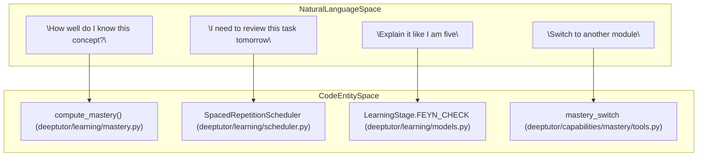
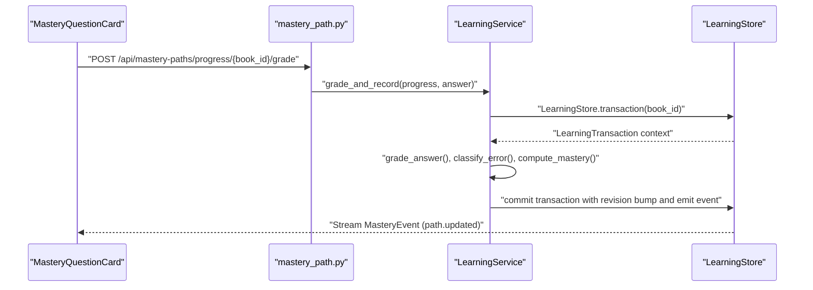

<!-- source: DeepWiki mcp.deepwiki.com · repo HKUDS/DeepTutor · extra page Learning Service, API and Mastery Loop · fetched 2026-11-09 -->

# Learning Service, API and Mastery Loop

Relevant source files

The following files were used as context for generating this wiki page:

- [deeptutor/api/routers/mastery_path.py](deeptutor/api/routers/mastery_path.py)
- [deeptutor/api/routers/render_storage.py](deeptutor/api/routers/render_storage.py)
- [deeptutor/capabilities/mastery/loop.py](deeptutor/capabilities/mastery/loop.py)
- [deeptutor/capabilities/mastery/prompts/en/mastery_loop.yaml](deeptutor/capabilities/mastery/prompts/en/mastery_loop.yaml)
- [deeptutor/capabilities/mastery/prompts/zh/mastery_loop.yaml](deeptutor/capabilities/mastery/prompts/zh/mastery_loop.yaml)
- [deeptutor/capabilities/mastery/tools.py](deeptutor/capabilities/mastery/tools.py)
- [deeptutor/learning/mastery.py](deeptutor/learning/mastery.py)
- [deeptutor/learning/models.py](deeptutor/learning/models.py)
- [deeptutor/learning/policy.py](deeptutor/learning/policy.py)
- [deeptutor/learning/question_card.py](deeptutor/learning/question_card.py)
- [deeptutor/learning/scheduler.py](deeptutor/learning/scheduler.py)
- [deeptutor/learning/semantic_assessment.py](deeptutor/learning/semantic_assessment.py)
- [deeptutor/learning/service.py](deeptutor/learning/service.py)
- [deeptutor/learning/storage.py](deeptutor/learning/storage.py)
- [deeptutor/learning/teaching.py](deeptutor/learning/teaching.py)
- [deeptutor/learning/tests/test_api_endpoints.py](deeptutor/learning/tests/test_api_endpoints.py)
- [deeptutor/learning/tests/test_guided_mastery_updates.py](deeptutor/learning/tests/test_guided_mastery_updates.py)
- [deeptutor/learning/tests/test_mastery_tools.py](deeptutor/learning/tests/test_mastery_tools.py)
- [deeptutor/learning/tests/test_models.py](deeptutor/learning/tests/test_models.py)
- [deeptutor/learning/tests/test_policy.py](deeptutor/learning/tests/test_policy.py)
- [deeptutor/learning/tests/test_scheduler.py](deeptutor/learning/tests/test_scheduler.py)
- [deeptutor/learning/tests/test_storage.py](deeptutor/learning/tests/test_storage.py)
- [deeptutor/services/workspace/render_storage.py](deeptutor/services/workspace/render_storage.py)
- [tests/api/test_mastery_path_reviews.py](tests/api/test_mastery_path_reviews.py)
- [tests/api/test_render_storage.py](tests/api/test_render_storage.py)
- [tests/capabilities/test_mastery_capability.py](tests/capabilities/test_mastery_capability.py)
- [tests/capabilities/test_mastery_profile_continuity.py](tests/capabilities/test_mastery_profile_continuity.py)
- [tests/capabilities/test_mastery_semantic_assessment.py](tests/capabilities/test_mastery_semantic_assessment.py)
- [tests/capabilities/test_mastery_teaching_compass.py](tests/capabilities/test_mastery_teaching_compass.py)
- [tests/capabilities/test_mastery_teaching_focus.py](tests/capabilities/test_mastery_teaching_focus.py)
- [web/app/(workspace)/learning/mastery/[pathId]/page.tsx](web/app/(workspace)/learning/mastery/[pathId]/page.tsx)
- [web/app/(workspace)/learning/page.tsx](web/app/(workspace)/learning/page.tsx)
- [web/components/chat/GeneratedOutputFileActions.tsx](web/components/chat/GeneratedOutputFileActions.tsx)
- [web/components/chat/QuestionBankPicker.tsx](web/components/chat/QuestionBankPicker.tsx)
- [web/components/chat/home/StandaloneComposer.tsx](web/components/chat/home/StandaloneComposer.tsx)
- [web/components/files/OutputFileActions.tsx](web/components/files/OutputFileActions.tsx)
- [web/components/math-animator/MathAnimatorViewer.tsx](web/components/math-animator/MathAnimatorViewer.tsx)
- [web/components/math-animator/RenderFileActions.tsx](web/components/math-animator/RenderFileActions.tsx)
- [web/components/reading/workspace/ReadingComposer.tsx](web/components/reading/workspace/ReadingComposer.tsx)
- [web/components/space/learning/MasteryComposer.tsx](web/components/space/learning/MasteryComposer.tsx)
- [web/components/space/learning/ReviewTrail.tsx](web/components/space/learning/ReviewTrail.tsx)
- [web/features/chat/transport/command-delivery.ts](web/features/chat/transport/command-delivery.ts)
- [web/hooks/useWorkspaceChatActions.ts](web/hooks/useWorkspaceChatActions.ts)
- [web/lib/ask-user-state.ts](web/lib/ask-user-state.ts)
- [web/lib/learning-api.ts](web/lib/learning-api.ts)
- [web/tests/capability-catalog.test.ts](web/tests/capability-catalog.test.ts)
- [web/tests/generated-output-file-actions.spec.tsx](web/tests/generated-output-file-actions.spec.tsx)
- [web/tests/reading-composer-resources.spec.tsx](web/tests/reading-composer-resources.spec.tsx)
- [web/tests/workspace-chat-actions-hidden-capability.spec.tsx](web/tests/workspace-chat-actions-hidden-capability.spec.tsx)

This page documents the implementation and architecture of the Mastery Path learning engine's core backend `LearningService` [deeptutor/learning/service.py:1-183](), its REST API endpoints, the mastery capability loop with relevant tools [deeptutor/capabilities/mastery/tools.py:1-112](), the event hub for real-time state updates, and frontend components such as `LearningBoard` and `MasteryStudy`. It covers the grading pipeline, transactional database updates, capability runtime integration, and user navigation features within DeepTutor.

---

## 1. LearningService: Core Grading Pipeline and State Management

The `LearningService` is the central service layer managing the lifecycle of a learner's progress on a Mastery Path. It coordinates persistent state updates, curriculum module initialization, answer grading, mastery level calculations, and spaced repetition scheduling.

### 1.1 Service Responsibilities and Transactional Storage

- Loads and saves `LearningProgress` aggregates via an SQLite-backed `LearningStore` providing compare-and-swap transactional safety [deeptutor/learning/storage.py:1-115]().
- Reconciles curriculum structures, ensuring modules and knowledge points are initialized cleanly without mixing stale learning evidence across incompatible schemas.
- Coordinates the evaluation pipeline by invoking `grade_answer()` and `classify_error()` from the domain modules [deeptutor/learning/service.py:8-9]().
- Updates retrieval metrics through the `SpacedRepetitionScheduler` when review sessions are active [deeptutor/learning/scheduler.py:147-194]().
- Emits events through `LearningTransaction` to broadcast revisions to external listeners [deeptutor/learning/storage.py:135-154]().

### 1.2 Module Initialization and Replacement

When initializing or updating modules on a path, the engine uses strict replacement mechanics to maintain integrity:
- Validates objectives and prevents duplicate or conflicting entries.
- Stale knowledge points that are absent from replacement manifests have their associated mastery records safely scoped or archived.
- Recomputes internal lookups keyed by knowledge point IDs and module boundaries.

Sources: `[deeptutor/learning/service.py:1-183]()`, `[deeptutor/learning/storage.py:1-115]()`

---

## 2. Mastery Loop Capabilities, Choices, and Navigation Tools

The Mastery Path tutoring loop operates as an agent capability (`MasteryLoopCapability`), combining specialized assessment tools with conversational flows [deeptutor/capabilities/mastery/loop.py:43-81]().

### 2.1 Tool Registration and Execution

The mastery capability mounts a set of structured tools defined in `MASTERY_TOOL_NAMES`:
- `mastery_status`: Fetches current objective state, due reviews, and outline data [deeptutor/capabilities/mastery/tools.py:95-112]().
- `mastery_quiz`: Poses an active question card to the learner, concluding the current agent turn [deeptutor/capabilities/mastery/tools.py:95-112]().
- `mastery_grade`: Grades open or choice-based answers against expected keys [deeptutor/capabilities/mastery/tools.py:95-112]().
- Navigation tools (`mastery_switch`, `mastery_leave`) allow runtime session routing between paths and modules [deeptutor/capabilities/mastery/tools.py:95-112](), [deeptutor/tools/mastery_nav.py]().

### 2.2 Prompt Packs and Runtime Policy

The loop relies on YAML prompt packs (`mastery_loop.yaml`) to establish the tutor protocol:
- **Posing as termination**: Posing a question ends the turn natively, preventing conversational ambiguity.
- **Strict gate enforcement**: Objectives advance only when the engine reports `mastered: true` through grading or assessment tools, regardless of conversational tone.

Sources: `[deeptutor/capabilities/mastery/tools.py:1-112]`, `[deeptutor/capabilities/mastery/loop.py:43-81]`, `[deeptutor/capabilities/mastery/prompts/en/mastery_loop.yaml:1-60]()`

---

## 3. Mastery Path REST Endpoints and WebSocket Event Hub

The FastAPI backend exposes REST routers and WebSocket handlers to synchronize frontend interfaces with backend state.

### 3.1 REST API Routes (`mastery_path.py`)

- `GET /api/mastery-paths/progress` — Lists summaries of all active learning paths.
- `POST /api/mastery-paths/progress/{book_id}/init-modules` — Initializes or replaces module definitions for a book/path [deeptutor/learning/tests/test_api_endpoints.py:170-184]().
- `GET /api/mastery-paths/progress/{book_id}/map` — Returns the current mastery map with objective statuses (`new`, `learning`, `mastered`) [web/lib/learning-api.ts:124-131]().
- `GET /api/mastery-paths/progress/{book_id}/board` — Provides card-structured board data for visual layouts [web/lib/learning-api.ts:155-161]().
- `GET /api/mastery-paths/progress/{book_id}/events` — Streams revision-numbered change events for multi-tab synchronization [web/lib/learning-api.ts:218-231]().

### 3.2 Real-time Event Hub

- WebSocket streams broadcast turn events and path mutation actions using revision markers. This ensures that when a tutoring turn updates state in one tab, open dashboards instantly reflect the new revision.

Sources: `[deeptutor/api/routers/mastery_path.py]()`, `[web/lib/learning-api.ts:1-231]()`

---

## 4. Frontend Components: LearningBoard and MasteryStudy

### 4.1 LearningBoard (`web/lib/learning-api.ts`, `LearningBoard.tsx`)

- Displays knowledge points as a collection of interactive cards organized in columns by module.
- Tracks card status, mastery level, and review schedules based on payload data retrieved from the `/board` endpoint.

### 4.2 MasteryStudy and MasteryQuestionCard

- Renders active assessment cards during tutorial loops.
- Captures learner submissions, interacts with the turn runtime client, and communicates structured answers back to the backend service.

Sources: `[web/lib/learning-api.ts:1-161]()`

---

## 5. Architecture Diagrams: Mapping Concepts to Code

### 5.1 Pedagogical to System Mapping

This diagram connects natural language and educational concepts to their corresponding code entities in the backend and frontend architecture.

Sources: `[deeptutor/learning/mastery.py]()`, `[deeptutor/learning/scheduler.py]()`, `[deeptutor/learning/models.py]()`, `[deeptutor/capabilities/mastery/tools.py]()`

---

### 5.2 Grading Pipeline Sequence Diagram

This sequence diagram illustrates the flow of grading a learner's submission through the API router, service layer, and persistent store.

Sources: `[deeptutor/api/routers/mastery_path.py]()`, `[deeptutor/learning/service.py:1-183]()`, `[deeptutor/learning/storage.py:1-115]()`

---

