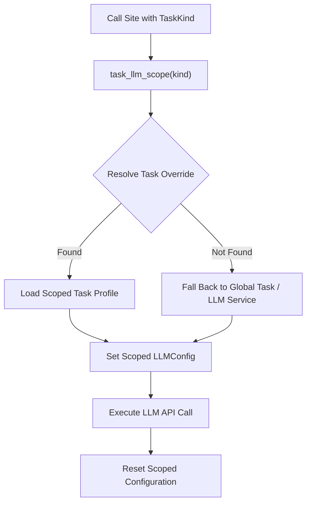
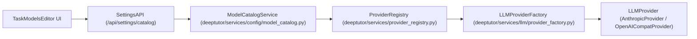

<!-- source: DeepWiki mcp.deepwiki.com · repo HKUDS/DeepTutor · extra page Model Selection and Task Models · fetched 2026-11-09 -->

# Model Selection and Task Models

<details>
<summary>Relevant source files</summary>

The following files were used as context for generating this wiki page:

- [deeptutor/api/routers/dashboard.py](deeptutor/api/routers/dashboard.py)
- [deeptutor/capabilities/mastery/pipeline.py](deeptutor/capabilities/mastery/pipeline.py)
- [deeptutor/services/config/lightrag_roles.py](deeptutor/services/config/lightrag_roles.py)
- [deeptutor/services/config/model_catalog.py](deeptutor/services/config/model_catalog.py)
- [deeptutor/services/llm/provider_core/anthropic_provider.py](deeptutor/services/llm/provider_core/anthropic_provider.py)
- [deeptutor/services/model_selection/reasoning.py](deeptutor/services/model_selection/reasoning.py)
- [deeptutor/services/model_selection/tasks.py](deeptutor/services/model_selection/tasks.py)
- [deeptutor/services/rag/pipelines/lightrag/write_lock.py](deeptutor/services/rag/pipelines/lightrag/write_lock.py)
- [deeptutor/services/session/context_builder.py](deeptutor/services/session/context_builder.py)
- [deeptutor/services/session/model_history.py](deeptutor/services/session/model_history.py)
- [deeptutor/services/suggestions.py](deeptutor/services/suggestions.py)
- [tests/agents/chat/test_mastery_source_request_boundary.py](tests/agents/chat/test_mastery_source_request_boundary.py)
- [tests/api/test_dashboard_suggestions.py](tests/api/test_dashboard_suggestions.py)
- [tests/capabilities/test_mastery_demand_preparation.py](tests/capabilities/test_mastery_demand_preparation.py)
- [tests/services/llm/test_anthropic_provider_fixes.py](tests/services/llm/test_anthropic_provider_fixes.py)
- [tests/services/llm/test_model_overrides.py](tests/services/llm/test_model_overrides.py)
- [tests/services/session/test_context_builder.py](tests/services/session/test_context_builder.py)
- [tests/services/session/test_image_context_budget.py](tests/services/session/test_image_context_budget.py)
- [tests/services/session/test_model_history.py](tests/services/session/test_model_history.py)
- [tests/services/test_model_catalog.py](tests/services/test_model_catalog.py)
- [tests/services/test_suggestions.py](tests/services/test_suggestions.py)
- [tests/services/test_task_model_call_sites.py](tests/services/test_task_model_call_sites.py)
- [tests/services/test_task_models.py](tests/services/test_task_models.py)
- [web/components/chat/home/StarterSuggestions.tsx](web/components/chat/home/StarterSuggestions.tsx)
- [web/lib/reasoning-effort.ts](web/lib/reasoning-effort.ts)
- [web/tests/reasoning-effort.test.ts](web/tests/reasoning-effort.test.ts)

</details>


## Purpose and Scope

This page details how DeepTutor manages, configures, and routes Large Language Models (LLMs) across interactive tutoring sessions and internal background operations. It covers the model catalog layout and secret masking (`ModelCatalogService`), task-model routing (`task_llm_scope` and `TaskKind`), API key pooling, dynamic capability routing, model-intrinsic request overrides (such as temperature locks and reasoning effort handling), and application launch settings.

Sources:
- [deeptutor/services/config/model_catalog.py:1-132]()
- [deeptutor/services/model_selection/tasks.py:1-164]()
- [deeptutor/services/llm/config.py:83-117]()

---

## Model Catalog

The core configuration for LLM providers, profiles, and available models is stored in the model catalog JSON file located at:

```
data/user/settings/model_catalog.json
```

The `ModelCatalogService` class manages loading, updating, and saving this file [deeptutor/services/config/model_catalog.py:13-31](). To prevent credentials from leaking across the API boundary or being accidentally overwritten, the service implements secure secret redaction and restoration.

### Secret Redaction and Restoration

When exposing catalog settings to frontend clients via API endpoints, `redact_catalog_secrets()` replaces sensitive fields (such as `api_key`, `apikey`, `token`, `secret`, `password`, and `extra_headers`) with a fixed placeholder mask:

```python
CATALOG_SECRET_MASK = "***"
```

When clients submit updates back to the backend, `restore_catalog_secrets()` compares the proposed payload against the currently stored configuration. If the placeholder `CATALOG_SECRET_MASK` is detected, the service restores the original stored credentials rather than persisting the mask [deeptutor/services/config/model_catalog.py:32-132]().

### Structure and Service Definitions

The catalog groups definitions into distinct service namespaces defined by `SERVICE_NAMES`:

- `"llm"`: Primary large language models for interactive chat and agentic reasoning.
- `"task"`: Specialized, lightweight models for short-lived background operations.
- `"embedding"`, `"search"`, `"tts"`, `"stt"`, `"imagegen"`, `"videogen"`: Auxiliary modalities and services.

Profiles within connectable services inherit credential structures from shared connection definitions [deeptutor/services/config/model_catalog.py:150-192]().

Sources:
- [deeptutor/services/config/model_catalog.py:1-192]()
- [tests/services/test_model_catalog.py:1-105]()

---

## Task Models and Routing

### Purpose and Background Execution

DeepTutor separates user-facing conversational turns from internal "task" LLM calls made autonomously by the system. Examples of tasks include generating conversation titles, extracting knowledge point summaries, or computing starter suggestions [tests/services/test_task_model_call_sites.py:101-185](). 

These background operations are latency-sensitive and benefit from smaller, faster task models configured under the `"task"` service namespace [deeptutor/services/model_selection/tasks.py:1-26](). If the `"task"` service is unconfigured or empty, calls fall back gracefully to the primary `"llm"` service configuration [tests/services/test_task_models.py:31-95]().

### TaskKind and Overrides

Specific operations are categorized using the `TaskKind` enumeration (e.g., `SESSION_TITLE`, `CHAT_STARTERS`, `READING_TRANSLATION`) [deeptutor/services/model_selection/tasks.py:54-95](). Administrators can configure per-kind model overrides under `services.task.overrides`, supporting modes like `"inherit"`, `"reference"`, or explicit profile pinning [deeptutor/services/model_selection/tasks.py:98-164]().

### Context Manager: `task_llm_scope`

To execute code under a specific task model, DeepTutor uses the `task_llm_scope(kind: TaskKind)` context manager. This temporarily adjusts the active LLM configuration for the duration of the background call [deeptutor/services/model_selection/tasks.py:67-96]().



Sources:
- [deeptutor/services/model_selection/tasks.py:1-164]()
- [tests/services/test_task_models.py:1-180]()

---

## Key Pooling and Environment Initialization

API credentials configured in the catalog can be provided as a single string or as a list of keys for key pooling. The `primary_api_key()` function extracts the active key for a given call profile [deeptutor/services/llm/config.py:109-117]().

Additionally, for OpenAI-compatible providers, environment variables `OPENAI_API_KEY` and `OPENAI_BASE_URL` are initialized during application startup using catalog parameters to satisfy external SDK requirements that read directly from environment state [deeptutor/services/llm/config.py:83-107]().

Sources:
- [deeptutor/services/llm/config.py:83-117]()

---

## Capability Routing

DeepTutor dynamically evaluates incoming queries to determine whether a turn should be routed to a specialized capability (such as `deep_question` or `solve`) rather than the default `chat` handler [tests/services/session/test_capability_routing.py:41-61](). 

When routing rules trigger, the active capability is updated within the `UnifiedContext`, ensuring the correct orchestrator agent processes the turn [tests/services/session/test_capability_routing.py:47-140]().

Sources:
- [tests/services/session/test_capability_routing.py:40-140]()

---

## Model Overrides, Intrinsic Limits, and Reasoning Effort

### User Overrides

Users can override default model selections per session or turn via the frontend interface (`ModelSelector`) [web/components/chat/home/ModelSelector.tsx:9-131](). These overrides are transmitted as `config_overrides` within request contexts [tests/conftest.py:150-160]().

### Immutable `LLMConfig` Pattern

The `LLMConfig` dataclass encapsulates parameters including model name, provider bindings, temperature, and token ceilings. It supports an immutable copy pattern via `model_copy()` to safely apply transient overrides without mutating global state [deeptutor/services/llm/config.py:140-150]().

### Model-Intrinsic Parameter Restraints and Reasoning Effort

Certain models enforce strict constraints on request parameters. For instance, Kimi/Moonshot models lock sampling parameters server-side and reject explicit `temperature` values, while newer Anthropic Claude model families (`claude-opus-4-7`, `claude-opus-5`, etc.) require adaptive thinking configurations and omit standard temperature settings [tests/services/llm/test_anthropic_provider_fixes.py:49-166]().

The backend model override system and frontend reasoning selector (`web/lib/reasoning-effort.ts`) cooperate to filter unsupported arguments (such as stripping `temperature` when incompatible) before dispatching requests to upstream providers [tests/services/test_model_overrides.py:49-85]().

Sources:
- [deeptutor/services/llm/config.py:140-150]()
- [tests/services/llm/test_anthropic_provider_fixes.py:49-166]()
- [tests/services/test_model_overrides.py:1-152]()
- [web/lib/reasoning-effort.ts:1-201]()

---

## Launch Settings

Application runtime ports and interface language defaults are maintained in settings files under `data/user/settings/system.json` and `interface.json`, with deployment overrides supported via environment variables like `BACKEND_PORT`, `FRONTEND_PORT`, and `UI_LANGUAGE` [deeptutor/services/config/launch_settings.py:10-120]().

Sources:
- [deeptutor/services/config/launch_settings.py:1-120]()

---

# Mapping: Natural Language Space to Code Entity Space

### Catalog and Provider Factory Resolution



Sources:
- [deeptutor/services/config/model_catalog.py:3-132]()
- [deeptutor/services/provider_registry.py:1-30]()
- [deeptutor/services/llm/provider_factory.py:1-80]()

### Task Model Routing Architecture


Sources:
- [deeptutor/services/model_selection/tasks.py:1-164]()
- [deeptutor/services/llm/config.py:83-150]()

---

