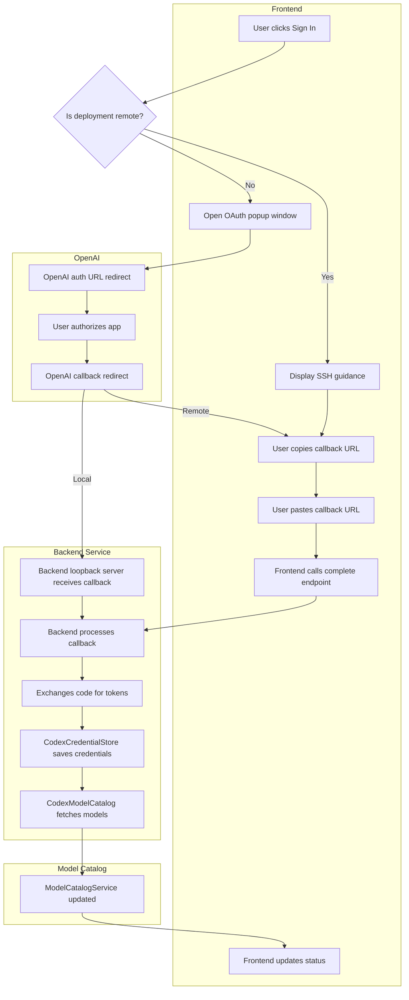
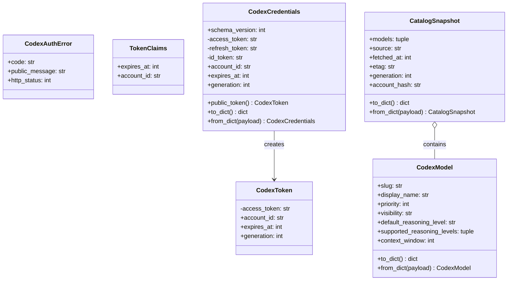

<!-- source: DeepWiki mcp.deepwiki.com · repo HKUDS/DeepTutor · extra page OAuth and Codex Auth · fetched 2026-11-09 -->

# OAuth and Codex Auth

Relevant source files

The following files were used as context for generating this wiki page:

- [deeptutor/services/codex_auth/catalog.py](deeptutor/services/codex_auth/catalog.py)
- [deeptutor/services/codex_auth/client_version.py](deeptutor/services/codex_auth/client_version.py)
- [deeptutor/services/codex_auth/constants.py](deeptutor/services/codex_auth/constants.py)
- [deeptutor/services/codex_auth/contracts.py](deeptutor/services/codex_auth/contracts.py)
- [deeptutor/services/codex_auth/oauth.py](deeptutor/services/codex_auth/oauth.py)
- [deeptutor/services/codex_auth/service.py](deeptutor/services/codex_auth/service.py)
- [deeptutor/services/codex_auth/storage.py](deeptutor/services/codex_auth/storage.py)
- [deeptutor/services/llm/provider_core/openai_codex_provider.py](deeptutor/services/llm/provider_core/openai_codex_provider.py)
- [tests/capabilities/test_mastery_group_delivery.py](tests/capabilities/test_mastery_group_delivery.py)
- [tests/services/codex_auth/fixtures/astra-model.json](tests/services/codex_auth/fixtures/astra-model.json)
- [tests/services/codex_auth/test_catalog.py](tests/services/codex_auth/test_catalog.py)
- [tests/services/codex_auth/test_catalog_refresh.py](tests/services/codex_auth/test_catalog_refresh.py)
- [tests/services/codex_auth/test_client_version.py](tests/services/codex_auth/test_client_version.py)
- [tests/services/codex_auth/test_contracts.py](tests/services/codex_auth/test_contracts.py)
- [tests/services/codex_auth/test_oauth.py](tests/services/codex_auth/test_oauth.py)
- [tests/services/codex_auth/test_service.py](tests/services/codex_auth/test_service.py)
- [tests/services/codex_auth/test_storage.py](tests/services/codex_auth/test_storage.py)
- [tests/services/llm/test_openai_codex_oauth_provider.py](tests/services/llm/test_openai_codex_oauth_provider.py)

This page details the implementation of OpenAI Codex/CodeBuddy OAuth flows within DeepTutor, focusing on the `codex_auth` service, its contracts, model catalog refresh mechanisms, the frontend `CodexOAuthCard` component, and multi-user credential isolation. It covers how DeepTutor authenticates with OpenAI Codex, manages credentials, and integrates Codex models into its LLM catalog.

Sources: 
- [deeptutor/services/codex_auth/service.py:1-55]()
- [deeptutor/services/llm/provider_core/openai_codex_provider.py:1-45]()

## Codex OAuth Flow Overview

The DeepTutor system integrates with OpenAI Codex (also referred to as CodeBuddy) using an OAuth 2.0 authorization code flow with PKCE (Proof Key for Code Exchange). This flow enables secure authentication by letting users authorize DeepTutor to access their OpenAI Codex models without sharing direct credentials.

Key components in the flow include:

- **Frontend (`CodexOAuthCard`)** initiates login and handles user interaction.
- **Backend `CodexOAuthService`** manages OAuth operations, token exchange, credential storage, and model catalog updates.
- **Loopback callback server** for receiving OAuth redirects locally.
- **Model catalog synchronization** to incorporate Codex models into DeepTutor.

### Frontend Initiation and Callback Handling

The OAuth flow begins when the user clicks “Sign In” on the frontend Codex OAuth card [web/components/settings/CodexOAuthCard.tsx]().

- For **local** deployments, the frontend opens a popup window that loads the OpenAI OAuth authorization URL constructed by the backend.
- Upon successful authorization, OpenAI redirects to a loopback URL (e.g., `http://localhost:1457/auth/callback`) monitored by DeepTutor's backend [deeptutor/services/codex_auth/constants.py:16-17]() and loopback callback listeners [deeptutor/services/codex_auth/oauth.py]().
- For **remote** deployments (e.g., Docker), the callback URL within the container is inaccessible externally. The frontend instructs the user to copy the OAuth callback URL from their browser’s address bar and manually paste it back into the frontend [web/components/settings/CodexOAuthCard.tsx](). An SSH forwarding command is shown via `ssh_forward_command()` to help users tunnel the callback port if needed [deeptutor/services/codex_auth/service.py:128-130]().

The frontend proxy transparently rewrites `/api/auth/openai-codex/callback` requests to the backend's codex callback API [web/proxy.ts](), allowing consistent internal routing.

### Backend OAuth Service (`CodexOAuthService`)

The `CodexOAuthService` class encapsulates all backend logic related to Codex OAuth [deeptutor/services/codex_auth/service.py]().

Responsibilities include:

- **PKCE codes:** Generates PKCE verifier and challenge codes to secure the OAuth authorization code exchange [deeptutor/services/codex_auth/oauth.py:43-46]().
- **Authorization URL:** Constructs the OpenAI authorization URL using `build_authorize_url()` with parameters like client ID, redirect URI, scope, and state [deeptutor/services/codex_auth/oauth.py:44]().
- **Loopback Callback Listener:** Starts an ephemeral local HTTP server that listens on loopback addresses for OAuth redirects during login [deeptutor/services/codex_auth/oauth.py:41-42]().
- **Token Exchange:** Exchanges authorization code for access, refresh, and ID tokens from OpenAI [deeptutor/services/codex_auth/oauth.py]().
- **Credential Storage:** Commits `CodexCredentials` securely to disk scoped per user session via `CodexCredentialStore` [deeptutor/services/codex_auth/storage.py:106-116]().
- **Model Catalog Refresh:** Invokes model catalog updating to fetch and persist available Codex LLM models for the logged-in account [deeptutor/services/codex_auth/service.py:280-300]().

The service tracks login operations using `_LoginOperation` dataclasses with states (`waiting`, `exchanging`, `fetching_models`, `completed`, etc.) to support frontend status polling and error reporting [deeptutor/services/codex_auth/service.py:62-76]().

Sources:
- [deeptutor/services/codex_auth/service.py:62-130]()
- [deeptutor/services/codex_auth/constants.py:16-17]()
- [deeptutor/services/codex_auth/oauth.py:40-47]()
- [deeptutor/services/codex_auth/storage.py:106-116]()

## Contracts and Data Structures

The `deeptutor.services.codex_auth.contracts` module defines core data models and exceptions used by the OAuth flow and model catalog integration [deeptutor/services/codex_auth/contracts.py:1-298]().

### Key Classes:

- **`CodexAuthError`**: A custom exception carrying a safe-to-display user message, error code, and HTTP status [deeptutor/services/codex_auth/contracts.py:28-40]().
- **`TokenClaims`**: Represents parsed claims from the ID token, such as expiration and account ID, extracted without sensitive email fields [deeptutor/services/codex_auth/contracts.py:41-46]().
- **`CodexCredentials`**: Stores sensitive OAuth tokens including access token, refresh token, ID token, account ID, expiry timestamp, and a generation counter for versioning [deeptutor/services/codex_auth/contracts.py:47-75](). Access tokens are hidden from debug logs via `repr=False`.
- **`CodexToken`**: A public, stripped-down version of `CodexCredentials` that omits refresh and ID tokens and is safe for passing at runtime [deeptutor/services/codex_auth/contracts.py:123-130]().
- **`CodexModel`**: Represents a Codex LLM model with attributes like slug, display name, priority, supported reasoning levels, context windows, and capability flags [deeptutor/services/codex_auth/contracts.py:131-158]().
- **`CatalogSnapshot`**: A snapshot of a fetched model catalog, containing a tuple of `CodexModel` items plus metadata like source, fetch timestamp, ETag, generation number, and account hash [deeptutor/services/codex_auth/contracts.py:190-298]().

Sources:
- [deeptutor/services/codex_auth/contracts.py:28-158]()

## Model Catalog Refresh

After OAuth login, `CodexOAuthService` refreshes the Codex model catalog from OpenAI's backend (`https://chatgpt.com/backend-api/codex/models`) to keep DeepTutor's LLM model listings updated [deeptutor/services/codex_auth/constants.py:21]().

The process includes:

1. **Catalog Fetching:** The service uses the authenticated access token to call the Codex models API endpoint via `CodexModelCatalog.get()`, supporting fresh/stale caching, ETag validation, and client version discovery [deeptutor/services/codex_auth/catalog.py:128-181]().
2. **Response Parsing:** The raw JSON response is parsed by `parse_models_response()` to extract `CodexModel` objects, filtering only models visible for listing and applying normalization such as reasoning level fixes [deeptutor/services/codex_auth/catalog.py:33-93]().
3. **Credential Store Cache:** The fetched `CatalogSnapshot` (including models, timestamps, ETag, generation) is saved in the per-user `CodexCredentialStore` [deeptutor/services/codex_auth/storage.py:106-114]().
4. **Sync to DeepTutor Model Catalog:** The helper `sync_codex_catalog()` converts the `CatalogSnapshot` into DeepTutor model catalog entries. It creates a managed profile `llm-profile-openai-codex-managed` tied to the account, sets `owner_bound: True` to restrict sharing, and generates Codex-specific model entries with unique IDs [deeptutor/services/codex_auth/service.py:150-192]().

Sources:
- [deeptutor/services/codex_auth/catalog.py:33-181]()
- [deeptutor/services/codex_auth/service.py:150-192]()
- [deeptutor/services/codex_auth/constants.py:21]()

## Multi-User Considerations

DeepTutor's Codex OAuth service handles multi-user isolation carefully:

- Each user has a separate credential store subtree (`CodexCredentialStore`) scoped to their private user path [tests/services/codex_auth/test_service.py:39-76](). This prevents token pooling across accounts, as a single Codex token authorizes a single user's ChatGPT plan.
- Partners (persistent AI companions) inherit their owner's Codex credentials transparently since partners lack separate accounts [tests/services/codex_auth/test_service.py:78-105]().
- The managed Codex runtime profile (`CODEX_PROFILE_ID`) is marked `owner_bound: True`, disallowing sharing the Codex profile and models with other users via the permissions/granting system [deeptutor/services/codex_auth/service.py:175-195]().

Sources:
- [deeptutor/services/codex_auth/service.py:175-195]()
- [tests/services/codex_auth/test_service.py:39-105]()

---

