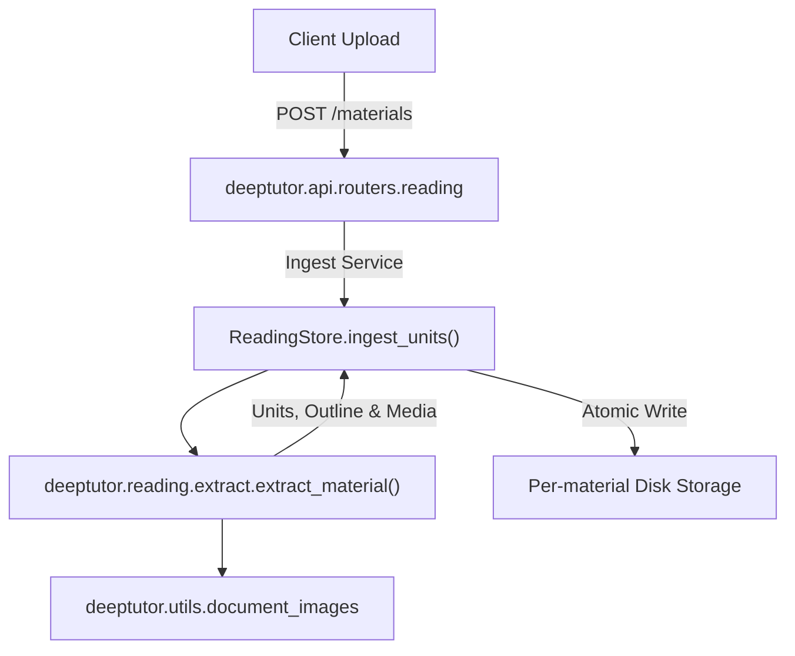
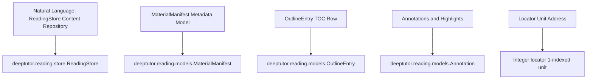
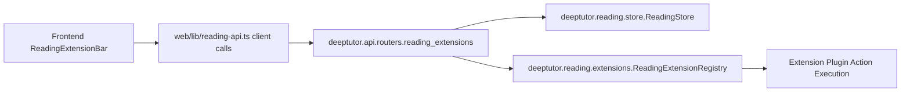

<!-- source: DeepWiki mcp.deepwiki.com · repo HKUDS/DeepTutor · extra page Reading Backend — Store, Models, and Extensions · fetched 2026-11-09 -->

# Reading Backend — Store, Models, and Extensions

<details>
<summary>Relevant source files</summary>

The following files were used as context for generating this wiki page:

- [deeptutor/api/routers/book.py](deeptutor/api/routers/book.py)
- [deeptutor/api/routers/reading.py](deeptutor/api/routers/reading.py)
- [deeptutor/api/routers/reading_extensions.py](deeptutor/api/routers/reading_extensions.py)
- [deeptutor/book/models.py](deeptutor/book/models.py)
- [deeptutor/book/storage.py](deeptutor/book/storage.py)
- [deeptutor/capabilities/reading/_tool_base.py](deeptutor/capabilities/reading/_tool_base.py)
- [deeptutor/capabilities/reading/capability.py](deeptutor/capabilities/reading/capability.py)
- [deeptutor/capabilities/reading/figure_view.py](deeptutor/capabilities/reading/figure_view.py)
- [deeptutor/capabilities/reading/media_notes.py](deeptutor/capabilities/reading/media_notes.py)
- [deeptutor/capabilities/reading/mode.py](deeptutor/capabilities/reading/mode.py)
- [deeptutor/capabilities/reading/prompts/en/reading.yaml](deeptutor/capabilities/reading/prompts/en/reading.yaml)
- [deeptutor/capabilities/reading/prompts/zh/reading.yaml](deeptutor/capabilities/reading/prompts/zh/reading.yaml)
- [deeptutor/capabilities/reading/tools.py](deeptutor/capabilities/reading/tools.py)
- [deeptutor/learning/assessment.py](deeptutor/learning/assessment.py)
- [deeptutor/learning/tests/test_assessment.py](deeptutor/learning/tests/test_assessment.py)
- [deeptutor/reading/__init__.py](deeptutor/reading/__init__.py)
- [deeptutor/reading/captions.py](deeptutor/reading/captions.py)
- [deeptutor/reading/epub_bilingual.py](deeptutor/reading/epub_bilingual.py)
- [deeptutor/reading/extensions.py](deeptutor/reading/extensions.py)
- [deeptutor/reading/extract.py](deeptutor/reading/extract.py)
- [deeptutor/reading/ingestion.py](deeptutor/reading/ingestion.py)
- [deeptutor/reading/models.py](deeptutor/reading/models.py)
- [deeptutor/reading/read_aloud.py](deeptutor/reading/read_aloud.py)
- [deeptutor/reading/refresh.py](deeptutor/reading/refresh.py)
- [deeptutor/reading/store.py](deeptutor/reading/store.py)
- [deeptutor/tools/web_fetch.py](deeptutor/tools/web_fetch.py)
- [deeptutor/utils/document_extractor.py](deeptutor/utils/document_extractor.py)
- [deeptutor/utils/document_images.py](deeptutor/utils/document_images.py)
- [scripts/reading_refresh_figures.py](scripts/reading_refresh_figures.py)
- [tests/api/test_book_quiz_attempt_notebook.py](tests/api/test_book_quiz_attempt_notebook.py)
- [tests/api/test_reading_quiz_answers.py](tests/api/test_reading_quiz_answers.py)
- [tests/docx_math_fixture.py](tests/docx_math_fixture.py)
- [tests/reading/test_capability.py](tests/reading/test_capability.py)
- [tests/reading/test_engine.py](tests/reading/test_engine.py)
- [tests/reading/test_epub_bilingual.py](tests/reading/test_epub_bilingual.py)
- [tests/reading/test_extension_router.py](tests/reading/test_extension_router.py)
- [tests/reading/test_extensions.py](tests/reading/test_extensions.py)
- [tests/reading/test_ingestion.py](tests/reading/test_ingestion.py)
- [tests/reading/test_reading_captions.py](tests/reading/test_reading_captions.py)
- [tests/reading/test_reading_media_notes.py](tests/reading/test_reading_media_notes.py)
- [tests/reading/test_reading_page_render.py](tests/reading/test_reading_page_render.py)
- [tests/reading/test_reading_pdf_media.py](tests/reading/test_reading_pdf_media.py)
- [tests/reading/test_router.py](tests/reading/test_router.py)
- [tests/reading/test_safe_filename.py](tests/reading/test_safe_filename.py)
- [tests/reading/test_view_figure.py](tests/reading/test_view_figure.py)
- [tests/services/web_source/test_markdown.py](tests/services/web_source/test_markdown.py)
- [tests/tools/test_web_fetch.py](tests/tools/test_web_fetch.py)
- [tests/utils/test_document_extractor.py](tests/utils/test_document_extractor.py)
- [tests/utils/test_document_images.py](tests/utils/test_document_images.py)
- [tests/utils/test_pptx_fallback_pictures.py](tests/utils/test_pptx_fallback_pictures.py)
- [tests/utils/test_pptx_presentation_order.py](tests/utils/test_pptx_presentation_order.py)
- [tests/utils/test_xlsx_sparse_columns.py](tests/utils/test_xlsx_sparse_columns.py)
- [web/app/(workspace)/learning/books/BooksRoute.tsx](web/app/(workspace)/learning/books/BooksRoute.tsx)
- [web/components/reading/ReaderPane.tsx](web/components/reading/ReaderPane.tsx)
- [web/components/reading/ReadingExtensionBar.tsx](web/components/reading/ReadingExtensionBar.tsx)
- [web/lib/book-api.ts](web/lib/book-api.ts)
- [web/lib/book-types.ts](web/lib/book-types.ts)
- [web/lib/reading-api.ts](web/lib/reading-api.ts)
- [web/tests/reading-extensions.test.ts](web/tests/reading-extensions.test.ts)
- [web/tests/reading-quiz-persistence.spec.tsx](web/tests/reading-quiz-persistence.spec.tsx)
- [web/tests/reading-toolbar-selection.spec.tsx](web/tests/reading-toolbar-selection.spec.tsx)
- [web/tests/reading-web-markdown.test.ts](web/tests/reading-web-markdown.test.ts)

</details>


The Reading Backend provides foundational components and infrastructure enabling the **Immersive Reading** feature within DeepTutor. It manages document ingestion, text and metadata extraction, persistent annotations, document navigation, and interaction with AI-driven extensions like quizzes and translations, all while supporting multiple document formats and bilingual EPUB pairing.

This page details the architecture, data flow, core classes, and API routes involved in the Reading subsystem, as well as its extension protocol and bilingual EPUB support.

---

## ReadingStore On-Disk Layout

The `ReadingStore` class is the central on-disk repository for storing reading materials and their related data. It organizes each extracted document in its own directory under a root path, typically under the user’s workspace directory.

### Directory Structure

Each material is identified by a `material_id` which is safe for filesystem paths, typically a content hash or a minted catalog identifier. The per-material layout includes:

```text
<root>/<material_id>/
    manifest.json        # MaterialManifest metadata
    outline.json         # List of OutlineEntry (document TOC)
    units/               # Extracted text units (one file per locator)
        0001.txt
        0002.txt
        ...
    raw/                 # Original source file bytes for faithful rendering
        filename.pdf
    annotations/         # Annotation collections, one file per material_id
        <material_id>.json
    positions/           # Reading positions storage, one file per material_id
        <material_id>.json
    bookmarks/           # Reader bookmarks; various auxiliary dirs (media/, render/)
```

This layout is designed for efficient random access: when reading a locator (unit), only its corresponding small `.txt` file is loaded, avoiding deserialization of the entire document.

Additionally, writes use atomic operations (write to temp file + `os.replace`) combined with per-material reentrant locks to ensure data consistency during concurrent operations [deeptutor/reading/store.py:1-25](), [deeptutor/reading/store.py:161-190]().

### Content Addressability

The `material_id` corresponds to a sha256 hash abbreviated to 16 hex digits, preventing accidental collisions and allowing safe reuse or deduplication of stored content [deeptutor/reading/store.py:157-159]().

Sources: [deeptutor/reading/store.py:1-25](), [deeptutor/reading/store.py:157-190]()

---

## Data Models, Locators, and Annotations

Key abstractions center around **locators**, **materials**, and **annotations**:

### Locator: The Core Unit Identifier

A locator is a 1-based integer that identifies a unit of content inside a material:

| Document Format | Locator Unit Kind            |
|-----------------|-----------------------------|
| PDF             | `page`                      |
| EPUB            | `chapter`                   |
| PPTX            | `slide`                     |
| Plain text/MD   | `section` (paragraph boundary) |

This abstraction enables all tools and UI components to refer uniformly to content segments without branching on format [deeptutor/reading/models.py:3-9](), [deeptutor/reading/extract.py:30-37]().

### MaterialManifest

A `MaterialManifest` data model holds metadata about a material excluding its text or annotations:
- `material_id`: stable identifier
- `filename`: source file name
- `unit`: the unit kind (`page`, `chapter`, etc.)
- `unit_count`: count of extracted units
- `mime`: mime-type string (e.g., `"application/pdf"`)
- `title`: document title
- `byte_size`: source file size in bytes
- `render_mode`: how the UI renders the content (`text`, `pdf`, `epub`, etc.)

It is stored as JSON at `manifest.json` in the material directory [deeptutor/reading/models.py:192-206]().

### OutlineEntry and Outline Synthesis

The `OutlineEntry` data class represents one row in the document's table of contents:
- `locator` (the address of the content unit)
- `title` (the heading text)
- `level` (nesting depth, 1-based)
- `synthesised` (boolean indicating whether the outline entry was inferred)

The outline is stored as a JSON array in `outline.json` [deeptutor/reading/models.py:126-145]().

### Annotations and Selector Models

Annotations denote user or model highlights, underlines, notes, or citations on specific text spans within a locator.
- **Rectangles** bounding annotations are stored normalized (`0..1` width and height relative coordinates) with origin top-left [deeptutor/reading/models.py:66-96]().
- Annotation kinds include `"highlight"`, `"underline"`, `"note"`, and `"citation"`.
- Annotations include W3C selectors for anchoring to text (`TextQuoteSelector`, `TextPositionSelector`) and resolution status (`"resolved"`, `"unresolved"`, `"ambiguous"`) [deeptutor/reading/models.py:220-245]().

Sources: [deeptutor/reading/models.py:3-145](), [deeptutor/reading/models.py:192-245]()

---

## Reading Ingestion, Extraction, and Media Handling

The ingestion process converts uploaded source files (PDF, EPUB, plain text, Office documents) into the store layout.

### Extraction Flow and Embedded Images

1. **Upload & Validation**: The client uploads a file via the reading API, validated against format policies [deeptutor/api/routers/reading.py:29-75]().
2. **Extract Material**: The extraction engine `extract_material()` parses the file, cuts it into addressable units, and maps embedded images via markers (`[图片 N]`) using `deeptutor.utils.document_images` [deeptutor/reading/extract.py:38-135](), [deeptutor/utils/document_images.py:1-25]().
3. **Store Material**: Extracted units, outline, and media assets are stored atomically in `ReadingStore` [deeptutor/reading/store.py:161-190]().



Sources: [deeptutor/reading/extract.py:38-142](), [deeptutor/utils/document_images.py:1-54](), [deeptutor/api/routers/reading.py:29-75]()

---

## Reading API Router and Routes

The FastAPI router in `deeptutor/api/routers/reading.py` exposes REST endpoints for client interactions with reading materials.

### Key Reading Routes

| Route | Purpose |
| :--- | :--- |
| `GET /api/reading/materials` | List all reading materials with metadata and annotation counts. |
| `GET /api/reading/materials/{material_id}` | Retrieve material manifest and outline. |
| `GET /api/reading/materials/{material_id}/units/{locator}` | Fetch text for a specific locator unit. |
| `PUT /api/reading/materials/{material_id}/annotations` | Save or update annotations for a locator. |
| `GET /api/reading/materials/{material_id}/raw` | Stream the source file bytes with HTTP Range support for faithful PDF rendering. |
| `DELETE /api/reading/materials/{material_id}` | Delete a material irreversibly. |

Annotations modifications and reading position updates are managed similarly within this API [deeptutor/api/routers/reading.py:40-110]().

Sources: [deeptutor/api/routers/reading.py:29-110]()

---

## Reading Extensions — Entry Points and Execution Protocol

Reading extensions enable server-side computations aligned with reading content:
- Examples: generating quizzes, vocabulary explanations, translations, read-aloud generation, study guidance [deeptutor/api/routers/reading_extensions.py:1-50]().
- Extensions are registered via an extension registry loaded at startup [deeptutor/reading/extensions.py:20-30]().

### Extensions API Router

The `reading_extensions` API router (`deeptutor/api/routers/reading_extensions.py`) handles authenticated invocation of extension actions:
- Routes: `POST /materials/{material_id}/extensions/{extension_id}/actions/{action}` [deeptutor/api/routers/reading_extensions.py:195-200]()
- Verifies user permissions, material access, and verifies text selections against the unit's text layer [deeptutor/api/routers/reading_extensions.py:87-110]().
- Enforces execution timeouts (~120s) and logs activity into the `LearningStore` [deeptutor/api/routers/reading_extensions.py:37-139]().

Sources: [deeptutor.api.routers.reading_extensions:1-139]()

---

## Built-In Reading Extensions and Bilingual EPUB Pairing

### Built-In Reading Extensions

| Extension ID | Purpose | Notes |
| :--- | :--- | :--- |
| `read_aloud` | Reads text aloud using server speech synthesis or browser API | Integrates with `synthesize_speech` [deeptutor/api/routers/reading_extensions.py:151-193]() |
| `translation` | Translates selected text or unit content | Supports multiple target languages |
| `quiz` | Generates quizzes on selected passage or unit | Integrates with learning assessment |
| `vocabulary` | Explains vocabulary terms in context | Generates definitions and usage examples |

### Bilingual EPUB Pairing

DeepTutor supports pairing two EPUB materials with aligned content in different languages (e.g., English and Chinese editions of the same book) using metadata and TOC overlap heuristics, storing pairings persistently in the user workspace [deeptutor/reading/epub_bilingual.py:1-215]().

Sources: [deeptutor/api/routers/reading_extensions.py:151-193](), [deeptutor/reading/epub_bilingual.py:1-150]()

---

## Reading Backend Entity Mapping

### Natural Language ↔ Code Entity Diagram: Store and Models



Sources: [deeptutor/reading/store.py:161-190](), [deeptutor/reading/models.py:1-206]()

### Natural Language ↔ Code Entity Diagram: Reading Extensions Flow



Sources: [deeptutor/api/routers/reading_extensions.py:141-200](), [web/lib/reading-api.ts:188-210]()

---

# Summary

This page covered:
- The design and on-disk layout of `ReadingStore`.
- Core data models: `MaterialManifest`, locators, outlines, annotations, and W3C selectors.
- Ingestion, extraction, and media asset mapping.
- FastAPI routers exposing reading data and annotation CRUD.
- Architecture and protocol for server-side reading extensions supporting AI-augmented reading aids.
- Support for bilingual EPUB pairing.
- Visual code model mappings bridging natural language concepts to code entities.

---

