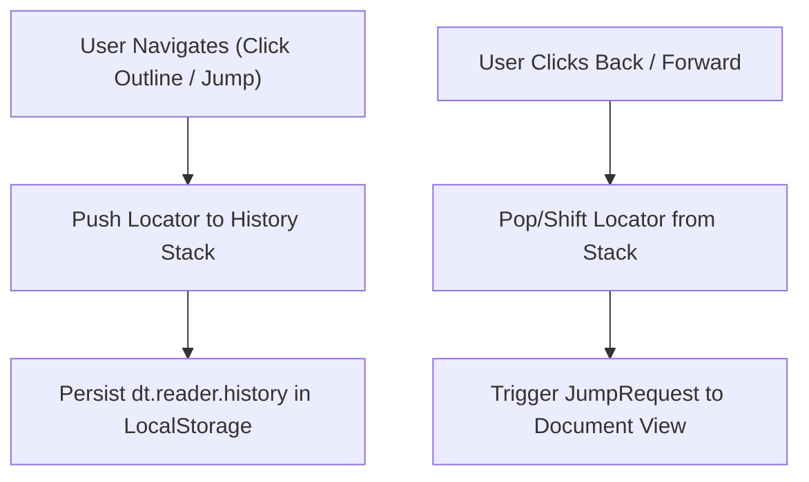
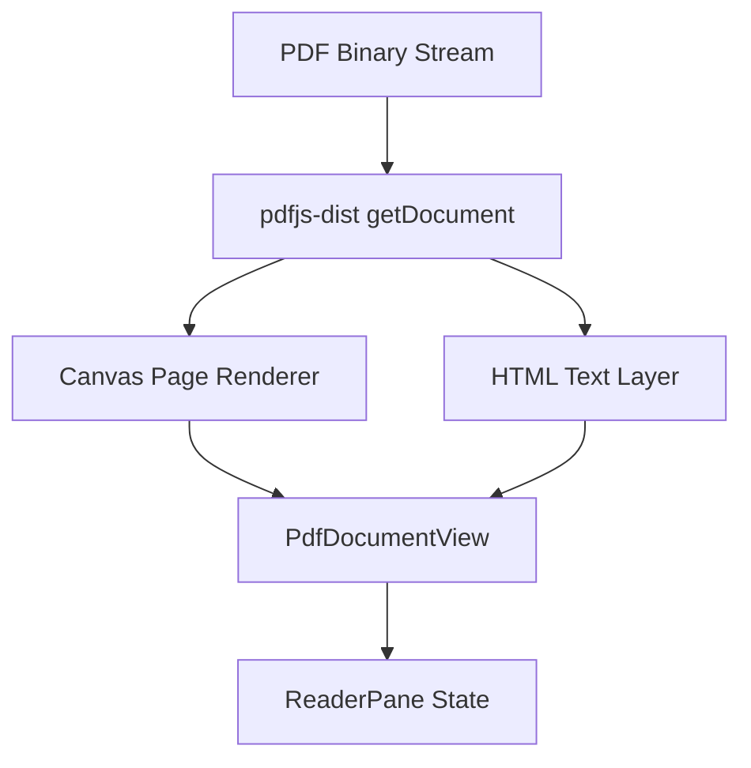
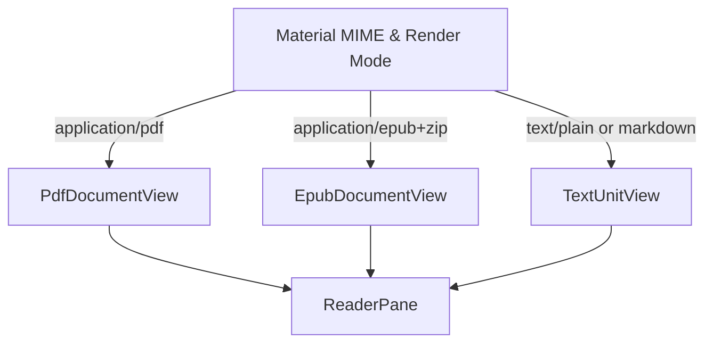
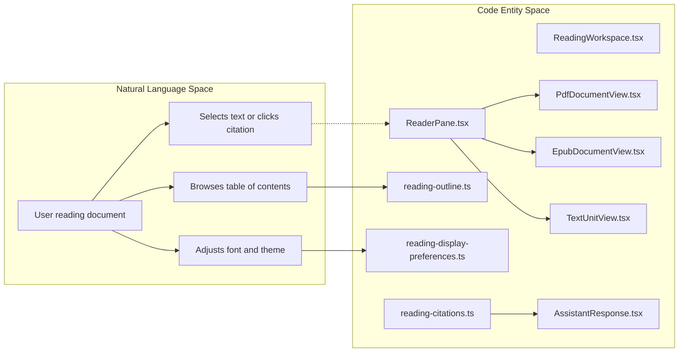

<!-- source: DeepWiki mcp.deepwiki.com · repo HKUDS/DeepTutor · extra page Reading Frontend — Viewers and Reader Shell · fetched 2026-11-09 -->

# Reading Frontend — Viewers and Reader Shell

Relevant source files

The following files were used as context for generating this wiki page:

- [deeptutor/reading/export.py](deeptutor/reading/export.py)
- [web/components/common/AssistantResponse.tsx](web/components/common/AssistantResponse.tsx)
- [web/components/reading/AnnotationList.tsx](web/components/reading/AnnotationList.tsx)
- [web/components/reading/AnnotationPopover.tsx](web/components/reading/AnnotationPopover.tsx)
- [web/components/reading/EpubDocumentView.tsx](web/components/reading/EpubDocumentView.tsx)
- [web/components/reading/ReaderDisplayControls.tsx](web/components/reading/ReaderDisplayControls.tsx)
- [web/components/reading/TextUnitView.tsx](web/components/reading/TextUnitView.tsx)
- [web/components/reading/workspace-menu-context.ts](web/components/reading/workspace-menu-context.ts)
- [web/components/reading/workspace/ReadAloudButton.tsx](web/components/reading/workspace/ReadAloudButton.tsx)
- [web/components/reading/workspace/ReadingActionCards.tsx](web/components/reading/workspace/ReadingActionCards.tsx)
- [web/components/reading/workspace/ReadingWorkspace.tsx](web/components/reading/workspace/ReadingWorkspace.tsx)
- [web/components/reading/workspace/SourceNavigator.tsx](web/components/reading/workspace/SourceNavigator.tsx)
- [web/components/reading/workspace/WorkspaceChrome.tsx](web/components/reading/workspace/WorkspaceChrome.tsx)
- [web/components/reading/workspace/WorkspaceMenu.tsx](web/components/reading/workspace/WorkspaceMenu.tsx)
- [web/context/ReadingContext.tsx](web/context/ReadingContext.tsx)
- [web/features/settings/navigation/settings-scroll.ts](web/features/settings/navigation/settings-scroll.ts)
- [web/lib/book-reader-navigation.ts](web/lib/book-reader-navigation.ts)
- [web/lib/epub-page-turn.ts](web/lib/epub-page-turn.ts)
- [web/lib/reading-citations.ts](web/lib/reading-citations.ts)
- [web/lib/reading-display-preferences.ts](web/lib/reading-display-preferences.ts)
- [web/lib/reading-inline-markdown.tsx](web/lib/reading-inline-markdown.tsx)
- [web/lib/reading-location-history.ts](web/lib/reading-location-history.ts)
- [web/lib/reading-outline.ts](web/lib/reading-outline.ts)
- [web/lib/reading-references.ts](web/lib/reading-references.ts)
- [web/lib/reading-turn-state.ts](web/lib/reading-turn-state.ts)
- [web/lib/reading-w3c-annotations.ts](web/lib/reading-w3c-annotations.ts)
- [web/tests/book-reader-navigation.test.ts](web/tests/book-reader-navigation.test.ts)
- [web/tests/book-reader-sequential-contract.test.ts](web/tests/book-reader-sequential-contract.test.ts)
- [web/tests/e2e/book-reader-sequential.audit.ts](web/tests/e2e/book-reader-sequential.audit.ts)
- [web/tests/e2e/compliance-and-ux.audit.ts](web/tests/e2e/compliance-and-ux.audit.ts)
- [web/tests/e2e/fixtures/modules.ts](web/tests/e2e/fixtures/modules.ts)
- [web/tests/e2e/learning-progress.audit.ts](web/tests/e2e/learning-progress.audit.ts)
- [web/tests/e2e/modules.audit.ts](web/tests/e2e/modules.audit.ts)
- [web/tests/e2e/pdf-reading-resize.audit.ts](web/tests/e2e/pdf-reading-resize.audit.ts)
- [web/tests/e2e/reading-citation-material.audit.ts](web/tests/e2e/reading-citation-material.audit.ts)
- [web/tests/e2e/reading-location-history.audit.ts](web/tests/e2e/reading-location-history.audit.ts)
- [web/tests/e2e/reading-w3c-annotations.audit.ts](web/tests/e2e/reading-w3c-annotations.audit.ts)
- [web/tests/e2e/release-ui-matrix.audit.ts](web/tests/e2e/release-ui-matrix.audit.ts)
- [web/tests/e2e/settings-navigation.audit.ts](web/tests/e2e/settings-navigation.audit.ts)
- [web/tests/epub-display-preferences.spec.tsx](web/tests/epub-display-preferences.spec.tsx)
- [web/tests/epub-page-turn.test.ts](web/tests/epub-page-turn.test.ts)
- [web/tests/epub-reader.audit.ts](web/tests/epub-reader.audit.ts)
- [web/tests/reading-annotation-rollback.spec.tsx](web/tests/reading-annotation-rollback.spec.tsx)
- [web/tests/reading-citations.test.ts](web/tests/reading-citations.test.ts)
- [web/tests/reading-display-preferences.test.ts](web/tests/reading-display-preferences.test.ts)
- [web/tests/reading-mobile-header.spec.tsx](web/tests/reading-mobile-header.spec.tsx)
- [web/tests/reading-outline-tracking.spec.tsx](web/tests/reading-outline-tracking.spec.tsx)
- [web/tests/reading-outline.test.ts](web/tests/reading-outline.test.ts)
- [web/tests/reading-selection-sheet.spec.tsx](web/tests/reading-selection-sheet.spec.tsx)
- [web/tests/reading-source-navigator.spec.tsx](web/tests/reading-source-navigator.spec.tsx)
- [web/tests/reading-turn-state.test.ts](web/tests/reading-turn-state.test.ts)
- [web/tests/reading-w3c-annotations.test.ts](web/tests/reading-w3c-annotations.test.ts)
- [web/tests/settings-continuous-navigation.test.ts](web/tests/settings-continuous-navigation.test.ts)

The Reading Frontend in DeepTutor delivers an immersive document reading workspace tightly integrated with the AI agent runtime. It supports multiple document formats — windowed PDF rendering via `pdfjs-dist`, reflowable paginated EPUBs via `epubjs`, and text/Markdown units via `TextUnitView`. The frontend manages reader state, annotations using W3C standards, location history, display preferences, inline citations, and outline tracking.

---

## 1. Reader Shell, Workspace, and Location History

The reading experience is orchestrated across `ReadingWorkspace.tsx` and `ReaderPane.tsx`, which manage active tabs, session bindings, viewport reporting, and location navigation.

### Core Shell Components

- **ReadingWorkspace**: Top-level workspace container (`web/components/reading/workspace/ReadingWorkspace.tsx:129-175]`) managing document tabs, active material switching, conversation links, notebook captures, and learning modes.
- **ReaderPane**: Core reading shell component coordinating document views, annotation lists, and navigation actions [web/components/reading/ReaderPane.tsx:156-195]().
- **Location History**: Manages a stack of visited locations across materials and sessions, allowing reliable back/forward navigation within the reader pane [web/lib/reading-location-history.ts:40-69]().

### Location History State Machine

Sources: [web/components/reading/workspace/ReadingWorkspace.tsx:129-175](), [web/components/reading/ReaderPane.tsx:156-195](), [web/lib/reading-location-history.ts:40-69]()

---

## 2. PDF Rendering Pipeline

The PDF reader (`PdfDocumentView.tsx`) uses `pdfjs-dist` to provide windowed rendering and selectable text layers.

### Technical Implementation

- **Windowed Rendering**: Only pages visible in or adjacent to the current viewport are rendered into `<canvas>` elements to maintain high performance over long documents.
- **Text Layer**: Transparent HTML text blocks overlay the rendered canvas to support native browser text selection, copy-pasting, and annotation anchoring.
- **Annotation Normalization**: Highlight rectangles are stored as normalized coordinates `[x, y, width, height]` scaled relative to page dimensions (0..1) [web/lib/reading-api.ts:90]().

### PDF Data Flow

Sources: [web/components/reading/PdfDocumentView.tsx:1-50](), [web/lib/reading-api.ts:90]()

---

## 3. EPUB and Text Unit Viewers

DeepTutor handles reflowable books and structured text formats through specialized view components.

### 1. EpubDocumentView
Built on `epubjs`, `EpubDocumentView` provides paginated rendering of EPUB archives [web/components/reading/EpubDocumentView.tsx:166-181](). It maps server-side locators to EPUB Canonical Fragment Identifiers (CFIs), injects custom CSS for user display preferences [web/components/reading/EpubDocumentView.tsx:109-143](), and extracts hierarchical headings from chapter documents [web/lib/reading-outline.ts:47-67]().

### 2. TextUnitView
`TextUnitView` provides a one-unit-at-a-time reading view for formats lacking fixed physical pages (DOCX, Markdown, plain text) [web/components/reading/TextUnitView.tsx:78-102](). Highlights and annotations are anchored to exact text quotes using W3C standard selectors (`TextPositionSelector` and `TextQuoteSelector`) rather than static bounding boxes [web/tests/e2e/reading-w3c-annotations.audit.ts:65-80](), ensuring resilience during window resizing.

### Viewing Mode Decision Flow

Sources: [web/components/reading/EpubDocumentView.tsx:166-181](), [web/components/reading/TextUnitView.tsx:78-102](), [web/lib/reading-outline.ts:47-67](), [web/tests/e2e/reading-w3c-annotations.audit.ts:65-80]()

---

## 4. Display Preferences and Outline Tracking

### Display Preferences (`reading-display-preferences.ts`)
User configuration for typography and layout is centrally managed and persisted under `dt.reader.textPreferences` [web/components/reading/TextUnitView.tsx:30-37](). Supported properties include font size, line width, serif toggle, reader themes (`auto`, `light`, `sepia`, `night`), and spread modes [web/lib/reading-display-preferences.ts:5-39]().

### Outline Tracking (`reading-outline.ts`)
The outline subsystem extracts headings dynamically while filtering out fenced code blocks [web/lib/reading-outline.ts:136-159](). 
- `extractReaderHeadings()` parses Markdown source lines [web/lib/reading-outline.ts:136-159]().
- `extractEpubHeadings()` parses HTML heading elements from EPUB chapter documents [web/lib/reading-outline.ts:47-67]().
- `activeReaderHeading()` calculates the currently visible heading based on container scroll position [web/lib/reading-outline.ts:161-171]().

Sources: [web/components/reading/TextUnitView.tsx:30-37](), [web/lib/reading-display-preferences.ts:5-39](), [web/lib/reading-outline.ts:47-171]()

---

## 5. Citations and Evidence Linking

When assistant turns reference reading materials using locator citations (e.g., `[p.12]`), the frontend processes these references into interactive anchor links [web/lib/reading-citations.ts:25-46]().

### Citation Processing Pipeline
1. **Code Shielding**: `codeRanges()` identifies and shields fenced code blocks and inline code to prevent false-positive linkification [web/lib/reading-citations.ts:72-98]().
2. **Locator Parsing**: `parseLocatorList()` extracts numerical locators from citation bodies, supporting individual numbers, comma lists, and ranges [web/lib/reading-citations.ts:100-122]().
3. **Verification**: `verifiedReadingLocators()` cross-references tool events in the assistant turn to ensure citations correspond to actual read actions [web/components/common/AssistantResponse.tsx:56-64]().
4. **Linkification**: `linkifyLocatorCitations()` converts text markers into internal anchor links [web/lib/reading-citations.ts:39-46](), which the reader catches to jump to the target locator.

Sources: [web/lib/reading-citations.ts:25-122](), [web/components/common/AssistantResponse.tsx:56-64]()

---

## 6. Natural Language to Code Entity Mapping

Sources: [web/components/reading/workspace/ReadingWorkspace.tsx:129-175](), [web/components/reading/ReaderPane.tsx:156-195](), [web/components/reading/PdfDocumentView.tsx:1-50](), [web/components/reading/EpubDocumentView.tsx:166-181](), [web/components/reading/TextUnitView.tsx:78-102](), [web/lib/reading-outline.ts:47-171](), [web/lib/reading-display-preferences.ts:5-39](), [web/lib/reading-citations.ts:25-122](), [web/components/common/AssistantResponse.tsx:41-92]()

---

