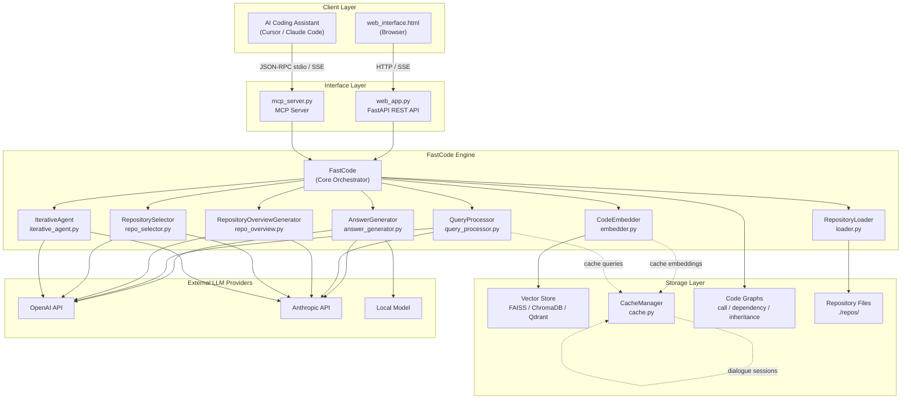
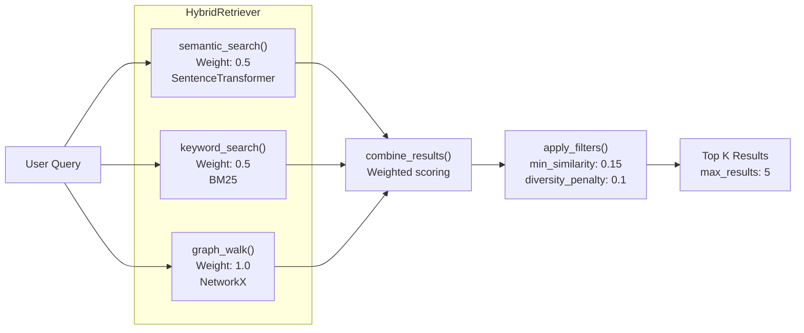
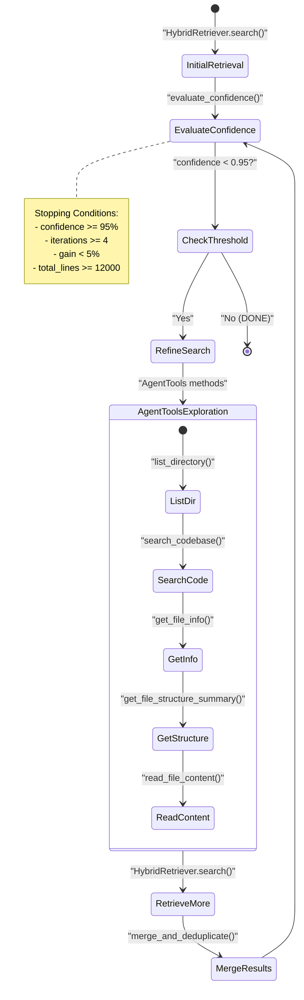
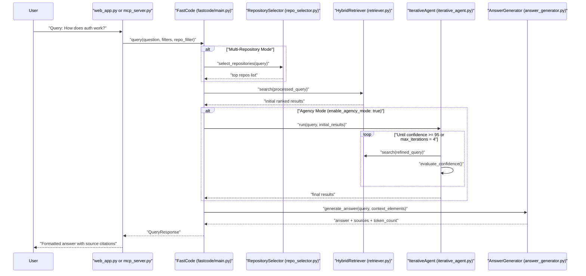
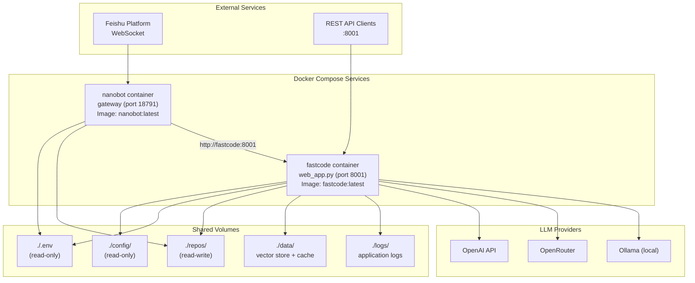

<!-- source: DeepWiki mcp.deepwiki.com · repo HKUDS/FastCode · page 1 Overview · fetched 2026-11-09 -->

# Overview

Relevant source files

The following files were used as context for generating this wiki page:

- [README.md](README.md)
- [config/config.yaml](config/config.yaml)
- [fastcode/embedder.py](fastcode/embedder.py)

This document introduces FastCode, a repository-level code understanding system that provides intelligent querying and analysis of software codebases. FastCode is designed for developers who need to understand large-scale repositories quickly and cost-effectively, supporting multi-repository reasoning across 8 programming languages.

For specific installation instructions, see [Installation](#2.1). For API reference documentation, see [API Reference](#12.2). For agent-based retrieval details, see [Agent System](#5).

---

## Purpose and Scope

FastCode is a token-efficient framework that enables natural language queries over code repositories. The system indexes codebases using a combination of semantic embeddings, keyword search, and code graph analysis, then retrieves relevant code elements to answer developer questions. Key performance characteristics include:

- **3-4x faster** query response compared to traditional code analysis tools
- **10x token savings** through intelligent navigation and context management
- **44-55% cost reduction** in LLM API usage
- **Multi-repository support** for cross-codebase dependency analysis

**Sources:** [README.md:1-47](), [fastcode/__init__.py:1-27]()

---

## System Architecture

FastCode is implemented as a modular Python system with clearly defined components for repository management, code analysis, retrieval, and answer generation.

### Core Component Structure

**Module topology: interfaces, engine, and storage**

**FastCode Core Orchestrator**

The `FastCode` class in `fastcode/main.py` coordinates all engine components through well-defined interfaces. Each component is independently configured via `config/config.yaml`. The system supports hot-swapping of backends for vector stores, LLM providers, and caching.

Sources: [fastcode/__init__.py:15-41](), [README.md:74-113]()

---

## Three-Phase Framework

FastCode implements a three-phase approach to code understanding, each phase designed to optimize a different aspect of the query pipeline.

### Phase 1: Semantic-Structural Code Representation

The first phase builds a dual representation of the codebase:

**Hierarchical Code Units**
- **File-level**: Metadata (path, size, type, modification time)
- **Class-level**: Class definitions, base classes, method signatures
- **Function-level**: Function signatures, parameters, return types, decorators
- **Documentation-level**: Docstrings, inline comments, type hints

The `CodeParser` uses AST-based parsing for 8 languages (Python, JavaScript, TypeScript, Java, Go, C/C++, Rust, C#), while `CodeIndexer` structures this information into a searchable hierarchy.

**Hybrid Index**
- **Semantic**: `CodeEmbedder` generates embeddings using SentenceTransformer models (default: `paraphrase-multilingual-MiniLM-L12-v2`)
- **Keyword**: BM25 scoring for exact token matching
- **Graph**: Three interconnected graphs:
  - **Call Graph**: Function invocation relationships
  - **Dependency Graph**: Module import/include relationships
  - **Inheritance Graph**: Class hierarchy relationships

**Sources:** [README.md:82-90](), [fastcode/parser.py](), [fastcode/indexer.py](), [fastcode/embedder.py]()

### Phase 2: Lightning-Fast Navigation

The second phase implements intelligent code exploration without loading full file contents:

**Two-Stage Retrieval**
1. Repository selection (for multi-repo scenarios) using `RepositorySelector`
2. Code element retrieval using `HybridRetriever`

**Safe File Browsing**
- `AgentTools` provides read-only exploration:
  - `list_directory`: Survey file structure
  - `search_codebase`: Find files by pattern
  - `get_file_info`: Check metadata without reading content
  - `get_file_structure_summary`: Extract headers (function names, class definitions)
  - `read_file_content`: Load targeted files only

**Graph Traversal**
- Follow call chains up to 2 hops
- Trace dependency paths
- Navigate inheritance hierarchies

**Code Skimming**
- Extract function signatures and class definitions without loading full implementations
- Reduces token consumption by 5-10x for exploration phase

**Sources:** [README.md:92-102](), [fastcode/retriever.py](), [fastcode/iterative_agent.py](), [fastcode/agent_tools.py]()

### Phase 3: Cost-Efficient Context Management

The third phase optimizes LLM token usage through intelligent decision-making:

**Budget-Aware Decisions**
- Confidence threshold: 95% (stop when sufficient information is gathered)
- Max iterations: 4 (prevent runaway token costs)
- Min confidence gain: 5% per iteration (diminishing returns cutoff)
- Max total lines: 12,000 (context size limit)

**Resource-Optimized Learning**
- `IterativeAgent` evaluates confidence after each retrieval round
- Adaptive query refinement based on information gaps
- Early termination when confidence threshold is met

**Value-First Selection**
- Prioritize high-relevance, low-token-cost code elements
- Truncate context to fit within `max_context_tokens` budget
- Reserve tokens for LLM response (`reserve_tokens_for_response`)

**Sources:** [README.md:104-112](), [fastcode/iterative_agent.py](), [fastcode/answer_generator.py]()

---

## Core Capabilities

### Multi-Language Support

FastCode supports 8 programming languages through Tree-sitter AST parsing:

| Language | Extensions | Parser Capabilities |
|----------|-----------|-------------------|
| Python | `.py` | Classes, functions, docstrings, imports, decorators |
| JavaScript | `.js` | Functions, classes, JSDoc, imports/exports |
| TypeScript | `.ts`, `.tsx` | All JS features + type annotations, interfaces |
| Java | `.java` | Classes, methods, Javadoc, packages, annotations |
| Go | `.go` | Functions, structs, interfaces, package imports |
| C/C++ | `.c`, `.cpp`, `.h`, `.hpp` | Functions, structs, classes, includes |
| Rust | `.rs` | Functions, structs, traits, modules, crates |
| C# | `.cs` | Classes, methods, namespaces, attributes |

**Sources:** [README.md:596-606](), [fastcode/parser.py]()

### Multi-Repository Reasoning

The system can load and query multiple repositories simultaneously:

**Repository Selection Methods**
- **LLM-based**: Uses language model to analyze repository overviews and select relevant repos
- **Embedding-based**: Combines semantic similarity + BM25 scoring on repository summaries

**Two-Stage Retrieval Process**
1. `RepositorySelector.select_repositories()` returns top 5 repos (min_similarity: 0.1)
2. `HybridRetriever` searches within selected repositories

**Sources:** [README.md:49-53](), [fastcode/repo_selector.py](), [fastcode/repo_overview.py]()

### Hybrid Search

The `HybridRetriever` combines three search strategies with configurable weights:

**Filtering and Ranking**
- Minimum similarity threshold: 0.15
- Maximum results: 5 (configurable)
- Diversity penalty: 0.1 (avoid redundant results)
- Enable two-stage retrieval for multi-repository scenarios

**Sources:** [fastcode/retriever.py](), [config/config.yaml]()

### Agent-Based Retrieval

The `IterativeAgent` provides multi-round retrieval with stopping conditions:

**Agent Configuration**
- Temperature: 0.2 (focused, deterministic behavior)
- Max tokens: 8,000
- Confidence computation: Normalized relevance score across retrieved elements

**Sources:** [fastcode/iterative_agent.py](), [fastcode/agent_tools.py]()

---

## Entry Points and Interfaces

FastCode provides five interfaces for different use cases:

### Interface Summary

| Interface | Entry Point | Transport / Port | Use Case |
|-----------|------------|-----------------|----------|
| **Web UI** | `web_interface.html` + `web_app.py` | HTTP, default port 5000 | Interactive browser-based exploration |
| **REST API** | `web_app.py` | HTTP (configurable) | Programmatic tool integration |
| **MCP Server** | `mcp_server.py` | stdio (local) or SSE :8080 | AI coding assistants (Cursor, Claude Code) |
| **CLI** | `main.py` | N/A | Scripting and automation |
| **Nanobot** | `nanobot/` | Docker port 18791 | Feishu/Lark messaging integration |

The `web_app.py` module serves both the web UI (`web_interface.html`) and the full REST API under `/api/*` routes. The `mcp_server.py` module exposes the same `FastCode` engine through the Model Context Protocol (MCP), allowing AI assistants to call tools like `code_qa`, `list_indexed_repos`, and session management functions directly.

### Query Flow Across Interfaces

**End-to-end query path from user input to answer**

Sources: [web_app.py](), [mcp_server.py](), [main.py](), [README.md:352-545]()

---

## Deployment Architecture

FastCode supports local Python installation and Docker-based deployment. The Docker architecture enables integration with messaging platforms via Nanobot.

### Docker Services

**Docker Compose service layout and volume mounts**

**Environment Configuration**

FastCode reads LLM provider configuration from environment variables (typically set in `.env`):

| Variable | Purpose |
|----------|---------|
| `OPENAI_API_KEY` | API key for OpenAI, OpenRouter, or Ollama |
| `MODEL` | Model name for code analysis (e.g., `gpt-4`, `google/gemini-flash-1.5`) |
| `BASE_URL` | Provider base URL (e.g., `https://api.openai.com/v1`) |
| `NANOBOT_MODEL` | Separate model for Nanobot agent reasoning |

**Deployment Commands**

| Command | Purpose |
|---------|---------|
| `./run_nanobot.sh` | Auto-detect state and start/restart services |
| `./run_nanobot.sh --build` | Force rebuild Docker images |
| `./run_nanobot.sh stop` | Stop all services |
| `./run_nanobot.sh status` | View service status and health |

Sources: [README.md:609-795](), [README.md:840-865]()

---

## System Configuration

FastCode uses a hierarchical configuration system:

### Configuration Hierarchy

1. **Environment Variables** (`.env`): API keys, LLM model selection, base URLs
2. **System Configuration** (`config/config.yaml`): All behavioral settings
3. **Runtime Parameters**: Query-specific overrides (via API/CLI arguments)

### Key Configuration Sections

The `config/config.yaml` file contains 11 major sections:

| Section | Key Settings | Purpose |
|---------|--------------|---------|
| **repository** | `repo_root`, `max_file_size_mb`, `supported_extensions` | Repository loading behavior |
| **parser** | `extract_docstrings`, `extract_comments`, `compute_complexity` | AST parsing options |
| **embedding** | `model`, `device`, `batch_size`, `normalize_embeddings` | Semantic embedding generation |
| **indexing** | `levels`, `include_imports`, `include_class_context` | Multi-level index construction |
| **vector_store** | `type`, `distance_metric`, `index_type` | Vector storage backend |
| **retrieval** | `semantic_weight`, `keyword_weight`, `graph_weight`, `agency_mode` | Hybrid search configuration |
| **query** | `expand_query`, `llm_enhancement_mode`, `enable_multi_turn` | Query processing |
| **generation** | `provider`, `model`, `temperature`, `max_tokens` | LLM answer generation |
| **agent** | `max_iterations`, `confidence_threshold`, `min_confidence_gain` | Iterative agent behavior |
| **cache** | `backend`, `ttl`, `dialogue_ttl`, `max_size_mb` | Caching strategy |
| **graph** | `build_call_graph`, `build_dependency_graph`, `build_inheritance_graph` | Code graph construction |

For complete configuration reference, see [Configuration Reference](#12.1).

**Sources:** [config/config.yaml](), [README.md:550-606]()

---

## Performance Characteristics

FastCode achieves significant performance improvements through architectural decisions:

### Token Efficiency

- **10x token savings** compared to loading full file contents
- Code skimming reduces exploration tokens by 5-10x
- Context truncation with value-first selection
- Iterative refinement with early stopping (confidence threshold)

### Query Speed

- **3-4x faster** than traditional code analysis tools
- HNSW indexing for O(log n) vector search
- Cached embeddings and query results
- Parallel retrieval across semantic/keyword/graph strategies

### Cost Optimization

- **44-55% cost reduction** in LLM API usage
- Budget-aware decision making (5 factors)
- Resource-optimized learning (adaptive iteration)
- Multi-turn dialogue with summary generation (only history context, not full content)

**Sources:** [README.md:25-47](), [README.md:104-135]()

---

## Supported Technologies

### Programming Languages

FastCode supports 8 programming languages with full AST parsing:

**Tier 1 (Full Support)**: Python, JavaScript, TypeScript, Java  
**Tier 2 (Full Support)**: Go, Rust, C/C++, C#

For language-specific parsing capabilities, see [Supported Languages](#12.4).

### LLM Providers

FastCode integrates with multiple LLM providers:

| Provider | Models | Configuration |
|----------|--------|---------------|
| **OpenAI** | gpt-4, gpt-4-turbo, gpt-3.5-turbo | `BASE_URL=https://api.openai.com/v1` |
| **OpenRouter** | Gemini, Claude, Llama, others | `BASE_URL=https://openrouter.ai/api/v1` |
| **Ollama** | qwen3-coder-30b, deepseek-coder, others | `BASE_URL=http://localhost:11434/v1` |

For complete provider configuration, see [LLM Provider Support](#12.5).

### Vector Stores

Three vector storage backends are supported:

| Backend | Index Type | Distance Metric | Use Case |
|---------|-----------|-----------------|----------|
| **FAISS** | HNSW | Cosine, L2, Inner Product | High performance, local |
| **ChromaDB** | HNSW | Cosine, L2, Inner Product | Persistent, embedded |
| **Qdrant** | HNSW | Cosine, Euclidean, Dot | Distributed, scalable |

**Sources:** [fastcode/vector_store.py](), [README.md:552-594]()

---

## Version Information

**FastCode Version**: 2.0.0

**Major Changes in 2.0**:
- Multi-repository support with intelligent repository selection
- Agent-based iterative retrieval system
- Enhanced cost management with budget-aware decisions
- Support for 8 programming languages (expanded from 5)
- Multi-turn dialogue with session management
- Docker deployment with Nanobot integration

**Sources:** [fastcode/__init__.py:26](), [README.md:1-7]()

---

## Next Steps

To get started with FastCode:

1. **Installation**: Follow the [Installation](#2.1) guide for your platform
2. **Configuration**: Set up [Environment Configuration](#2.2) with your LLM API keys
3. **Quick Start**: Try the [Quick Start Guide](#2.3) to index your first repository
4. **Deep Dive**: Explore the [System Architecture](#3) to understand internal workings

For integration with existing tools, see [REST API](#6.1). For production deployment, see [Docker Deployment](#7.1).

---

