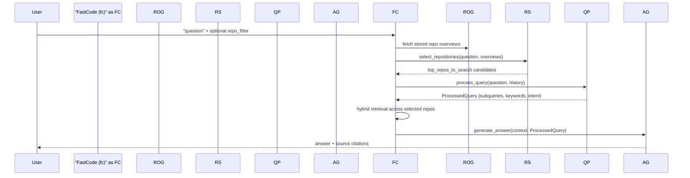
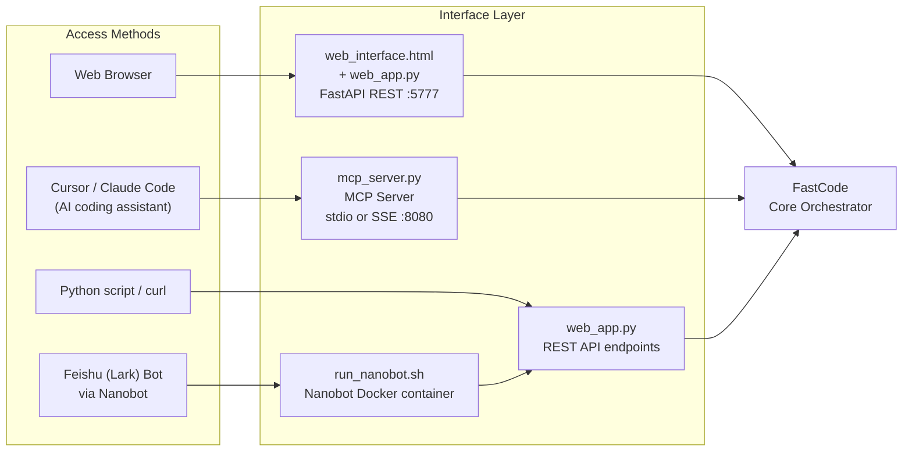

<!-- source: DeepWiki mcp.deepwiki.com · repo HKUDS/FastCode · page 1.1 Key Features & Benefits · fetched 2026-11-09 -->

# Key Features & Benefits

<details>
<summary>Relevant source files</summary>

The following files were used as context for generating this wiki page:

- [README.md](README.md)

</details>


This page details the specific capabilities FastCode delivers and the technical components that implement them. It focuses on **what** FastCode does and **which code entities** realize each capability. For a higher-level description of how the three phases connect architecturally, see [Architecture Overview](#1.2). For configuration knobs that tune each feature, see [Configuration](#8).

---

## Performance Claims

FastCode's stated benchmark results against Cursor and Claude Code:

| Metric | vs. Cursor | vs. Claude Code |
|---|---|---|
| Speed | 3× faster | 4× faster |
| Cost | 55% cheaper | 44% cheaper |
| Token consumption | Up to 10× fewer tokens | Up to 10× fewer tokens |
| Accuracy | Highest across benchmarks | Highest across benchmarks |

These results are measured across four benchmarks: **SWE-QA**, **LongCodeQA**, **LOC-BENCH**, and **GitTaskBench**, representing software engineering Q&A, long-context analysis, code localization, and real-world task workflows respectively.

Sources: [README.md:31-49](), [README.md:119-138]()

---

## Feature Summary

The table below maps each user-visible feature to the primary code entity that implements it.

| Feature | Implementing Component | File |
|---|---|---|
| Repository ingestion (URL / path / ZIP) | `RepositoryLoader` | `loader.py` |
| Code parsing (AST, multi-language) | Code Parser (tree-sitter + libcst) | `fastcode/` |
| Semantic + keyword + graph retrieval | `CodeEmbedder`, BM25, graph structures | `embedder.py` |
| Query understanding & expansion | `QueryProcessor` | `query_processor.py` |
| Answer generation with context budgeting | `AnswerGenerator` | `answer_generator.py` |
| Iterative multi-round retrieval (agent mode) | `IterativeAgent` | `iterative_agent.py` |
| Multi-repo LLM-driven selection | `RepositorySelector` | `repo_selector.py` |
| Repository summaries | `RepositoryOverviewGenerator` | `repo_overview.py` |
| Embedding & result caching | `CacheManager` | `cache.py` |
| REST API surface | `web_app.py` (FastAPI, port 5777) | `web_app.py` |
| MCP protocol integration | `mcp_server.py` | `mcp_server.py` |

Sources: [README.md:43-63]()

---

## Three-Phase Framework

FastCode's core approach is organized into three phases. Each phase maps to specific components.

**Feature-to-Component Map:**

```mermaid
flowchart TD
    subgraph Phase1["Phase 1: Semantic-Structural Code Representation"]
        P1A["Hierarchical Code Units\n(file / class / function / doc)"]
        P1B["Hybrid Index\n(semantic embeddings + BM25)"]
        P1C["Multi-Layer Graph Modeling\n(call / dependency / inheritance)"]
    end

    subgraph Phase2["Phase 2: Lightning-Fast Codebase Navigation"]
        P2A["Two-Stage Smart Search\n(RepositorySelector + fine-grained retrieval)"]
        P2B["Code Skimming\n(function signatures, class defs, type hints)"]
        P2C["Graph Traversal\n(up to 2-hop connection tracing)"]
    end

    subgraph Phase3["Phase 3: Cost-Efficient Context Management"]
        P3A["Budget-Aware Decision Making\n(IterativeAgent confidence scoring)"]
        P3B["Resource-Optimized Learning\n(adaptive parameter tuning)"]
        P3C["Value-First Selection\n(smart pruning + deduplication)"]
    end

    subgraph Components["Code Entities"]
        CE1["CodeEmbedder\nembedder.py"]
        CE2["BM25 Index\nindexer"]
        CE3["Graph Structures\ncall_graph / dep_graph / inheritance_graph"]
        CE4["RepositorySelector\nrepo_selector.py"]
        CE5["QueryProcessor\nquery_processor.py"]
        CE6["IterativeAgent\niterative_agent.py"]
        CE7["AnswerGenerator\nanswer_generator.py"]
    end

    P1A --> CE1
    P1B --> CE1
    P1B --> CE2
    P1C --> CE3
    P2A --> CE4
    P2A --> CE5
    P2B --> CE7
    P2C --> CE3
    P3A --> CE6
    P3B --> CE6
    P3C --> CE6
```



Sources: [README.md:79-116]()

### Phase 1 — Semantic-Structural Code Representation

- **Hierarchical Code Units**: Code is indexed at four granularity levels — file, class, function, and documentation. This is controlled by the `indexing.granularity` setting in `config/config.yaml` and executed by the indexing pipeline.
- **Hybrid Index**: `CodeEmbedder` (using `SentenceTransformer`) produces dense vectors; a separate BM25 index handles keyword search. Both are combined with configurable weights in `config/config.yaml` under `retrieval.semantic`, `retrieval.keyword`, and `retrieval.graph`.
- **Multi-Layer Graph Modeling**: Three graph types are built — call graph, dependency graph, inheritance graph — using `networkx`. Graph weights contribute to hybrid retrieval scoring.

### Phase 2 — Lightning-Fast Codebase Navigation

- **Two-Stage Smart Search**: For multi-repo scenarios, `RepositorySelector` narrows the candidate set by LLM-driven overview comparison before fine-grained element retrieval runs.
- **Code Skimming**: Rather than loading entire files into the LLM context, `AnswerGenerator` selects partial file content — function signatures, class definitions, type hints — to minimize token usage while preserving answer quality.
- **Graph Traversal**: Retrieval follows code relationships up to a configurable depth (`graph.max_depth`) using the call/dependency/inheritance graphs.

### Phase 3 — Cost-Efficient Context Management

`IterativeAgent` implements multi-round retrieval with five decision factors before each iteration: confidence level, query complexity, codebase size, resource cost, and iteration count. It applies smart pruning and deduplication across rounds. This mode is optional and controlled by `retrieval.enable_agency_mode`.

Sources: [README.md:85-116](), [README.md:119-138]()

---

## Multi-Language Support

FastCode uses **tree-sitter** grammars (plus **libcst** for Python) to parse source code. All supported languages are detected by file extension.

| Language | Extensions |
|---|---|
| Python | `.py` |
| JavaScript | `.js` |
| TypeScript | `.ts`, `.tsx` |
| Java | `.java` |
| Go | `.go` |
| C / C++ | `.c`, `.cpp`, `.h`, `.hpp` |
| Rust | `.rs` |
| C# | `.cs` |

For the full extension list and how to add a new language, see [Adding Language Support](#10.4) and [Supported Languages](#12.4).

Sources: [README.md:718-727]()

---

## Multi-Repository Reasoning

FastCode can index and query multiple repositories simultaneously. The query flow in multi-repo mode:



Key configuration settings for multi-repo behavior:

| Config Key | Purpose |
|---|---|
| `retrieval.select_repos_by_overview` | Enable/disable two-stage repo selection |
| `retrieval.top_repos_to_search` | Max repos to include after selection |
| `retrieval.min_repo_similarity` | Minimum similarity score for a repo to qualify |

Sources: [README.md:638-658]()

---

## Token Efficiency

The "scouting-first" approach contrasts with traditional file-loading patterns:

| Approach | Pattern | Token Cost |
|---|---|---|
| Traditional | Load files → search → load more files → repeat | High (repeated full-file loads) |
| FastCode | Build semantic map → navigate structure → load targets | Low (targeted loading only) |

This is achieved through the combination of:
- Hierarchical indexing (avoid loading files not in the index hit set)
- Code skimming in `AnswerGenerator` (load signatures, not full bodies)
- `IterativeAgent` line budget (`agent.iterative.max_total_lines`) that caps total content loaded per query

Sources: [README.md:919-933]()

---

## Interface & Integration Options

FastCode exposes its engine through four distinct interfaces:



| Interface | Entry Point | Transport | Use Case |
|---|---|---|---|
| Web UI | `web_app.py` + `web_interface.html` | HTTP / SSE | Manual exploration |
| REST API | `web_app.py` (FastAPI) | HTTP JSON / SSE | Programmatic integration |
| MCP Server | `mcp_server.py` | stdio or HTTP SSE | Cursor, Claude Code, Windsurf |
| Nanobot | `run_nanobot.sh` + Docker | WebSocket → REST | Feishu chat bot |

The MCP server exposes a `code_qa` tool that accepts a question, a list of repository sources (GitHub URLs or local paths), and an optional `session_id` for multi-turn conversations. It handles cloning and indexing automatically if a repo has not yet been indexed.

For REST API endpoint details see [REST API](#6.1). For MCP server details see [MCP Server](#6.3). For Nanobot setup see [Nanobot Integration](#6.4).

Sources: [README.md:550-666](), [README.md:731-898]()

---

## Small / Local Model Support

FastCode is compatible with locally-hosted LLMs via any OpenAI-compatible endpoint (e.g., Ollama). The `MODEL` and `BASE_URL` environment variables control which provider and model are used at runtime. The README lists `qwen3-coder-30b` as a validated local model option.

```
OPENAI_API_KEY=ollama
MODEL=qwen3-coder-30b_fastcode
BASE_URL=http://localhost:11434/v1
```

For the full list of supported providers and the `openai_chat_completion` compatibility shim, see [LLM Provider Support](#12.5).

Sources: [README.md:708-715]()

---

## Caching

`CacheManager` (`cache.py`) stores:
- Embedding vectors (avoid recomputing on re-index)
- Query results (avoid LLM calls for repeated questions)
- Dialogue sessions (multi-turn conversation history)

Two backends are supported: **disk** (default) and **Redis**. Caching behavior is governed by the `cache` section in `config/config.yaml`. For details see [Caching System](#9.1).

Sources: [README.md:43-63]()

---

